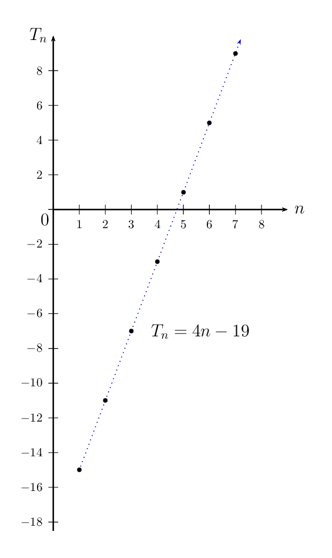
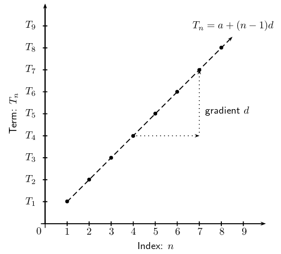
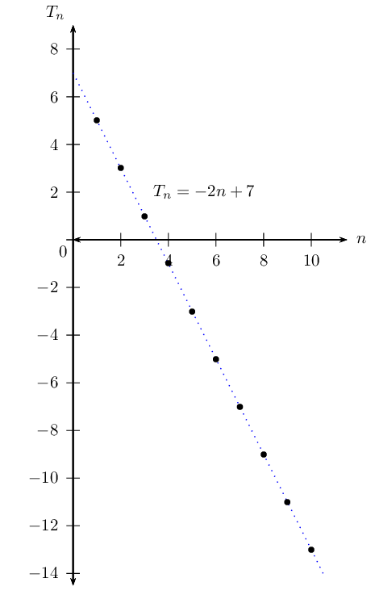
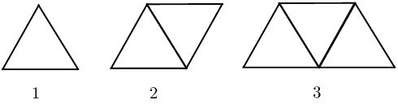
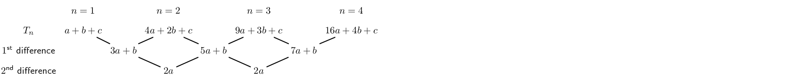
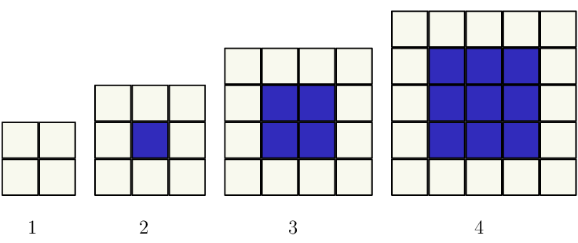
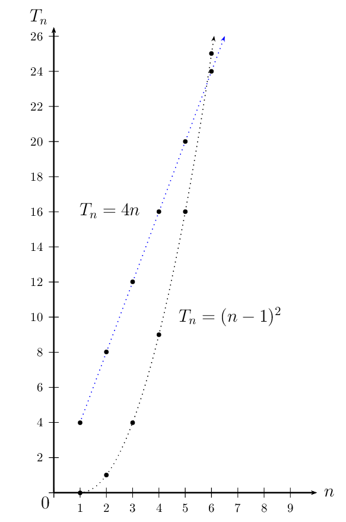

# Chapter 1: Sequences and series

- Discuss and explain important terminology.
- Be consistent with the use of “common” difference and “constant”
                                  ratio to avoid confusing learners.
- Learners must understand the difference between arithmetic and geometric sequences.
- Explain sigma notation carefully as many learners have difficulty with this concept.
- Encourage learners to use the correct notation (for example \(T_{n}, \enspace S_{n}\) etc.)
                                  when solving problems.
- Use the investigation for the sum of an infinite series to introduce the concept of
                                  convergence and divergence.

In earlier grades we learnt about number patterns, which included linear sequences with a common difference
                and quadratic sequences with a common second difference. We also looked at completing a sequence and how
                to determine the general term of a sequence.

In this chapter we also look at geometric sequences, which have a constant ratio between consecutive terms.
                We will learn about arithmetic and geometric series, which are the summing of the terms in sequences.

## 1.1 Arithmetic sequences (EMCDP)

An arithmetic sequence is a sequence where consecutive terms are calculated by adding a constant
                        value (positive or negative) to the previous term. We call this constant value the common
                        difference (\(d\)).

For example,

                \[\text{3}; \text{0}; -\text{3}; -\text{6}; -\text{9}; \ldots\]

This is an arithmetic sequence because we add \(-\text{3}\) to each term to get the next term:

| First term | \(T_{1}\) |  | \(\text{3}\) |
| --- | --- | --- | --- |
| Second term | \(T_{2}\) | \(3 + (-3) =\) | \(0\) |
| Third term | \(T_{3}\) | \(0 + (-3) =\) | \(-\text{3}\) |
| Fourth term | \(T_{4}\) | \(-3 + (-3) =\) | \(-\text{6}\) |
| Fifth term | \(T_{5}\) | \(-6 + (-3) =\) | \(-\text{9}\) |
| \(\vdots\) | \(\vdots\) | \(\vdots\) | \(\vdots\) |

<Callout type="note" title="Note">
<VideoPlayer src="https://www.youtube.com/embed/jExpsJTu9o8" title="Video: 284G" />
</Callout>

## Arithmetic sequences

### Textbook Exercise 1.1

Find the common difference and write down the next \(\text{3}\) terms of the
                                                sequence.

**Problem:**
\(2; 6; 10; 14; 18; 22; \ldots\)

**Solution:**
\begin{align*}
                                                d &= 6 - 2 \\
                                                &= 4 \\
                                                \text{ or } & \\
                                                d &= 10 - 6 \\
                                                &= 4 \\
                                                \therefore T_{7} &= 22 + 4 \\
                                                &= 26 \\
                                                T_{8} &= 26 + 4 \\
                                                &= 30 \\
                                                T_{9} &= 30 + 4 \\
                                                &= 34
                                                \end{align*}

**Problem:**
\(-1; -4; -7; -10; -13; -16; \ldots\)

**Solution:**
\begin{align*}
                                                d &= -4 -(-1) \\
                                                &= -\text{3} \\
                                                \text{ or } & \\
                                                d &= -7 - (-4) \\
                                                &= -\text{3}\\
                                                \therefore T_{7} &= -16 - 3 \\
                                                &= -\text{19} \\
                                                T_{8} &= -19 - 3 \\
                                                &= -\text{22} \\
                                                T_{9} &= -22 - 3 \\
                                                &= -\text{25}
                                                \end{align*}

**Problem:**
\(-5; -3; -1; 1; 3; \ldots\)

**Solution:**
\begin{align*}
                                                d &= -3-(-5) \\
                                                &= \text{2} \\
                                                \text{ or } & \\
                                                d &= -1 - (-3) \\
                                                &= \text{2}\\
                                                \therefore T_{7} &= 3 + 2 \\
                                                &= \text{5} \\
                                                T_{8} &= 5+2\\
                                                &= \text{7} \\
                                                T_{9} &= 7 + 2 \\
                                                &= \text{9}
                                                \end{align*}

**Problem:**
\(-1; 10; 21; 32; 43; 54; \ldots\)

**Solution:**
\begin{align*}
                                                d &= 10 - (-1) \\
                                                &= \text{11} \\
                                                \text{ or } & \\
                                                d &= 21 - 10 \\
                                                &= \text{11}\\
                                                \therefore T_{7} &= 54 + 11 \\
                                                &= \text{65} \\
                                                T_{8} &= 65 + 11\\
                                                &= \text{76} \\
                                                T_{9} &= 76 + 11 \\
                                                &= \text{87}
                                                \end{align*}

**Problem:**
\(a-3b; a-b; a+b; a+3b; \ldots\)

**Solution:**
This is an example of a non-numeric arithmetic sequence.

                                                \begin{align*}
                                                d &= (a-b) - (a-3b) \\
                                                &= a-b-a+3b \\
                                                &= 2b \\
                                                \text{ or } & \\
                                                d &= (a+b) - (a-b) \\
                                                &= a+b -a +b \\
                                                &= 2b \\
                                                \therefore T_{7} &= a + 3b + 2b \\
                                                &= a+ 5b \\
                                                T_{8} &= a+5b + 2b \\
                                                &= a + 7b \\
                                                T_{9} &= a + 7b +2b \\
                                                &= a + 9b
                                                \end{align*}

**Problem:**
\(-2; -\frac{3}{2}; -1; -\frac{1}{2}; 0; \frac{1}{2}; 1; \ldots\)

**Solution:**
\begin{align*}
                                                d &= -\frac{3}{2} -\left( -2 \right)\\
                                                &= \frac{1}{2} \\
                                                \text{ or } & \\
                                                d &= - 1 - \left( -\frac{3}{2} \right) \\
                                                &= \frac{1}{2} \\
                                                \therefore T_{8} &= 1 + \frac{1}{2} \\
                                                &= \frac{3}{2} \\
                                                T_{9} &= \frac{3}{2} + \frac{1}{2} \\
                                                &= 2 \\
                                                T_{10} &= 2 + \frac{1}{2} \\
                                                &= \frac{5}{2}
                                                \end{align*}

### The general term for an arithmetic sequence (EMCDQ)

For a general arithmetic sequence with first term \(a\) and a common difference \(d\), we can
                                generate the following terms:

                        \begin{align*}
                        {T}_{1}&= a \\
                        {T}_{2}&= {T}_{1}+d = a + d \\
                        {T}_{3}&= {T}_{2}+d = \left(a+d\right)+d =a+2d \\
                        {T}_{4}&= {T}_{3}+d=\left(a+2d\right)+d=a+3d \\
                        \vdots & \quad \quad \qquad \vdots \quad \quad \qquad \vdots \quad \quad \qquad \vdots \\
                        {T}_{n}&= {T}_{n-1} + d =\left(a+(n-2)d\right)+d = a + \left(n-1\right)d
                        \end{align*}

Therefore, the general formula for the \(n\)\(^{\text{th}}\) term of an arithmetic sequence
                                is:

                        \[{T}_{n}= a + \left(n-1\right)d\]

Arithmetic sequence

An arithmetic (or linear) sequence is an ordered set of numbers (called
                                                terms) in which each new term is calculated by adding a constant value
                                                to the previous term:

                                        \[{T}_{n}=a+(n-1)d\]

where

- \({T}_{n}\) is the \(n\)\(^{\text{th}}\) term;
- \(n\) is the position of the term in the sequence;
- \(a\) is the first term;
- \(d\) is the common difference.

**Test for an arithmetic sequence**

To test whether a sequence is an arithmetic sequence or not, check if the difference between
                                any two consecutive terms is constant:

                        \[d = {T}_{2}-{T}_{1}={T}_{3}-{T}_{2}= \ldots = {T}_{n}-{T}_{n-1}\]

If this is not true, then the sequence is not an arithmetic sequence.

<Callout type="tip" title="Worked example 1: Arithmetic sequence">
**Question:**
Given the sequence \(-15; -11; -7; \ldots 173\).

2. Is this an arithmetic sequence?
4. Find the formula of the general term.
6. Determine the number of terms in the sequence.

**Check if there is a common difference between successive terms:**
\begin{align*}
                                        T_{2} - T_{1} &= -11 - (-15) = 4 \\
                                        T_{3} - T_{2} &= -7 - (-11) = 4 \\
                                        \therefore \text{This is an } & \text{arithmetic sequence with } d = 4
                                        \end{align*}

**Determine the formula for the general term:**
Write down the formula and the known values:

                                        \[T_{n} = a + (n-1)d\]
                                        \[a = -15; \qquad d = 4\]
                                        \begin{align*}
                                        T_{n} &= a + (n-1)d \\
                                        &= -15 + (n-1)(4) \\
                                        &= -15 + 4n - 4 \\
                                        &= 4n - 19
                                        \end{align*}

A graph was not required for this question but it has been included to show
                                                that the points of the arithmetic sequence lie in a straight line.

Note: The numbers of the sequence are natural numbers \(\left(n \in \{1;2;3;
                                                \ldots \} \right)\) and therefore we should not connect the plotted
                                                points. In the diagram above, a dotted line has been used to show that
                                                the graph of the sequence lies on a straight line.

**Determine the number of terms in the sequence:**
\begin{align*}
                                        T_{n} &= a + (n-1)d \\
                                        173 &= 4n - 19 \\
                                        192 &= 4n \\
                                        \therefore n &= \frac{192}{4} \\
                                        &= 48 \\
                                        \therefore T_{48} &= 173
                                        \end{align*}

**Write the final answer:**
Therefore, there are \(\text{48}\) terms in the sequence.
</Callout>

**Arithmetic mean **

The arithmetic mean between two numbers is the number half-way between the two numbers. In
                                other words, it is the average of the two numbers. The arithmetic mean and the two terms
                                form an arithmetic sequence.

For example, the arithmetic mean between \(\text{7}\) and \(\text{17}\) is calculated:

                        \begin{align*}
                        \text{Arithmetic mean } &= \frac{7 + 17}{2} \\
                        &= 12 \\
                        \therefore 7; 12; 17 & \text{ is an arithmetic sequence} \\
                        T_{2} - T_{1} &= 12 - 7 = 5 \\
                        T_{3} - T_{2} &= 17-12 = 5
                        \end{align*}

Plotting a graph of the terms of a sequence sometimes helps in determining the type of
                                sequence involved.
                                For an arithmetic sequence, plotting \({T}_{n}\) vs. \(n\) results in the following
                                graph:

- If the sequence is arithmetic, the plotted points will lie in a straight line.
- Arithmetic sequences are also called linear sequences, where the common difference
                                          (\(d\)) is the gradient of the straight line.

                        \begin{align*}
                        T_{n} &= a + (n-1)d \\
                        \text{can be written as } T_{n}&= d(n - 1) + a \\
                        \text{which is of the } & \text{same form as } y = mx + c
                        \end{align*}

## Arithmetic Sequences

### Textbook
                                                Exercise 1.2

Given the sequence \(7; \text{5,5}; 4; \text{2,5}; \ldots\)

**Problem:**
Find the next term in the sequence.

**Solution:**
\begin{align*}
                                                                d &= \text{5,5} - 7 \\
                                                                &= -\text{1,5} \\
                                                                \therefore T_{5} & = \text{2,5} + (-\text{1,5}) \\
                                                                &= 1
                                                                \end{align*}

**Problem:**
Determine the general term of the sequence.

**Solution:**
\begin{align*}
                                                                T_{n} &= a + (n-1)d \\
                                                                &= 7 + (n-1)(-\text{1,5}) \\
                                                                &= \text{8,5} - \text{1,5}n
                                                                \end{align*}

**Problem:**
Which term has a value of \(-\text{23}\)?

**Solution:**
\begin{align*}
                                                                T_{n} &= \text{8,5} - \text{1,5}n \\
                                                                \therefore -23 &= \text{8,5} - \text{1,5}n \\
                                                                \text{31,5} &= \text{1,5}n \\
                                                                \therefore n &= 21 \\
                                                                \text{Therefore } T_{21} &= -23
                                                                \end{align*}

Given the sequence \(2; 6; 10; 14; \ldots\)

**Problem:**
Is this an arithmetic sequence? Justify
                                                                your answer by calculation.

**Solution:**
\begin{align*}
                                                                T_{2} - T_{1} &= 6 - 2 = 4 \\
                                                                T_{3} - T_{2} &= 10 - 6 = 4 \\
                                                                T_{4} - T_{3} &= 14 - 10 = 4
                                                                \end{align*}

Yes, this is an arithmetic sequence since there is a
                                                                        common difference of \(\text{4}\) between
                                                                        consecutive terms.

**Problem:**
Calculate \(T_{55}\).

**Solution:**
\begin{align*}
                                                                T_{n} &= a + (n-1)d \\
                                                                &= 2 + (n-1)4 \\
                                                                &= 4n - 2 \\
                                                                \therefore T_{55} &= 4(55) - 2 \\
                                                                &= 218
                                                                \end{align*}

**Problem:**
Which term has a value of \(\text{322}\)?

**Solution:**
\begin{align*}
                                                                T_{n} &= 4n - 2 \\
                                                                \therefore 322 &= 4n - 2 \\
                                                                324 &= 4n \\
                                                                \therefore n &= 81 \\
                                                                \therefore T_{81} &= 322
                                                                \end{align*}

**Problem:**
Determine by calculation whether or not
                                                                \(\text{1 204}\) is a term in the sequence?

**Solution:**
\begin{align*}
                                                                T_{n} &= 4n - 2 \\
                                                                \therefore \text{1 204} &= 4n - 2 \\
                                                                \text{1 206} &= 4n \\
                                                                \therefore n &= 301\frac{1}{2}
                                                                \end{align*}

This value of \(n\) is not a positive integer,
                                                                        therefore \(\text{1 204}\) is not a term of
                                                                        this sequence.

An arithmetic sequence has the general term \(T_{n} = -2n +
                                                                7\).

**Problem:**
Calculate the second, third and tenth terms
                                                                of the sequence.

**Solution:**
\begin{align*}
                                                                T_{2} &= -2(2) + 7 = 3 \\
                                                                T_{3} &= -2(3) + 7 = 1 \\
                                                                T_{10} &= -2(10) + 7 = -13
                                                                \end{align*}

**Problem:**
Draw a diagram of the sequence for \(0 <
                                                                n \leq 10\).

**Solution:**

**Problem:**
The first term of an arithmetic sequence is
                                                        \(-\frac{1}{2}\) and \(T_{22} = 10\). Find \(T_{n}\).

**Solution:**
Calculate the common difference \((d)\):

                                                        \begin{align*}
                                                        a & = -\frac{1}{2} \\
                                                        \text{General formula: } T_{n} &= a + (n-1)d \\
                                                        T_{22} &= -\frac{1}{2} + (22 - 1)d \\
                                                        \therefore 10 &= -\frac{1}{2} + 21d \\
                                                        10 + \frac{1}{2} &= 21d \\
                                                        \frac{21}{2} &= 21d \\
                                                        \therefore d &= \frac{1}{2}
                                                        \end{align*}

Now determine the general term for the sequence:

                                                        \begin{align*}
                                                        T_{n} &= a + (n - 1)d \\
                                                        T_{n} &= -\frac{1}{2} + (n-1) \left( \frac{1}{2} \right)\\
                                                        &= -\frac{1}{2} + \frac{1}{2}n -\frac{1}{2} \\
                                                        \therefore T_{n} &= \frac{1}{2}n - 1
                                                        \end{align*}

**Problem:**
What are the important characteristics of an arithmetic
                                                                sequence?

**Solution:**
- There is a common difference between any two
                                                                          successive terms in the sequence.
- The graph of \(T_{n}\) vs. \(n\) is a straight line.

**Problem:**
You are given the first four terms of an arithmetic sequence.
                                                                Describe the method you would use to find the formula
                                                                for the \(n\)\(^{\text{th}}\) term of the sequence.

**Solution:**
- Use the given terms to calculate the common
                                                                          difference \((d): \quad d = T_{2} - T_{1}\).
- From given terms, we know that \(T_{1} = a\).
- Substitute the values for \(a\) and \(d\) into the
                                                                          equation \(T_{n} = a + (n-1)d\).
- Simplify and gather like \(n\) terms.

A single square is made from \(\text{4}\) matchsticks. To
                                                                make two squares in a row takes \(\text{7}\)
                                                                matchsticks, while three squares in a row takes
                                                                \(\text{10}\) matchsticks.

**Problem:**
Write down the first four terms of the sequence.

**Solution:**
\(4; 7; 10; 13\)

**Problem:**
What is the common difference?

**Solution:**
\begin{align*}
                                                                d &= T_{2} - T_{1} \\
                                                                &= 7 - 4 \\
                                                                &= 3
                                                                \end{align*}

**Problem:**
Determine the formula for the general term.

**Solution:**
\begin{align*}
                                                                a &= 4 \\
                                                                d &= 3 \\
                                                                T_{n} &= a + (n-1)d \\
                                                                &= 4 + (n -1)(3) \\
                                                                &= 4 + 3n - 3 \\
                                                                \therefore T_{n} &= 3n + 1
                                                                \end{align*}

**Problem:**
How many matchsticks are in a row of \(\text{25}\)
                                                                        squares?

**Solution:**
\begin{align*}
                                                                T_{n} &= a + (n-1)d \\
                                                                T_{25} &= 4 + (25 -1)(3) \\
                                                                &= 4 + (24)(3) \\
                                                                &= 76
                                                                \end{align*}

**Problem:**
If there are \(\text{109}\) matchsticks, calculate
                                                                        the number of squares in the row.

**Solution:**
\begin{align*}
                                                                T_{n} &= 3n + 1 \\
                                                                109 &= 3n + 1 \\
                                                                108 &= 3n \\
                                                                \therefore n &= 36 \\
                                                                \therefore T_{36} &= 109
                                                                \end{align*}

A pattern of equilateral triangles decorates the border of a
                                                                girl's skirt. Each triangle is made by three stitches,
                                                                each having a length of \(\text{1}\) \(\text{cm}\).

**Problem:**
Complete the table:

| Figure no. | \(\text{1}\) | \(\text{2}\) | \(\text{3}\) | \(q\) | \(r\) | \(n\) |
| --- | --- | --- | --- | --- | --- | --- |
| No. of stitches | \(\text{3}\) | \(\text{5}\) | \(p\) | \(\text{15}\) | \(\text{71}\) | \(s\) |

**Solution:**
\begin{align*}
                                                                p &= \text{7} \\
                                                                q &= \text{7} \\
                                                                r &= \text{35} \\
                                                                s &= 2n + 1
                                                                \end{align*}

**Problem:**
The border of the skirt is \(\text{2}\)
                                                                \(\text{m}\) in length. If the entire length of the
                                                                border is decorated with the triangular pattern, how
                                                                many stitches will there be?

**Solution:**
\begin{align*}
                                                                \text{2}\text{ m} &= \text{200}\text{ cm} \\
                                                                2 \text{ triangles } &= \text{1}\text{ cm} \text{ in
                                                                the border } \\
                                                                \therefore 2 \times 200 &= 400 \text{ triangles in
                                                                the border } \\
                                                                \text{No. of stitches: } T_{n} &= 2n + 1 \\
                                                                &= 2(400) + 1 \\
                                                                &= 801
                                                                \end{align*}

**Problem:**
The terms \(p; (2p+2); (5p+3)\) form an arithmetic sequence.
                                                                Find \(p\) and the \(15^{\text{th}}\) term of the
                                                                sequence.

[IEB, Nov 2011]

**Solution:**
\begin{align*}
                                                        d &= T_{2} - T_{1} \\
                                                        &= (2p+2) -(p) \\
                                                        &= p + 2\\
                                                        \text{ or } & \\
                                                        d &= T_{3} - T_{2} \\
                                                        &= (5p+3) - (2p+2) \\
                                                        &= 3p + 1 \\
                                                        \therefore 3p + 1 &= p+2 \\
                                                        2p &= 1 \\
                                                        \therefore p &= \frac{1}{2}
                                                        \end{align*}
                                                        \begin{align*}
                                                        T_{15} &= a + 14d \\
                                                        &= p +14(p + 2) \\
                                                        &= 15p + 28 \\
                                                        &= 15 \left( \frac{1}{2} \right) + 28 \\
                                                        &= 35\frac{1}{2}
                                                        \end{align*}

**Problem:**
The arithmetic mean of \(3a - 2\) and \(x\) is \(4a-4\).
                                                                Determine the value of \(x\) in terms of \(a\).

**Solution:**
\begin{align*}
                                                        \frac{3a - 2 + x}{2} &= 4a - 4 \\
                                                        3a - 2 + x &= 8a - 8 \\
                                                        \therefore x &= 5a - 6 \\
                                                        \text{ or }& \\
                                                        T_{2} - T_{1} &= T_{3} - T_{2} \\
                                                        \therefore (4a - 4) - (3a - 2) &= (x) - (4a - 4) \\
                                                        4a - 4 -3a + 2 &= x -4a + 4 \\
                                                        \therefore 5a - 6 &= x
                                                        \end{align*}

**Problem:**
Insert seven arithmetic means between the terms \((3s-t)\)
                                                                and \((-13s+7t)\).

**Solution:**
Let the arithmetic means be:

                                                        \(a_{1}; a_{2}; a_{3}; a_{4}; a_{5}; a_{6}; a_{7}\)

Therefore the sequence is:

                                                        \[T_{1}; a_{1}; a_{2}; a_{3}; a_{4}; a_{5}; a_{6}; a_{7};
                                                        T_{9}\]

                                                        \begin{align*}
                                                        T_{1} &= 3s-t \\
                                                        T_{9} &= -13s + 7t \\
                                                        d &= \frac{T_{9} - T_{1}}{8} \\
                                                        &= \frac{-13s + 7t -3s + t}{8} \\
                                                        &= \frac{-16s + 8t}{8} \\
                                                        &= -2s + t \\
                                                        \therefore T_{1} &= 3s -t \\
                                                        a_{1} &= (3s - t) +(-2s + t) \\
                                                        &= s \\
                                                        a_{2} &= (s) +(-2s + t) \\
                                                        &= -s + t \\
                                                        a_{3} &= (-s + t) +(-2s + t) \\
                                                        &= -3s + 2t \\
                                                        a_{4} &= (-3s + 2t) +(-2s + t) \\
                                                        &= -5s + 3t \\
                                                        a_{5} &= (-5s + 3t) +(-2s + t) \\
                                                        &= -7s + 4t \\
                                                        a_{6} &= (-7s + 4t) +(-2s + t) \\
                                                        &= -9s + 5t \\
                                                        a_{7} &= (-9s + 5t) +(-2s + t) \\
                                                        &= -11s + 6t \\
                                                        T_{9} &= (-11s + 6t) +(-2s + t)\\
                                                        &= -13s + 7t
                                                        \end{align*}

Quadratic sequence

A quadratic sequence is a sequence of numbers in which the second difference
                                                between any two consecutive terms is constant.

The general formula for the \(n^{\text{th}}\) term of a quadratic sequence is:
                                \[{T}_{n}=a{n}^{2}+bn+c\]

It is important to note that the first differences of a quadratic sequence form an arithmetic
                                sequence. This sequence has a common difference of \(2a\) between consecutive terms. In
                                other words, a linear sequence results from taking the first differences of a quadratic
                                sequence.

<Callout type="tip" title="Worked example 2: Quadratic sequence">
**Question:**
Consider the pattern of white and blue blocks in the diagram below.

2. Determine the sequence formed by the white blocks \((w)\).
4. Find the sequence formed by the blue blocks \((b)\).

| Pattern number \((n)\) | \(\text{1}\) | \(\text{2}\) | \(\text{3}\) | \(\text{4}\) | \(\text{5}\) | \(\text{6}\) | \(n\) |
| --- | --- | --- | --- | --- | --- | --- | --- |
| No. of white blocks \((w)\) |  |  |  |  |  |  |  |
| Common difference \((d)\) |  |  |  |  |  |  |  |

| Pattern number \((n)\) | \(\text{1}\) | \(\text{2}\) | \(\text{3}\) | \(\text{4}\) | \(\text{5}\) | \(\text{6}\) | \(n\) |
| --- | --- | --- | --- | --- | --- | --- | --- |
| No. of blue blocks \((b)\) |  |  |  |  |  |  |  |
| Common difference \((d)\) |  |  |  |  |  |  |  |

**Use the diagram to complete the table for the white blocks:**
| Pattern number \((n)\) | \(\text{1}\) | \(\text{2}\) | \(\text{3}\) | \(\text{4}\) | \(\text{5}\) | \(\text{6}\) | \(n\) |
| --- | --- | --- | --- | --- | --- | --- | --- |
| No. of white blocks \((w)\) | \(\text{4}\) | \(\text{8}\) | \(\text{12}\) | \(\text{16}\) | \(\text{20}\) | \(\text{24}\) | \(4n\) |
| Common difference \((d)\) |  | \(\text{4}\) | \(\text{4}\) | \(\text{4}\) | \(\text{4}\) | \(\text{4}\) |  |

We see that the next term in the sequence is obtained by adding \(\text{4}\)
                                                to the previous term, therefore the sequence is linear and the common
                                                difference \((d)\) is \(\text{4}\).

The general term is:

                                        \begin{align*}
                                        T_{n} &= a + (n-1)d \\
                                        &= 4 + (n-1)(4) \\
                                        &= 4 + 4n - 4 \\
                                        &= 4n
                                        \end{align*}

**Use the diagram to complete the table for the blue blocks:**
| Pattern number \((n)\) | \(\text{1}\) | \(\text{2}\) | \(\text{3}\) | \(\text{4}\) | \(\text{5}\) | \(\text{6}\) |
| --- | --- | --- | --- | --- | --- | --- |
| No. of blue blocks \((b)\) | \(\text{0}\) | \(\text{1}\) | \(\text{4}\) | \(\text{9}\) | \(\text{16}\) | \(\text{25}\) |
| Difference |  | \(\text{1}\) | \(\text{3}\) | \(\text{5}\) | \(\text{7}\) | \(\text{9}\) |

We notice that there is no common difference between successive terms.
                                                However, there is a pattern and on further investigation we see that
                                                this is in fact a quadratic sequence:

| Pattern number \((n)\) | \(\text{1}\) | \(\text{2}\) | \(\text{3}\) | \(\text{4}\) | \(\text{5}\) | \(\text{6}\) | \(n\) |
| --- | --- | --- | --- | --- | --- | --- | --- |
| No. of blue blocks \((b)\) | \(\text{0}\) | \(\text{1}\) | \(\text{4}\) | \(\text{9}\) | \(\text{16}\) | \(\text{25}\) | \((n-1)^{2}\) |
| First difference | \(-\) | \(\text{1}\) | \(\text{3}\) | \(\text{5}\) | \(\text{7}\) | \(\text{9}\) | \(-\) |
| Second difference | \(-\) | \(-\) | \(\text{2}\) | \(\text{2}\) | \(\text{2}\) | \(\text{2}\) | \(-\) |
| Pattern | \((1-1)^{2}\) | \((2-1)^{2}\) | \((3-1)^{2}\) | \((4-1)^{2}\) | \((5-1)^{2}\) | \((6-1)^{2}\) | \((n-1)^{2}\) |

\[T_{n} = (n - 1)^{2}\]

**Draw a graph of \(T_{n}\) vs. \(n\) for each sequence:**
\begin{align*}
                                        \text{White blocks: } T_{n} &= 4n \\
                                        \text{Blue blocks: } T_{n} &= (n-1)^{2} \\
                                        &= n^{2} - 2n + 1
                                        \end{align*}

Since the numbers of the sequences are natural numbers \(\left(n \in \{1;2;3;
                                                \ldots \} \right)\), we should not connect the plotted points. In the
                                                diagram above, a dotted line has been used to show that the graph of the
                                                sequence formed by the white blocks \((w)\) is a straight line and the
                                                graph of the sequence formed by the blue blocks \((b)\) is a parabola.
</Callout>

## Quadratic sequences

### Textbook Exercise 1.3

Determine whether each of the following sequences is:

- a linear sequence;
- a quadratic sequence;
- or neither.

**Problem:**
\(8;17;32;53;80;\ldots\)

**Solution:**
\begin{align*}
                                                                \text{First differences: } &= 9; 15; 21; 27 \\
                                                                \text{Second difference: } &= 6
                                                                \end{align*}

Quadratic sequence

**Problem:**
\(3p^2; 6p^2; 9p^2; 12p^2; 15p^2; \ldots\)

**Solution:**
\[\text{First difference: } = 3p^2\]

Linear sequence

**Problem:**
\(1;\text{2,5};5;\text{8,5};13;\ldots\)

**Solution:**
\begin{align*}
                                                                \text{First differences: } &= \text{1,5};~
                                                                \text{2,5};~ \text{3,5};~ \text{4,5} \\
                                                                \text{Second difference: } &= 1
                                                                \end{align*}

Quadratic sequence

**Problem:**
\(2;6;10;14;18;\ldots\)

**Solution:**
\[\text{First difference: } = 4\]

Linear sequence

**Problem:**
\(5;19;41;71;109;\ldots\)

**Solution:**
\begin{align*}
                                                                \text{First differences: } &= 14; 22; 30; 38 \\
                                                                \text{Second difference: } &= 8
                                                                \end{align*}

Quadratic sequence

**Problem:**
\(3;9;16;21;27;\ldots\)

**Solution:**
Neither

**Problem:**
\(2k; 8k; 18k; 32k; 50k; \ldots\)

**Solution:**
\begin{align*}
                                                                \text{First differences: } &= 6k; 10k; 14k; 18k \\
                                                                \text{Second difference: } &= 4k
                                                                \end{align*}

Quadratic sequence

**Problem:**
\(2\frac{1}{2}; 6; 10\frac{1}{2}; 16; 22\frac{1}{2};
                                                                        \ldots\)

**Solution:**
\begin{align*}
                                                                \text{First differences: } &= \text{3,5};~
                                                                \text{4,5};~ \text{5,5};~ \text{6,5} \\
                                                                \text{Second difference: } &= 1
                                                                \end{align*}

Quadratic sequence

**Problem:**
A quadratic pattern is given by \(\; T_{n} = n^{2} + bn +
                                                                c\). Find the values of \(b\) and \(c\) if the sequence
                                                                starts with the following terms:

                                                                \[-1 \; ; \; 2 \; ; \; 7 \; ; \; 14 \; ; \; \ldots\]

**Solution:**
Starting with the first term, we have \(n = 1\) and \(T_{1} =
                                                                -1\):

                                                                \begin{align*}
                                                                T_{1} & = (1)^{2} + b(1) + c \\
                                                                (-1) & = 1 + b + c \\
                                                                -2 & = b + c
                                                                \end{align*}

For the second term, we use \(n = 2\) and \(T_{2} = 2\):

                                                        \begin{align*}
                                                        T_{2} & = (2)^{2} + b(2) + c \\
                                                        (2) & = 4 + 2 b + c \\
                                                        -2 & = 2 b + c
                                                        \end{align*}

Now we must solve these equations simultaneously. We can do
                                                                this by substitution, but here we will show the solution
                                                                using the 'elmination' method (which means subtracting
                                                                one equation from the other to cancel the \(c\)'s).

                                                        \begin{align*}
                                                        -2 & = 2 b + c \\
                                                        - ( -2 & = \; b + c ) \\
                                                        0 & = \; b
                                                        \end{align*}

Finally, calculate the value of \(c\). As usual for
                                                                simultaneous equations, this means that we must
                                                                substitute the \(b = 0\) into either of the equations we
                                                                used above. Let's use the equation \(-2 = b + c\).

                                                        \begin{align*}
                                                        b = 0 \; \longrightarrow \quad -2 & = b + c \\
                                                        -2 & = ( 0 ) + c \\
                                                        -2 & = \; c
                                                        \end{align*}

The final answers are \(b = 0\) and \(c = -2\).

NOTE: Now we know that the general term of the sequence is
                                                                \(\; T_{n} = n^{2} - 2 \;\). We can use this to check
                                                                our answers. We know that \(T_{3} = 7\). Substitute \(n
                                                                = 3\) into the general formula to check:

                                                        \begin{align*}
                                                        T_{n} & = n^{2} - 2 \\
                                                        T_{3} & = (3)^{2} - 2 \\
                                                        & = (9) +0 -2 \\
                                                        & = 7
                                                        \end{align*}

\(a^{2}; -a^{2}; -3a^{2}; -5a^{2}; \ldots\) are the first
                                                                \(\text{4}\) terms of a sequence.

**Problem:**
Is the sequence linear or quadratic?
                                                                Motivate your answer.

**Solution:**
\begin{align*}
                                                                T_{2} - T_{1} &= -a^{2} -a^{2} = -2a^{2} \\
                                                                T_{3} - T_{2} &= -3a^{2} - (-a^{2}) = -2a^{2} \\
                                                                T_{4} - T_{3} &= -5a^{2} - (-3a^{2}) = -2a^{2}
                                                                \end{align*}

This is an arithmetic sequence since there is a
                                                                        common difference of \(-2a^{2}\) between
                                                                        consecutive terms.

**Problem:**
What is the next term in the sequence?

**Solution:**
\begin{align*}
                                                                T_{5} &= -5a^{2} + \left( -2a^{2} \right) \\
                                                                &= -7a^{2}
                                                                \end{align*}

**Problem:**
Calculate \(T_{100}\).

**Solution:**
\begin{align*}
                                                                T_{n} &= a + (n-1)d \\
                                                                \therefore T_{100} &= a^{2} + (99)(-2a^{2}) \\
                                                                &= a^{2} - 198a^{2} \\
                                                                \therefore T_{100} &= -197 a^{2}
                                                                \end{align*}

**Problem:**
Given \(\; T_{n} = n^{2} + bn + c\), determine the values of
                                                                \(b\) and \(c\) if the sequence starts with the terms:

                                                                \[2 \; ; \; 7 \; ; \; 14 \; ; \; 23 \; ; \; \ldots\]

**Solution:**
Starting with the first term, we have \(n = 1\) and \(T_{1} =
                                                                2\):

                                                                \begin{align*}
                                                                T_{1} & = (1)^{2} + b(1) + c \\
                                                                (2) & = 1 + b + c \\
                                                                1 & = b + c
                                                                \end{align*}

For the second term, we use \(n = 2\) and \(T_{2} = 7\):
                                                                \begin{align*}
                                                                T_{2} & = (2)^{2} + b(2) + c \\
                                                                (7) & = 4 + 2 b + c \\
                                                                3 & = 2 b + c
                                                                \end{align*}

Now we must solve these equations simultaneously. We can do
                                                                this by substitution, but here we will show the solution
                                                                using the 'elimination' method (which means subtracting
                                                                one equation from the other to cancel the \(c\)'s).
                                                                \begin{align*}
                                                                3 & = 2 b + c \\
                                                                - ( 1 & = \; b + c ) \\
                                                                2 & = \; b
                                                                \end{align*}

Finally, calculate the value of \(c\). As usual for
                                                                simultaneous equations, this means that we must
                                                                substitute the \(b = 2\) into either of the equations we
                                                                used above. Let's use the equation \(1 = b + c\).

                                                                \begin{align*}
                                                                b = 2 \; \longrightarrow \quad 1 & = b + c \\

                                                                1 & = ( 2 ) + c \\
                                                                -1 & = \; c
                                                                \end{align*}

                                                                The final answers are \(b = 2\) and \(c = -1\).

NOTE: Now we know that the general term of the sequence is
                                                                \(\; T_{n} = n^{2} + 2 n - 1 \;\). We can use this to
                                                                check our answers. We know that \(T_{3} = 14\).
                                                                Substitute \(n = 3\) into the general formula to check:

                                                        \begin{align*}
                                                        T_{n} & = n^{2} + 2 n - 1 \\
                                                        T_{3} & = (3)^{2} + 2 (3) - 1 \\
                                                        & = (9) +6 -1 \\
                                                        & = 14
                                                        \end{align*}

**Problem:**
The first term of a quadratic sequence is \(\text{4}\), the
                                                                third term is \(\text{34}\) and the common second
                                                                difference is \(\text{10}\). Determine the first six
                                                                terms in the sequence.

**Solution:**
\begin{align*}
                                                        \text{Let } T_2 &= x \\
                                                        \therefore T_2 - T_1 &= x - 4 \\
                                                        \text{And } T_3 - T_2 &= 34 - x \\
                                                        \text{Second difference } &= (T_3 - T_2) - (T_2 - T_1) \\
                                                        &= (34 - x) - (x - 4)\\
                                                        \therefore 10 &= 38 - 2x \\
                                                        2x &= 28 \\
                                                        \therefore x &= 14
                                                        \end{align*}

\(4; 14; 34; 64; 104; 154\)

A quadratic sequence has a second term equal to \(\text{1}\),
                                                                a third term equal to \(-\text{6}\) and a fourth term
                                                                equal to \(-\text{14}\).

**Problem:**
Determine the second difference for this sequence.

**Solution:**
\begin{align*}
                                                                T_3 - T_2 &= -6 -(1) \\
                                                                &= -7 \\
                                                                T_4 - T_3 &= -14 - (-6) \\
                                                                &= -8 \\
                                                                \therefore \text{Second difference} &= -1
                                                                \end{align*}

**Problem:**
Hence, or otherwise, calculate the first term of the
                                                                        pattern.

**Solution:**
\begin{align*}
                                                                T_{1} &= 1 + 6 \\
                                                                &= 7
                                                                \end{align*}
