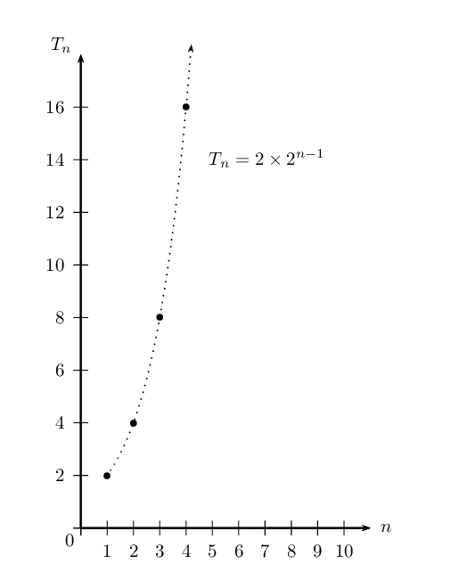
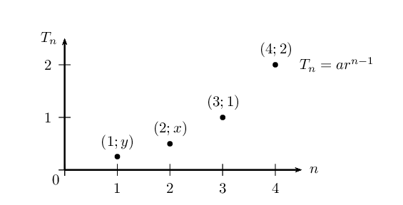

## 1.2 Geometric sequences (EMCDR)

Geometric sequence

A geometric sequence is a sequence of numbers in which each new term
                                        (except for the first term) is calculated by multiplying the previous term by a
                                        constant value called the constant ratio (\(r\)).

<Callout type="note" title="Note">
<VideoPlayer src="https://www.youtube.com/embed/XHyeLKZYb2w" title="Video: 285K" />
</Callout>

This means that the ratio between consecutive numbers in a geometric sequence is a
                        constant (positive or negative). We will explain what we mean by ratio after looking at the
                        following example.

### Example: A flu epidemic (EMCDS)

Influenza (commonly called “flu”) is caused by the influenza
                                virus, which infects the respiratory tract (nose, throat, lungs). It can cause mild to
                                severe
                                illness that most of us get during winter time. The influenza virus is spread from
                                person to person in respiratory droplets of coughs and sneezes. This is called
                                “droplet
                                spread”. This can happen when droplets from a cough or sneeze of an infected
                                person are propelled through the air and deposited on the mouth or nose of people
                                nearby. It
                                is good practice to cover your mouth when you cough or sneeze so as not to infect others
                                around you
                                when you have the flu. Regular hand washing is an effective way to prevent the spread of
                                infection and illness.

Assume that you have the flu virus, and you forgot to cover your mouth when two friends came
                                to
                                visit while you were sick in bed. They leave, and the next day they also have the flu.
                                Let's assume
                                that each friend in turn spreads the virus to two of their friends by the same droplet
                                spread the following
                                day. Assuming this pattern continues and each sick person infects 2 other friends, we
                                can represent
                                these events in the following manner:

Each person infects two more people with the flu virus.

We can tabulate the events and formulate an equation for the general case:

| Day (n) | No. of newly-infected people |
| --- | --- |
| \(\text{1}\) | \(2 =2\) |
| \(\text{2}\) | \(4=2\times 2=2\times {2}^{1}\) |
| \(\text{3}\) | \(8=2\times 4=2\times 2\times 2=2\times {2}^{2}\) |
| \(\text{4}\) | \(16 =2\times 8=2\times 2\times 2\times 2=2\times {2}^{3}\) |
| \(\text{5}\) | \(32 =2\times 16=2\times 2\times 2\times 2\times 2=2\times {2}^{4}\) |
| \(\vdots\) | \(\vdots\) |
| \(n\) | \(2\times 2\times 2\times 2\times \cdots \times 2=2\times {2}^{n-1}\) |

The above table represents the number of **newly-infected** people after \(n\)
                                days since you
                                first infected your \(\text{2}\) friends.

You sneeze and the virus is carried over to \(\text{2}\) people who start the chain
                                (\({a}=2\)). The next day, each one then infects \(\text{2}\) of their friends. Now
                                \(\text{4}\) people are newly-infected. Each of them infects \(\text{2}\) people the
                                third day, and \(\text{8}\) new people are infected, and so on. These events can be
                                written as a geometric sequence:

                        \[2; 4; 8; 16; 32; \ldots\]

Note the constant ratio (\(r=2\)) between the events. Recall from the linear arithmetic
                                sequence how the common difference between terms was established. In the geometric
                                sequence we can determine the constant ratio (\(r\)) from:

                        \[\frac{{T}_{2}}{{T}_{1}}=\frac{{T}_{3}}{{T}_{2}}=r\]

More generally,

                        \[\frac{{T}_{n}}{{T}_{n-1}}=r\]

## Constant ratio of a geometric sequence

### Textbook Exercise 1.4

Determine the constant ratios for the following geometric sequences
                                                        and write down the next three terms in each sequence:

**Problem:**
\(5; 10; 20; \ldots\)

**Solution:**
\begin{align*}
                                                        r = \frac{T_{2}}{T_{1}} & = \frac{10}{5} \\
                                                        &= 2 \\
                                                        \therefore \text{Next terms: } & 40; 80; 160
                                                        \end{align*}

**Problem:**
\(\frac{1}{2}; \frac{1}{4}; \frac{1}{8}; \ldots\)

**Solution:**
\begin{align*}
                                                        r = \frac{T_{2}}{T_{1}} & = \frac{\frac{1}{4}}{\frac{1}{2}}
                                                        \\
                                                        &= \frac{1}{2} \\
                                                        \therefore \text{Next terms: } & \frac{1}{16}; \frac{1}{32};
                                                        \frac{1}{64}
                                                        \end{align*}

**Problem:**
\(\text{7}; \text{0,7}; \text{0,07}; \ldots\)

**Solution:**
\begin{align*}
                                                        r = \frac{T_{2}}{T_{1}} & = \frac{\text{0,7}}{\text{7}} \\
                                                        &= \text{0,1} \\
                                                        \therefore \text{Next terms: } & \text{0,007};
                                                        \text{0,0007}; \text{0,00007}
                                                        \end{align*}

**Problem:**
\(p; 3p^{2}; 9p^{3}; \ldots\)

**Solution:**
\begin{align*}
                                                        r = \frac{T_{2}}{T_{1}} & = \frac{3p^{2}}{p} \\
                                                        &= 3p \\
                                                        \therefore \text{Next terms: } & 27p^{4}; 81p^{5}; 243p^{6}
                                                        \end{align*}

**Problem:**
\(-3; 30; -300; \ldots\)

**Solution:**
\begin{align*}
                                                        r = \frac{T_{2}}{T_{1}} & = \frac{30}{-3} \\
                                                        &= -10 \\
                                                        \therefore \text{Next terms: } & \text{3 000};
                                                        -\text{30 000}; \text{300 000};
                                                        -\text{3 000 000};
                                                        \end{align*}

### The general term for a geometric sequence (EMCDT)

From the flu example above we know that \({T}_{1}=2\) and \(r=2\), and we have seen from the
                                table that the \(n\)\(^{\text{th}}\) term is given by \({T}_{n}=2\times {2}^{n-1}\).

The general geometric sequence can be expressed as:

                        \[\begin{array}{rll}
                        T_{1} &=a &=ar^{0} \\
                        T_{2} &=a \times r &=ar^{1} \\
                        T_{3} &=a \times r \times r &=ar^{2} \\
                        T_{4} &=a \times r \times r \times r &=ar^{3} \\
                        T_{n} &=a \times [r \times r \ldots (n-1)\text{ times}] &=ar^{n-1}
                        \end{array}\]

Therefore the general formula for a geometric sequence is:

                                \[T_{n} = ar^{n-1}\]

where

- \(a\) is the first term in the sequence;
- \(r\) is the constant ratio.

**Test for a geometric sequence**

To test whether a sequence is a geometric sequence or not, check if the ratio between any two
                                consecutive terms is constant:

                        \[\frac{T_{2}}{T_{1}} = \frac{T_{3}}{T_{2}} = \frac{T_{n}}{T_{n-1}} = r\]

If this condition does not hold, then the sequence is not a geometric sequence.

## General term of a geometric sequence

### Textbook Exercise 1.5

Determine the general formula for the \(n\)\(^{\text{th}}\) term of
                                                        each of the following geometric
                                                        sequences:

**Problem:**
\(5; 10; 20; \ldots\)

**Solution:**
\begin{align*}
                                                        a &= 5 \\
                                                        r = \frac{T_{2}}{T_{1}} & = \frac{10}{5} \\
                                                        &= 2 \\
                                                        T_{n} &= ar^{n-1} \\
                                                        \therefore T_{n} &= 5(2)^{n-1}
                                                        \end{align*}

**Problem:**
\(\frac{1}{2}; \frac{1}{4}; \frac{1}{8}; \ldots\)

**Solution:**
\begin{align*}
                                                        a &= \frac{1}{2} \\
                                                        r = \frac{T_{2}}{T_{1}} & = \frac{\frac{1}{4}}{\frac{1}{2}}
                                                        \\
                                                        &= \frac{1}{2} \\
                                                        T_{n} &= ar^{n-1} \\
                                                        \therefore T_{n} &= \frac{1}{2} \left( \frac{1}{2}
                                                        \right)^{n-1} \\
                                                        &= \left( \frac{1}{2} \right)^{n}
                                                        \end{align*}

**Problem:**
\(\text{7}; \text{0,7}; \text{0,07}; \ldots\)

**Solution:**
\begin{align*}
                                                        a &= 7 \\
                                                        r = \frac{T_{2}}{T_{1}} & = \frac{\text{0,7}}{\text{7}} \\
                                                        &= \text{0,1} \\
                                                        T_{n} &= ar^{n-1} \\
                                                        \therefore T_{n} &= 7(\text{0,1})^{n-1}
                                                        \end{align*}

**Problem:**
\(p; 3p^{2}; 9p^{3}; \ldots\)

**Solution:**
\begin{align*}
                                                        a &= p \\
                                                        r = \frac{T_{2}}{T_{1}} & = \frac{3p^{2}}{p} \\
                                                        &= 3p \\
                                                        T_{n} &= ar^{n-1} \\
                                                        \therefore T_{n} &= p(3p)^{n-1}
                                                        \end{align*}

**Problem:**
\(-3; 30; -300; \ldots\)

**Solution:**
\begin{align*}
                                                        a &= -3 \\
                                                        r = \frac{T_{2}}{T_{1}} & = \frac{30}{-3} \\
                                                        &= -10 \\
                                                        T_{n} &= ar^{n-1} \\
                                                        \therefore T_{n} &= -3(-10)^{n-1}
                                                        \end{align*}

<Callout type="tip" title="Worked example 3: Flu epidemic">
**Question:**
We continue with the previous flu example, where \(T_{n}\) is the number of
                                                newly-infected people after \(n\) days:

                                        \[T_{n} = 2 \times 2^{n-1}\]

2. Calculate how many newly-infected people there are on the tenth day.
4. On which day will \(\text{16 384}\) people be newly-infected?

**Write down the known values and the general formula:**
\begin{align*}
                                        a &= 2 \\
                                        r &= 2 \\
                                        T_{n} &= 2 \times 2^{n-1}
                                        \end{align*}

**Use the general formula to calculate \(T_{10}\):**
Substitute \(n = 10\) into the general formula:

\begin{align*}
                                                {T}_{n}& = {a} \times {r}^{n-1} \\
                                                \therefore {T}_{10}& = 2\times {2}^{10-1} \\
                                                & = 2\times {2}^{9} \\
                                                & = 2\times 512 \\
                                                & = 1024
                                                \end{align*}

On the tenth day, there are \(\text{1 024}\) newly-infected people.

**Use the general formula to calculate \(n\):**
We know that \(T_{n} = \text{16 384}\) and can use the general formula
                                                to calculate the corresponding value of \(n\):

                                        \begin{align*}
                                        {T}_{n}& = {a} {r}^{n-1} \\
                                        \text{16 384}& = 2 \times {2}^{n-1} \\
                                        \frac{\text{16 384}}{2} & = {2}^{n-1} \\
                                        \text{8 192}& = {2}^{n-1} \\
                                        \text{We can write } \text{8 192} &\text{ as } {2}^{13} \\
                                        \text{So } {2}^{13}& = {2}^{n-1} \\
                                        \therefore 13& = n-1 \quad (\text{same bases})\\
                                        \therefore n & = 14
                                        \end{align*}

There are \(\text{16 384}\) newly-infected people on the
                                                \(14^{\text{th}}\) day.
</Callout>

For this geometric sequence, plotting the number of newly-infected people (\(T_{n}\)) vs. the
                                number of days (\(n\)) results in the following graph:

| Day (n) | No. of newly-infected people |
| --- | --- |
| \(\text{1}\) | \(2\) |
| \(\text{2}\) | \(\text{4}\) |
| \(\text{3}\) | \(\text{8}\) |
| \(\text{4}\) | \(\text{16}\) |
| \(\text{5}\) | \(\text{32}\) |
| \(\text{6}\) | \(\text{64}\) |
| \(n\) | \(2 \times 2^{n-1}\) |

In this example we are only dealing with positive integers \(\left( n \in \{1; 2; 3; \ldots
                                \}, T_{n} \in \{1; 2; 3; \ldots \} \right)\), therefore the graph is not continuous and
                                we do not join the points with a curve (the dotted line has been drawn to indicate the
                                shape of an exponential graph).

**Geometric mean**

The geometric mean between two numbers is the value that forms a geometric sequence together
                                with the two numbers.

For example, the geometric mean between \(\text{5}\) and \(\text{20}\) is the number that has
                                to be inserted between \(\text{5}\) and \(\text{20}\) to form the geometric sequence:
                                \(5; x; 20\)

                        \begin{align*}
                        \text{Determine the constant ratio: } \frac{x}{5} &= \frac{20}{x} \\
                        \therefore x^{2} &= 20 \times 5 \\
                        x^{2} &= 100 \\
                        x &= \pm 10
                        \end{align*}

**Important:** remember to include both the positive and negative square root.
                                The geometric mean generates two possible geometric sequences:

                        \[5; 10; 20; \ldots\]
                        \[5; -10; 20; \ldots\]

In general, the geometric mean (\(x\)) between two numbers \(a\) and \(b\) forms a geometric
                                sequence with \(a\) and \(b\):

                        \[\text{For a geometric sequence: }a; x; b\]
                        \begin{align*}
                        \text{Determine the constant ratio: } \frac{x}{a} &= \frac{b}{x} \\
                        x^{2} &= ab \\
                        \therefore x &= \pm \sqrt{ab}
                        \end{align*}

## Mixed exercises

### Textbook Exercise 1.6

The \(n\)\(^{\text{th}}\) term of a sequence is given by the
                                                                formula \(T_{n} = 6 \left( \frac{1}{3} \right)^{n-1}\).

**Problem:**
Write down the first three terms of the sequence.

**Solution:**
\begin{align*}
                                                                T_{1} &= 6 \left( \frac{1}{3} \right)^{0} \\
                                                                &= 6 \\
                                                                T_{2} &= 6 \left( \frac{1}{3} \right)^{1} \\
                                                                &= 2 \\
                                                                T_{3} &= 6 \left( \frac{1}{3} \right)^{2} \\
                                                                &= \frac{2}{3}
                                                                \end{align*}

\(\therefore 6; 2; \frac{2}{3} \ldots\)

**Problem:**
What type of sequence is this?

**Solution:**
\begin{align*}
                                                                r &= \frac{T_{2}}{T_{1}} \\
                                                                &= \frac{2}{6} \\
                                                                &= \frac{1}{3} \\
                                                                \text{Check: } r &= \frac{T_{3}}{T_{2}} \\
                                                                &= \frac{\frac{2}{3}}{2} \\
                                                                &= \frac{1}{3}
                                                                \end{align*}

Therefore this is a geometric sequence with constant
                                                                        ratio \(r = \frac{1}{3}\).

**Problem:**
Consider the following terms:

                                                        \[(k-4); (k+1); m; 5k\]

The first three terms form an arithmetic sequence and the
                                                                last three terms form a geometric sequence. Determine
                                                                the values of \(k\) and \(m\) if both are positive
                                                                integers.

[IEB, Nov 2006]

**Solution:**
First consider the arithmetic sequence: \((k-4); (k+1); m\)

                                                        \begin{align*}
                                                        d &= T_{2} - T_{1} \\
                                                        &= (k + 1) - (k-4) \\
                                                        &= k + 1 - k + 4 \\
                                                        &= 5 \\
                                                        \text{And } d &= T_{3} - T_{2} \\
                                                        &= m - (k + 1) \\
                                                        &= m - k - 1 \\
                                                        \therefore 5 &= m - k - 1 \\
                                                        k + 6 &= m \ldots \ldots (1)
                                                        \end{align*}

Now consider the geometric sequence: \((k+1); m; 5k\)

                                                        \begin{align*}
                                                        r &= \frac{T_{2}}{T_{1}} \\
                                                        &= \frac{m}{k+1}\\
                                                        \text{And } r &= \frac{T_{3}}{T_{2}} \\
                                                        &= \frac{5k}{m} \\
                                                        \therefore \frac{m}{k+1} &= \frac{5k}{m} \\
                                                        m^2 &= 5k(k + 1) \\
                                                        m^2 &= 5k^2 + 5k \ldots \ldots (2) \\
                                                        \text{Substitute eqn } (1) \rightarrow (2): (k + 6)^2&= 5k^2
                                                        + 5k \\
                                                        k^2 + 12k + 36 &= 5k^2 + 5k \\
                                                        4k^2 - 7k - 36 &= 0 \\
                                                        (4k + 9)(k - 4) &= 0 \\
                                                        \therefore k = -\frac{9}{4} &\text{ or } k = 4 \\
                                                        \text{But } k & \in \mathbb{Z} \\
                                                        \text{Therefore } k = 4 \\
                                                        \text{And } m &= k + 6 \\
                                                        &= 4 + 6 \\
                                                        &= 10
                                                        \end{align*}

Therefore \(k= 4\) and \(m = 10\) giving the terms \(0; 5;
                                                                10; 20\)

Given a geometric sequence with second term \(\frac{1}{2}\)
                                                                and ninth term \(64\).

**Problem:**
Determine the value of \(r\).

**Solution:**
\begin{align*}
                                                                T_{2} &= \frac{1}{2} \\
                                                                \therefore ar &= \frac{1}{2} \\
                                                                T_{9} &= 64 \\
                                                                \therefore ar^{8} &= 64 \\
                                                                \frac{ar^{8}}{ar} &= \dfrac{64}{\frac{1}{2}} \\
                                                                \therefore r^{7} &= 128 \\
                                                                &= 2^{7} \\
                                                                \therefore r &= 2
                                                                \end{align*}

**Problem:**
Find the value of \(a\).

**Solution:**
\begin{align*}
                                                                T_{2} &= \frac{1}{2} \\
                                                                \therefore ar &= \frac{1}{2} \\
                                                                a(2) &= \frac{1}{2} \\
                                                                \therefore a &=\frac{1}{4}
                                                                \end{align*}

**Problem:**
Determine the general formula of the sequence.

**Solution:**
\begin{align*}
                                                                T_{n} &= ar^{n-1} \\
                                                                &= \frac{1}{4}(2)^{n-1} \\
                                                                &= 2^{-2} \cdot 2^{n-1} \\
                                                                &= 2^{n-1 - 2} \\
                                                                &= 2^{n-3} \\
                                                                &= 2^{n} \cdot 2^{-3} \\
                                                                &= \frac{2^{n}}{8}
                                                                \end{align*}

The diagram shows four sets of values of consecutive terms of
                                                                a geometric sequence with the general formula \(T_{n} =
                                                                ar^{n-1}\).

**Problem:**
Determine \(a\) and \(r\).

**Solution:**
\begin{align*}
                                                                \left(3; 1 \right): \quad T_{3} &= ar^{3-1} \\
                                                                \therefore 1 &= ar^{2} \\
                                                                \therefore \frac{1}{r^{2}} &= a \ldots \ldots (1) \\
                                                                \left(4; 2 \right): \quad T_{4} &= ar^{4-1} \\
                                                                \therefore 2 &= ar^{3} \ldots \ldots (2) \\
                                                                \text{Substitute } (1) \rightarrow (2): \quad 2 &=
                                                                \left( \frac{1}{r^{2}} \right) r^{3} \\
                                                                \therefore 2 &= r \\
                                                                \text{Substitute back into } (1): \quad a &=
                                                                \frac{1}{(2)^{2}} \\
                                                                \therefore a &= \frac{1}{4} \\
                                                                \therefore T_{n} &= \frac{1}{4}(2)^{n-1}
                                                                \end{align*}

**Problem:**
Find \(x\) and \(y\).

**Solution:**
Determine \(y\):

                                                                \begin{align*}
                                                                T_{n} &= \frac{1}{4}(2)^{n-1} \\
                                                                T_{1} &= \frac{1}{4}(2)^{1-1} \\
                                                                \therefore y &= \frac{1}{4}
                                                                \end{align*}

Determine \(x\):

                                                                \begin{align*}
                                                                T_{n} &= \frac{1}{4}(2)^{n-1} \\
                                                                T_{2} &= \frac{1}{4}(2)^{2-1} \\
                                                                \therefore x &= \frac{1}{2}
                                                                \end{align*}

**Problem:**
Find the fifth term of the sequence.

**Solution:**
\begin{align*}
                                                                T_{n} &= \frac{1}{4}(2)^{n-1} \\
                                                                T_{5} &= \frac{1}{4}(2)^{5-1} \\
                                                                &= \frac{1}{4}(2)^{4} \\
                                                                &= \frac{1}{4}(16) \\
                                                                &= 4
                                                                \end{align*}

**Problem:**
Write down the next two terms for the following sequence:

                                                        \[1; \sin \theta; 1 - \cos^{2} \theta; \ldots\]

**Solution:**
Check if this is a geometric sequence:

                                                        \begin{align*}
                                                        r &= \frac{T_{2}}{T_{1}} \\
                                                        &= \sin \theta \\
                                                        \text{And } r &= \frac{T_{3}}{T_{2}} \\
                                                        &= \frac{1 - \cos^{2} \theta}{\sin \theta} \\
                                                        &= \frac{\sin^{2} \theta}{\sin \theta} \\
                                                        &= \sin \theta
                                                        \end{align*}

This is a geometric sequence with \(r = \sin \theta\).
                                                                Therefore, \(T_{4} = \sin^{3} \theta\) and \(T_{5} =
                                                                \sin^{4} \theta\).

**Problem:**
\(5; x; y\) is an arithmetic sequence and \(x; y; 81\) is a
                                                                geometric sequence. All terms in the sequences are
                                                                integers. Calculate the values of \(x\) and \(y\).

**Solution:**
For the arithmetic sequence:

                                                        \begin{align*}
                                                        d &= T_{2} - T_{1} \\
                                                        &= x-5 \\
                                                        \text{And } d &= T_{3} - T_{2} \\
                                                        &= y-x \\
                                                        \therefore x-5 &= y-x \\
                                                        2x - 5 &=y \ldots \ldots (1)
                                                        \end{align*}

For the geometric sequence:

                                                        \begin{align*}
                                                        r &= \frac{T_{2}}{T_{1}} \\
                                                        &= \frac{y}{x} \\
                                                        \text{And } r &= \frac{T_{3}}{T_{2}} \\
                                                        &= \frac{81}{y} \\
                                                        \therefore \frac{y}{x} \ &= \frac{81}{y} \ \\
                                                        y^{2} &= 81x \ldots \ldots (2)\\
                                                        \text{Substitute eqn } (1) \rightarrow (2): \quad (2x - 5)^{2}
                                                        &= 81x \\
                                                        4x^2 - 20x + 25 &= 81x \\
                                                        4x^2 - 101x + 25 &= 0 \\
                                                        (4x - 1)(x - 25) &= 0 \\
                                                        \therefore x = \frac{1}{4} &\text{ or } x = 25
                                                        \end{align*}
                                                        \begin{align*}
                                                        \text{If } x = \frac{1}{4}: \quad y^2 &= 81x \\
                                                        &= \frac{81}{4} \\
                                                        \therefore y &= \pm \frac{9}{2} \\
                                                        \text{If } x = 25: y^2 &= 81x \\
                                                        &= 81 \times 25 \\
                                                        &= \text{2 025}\\
                                                        \therefore y &= \pm 45
                                                        \end{align*}
                                                        \begin{align*}
                                                        \text{Arithmetic sequence: } & 5; \frac{1}{4}; -\frac{9}{2};
                                                        \ldots \\
                                                        \text{or } \quad & 5; 25; 45; \ldots \\
                                                        \text{Geometric sequence: } & \frac{1}{4}; -\frac{9}{2}; 81;
                                                        \ldots \\
                                                        \text{or } \quad & 25; -45; 81; \ldots
                                                        \end{align*}

The two numbers \(2x^{2}y^{2}\) and \(8x^4\) are given.

**Problem:**
Write down the geometric mean between the two numbers
                                                                        in terms of \(x\) and \(y\).

**Solution:**
\begin{align*}
                                                                \text{Let the mean be } T_{2} &= p \\
                                                                \frac{T_{2}}{T_{1}} &= \frac{T_{3}}{T_{2}} \\
                                                                \frac{p}{2x^2y^2} &= \frac{8x^4}{p} \\
                                                                \therefore p^{2} &= (2x^2y^2)(8x^4) \\
                                                                p^{2} &= 16x^6y^2 \\
                                                                \therefore p &= 4x^{3}y
                                                                \end{align*}

Note: in this case only the positive square root is
                                                                        valid.

**Problem:**
Determine the constant ratio of the resulting
                                                                        sequence.

**Solution:**
\begin{align*}
                                                                r &= \frac{T_{2}}{T_{1}} \\
                                                                &= \frac{4x^{3}y }{2x^2y^2} \\
                                                                &= \frac{2x}{y}
                                                                \end{align*}

**Problem:**
Insert three geometric means between \(-1\) and
                                                                \(-\frac{1}{81}\). Give all possible answers.

**Solution:**
Let the geometric sequence be \(-1; T_{2}; T_{3}; T_{4};
                                                                -\frac{1}{81}\)

                                                        \begin{align*}
                                                        T_{1} &=-1 = a \\
                                                        T_{5} &=-\frac{1}{81} = ar^{4} \\
                                                        \therefore (-1)r^{4}&= -\frac{1}{81} \\
                                                        r^{4}&= \frac{1}{81} \\
                                                        \therefore r &= \pm \frac{1}{3}
                                                        \end{align*}

Therefore possible geometric sequences are:

\(-1; \frac{1}{3}; -\frac{1}{9}; \frac{1}{27};
                                                                -\frac{1}{81}\)

\(-1; -\frac{1}{3}; -\frac{1}{9}; -\frac{1}{27};
                                                                -\frac{1}{81}\)
