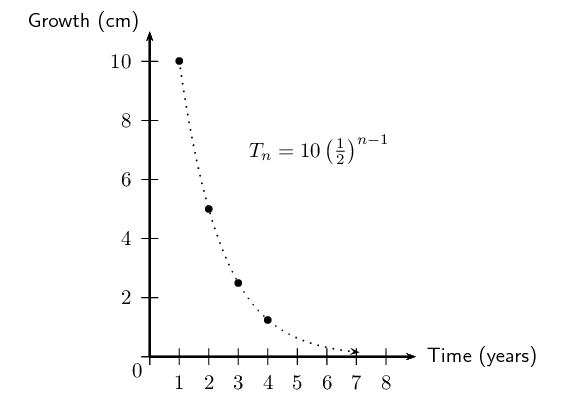

## 1.6 Infinite series (EMCF3)

So far we have been working only with finite sums, meaning that whenever we determined the sum of a
                        series, we only considered the sum of the first \(n\) terms. We now consider what happens when
                        we add an infinite number of terms together. Surely if we sum infinitely many numbers, no matter
                        how small they are, the answer goes to infinity? In some cases the answer does indeed go to
                        infinity (like when we sum all the positive integers), but surprisingly there are some cases
                        where the answer is a finite real number.

## Sum of an infinite series

2. Cut a piece of string \(\text{1}\) \(\text{m}\) in length.
4. Now cut the piece of string in half and place one half on the desk.
6. Cut the other half in half again and put one of the pieces on the desk.
8. Repeat this process until the piece of string is too short to cut easily.
10. Draw a diagram to illustrate the sequence of lengths of the pieces of string.
12. Can this sequence be expressed mathematically? Hint: express the shorter lengths of
                                           string as a fraction of the original length of string.
14. What is the sum of the lengths of all the pieces of string?
16. Predict what would happen if these steps could be repeated infinitely many times.
18. Will the sum of the lengths of string ever be greater than \(\text{1}\)?
20. What can you conclude?

<Callout type="tip" title="Worked example 14: Sum to infinity">
**Question:**
Complete the table below for the geometric series \(T_{n} = \left( \frac{1}{2}
                                        \right)^{n}\) and answer the questions that follow:

|  | Terms | \(S_{n}\) | \(1 - S_{n}\) |
| --- | --- | --- | --- |
| \(T_{1}\) | \(\frac{1}{2}\) | \(\frac{1}{2}\) | \(\frac{1}{2}\) |
| \(T_{1} + T_{2}\) |  |  |  |
| \(T_{1} + T_{2} + T_{3}\) |  |  |  |
| \(T_{1} + T_{2} + T_{3} + T_{4}\) |  |  |  |

2. As more and more terms are added, what happens to the value of \(S_{n}\)?
4. As more more and more terms are added, what happens to the value of \(1 -
                                                   S_{n}\)?
6. Predict the maximum value of \(S_{n}\) for the sum of infinitely many terms
                                                   in the series.

**Complete the table:**
|  | Terms | \(S_{n}\) | \(1 - S_{n}\) |
| --- | --- | --- | --- |
| \(T_{1}\) | \(\frac{1}{2}\) | \(\frac{1}{2}\) | \(\frac{1}{2}\) |
| \(T_{1} + T_{2}\) | \(\frac{1}{2} + \frac{1}{4}\) | \(\frac{3}{4}\) | \(\frac{1}{4}\) |
| \(T_{1} + T_{2} + T_{3}\) | \(\frac{1}{2} + \frac{1}{4} + \frac{1}{8}\) | \(\frac{7}{8}\) | \(\frac{1}{8}\) |
| \(T_{1} + T_{2} + T_{3} + T_{4}\) | \(\frac{1}{2} + \frac{1}{4} + \frac{1}{8} + \frac{1}{16}\) | \(\frac{15}{16}\) | \(\frac{1}{16}\) |

**Consider the value of \(S_{n}\) and \(1 - S_{n}\):**
As more terms in the series are added together, the value of \(S_{n}\) increases:

                                \[\frac{1}{2} \quad < \quad \frac{3}{4} \quad < \quad \frac{7}{8} \quad < \quad
                                \cdots\]

However, by considering \(1 - S_{n}\), we notice that the amount by which \(S_{n}\)
                                        increases gets smaller and smaller as more terms are added:

                                \[\frac{1}{2} \quad > \quad \frac{1}{4} \quad > \quad \frac{1}{8} \quad > \quad
                                \cdots\]

We can therefore conclude that the value of \(S_n\) is approaching a maximum value of
                                        \(\text{1}\); it is converging to \(\text{1}\).

**Write conclusion mathematically:**
We can conclude that the sum of the series

                                \[\frac{1}{2} + \frac{1}{4} + \frac{1}{8} + \cdots\]

gets closer to 1 (\(S_{n} \rightarrow 1\)) as the number of terms approaches infinity
                                        (\(n \rightarrow \infty\)), therefore the series converges.

                                \[\sum _{i = 1}^{\infty}{ \left( \frac{1}{2} \right)^{i}} = 1\]
</Callout>

<QuizCard id="m12-01-06a" title="Interactive Exercise 1.16" question="Consider the series shown below and calculate \(r\) . \[\begin{array}{c}(-3) + (-9) + (-27) +                     (-81) + \ldots\end{array}\]" options=["converges", "diverges"] answer="3" hint="You should enter a number here. If you want to, you can use a space to separate thousands.                Example: 12 800,25 For scientific notation you need to use the multiply symbol                ( ∗ ) and the exponent symbol ( ^ ). For example 6,673 × 10 −11 should be written as: 6,673 ∗ 10^−11" explanation="Determine the value of \(r\) To calculate the constant ratio ( \(r\) ), we need to determine how consecutive terms in the series are related to each other: \[                         \begin{aligned}                         r & = \frac{T_{2}}{T_{1}}\\                         & = \frac{-9}{-3} \\                         & = 3 \\                         & \\                         \text{Or } \quad r & =  \frac{T_{3}}{T_{2}} \\                         &= \frac{-27}{-9} \\                         &= 3                         \end{aligned}                     \] Therefore, the constant ratio for this geometric series is \(r = 3\) . Submit your answer as:" />

<QuizCard id="m12-01-06a" title="Interactive Exercise 1.16" question="Consider the series shown below and calculate \(r\) . \[\begin{array}{c}8 + 32 + 128 +                     512 + \ldots\end{array}\]" options=["converges", "diverges"] answer="4" hint="You should enter a number here. If you want to, you can use a space to separate thousands.                Example: 12 800,25 For scientific notation you need to use the multiply symbol                ( ∗ ) and the exponent symbol ( ^ ). For example 6,673 × 10 −11 should be written as: 6,673 ∗ 10^−11" explanation="Determine the value of \(r\) To calculate the constant ratio ( \(r\) ), we need to determine how consecutive terms in the series are related to each other: \[                         \begin{aligned}                         r & = \frac{T_{2}}{T_{1}}\\                         & = \frac{32}{8} \\                         & = 4 \\                         & \\                         \text{Or } \quad r & =  \frac{T_{3}}{T_{2}} \\                         &= \frac{128}{32} \\                         &= 4                         \end{aligned}                     \] Therefore, the constant ratio for this geometric series is \(r = 4\) . Submit your answer as:" />

<QuizCard id="m12-01-06a" title="Interactive Exercise 1.16" question="Calculate for which values of \(p\) the geometric series \(S_{n} = 3 + \frac{3}{4}( p - 1) + \frac{3}{4^{2}}( p - 1)^{2}\ldots\) will converge . INSTRUCTION: Give your answer as an inequality." options=[] answer=" -3 < p < 5 " hint="Answer this question with an inequality. You can use the following mathematical symbols: greater than: > greater than or equal to: >= less than: < less than or equal to: <= For example, 8 < x ≤ 12 can be written as: 8 < x <= 12 You can also use the word \"or\" to join two intervals. For example                x < 10 or x ≥ 19 can be written as: x < 10 or x >= 19" explanation="Determine the value of \(r\) A geometric series converges (has a finite sum) if the constant ratio is between \(-\text{1}\) and \(\text{1}\) . So we need to determine the value of \(r\) for this series. As always, the ratio comes from any two consecutive terms: \[\begin{array}{c}r = \frac{T_{2}}{T_{1}} = \frac{T_{3}}{T_{2}} = \frac{T_{n}}{T_{n-1}}\end{array}\] \[                     \begin{aligned}                     &\\                     r &= \frac{T_{2}}{T_{1}} \\[0.2em]                     &= \frac{\frac{3}{4}( p - 1)}{3} \\[0.2em]                     &= \frac{1}{4}( p - 1)                     &\\[0.8em]                     \text{Or } \quad r &= \frac{T_{3}}{T_{2}} \\[0.2em]                     &= \frac{\frac{3}{4^{2}}( p - 1)^{2}}{\frac{3}{4}( p - 1)} \\[0.2em]                     &= \frac{1}{4}( p - 1)                     \end{aligned}                 \] So we know that \(r = \frac{1}{4}( p - 1)\) . Apply the condition for convergence to determine the possible values of \(p\) The sum to infinity only exists for a converging geometric series. We know that a geometric series converges if \(-1 < r < 1\) , so we can determine the possible values of \(p\) using \(:\) \[                     \begin{aligned}                     &-1  < r < 1 \\                     &-1  < \frac{1}{4} ( p - 1) < 1 \\                     &\\                     &{\color{green}{\text{Multiply through by } 4:}} \\                     &-4  < p - 1 < 4 \\                     &\\                     &{\color{green}{\text{Add  } 1:}} \\                     &-3 < p < 5                     \end{aligned}                 \] We have the answer: for the series to converge , \( p \) must be in this range: \(-3 < p < 5 \) . Submit your answer as:" />

<QuizCard id="m12-01-06a" title="Interactive Exercise 1.16" question="Determine for which values of \(x\) the geometric series \(S_{n} = 4 + \frac{4}{6}( x + 1) + \frac{4}{6^{2}}( x + 1)^{2}\ldots\) will converge . INSTRUCTION: Give your answer as an inequality." options=[] answer=" -7 < x < 5 " hint="Answer this question with an inequality. You can use the following mathematical symbols: greater than: > greater than or equal to: >= less than: < less than or equal to: <= For example, 8 < x ≤ 12 can be written as: 8 < x <= 12 You can also use the word \"or\" to join two intervals. For example                x < 10 or x ≥ 19 can be written as: x < 10 or x >= 19" explanation="Determine the value of \(r\) A geometric series converges (has a finite sum) if the constant ratio is between \(-\text{1}\) and \(\text{1}\) . So we need to determine the value of \(r\) for this series. As always, the ratio comes from any two consecutive terms: \[\begin{array}{c}r = \frac{T_{2}}{T_{1}} = \frac{T_{3}}{T_{2}} = \frac{T_{n}}{T_{n-1}}\end{array}\] \[                     \begin{aligned}                     &\\                     r &= \frac{T_{2}}{T_{1}} \\[0.2em]                     &= \frac{\frac{4}{6}( x + 1)}{4} \\[0.2em]                     &= \frac{1}{6}( x + 1)                     &\\[0.8em]                     \text{Or } \quad r &= \frac{T_{3}}{T_{2}} \\[0.2em]                     &= \frac{\frac{4}{6^{2}}( x + 1)^{2}}{\frac{4}{6}( x + 1)} \\[0.2em]                     &= \frac{1}{6}( x + 1)                     \end{aligned}                 \] So we know that \(r = \frac{1}{6}( x + 1)\) . Apply the condition for convergence to determine the possible values of \(x\) For a geometric series to converge, the value of \(r\) must lie within the interval \((-1 \, ; 1)\) . We use this fact to determine the possible values of \(x:\) \[                     \begin{aligned}                     &-1  < r < 1 \\                     &-1  < \frac{1}{6} ( x + 1) < 1 \\                     &\\                     &{\color{green}{\text{Multiply through by } 6:}} \\                     &-6  < x + 1 < 6 \\                     &\\                     &{\color{green}{\text{Subtract  } 1:}} \\                     &-7 < x < 5                     \end{aligned}                 \] We have the answer: for the series to converge , \( x \) must be in this range: \(-7 < x < 5 \) . Submit your answer as:" />

<QuizCard id="m12-01-06a" title="Interactive Exercise 1.16" question="Consider the general term \(T_{n} = \left(\frac{1}{2}\right)^{n}\) , determine an expression for the sum of the first \(n\) terms of the series." options=["divergent", "convergent"] answer="(1 - (1/2)^n)" hint="Your answer should be a mathematical expression. You can use the following symbols to write mathematical expressions: add: + subtract: − multiply: ∗ divide: / exponent: ^ The following special symbols are also recognised: pi (π): pi infinity (∞): oo It is also possible to write certain functions: √: sqrt( ) log: log( ) sin: sin( ) cosec: cosec( ) cos: cos( ) sec: sec( ) tan: tan( ) cot: cot( ) To write a logarithm with a specific base, use the underscore _ symbol.                For example, log of x base 3 can be written as: log_3 x" explanation="Use the general term to write down the first few terms in the series Let's look at the general term \(T_{n} = \left(\frac{1}{2}\right)^{n}\) . We need to determine if this will generate an arithmetic or geometric series, so we write down the first few terms in the series: \[                         \begin{aligned}                             \text{For } n=1: \enspace T_{1} & = \left(\frac{1}{2}\right)^{1} = \frac{\text{1}}{\text{2}} \\                             \text{For } n=2: \enspace T_{2} & = \left(\frac{1}{2}\right)^{2} = \frac{\text{1}}{\text{4}} \\                             \text{For } n=3: \enspace T_{3} & = \left(\frac{1}{2}\right)^{3} = \frac{\text{1}}{\text{8}} \\                             \text{For } n=4: \enspace T_{4} & = \left(\frac{1}{2}\right)^{4} = \frac{\text{1}}{\text{16}}                         \end{aligned}                     \] Therefore, we have the following series: \[\begin{array}{c}\frac{\text{1}}{\text{2}} + \frac{\text{1}}{\text{4}} + \frac{\text{1}}{\text{8}} + \frac{\text{1}}{\text{16}} + \ldots\end{array}\] So, the first term for the series is \(a = \frac{\text{1}}{\text{2}}\) . Now we need to see if there is a constant ratio ( \(r\) ), which would make this a geometric series: \[                         \begin{aligned}                             r &= \frac{T_{2}}{T_{1} } \\[0.2em]                             &= \frac{\frac{\text{1}}{\text{4}}}{\frac{\text{1}}{\text{2}}} \\[0.2em]                             &= \frac{1}{2} \\[0.8em]                             \text{Or } \quad r &= \frac{T_{3}}{T_{2} } \\[0.2em]                             &= \frac{\frac{\text{1}}{\text{8}}}{\frac{\text{1}}{\text{4}}} \\[0.2em]                             &= \frac{1}{2}                         \end{aligned}                     \] Therefore, this is a geometric series with \(a = \frac{\text{1}}{\text{2}}\) and \(r = \frac{1}{2}\) . Determine an expression for the sum of the first \(n\) terms of the series Since we know that we are dealing with a geometric series and that \(0 < r < 1\) , we use the following formula: \[\begin{array}{c}S_{n} = \frac{a(1 - r^{n})}{1 - r}\end{array}\] We substitute in the known values and simplify: \[                         \begin{aligned}                             S_{n} &= \frac{\frac{1}{2}\left(1 - \left(\frac{\text{1}}{\text{2}}\right)^{n}\right)}{1 - \frac{\text{1}}{\text{2}}} \\                             &= \frac{\frac{1}{2}\left(1 - \left(\frac{1}{2}\right)^{n}\right)}{\frac{1}{2}} \\                             & = \frac{\frac{1}{2}}{\frac{1}{2}}\left(1 - \left(\frac{1}{2}\right)^{n}\right) \\                             &= 1 - \left(\frac{1}{2}\right)^{n}                         \end{aligned}                     \] Therefore, the sum of the first \(n\) terms of the series is given by \(1 - \left(\frac{1}{2}\right)^{n}\) . Submit your answer as:" />

<QuizCard id="m12-01-06a" title="Interactive Exercise 1.16" question="Consider the general term \(T_{n} = \left(\frac{1}{4}\right)^{n}\) , determine an expression for the sum of the first \(n\) terms of the series." options=["divergent", "convergent"] answer="1/3 * (1 - (1/4)^n)" hint="Your answer should be a mathematical expression. You can use the following symbols to write mathematical expressions: add: + subtract: − multiply: ∗ divide: / exponent: ^ The following special symbols are also recognised: pi (π): pi infinity (∞): oo It is also possible to write certain functions: √: sqrt( ) log: log( ) sin: sin( ) cosec: cosec( ) cos: cos( ) sec: sec( ) tan: tan( ) cot: cot( ) To write a logarithm with a specific base, use the underscore _ symbol.                For example, log of x base 3 can be written as: log_3 x" explanation="Use the general term to write down the first few terms in the series Consider the general term \(T_{n} = \left(\frac{1}{4}\right)^{n}\) . We need to determine if this will generate an arithmetic or geometric series, so we write down the first few terms in the series: \[                         \begin{aligned}                             \text{For } n=1: \enspace T_{1} & = \left(\frac{1}{4}\right)^{1} = \frac{\text{1}}{\text{4}} \\                             \text{For } n=2: \enspace T_{2} & = \left(\frac{1}{4}\right)^{2} = \frac{\text{1}}{\text{16}} \\                             \text{For } n=3: \enspace T_{3} & = \left(\frac{1}{4}\right)^{3} = \frac{\text{1}}{\text{64}} \\                             \text{For } n=4: \enspace T_{4} & = \left(\frac{1}{4}\right)^{4} = \frac{\text{1}}{\text{256}}                         \end{aligned}                     \] Therefore, we have the following series: \[\begin{array}{c}\frac{\text{1}}{\text{4}} + \frac{\text{1}}{\text{16}} + \frac{\text{1}}{\text{64}} + \frac{\text{1}}{\text{256}} + \ldots\end{array}\] So, the first term for the series is \(a = \frac{\text{1}}{\text{4}}\) . Now we need to see if there is a constant ratio ( \(r\) ), which would make this a geometric series: \[                         \begin{aligned}                             r &= \frac{T_{2}}{T_{1} } \\[0.2em]                             &= \frac{\frac{\text{1}}{\text{16}}}{\frac{\text{1}}{\text{4}}} \\[0.2em]                             &= \frac{1}{4} \\[0.8em]                             \text{Or } \quad r &= \frac{T_{3}}{T_{2} } \\[0.2em]                             &= \frac{\frac{\text{1}}{\text{64}}}{\frac{\text{1}}{\text{16}}} \\[0.2em]                             &= \frac{1}{4}                         \end{aligned}                     \] Therefore, this is a geometric series with \(a = \frac{\text{1}}{\text{4}}\) and \(r = \frac{1}{4}\) . Determine an expression for the sum of the first \(n\) terms of the series Since we know that we are dealing with a geometric series and that \(0 < r < 1\) , we use the following formula: \[\begin{array}{c}S_{n} = \frac{a(1 - r^{n})}{1 - r}\end{array}\] We substitute in the known values and simplify: \[                         \begin{aligned}                             S_{n} &= \frac{\frac{1}{4}\left(1 - \left(\frac{\text{1}}{\text{4}}\right)^{n}\right)}{1 - \frac{\text{1}}{\text{4}}} \\                             &= \frac{\frac{1}{4}\left(1 - \left(\frac{1}{4}\right)^{n}\right)}{\frac{3}{4}} \\                             & = \frac{\frac{1}{4}}{\frac{3}{4}}\left(1 - \left(\frac{1}{4}\right)^{n}\right) \\                             &= \frac{1}{3}\left(1 - \left(\frac{1}{4}\right)^{n}\right)                         \end{aligned}                     \] Therefore, the sum of the first \(n\) terms of the series is given by \(\frac{1}{3}\left(1 - \left(\frac{1}{4}\right)^{n}\right)\) . Submit your answer as:" />

<QuizCard id="m12-01-06a" title="Interactive Exercise 1.16" question="Determine the value of \(r\) for the given series: \[                     \begin{array}{c}                     \left(- \dfrac{2}{3}\right) + \dfrac{4}{9} + \left(- \dfrac{8}{27}\right) +                     \dfrac{16}{81} + \ldots                     \end{array}                 \]" options=[] answer="-2/3" hint="You should enter a number here. If you want to, you can use a space to separate thousands.                Example: 12 800,25 For scientific notation you need to use the multiply symbol                ( ∗ ) and the exponent symbol ( ^ ). For example 6,673 × 10 −11 should be written as: 6,673 ∗ 10^−11" explanation="Determine the value of \(r\) To calculate \(r\) , we need to determine the ratio between any two consecutive terms in the series: \[                         \begin{aligned}                         r  &=  \frac{T_{2}}{T_{1} }  \\                         &= \frac{\frac{4}{9}}{- \frac{2}{3}} \\                         &= - \dfrac{2}{3}                         \end{aligned}                     \] Or \[                         \begin{aligned}                         r  &=  \frac{T_{3}}{T_{2} }  \\                         &= \frac{- \frac{8}{27}}{\frac{4}{9}} \\                         &= - \dfrac{2}{3}                         \end{aligned}                     \] Therefore, \(r = - \dfrac{2}{3}\) . Submit your answer as:" />

<QuizCard id="m12-01-06a" title="Interactive Exercise 1.16" question="Given the series, determine the value of \(r\) . \[                     \begin{array}{c}                     \left(- \dfrac{2}{3}\right) + \left(- \dfrac{4}{9}\right) + \left(- \dfrac{8}{27}\right) +                     \left(- \dfrac{16}{81}\right) + \ldots                     \end{array}                 \]" options=[] answer="2/3" hint="You should enter a number here. If you want to, you can use a space to separate thousands.                Example: 12 800,25 For scientific notation you need to use the multiply symbol                ( ∗ ) and the exponent symbol ( ^ ). For example 6,673 × 10 −11 should be written as: 6,673 ∗ 10^−11" explanation="Determine the value of \(r\) To calculate \(r\) , we need to determine the ratio between any two consecutive terms in the series: \[                         \begin{aligned}                         r  &=  \frac{T_{2}}{T_{1} }  \\                         &= \frac{- \frac{4}{9}}{- \frac{2}{3}} \\                         &= \dfrac{2}{3}                         \end{aligned}                     \] Or \[                         \begin{aligned}                         r  &=  \frac{T_{3}}{T_{2} }  \\                         &= \frac{- \frac{8}{27}}{- \frac{4}{9}} \\                         &= \dfrac{2}{3}                         \end{aligned}                     \] Therefore, \(r = \dfrac{2}{3}\) . Submit your answer as:" />

<QuizCard id="m12-01-06a" title="Interactive Exercise 1.16" question="Determine the value of \(r\) for the given series: \[                     \begin{array}{c}                     \dfrac{3}{4} + \dfrac{9}{16} + \dfrac{27}{64} +                     \dfrac{81}{256} + \ldots                     \end{array}                 \]" options=[] answer="3/4" hint="You should enter a number here. If you want to, you can use a space to separate thousands.                Example: 12 800,25 For scientific notation you need to use the multiply symbol                ( ∗ ) and the exponent symbol ( ^ ). For example 6,673 × 10 −11 should be written as: 6,673 ∗ 10^−11" explanation="Determine the value of \(r\) To calculate \(r\) , we need to determine the ratio between any two consecutive terms in the series: \[                         \begin{aligned}                         r  &=  \frac{T_{2}}{T_{1} }  \\                         &= \frac{\frac{9}{16}}{\frac{3}{4}} \\                         &= \dfrac{3}{4}                         \end{aligned}                     \] Or \[                         \begin{aligned}                         r  &=  \frac{T_{3}}{T_{2} }  \\                         &= \frac{\frac{27}{64}}{\frac{9}{16}} \\                         &= \dfrac{3}{4}                         \end{aligned}                     \] Therefore, \(r = \dfrac{3}{4}\) . Submit your answer as:" />

<QuizCard id="m12-01-06a" title="Interactive Exercise 1.16" question="Consider the series shown below and calculate \(r\) . \[\begin{array}{c}(-2) + (-4) + (-8) +                     (-16) + \ldots\end{array}\]" options=["diverges", "converges"] answer="2" hint="You should enter a number here. If you want to, you can use a space to separate thousands.                Example: 12 800,25 For scientific notation you need to use the multiply symbol                ( ∗ ) and the exponent symbol ( ^ ). For example 6,673 × 10 −11 should be written as: 6,673 ∗ 10^−11" explanation="Determine the value of \(r\) To calculate the constant ratio ( \(r\) ), we need to determine how consecutive terms in the series are related to each other: \[                         \begin{aligned}                         r & = \frac{T_{2}}{T_{1}}\\                         & = \frac{-4}{-2} \\                         & = 2 \\                         & \\                         \text{Or } \quad r & =  \frac{T_{3}}{T_{2}} \\                         &= \frac{-8}{-4} \\                         &= 2                         \end{aligned}                     \] Therefore, the constant ratio for this geometric series is \(r = 2\) . Submit your answer as:" />

We express the sum of an infinite number of terms of a series as

                \[{S}_{\infty }=\sum _{i=1}^{\infty }{T}_{i}\]

**Convergence and divergence**

If the sum of a series gets closer and closer to a certain value as we increase the number of
                                terms in the sum, we say that the series converges. In other words, there is a limit to
                                the sum of a converging series. If a series does not converge, we say that it diverges.
                                The sum of an infinite series usually tends to infinity, but there are some special
                                cases where it does not.

## Convergent and divergent series

### Textbook Exercise 1.10

For each of the general terms below:

- Determine if it forms an arithmetic or geometric series.
- Calculate \(S_{1}, S_{2}, S_{10} \text{ and } S_{100}\).
- Determine if the series is convergent or divergent.

**Problem:**
\(T_{n} = 2n\)

**Solution:**
\(2+4+6+8+ \ldots\)

                                                \begin{align*}
                                                a &= 2 \\
                                                d &= 2 \\
                                                \therefore & \text{ this is an arithmetic series } \\
                                                S_{1} &= 2 \\
                                                S_{2} &= 2 + 4 = 6 \\
                                                S_{n} & = \frac{n}{2}(2a + [n-1]d) \\
                                                S_{10} &= 5(2(2) + 9(2)) = 110 \\
                                                S_{100} &= 50(2(2) + 99(2)) = 10100
                                                \end{align*}
                                                \begin{align*}
                                                a &= 2 \\
                                                S_{n} &= \frac{n}{2}(2(2) + [n - 1]2) \\
                                                &= \frac{n}{2}(2 + 2n) \\
                                                &= n(1 + n) \\
                                                &= n + n^{2} \\
                                                \therefore S_{n} \to \infty & \text{ as } n \to \infty
                                                \end{align*}

Therefore, this is a divergent series.

**Problem:**
\(T_{n} = (-n)\)

**Solution:**
\((-1) + (-2) + (-3) + (-4)+\ldots\)

                                                \begin{align*}
                                                a &= -1 \\
                                                d &= -1 \\
                                                \therefore & \text{ this is an arithmetic series } \\
                                                S_{1} &= -1 \\
                                                S_{2} &= -1 -2 = -3 \\
                                                S_{n} & = \frac{n}{2}(2a + [n-1]d) \\
                                                S_{10} &= 5(2(-1) + 9(-1)) = -55 \\ \\
                                                S_{100} &= 50(2(-1) + 99(-1)) = -5050 \\
                                                & \\
                                                S_{n} & = \frac{n}{2}(2(-1) + [n-1](-1)) \\
                                                & = \frac{n}{2}(-2 - n + 1) \\
                                                & = - \frac{n}{2}(n + 1) \\
                                                \therefore S_{n} \to - \infty & \text{ as } n \to \infty
                                                \end{align*}

This is a divergent series.

**Problem:**
\(T_{n} = (\frac{2}{3})^{n}\)

**Solution:**
\(\frac{2}{3}+\frac{4}{9}+\frac{8}{27}+\frac{16}{81}+\ldots\)

                                                \begin{align*}
                                                a &= \frac{2}{3} \\
                                                r &= \frac{2}{3} \\
                                                \therefore & \text{ this is a geometric series (with } r < 1) \\
                                                S_{1} &= \frac{2}{3} = \text{0,666}\ldots \\
                                                S_{2} &= \frac{2}{3} +\frac{4}{9} = \frac{10}{9} =
                                                \text{1,111}\ldots \\
                                                S_{n} & = \frac{a(1-r^n)}{1-r} \\
                                                S_{10} &= \frac{\frac{2}{3}\left( 1 - \left( \frac{2}{3}
                                                \right)^{10} \right)}{1 - \frac{2}{3}} \\ \\
                                                &= 2\left( 1 - \left( \frac{2}{3} \right)^{10} \right) \\
                                                &= \text{1,965}\ldots \\
                                                S_{100} &= \frac{\frac{2}{3}\left( 1 - \left( \frac{2}{3}
                                                \right)^{100} \right)}{1 - \frac{2}{3}} \\ \\
                                                &= 2\left( 1 - \left( \frac{2}{3} \right)^{100} \right) \\
                                                &= \text{2,00} \ldots \\
                                                & \\
                                                S_{n} & = \frac{\frac{2}{3} (1- \left( \frac{2}{3} \right)^n)}{1 -
                                                \frac{2}{3}} \\
                                                & = \frac{\frac{2}{3} \left(1- \left( \frac{2}{3} \right)^n
                                                \right)}{ \frac{1}{3} } \\
                                                & = 2 \left(1 - \left( \frac{2}{3} \right)^{n} \right) \\
                                                & = 2 - 2 \left( \frac{2}{3} \right)^{n} \\
                                                \text{ Therefore, as } n \to \infty & \enspace S_{n} \to 2
                                                \end{align*}

This series is convergent (since the \(r < 1\)) and converges to
                                                        \(\text{2}\).

**Problem:**
\(T_{n} = 2^{n}\)

**Solution:**
\(2 + 4 + 8 + 16 +\ldots\)

                                                \begin{align*}
                                                a &= 2 \\
                                                r &= 2 \\
                                                \therefore & \text{ this is a geometric series (with r } > 1) \\
                                                S_{1} &= 2\\
                                                S_{2} &= 2 + 4 = 6 \\
                                                S_{n} & = \frac{a(r^n - 1)}{r - 1} \\
                                                S_{10} &= \frac{2 \left( \left( 2 \right)^{10} - 1 \right)}{2 - 1}
                                                \\ \\
                                                &= 2 \left( \left( 2 \right)^{10} - 1 \right) \\
                                                &= \text{2 046} \\
                                                S_{100} &= \frac{2\left( \left( 2 \right)^{100} - 1 \right)}{2 - 1}
                                                \\ \\
                                                &= 2\left( \left( 2 \right)^{100} - 1 \right) \\
                                                &= \text{2,5} \times \text{10}^{\text{30}} \\
                                                & \\
                                                S_{n} & = \frac{2((2)^{n} - 1)}{2 - 1} \\
                                                & = (2)^{n + 1} - 2 \\
                                                \therefore S_{n} \to \infty & \text{ as } n \to \infty
                                                \end{align*}

This is a divergent series.

Note the following:

- An arithmetic series never converges: as \(n\) tends to infinity, the series will always
                                  tend to positive or negative infinity.
- Some geometric series converge (have a limit) and some diverge (as \(n\) tends to infinity,
                                  the series does not tend to any limit or it tends to infinity).

### Infinite geometric series (EMCF4)

There is a simple test for determining whether a geometric series converges or diverges; if
                                \(-1 < r < 1\), then the infinite series will converge. If \(r\) lies outside this
                                interval, then the infinite series will diverge.

**Test for convergence:**

- If \(-1 < r < 1\), then the infinite geometric series converges.
- If \(r < -1 \text{ or } r > 1\), then the infinite geometric series
                                                  diverges.

We derive the formula for calculating the value to which a geometric series converges as
                                follows:

                        \[{S}_{n}=\sum _{i=1}^{n}{a}{r}^{i-1}=\frac{{a} \left(1 - {r}^{n}\right)}{1 - r}\]

Now consider the behaviour of \({r}^{n}\) for \(-1<r<1\) as \(n\) becomes larger.

Let \(r=\frac{1}{2}\):

                        \begin{align*}
                        n=1& : {r}^{n}={r}^{1}={\left(\frac{1}{2}\right)}^{1}=\frac{1}{2} \\
                        n=2& : {r}^{n}={r}^{2}={\left(\frac{1}{2}\right)}^{2}=\frac{1}{2} \cdot
                        \frac{1}{2}=\frac{1}{4}<\frac{1}{2} \\
                        n=3& : {r}^{n}={r}^{3}={\left(\frac{1}{2}\right)}^{3}=\frac{1}{2} \cdot \frac{1}{2} \cdot
                        \frac{1}{2}=\frac{1}{8} <\frac{1}{4}
                        \end{align*}

Since \(r\) is in the range \(-1<r<1\), we see that \({r}^{n}\) gets closer to
                                \(\text{0}\) as \(n\) gets larger. Therefore \((1 - r^{n})\) gets closer to
                                \(\text{1}\).

Therefore,

                        \begin{align*}
                        {S}_{n}& = \frac{{a}\left(1 - {r}^{n} \right)}{1 - r} \\
                        \text{If } -1 < r < 1, \quad & \text{then } r^{n} \rightarrow 0 \text{ as } n
                        \rightarrow \infty \\
                        \therefore {S}_{\infty }& = \frac{{a}\left(1 - 0 \right)}{1 - r} \\
                        & = \frac{{a}}{1-r}
                        \end{align*}

The sum of an infinite geometric series is given by the formula

                                \[\therefore {S}_{\infty }=\sum _{i=1}^{\infty }{a}{r}^{i-1}=\frac{{a}}{1-r} \qquad
                                (-1<r<1)\]

where

- \({a}\) is the first term of the series;
- \(r\) is the constant ratio.

Alternative notation:

                        \[\underbrace{{S}_{n}}_{n \rightarrow \infty} \rightarrow \frac{a}{1 - r} \quad \text{ if
                        }-1<r<1\]

In words: as the number of terms \((n)\) tends to infinity, the sum of a converging geometric
                                series \((S_{n})\) tends to the value \(\frac{a}{1 - r}\).

<Callout type="note" title="Note">
<VideoPlayer src="https://www.youtube.com/embed/RLZXFhvdlV8" title="Video:
                                                287P" />
</Callout>

<Callout type="tip" title="Worked example 15: Sum to infinity of a geometric series">
**Question:**
Given the series \(18 + 6 + 2 + \cdots\). Find the sum to infinity if it
                                                exists.

**Determine the value of \(r\):**
We need to know the value of \(r\) to determine whether the series converges
                                                or diverges.

                                        \begin{align*}
                                        \frac{T_{2}}{T_{1}} &= \frac{6}{18} \\
                                        &= \frac{1}{3} \\
                                        \frac{T_{3}}{T_{2}} &= \frac{2}{6} \\
                                        &= \frac{1}{3} \\
                                        \therefore r &= \frac{1}{3}
                                        \end{align*}

Since \(- 1 < r < 1\), we can conclude that this is a convergent
                                                geometric series.

**Determine the sum to infinity:**
Write down the formula for the sum to infinity and substitute the known
                                                values:

\[a = 18; \qquad r = \frac{1}{3}\]

                                        \begin{align*}
                                        S_{\infty} &= \frac{a}{1 - r} \\
                                        &= \frac{18}{ 1 - \frac{1}{3}} \\
                                        &= \frac{18}{\frac{2}{3}} \\
                                        &= 18 \times \frac{3}{2} \\
                                        &= 27
                                        \end{align*}

As \(n\) tends to infinity, the sum of this series tends to \(\text{27}\); no
                                                matter how many terms are added together, the value of the sum will
                                                never be greater than \(\text{27}\).
</Callout>

<QuizCard id="m12-01-06c" title="Interactive Exercise 1.18" question="Determine for which values of \(m\) the geometric series \(S_{n} = 2 + \frac{2}{4}( m + 1) + \frac{2}{4^{2}}( m + 1)^{2}\ldots\) will be convergent . INSTRUCTION: Give your answer as an inequality." options=[] answer=" -5 < m < 3 " hint="Answer this question with an inequality. You can use the following mathematical symbols: greater than: > greater than or equal to: >= less than: < less than or equal to: <= For example, 8 < x ≤ 12 can be written as: 8 < x <= 12 You can also use the word \"or\" to join two intervals. For example                x < 10 or x ≥ 19 can be written as: x < 10 or x >= 19" explanation="Determine the value of \(r\) A geometric series converges (has a finite sum) if the constant ratio is between \(-\text{1}\) and \(\text{1}\) . So we need to determine the value of \(r\) for this series. As always, the ratio comes from any two consecutive terms: \[\begin{array}{c}r = \frac{T_{2}}{T_{1}} = \frac{T_{3}}{T_{2}} = \frac{T_{n}}{T_{n-1}}\end{array}\] \[                     \begin{aligned}                     &\\                     r &= \frac{T_{2}}{T_{1}} \\[0.2em]                     &= \frac{\frac{2}{4}( m + 1)}{2} \\[0.2em]                     &= \frac{1}{4}( m + 1)                     &\\[0.8em]                     \text{Or } \quad r &= \frac{T_{3}}{T_{2}} \\[0.2em]                     &= \frac{\frac{2}{4^{2}}( m + 1)^{2}}{\frac{2}{4}( m + 1)} \\[0.2em]                     &= \frac{1}{4}( m + 1)                     \end{aligned}                 \] So we know that \(r = \frac{1}{4}( m + 1)\) . Apply the condition for convergence to determine the possible values of \(m\) For a geometric series to converge, the value of \(r\) must lie within the interval \((-1 \, ; 1)\) . We use this fact to determine the possible values of \(m:\) \[                     \begin{aligned}                     &-1  < r < 1 \\                     &-1  < \frac{1}{4} ( m + 1) < 1 \\                     &\\                     &{\color{green}{\text{Multiply through by } 4:}} \\                     &-4  < m + 1 < 4 \\                     &\\                     &{\color{green}{\text{Subtract  } 1:}} \\                     &-5 < m < 3                     \end{aligned}                 \] We have the answer: for the series to converge , \( m \) must be in this range: \(-5 < m < 3 \) . Submit your answer as:" />

<QuizCard id="m12-01-06c" title="Interactive Exercise 1.18" question="Consider the following series and calculate \(r\) . \[                     \begin{array}{c}                     \dfrac{3}{2} + \dfrac{9}{8} + \dfrac{27}{32} +                     \dfrac{81}{128} + \ldots                     \end{array}                 \]" options=[] answer="3/4" hint="You should enter a number here. If you want to, you can use a space to separate thousands.                Example: 12 800,25 For scientific notation you need to use the multiply symbol                ( ∗ ) and the exponent symbol ( ^ ). For example 6,673 × 10 −11 should be written as: 6,673 ∗ 10^−11" explanation="Determine the value of \(r\) To calculate \(r\) , we need to determine the ratio between any two consecutive terms in the series: \[                         \begin{aligned}                         r  &=  \frac{T_{2}}{T_{1} }  \\                         &= \frac{\frac{9}{8}}{\frac{3}{2}} \\                         &= \dfrac{3}{4}                         \end{aligned}                     \] Or \[                         \begin{aligned}                         r  &=  \frac{T_{3}}{T_{2} }  \\                         &= \frac{\frac{27}{32}}{\frac{9}{8}} \\                         &= \dfrac{3}{4}                         \end{aligned}                     \] Therefore, \(r = \dfrac{3}{4}\) . Submit your answer as:" />

<QuizCard id="m12-01-06c" title="Interactive Exercise 1.18" question="Consider the general term \(T_{n} = 3\times6^{\,n+1}\) , determine an expression for the sum of the first \(n\) terms of the series." options=["divergent", "convergent"] answer="108/5 * (6^n - 1)" hint="Your answer should be a mathematical expression. You can use the following symbols to write mathematical expressions: add: + subtract: − multiply: ∗ divide: / exponent: ^ The following special symbols are also recognised: pi (π): pi infinity (∞): oo It is also possible to write certain functions: √: sqrt( ) log: log( ) sin: sin( ) cosec: cosec( ) cos: cos( ) sec: sec( ) tan: tan( ) cot: cot( ) To write a logarithm with a specific base, use the underscore _ symbol.                For example, log of x base 3 can be written as: log_3 x" explanation="Use the general term to write down the first few terms in the series Consider the general term \(T_{n} = 3\times6^{\,n+1}\) . We need to determine if this will generate an arithmetic or geometric series, so we write down the first few terms in the series: \[                         \begin{aligned}                             \text{For } n=1: \enspace T_{1} & = 3\times6^{\,2} = \text{108} \\                             \text{For } n=2: \enspace T_{2} & = 3\times6^{\,3} = \text{648} \\                             \text{For } n=3: \enspace T_{3} & = 3\times6^{\,4} = \text{3 888} \\                             \text{For } n=4: \enspace T_{4} & = 3\times6^{\,5} = \text{23 328}                         \end{aligned}                     \] Therefore, we have the following series: \[\begin{array}{c}\text{108} + \text{648} + \text{3 888} + \text{23 328} + \ldots\end{array}\] So, the first term for the series is \(a = \text{108}\) . Now we need to see if there is a constant ratio ( \(r\) ), which would make this a geometric series: \[                         \begin{aligned}                             r &= \frac{T_{2}}{T_{1} } \\[0.2em]                             &= \frac{\text{648}}{\text{108}} \\[0.2em]                             &= 6 \\[0.8em]                             \text{Or } \quad r &= \frac{T_{3}}{T_{2} } \\[0.2em]                             &= \frac{\text{3 888}}{\text{648}} \\[0.2em]                             &= 6                         \end{aligned}                     \] Therefore, this is a geometric series with \(a = \text{108}\) and \(r = 6\) . Determine an expression for the sum of the first \(n\) terms of the series Since we know that we are dealing with a geometric series and that \(r > 1\) , we use the following formula: \[\begin{array}{c}S_{n} = \frac{a(r^{n} - 1)}{r - 1}\end{array}\] We substitute in the known values and simplify: \[                         \begin{aligned}                             S_{n} &= \frac{\text{108}(6^{\,n} - 1)}{6 - 1} \\                             &= \frac{108(6^{\,n} - 1)}{5} \\                             &  \\                             &= \frac{108}{5}(6^{\,n} - 1)                         \end{aligned}                     \] Therefore, the sum of the first \(n\) terms of the series is given by \(\frac{108}{5}(6^{\,n} - 1)\) . Submit your answer as:" />

<QuizCard id="m12-01-06c" title="Interactive Exercise 1.18" question="Determine for which values of \(p\) the geometric series \(T_{n} = \frac{3}{4^{\,n-1}} ( p + 1)^{\,n-1}\) will converge . INSTRUCTION: Give your answer as an inequality, for example: -1 < x < 1 ." options=[] answer="-5 < p < 3" hint="Answer this question with an inequality. You can use the following mathematical symbols: greater than: > greater than or equal to: >= less than: < less than or equal to: <= For example, 8 < x ≤ 12 can be written as: 8 < x <= 12 You can also use the word \"or\" to join two intervals. For example                x < 10 or x ≥ 19 can be written as: x < 10 or x >= 19" explanation="Determine the values of \(a\) and \(r\) Let's look at the first few terms in the series: \[ 	    \begin{aligned} 	      \text{For } n=1: \enspace T_{1} & = \frac{3}{4^{\,1-1}} ( p + 1)^{\,1-1} = 3 \\ 		\text{For } n=2: \enspace T_{2} & = \frac{3}{4^{\,2-1}} ( p + 1)^{\,2-1} = \frac{3}{4}( p + 1) \\ 		  \text{For } n=3: \enspace T_{3} & = \frac{3}{4^{\,3-1}} ( p + 1)^{\,3-1} = \frac{3}{4^{2}}( p + 1)^{2} = \frac{3}{16}( p + 1)^{2} \\ 		    \text{For } n=4: \enspace T_{4} & = \frac{3}{4^{\,4-1}} ( p + 1)^{\,4-1} = \frac{3}{4^{3}}( p + 1)^{3} = \frac{3}{64}( p + 1)^{3} 	    \end{aligned} 	  \] From the given series we can see that \(a = T_{1} = 3\) . To determine the value of \(r\) , we need to determine the ratio between any two consecutive terms in the series: \[\begin{array}{c}r = \frac{T_{2}}{T_{1}} = \frac{T_{3}}{T_{2}} = \frac{T_{n}}{T_{n-1}}\end{array}\] \[ 	    \begin{aligned} 	    &\\ 	    r &= \frac{T_{2}}{T_{1}} \\[0.2em] 	      &= \frac{\frac{3}{4}( p + 1)}{3} \\[0.2em] 		&= \frac{1}{4}( p + 1) 		&\\[0.8em] 		\text{Or } \quad r &= \frac{T_{3}}{T_{2}} \\[0.2em] 		  &= \frac{\frac{3}{16}( p + 1)^{2}}{\frac{3}{4}( p + 1)} \\[0.2em] 		    &= \frac{1}{4}( p + 1)            \end{aligned} 	 \] So we have that \(a = 3\) and \(r = \frac{1}{4}( p + 1)\) . Apply the condition for convergence to determine the possible values of \(p\) The sum to infinity only exists for a converging geometric series. We know that a geometric series converges if \(-1 < r < 1\) , so we can determine the possible values of \(p\) using \(:\) \[ 	    \begin{aligned} 	    &-1  < r < 1 \\ 	      &-1  < \frac{1}{4} ( p + 1) < 1 \\ 	      &\\ 	      &{\color{green}{\text{Multiply through by } 4:}} \\ 		&-4  < p + 1 < 4 \\ 		&\\ 		  &{\color{green}{\text{Subtract  } 1:}} \\ 		  &-5 < p < 3 	    \end{aligned} 	  \] Therefore, for the series to converge , we have determined that \(-5 < p < 3 \) . Submit your answer as:" />

<QuizCard id="m12-01-06c" title="Interactive Exercise 1.18" question="A hedge is \(\text{117}\ \text{cm}\) high and receives                     an average rainfall of \(\text{521}\ \text{mm}\) . After one year, the hedge is \(\text{150}\ \text{cm}\) tall. For the years that follow, the growth of the                     hedge is a third of the previous year's growth. Determine the maximum height to which the hedge will grow. INSTRUCTION: Round your answer to \(\text{1}\) decimal place." options=[] answer="
                        166.5
                    " hint="You should enter a number here. If you want to, you can use a space to separate thousands.                Example: 12 800,25 For scientific notation you need to use the multiply symbol                ( ∗ ) and the exponent symbol ( ^ ). For example 6,673 × 10 −11 should be written as: 6,673 ∗ 10^−11" explanation="Write down a sequence for the annual growth of the hedge From the question statement, we know that the hedge grows by \(\text{150}\ \text{cm} - \text{117}\ \text{cm} = \text{33}\ \text{cm}\) in the first year. Therefore \(a = 33\) . Be careful not to make the height ( \(\text{150}\ \text{cm}\) ) the first term in the series. It is important to recognise that the series must describe the growth of the hedge. We also need to calculate the constant ratio. \[                         \begin{array}{c}                             33 + 11 + \frac{11}{3} +                             \frac{11}{9} + \ldots                         \end{array}                     \] \[                         \begin{aligned}                             r &= \frac{T_{2}}{T_{1}} \\                             &= \frac{11}{33} \\                             &= \frac{1}{3} \\[0.5cm]                             \text{Or } \quad r &= \frac{T_{3}}{T_{2}} \\                             &= \frac{\frac{11}{3}}{11} \\                             &= \frac{1}{3}                         \end{aligned}                     \] So we have that \(a = 33\) and \(r = \frac{1}{3}\) . This was actually given to us in                         the question statement: third \(\color{blue}{ = \frac{1}{3} = r}\) Apply the condition for convergence to determine the maximum height We notice that with each passing year, the hedge grows less and less. We also see that the constant ratio for this series lies                         within the interval \((-1\, ;1)\) , which means that the series will converge. In other words, the growth of the hedge has                         a limit or maximum. We determine the maximum growth of the hedge by calculating the value to which the series converges.                          To do that, we use the formula for the sum to infinity: \[                         \begin{aligned}                             S_{\infty} &= \frac{a}{1 - r} \qquad (r \neq 1 ) \\                             &= \frac{33}{1 - \frac{1}{3}} \\                             &= \frac{33}{\frac{2}{3}} \\                             &= \text{49,5}                          \end{aligned}                     \] Therefore, the growth of the hedge is limited to \(\text{49,5}\ \text{cm}\) , and the maximum height of the                         hedge is \(\text{117}\ \text{cm} +                         \text{49,5}\ \text{cm} =                         \text{166,5}\ \text{cm}\) . Submit your answer as:" />

<QuizCard id="m12-01-06c" title="Interactive Exercise 1.18" question="Consider: \[\begin{array}{c}\sum _{n=1}^{\infty}{ar^{\,n-1}} = - \frac{74}{3}\end{array}\] Determine the range of possible values of \(a\) and \(r\) . Give your answer as an inequality." options=[] answer="-148/3 < a < 0, -1 < r < 1" hint="Answer this question with an inequality. You can use the following mathematical symbols: greater than: > greater than or equal to: >= less than: < less than or equal to: <= For example, 8 < x ≤ 12 can be written as: 8 < x <= 12 You can also use the word \"or\" to join two intervals. For example                x < 10 or x ≥ 19 can be written as: x < 10 or x >= 19" explanation="Write down the formula for the sum to infinity and substitute the known value We know that the sum to infinity for a geometric series can be determined using the formula: \[                     \begin{aligned}                         S_{\infty} &= \frac{a}{1 - r} \\                         \therefore - \frac{74}{3} &= \frac{a}{1 - r} \\                         - \frac{74}{3} (1 - r) &= a \\                         \therefore a &= - \frac{74}{3} + \frac{74}{3} r \\                         &\\                         \text{And } \quad \frac{74}{3} r &= \frac{74}{3} + a \\                         r & = \frac{ \frac{74}{3} + a}{\frac{74}{3}} \\                         \therefore r  &= \frac{74 + 3a}{74}                     \end{aligned}                 \] So we have that \(a = - \frac{74}{3} + \frac{74}{3}r\) and \(r = \frac{74 + 3a}{74}\) . Apply the condition for convergence to determine the possible values of \(a\) and \(r\) The sum to infinity only exists for a converging geometric series. We know that a geometric series converges if \(-1 < r < 1.\) Therefore, the range of possible values for \(r\) is simply \(-1 < r < 1\) . We can now use this to determine the possible values of \(a\) : \[                     \begin{array}{c}                     -1 < r < 1 \\                     -1 < \dfrac{74 + 3a}{74} < 1 \\                     -74 < 74 + 3a < 74 \\ -148 < 3 a < 0 \\                     -\frac{148}{3} <  a < 0                      \end{array}                  \] Therefore, for the series to converge such that \(S_{\infty} = - \frac{74}{3}\) , we have determined that \(-1 < r < 1\) and \(- \frac{148}{3} < a < 0\) . Submit your answer as: and" />

<QuizCard id="m12-01-06c" title="Interactive Exercise 1.18" question="Examine the following: \[\begin{array}{c}\sum _{n=1}^{\infty}{ar^{\,n-1}} = - \frac{55}{8}\end{array}\] Determine the range of possible values of \(a\) and \(r\) . Give your answer as an inequality." options=[] answer="-55/4 < a < 0, -1 < r < 1" hint="Answer this question with an inequality. You can use the following mathematical symbols: greater than: > greater than or equal to: >= less than: < less than or equal to: <= For example, 8 < x ≤ 12 can be written as: 8 < x <= 12 You can also use the word \"or\" to join two intervals. For example                x < 10 or x ≥ 19 can be written as: x < 10 or x >= 19" explanation="Write down the formula for the sum to infinity and substitute the known value We know that the sum to infinity for a geometric series can be determined using the formula: \[                     \begin{aligned}                         S_{\infty} &= \frac{a}{1 - r} \\                         \therefore - \frac{55}{8} &= \frac{a}{1 - r} \\                         - \frac{55}{8} (1 - r) &= a \\                         \therefore a &= - \frac{55}{8} + \frac{55}{8} r \\                         &\\                         \text{And } \quad \frac{55}{8} r &= \frac{55}{8} + a \\                         r & = \frac{ \frac{55}{8} + a}{\frac{55}{8}} \\                         \therefore r  &= \frac{55 + 8a}{55}                     \end{aligned}                 \] So we have that \(a = - \frac{55}{8} + \frac{55}{8}r\) and \(r = \frac{55 + 8a}{55}\) . Apply the condition for convergence to determine the possible values of \(a\) and \(r\) The sum to infinity only exists for a converging geometric series. We know that a geometric series converges if \(-1 < r < 1.\) Therefore, the range of possible values for \(r\) is simply \(-1 < r < 1\) . We can now use this to determine the possible values of \(a\) : \[                     \begin{array}{c}                     -1 < r < 1 \\                     -1 < \dfrac{55 + 8a}{55} < 1 \\                     -55 < 55 + 8a < 55 \\ -110 < 8 a < 0 \\                     -\frac{55}{4} <  a < 0                      \end{array}                  \] Therefore, for the series to converge such that \(S_{\infty} = - \frac{55}{8}\) , we have determined that \(-1 < r < 1\) and \(- \frac{55}{4} < a < 0\) . Submit your answer as: and" />

<QuizCard id="m12-01-06c" title="Interactive Exercise 1.18" question="Complete the statement below about the following infinite series: \[                     \begin{aligned}                         \text{8} + \text{4} + \text{2} + \text{1} + \ldots                     \end{aligned}                 \]" options=["will", "will not", "a > 1", "r is rational", "-1 < r < 1", "r > 0"] answer="0, 2" hint="" explanation="Test the series against conditions for convergence Whether or not a geometric series will converge depends on the value of the constant ratio \(r\) . If \(-1 < r < 1\) , the series will converge and the sum of the terms will tend towards some finite value. Otherwise, the sum of the terms will be infinite. We work out the value of \(r\) by taking the ratio of any two consecutive terms in the sequence. \[                         \begin{aligned}                             r & = \dfrac{T_{2}}{T_{1}} \\                             & = \dfrac{\text{4}}{\text{8}} \\                             & = \dfrac{1}{2}                         \end{aligned}                     \] This value of \(r\) is \(-1 < \tfrac{1}{2} < 1 \) . So the series will converge because \(-1 < r < 1 \) . Submit your answer as: will and -1 < r < 1" />

<QuizCard id="m12-01-06c" title="Interactive Exercise 1.18" question="Complete the statement below about the following infinite series: \[                     \begin{aligned}                         \text{12} + \text{6} + \text{3} + \text{1,5} + \ldots                     \end{aligned}                 \]" options=["will", "will not", "-1 < r < 1", "r > 0", "r is rational", "a > 1"] answer="0, 0" hint="" explanation="Test the series against conditions for convergence Whether or not a geometric series will converge depends on the value of the constant ratio \(r\) . If \(-1 < r < 1\) , the series will converge and the sum of the terms will tend towards some finite value. Otherwise, the sum of the terms will be infinite. We work out the value of \(r\) by taking the ratio of any two consecutive terms in the sequence. \[                         \begin{aligned}                             r & = \dfrac{T_{2}}{T_{1}} \\                             & = \dfrac{\text{6}}{\text{12}} \\                             & = \dfrac{1}{2}                         \end{aligned}                     \] This value of \(r\) is \(-1 < \tfrac{1}{2} < 1 \) . So the series will converge because \(-1 < r < 1 \) . Submit your answer as: will and -1 < r < 1" />

<QuizCard id="m12-01-06c" title="Interactive Exercise 1.18" question="Find the value of \(h\) . \[\begin{array}{c}\sum_{j = 1}^{\infty}{48h^{\,j}} = \sum_{p = 2}^{\,16}{\left(- \frac{92}{3}+4p\right)}\end{array}\]" options=[] answer="5/8" hint="You are expected to write a fraction here. You can write pure fractions using the division symbol: / For example, to write the fraction \(-\frac{2}{3}\) the correct input would be: -2/3 You can also write mixed numbers by first writing the integer part, then a space and                then the fraction part. For example, to write \(2 \frac{1}{8}\) the correct input                would be: 2 1/8" explanation="Examine the given equation Let us consider the given equation. We see that it contains two sigma notation expressions: a finite arithmetic series on the right-hand side ( RHS ) and an infinite geometric series on the left-hand side ( LHS ). We need to find the unknown variable on the LHS , so it makes sense to first evaluate the RHS and then use the answer to determine \(h\) . Determine \(a\) and \(d\) for the arithmetic series ( RHS ) We write out the first few terms in the series: \[                     \begin{aligned}                         \sum_{p = 2}^{\,16}{\left(- \frac{92}{3}+4p\right)} &= \left(- \frac{92}{3}+4(2)\right) + \left(- \frac{92}{3}+4(3)\right) + \left(- \frac{92}{3}+4(4)\right) + \ldots \\                         &= - \frac{68}{3}  - \frac{56}{3}  - \frac{44}{3} - \ldots \\                         &                     \end{aligned}                 \] \[                     \begin{aligned}                         & \\ & \\ & \\                         d &= T_{2} - T_{1} \\                         &= - \frac{56}{3} - \left(- \frac{68}{3}\right) \\                         &= 4 \\                         & \\                         \text{Or } \quad d &= T_{3} - T_{2} \\                         &= - \frac{44}{3} - \left(- \frac{56}{3}\right) \\                         &= 4                     \end{aligned}                 \] So we have that \(a = - \frac{68}{3} \) and \(d = 4\) . Determine the sum of the arithmetic series To determine the number of terms that we must add together, we do the following calculation: \[                     \begin{aligned}                         n &= [\text{upper index}] - [\text{lower index}] + 1 \\                         \therefore n &= 16 - 2 + 1 \\                         &= 15                     \end{aligned}                 \] We can now evaluate the sum: \[                     \begin{aligned}                         S_{n} &= \frac{n}{2}[2a + (n - 1)d] \\                         \therefore S_{15} &= \frac{15}{2}[2\left(- \frac{68}{3}\right) + (15-1)(4)] \\                         &= \frac{15}{2}[- \frac{136}{3} + (56)] \\                         &= 80                     \end{aligned}                 \] Therefore, we know that: \[\begin{array}{c}\sum_{p = 2}^{\,16}{\left(- \frac{92}{3}+4p\right)} = 80\end{array}\] Expand the geometric series to find \(a\) and \(r\) We write out the first few terms in the series: \[\begin{array}{c}\sum_{j = 1}^{\infty}{48h^{\,j}} = 48h + 48h^{2} + 48h^{3} + \ldots\end{array}\] So we have that \(a = 48h \) and \(r = h\) . For an infinite geometric series to converge, we must have \(-1 \lt r \lt 1\) . Therefore, it is vital that we note the restriction that \(-1 < r < 1\) . \[                     \begin{aligned}                         S_{\infty} &= \frac{a}{1 - r} \\                         \therefore 80 &= \frac{48h}{1 - h} \\                         80(1 - h) &= 48h \\                         80 - 80h &= 48h \\                         80 &= 48h + 80h \\                         80 &= 128h \\                         \therefore h & = \frac{80}{128} \\                         & = \frac{5}{8}                     \end{aligned}                 \] Check with restriction: we make sure that the answer for \(h\) is valid by checking that it lies between \((-1 \, ; 1)\) . Therefore, \(h = \frac{5}{8}\) . Submit your answer as:" />

<QuizCard id="m12-01-06c" title="Interactive Exercise 1.18" question="Find the value of \(g\) . \[\begin{array}{c}\sum_{t = 1}^{\infty}{22g^{\,t}} = \sum_{p = 4}^{\,14}{\left(-57+7p\right)}\end{array}\]" options=[] answer="3/4" hint="You are expected to write a fraction here. You can write pure fractions using the division symbol: / For example, to write the fraction \(-\frac{2}{3}\) the correct input would be: -2/3 You can also write mixed numbers by first writing the integer part, then a space and                then the fraction part. For example, to write \(2 \frac{1}{8}\) the correct input                would be: 2 1/8" explanation="Examine the given equation The given equation contains two series written in sigma notation. On the right-hand side ( RHS ) we have a finite arithmetic series and on the left-hand side ( LHS ) an infinite geometric series . We are required to find the unknown variable on the LHS , which means that we should evaluate the RHS first. We can then use this answer to determine \(g\) . Determine \(a\) and \(d\) for the arithmetic series ( RHS ) We write out the first few terms in the series: \[                     \begin{aligned}                         \sum_{p = 4}^{\,14}{\left(-57+7p\right)} &= \left(-57+7(4)\right) + \left(-57+7(5)\right) + \left(-57+7(6)\right) + \ldots \\                         &= -29  -22  -15 - \ldots \\                         &                     \end{aligned}                 \] \[                     \begin{aligned}                         & \\ & \\ & \\                         d &= T_{2} - T_{1} \\                         &= -22 - \left(-29\right) \\                         &= 7 \\                         & \\                         \text{Or } \quad d &= T_{3} - T_{2} \\                         &= -15 - \left(-22\right) \\                         &= 7                     \end{aligned}                 \] So we have that \(a = -29 \) and \(d = 7\) . Determine the sum of the arithmetic series To determine the number of terms that we must add together, we do the following calculation: \[                     \begin{aligned}                         n &= [\text{upper index}] - [\text{lower index}] + 1 \\                         \therefore n &= 14 - 4 + 1 \\                         &= 11                     \end{aligned}                 \] We can now evaluate the sum: \[                     \begin{aligned}                         S_{n} &= \frac{n}{2}[2a + (n - 1)d] \\                         \therefore S_{11} &= \frac{11}{2}[2\left(-29\right) + (11-1)(7)] \\                         &= \frac{11}{2}[-58 + (70)] \\                         &= 66                     \end{aligned}                 \] Therefore, we know that: \[\begin{array}{c}\sum_{p = 4}^{\,14}{\left(-57+7p\right)} = 66\end{array}\] Expand the geometric series to find \(a\) and \(r\) We write out the first few terms in the series: \[\begin{array}{c}\sum_{t = 1}^{\infty}{22g^{\,t}} = 22g + 22g^{2} + 22g^{3} + \ldots\end{array}\] So we have that \(a = 22g \) and \(r = g\) . We know that for an infinite geometric series to converge, the constant ratio must lie within the interval \((-1 \, ; 1)\) . So we need to note the restriction that \(-1 < r < 1\) . \[                     \begin{aligned}                         S_{\infty} &= \frac{a}{1 - r} \\                         \therefore 66 &= \frac{22g}{1 - g} \\                         66(1 - g) &= 22g \\                         66 - 66g &= 22g \\                         66 &= 22g + 66g \\                         66 &= 88g \\                         \therefore g & = \frac{66}{88} \\                         & = \frac{3}{4}                     \end{aligned}                 \] Check with restriction: we make sure that the answer for \(g\) is valid by checking that it lies between \((-1 \, ; 1)\) . Therefore, \(g = \frac{3}{4}\) . Submit your answer as:" />

<QuizCard id="m12-01-06c" title="Interactive Exercise 1.18" question="Given the geometric sequence: \(\enspace w - 14\enspace \, ; \enspace w - \frac{49}{4}\enspace \, ; \enspace w - \frac{175}{16}\) Determine the value of \(w\) . Restriction: no term in the sequence has a zero value." options=[] answer="7" hint="You should enter a number here. If you want to, you can use a space to separate thousands.                Example: 12 800,25 For scientific notation you need to use the multiply symbol                ( ∗ ) and the exponent symbol ( ^ ). For example 6,673 × 10 −11 should be written as: 6,673 ∗ 10^−11" explanation="Use the terms of the given sequence to calculate \(w\) We are given the first three terms in a geometric sequence. We know that there is a constant ratio between successive terms, so we can construct the following equation: \[ 		\begin{aligned} 		  r = \frac{T_{2}}{T_{1}} &= \frac{T_{3}}{T_{2}} \\ 		    \therefore \frac{w - \frac{49}{4}}{w - 14} &= \frac{w - \frac{175}{16}}{w - \frac{49}{4}} \\ 		      (w - \frac{49}{4})^{2} &= \left(w - 14 \right) \left(w - \frac{175}{16} \right) \\ 			w^{2} - \frac{49 w}{2} + \frac{2401}{16} &= w^{2} - \frac{399 w}{16} + \frac{1225}{8} \\ 			  \frac{7}{16}w &= \frac{49}{16} \\ 			\therefore w &= 7 		\end{aligned} 	      \] Therefore, we have determined that \(w = 7\) . Remember to check that none of the terms are equal to zero for \(w = 7\) : \[ 		\begin{aligned} 		  T_{1} &= w - 14 \\ 		    &= 7-14 \\ &= -7 \\ 			T_{2} &= w - \frac{49}{4} \\ 			  &= 7- \frac{49}{4} \\ &= - \frac{21}{4} \\ 			      T_{3} &= w - \frac{175}{16} \\ 				&= 7- \frac{175}{16} \\  &= - \frac{63}{16} 		\end{aligned} 	      \] Therefore, \(w = 7\) is a valid solution. Submit your answer as:" />

<Callout type="tip" title="Worked example 16: Using the sum to infinity to convert recurring
                                        decimals to fractions">
**Question:**
Use two different methods to convert the recurring decimal \(0,\dot{5}\) to a
                                                proper fraction.

**Convert the recurring decimal to a fraction using equations:**
\begin{align*}
                                        \text{Let } x &= \text{0,}\dot{\text{5}}\\
                                        \therefore x &= \text{0,555} \ldots \ldots (1) \\
                                        10x &= \text{5,55} \ldots \ldots (2) \\
                                        (2) - (1): \quad 9x &= 5 \\
                                        \therefore x &= \frac{5}{9}
                                        \end{align*}

**Convert the recurring decimal to a fraction using the sum to
                                                infinity:**
\begin{align*}
                                        \text{0,}\dot{\text{5}} &= \text{0,5} + \text{0,05} + \text{0,005} + \ldots
                                        \\
                                        \text{or } \quad \text{0,}\dot{\text{5}} &= \frac{5}{10} + \frac{5}{100} +
                                        \frac{5}{1000} + \ldots
                                        \end{align*}

This is a geometric series with \(r = \text{0,1} = \frac{1}{10}\). And since
                                                \(- 1 < r < 1\), we can conclude that the series is convergent.

                                        \begin{align*}
                                        S_{\infty} &= \frac{a}{1 - r} \\
                                        &= \frac{\frac{5}{10}}{1 - \frac{1}{10}} \\
                                        &= \dfrac{\frac{5}{10}}{\frac{9}{10}} \\
                                        &= \frac{5}{9}
                                        \end{align*}
</Callout>

<Callout type="tip" title="Worked example 17: Sum to infinity">
**Question:**
Determine the possible values of \(a\) and \(r\) if

                                        \[\sum _{n=1}^{\infty}{ar^{n-1}} = 5\]

**Write down the sum to infinity formula and substitute known
                                                values:**
\begin{align*}
                                        S_{\infty} &= \frac{a}{1 - r} \\
                                        \therefore 5 &= \frac{a}{1 - r} \\
                                        a &= 5(1 - r) \\
                                        \therefore a &= 5 - 5r \\
                                        \text{And } 5r &= 5 - a \\
                                        \therefore r &= \frac{5 - a}{5}
                                        \end{align*}

**Apply the condition for convergence to determine possible
                                                values of \(a\):**
For a series to converge: \(- 1 < r < 1\)

                                        \begin{align*}
                                        -1 & < r < 1 \\
                                        -1 & < \frac{5 - a}{5} < 1 \\
                                        -5 & < 5 - a < 5 \\
                                        -10 & < - a < 0 \\
                                        0 & < a < 10
                                        \end{align*}

**Write the final answer:**
For the series to converge, \(0 < a < 10\) and \(- 1 < r < 1\).
</Callout>

## Sum to infinity

### Textbook Exercise 1.11

**Problem:**
What value does \({\left(\frac{2}{5}\right)}^{n}\) approach
                                                                as \(n\) tends towards \(\infty\)?

**Solution:**
\begin{align*}
                                                        S_{n} &= \frac{2}{5} + \frac{4}{25} + \frac{8}{125} + \ldots
                                                        \\
                                                        \therefore a &= \frac{2}{5} \\
                                                        \text{And } r &= \dfrac{\frac{4}{25}}{\frac{2}{5}} \\
                                                        &= \frac{2}{5} \qquad (- 1 < r < 1) \\
                                                        \text{So then } S_{\infty} &= \frac{a}{1-r} \\
                                                        &= \frac{\frac{2}{5}}{1-\frac{2}{5}} \\
                                                        &= \frac{\frac{2}{5}}{\frac{3}{5}} \\
                                                        &= \frac{2}{3}
                                                        \end{align*}

**Problem:**
Find the sum to infinity of the geometric series
                                                                \(3+1+\frac{1}{3}+\frac{1}{9}+ \cdots\)

**Solution:**
\begin{align*}
                                                        a &= 3 \\
                                                        r &= \frac{1}{3} \\
                                                        S_{\infty} &= \frac{a}{1 -r} \\
                                                        &= \frac{3}{1 - \frac{1}{3}} \\
                                                        &= \frac{3}{\frac{2}{3}} \\
                                                        &= \frac{9}{2}
                                                        \end{align*}

**Problem:**
Determine for which values of \(x\), the geometric series
                                                                \(2+\frac{2}{3} \left(x+1\right)+\frac{2}{9}
                                                                {\left(x+1\right)}^{2}+ \cdots\) will converge.

**Solution:**
\begin{align*}
                                                        a &= 2 \\
                                                        r &= \frac{\frac{2}{3} \left(x+1\right)}{2} \\
                                                        &= \frac{1}{3} \left(x+1\right)
                                                        \end{align*}

For the series to converge, \(-1 < r < 1\), therefore:

                                                        \begin{align*}
                                                        -1&< r < 1 \\
                                                        -1 &< \frac{1}{3} \left(x+1\right) < 1 \\
                                                        -3 &< \left(x+1\right) < 3 \\
                                                        -3-1 &< x < 3-1 \\
                                                        -4 &< x < 2
                                                        \end{align*}

**Problem:**
The sum to infinity of a geometric series with positive terms
                                                                is \(4\frac{1}{6}\) and the sum of the first two terms
                                                                is \(2\frac{2}{3}\). Find \(a\), the first term, and
                                                                \(r\), the constant ratio between consecutive terms.

**Solution:**
\begin{align*}
                                                        T_{1} + T_{2} &= \frac{8}{3} \\
                                                        \therefore a + ar &= \frac{8}{3} \\
                                                        a(1 + r) &= \frac{8}{3} \\
                                                        \therefore a &= \frac{8}{3(1 + r)} \ldots \ldots (1) \\
                                                        S_{\infty} &= 4\frac{1}{6} = \frac{25}{6} \\
                                                        \therefore \frac{a}{1 -r}&= \frac{25}{6} \\
                                                        6a &= 25(1 -r) \ldots \ldots (2) \\
                                                        \text{Substitute eqn. } (1) \rightarrow (2): \quad 6 \left(
                                                        \frac{8}{3(1 + r)} \right)&= 25(1 -r) \\
                                                        16 &= 25(1 -r)(1 + r)\\
                                                        16 &= 25(1 - r^{2}) \\
                                                        16 &= 25 - 25r^{2} \\
                                                        25r^{2} &= 25 - 16 \\
                                                        25r^{2} &= 9 \\
                                                        r^{2} &= \frac{9}{25} \\
                                                        \therefore r &= \pm \frac{3}{5} \\
                                                        \text{But } T_{n} & > 0 \\
                                                        \therefore r &= \frac{3}{5} \\
                                                        \text{And } a &= \frac{8}{3(1 + r)} \\
                                                        &= \frac{8}{3 + 3r} \\
                                                        &= \frac{8}{3 + 3 \left(\frac{3}{5} \right)} \\
                                                        &= \frac{8}{\frac{15}{5} + \frac{9}{5}} \\
                                                        &= \frac{8}{\frac{24}{5}} \\
                                                        \therefore a &= \frac{5}{3}
                                                        \end{align*}

**Problem:**
Use the sum to infinity to show that
                                                                \(\text{0,}\dot{\text{9}} = 1\).

**Solution:**
Rewrite the recurring decimal:

                                                        \[\text{0,}\dot{\text{9}} = \frac{9}{10} + \frac{9}{100} + +
                                                        \frac{9}{1000} + \ldots\]

This is a geometric series with \(a = \frac{9}{10}\) and \(r
                                                                = \frac{1}{10}\).

                                                        \begin{align*}
                                                        S_{\infty} &= \frac{a}{1 - r} \\
                                                        &= \frac{\frac{9}{10}}{1 - \frac{1}{10}} \\
                                                        &= \frac{\frac{9}{10}}{\frac{9}{10}} \\
                                                        &= 1
                                                        \end{align*}

**Problem:**
A shrub \(\text{110}\) \(\text{cm}\) high is planted in a
                                                                garden. At the end of the first year, the shrub is
                                                                \(\text{120}\) \(\text{cm}\) tall. Thereafter the growth
                                                                of the shrub each year is half of it's growth in the
                                                                previous year. Show that the height of the shrub will
                                                                never exceed \(\text{130}\) \(\text{cm}\). Draw a graph
                                                                of the relationship between time and growth.

[IEB, Nov 2003]

**Solution:**
Write the annual growth of the shrub as a series:

                                                        \[10 + 5 + \frac{5}{2} + \frac{5}{4} + \ldots\]

This is a geometric series with \(a = 10\) and \(r =
                                                                \frac{1}{2}\).

                                                        \begin{align*}
                                                        S_{\infty} &= \frac{a}{1 - r} \\
                                                        &= \frac{10}{1 - \frac{1}{2}} \\
                                                        &= \frac{10}{\frac{1}{2}} \\
                                                        &= 20
                                                        \end{align*}

Therefore the growth of the shrub is limited to \(\text{20}\)
                                                                \(\text{cm}\), and the maximum height of the shrub is
                                                                therefore \(\text{110}\) \(\text{cm}\) +\(\text{20}\)
                                                                \(\text{cm}\) = \(\text{130}\) \(\text{cm}\).

Note: we may join the points on the graph because the growth
                                                                is continuous.

**Problem:**
Find \(p\):

                                                        \[\sum_{k = 1}^{\infty}{27p^{k}} = \sum_{t=1}^{12}{(24 - 3t)}\]

**Solution:**
Write out the series on the RHS:

                                                        \[\sum_{t=1}^{12}{(24 - 3t)} = 21 + 18 + 15 + \ldots\]

This is an arithmetic series with \(a = 21\) and \(d = -3\).

                                                        \begin{align*}
                                                        S_{n} &= \frac{n}{2}[2a + (n - 1)d] \\
                                                        S_{12} &= \frac{12}{2}[2(21) + (12 - 1)(3)] \\
                                                        &= 6[42 - 33] \\
                                                        &= 54 \\
                                                        \therefore \sum_{t=1}^{12}{(24 - 3t)} = 54
                                                        \end{align*}

Write out the series on the LHS:

                                                        \[\sum_{k = 1}^{\infty}{27p^{k}} = 27p + 27p^{2} + 27p^{3} +
                                                        \ldots\]

This is a geometric series with \(a = 27p\) and \(r = p\)
                                                                (\(-1 < p < 1\) for the series to converge).

                                                        \begin{align*}
                                                        S_{\infty} &= \frac{a}{1 - r} \\
                                                        \therefore 54 &= \frac{27p}{1 - p} \\
                                                        27p &= 54 - 54 p \\
                                                        81 p &= 54 \\
                                                        \therefore p &= \frac{54}{81} \\
                                                        &= \frac{2}{3}
                                                        \end{align*}
