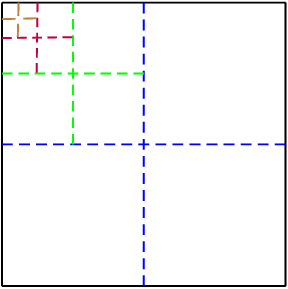
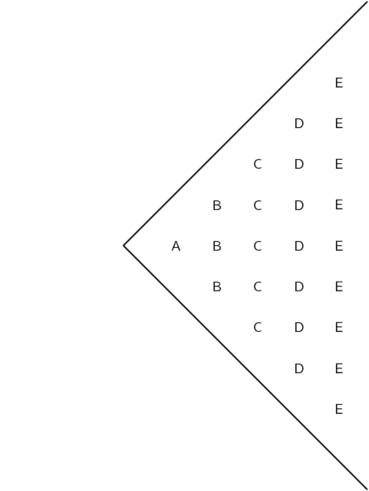

## End of chapter exercises

### Textbook Exercise 1.12

**Problem:**
Is \(1+2+3+4+\cdots\) an example of a *finite series* or an
                                                *infinite series*?

**Solution:**
Infinite arithmetic series

A new soccer competition requires each of \(\text{8}\) teams to play every
                                                other team once.

**Problem:**
Calculate the total number of matches to be played in the
                                                        competition.

**Solution:**
\[7 + 6 + 5 + \ldots\]

                                                \begin{align*}
                                                a &= 7 \\
                                                d &= -1 \\
                                                S_{n} &= \frac{n}{2}[2a + (n-1)d] \\
                                                S_{7} &= \frac{7}{2}[2(7) + (6)(-1)] \\
                                                &= \frac{7}{2}[8] \\
                                                &= 28
                                                \end{align*}
                                                \(S_{7} = 28\)

**Problem:**
If each of \(n\) teams played each other once, determine a formula
                                                        for the total number of matches in terms of \(n\).

**Solution:**
\[(n-1) + (n-2) + (n-3) + \ldots + 1\]

                                                \begin{align*}
                                                a &= n - 1 \\
                                                d &= -1 \\
                                                \l &= 1 \\
                                                S_{n} &= \frac{n}{2}[a + \l] \\
                                                S_{n-1} &= \frac{n-1}{2}[(n - 1) + (1)] \\
                                                &= \frac{n-1}{2}[n] \\
                                                &= \frac{n(n-1)}{2}
                                                \end{align*}

**Problem:**
Calculate:

                                        \[\sum _{k=2}^{6}3 {\left(\frac{1}{3}\right)}^{k+2}\]

**Solution:**
Number of terms = end index - start index \(+ 1\) \(= (6 - 2) + 1 = 5\)

                                        \begin{align*}
                                        k = 2: \quad T_{1} &= 3 \left( \frac{1}{3} \right)^{4} = \frac{1}{27} \\
                                        k = 3: \quad T_{2} &= 3 \left( \frac{1}{3} \right)^{5} = \frac{1}{81} \\
                                        \therefore r &= \frac{T_{2}}{T_{1}} = \frac{1}{3} \\
                                        a &= \frac{1}{27} \\
                                        \therefore S_{n} &= \frac{a(1 - r^{n})}{1 -r} \\
                                        S_{5} &= \frac{\frac{1}{27}(1 - \left( \frac{1}{3} \right)^{5})}{1 -
                                        \frac{1}{3}} \\
                                        &= \frac{\frac{1}{27}\left( \frac{242}{243} \right)}{\frac{2}{3}} \\
                                        &= \frac{242}{6561} \times \frac{3}{2} \\
                                        &= \frac{121}{2187}
                                        \end{align*}

The first three terms of a convergent geometric series are: \(\enspace x+1\);
                                                \(x-1\); \(2x-5\).

**Problem:**
Calculate the value of \(x\), (\(x \ne 1 \text{ or } 1\)).

**Solution:**
\begin{align*}
                                                r &= \frac{T_{2}}{T_{1}} = \frac{T_{3}}{T_{2}}\\
                                                \frac{x - 1}{x + 1} &= \frac{2x - 5}{x - 1} \\
                                                \therefore (x - 1)^{2} &= (2x - 5)(x + 1) \\
                                                x^{2} - 2x + 1 &= 2x^{2} - 3x - 5 \\
                                                x^{2} - x - 6 &= 0 \\
                                                (x - 3)(x + 2) &= 0 \\
                                                \therefore x = 3 &\text{ or } x = -2 \\
                                                \text{If } x &= -2 \\
                                                \text{Geometric sequence: } & -1; -3; -9 \\
                                                \therefore r &= 3 \\
                                                \therefore & \text{ will diverge } \\
                                                \text{If } x &= 3 \\
                                                \text{Geometric sequence: } & 4; 2; 1 \\
                                                \therefore r &= \frac{1}{2} \\
                                                \therefore & \text{ will converge } \\
                                                \therefore x &= 3
                                                \end{align*}

**Problem:**
Sum to infinity of the series.

**Solution:**
\begin{align*}
                                                4; \enspace 2; \enspace & 1; \ldots \\
                                                S_{\infty} &= \frac{a}{1 -r} \\
                                                &= \frac{4}{1 - \frac{1}{2}} \\
                                                &= \frac{4}{\frac{1}{2}} \\
                                                &= 8
                                                \end{align*}

**Problem:**
Write the sum of the first twenty terms of the following series in \(\sum\)
                                                notation.

                                        \[6+3+\frac{3}{2}+\frac{3}{4}+\cdots\]

**Solution:**
This is a geometric series:

                                        \begin{align*}
                                        a &= 6 \\
                                        r &= \frac{1}{2} \\
                                        T_{n} &= ar^{n-1} \\
                                        &= 6 \left( \frac{1}{2} \right)^{n-1} \\
                                        \therefore & \sum_{n=1}^{20}{6\left( \frac{1}{2} \right)^{n-1} }
                                        \end{align*}

**Problem:**
Determine:

                                        \[\sum _{k=1}^{\infty }12{\left(\frac{1}{5}\right)}^{k-1}\]

**Solution:**
\begin{align*}
                                        \sum _{k=1}^{\infty }12{\left(\frac{1}{5}\right)}^{k-1} & \\
                                        \therefore & \text{ this is a geometric sequence } \\
                                        r &= \frac{1}{5} \\
                                        \therefore & \text{ series converges } \\
                                        a &= 12 \\
                                        S_{\infty} &= \frac{a}{1 - r} \\
                                        &= \frac{12}{1 - \frac{1}{5}} \\
                                        &= \frac{12}{ \frac{4}{5}} \\
                                        &= 15
                                        \end{align*}

A man was injured in an accident at work. He receives a disability grant of
                                                \(\text{R}\,\text{4 800}\) in the first year. This grant increases with
                                                a fixed amount each year.

**Problem:**
What is the annual increase if he received a total of
                                                        \(\text{R}\,\text{143 500}\) over \(\text{20}\) years?

**Solution:**
\[4800 + (4800 + d) + (4800 + 2d) + \ldots\]

This is an arithmetic series.

                                                \begin{align*}
                                                a &= \text{4 800} \\
                                                S_{n} &= \frac{n}{2}[2a + (n - 1)d] \\
                                                S_{20} &= \frac{20}{2}[2(\text{4 800}) + (20 - 1)d] \\
                                                \text{And } S_{20} &= \text{143 500} \\
                                                \therefore \text{143 500} &= 10 [\text{9 600} + 19d] \\
                                                \text{14 350} &= \text{9 600} + 19d \\
                                                \text{4 750} &= 19d \\
                                                \therefore 250 &= d
                                                \end{align*}

**Problem:**
His initial annual expenditure is \(\text{R}\,\text{2 600}\), which
                                                        increases at a rate of \(\text{R}\,\text{400}\) per year. After
                                                        how many years will his expenses exceed his income?

**Solution:**
\[2600 + 3000 + 3400 + \ldots\]

This is an arithmetic series.

                                                \begin{align*}
                                                a &= 2600 \\
                                                d &= 400 \\
                                                S_{n} &= \frac{n}{2}[2a + (n - 1)d] \\
                                                S_{\text{expenses}} &= \frac{n}{2}[2(2600) + (n - 1)(400)] \\
                                                S_{e} &= \frac{n}{2}[5200 + 400n - 400] \\
                                                &= \frac{n}{2}[4800 + 400n]
                                                \end{align*}
                                                \begin{align*}
                                                S_{\text{income}} &= \frac{n}{2}[2(4800) + (n - 1)(250)] \\
                                                S_{i} &= \frac{n}{2}[2(4800) + (n - 1)(250)] \\
                                                &= \frac{n}{2}[9600 + 250n - 250] \\
                                                &= \frac{n}{2}[9350 + 250n]
                                                \end{align*}
                                                \begin{align*}
                                                \text{let } S_{e} &= S_{i} \\
                                                \frac{n}{2}[4800 + 400n] &= \frac{n}{2}[9350 + 250n] \\
                                                4800 + 400n &= 9350 + 250n \\
                                                150n &= 4550 \\
                                                \therefore n &= \frac{4550}{150} \\
                                                &= \text{30,333} \ldots
                                                \end{align*}

Therefore his expenses will exceed his income after \(\text{30}\)
                                                        years.

**Problem:**
The length of the side of a square is \(\text{4}\) units. This square is
                                                divided into \(\text{4}\) equal, smaller squares. One of the smaller
                                                squares is then divided into four equal, even smaller squares. One of
                                                the even smaller squares is divided into four, equal squares. This
                                                process is repeated indefinitely. Calculate the sum of the areas of the
                                                squares formed by this process of division.

**Solution:**

This gives the geometric series: \[16 + 4 + 1 + \frac{1}{4} + \ldots\]

                                        \begin{align*}
                                        a &= 16 \\
                                        r &= \frac{1}{4} \\
                                        S_{\infty} &= \frac{a}{1 - r} \\
                                        &= \frac{16}{1 - \frac{1}{4}} \\
                                        &= \frac{16}{\frac{3}{4}} \\
                                        &= \frac{64}{3}
                                        \end{align*}

**Problem:**
Thembi worked part-time to buy a Mathematics book which costs
                                                \(\text{R}\,\text{29,50}\). On 1 February she saved
                                                \(\text{R}\,\text{1,60}\), and every day saves \(\text{30}\)
                                                \(\text{cents}\) more than she saved the previous day. So, on the second
                                                day, she saved \(\text{R}\,\text{1,90}\), and so on. After how many days
                                                did she have enough money to buy the book?

**Solution:**
\[\text{1,60} + \text{1,90} + \text{2,10} + \ldots\]

This is an arithmetic series.

                                        \begin{align*}
                                        a &= \text{1,60} \\
                                        d &= \text{0,3} \\
                                        S_{n} &= \frac{n}{2}[2a + (n-1)d] \\
                                        \therefore \text{29,50} &= \frac{n}{2}[2(\text{1,60}) + (n-1)(\text{0,3})]
                                        \\
                                        \text{59} &= n[\text{3,2} + \text{0,3}n - \text{0,3} ] \\
                                        \text{59} &= \text{2,9}n + \text{0,3}n^{2} \\
                                        (\times 10:) \quad 590 &= 29n + 3n^{2} \\
                                        0 &= 3n^{2} + 29n - 590 \\
                                        0 &= (3n + 59)(n - 10) \\
                                        \therefore n = -\frac{59}{3} &\text{ or } n = 10 \\
                                        \therefore n & = 10
                                        \end{align*}

since \(n\) must be a positive integer.

**Problem:**
A plant reaches a height of \(\text{118}\) \(\text{mm}\)
                                                after one year under ideal conditions in a greenhouse. During the next
                                                year, the height increases by \(\text{12}\) \(\text{mm}\). In each
                                                successive year, the height increases by \(\frac{5}{8}\) of the previous
                                                year's growth. Show that the plant will never reach a height of more
                                                than \(\text{150}\) \(\text{mm}\).

**Solution:**
\[12 + 12 \left( \frac{5}{8} \right) + 12 \left( \frac{5}{8} \right)^{2} +
                                        \ldots
                                        12 \left( \frac{5}{8} \right)^{n-1}\]

This is a geometric series.

                                        \begin{align*}
                                        a &= 12 \\
                                        r &= \frac{5}{8} \\
                                        S_{\infty} &= \frac{a}{1 - r} \\
                                        &= \frac{12}{1 - \frac{5}{8}} \\
                                        &= \frac{12}{\frac{3}{8}} \\
                                        &= 32
                                        \end{align*}

Therefore the height of the plant is limited to \(\text{118}\) \(\text{mm}\)
                                                + \(\text{32}\) \(\text{mm}\) = \(\text{150}\) \(\text{mm}\)

**Problem:**
Calculate the value of \(n\) if:

                                        \[\sum_{a=1}^{n} \left(20-4a\right)=-20\]

**Solution:**
\[16 + 12 + 8 + \ldots\]

This is an arithmetic series.

                                        \begin{align*}
                                        a &= 16 \\
                                        d &= -4 \\
                                        S_{n} &= \frac{n}{2}[2a + (n-1)d] \\
                                        -20 &= \frac{n}{2}[2(16) + (n-1)(-4)] \\
                                        -40 &= n[32 - 4n + 4] \\
                                        -40 &= 36n - 4n^{2} \\
                                        0 &= - 4n^{2} + 36n + 40 \\
                                        &= n^{2} - 9n - 10 \\
                                        &= (n + 1)(n - 10) \\
                                        &= (n + 1)(n - 10) \\
                                        \therefore n = -1 & \text{ or } n = 10 \\
                                        \therefore n &= 10
                                        \end{align*}

since \(n\) must be a positive integer.

Michael saved \(\text{R}\,\text{400}\) during the first month of his working
                                                life. In each subsequent month, he saved \(\text{10}\%\) more than what
                                                he had saved in the previous month.

**Problem:**
How much did he save in the seventh working month?

**Solution:**
\[400 + 400(\text{1,1}) + 400(\text{1,1})^{2} + \ldots\]

This is a geometric series.

                                                \begin{align*}
                                                a &= 400 \\
                                                r &= \text{1,1} \\
                                                T_{n} &= ar^{n-1} \\
                                                \therefore T_{7} &= 400(\text{1,1})^{6} \\
                                                &= \text{708,62}
                                                \end{align*}

Therefore he saved \(\text{R}\,\text{708,62}\) in seventh month.

**Problem:**
How much did he save all together in his first \(\text{12}\) working
                                                        months?

**Solution:**
\begin{align*}
                                                S_{12} &= \frac{a(1 - r^{n})}{1 - r} \\
                                                &= \frac{400(1 - (\text{1,1})^{12})}{1 - \text{1,1}} \\
                                                &= \text{8 553,71}
                                                \end{align*}

Therefore he saved \(\text{R}\,\text{8 553,71}\) in first
                                                        \(\text{12}\) months.

The Cape Town High School wants to build a school hall and is busy with
                                                fundraising. Mr. Manuel, an ex-learner of the school and a successful
                                                politician, offers to donate money to the school. Having enjoyed
                                                mathematics at school, he decides to donate an amount of money on the
                                                following basis.
                                                He sets a mathematical quiz with \(\text{20}\) questions. For the
                                                correct answer to the first question (any learner may answer), the
                                                school will receive \(\text{R}\,\text{1}\), for a correct answer to the
                                                second question, the school will receive \(\text{R}\,\text{2}\), and so
                                                on. The donations \(1;2;4; \ldots\) form a geometric sequence.
                                                Calculate, to the nearest Rand:

**Problem:**
The amount of money that the school will receive for the correct
                                                        answer to the \(20^{\text{th}}\) question.

**Solution:**
\[1 + 2 + 4 + \ldots\]

This is a geometric series.

                                                \begin{align*}
                                                a &= 1 \\
                                                r &= 2 \\
                                                T_{n}&= ar^{n-1} \\
                                                \therefore T_{20}&= (1) \left( 2^{19} \right) \\
                                                &= \text{524 288}
                                                \end{align*}

They receive \(\text{R}\,\text{524 288}\) for question \(\text{20}\).

**Problem:**
The total amount of money that the school will receive if all
                                                        \(\text{20}\) questions are answered correctly.

**Solution:**
\begin{align*}
                                                S_{n}&= \frac{a (r^{n} - 1)}{ r - 1} \\
                                                &= \frac{(1)[2^{20} - 1]}{2 - 1} \\
                                                &= \text{1 048 575}
                                                \end{align*}

They receive \(\text{R}\,\text{1 048 575}\)!

**Problem:**
The first term of a geometric sequence is \(\text{9}\), and the ratio of the
                                                sum of the first eight terms to the sum of the first four terms is
                                                \(97:81\). Find the first three terms of the sequence, if it is given
                                                that all the terms are positive.

**Solution:**
\begin{align*}
                                        S_{n} &= \frac{a(1 - r^{n})}{1 - r} \\
                                        a &= 9 \\
                                        \frac{S_{8}}{S_{4}} &= \frac{97}{81} \\
                                        &= \frac{\frac{9(1 - r^{8})}{1 - r}}{\frac{9(1 - r^{4})}{1 - r}} \\
                                        &= \frac{1 - r^{8}}{1 - r^{4}} \\
                                        \therefore \frac{97}{81} &= \frac{1 - r^{8}}{1 - r^{4}} \\
                                        \frac{97}{81} &= \frac{(1 - r^{4})(1 + r^{4})}{1 - r^{4}} \\
                                        \frac{97}{81} &= 1 + r^{4} \\
                                        \frac{16}{81} &= r^{4} \\
                                        \therefore r &= \pm \frac{2}{3} \\
                                        \text{But terms are positive } \therefore r &= \frac{2}{3}
                                        \end{align*}
                                        \[9; 6; 4; \ldots\]

Given the geometric sequence: \(6+p ; 10+p ; 15+p\)

**Problem:**
Determine \(p\), (\(p \ne -\text{6} \text{ or } -\text{10}\)).

**Solution:**
\begin{align*}
                                                \frac{10 + p}{6 + p} &= \frac{15 + p}{10 + p} \\
                                                \therefore (10 + p)(10 + p) &= (15 + p)(6 + p) \\
                                                100 + 20p + p^{2} &= 90 + 21p + p^{2} \\
                                                \therefore p &= 10
                                                \end{align*}

**Problem:**
Show that the constant ratio is \(\frac{5}{4}\).

**Solution:**
\begin{align*}
                                                r &= \frac{10 + p}{6 + p} \\
                                                &= \frac{20}{16} \\
                                                &= \frac{5}{4}
                                                \end{align*}

**Problem:**
Determine the tenth term of this sequence correct to one decimal
                                                        place.

**Solution:**
\begin{align*}
                                                T_{n} &= ar^{n-1} \\
                                                T_{10} &= (16) \left( \frac{5}{4} \right)^{9} \\
                                                &= \text{119,2}
                                                \end{align*}

                                                \(T_{10} = \text{119,2}\)

**Problem:**
The second and fourth terms of a convergent geometric series are
                                                \(\text{36}\) and \(\text{16}\), respectively. Find the sum to infinity
                                                of this series, if all its terms are positive.

**Solution:**
\begin{align*}
                                        \frac{T_{4}}{T_{2}} &= \frac{ar^{3}}{ar} \\
                                        &= \frac{16}{36} \\
                                        \therefore r^{2} &= \frac{16}{36} \\
                                        r &= \pm \frac{2}{3} \\
                                        \text{But terms are positive, } r &= \frac{2}{3} \\
                                        T_{2} &= ar \\
                                        &= 36
                                        \end{align*}
                                        \begin{align*}
                                        a \left( \frac{2}{3} \right) &= 36 \\
                                        \therefore a &= 54 \\
                                        S_{\infty} &= \frac{a}{1 - r} \\
                                        &= \frac{54}{1 - \frac{2}{3}} \\
                                        &= 162
                                        \end{align*}

**Problem:**
Evaluate: \[\sum _{k=2}^{5}\frac{k\left(k+1\right)}{2}\]

**Solution:**
\[\frac{2(2 + 1)}{2} + \frac{3(3 + 1)}{2} + \frac{4(4 + 1)}{2} + \frac{5(5 +
                                        1)}{2}\]

                                        \[3 + 6 + 10 + 15 = 34\]

**Problem:**
\({S}_{n}=4{n}^{2}+1\) represents the sum of the first \(n\) terms of a
                                                particular series. Find the second term.

**Solution:**
\begin{align*}
                                        S_{n} &= 4{n}^{2}+1 \\
                                        S_{1} &= 4{(1)}^{2}+1 = 5 \\
                                        S_{2} &= 4{(2)}^{2}+1 = 17 \\
                                        T_{2} &= S_{2} - S_{1} \\
                                        &= 17 - 5 \\
                                        &= 12
                                        \end{align*}

Determine whether the following series converges for the given values of
                                                \(x\). If it does converge, calculate the sum to infinity.
                                                \[\sum _{p=1}^{\infty }{\left(x+2\right)}^{p}\]

**Problem:**
\(x=-\frac{5}{2}\)

**Solution:**
\begin{align*}
                                                x &= -\frac{5}{2} \\
                                                \sum _{p=1}^{\infty }{\left(x+2\right)}^{p} &= \sum _{p=1}^{\infty
                                                }{\left( -\frac{5}{2}+2\right)}^{p} \\
                                                &= \sum _{p=1}^{\infty }{\left( -\frac{1}{2}\right)}^{p}
                                                \end{align*}
                                                \[-\frac{1}{2}; \frac{1}{4}; -\frac{1}{8}; \ldots\]

This is a geometric sequence.

                                                \begin{align*}
                                                r &= -\frac{1}{2} \\
                                                \therefore & \text{ series converges since } \\
                                                -1 & < r < 1 \\
                                                S_{\infty} &= \frac{a}{1 - r} \\
                                                &=\frac{-\frac{1}{2}}{1 - \left( -\frac{1}{2} \right)} \\
                                                &= \frac{-\frac{1}{2}}{\frac{3}{2}} \\
                                                &= -\frac{1}{3}
                                                \end{align*}

**Problem:**
\(x=-5\)

**Solution:**
\begin{align*}
                                                x &= -5 \\
                                                \sum _{p=1}^{\infty }{\left(x+2\right)}^{p} &= \sum _{p=1}^{\infty
                                                }{\left( -5+2\right)}^{p} \\
                                                &= \sum _{p=1}^{\infty }{\left( -3 \right)}^{p}
                                                \end{align*}
                                                \[-3; 9; -27; \ldots\]

This is a geometric sequence.

                                                \begin{align*}
                                                r &= -3 \\
                                                \therefore & \text{ series does not converge since } r < -1
                                                \end{align*}

**Problem:**
Calculate: \[\sum _{i=1}^{\infty } 5 \left( {4}^{-i} \right)\]

**Solution:**
\[\frac{5}{4}; \frac{5}{4^{2}}; \frac{5}{4^{3}}; \ldots \frac{5}{4^{n}}\]

This is a geometric sequence.

                                        \begin{align*}
                                        r &= \frac{1}{4} \\
                                        a &= \frac{5}{4} \\
                                        S_{\infty} &= \frac{a}{1 - r} \\
                                        &= \frac{\frac{5}{4}}{1 - \frac{1}{4}}\\
                                        &= \frac{5}{3}
                                        \end{align*}

**Problem:**
The sum of the first \(p\) terms of a sequence is \(p \left(p+1\right)\).
                                                Find the tenth term.

**Solution:**
\begin{align*}
                                        p=10: \quad S_{10} & = 10(10 + 1)= 110 \\
                                        p=9: \quad S_{9} &= 9(9 + 1) = 90 \\
                                        \text{And } T_{10} &= S_{10} - S_{9} \\
                                        \therefore T_{10} &= 110 - 90 \\
                                        &= 20
                                        \end{align*}

Alternative method:

                                        \begin{align*}
                                        p=1: \quad S_{1} &=a = 1(1 + 1)= 2 \\
                                        p=2: \quad S_{2} &= 2(2 + 1) = 6 \\
                                        \text{And } S_{2} &=T_{1} + T_{2} = 6 \\
                                        \therefore T_{2} &= 6 - 2 = 4 \\
                                        S_{3} &=T_{1} + T_{2} + T_{3}= 3 \times 4 = 12 \\
                                        \therefore T_{3} &= 12 - 6 = 6
                                        \end{align*}
                                        \[2; 4; 6; \ldots\]

This is an arithmetic sequence.

                                        \begin{align*}
                                        a &= 2 \\
                                        d &= 2 \\
                                        T_{n} &= a + (n -1)d \\
                                        T_{10} &= 2 + (10 -1)(2) \\
                                        &= 20
                                        \end{align*}

**Problem:**
The powers of \(\text{2}\) are removed from the following set of positive
                                                integers

                                        \(1; 2; 3; 4; 5; 6; \ldots;1998; 1999; 2000\)

Find the sum of remaining integers.

**Solution:**
\[1; 2^{1}; 3; 2^{2}; 5; 6; \ldots 2000\]

                                        \begin{align*}
                                        S_{n} &= \frac{n}{2}[a + \l] \\
                                        S_{2000} &= \frac{2000}{2}[1 + 2000]\\
                                        &= 1000(2001) \\
                                        &= 2001000
                                        \end{align*}

Remove the powers of \(\text{2}\) to make a separate series:

                                        \[2^{0}; 2^{1}; 2^{2}; \ldots 2^{10}\]

This is a geometric series.

                                        \begin{align*}
                                        a &= 1 \\
                                        r &= 2 \\
                                        S_{n} &= \frac{a(r^{n} - 1)}{r - 1} \\
                                        S_{11} &= \frac{1(2^{11} - 1)}{2 - 1} \\
                                        &= 2047 \\
                                        \therefore S_{2000} - S_{11} &= 2001000 - 2047 \\
                                        &= 1998953
                                        \end{align*}

Observe the pattern below:

**Problem:**
If the pattern continues, find the number of letters in the column
                                                        containing M's.

**Solution:**
\[1; 3; 5; 7; \ldots\]

This is an arithmetic series.

                                                \begin{align*}
                                                a &= 1 \\
                                                d &= 2 \\
                                                T_{n} &= a + (n -1)d \\
                                                \text{For the letter M: } \quad & n=13: \\
                                                \quad T_{13} &= 1 + (12)(2) \\
                                                &= 25
                                                \end{align*}

**Problem:**
If the total number of letters in the pattern is \(\text{361}\),
                                                        which letter will be in the last column.

**Solution:**
\begin{align*}
                                                S_{n} &= \frac{n}{2}[2a + (n - 1)d] \\
                                                361 &= \frac{n}{2}[2a + (n - 1)(2)] \\
                                                361 &= n[1 + n - 1] \\
                                                361 &= n^{2} \\
                                                \therefore n &= \pm 19 \\
                                                \therefore n &= 19
                                                \end{align*}

so the letter “s” will be in the last column.

**Problem:**
Write \(\text{0,5}\dot{\text{7}}\) as a proper fraction.

**Solution:**
Rewrite the recurring decimal:

                                        \begin{align*}\text{0,5}\dot{\text{7}} &= \text{0,5} +
                                        \text{0,0}\dot{\text{7}} \\
                                        \text{0,5}\dot{\text{7}} &= \text{0,5} + [\text{0,07} + \text{0,007} +
                                        \ldots ]
                                        \end{align*}

The part in the square brackets is a geometric series with \(a =
                                                \frac{7}{100}\) and \(r = \frac{1}{10}\).

                                        \begin{align*}
                                        S_{\infty} &= \frac{a}{1 -r} \\
                                        &= \frac{\frac{7}{100}}{1 - \frac{1}{10}} \\
                                        &= \frac{\frac{7}{100}}{ \frac{9}{10}} \\
                                        &= \frac{7}{90} \\
                                        \therefore \text{0,5}\dot{\text{7}} &= \text{0,5} + \text{0,0}\dot{\text{7}}
                                        \\
                                        &= \frac{1}{2} + \frac{7}{90} \\
                                        &= \frac{52}{90} \\
                                        &= \frac{26}{45}
                                        \end{align*}

Given:

                                        \[f(x) = \sum_{p=1}^{\infty}{\frac{(1 + x)^{p}}{1 - x}}\]

**Problem:**
For which values of \(x\) will \(f(x)\) converge?

**Solution:**
\[\frac{(1+x)}{1 - x} + \frac{(1+x)^{2}}{1 - x} + \frac{(1+x)^{3}}{1 -
                                                x} + \ldots\]

This is a geometric series with \(a = \frac{(1+x)}{1 - x}\) and \(r =
                                                        (1 + x)\). For the series to converge:

                                                \begin{align*}
                                                -1 &< r < 1 \\
                                                -1 &< 1 + x < 1 \\
                                                -2 &< x < 0
                                                \end{align*}

**Problem:**
Determine the value of \(f \left( -\frac{1}{2} \right)\).

**Solution:**
\begin{align*}
                                                S_{\infty} &= \frac{a}{1 - r} \\
                                                &= \frac{\frac{1+x}{1-x}}{1 - (1 + x)} \\
                                                &= \frac{1 + x}{(1 - x)(-x)} \\
                                                \text{Substitute } x&= -\frac{1}{2} \\
                                                f(-\frac{1}{2})&= \frac{\frac{1}{2}}{\left(\frac{3}{2}\right)
                                                \left(\frac{1}{2}\right)} \\
                                                &= \frac{2}{3}
                                                \end{align*}

**Problem:**
From the definition of a geometric sequence, deduce a formula for
                                        calculating the sum of \(n\) terms of the series \[a^{2} + a^{4} + a^{6} +
                                        \cdots\]

**Solution:**
\begin{align*}
                                        r &= a^{2} \\
                                        T_{n} &= a^{2n} \\
                                        \therefore S_{n} &= a^{2} + a^{4} + a^{6} + \ldots + a^{2n - 2} + a^{2n}
                                        \ldots \ldots (1) \\
                                        r \times S_{n} = a^{2}S_{n} &= \qquad a^{4} + a^{6} + \ldots + a^{2n} +
                                        a^{2n + 2} \ldots \ldots (2) \\
                                        (1) - (2): \quad S_{n} - a^{2}S_{n} &= a^{2} - a^{2n + 2} \\
                                        S_{n}(1 - a^{2}) &= a^{2} - a^{2} \cdot a^{2n} \\
                                        \therefore S_{n} &= \frac{a^{2}(1 - a^{2n})}{(1 - a^{2})}
                                        \end{align*}

**Problem:**
Calculate the tenth term of the series if \(S_{n} = 2n + 3n^{2}\).

**Solution:**
\begin{align*}
                                        p=10: \quad S_{10} &= 2(10) + 3(10)^{2} \\
                                        & = 20 + 300 = 320 \\
                                        p=9: \quad S_{9} &= 2(9) + 3(9)^{2} \\
                                        &= 18 + 243 = 261 \\
                                        \text{And } T_{10} &= S_{10} - S_{9} \\
                                        \therefore T_{10} &= 320 - 261 \\
                                        &= 59
                                        \end{align*}

Alternative method:

                                        \begin{align*}
                                        S_{1} &= T_{1} = 5 \\
                                        S_{2} &= T_{1} + T_{2} = 16 \\
                                        \therefore T_{2} &= 16 - 5 \\
                                        &= 11 \\
                                        S_{3} &= 2(3) + 3(3)^{2} = 33 \\
                                        \therefore 33 &= T_{3} + S_{2} \\
                                        \therefore T_{3} &= 17 \\
                                        S_{n} &= 5 + 11 + 17 + \ldots \\
                                        d &= 11 - 5 = 6 \\
                                        d &= 17 - 11 = 6 \\
                                        \therefore & \text{ this is an arithmetic series} \\
                                        T_{10} &= a + (n-1)d \\
                                        &= 5 + (9)(6) \\
                                        &= 59
                                        \end{align*}

**Problem:**
A theatre is filling up at a rate of \(4\) people in the first minute,
                                                \(\text{6}\) people in the second minute, and \(\text{8}\) people in the
                                                third minute and so on. After \(\text{6}\) minutes the theatre is half
                                                full. After how many minutes will the theatre be full?

[IEB, Nov 2001]

**Solution:**
\[4 + 6 + 8 + \ldots\]

                                        \begin{align*}
                                        d &= T_{2} - T_{1} \\
                                        &= 6 - 4 \\
                                        &= 2 \\
                                        d &= T_{3} - T_{2} \\
                                        &= 8 - 6 \\
                                        &= 2 \\
                                        \therefore & \text{ this is an arithmetic series} \\
                                        S_{n} &= \frac{n}{2}[2a + (n-1)d] \\
                                        S_{6} &= \frac{6}{2}[2(4) + (5)(2)] \\
                                        &=3 (18) \\
                                        &= 54 \quad \text{(theatre half full)}\\
                                        \therefore 2 \times 54 &= 108 \quad \text{(theatre full)}\\
                                        S_{n} &= \frac{n}{2}[2a + (n-1)d] \\
                                        108 &= \frac{n}{2}[2(4) + (n-1)(2)] \\
                                        216 &= n[8 + 2n - 2] \\
                                        0 &= 2n^{2} + 6n - 216 \\
                                        0 &= n^{2} + 3n - 108 \\
                                        0 &= (n + 12)(n - 9) \\
                                        \therefore n = -12 &\text{ or } n = 9 \\
                                        n & \text{ must be a positive integer } \\
                                        \therefore n &= 9
                                        \end{align*}

It takes \(\text{9}\) minutes for the theatre to be full.
