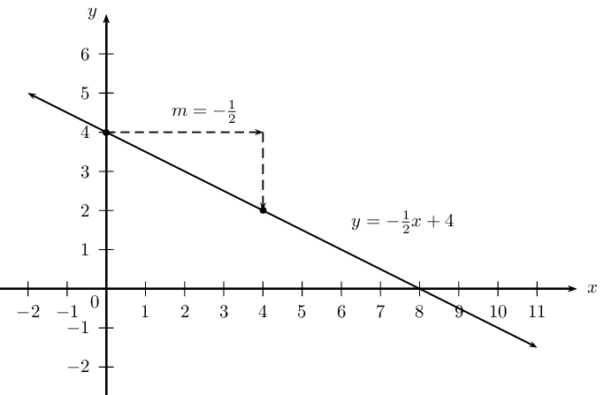
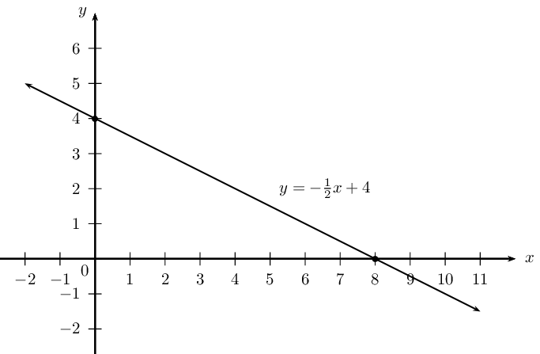
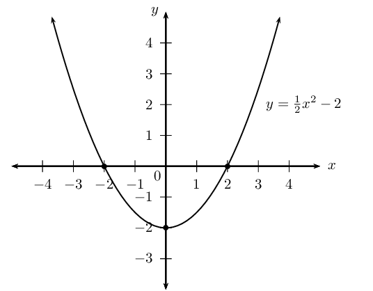
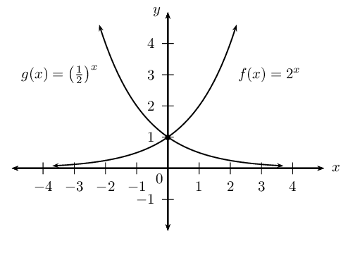
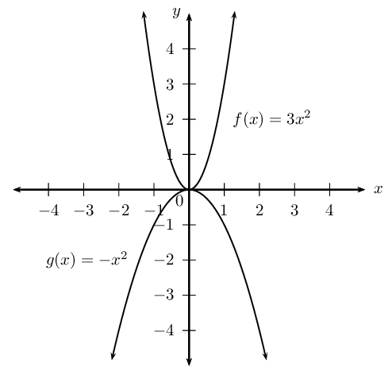
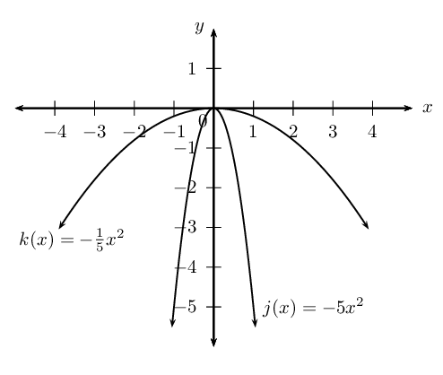
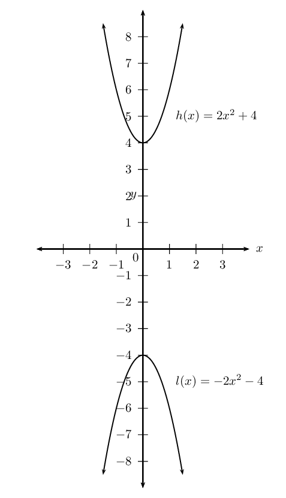
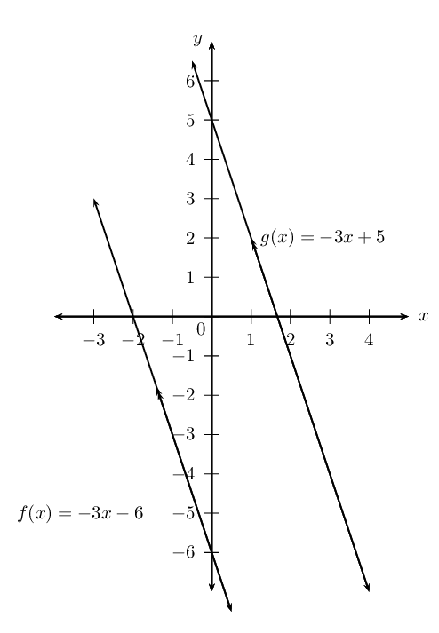
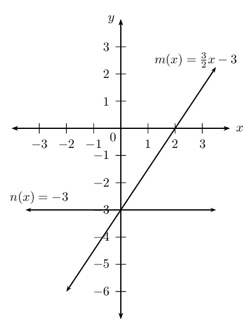
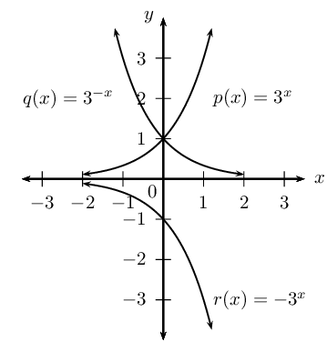

# Chapter 2: Functions

- Learners must be encouraged to check whether or not the inverse is a function.
- It is very important that learners understand that \(f^{-1}(x)\) notation can only be used if the inverse is a
          function.
- Learners must not confuse the inverse function \(f^{-1}\) and the reciprocal \(\frac{1}{f(x)}\).
- Encourage learners to state restrictions, particularly for quadratic functions.
- Learners must understand that \(y = \sqrt{-x}\) has real solutions for \(x < 0\).
- Exercises on parabolic functions with horizontal and vertical shifts have been included for enrichment only
          and are clearly marked.
- The logarithmic function is introduced as the inverse of the exponential function. Learners need to understand
          that the logarithmic function allows us to rewrite an exponential expression with the exponent as the subject of
          the formula.
- It is very important that learners can change from exponential form to logarithmic form and vice versa. This
          skill is also important for finding the period of an investment or loan in the Finance chapter.
- Learners should be encouraged to use the definition and change of base to solve problems. Manipulation
          involving the logarithmic laws is not examinable.
- Learners should be encouraged to be familiar with the LOG function on their calculator and also to use their
          calculator to check answers.
- Enrichment content is not examinable and is clearly marked.

## 2.1 Revision (EMCF6)

In previous grades we learned about the characteristics of linear, quadratic, hyperbolic and exponential
      functions. In this chapter we will demonstrate
      the ability to work with various types of functions and relations
      including inverses. In particular, we will look at the graphs of
      the inverses of:

Linear functions: \(y=mx+c\) or \(y = ax + q\)

Quadratic functions: \(y=a{x}^{2}\)

Exponential functions: \(y=b^{x} \quad (b > 0, b \ne 1)\)

<Callout type="tip" title="Worked example 1: Linear function">
**Question:**
Draw a graph of \(2y + x - 8 = 0\) and determine the significant characteristics of this linear function.

**Write the equation in standard form \(y = mx + c\):**
\begin{align*}
        2y + x - 8 &= 0 \\
        2y &= - x + 8 \\
        \therefore y &= -\frac{1}{2}x + 4 \\
        \therefore m &= -\frac{1}{2} \\
        \text{And } c &= 4
        \end{align*}

**Draw the straight line graph:**
To draw the straight line graph we can use the gradient-intercept method:

        \begin{align*}
        y-\text{intercept}: \enspace & (0;4) \\
        m &= -\frac{1}{2}
        \end{align*}

Alternative method: we can also determine and plot the \(x\)- and \(y\)-intercepts as follows:

For the \(y\)-intercept, let \(x = 0\):

        \begin{align*}
        y &= -\frac{1}{2}(0) + 4 \\
        \therefore y &= 0 + 4 \\
        &= 4
        \end{align*}

This gives the point \((0;4)\).

For the \(x\)-intercept, let \(y = 0\):

        \begin{align*}
        0 &= -\frac{1}{2}x + 4 \\
        \frac{1}{2}x &= 4 \\
        \therefore x &= 8
        \end{align*}

This gives the point \((8;0)\).

**Determine the characteristics:**
Gradient: \(-\frac{1}{2}\)

Intercepts: \((0;4) \text{ and } (8;0)\)

Domain: \(\{x: x \in \mathbb{R} \}\)

Range: \(\{y: y \in \mathbb{R} \}\)

Decreasing function: as \(x\) increases, \(y\) decreases.
</Callout>

<Callout type="tip" title="Worked example 2: Quadratic function">
**Question:**
Write the quadratic function \(2y - x^{2} + 4 = 0\) in standard form. Draw a graph of the function and state
          the significant characteristics.

**Write the equation in standard form \(y = ax^{2} + bx + c\):**
\begin{align*}
        2y - x^{2} + 4 &= 0 \\
        2y &= x^{2} - 4 \\
        y &= \frac{1}{2}x^{2} - 2
        \end{align*}

Therefore, we see that:

\[a = \frac{1}{2}; \qquad b = 0; \qquad c = -2\]

**Draw a graph of the parabola:**
For the \(y\)-intercept, let \(x = 0\):

        \begin{align*}
        y &= \frac{1}{2}(0)^{2} - 2 \\
        \therefore y &= 0 - 2 \\
        &= -2
        \end{align*}

This gives the point \((0;-2)\).

For the \(x\)-intercept, let \(y = 0\):

        \begin{align*}
        0 &= \frac{1}{2}x^{2} - 2 \\
        0 &= x^{2} - 4 \\
        0 &= (x - 2)(x + 2) \\
        \therefore x = -2 &\text{ or } x = 2
        \end{align*}

This gives the points \((-2;0)\) and \((2;0)\).

**State the significant characteristics:**
Shape: \(a > 0\), therefore the graph is a “smile”.

Intercepts: \((-2;0), (2;0) \text{ and } (0;-2)\)

Turning point: \((0;-2)\)

Axes of symmetry: \(x = -\frac{b}{2a} = - \frac{0}{2 \left( \frac{1}{2} \right)} = 0\)

Domain: \(\{ x: x \in \mathbb{R} \}\)

Range: \(\{ y: y \geq -2, y \in \mathbb{R} \}\)

The function is decreasing for \(x < 0\) and increasing for \(x > 0\).
</Callout>

<Callout type="tip" title="Worked example 3: Exponential function">
**Question:**
Draw the graphs of \(f(x) = 2^{x}\) and \(g(x) = \left( \frac{1}{2} \right)^{x}\) on the same set of axes and
          compare the two functions.

**Examine the functions and determine the information needed to draw the graphs:**
Consider the function: \(f(x) = 2^{x}\)

        \begin{align*}
        \text{If } y = 0: \quad 2^{x} &= 0 \\
        \text{But } 2^{x} &\ne 0 \\
        \therefore \text{ no solution} & \\
        \text{If } x = 0: \quad 2^{0} &= 1 \\
        \text{This gives the point } & (0;1).
        \end{align*}

Asymptotes: \(f(x) = 2^{x}\) has a horizontal asymptote, the line \(y = 0\), which is the \(x\)-axis.

| \(x\) | \(-2\) | \(-1\) | \(0\) | \(1\) | \(2\) |
| --- | --- | --- | --- | --- | --- |
| \(f(x)\) | \(\frac{1}{4}\) | \(\frac{1}{2}\) | \(1\) | \(2\) | \(4\) |

Consider the function: \(g(x) = \left( \frac{1}{2} \right)^{x}\)

        \begin{align*}
        \text{If } y = 0: \quad \left( \frac{1}{2} \right)^{x} &= 0 \\
        \text{But } \left( \frac{1}{2} \right)^{x} &\ne 0 \\
        \therefore \text{ no solution}& \\
        \text{If } x = 0: \quad \left( \frac{1}{2} \right)^{0} &= 1 \\
        \text{This gives the point } & (0;1).
        \end{align*}

Asymptotes: \(g(x) = \left( \frac{1}{2} \right)^{x}\) also has a horizontal asymptote at \(y = 0\).

| \(x\) | \(-2\) | \(-1\) | \(0\) | \(1\) | \(2\) |
| --- | --- | --- | --- | --- | --- |
| \(g(x)\) | \(4\) | \(2\) | \(1\) | \(\frac{1}{2}\) | \(\frac{1}{4}\) |

**Draw the graphs of the exponential functions:**

**State the significant characteristics:**
Symmetry: \(f\) and \(g\) are symmetrical about the \(y\)-axis.

Domain of \(f\) and \(g\): \(\{ x: x \in \mathbb{R} \}\)

Range of \(f\) and \(g\): \(\{ y: y > 0, y \in \mathbb{R} \}\)

The function \(g\) decreases as \(x\) increases and function \(f\) increases as \(x\) increases. The two
          graphs intersect at the point \((0;1)\).
</Callout>

## Revision

### Textbook Exercise 2.1

Sketch the graphs on the same set of axes and determine the following for each function:

- Intercepts
- Turning point
- Axes of symmetry
- Domain and range
- Maximum and minimum values

**Problem:**
\(f(x) = 3x^{2}\) and \(g(x) = - x^{2}\)

**Solution:**

For \(f(x)\):

              \begin{align*}
              \text{Intercept: } & (0;0) \\
              \text{Turning point: } & (0;0) \\
              \text{Axes of symmetry: } & x = 0 \\
              \text{Domain: } & \{x: x \in \mathbb{R} \} \\
              \text{Range: } & \{y: y \geq 0, y \in \mathbb{R} \} \\
              \text{Minimum value: } & y = 0
              \end{align*}

For \(g(x)\):

              \begin{align*}
              \text{Intercept: } & (0;0) \\
              \text{Turning point: } & (0;0) \\
              \text{Axes of symmetry: } & x = 0 \\
              \text{Domain: } & \{x: x \in \mathbb{R} \} \\
              \text{Range: } & \{y: y \leq 0, y \in \mathbb{R} \} \\
              \text{Maximum value: } & y = 0
              \end{align*}

**Problem:**
\(j(x) = - \frac{1}{5}x^{2}\) and \(k(x) = - 5x^{2}\)

**Solution:**

For \(j(x)\):

              \begin{align*}
              \text{Intercepts: } & (0;0) \enspace (0;0) \\
              \text{Turning point: } & (0;0) \\
              \text{Axes of symmetry: } & x = 0 \\
              \text{Domain: } & \{x: x \in \mathbb{R} \} \\
              \text{Range: } & \{y: y \leq 0, y \in \mathbb{R} \} \\
              \text{Maximum value: } & y = 0
              \end{align*}

For \(k(x)\):

              \begin{align*}
              \text{Intercepts: } & (0;0) \enspace (0;0) \\
              \text{Turning point: } & (0;0) \\
              \text{Axes of symmetry: } & x = 0 \\
              \text{Domain: } & \{x: x \in \mathbb{R} \} \\
              \text{Range: } & \{y: y \leq 0, y \in \mathbb{R} \} \\
              \text{Maximum value: } & y = 0
              \end{align*}

**Problem:**
\(h(x) = 2x^{2} + 4\) and \(l(x) = - 2x^{2} - 4\)

**Solution:**

For \(h(x)\):

              \begin{align*}
              \text{Intercept: } & (0;4) \\
              \text{Turning point: } & (0;4) \\
              \text{Axes of symmetry: } & x = 0 \\
              \text{Domain: } & \{x: x \in \mathbb{R} \} \\
              \text{Range: } & \{y: y \geq 4, y \in \mathbb{R} \} \\
              \text{Minimum value: } & y = 4
              \end{align*}

For \(l(x)\):

              \begin{align*}
              \text{Intercept: } & (0;-4) \\
              \text{Turning point: } & (0;-4) \\
              \text{Axes of symmetry: } & x = 0 \\
              \text{Domain: } & \{x: x \in \mathbb{R} \} \\
              \text{Range: } & \{y: y \leq -4, y \in \mathbb{R} \} \\
              \text{Maximum value: } & y = -4
              \end{align*}

**Problem:**
Given \(f(x) = -3x - 6\) and \(g(x) = mx +c\). Determine the values of \(m\) and \(c\) if \(g \parallel
              f\) and \(g\) passes through the point \((1;2)\). Sketch both functions on the same system of axes.

**Solution:**
\begin{align*}
            g(x) &= mx +c \\
            m & = -3 \\
            g(x) &= -3x +c \\
            \text{Substitute } (1;2) \quad 2 &= -3(1) + c \\
            \therefore c &= 5 \\
            \therefore g(x) &= -3x + 5 \\
            \text{Intercepts for } g: \quad & (\frac{5}{3};0);(0;5) \\
            & \\
            \text{Intercepts for } f: \quad & (-2;0);(0;-6)
            \end{align*}

**Problem:**
Given \(m: \frac{x}{2} - \frac{y}{3} = 1\) and \(n: - \frac{y}{3} = 1\). Determine the \(x\)- and
              \(y\)-intercepts and sketch both graphs on the same system of axes.

**Solution:**
For \(m(x)\):

            \begin{align*}
            \frac{x}{2} - \frac{y}{3} & = 1 \\
            \text{Let } x = 0: \quad - \frac{y}{3} & = 1 \\
            y & = -3 \\
            \text{Let } y = 0: \quad \frac{x}{2} & = 1 \\
            x & = 2 \\
            \text{Intercepts: } & (2;0);(0;-3)
            \end{align*}

For \(n(x)\):

            \begin{align*}
            - \frac{y}{3} & = 1 \\
            \therefore y & = -3 \\
            \text{Intercepts: } & (0;-3)
            \end{align*}

Write the linear function in standard form:

            \begin{align*}
            \frac{x}{2} - \frac{y}{3} & = 1 \\
            \frac{3x}{2} - y & = 3 \\
            \frac{3x}{2} - 3 & = y \\
            \therefore y &= \frac{3x}{2} - 3
            \end{align*}

Given \(p(x) = 3^{x}, q(x) = 3^{-x}\) and \(r(x) = -3^{x}\).

**Problem:**
Sketch \(p, q \text{ and } r\) on the same system of axes.

**Solution:**

**Problem:**
For each of the functions, determine the intercepts, asymptotes, domain and range.

**Solution:**
For \(p(x)\):

              \begin{align*}
              \text{Intercept: } & (0;1) \\
              \text{Asymptote: } & y = 0 \\
              \text{Domain: } & \{x: x \in \mathbb{R} \} \\
              \text{Range: } & \{y: y > 0 \}
              \end{align*}

For \(q(x)\):

              \begin{align*}
              \text{Intercept: } & (0;1) \\
              \text{Asymptote: } & y = 0 \\
              \text{Domain: } & \{x: x \in \mathbb{R} \} \\
              \text{Range: } & \{y: y > 0 \}
              \end{align*}

For \(r(x)\):

              \begin{align*}
              \text{Intercept: } & (0;-1) \\
              \text{Asymptote: } & y = 0 \\
              \text{Domain: } & \{x: x \in \mathbb{R} \} \\
              \text{Range: } & \{y: y < 0 \}
              \end{align*}
