## 2.2 Functions and relations (EMCF7)

Relation

A rule which associates each element of set \((A)\) with at least one element in set \((B)\).

Function

A rule which uniquely associates elements of one set \((A)\) with the elements of another set
                    \((B)\); each element in set \((A)\) maps to only one element in set \((B)\).

Functions can be one-to-one relations or many-to-one relations. A many-to-one relation associates two or more
            values of the independent (input) variable with a single value of the dependent (output) variable. The
            domain is the set of values to which the rule is applied \((A)\) and the range is the set of values (also
            called the images or function values) determined by the rule.

**Example of a one-to-one function: \(y = x + 1\)**

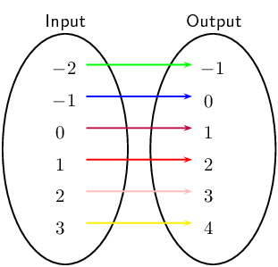

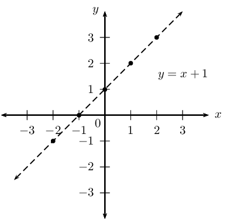

**Example of a many-to-one function: \(y = x^{2}\)**

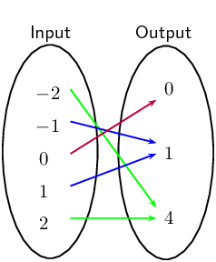

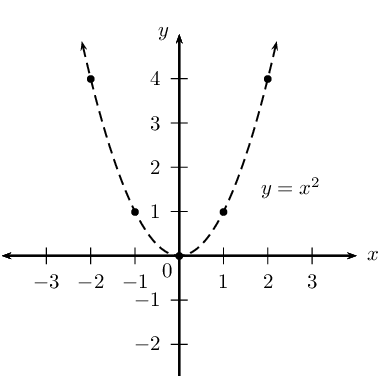

However, some very common mathematical constructions are not functions. For example, consider the relation
            \({x}^{2}+{y}^{2}=4\). This relation describes a circle of radius \(\text{2}\) centred at the origin. If we
            let \(x=0\), we see that \({y}^{2}=4\) and thus either \(y=2\) or \(y=-2\). This is a many-to-many relation
            because a single \(x\)-value relates to two different \(y\)-values. Therefore \({x}^{2}+{y}^{2}=4\) is not a
            function.

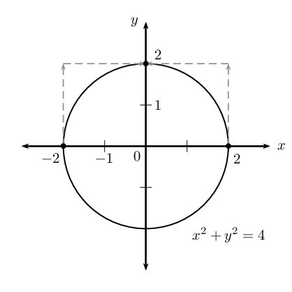

**Vertical line test**

Given the graph of a relation, there is a simple test for whether or not the relation is a function. This
            test is called the vertical line test. If it is possible to draw any vertical line (a line of constant
            \(x\)) which crosses the graph of the relation more than once, then the relation is not a function. If more
            than one intersection point exists, then the intersections correspond to multiple values of \(y\) for a
            single value of \(x\) (one-to-many).

If any vertical line cuts the graph only once, then the relation is a function (one-to-one or many-to-one).

The red vertical line cuts the circle twice and therefore the circle is not a function.

The red vertical line only cuts the parabola once and therefore the parabola is a function.

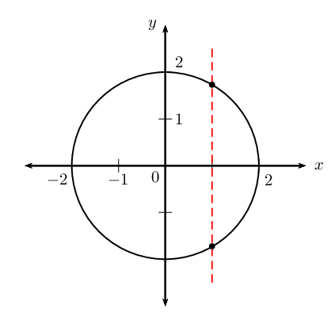

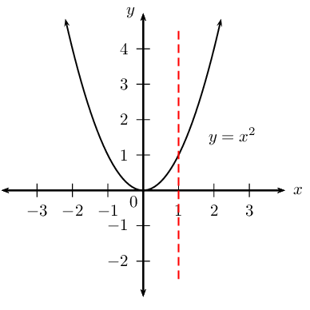

## Identifying functions

### Textbook Exercise 2.2

Consider the graphs given below and determine whether or not they are functions:

**Problem:**
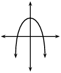

**Solution:**
Yes

**Problem:**
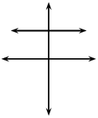

**Solution:**
Yes

**Problem:**
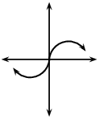

**Solution:**
Yes

**Problem:**
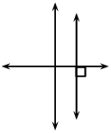

**Solution:**
No

**Problem:**
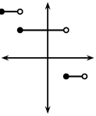

**Solution:**
Yes

**Problem:**
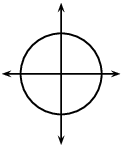

**Solution:**
No

**Problem:**
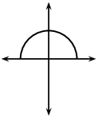

**Solution:**
Yes

**Problem:**
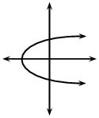

**Solution:**
No

Sketch the following and determine whether or not they are functions:

**Problem:**
\(x + y = 4\)

**Solution:**
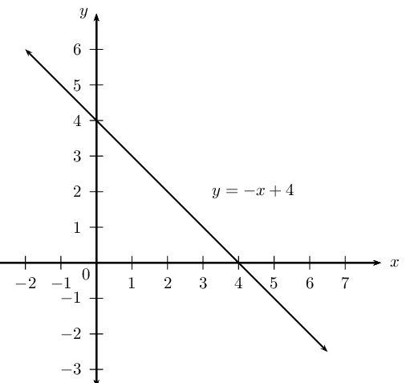

**Problem:**
\(y = \frac{x}{4}\)

**Solution:**
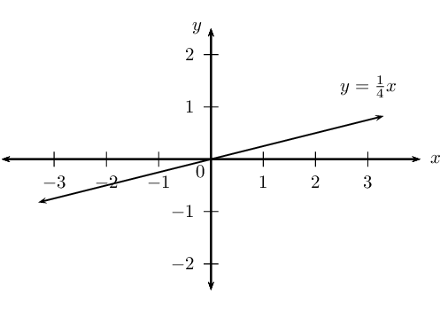

**Problem:**
\(y = 2^{x}\)

**Solution:**
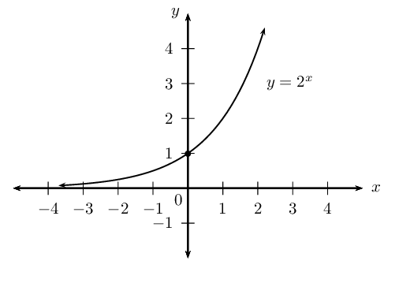

**Problem:**
\(x^{2} + y^{2} = 9\)

**Solution:**
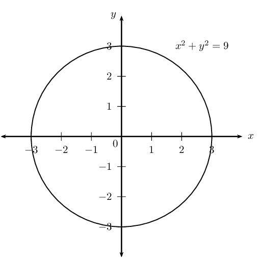

**Problem:**
\(y = \tan{x}\)

**Solution:**
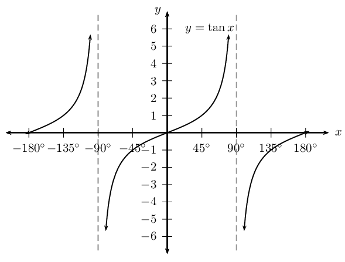

**Problem:**
The table below gives the average per capita income, \(d\), in a region of the country as a
                            function of \(u\), the percentage of
                            unemployed people. Write down an equation to show that the average income is a function of
                            the percentage of unemployed people.

| \(u\) | 1 | 2 | 3 | 4 |
| --- | --- | --- | --- | --- |
| \(d\) | \(\text{22 500}\) | \(\text{22 000}\) | \(\text{21 500}\) | \(\text{21 000}\) |

**Solution:**
Per capita income is a measure of the average amount of money earned per person in a certain
                            area.

We see that there is a constant difference of \(-\text{500}\) between the consecutive values
                            of \(d\), therefore the relation is a linear function of the form \(y = mx + c\):

\(u\) is the independent variable and \(d\) is the dependent variable.

                        \begin{align*}
                        d & = mu + c \\
                        m & = -\text{500} \\
                        d & = -\text{500}u + c
                        \end{align*}

Substitute any of the given set of values to solve for \(c\):

                        \begin{align*}
                        \text{22 500} & = -\text{500}(\text{1}) + c \\
                        \therefore c & = \text{23 000}
                        \end{align*}

The function is: \(d = -\text{500}u + \text{23 000}\)

**Function notation**

For the function \(y=f\left(x\right)\), \(y\) is the dependent variable, because the value of \(y\) (output)
            depends on the value of \(x\) (input). We say \(x\) is the independent variable, since we can choose \(x\)
            to be any number. Similarly, if \(g\left(t\right)=2t+1\), then \(t\) is the independent variable and \(g\)
            is the function name.

- If \(h\left(x\right)=3x-5\) and we need to determine when \(h\left(x\right)=3\), then we solve for
                      the value of \(x\) such that:
                  \begin{align*}
                  h\left(x\right)& = 3x-5 \\
                  3 & = 3x - 5 \\
                  8 & = 3x \\
                  \therefore x & = \frac{8}{3}
                  \end{align*}
- If \(h\left(x\right)=3x-5\) and we need to determine \(h\left(3\right)\), then we calculate the value
                      for \(h\left(x\right)\) when \(x=3\):
                  \begin{align*}
                  h\left(x\right)& = 3x-5 \\
                  h\left(3\right)& = 3\left(3\right)-5 \\
                  & = 4
                  \end{align*}
