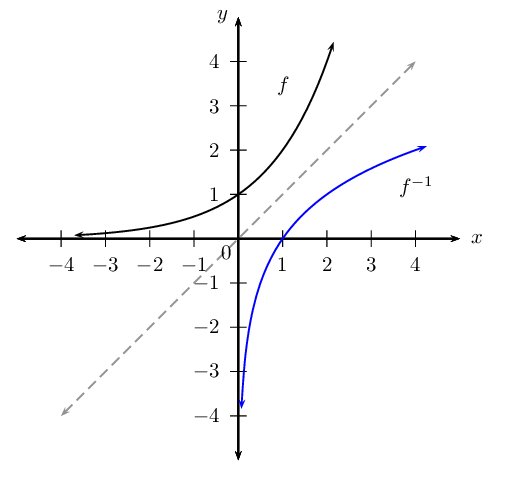

## 2.3 Inverse functions (EMCF8)

An inverse function is a function which does the “reverse” of a given function. More formally, if
      \(f\) is a function with domain \(X\), then \({f}^{-1}\) is its inverse function if and only if
      \({f}^{-1}\left(f\left(x\right)\right)=x\) for every \(x \in X\).

    \begin{align*}
    & \\
    y = f(x) &: \text{indicates a function} \\
    & \\
    {y}_{1} = f\left({x}_{1}\right) &: \text{indicates we must substitute a specific } x_{1} \text{ value} \\
    & \quad \text{into the function to get the corresponding } y_{1}\text{ value} \\
    & \\
    {f}^{-1}\left(y\right) = x &: \text{indicates the inverse function} \\
    & \\
    {f}^{-1}\left(y_{1}\right) = {x}_{1} &: \text{indicates we must substitute a specific } y_{1} \text{ value} \\
    & \quad \text{into the inverse to return the specific } x_{1}\text{ value}
    \end{align*}

A function must be a one-to-one relation if its inverse is to be a function. If a function \(f\) has an inverse
      function \(f^{-1}\), then \(f\) is said to be invertible.

Given the function \(f(x)\), we determine the inverse \(f^{-1}(x)\) by:

- interchanging \(x\) and \(y\) in the equation;
- making \(y\) the subject of the equation;
- expressing the new equation in function notation.

**Note:** if the inverse is not a function then it cannot be written in function notation. For
      example, the inverse of \(f(x) = 3x^2\) cannot be written as \(f^{-1}(x) = \pm \sqrt{\frac{1}{3}x}\) as it is not
      a function. We write the inverse as \(y = \pm \sqrt{\frac{1}{3}x}\) and conclude that \(f\) is not invertible.

If we represent the function \(f\) and the inverse function \({f}^{-1}\) graphically, the two graphs are
      reflected about the line \(y=x\). Any point on the line \(y = x\) has \(x\)- and \(y\)-coordinates with the same
      numerical value, for example \((-3;-3)\) and \(\left( \frac{4}{5}; \frac{4}{5} \right)\). Therefore interchanging
      the \(x\)- and \(y\)-values makes no difference.

This diagram shows an exponential function (black graph) and its inverse (blue graph) reflected about the line
      \(y = x\) (grey line).

**Important:** for \({f}^{-1}\), the superscript \(-\text{1}\) is not an exponent. It is the
        notation for indicating the inverse of a function. Do not confuse this with exponents, such as \(\left(
        \frac{1}{2} \right)^{-1}\) or \(3 + x^{-1}\).

**Be careful not to confuse the inverse of a function and the reciprocal of a function:**

| Inverse | Reciprocal |
| --- | --- |
| \(f^{-1}(x)\) | \([f(x)]^{-1} = \frac{1}{f(x)}\) |
| \(f(x)\) and \(f^{-1}(x)\) symmetrical about \(y=x\) | \(f(x) \times \frac{1}{f(x)} = 1\) |
| Example: \(\qquad \qquad \qquad \qquad \qquad \qquad\) | Example: \(\qquad \qquad \qquad \qquad \qquad\) |
| \(g(x) = 5x \therefore g^{-1}(x)= \frac{x}{5}\) | \(g(x) = 5x \therefore \frac{1}{g(x)} = \frac{1}{5x}\) |

<Callout type="note" title="Note">
<VideoPlayer src="https://www.youtube.com/embed/IR_1L1mnpvw" title="Video: 28B2" />
</Callout>

<QuizCard id="m12-02-03a" title="Interactive Exercise 2.3" question="Which diagram, if any, represents a function and its inverse?" options=["A", "B", "C", "None of the above."] answer=" 1 " hint="" explanation="The graph of the inverse To find the inverse of a function, we interchange the \(x\) and \(y\) variables and then make \(y\) the subject of the equation. This interchanging of the variables means that the graph of the function and the graph of the inverse are symmetrical about the line \(y = x\) . We consider the graphs in diagram B : we know that the inverse will be the same graph reflected about the line \(y = x\) . An easy method for reflecting a graph about a certain line is to imagine folding the Cartesian plane along that line and the reflected graph is pressed onto the plane. This gives us the graph of the inverse. Diagram B shows the function \(y = 3 x^{2}\) and its inverse \(y = \pm \sqrt{\frac{x}{3}}\) . The correct choice is B . Submit your answer as: B" />

<QuizCard id="m12-02-03a" title="Interactive Exercise 2.3" question="Determine which of the diagrams shown below represent a function and its inverse." options=["A", "B", "C", "None of the above."] answer=" 2 " hint="" explanation="The graph of the inverse To find the inverse of a function, we interchange the \(x\) and \(y\) variables and then make \(y\) the subject of the equation. This interchanging of the variables means that the graph of the function and the graph of the inverse are symmetrical about the line \(y = x\) . We consider the graphs in diagram C : we know that the inverse will be the same graph reflected about the line \(y = x\) . An easy method for reflecting a graph about a certain line is to imagine folding the Cartesian plane along that line and the reflected graph is pressed onto the plane. This gives us the graph of the inverse. Diagram C shows the function \(y = - 4 x + 4\) and its inverse \(y = - \frac{x}{4} + 1\) . The correct choice is C . Submit your answer as: C" />

<QuizCard id="m12-02-03a" title="Interactive Exercise 2.3" question="Given: \(f(-8) = -1\) Determine the value of \(f^{-1}(-1)\) ." options=[] answer="-8" hint="You should enter a number here. If you want to, you can use a space to separate thousands.                Example: 12 800,25 For scientific notation you need to use the multiply symbol                ( ∗ ) and the exponent symbol ( ^ ). For example 6,673 × 10 −11 should be written as: 6,673 ∗ 10^−11" explanation="An inverse function is a function which does the \"reverse\" of a given function. This means that if \(f(a) = b\) , then \(f^{-1}(b) = a\) . Therefore, \(f^{-1}(-1) = -8\) Submit your answer as:" />

<QuizCard id="m12-02-03a" title="Interactive Exercise 2.3" question="Given: \(f(-6) = 3\) Determine the value of \(f^{-1}(3)\) ." options=[] answer="-6" hint="You should enter a number here. If you want to, you can use a space to separate thousands.                Example: 12 800,25 For scientific notation you need to use the multiply symbol                ( ∗ ) and the exponent symbol ( ^ ). For example 6,673 × 10 −11 should be written as: 6,673 ∗ 10^−11" explanation="An inverse function is a function which does the \"reverse\" of a given function. This means that if \(f(a) = b\) , then \(f^{-1}(b) = a\) . Therefore, \(f^{-1}(3) = -6\) Submit your answer as:" />

<QuizCard id="m12-02-03a" title="Interactive Exercise 2.3" question="Fill in the correct word in the space(s) provided:" options=[] answer="['reciprocal', 'multiplicative inverse', 'multiplication inverse'], ['inverse', 'inverse function']" hint="" explanation="\([k(x)]^{-1}\) is the reciprocal of a given function \(k(x)\) and \( k^{-1}(x)\) is the inverse function . Submit your answer as: and" />

<QuizCard id="m12-02-03a" title="Interactive Exercise 2.3" question="Fill in the missing word(s):" options=[] answer="['one-to-one', '1-to-1', 'one to one', '1 to 1']" hint="" explanation="A function must be a one-to-one relation if its inverse is to be a function. Submit your answer as:" />

<QuizCard id="m12-02-03a" title="Interactive Exercise 2.3" question="Determine which of the diagrams shown below represent a function and its inverse." options=["A", "B", "C", "None of the above."] answer=" 0 " hint="" explanation="The graph of the inverse To find the inverse of a function, we interchange the \(x\) and \(y\) variables and then make \(y\) the subject of the equation. This interchanging of the variables means that the graph of the function and the graph of the inverse are symmetrical about the line \(y = x\) . We consider the graphs in diagram A : we know that the inverse will be the same graph reflected about the line \(y = x\) . An easy method for reflecting a graph about a certain line is to imagine folding the Cartesian plane along that line and the reflected graph is pressed onto the plane. This gives us the graph of the inverse. Diagram A shows the function \(y = \left(\frac{3}{8}\right)^{x}\) and its inverse \(y = \log_{\frac{3}{8}} x\) . The correct choice is A . Submit your answer as: A" />

<QuizCard id="m12-02-03a" title="Interactive Exercise 2.3" question="Given: \(f(-9) = 7\) Determine the value of \(f^{-1}(7)\) ." options=[] answer="-9" hint="You should enter a number here. If you want to, you can use a space to separate thousands.                Example: 12 800,25 For scientific notation you need to use the multiply symbol                ( ∗ ) and the exponent symbol ( ^ ). For example 6,673 × 10 −11 should be written as: 6,673 ∗ 10^−11" explanation="An inverse function is a function which does the \"reverse\" of a given function. This means that if \(f(a) = b\) , then \(f^{-1}(b) = a\) . Therefore, \(f^{-1}(7) = -9\) Submit your answer as:" />

<QuizCard id="m12-02-03a" title="Interactive Exercise 2.3" question="On a piece of paper, sketch the graph of \(f^{-1}\) . Then answer the following questions about the graph: What are the coordinates of the \(y\) -intercept of \(f^{-1}\) ? What are the coordinates of the endpoints of \(f^{-1}\) ? INSTRUCTIONS: Type your answers as coordinates of the form (x; y) . For Question 2, you can type your answers in any order." options=[] answer="(0; 1), (10; -4), (-6; 4)" hint="You are expected to write a coordinate here. A coordinate is a list of numbers, separated by semi-colons ( ; ).                Coordinates are surrounded by brackets. Example: (1,5 ; 3) The spaces are optional." explanation="Determine \(f^{-1}(x)\) To find \(f^{-1}(x)\) , we switch \(x\) and \(y\) in the equation for \(f(x)\) , and then rearrange to make \(y\) the subject of the formula. \[                         \begin{aligned}                             y & = - 2 x + 2 \\                             & \downarrow \\                             x & = - 2 y + 2 \\                             x - 2& = - 2 y \\                             - \frac{x}{2} + 1 & = y \\                             \therefore f^{-1}(x) & = - \frac{x}{2} + 1                         \end{aligned}                     \] Determine the \(y\) -intercept of \(f^{-1}\) To find the \(y\) -intercept of \(f^{-1}\) , we let \(x = 0\) : \[                         \begin{aligned}                             f^{-1}(x) & = - \frac{x}{2} + 1 \\                             y & = - \frac{(0)}{2} + 1 \\                             & = 1                         \end{aligned}                     \] So the \(y\) -intercept of \(f^{-1}\) is \((0; 1) \) . Determine the endpoints of \(f^{-1}\) To find the endpoints of \(f^{-1}\) , we need to start with the endpoints of \(f\) . The \(x\) -coordinates of the endpoints of \(f\) are the \(y\) -coordinates of the endpoints of \(f^{-1}\) , because \(f^{-1}\) is the inverse of \(f\) . We can use these values with the equation of \(f^{-1}\) to find the \(x\) -coordinates of the endpoints. \[                         \begin{aligned}                             (-4) & = - \frac{x}{2} + 1 \\                             -4 - 1& = - \frac{x}{2} \\                             10 & = x                         \end{aligned}                     \] and \[                         \begin{aligned}                             (4) & = - \frac{x}{2} + 1 \\                             4 - 1& = - \frac{x}{2} \\                             -6 & = x                         \end{aligned}                     \] So the coordinates of the endpoints of \(f^{-1}(x)\) are \((10; -4) \) and \((-6; 4)\) . Submit your answer as: and and" />

<QuizCard id="m12-02-03a" title="Interactive Exercise 2.3" question="Determine the coordinates of \(T\) . INSTRUCTION: Give your answer as a coordinate pair separated by a semi-colon e.g. (x; y) ." options=[] answer="(2; 0)" hint="You are expected to write a coordinate here. A coordinate is a list of numbers, separated by semi-colons ( ; ).                Coordinates are surrounded by brackets. Example: (1,5 ; 3) The spaces are optional." explanation="Let \(y = 0\) and solve for \(x\) \(T\) is the \(x\) -intercept of \(f\) . That means that \(f(x) = 0 \) at this point. We can use this to solve for the \(x\) -coordinate of \(T\) : \[                         \begin{aligned}                             0 & = - 2 x + 4 \\                             2x & = 4 \\                             x & = 2                          \end{aligned}                     \] So the coordinates of \(T\) are \((2; 0)\) . Submit your answer as:" />
