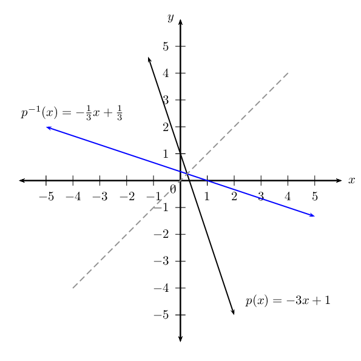
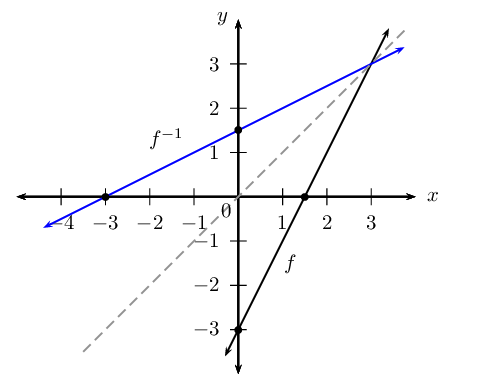
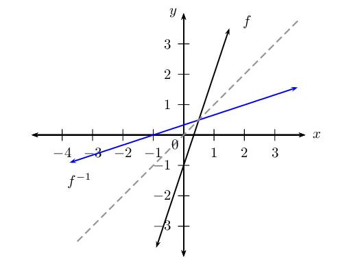
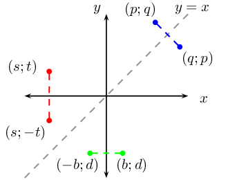
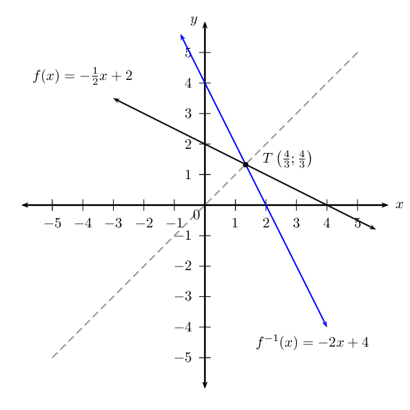

## 2.4 Linear functions (EMCF9)

### Inverse of the function \(y=ax+q\) (EMCFB)

<Callout type="tip" title="Worked example 4: Inverse of the function \(y=ax+q\)">
**Question:**
Determine the inverse function of \(p(x) = -3x + 1\) and sketch the graphs of
                                                \(p(x)\) and \(p^{-1}(x)\) on the same system of axes.

**Determine the inverse of the given function:**
- Interchange \(x\) and \(y\) in the equation.
- Make \(y\) the subject of the new equation.
- Express the new equation in function notation.

\begin{align*}
                                        \text{Let } y & = -3x + 1 \\
                                        \text{Interchange } x \text{ and } y: \quad x & = -3y + 1 \\
                                        x - 1 & = -3y \\
                                        -\frac{1}{3}(x - 1) & = y \\
                                        \therefore y &= -\frac{x}{3} + \frac{1}{3}
                                        \end{align*}

Therefore, \(p^{-1}(x) = -\frac{x}{3} + \frac{1}{3}\).

**Sketch the graphs of the same system of axes:**

The graph of \(p^{-1}(x)\) is the reflection of \(p(x)\) about the line \(y =
                                                x\). This means that every point on the graph of \(p(x)\) has a mirror
                                                image on the graph of \(p^{-1}(x)\).
</Callout>

**To determine the inverse function of \(y=ax+q\): **

                        \[\begin{array}{rll}

                        &(1) \quad \text{Interchange } x \text{ and } y: & x = ay+q \\
                        &(2) \quad \text{Make } y \text{ the subject of the equation}: & x - q = ay \\
                        && \frac{x}{a} - \frac{q}{a} = \frac{ay}{a} \\
                        &&\therefore y = \frac{1}{a}x-\frac{q}{a}
                        \end{array}\]

Therefore the inverse of \(y=ax+q\) is \(y=\frac{1}{a}x-\frac{q}{a}\). If a linear function
                                is invertible, then its inverse will also be linear.

<Callout type="tip" title="Worked example 5: Inverses - domain, range and intercepts">
**Question:**
Determine and sketch the inverse of the function \(f(x) = 2x - 3\). State the
                                                domain, range and intercepts.

**Determine the inverse of the given function:**
- Interchange \(x\) and \(y\) in the equation.
- Make \(y\) the subject of the new equation.
- Express the new equation in function notation.

\begin{align*}
                                        \text{Let } y & = 2x - 3 \\
                                        \text{Interchange } x \text{ and } y: \quad x & = 2y - 3 \\
                                        x + 3 & = 2y \\
                                        \frac{1}{2}(x + 3) & = y \\
                                        \therefore y &= \frac{x}{2} + \frac{3}{2}
                                        \end{align*}

Therefore, \(f^{-1}(x) = \frac{x}{2} + \frac{3}{2}\).

**Sketch the graphs on the same system of axes:**

The graph of \(f^{-1}(x)\) is the reflection of \(f(x)\) about the line \(y =
                                                x\).

**Determine domain, range and intercepts:**
\begin{align*}
                                        \text{Domain of } f &: \{ x: x \in \mathbb{R} \} \\
                                        \text{Range of } f &: \{ y: y \in \mathbb{R} \} \\
                                        \text{Intercepts of } f &: (0;-3) \text{ and } \left(\frac{3}{2}; 0 \right)
                                        \\
                                        & \\
                                        \text{Domain of } f^{-1} &: \{ x: x \in \mathbb{R} \} \\
                                        \text{Range of } f^{-1} &: \{ y: y \in \mathbb{R} \} \\
                                        \text{Intercepts of } f^{-1} &: \left(0;\frac{3}{2}\right) \text{ and }
                                        (-3;0)
                                        \end{align*}

Notice that the intercepts of \(f\) and \(f^{-1}\) are mirror images of each
                                                other. In other words, the \(x\)- and \(y\)-values have
                                                “swapped” positions. This is true of every point on the two
                                                graphs.
</Callout>

#### Domain and range

For a function of the form \(y=ax+q\), the domain is \(\left\{x:x\in
                                        ℝ\right\}\) and the range is \(\left\{y:y\in ℝ\right\}\). When a
                                        function is inverted the domain and range are interchanged. Therefore, the
                                        domain and range of the inverse of an invertible, linear function will be
                                        \(\left\{x:x\in ℝ\right\}\) and \(\left\{y:y\in ℝ\right\}\)
                                        respectively.

#### Intercepts

The general form of an invertible, linear function is \(y=ax+q \enspace (a \ne 0)\)
                                        and its inverse is \(y=\frac{1}{a}x-\frac{q}{a}\).

The \(y\)-intercept is obtained by letting \(x=0\):

                                \begin{align*}
                                y &= \frac{1}{a}(0)-\frac{q}{a} \\
                                y &= -\frac{q}{a}
                                \end{align*}

This gives the point \(\left(0; -\frac{q}{a}\right)\).

The \(x\)-intercept is obtained by letting \(y=0\):

                                \begin{align*}
                                0 &= \frac{1}{a}x -\frac{q}{a} \\
                                \frac{q}{a} &= \frac{1}{a}x \\
                                q &= x
                                \end{align*}

This gives the point \((q; 0)\).

It is interesting to note that if \(f\left(x\right)=ax+q \enspace (a \ne 0)\), then
                                        \({f}^{-1}\left(x\right)=\frac{1}{a}x-\frac{q}{a}\) and the \(y\)-intercept of
                                        \(f\left(x\right)\) is the \(x\)-intercept of \({f}^{-1}\left(x\right)\) and the
                                        \(x\)-intercept of \(f\left(x\right)\) is the \(y\)-intercept of
                                        \({f}^{-1}\left(x\right)\).

<Callout type="note" title="Note">
<VideoPlayer src="http://www.khanacademy.org/embed_video?v=W84lObmOp8M" title="Video:
                                                        28B3" />
</Callout>

## Inverse of the function \(y = ax + q\)

### Textbook Exercise 2.3

**Problem:**
Given \(f\left(x\right)=5x + 4\), find
                                                                        \({f}^{-1}\left(x\right)\).

**Solution:**
\begin{align*}
                                                                f(x): y & = 5x + 4 \\
                                                                f^{-1}(x): x & = 5y + 4 \\
                                                                \therefore x - 4 & = 5y \\
                                                                y & = \frac{1}{5}x - \frac{4}{5}\\
                                                                \therefore f^{-1}(x) & = \frac{1}{5}x - \frac{4}{5}
                                                                \end{align*}

Consider the relation \(f\left(x\right)=-3x-7\).

**Problem:**
Is the relation a function? Explain your
                                                                                answer.

**Solution:**
It is a function. Every \(x\)-value relates
                                                                                to only one \(y\)-value, it is a
                                                                                one-to-one relation.

**Problem:**
Identify the domain and range.

**Solution:**
\begin{align*}
                                                                        \text{Domain } & \{ x: x \in \mathbb{R} \}
                                                                        \\
                                                                        \text{Range } & \{ y: y \in \mathbb{R} \}
                                                                        \end{align*}

**Problem:**
Determine \(f^{-1}(x)\).

**Solution:**
\begin{align*}
                                                                        f(x): y & = -3x-7 \\
                                                                        f^{-1}(x): x & = -3y-7 \\
                                                                        \therefore x + 7 & = -3y \\
                                                                        y & = - \frac{1}{3}x - \frac{7}{3} \\
                                                                        \therefore f^{-1}(x) & = - \frac{1}{3}x -
                                                                        \frac{7}{3}
                                                                        \end{align*}

**Problem:**
Sketch the graph of the function
                                                                                \(f\left(x\right)=3x-1\) and its inverse
                                                                                on the same system of axes. Indicate the
                                                                                intercepts and the axis of symmetry of
                                                                                the two graphs.

**Solution:**
\begin{align*}
                                                                        y & = 3x - 1 \\
                                                                        x & = 3y - 1\\
                                                                        \therefore 3y & = x + 1 \\
                                                                        y & = \frac{1}{3}x + \frac{1}{3}
                                                                        \end{align*}

The intercepts are:

                                                                        \begin{align*}
                                                                        f(x): x = 0, y = -\text{1}\\
                                                                        y=0, x = \frac{1}{3}\\
                                                                        f^{-1}(x): x = 0, y = \frac{1}{3}\\
                                                                        y = 0, x = -\text{1}
                                                                        \end{align*}

**Problem:**
\(T\left( \frac{4}{3}; 3 \right)\) is a point
                                                                                on \(f\) and \(R\) is a point on
                                                                                \(f^{-1}\). Determine the coordinates of
                                                                                \(R\) if \(R\) and \(T\) are
                                                                                symmetrical.

**Solution:**
\(R\left( 3; \frac{4}{3} \right)\)

**Problem:**
Explain why the line \(y = x\) is an axis of
                                                                                symmetry for a function and its inverse.

**Solution:**
To reflect a function about the \(y\)-axis,
                                                                                we replace every \(x\) with \(-x\).
                                                                                Similarly, to reflect a function about
                                                                                the \(x\)-axis, we replace every \(y\)
                                                                                with \(-y\). To reflect a function about
                                                                                the line \(y=x\), we replace \(x\) with
                                                                                \(y\) and \(y\) with \(x\), which is how
                                                                                we determine the inverse.

**Problem:**
Will the line \(y = -x\) be an axis of
                                                                                symmetry for a function and its inverse?

**Solution:**
No it will not.

**Problem:**
Given \({f}^{-1}\left(x\right)=-2x+4\),
                                                                                determine \(f\left(x\right)\).

**Solution:**
\begin{align*}
                                                                        f^{-1}(x): y & = -2x + 4 \\
                                                                        f(x): x & = -2y + 4 \\
                                                                        \therefore 2y & = -x + 4 \\
                                                                        y & = -\frac{1}{2}x + 2\\
                                                                        \therefore f(x) & = -\frac{1}{2}x + 2
                                                                        \end{align*}

**Problem:**
Calculate the intercepts of \(f(x)\) and
                                                                                \(f^{-1}(x)\).

**Solution:**
Consider \(f(x)\):

                                                                        \begin{align*}
                                                                        \text{Let } y & = -\frac{1}{2}x + 2 \\
                                                                        \text{Let } x=0: \quad y & = -\frac{1}{2}(0)
                                                                        + 2 \\
                                                                        y & = 2 \\
                                                                        \therefore y &-\text{intercept is } (0;2) \\
                                                                        & \\
                                                                        \text{Let } y=0: \quad 0 & = -\frac{1}{2}x +
                                                                        2 \\
                                                                        -2 & = -\frac{1}{2}x \\
                                                                        x & = 4 \\
                                                                        \therefore x &-\text{intercept is } (4;0)
                                                                        \end{align*}

Consider \(f^{-1}(x)\):

                                                                        \begin{align*}
                                                                        \text{Let } y & = - 2x+4 \\
                                                                        \text{Let } x=0: \quad y & = - 2(0) + 4\\
                                                                        y & = 4 \\
                                                                        \therefore y &-\text{intercept is } (0;4) \\
                                                                        & \\
                                                                        \text{Let } y=0: \quad 0 & = - 2x+4\\
                                                                        2x & = 4 \\
                                                                        x & = 2 \\
                                                                        \therefore x &-\text{intercept is } (2;0)
                                                                        \end{align*}

Therefore the intercepts for \(f(x)\) are
                                                                                \((4;0)\) and \((0;2)\) and the
                                                                                intercepts for \(f^{-1}(x)\) are
                                                                                \((2;0)\) and \((0;4)\).

**Problem:**
Determine the coordinates of \(T\), the point
                                                                                of intersection of \(f(x)\) and
                                                                                \(f^{-1}(x)\).

**Solution:**
To find the point on intersection, we let
                                                                                \(f(x) = f^{-1}(x)\):

                                                                        \begin{align*}
                                                                        -\frac{1}{2}x + 2 & = -2x + 4 \\
                                                                        -\frac{1}{2}x + 2x & = 4 - 2 \\
                                                                        \frac{3}{2}x & = 2 \\
                                                                        \therefore x & = \frac{4}{3} \\
                                                                        \text{And } y & = -2 \left( \frac{4}{3}
                                                                        \right) + 4 \\
                                                                        & = - \frac{8}{3} + 4 \\
                                                                        & = \frac{4}{3}
                                                                        \end{align*}

This gives the point \(T \left(
                                                                                \frac{4}{3};\frac{4}{3} \right)\).

**Problem:**
Sketch the graphs of \(f\) and \(f^{-1}\) on
                                                                                the same system of axes. Indicate the
                                                                                intercepts and point \(T\) on the graph.

**Solution:**

**Problem:**
Is \(f^{-1}\) an increasing or decreasing
                                                                                function?

**Solution:**
Decreasing function. The function values
                                                                                decrease as \(x\) increases.
