## 2.5 Quadratic functions (EMCFC)

### Inverse of the function \(y=a{x}^{2}\) (EMCFD)

<Callout type="tip" title="Worked example 6: Inverse of the function \(y=a{x}^{2}\)">
**Question:**
Determine the inverse of the quadratic function \(h(x) = 3x^{2}\) and sketch both
                                    graphs on the same system of axes.

**Determine the inverse of the given function \(h(x)\):**
- Interchange \(x\) and \(y\) in the equation.
- Make \(y\) the subject of the new equation.

\begin{align*}
                              \text{Let } y & = 3x^{2} \\
                              \text{Interchange } x \text{ and } y: \quad x & = 3y^{2} \\
                              \frac{x}{3} & = y^{2} \\
                              \therefore y & = ±\sqrt{\frac{x}{3}} \qquad (x \geq 0)
                              \end{align*}

**Sketch the graphs on the same system of axes:**
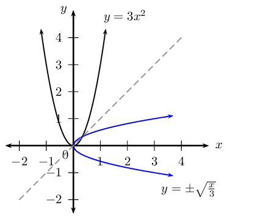

Notice that the inverse does not pass the vertical line test and therefore is not a
                                    function.

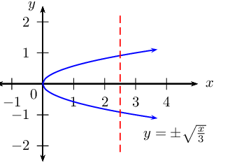
</Callout>

**To determine the inverse function of \(y=ax^{2}\): **

                  \[\begin{array}{rll}

                  &(1) \quad \text{Interchange } x \text{ and } y: & x = ay^{2} \\
                  &(2) \quad \text{Make } y \text{ the subject of the equation}: & \frac{x}{a} = y^{2} \\
                  &&\therefore y = ±\sqrt{\frac{x}{a}} \qquad (x \geq 0)
                  \end{array}\]

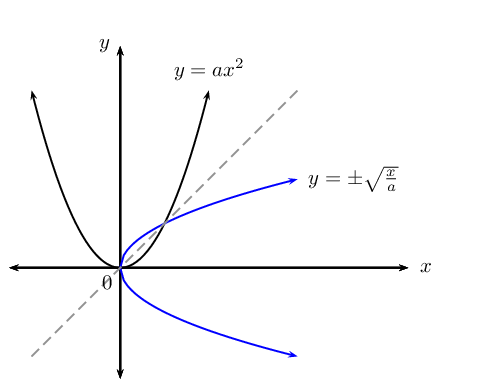

The vertical line test shows that the inverse of a parabola is not a function. However, we can
                        limit the domain of the parabola so that the inverse of the parabola is a function.

**Domain and range**

Consider the previous worked example \(h(x) = 3x^{2}\) and its inverse \(y =
                        ±\sqrt{\frac{x}{3}}\):

- If we restrict the domain of \(h\) so that \(x\ge 0\), then \(h^{-1}(x) =
                                      \sqrt{\frac{x}{3}}\) passes the vertical line test and is a function.
  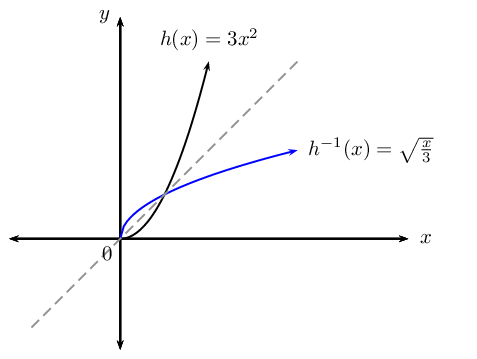
- If the restriction on the domain of \(h\) is \(x\le 0\), then \(h^{-1}(x) =
                                      -\sqrt{\frac{x}{3}}\) would also be a function.
  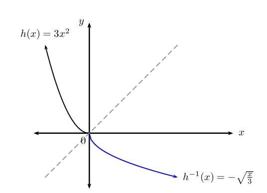

The domain of the function is equal to the range of the inverse. The range of the function is equal
                        to the domain of the inverse.

Similarly, a restriction on the domain of the function results in a restriction on the range of the
                        inverse and vice versa.

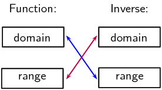

<Callout type="tip" title="Worked example 7: Inverses - domain, range and restrictions">
**Question:**
Determine the inverse of \(q(x) = 7x^{2}\) and sketch both graphs on the same system of
                                    axes. Restrict the domain of \(q\) so that the inverse is a function.

**Examine the function and determine the inverse:**
Determine the inverse of the function:

                              \begin{align*}
                              \text{Let } y & = 7x^{2} \\
                              \text{Interchange } x \text{ and } y: \quad x & = 7y^{2} \\
                              \frac{x}{7} & = y^{2} \\
                              \therefore y & = ±\sqrt{\frac{x}{7}} \qquad (x \geq 0)
                              \end{align*}

**Sketch both graphs on the same system of axes:**
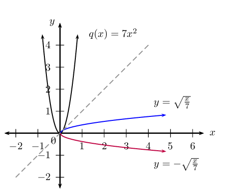

**Determine the restriction on the domain:**
Option \(\text{1}\): Restrict the domain of \(q\) to \(x \ge 0\) so that the inverse
                                    will also be a function \(\left( q^{-1} \right)\). The restriction \(x \ge 0\) on
                                    the domain of \(q\) will restrict the range of \(q^{-1}\) such that \(y \ge 0\).

                              \begin{align*}
                              q: \qquad & \text{domain } x \ge 0 \quad \text{range } y \ge 0 \\
                              q^{-1}: \qquad & \text{domain } x \ge 0 \quad \text{range } y \ge 0
                              \end{align*}

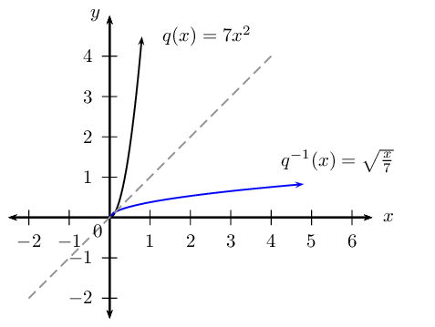

**or**

Option \(\text{2}\): Restrict the domain of \(q\) to \(x \le 0\) so that the inverse
                                    will also be a function \(\left( q^{-1} \right)\). The restriction \(x \le 0\) on
                                    the domain of \(q\) will restrict the range of \(q^{-1}\) such that \(y \le 0\).

                              \begin{align*}
                              q: \qquad & \text{domain } x \le 0 \quad \text{range } y \ge 0 \\
                              q^{-1}: \qquad & \text{domain } x \ge 0 \quad \text{range } y \le 0
                              \end{align*}

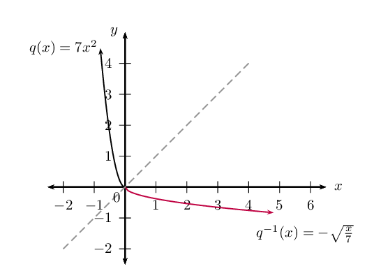
</Callout>

<Callout type="tip" title="Worked example 8: Inverses - domain, range and restrictions">
**Question:**
2. Determine the inverse of \(f(x) = -x^{2}\).
4. Sketch both graphs on the same system of axes.
6. Restrict the domain of \(f\) so that its inverse is a function.

**Determine the inverse of the function:**
\begin{align*}
                              \text{Let } y & = -x^{2} \\
                              \text{Interchange } x \text{ and } y: \quad x & = -y^{2} \\
                              -x & = y^{2} \\
                              y & = ±\sqrt{-x} \qquad (x \leq 0)
                              \end{align*}

Note: \(\sqrt{-x}\) is only defined if \(x \le 0\).

**Sketch both graphs on the same system of axes:**
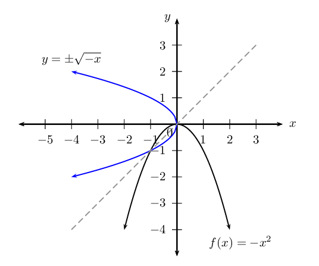

The inverse does not pass the vertical line test and is not a function.

**Determine the restriction on the domain:**
- If \(f(x) = -x^{2}, \text{ for } x \le 0\):
                                            \begin{align*}
                                            f: \qquad & \text{domain } x \le 0 \quad \text{range } y \le 0 \\
                                            f^{-1}: \qquad & \text{domain } x \le 0 \quad \text{range } y \le 0
                                            \end{align*}
- If \(f(x) = -x^{2}, \text{ for } x \ge 0\):
                                            \begin{align*}
                                            f: \qquad & \text{domain } x \ge 0 \quad \text{range } y \le 0 \\
                                            f^{-1}: \qquad & \text{domain } x \le 0 \quad \text{range } y \ge 0
                                            \end{align*}
</Callout>

## Inverses - domain, range, intercepts, restrictions

### Textbook Exercise 2.4

Determine the inverse for each of the following functions:

**Problem:**
\(y = \frac{3}{4}x^{2}\)

**Solution:**
\begin{align*}
                                                y & = \frac{3}{4}x^{2} \\
                                                \text{Interchange } x \text{ and } y: \quad x & = \frac{3}{4}y^{2}
                                                \\
                                                \frac{4}{3}x & = y^{2} \\
                                                \therefore y & = \pm \sqrt{\frac{4}{3}x} \qquad (x \geq 0)
                                                \end{align*}

**Problem:**
\(4y - 8x^{2} = 0\)

**Solution:**
\begin{align*}
                                                \text{Interchange } x \text{ and } y: \quad 4x - 8y^{2} & = 0 \\
                                                4x & = 8y^{2} \\
                                                \frac{1}{2}x & = y^{2} \\
                                                \therefore y & = \pm \sqrt{\frac{1}{2}x} \qquad (x \geq 0)
                                                \end{align*}

**Problem:**
\(x^{2} + 5y = 0\)

**Solution:**
\begin{align*}
                                                \text{Interchange } x \text{ and } y: \quad y^{2} + 5x & = 0 \\
                                                y^{2} & = - 5x \\
                                                \therefore y & = \pm \sqrt{- 5x} \qquad (x \leq 0)
                                                \end{align*}

**Problem:**
\(4y - 9 = (x + 3)(x - 3)\)

**Solution:**
\begin{align*}
                                                4y - 9 &= x^{2} - 9 \\
                                                4y &= x^{2} \\
                                                \text{Interchange } x \text{ and } y: \quad 4x & = y^{2} \\
                                                \therefore y & = \pm \sqrt{4x} \qquad (x \geq 0)
                                                \end{align*}

Given the function \(g(x) = \frac{1}{2}x^{2}\) for \(x \ge 0\).

**Problem:**
Find the inverse of \(g\).

**Solution:**
\begin{align*}
                                                \text{Let } y & = \frac{1}{2}x^{2} \qquad (x \geq 0) \\
                                                \text{Interchange } x \text{ and } y: \quad x & = \frac{1}{2}y^{2}
                                                \qquad (y \geq 0) \\
                                                2x & = y^{2} \\
                                                y & = \sqrt{2x} \qquad (x \geq 0,y \geq 0) \\
                                                & \\
                                                \therefore g^{-1}(x) & = \sqrt{2x} \qquad (x \geq 0)
                                                \end{align*}

**Problem:**
Draw \(g\) and \(g^{-1}\) on the same set of axes.

**Solution:**
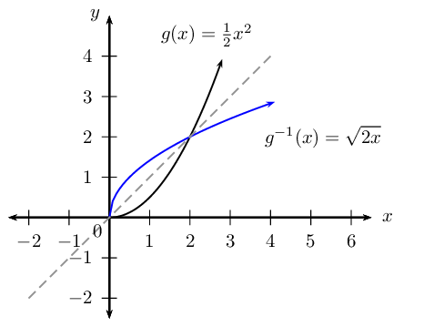

**Problem:**
Is \(g^{-1}\) a function? Explain your answer.

**Solution:**
Yes. It passes the vertical line test and is a one-to-one relation.

**Problem:**
State the domain and range for \(g\) and \(g^{-1}\).

**Solution:**
\begin{align*}
                                                g: \qquad & \text{domain } x \ge 0 \quad \text{range } y \ge 0 \\
                                                g^{-1}: \qquad & \text{domain } x \ge 0 \quad \text{range } y \ge 0
                                                \end{align*}

**Problem:**
Determine the coordinates of the point(s) of intersection of the
                                                      function and its inverse.

**Solution:**
To find the points of intersection, we equate \(g(x)\) and
                                                      \(g^{-1}(x)\):

                                                \begin{align*}
                                                \frac{1}{2}x^{2} & = \sqrt{2x} \\
                                                \left( \frac{1}{2}x^{2} \right)^{2} & = \left( \sqrt{2x} \right)^{2}
                                                \\
                                                \frac{1}{4}x^{4} & = 2x \\
                                                x^{4} & = 8x \\
                                                x^{4} - 8x & = 0\\
                                                x(x^{3} - 8) & = 0\\
                                                x(x-2)(x^{2} + 2x + 4) & = 0\\
                                                \therefore x = 0 \text{ or } x =2 \text{ or } & x^{2} + 2x + 4 = 0
                                                \end{align*}
                                                \begin{align*}
                                                \text{If } x & = 0 \\
                                                y & = 0 \\
                                                \text{If } x & = 2 \\
                                                y & = \frac{1}{2}(2)^{2} \\
                                                & = 2
                                                \end{align*}
                                                \begin{align*}
                                                \text{If } x^{2} + 2x + 4 & = 0 \\
                                                \text{Use the quadratic formula } x & = \frac{-b \pm \sqrt{b^{2} -
                                                4ac}}{2a} \\
                                                & = \frac{-2 \pm \sqrt{(2)^{2} - 4(1)(4)}}{2(1)} \\
                                                & = \frac{-2 \pm \sqrt{-12}}{2} \\
                                                & = \text{no real solution}
                                                \end{align*}

Therefore, we get the points \((0;0)\) or \((2;2)\).

Given the graph of the parabola \(f(x) = ax^{2}\) with \(x \ge 0\) and
                                                passing through the point \(P(1;-3)\).

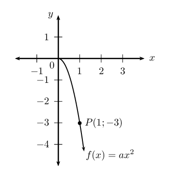

**Problem:**
Determine the equation of the parabola.

**Solution:**
\begin{align*}
                                                \text{Let } y & = ax^{2} \\
                                                \text{Substitute } P(1;-3): \quad & -3 = a(1)^{2} \\
                                                \therefore a & = -3 \\
                                                \therefore f(x) & = -3x^{2} \quad (x \ge 0)
                                                \end{align*}

**Problem:**
State the domain and range of \(f\).

**Solution:**
\(f: \enspace \text{domain } \{x: x \ge 0 \} \quad \text{range } \{y: y
                                                \le 0 \}\)

**Problem:**
Give the coordinates of the point on \(f^{-1}\) that is symmetrical
                                                      to the point \(P\) about the line \(y=x\).

**Solution:**
\((-3;1)\)

**Problem:**
Determine the equation of \(f^{-1}\).

**Solution:**
\begin{align*}
                                                \text{Let } y & = -3x^{2} \qquad (x \geq 0) \\
                                                \text{Interchange } x \text{ and } y: \quad x & = -3y^{2} \qquad (y
                                                \geq 0) \\
                                                -\frac{1}{3}x & = y^{2} \\
                                                y & = \sqrt{-\frac{1}{3}x} \qquad (x \leq 0,y \geq 0) \\
                                                & \\
                                                \therefore f^{-1}(x) & = \sqrt{-\frac{1}{3}x} \qquad (x \leq 0)
                                                \end{align*}

**Problem:**
State the domain and range of \(f^{-1}\).

**Solution:**
\(f^{-1}: \enspace \text{domain } \{x: x \le 0 \} \quad \text{range }
                                                \{y: y \ge 0 \}\)

**Problem:**
Draw a graph of \(f^{-1}\).

**Solution:**
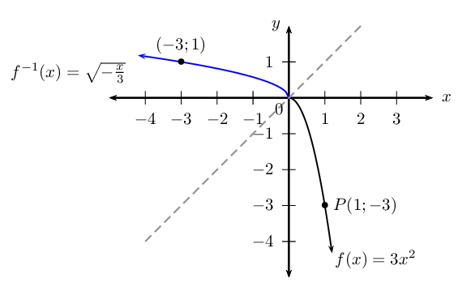

**Problem:**
Determine the inverse of \(h(x) = \frac{11}{5}x^{2}\).

**Solution:**
\begin{align*}
                                                \text{Let } y & = \frac{11}{5}x^{2} \\
                                                \text{Interchange } x \text{ and } y: \quad x & = \frac{11}{5}y^{2}
                                                \\
                                                \frac{5}{11} & = y^{2} \\
                                                \therefore y & = ±\sqrt{\frac{5}{11}x} \qquad (x \geq 0)
                                                \end{align*}

**Problem:**
Sketch both graphs on the same system of axes.

**Solution:**
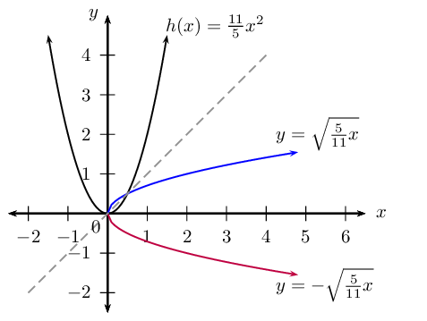

**Problem:**
Restrict the domain of \(h\) so that the inverse is a function.

**Solution:**
Option \(\text{1}\): Restrict the domain of \(h\) to \(x \ge 0\) so
                                                      that the inverse will also be a function \(\left( h^{-1}
                                                      \right)\). The restriction \(x \ge 0\) on the domain of \(h\) will
                                                      restrict the range of \(h^{-1}\) such that \(y \ge 0\).

                                                \begin{align*}
                                                h: \qquad & \text{domain } x \ge 0 \quad \text{range } y \ge 0 \\
                                                h^{-1}: \qquad & \text{domain } x \ge 0 \quad \text{range } y \ge 0
                                                \end{align*}

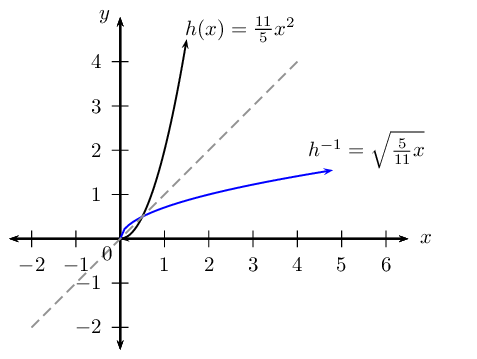

**or**

Option \(\text{2}\): Restrict the domain of \(h\) to \(x \le 0\) so
                                                      that the inverse will also be a function \(\left( h^{-1}
                                                      \right)\). The restriction \(x \le 0\) on the domain of \(h\) will
                                                      restrict the range of \(h^{-1}\) such that \(y \le 0\).

                                                \begin{align*}
                                                h: \qquad & \text{domain } x \le 0 \quad \text{range } y \ge 0 \\
                                                h^{-1}: \qquad & \text{domain } x \ge 0 \quad \text{range } y \le 0
                                                \end{align*}

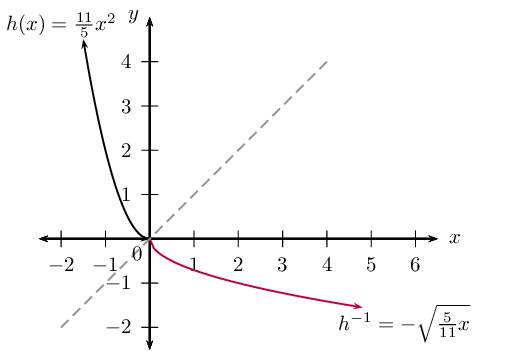

The diagram shows the graph of \(g(x) = mx + c\) and \(f^{-1}(x) = a
                                                \sqrt{x}, \enspace (x \geq 0)\). Both graphs pass through the point
                                                \(P(4;-1)\).

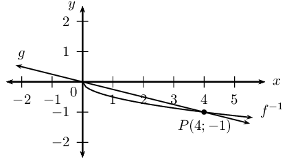

**Problem:**
Determine the values of \(a\), \(c\) and \(m\).

**Solution:**
From the graph we see that the straight line passes through the
                                                      origin, therefore \(c=0\).

                                                \begin{align*}
                                                g(x) & = mx \\
                                                \text{Substitute } P(4;-1): \enspace -1 & = 4m \\
                                                \therefore m & = - \frac{1}{4} \\
                                                \therefore g(x) & = - \frac{1}{4} x \\
                                                & \\
                                                f^{-1}(x)& = a \sqrt{x} \\
                                                \text{Substitute } P(4;-1): \enspace -1 & = a \sqrt{4} \\
                                                -1 & = 2a \\
                                                \therefore a & = - \frac{1}{2} \\
                                                \therefore f^{-1}(x) & = - \frac{1}{2} \sqrt{x}
                                                \end{align*}

**Problem:**
Give the domain and range of \(f^{-1}\) and \(g\).

**Solution:**
\begin{align*}
                                                g: \qquad & \text{domain: } x \in \mathbb{R} \quad \text{range: } y
                                                \in \mathbb{R} \\
                                                f^{-1}: \qquad & \text{domain: } x \ge 0 \quad \text{range: } y \le
                                                0
                                                \end{align*}

**Problem:**
For which values of \(x\) is \(g(x) < f(x)\)?

**Solution:**
\(x > 4\)

**Problem:**
Determine \(f\).

**Solution:**
\begin{align*}
                                                \text{Let } y & = - \frac{1}{2} \sqrt{x} \\
                                                \text{Interchange } x \text{ and } y: \quad x & = - \frac{1}{2}
                                                \sqrt{y} \qquad (y \geq 0) \\
                                                -2x & = \sqrt{y} \\
                                                \therefore y & = 4x^{2} \qquad (y \geq 0)
                                                \end{align*}

**Problem:**
Determine the coordinates of the point(s) of intersection of \(g\)
                                                      and \(f\) intersect.

**Solution:**
To determine the coordinates of the point(s) of intersection, we
                                                      equate \(g\) and \(f\):

                                                \begin{align*}
                                                - \frac{1}{4} x & = 4x^{2} \\
                                                0 & = 4x^{2} + \frac{1}{4} x \\
                                                0 & = x \left(4x + \frac{1}{4} \right) \\
                                                \therefore x = 0 & \text{ or } 4x + \frac{1}{4} = 0 \\
                                                \text{If } x = 0: \enspace y &= 0 \\
                                                \text{If } 4x + \frac{1}{4} &= 0: \\
                                                4x &= - \frac{1}{4} \\
                                                x &= - \frac{1}{16} \\
                                                \text{If } x = - \frac{1}{16}: \enspace y &= - \frac{1}{4} \left( -
                                                \frac{1}{16} \right) \\
                                                &= \frac{1}{64}
                                                \end{align*}

Therefore, the two graphs intersect at \(\left( 0;0 \right)\) and
                                                      \(\left( - \frac{1}{16}; \frac{1}{64} \right)\).

<Callout type="tip" title="Worked example 9: Inverses - average gradient">
**Question:**
Given: \(h(x) = 2x^{2}, \quad x \ge 0\)

2. Determine the inverse, \(h^{-1}\).
4. Find the point where \(h\) and \(h^{-1}\) intersect.
6. Sketch \(h\) and \(h^{-1}\) on the same set of axes.
8. Use the sketch to determine if \(h\) and \(h^{-1}\) are increasing or decreasing
                                             functions.
10. Calculate the average gradient of \(h\) between the two points of intersection.

**Determine the inverse of the function:**
\begin{align*}
                              \text{Let } y & = 2x^{2} \qquad (x \ge 0) \\
                              \text{Interchange } x \text{ and } y: \quad x & = 2y^{2} \qquad (y \ge 0) \\
                              \frac{x}{2} & = y^{2} \\
                              y & = \sqrt{\frac{x}{2}} \qquad (x \ge 0, y \geq 0) \\
                              & \\
                              \therefore h^{-1}(x) & = \sqrt{\frac{x}{2}} \qquad (x \geq 0)
                              \end{align*}

**Determine the point of intersection:**
\begin{align*}
                              2x^{2} & = \sqrt{\frac{x}{2}} \\
                              \left( 2x^{2} \right)^{2} & = \left( \sqrt{\frac{x}{2}} \right)^{2} \\
                              4x^{4} & = \frac{x}{2} \\
                              8x^{4} & = x \\
                              8x^{4} - x & = 0 \\
                              x(8x^{3} - 1) & = 0 \\
                              \therefore x = 0 &\text{ or } \enspace 8x^{3} - 1 = 0 \\
                              \text{If } x=0, \quad y & = 0 \\
                              \text{If } 8x^{3} - 1 & = 0 \\
                              8x^{3} & = 1 \\
                              x^{3} & = \frac{1}{8} \\
                              \therefore x & = \frac{1}{2} \\
                              \text{If } x= \frac{1}{2}, \quad y & = \frac{1}{2}
                              \end{align*}

Therefore, this gives the points A\((0;0)\) and \(B\left( \frac{1}{2} ;
                                    \frac{1}{2}\right)\).

**Sketch both graphs on the same system of axes:**
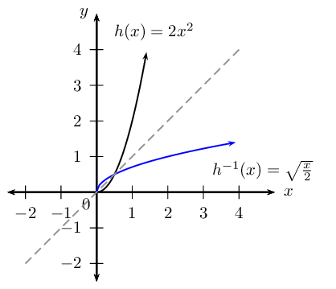

**Examine the graphs:**
From the graphs, we see that both \(h\) and \(h^{-1}\) pass the vertical line test and
                                    therefore are functions.

                              \begin{align*}
                              h: \quad & \text{as } x \text{ increases, } y \text{ also increases, } \text{
                              therefore } h \text{ is an increasing function. } \\
                              h^{-1}: \quad & \text{as } x \text{ increases, } y \text{ also increases, } \text{
                              therefore } h^{-1} \text{ is an increasing function. }
                              \end{align*}

**Calculate the average gradient:**
Calculate the average gradient of \(h\) between the points A\((0;0)\) and \(B\left(
                                    \frac{1}{2} ; \frac{1}{2}\right)\).

                              \begin{align*}
                              \text{Average gradient: } &= \frac{y_{B} - y_{A}}{x_{B} - x_{A}} \\
                              &= \frac{ \frac{1}{2} - 0 }{\frac{1}{2} - 0 } \\
                              &= 1
                              \end{align*}

Note: this is also the average gradient of \(h^{-1}\) between the points \(A\) and
                                    \(B\).
</Callout>

## Inverses - average gradient, increasing and decreasing functions

### Textbook Exercise 2.5

**Problem:**
Sketch the graph of \(y={x}^{2}\) and label a point other than the
                                                      origin on the graph.

**Solution:**
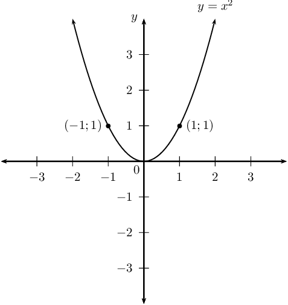

**Problem:**
Find the equation of the inverse of \(y = x^{2}\).

**Solution:**
\begin{align*}
                                                y & = x^{2} \\
                                                \text{Inverse: } x & = y^{2} \\
                                                \therefore y & = \pm \sqrt{x} \qquad (x \ge 0)
                                                \end{align*}

**Problem:**
Sketch the graph of the inverse on the same system of axes.

**Solution:**
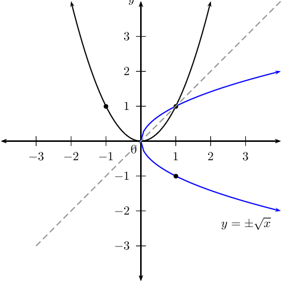

**Problem:**
Is the inverse a function? Explain your answer.

**Solution:**
No. For certain values of \(x\), the inverse cuts a vertical line in
                                                      two places. Therefore, it is not function.

**Problem:**
\(P(2;4)\) is a point on \(y = x^{2}\). Determine the coordinates of
                                                      \(Q\), the point on the graph of the inverse which is symmetrical
                                                      to \(P\) about the line \(y = x\).

**Solution:**
\(Q(4;2)\)

**Problem:**
Determine the average gradient between:

2. the origin and \(P\);
4. the origin and \(Q\).

Interpret the answers.

**Solution:**
2. \begin{align*}
                                                               \text{Average gradient: } &= \frac{y_{P} - y_{O}}{x_{P}
                                                               - x_{O}} \\
                                                               &= \frac{ 4 - 0 }{2- 0 } \\
                                                               &= 2
                                                               \end{align*}
4. \begin{align*}
                                                               \text{Average gradient: } &= \frac{y_{Q} - y_{O}}{x_{Q}
                                                               - x_{O}} \\
                                                               &= \frac{ 2 - 0 }{4- 0 } \\
                                                               &= \frac{1}{2}
                                                               \end{align*}

\(\text{Average gradient}_{ OP} = 2\) and \(\text{average gradient}_{
                                                      OQ} = \frac{1}{2}\).

Both gradients are positive, and they are also reciprocals of each
                                                      other.

Given the function \(f^{-1}(x) = kx^{2}\), \(x \ge 0\), which passes
                                                through the point \(P \left( \frac{1}{2}; -1 \right)\).

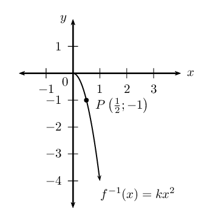

**Problem:**
Find the value of \(k\).

**Solution:**
\begin{align*}
                                                f^{-1}(x) & = kx^{2} \\
                                                \text{Substitute } \left( \frac{1}{2}; -1 \right) \quad -1 & = k
                                                \left( \frac{1}{2} \right)^{2} \\
                                                -1 & = k \left( \frac{1}{4} \right) \\
                                                -4 & = k \\
                                                \therefore f^{-1}(x) & = -4x^{2}
                                                \end{align*}

**Problem:**
State the domain and range of \(f^{-1}\).

**Solution:**
\begin{align*}
                                                \text{Domain: } & \{x: x \ge 0, x \in \mathbb{R} \} \\
                                                \text{Range: } & \{y: y \le 0, y \in \mathbb{R} \}
                                                \end{align*}

**Problem:**
Find the equation of \(f\).

**Solution:**
\begin{align*}
                                                f^{-1}: \quad y & = -4x^{2} \quad (x \ge 0) \\
                                                f: \quad x & = -4y^{2} \quad (y \ge 0) \\
                                                -\frac{1}{4}x & = y^{2} \\
                                                \therefore y & = \sqrt{-\frac{1}{4}x} \quad (x \le 0)
                                                \end{align*}

**Problem:**
State the domain and range of \(f\).

**Solution:**
\begin{align*}
                                                \text{Domain: } & \{x: x \le 0, x \in \mathbb{R} \} \\
                                                \text{Range: } & \{y: y \ge 0, y \in \mathbb{R} \}
                                                \end{align*}

**Problem:**
Sketch the graphs of \(f\) and \(f^{-1}\) on the same system of axes.

**Solution:**
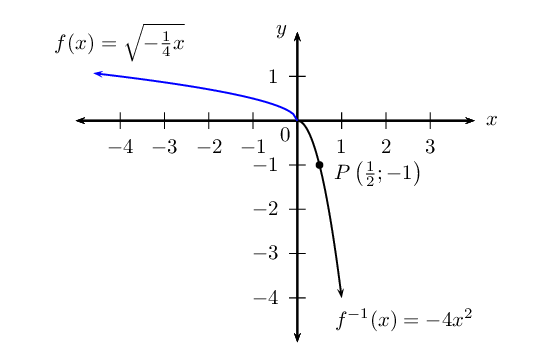

**Problem:**
Is \(f\) an increasing or decreasing function?

**Solution:**
Decreasing function: as the value of \(x\) increases, the function
                                                      value decreases.

Given: \(g(x) = \frac{5}{2}x^{2}, \enspace x \ge 0\).

**Problem:**
Find \(g^{-1}(x)\).

**Solution:**
\begin{align*}
                                                \text{Let } y & = \frac{5}{2}x^{2} \qquad (x \ge 0) \\
                                                \text{Interchange } x \text{ and } y: \quad x & = \frac{5}{2}y^{2}
                                                \qquad (y \ge 0) \\
                                                \frac{2}{5}x & = y^{2} \\
                                                y & = \sqrt{\frac{2}{5}x} \qquad (x \ge 0, y \geq 0) \\
                                                & \\
                                                \therefore g^{-1}(x) & = \sqrt{\frac{2}{5}x} \qquad (x \geq 0)
                                                \end{align*}

**Problem:**
Calculate the point(s) where \(g\) and \(g^{-1}\) intersect.

**Solution:**
\begin{align*}
                                                \frac{5}{2}x^{2} & = \sqrt{\frac{2}{5}x} \\
                                                \left( \frac{5}{2}x^{2} \right)^{2} & = \left( \sqrt{\frac{2}{5}x}
                                                \right)^{2} \\
                                                \frac{25}{4}x^{4} & = \frac{2}{5}x \\
                                                \frac{25}{4}x^{4} - \frac{2}{5}x & = 0 \\
                                                125x^{4} - 8x & = 0 \\
                                                x(125x^{3} - 8) & = 0 \\
                                                x(5x - 2)(25x^{2} +10x + 4) & = 0 \\
                                                \therefore x = 0 \enspace \text{ or } \enspace 5x - 2 = 0 \enspace
                                                &\text{ or } \enspace 25x^{2} +10x + 4 = 0 \\
                                                \text{If } x=0, \quad y & = 0 \\
                                                \text{If } x = \frac{2}{5}, \quad y & = \frac{5}{2} \left(
                                                \frac{2}{5} \right) ^{2} \\
                                                \therefore y & = \frac{2}{5} \\
                                                \text{If } 25x^{2} +10x + 4 &=0 \\
                                                \text{Use quadratic formula: } \quad x &= \frac{-10 \pm \sqrt{100 -
                                                4(25)(4)}}{2(25)}\\
                                                &= \frac{-10 \pm \sqrt{-300}}{50} \\
                                                \therefore & \text{no real solution}
                                                \end{align*}

Therefore, the points of intersection are \((0;0)\) and \(\left(
                                                      \frac{2}{5};\frac{2}{5} \right)\).

**Problem:**
Sketch \(g\) and \(g^{-1}\) on the same set of axes.

**Solution:**
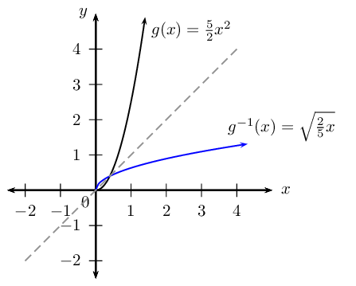

**Problem:**
Use the sketch to determine if \(g\) and \(g^{-1}\) are increasing or
                                                      decreasing functions.

**Solution:**
\begin{align*}
                                                g: \enspace & \text{as } x \text{ increases, } y \text{ also
                                                increases, } \therefore g \text{ is an increasing function. } \\
                                                g^{-1}: \enspace & \text{as } x \text{ increases, } y \text{ also
                                                increases, } \therefore g^{-1} \text{ is an increasing function. }
                                                \end{align*}

**Problem:**
Calculate the average gradient of \(g^{-1}\) between the two points
                                                      of intersection.

**Solution:**
\begin{align*}
                                                \text{Average gradient: } &= \frac{y_{2} - y_{1}}{x_{2} - x_{1}} \\
                                                &= \frac{ \frac{2}{5} - 0 }{\frac{2}{5} - 0 } \\
                                                &= 1
                                                \end{align*}
