## 2.6 Exponential functions (EMCFF)

**Revision of exponents**

An exponent indicates the number of times a certain number (the base) is multiplied by itself. The exponent, also
      called the index or power, indicates the number of times the multiplication is repeated. For example,
      \(\text{10}^{3} = 10 \times 10 \times 10 = \text{1 000}\).

**Graphs of the exponential function \(f(x) = b^{x}\)**

The value of \(b\) affects the direction of the graph:

- If \(b > 1\), \(f(x)\) is an increasing function.
- If \(0 < b < 1\), \(f(x)\) is a decreasing function.
- If \(b \leq 0\), \(f(x)\) is not defined.

| \(y = b^{x}\) | \(b > 1\) | \(0 < b < 1\) | \(b \leq 0\) |
| --- | --- | --- | --- |
|  |  |  | Not defined |

### Inverse of the function \(y=b^{x}\) (EMCFG)

## Determining the inverse

| Function | Type of function | Inverse: | Inverse: |
| --- | --- | --- | --- |
|  |  | interchange \(x\) and \(y\) | make \(y\) the subject |
| \(y = \frac{x}{3} + 10\) |  |  |  |
| \(y = \frac{x^{2}}{3}\) |  |  |  |
| \(y = (10)^{x}\) |  |  |  |
| \(y = \left( \frac{1}{3} \right)^{x}\) |  |  |  |

Consider the exponential function

      \[y = b^{x}\]

To determine the inverse of the exponential function, we interchange the \(x\)- and \(y\)-variables:

      \[x = b^{y}\]

For straight line functions and parabolic functions, we could easily manipulate the inverse to make \(y\) the
        subject of the formula. For the inverse of an exponential function, however, \(y\) is the index and we do not
        know a method of solving for the index.

To resolve this problem, mathematicians defined the logarithmic function. The logarithmic function allows us to
        rewrite the expression \(x = b^{y}\) with \(y\) as the subject of the formula:

      \[y = \log_{b}{x}\]

This means that \(x = b^{y}\) is the same as \(y = \log_{b}{x}\) and both are the inverse of the exponential
        function \(y = b^{x}\).

### Logarithms (EMCFH)

Logarithm

If \(x = {b}^{y}\), then \(y = {\log}_{b}\left(x\right)\), where \(b>0\), \(b \ne 1\) and \(x>0\).

Note that the brackets around the number \((x)\) are not compulsory, we use them to avoid confusion.

The logarithm of a number \((x)\) with a certain base \((b)\) is equal to the exponent \((y)\), the value to
        which that certain base must be raised to equal the number \((x)\).

For example, \(\log_{2}\left(8\right)\) means the power of \(\text{2}\) that will give \(\text{8}\). Since
        \({2}^{3}=8\), we see that \({\log}_{2}\left(8\right)=3\). Therefore the exponential form is \({2}^{3}=8\) and
        the logarithmic form is \({\log}_{2}{8}=3\).

**Restrictions on the definition of logarithms**

      \[\begin{array}{rll}
      \text{Restriction:}& & \text{Reason: } \\
      & & \\
      b > 0 & & \text{If } b \text{ is a negative number, then } b^{y} \text{ will oscillate between:} \\
      & & \text{positive values if } y \text{ is even } \\
      & & \text{negative values if } y \text{ is odd } \\
      & & \\
      b \ne 1 & & \text{Since } 1^{\text{(any value)}} = 1 \\
      & & \\
      x > 0 & & \text{Since } \text{(positive number)}^{\text{(any value)}} > 0
      \end{array}\]

## Exponential and logarithmic form

Discuss the following statements and determine whether they are true or false:

2. \(p = a^{n}\) is the inverse of \(p = \log_{a}{n}\).
4. \(y = 2^{x}\) is a one-to-one function, therefore \(y = \log_{2}{x}\) is also a one-to-one function.
6. \(x = \log_{5}{y}\) is the inverse of \(5^{x} = y\).
8. \(k = b^{t}\) is the same as \(t = \log_{b}{k}\).

**To determine the inverse function of \(y=b^{x}\): **

      \[\begin{array}{rll}

      &(1) \quad \text{Interchange } x \text{ and } y: & x = b^{y} \\
      &(2) \quad \text{Make } y \text{ the subject of the equation}: & y = \log_{b}{x}
      \end{array}\]

Therefore, if we have the exponential function \(f(x) = b^{x}\), then the inverse is the logarithmic function
        \(f^{-1}(x) = \log_{b}{x}\).

The “common logarithm” has a base \(\text{10}\) and can be written as \(\log_{10}{x} = \log{x}\).
        In other words, the \(\log\) symbol written without a base is interpreted as the logarithm to base
        \(\text{10}\). For example, \(\log{\text{25}} = \log_{10}{\text{25}}\).

<Callout type="note" title="Note">
<VideoPlayer src="https://www.youtube.com/embed/z296tOPj0HA" title="Video: 28BR" />
</Callout>

<Callout type="tip" title="Worked example 10: Exponential form to logarithmic form">
**Question:**
Write the following exponential expressions in logarithmic form and express each in words:

2. \(5^{2} = 25\)
4. \(10^{-3} = \text{0,001}\)
6. \(p^{x} = q\)

**Determine the inverse of the given exponential expressions:**
Remember: \(m = a^{n}\) is the same as \(n = \log_{a}{m}\).

2. \(2 = \log_{5}{25}\)
4. \(-3 = \log_{10}{(\text{0,001})}\)
6. \(x = \log_{p}{q}\)

**Express in words:**
2. \(\text{2}\) is the power to which \(\text{5}\) must be raised to give the number \(\text{25}\).
4. \(-\text{3}\) is the power to which \(\text{10}\) must be raised to give the decimal number
                 \(\text{0,001}\).
6. \(x\) is the power to which \(p\) must be raised to give \(q\).
</Callout>

<Callout type="tip" title="Worked example 11: Logarithmic form to exponential form">
**Question:**
Write the following logarithmic expressions in exponential form:

2. \(\log_{2}{128} = 7\)
4. \(-2 = \log_{3}{\left( \frac{1}{9} \right)}\)
6. \(z = \log_{w}{k}\)

**Determine the inverse of the given logarithmic expressions:**
For \(n = \log_{a}{m}\), we can write \(m = a^{n}\).

2. \(2^{7} = \text{128}\)
4. \(3^{-2} = \frac{1}{9}\)
6. \(w^{z} = k\)
</Callout>

<QuizCard id="m12-02-06a" title="Interactive Exercise 2.6" question="Rewrite the following equation in log form: \[\begin{array}{c}2 = (x + 1)^{a}\end{array}\]" options=[] answer=" ['log_((x + 1)) (2) = a', 'a = log_((x + 1)) (2)'] " hint="Your answer should be a mathematical equation. Here is an example of a famous                equation: E = mc^2 You can use the following symbols to write equations: add: + subtract: − multiply: ∗ divide: / exponent: ^ The following special symbols are also recognised: pi (π): pi infinity (∞): oo It is also possible to write certain functions: √: sqrt( ) log: log( ) sin: sin( ) cosec: cosec( ) cos: cos( ) sec: sec( ) tan: tan( ) cot: cot( ) To write a logarithm with a specific base, use the underscore _ symbol.                For example, log of x base 3 can be written as: log_3 x" explanation="Use the definition of logarithms to rewrite the equation The relationship between the two forms of the equation is as shown here: \[\begin{array}{c}a^{n} = x \qquad \Leftrightarrow \qquad \log_{a}x = n\end{array}\] It is really a matter of rearranging the equation according to this definition.  Given the original equation of \( 2 = (x + 1)^{a} \) which matches the left side of the above relationship, we need to move around the quantities to get the log form. The answer is: \( \log_{(x + 1)} 2 = a \) . Submit your answer as:" />

<QuizCard id="m12-02-06a" title="Interactive Exercise 2.6" question="Given \(f(x) = (6)^{x}\) . The inverse will have the form \(y = \log _{G} (x)\) . What is the value of \(G\;\) ?" options=[] answer="6" hint="You should enter a number here. If you want to, you can use a space to separate thousands.                Example: 12 800,25 For scientific notation you need to use the multiply symbol                ( ∗ ) and the exponent symbol ( ^ ). For example 6,673 × 10 −11 should be written as: 6,673 ∗ 10^−11" explanation="Start by interchanging the \( x \) and \( y \) variables: \[ 						\begin{aligned} 							\text{Function}: \enspace y &= (6)^{x} \\ 							\text{Inverse}: \enspace x & = (6)^{y} \\ 						\end{aligned} 					\] Now make \(y\) the subject of the formula. Use the definition to change the equation from exponential form to logarithmic form: \[ 						\begin{aligned} 							x &= (6)^{y}\\ 							\log _{6} (x) &= y   \\ 							y &= \log _{6} (x)\\ 						\end{aligned} 					\] Comparing with the question, we can see that the answer is \( G = 6 \) . Submit your answer as:" />

<QuizCard id="m12-02-06a" title="Interactive Exercise 2.6" question="Given \(g(x) = \log _{4}x\) . The inverse will have the form \(g^{-1}(x) = C^x\) . Calculate the value of \(C\) ." options=[] answer="4" hint="You should enter a number here. If you want to, you can use a space to separate thousands.                Example: 12 800,25 For scientific notation you need to use the multiply symbol                ( ∗ ) and the exponent symbol ( ^ ). For example 6,673 × 10 −11 should be written as: 6,673 ∗ 10^−11" explanation="To determine the inverse, we interchange the \(x\) and \(y\) variables: \( 							\begin{aligned} 								\text{Function}: \enspace y &= \log _{4} (x)\\ 								\text{Inverse}: \enspace x & = \log _{4} (y)\\ 							\end{aligned} 						\) Rearrange the equation to make \(y\) the subject: \( 							\begin{aligned} 								4^{x} &= y\\ 								\therefore y &= (4)^{x}\\ 							\end{aligned} 						\) \( 							\begin{aligned} 								\text{Therefore, } C & = 4 \\ 							\end{aligned} 						\) Submit your answer as:" />

<QuizCard id="m12-02-06a" title="Interactive Exercise 2.6" question="Determine the value of this expression: \[ 				\begin{array}{c} 					\log_{(x - 2)} \left( x - 2 \right)^{8} 				\end{array} 			\] NOTE: Do not use a calculator." options=[] answer="
					8
				" hint="You should enter a number here. If you want to, you can use a space to separate thousands.                Example: 12 800,25 For scientific notation you need to use the multiply symbol                ( ∗ ) and the exponent symbol ( ^ ). For example 6,673 × 10 −11 should be written as: 6,673 ∗ 10^−11" explanation="Rewrite the logarithm as an exponent Remember that a logarithm can also be written as an exponent. By changing the expression into an exponential arrangement you get: \[ 					\begin{array}{c} 						(x - 2)^? = \left( x - 2 \right)^{8} 					\end{array} 				\] The binomials make this question a bit noisy, but you can see that the bases are the same on each side of the equation; that means the exponents must also be equal. Therefore the final answer is \(8\) . Submit your answer as:" />

## Finding the inverse of \(y=b^{x}\)

### Textbook Exercise 2.6

Write the following in logarithmic form:

**Problem:**
\(16 = 2^{4}\)

**Solution:**
\(4 = \log_{2}{16}\)

**Problem:**
\(3^{-5} = \frac{1}{243}\)

**Solution:**
\(-5 = \log_{3}{\left( \frac{1}{243} \right) }\)

**Problem:**
\((\text{1,7})^{3} = \text{4,913}\)

**Solution:**
\(3 = \log_{\text{1,7}}{(\text{4,913})}\)

**Problem:**
\(y = 2^{x}\)

**Solution:**
\(x = \log_{2}{y}\)

**Problem:**
\(q = 4^{5}\)

**Solution:**
\(\log_{4} q = 5\).

**Problem:**
\(4 = y^{g}\)

**Solution:**
\(\log_{y} 4 = g\).

**Problem:**
\(9 = (x -4)^{p}\)

**Solution:**
\(\log_{(x - 4)} 9 = p\).

**Problem:**
\(3 = m^{(a + 4)}\)

**Solution:**
\(\log_{m} 3 = a + 4\).

Express each of the following logarithms in words and then write in exponential form:

**Problem:**
\(\log_{2}{32} = 5\)

**Solution:**
The logarithm of \(\text{32}\) to base \(\text{2}\) is equal to \(\text{5}\).

                \(2^{5} = 32\)

**Problem:**
\(\log{\frac{1}{1000}} = -3\)

**Solution:**
The logarithm of \(\frac{1}{1000}\) to base \(\text{10}\) is equal to \(-\text{3}\).

                \(10^{-3} = \frac{1}{1000}\)

**Problem:**
\(\log{\text{0,1}} = -1\)

**Solution:**
The logarithm of \(\text{0,1}\) to base \(\text{10}\) is equal to \(-\text{1}\).

                \(10^{-1} = \text{0,1}\)

**Problem:**
\(\log_{d}{c} = b\)

**Solution:**
The logarithm of \(c\) to base \(d\) is equal to \(b\).

                \(d^{b} = c\)

**Problem:**
\(\log_{5}{1} = 0\)

**Solution:**
The logarithm of \(\text{1}\) to base \(\text{5}\) is equal to \(\text{0}\).

                \(5^{0} = 1\)

**Problem:**
\(\log_{3}{\frac{1}{81}} = -4\)

**Solution:**
The logarithm of \(\frac{1}{81}\) to base \(\text{3}\) is equal to \(-\text{4}\).

                \(3^{-4} = \frac{1}{81}\)

**Problem:**
\(\log{100}\)

**Solution:**
\begin{align*}
                \text{Let } \log{100} &= m \\
                10^{m} &= 100 \\
                &= 10^{2} \\
                \therefore m &= 2 \\
                \therefore \log{100} &= 2
                \end{align*}

The logarithm of \(\text{100}\) to base \(\text{10}\) is \(\text{2}\).

**Problem:**
\(\log_{\frac{1}{2}}{16}\)

**Solution:**
\begin{align*}
                \text{Let } \log_{\frac{1}{2}}{16} &= y \\
                \therefore \left( \frac{1}{2} \right)^{y} &= 16 \\
                \therefore 2^{-y}&= 2^{4} \\
                -y &= 4 \\
                \therefore y &= -4
                \end{align*}

The logarithm of \(\text{16}\) to base \(\frac{1}{2}\) is \(-\text{4}\).

### Logarithm bases (EMCFJ)

From the definition of a logarithm we know that the base of a logarithm must be a positive number and it cannot
        be equal to \(\text{1}\). The value of the base influences the value of the logarithm. For example,
        \({\log}_{2}2\) is not the same as \({\log}{2}\) and \({\log}_{f}{11}\) is not the same as \({\log}_{g}{11}\),
        (\(f \ne g\)).

We often calculate the “common logarithm”, which has a base \(\text{10}\) and can be written as
        \(\log_{10}{x} = \log{x}\). For example, \(\log{8} = \log_{10}{8}\).

The “natural logarithm”, which has a base \(e\) (an irrational number between \(\text{2,71}\) and
        \(\text{2,72}\)), can be written as \(\log_{e}{x} = \ln{x}\). For example, \(\log_{e}{5} = \ln{5}\).

**Special logarithmic values**

- **\(\log_{a}{1} = 0\)**
            \begin{align*}
            \text{Given the exponential form } a^{n} &= x \\
            \text{we define the logarithmic function } \log_{a}{x} &= n \\
            \text{So then for } a^{0} &= 1 \\
            \text{we can write } \log_{a}{1} &= 0
            \end{align*}
- **\(\log_{a}{a} = 1\)**
            \begin{align*}
            \text{From the general exponential form } a^{n} &= x \\
            \text{we define the logarithmic function } \log_{a}{x} &= n \\
            \text{Since } a^{1} &= a \\
            \text{we can write } \log_{a}{a} &= 1
            \end{align*}

### Laws of logarithms (EMCFK)

In earlier grades, we used the following exponential laws for working with exponents:

- \({a}^{m} \times {a}^{n}={a}^{m+n}\)
- \(\frac{{a}^{m}}{{a}^{n}}={a}^{m-n}\)
- \({\left(ab\right)}^{n}={a}^{n}{b}^{n}\)
- \({\left(\frac{a}{b}\right)}^{n}=\frac{{a}^{n}}{{b}^{n}}\)
- \({\left({a}^{m}\right)}^{n}={a}^{mn}\)

        where \(a > 0\), \(b > 0\) and \(m, n \in ℤ\).

The logarithmic laws are based on the exponential laws and make working with logarithms much easier.

**Logarithmic laws:**

- \(\log_{a}{x^{b}} = b \log_{a}{x} \qquad (x > 0)\)
- \(\log_{a}{x} = \frac{\log_{b}{x}}{\log_{b}{a}} \qquad (b > 0 \text{ and } b \ne 1)\)
- \(\log_{a}{xy} = \log_{a}{x} + \log_{a}{y} \qquad (x > 0 \text{ and } y > 0)\)
- \(\log_{a}{\frac{x}{y}} = \log_{a}{x} - \log_{a}{y} \qquad (x > 0 \text{ and } y > 0)\)

The last two logarithmic laws in the list above are not covered in this section. They are discussed at the end
        of the chapter and are included for enrichment only.

**IMPORTANT: PROOFS ARE NOT REQUIRED FOR EXAMS**

**Logarithmic law: **

        \[\log_{a}{x^{b}} = b \log_{a}{x} \qquad (x > 0 )\]
      \begin{align*}
      \text{Let } {\log}_{a}{x} &= m \ldots (1)\qquad (x > 0 ) \\
      \therefore x &= a^{m} \\
      \therefore (x)^{b} &= \left( a^{m} \right)^{b} \\
      \therefore x^{b} &= a^{bm} \\
      \text{Change to logarithmic form: }\log_{a}\left(x^{b}\right) &= bm \\
      \text{And subst}: \quad m &= {\log}_{a}{x} \\
      \therefore {\log}_{a}{x^{b}} &= b{\log}_{a}{x}
      \end{align*}

In words: the logarithm of a number which is raised to a power is equal to the value of the power multiplied by
        the logarithm of the number.

<Callout type="tip" title="Worked example 12: Applying the logarithmic law \(\log_{a}{x^{b}} = b \log_{a}{x}\)">
**Question:**
Determine the value of \(\log_{3}{{27}^{4}}\).

**Use the logarithmic law to simplify the expression:**
\begin{align*}
          \log_{3}{{27}^{4}} &= 4 \log_{3}{{27}}\\
          &= 4\log_{3}{{3}^{3}} \\
          &= (4 \times 3) \log_{3}{3}\\
          &= 12 (1) \\
          &= 12
          \end{align*}

**Write the final answer:**
\(\log_{3}{{27}^{4}} = 12\)
</Callout>

**Special case: **

        \[\log_{a}{\sqrt[b]{x}} = \frac{\log_{a}{x}}{b} \qquad (x > 0 \text{ and } b > 0 )\]

The following is a special case of the logarithmic law \(\log_{a}{x^{b}} = b \log_{a}{x}\):

      \begin{align*}
      \log_{a}{\sqrt[b]{x}} &= \log_{a}{{x}^{\frac{1}{b}}} \\
      &= \frac{1}{b} \log_{a}{x} \\
      &= \frac{\log_{a}{x}}{b}
      \end{align*}

<Callout type="note" title="Note">
<VideoPlayer src="http://www.khanacademy.org/embed_video?v=Pb9V374iOas" title="Video: 28CC" />
</Callout>

## Applying the logarithmic law: \(\log_{a}{x^{b}} = b \log_{a}{x}\)

### Textbook Exercise 2.7

Simplify the following:

**Problem:**
\(\log_{8}{{10}^{10}}\)

**Solution:**
\[\log_{8}{{10}^{10}} = 10 \log_{8}{10}\]

**Problem:**
\(\log_{16}{{x}^{y}}\)

**Solution:**
\[\log_{16}{{x}^{y}} = y \log_{16}{x}\]

**Problem:**
\(\log_{3}{\sqrt{5}}\)

**Solution:**
\[\log_{3}{\sqrt{5}} = \frac{\log_{3}{5}}{2}\]

**Problem:**
\(\log_{z}{{y}^{z}}\)

**Solution:**
\[\log_{z}{{y}^{z}} = z \log_{z}{y}\]

**Problem:**
\(\log_{y}{\sqrt[x]{y}}\)

**Solution:**
\begin{align*}
              \log_{y}{\sqrt[x]{y}} &= \log_{y}{y^{\frac{1}{x}}} \\
              &= \frac{1}{x} \log_{y}{y} \\
              &= \frac{1}{x}
              \end{align*}

**Problem:**
\(\log_{p}{{p}^{q}}\)

**Solution:**
\begin{align*}
              \log_{p}{{p}^{q}} &= q \log_{p}{p} \\
              &= q(1) \\
              &= q
              \end{align*}

**Problem:**
\(\log_{2}{\sqrt[4]{8}}\)

**Solution:**
\begin{align*}
              \log_{2}{\sqrt[4]{8}} &= \log_{2}{8^{\frac{1}{4}}} \\
              &= \frac{1}{4} \log_{2}{2^{3}} \\
              &= \frac{1}{4} \times 3 \log_{2}{2} \\
              &= \frac{3}{4}
              \end{align*}

**Problem:**
\(\log_{5}{\frac{1}{5}}\)

**Solution:**
\begin{align*}
              \log_{5}{\frac{1}{5}} &= \log_{5}{5^{-1}} \\
              &= (-1) \log_{5}{5} \\
              &= (-1)(1) \\
              &= -1
              \end{align*}

**Problem:**
\(\log_{2}{{8}^{5}}\)

**Solution:**
\begin{align*}
              \log_{2}{{8}^{5}} &= 5 \log_{2}{{8}} \\
              &= 5 \log_{2}{{2}^{3}} \\
              &= 5 \times 3 \log_{2}{2} \\
              &= 15
              \end{align*}

**Problem:**
\(\log_{4}{16} \times \log_{3}{81}\)

**Solution:**
\begin{align*}
              \log_{4}{16} \times \log_{3}{81} &= \log_{4}{4^{2}} \times \log_{3}{3^{4}} \\
              &= (2) \log_{4}{4} \times (4) \log_{3}{3} \\
              &= (2)(1) \times (4)(1)\\
              &= 8
              \end{align*}

**Problem:**
\(\left( \log_{5}{25} \right)^{2}\)

**Solution:**
\begin{align*}
              \left( \log_{5}{25} \right)^{2} &= \left( \log_{5}{5^{2}} \right)^{2} \\
              &= \left( 2 \log_{5}{5} \right)^{2} \\
              &= \left( 2 (1) \right)^{2} \\
              &= 4 \\
              \text{Alternative method: } & \\
              \left( \log_{5}{25} \right)^{2} &= \log_{5}{ \left( 5^{2} \right)^{2} } \\
              &= \log_{5}{5}^{4} \\
              &= 4(1) \\
              &= 4
              \end{align*}

**Problem:**
\(\log_{2}{\text{0,125}}\)

**Solution:**
\begin{align*}
              \log_{2}{\text{0,125}} &= \log_{2}{\frac{125}{1000}} \\
              &= \log_{2}{\frac{1}{8}} \\
              &= \log_{2}{8^{-1}} \\
              &= (-1) \log_{2}{2^{3}} \\
              &= (-1)(3) \log_{2}{2} \\
              &= (-3) (1) \\
              &= -3
              \end{align*}

**Logarithmic law: **

        \({\log}_{a}x=\frac{{\log}_{b}{x}}{{\log}_{b}{a}} \qquad (b > 0 \text{ and } b \ne 1)\)

It is often necessary or convenient to convert a logarithm from one base to another base. This is referred to
        as a **change of base**.

      \begin{align*}
      \text{Let } \quad \log_{a}{x} &= m \\
      \therefore x &= a^{m} \\
      \text{Consider the fraction: } \quad & \frac{\log_{b}{x}}{\log_{b}{a}} \\
      \text{Substitute } x = a^{m}: \quad \frac{\log_{b}{x}}{\log_{b}{a}} &= \frac{\log_{b}{a^{m}}}{\log_{b}{a}} \\
      &= m \left( \frac{\log_{b}{a}}{\log_{b}{a}} \right) \\
      &= m (1) \\
      \therefore \frac{\log_{b}{x}}{\log_{b}{a}}&= \log_{a}{x}
      \end{align*}

**Special applications:**

      \begin{align*}
      (1) \qquad \log_{a}{x} &= \frac{\log_{x}{x}}{\log_{x}{a}} \\
      \therefore \log_{a}{x} &= \frac{1}{\log_{x}{a}} \\
      & \\
      & \\
      (2) \qquad \log_{a}{\frac{1}{x}} &= \log_{a}{x^{-1}} \\
      \therefore \log_{a}{\frac{1}{x}} &= - \log_{a}{x}
      \end{align*}

<Callout type="note" title="Note">
<VideoPlayer src="https://www.youtube.com/embed/ti9X8YgVd88" title="Video: 28CT" />
</Callout>

<Callout type="tip" title="Worked example 13: Applying the logarithmic law
          \({\log}_{a}x=\frac{{\log}_{b}{x}}{{\log}_{b}{a}}\)">
**Question:**
Show: \(\log_{2}{8} = \frac{\log{8}}{\log{2}}\)

**Simplify the right-hand side of the equation:**
\begin{align*}
          \text{RHS } &= \frac{\log{8}}{\log{2}} \\
          &= \frac{\log{2^{3}}}{\log{2}} \\
          &= 3 \left( \frac{\log{2}}{\log{2}} \right) \\
          &= 3(1) \\
          &= 3
          \end{align*}

**Simplify the left-hand side of the equation:**
\begin{align*}
          \text{LHS } &= \log_{2}{8} \\
          &= \log_{2}{2^{3}} \\
          &= 3 \log_{2}{2} \\
          &= 3(1) \\
          &= 3
          \end{align*}

**Write the final answer:**
We have shown that \(\log_{2}{8} = \dfrac{\log{8}}{\log{2}} = 3\).
</Callout>

<Callout type="tip" title="Worked example 14: Applying the logarithmic law
          \({\log}_{a}x=\frac{{\log}_{b}{x}}{{\log}_{b}{a}}\)">
**Question:**
If \(a = \log{2}\) and \(b = \log{3}\), express the following in terms of \(a\) and \(b\):

2. \(\log_{3}{2}\)
4. \(\log_{2}{\frac{10}{3}}\)

**Use a change of base to simplify the expressions:**
2. \begin{align*}
                 \log_{3}{2} &= \frac{\log{2}}{\log{3}} \\
                 &= \frac{a}{b}
                 \end{align*}
4. \begin{align*}
                 \log_{2}{\frac{10}{3}} &= \frac{\log{\frac{10}{3}}}{\log{2}} \\
                 &= \frac{\log{10} - \log{3}}{\log{2}} \\
                 &= \frac{1- b}{a}
                 \end{align*}
</Callout>

<QuizCard id="m12-02-06b" title="Interactive Exercise 2.7" question="\(\log_{3}{10}\)" options=[] answer="1/b" hint="Your answer should be a mathematical expression. You can use the following symbols to write mathematical expressions: add: + subtract: − multiply: ∗ divide: / exponent: ^ The following special symbols are also recognised: pi (π): pi infinity (∞): oo It is also possible to write certain functions: √: sqrt( ) log: log( ) sin: sin( ) cosec: cosec( ) cos: cos( ) sec: sec( ) tan: tan( ) cot: cot( ) To write a logarithm with a specific base, use the underscore _ symbol.                For example, log of x base 3 can be written as: log_3 x" explanation="Examine the given logarithm and consider which law to use To write the given logarithm in terms of \(a\) and/or \(b\) , we use the change of base law \(\log_{k}{x} = \frac{\log_{r}{x}}{\log_{r}{k}}\) . \[                 \begin{aligned}                   \log_{3} 10 & =  \frac{ \log 10 }{ \log 3 } \\         & =  \frac{ 1 }{ b }                 \end{aligned}               \] Therefore, \(\log_{ 3 } 10 \) can be written as \( \frac{ 1 }{ b } \) . Useful to remember : \( \log 10  = \log_{{ 10 }} 10 = 1\) Submit your answer as:" />

<QuizCard id="m12-02-06b" title="Interactive Exercise 2.7" question="\(\log_{\text{0,01}}2\)" options=[] answer="- m/2" hint="Your answer should be a mathematical expression. You can use the following symbols to write mathematical expressions: add: + subtract: − multiply: ∗ divide: / exponent: ^ The following special symbols are also recognised: pi (π): pi infinity (∞): oo It is also possible to write certain functions: √: sqrt( ) log: log( ) sin: sin( ) cosec: cosec( ) cos: cos( ) sec: sec( ) tan: tan( ) cot: cot( ) To write a logarithm with a specific base, use the underscore _ symbol.                For example, log of x base 3 can be written as: log_3 x" explanation="Consider the given expression and determine which logarithm law to use To write the given logarithm in terms of \(m\) and/or \(n\) , we use the change of base law \( \log_{k}{x} = \frac{ \log_{r} x }{ \log_{r} k }\) . \[                 \begin{aligned}                   \log_{ 0.01 } 2 & = \frac{ \log 2 }{ \log 0.01 } \\         &=  \frac{ \log 2 }{ \log 10^{ -2 } } \\         &=  \frac{ \log 2 }{ -2 \log 10 } \\         &=  \frac{ \log 2 }{ -2 }   \\         &=  - \frac{ m }{ 2 }                 \end{aligned}               \] Therefore, \( \log_{ 0.01 }{ 2 }\) can be written as \( - \frac{ m }{ 2 }\) . Remember : \( \log 10 = \log_{ 10 } 10 = 1\) Submit your answer as:" />

## Applying the logarithmic law: \({\log}_{a}x=\frac{{\log}_{b}{x}}{{\log}_{b}{a}}\)

### Textbook Exercise 2.8

Convert the following:

**Problem:**
\(\log_{2}{4}\) to base \(\text{8}\)

**Solution:**
\(\log_{2}{4} = \frac{\log_{8}{4}}{\log_{8}{2}}\)

**Problem:**
\(\log_{10}{14}\) to base \(\text{2}\)

**Solution:**
\(\log_{10}{14} = \frac{\log_{2}{14}}{\log_{2}{10}}\)

**Problem:**
\(\log{4\frac{1}{2}}\) to base \(\text{2}\)

**Solution:**
\begin{align*}
                \log{4\frac{1}{2}} &= \log{\frac{9}{2}} \\
                &= \frac{\log_{2}{\frac{9}{2}}}{\log_{2}{10}} \\
                &= \frac{\log_{2}{9} - \log_{2}{2}}{\log_{2}{10}} \\
                &= \frac{\log_{2}{9} - 1}{\log_{2}{10}}
                \end{align*}

**Problem:**
\(\log_{2}{8}\) to base \(\text{8}\)

**Solution:**
\begin{align*}
                \log_{2}{8} &= \frac{\log_{8}{8}}{\log_{8}{2}} \\
                &= \frac{1}{\log_{8}{2}}
                \end{align*}

**Problem:**
\(\log_{y}{x}\) to base \(x\)

**Solution:**
\begin{align*}
                \log_{y}{x} &= \frac{\log_{x}{x}}{\log_{x}{y}} \\
                &= \frac{1}{\log_{x}{y}}
                \end{align*}

\(\therefore\) a logarithm is equal to the reciprocal of its inverse.

                \(\)

**Problem:**
\(\log_{10}{2x}\) to base \(\text{2}\)

**Solution:**
\begin{align*}
                \log_{10}{2x} &= \frac{\log_{2}{2x}}{\log_{2}{10}} \\
                &= \frac{\log_{2}{2} + \log_{2}{x}}{\log_{2}{10}} \\
                &= \frac{1 + \log_{2}{x}}{\log_{2}{10}}
                \end{align*}
                \(\)

Simplify the following using a change of base:

**Problem:**
\(\log_{2}{10} \times \log_{10}{2}\)

**Solution:**
\begin{align*}
                \log_{2}{10} \times \log_{10}{2} &= \frac{\log{10}}{\log{2}} \times \frac{\log{2}}{\log{10}} \\
                &= 1
                \end{align*}

**Problem:**
\(\log_{5}{100}\)

**Solution:**
\begin{align*}
                \log_{5}{100} &= \frac{\log{100}}{\log{5}} \\
                &= \frac{\log{10^{2}}}{\log{5}} \\
                &= \frac{2 \log{10}}{\log{5}} \\
                &= \frac{2}{\log{5}}
                \end{align*}

If \(\log{3} = \text{0,477}\) and \(\log{2} = \text{0,301}\), determine (correct to \(\text{2}\)
                decimal places):

**Problem:**
\(\log_{2}{3}\)

**Solution:**
\begin{align*}
                \log_{2}{3} &= \frac{\log{3}}{\log{2}} \\
                &= \frac{\text{0,477}}{\text{0,301}} \\
                &= \text{1,58}
                \end{align*}

**Problem:**
\(\log_{3}{2000}\)

**Solution:**
\begin{align*}
                \log_{3}{2000} &= \frac{\log{2000}}{\log{3}} \\
                &= \frac{\log{(2 \times 1000)}}{\log{3}} \\
                &= \frac{\log{2} + \log{10^{3}}}{\log{3}} \\
                &= \frac{\text{0,301} +3(1)}{\text{0,477}} \\
                &= \frac{\text{3,301}}{\text{0,477}} \\
                &= \text{6,92}
                \end{align*}

### Logarithms using a calculator (EMCFM)

**Calculating a logarithmic value**

There are many different types and models of scientific calculators. It is very important to be familiar with
        your own calculator and the different function buttons. Some calculators only have two buttons for logarithms:
        one for calculating the common logarithm (base is equal to \(\text{10}\)) and another for calculating the
        natural log (base is equal to \(e\)). Newer models will have a third button which allows the user to calculate
        the logarithm of a number to a certain base.

<Callout type="tip" title="Worked example 15: Using a calculator: logarithm function">
**Question:**
Use a calculator to determine the following values (correct to \(\text{3}\) decimal places):

2. \(\log{9}\)
4. \(\log{\text{0,3}}\)
6. \(\log{\frac{3}{4}}\)
8. \(\log{(-2)}\)

**Use the common logarithm function on your calculator:**
Make sure that you are familiar with the “LOG” function on your calculator. Notice that the
            base for each of the logarithms given above is \(\text{10}\).

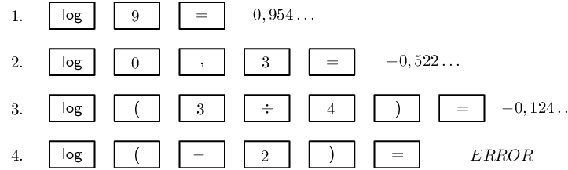

**Write the final answer:**
2. \(\log{9} = \text{0,954}\)
4. \(\log{\text{0,3}} = -\text{0,523}\)
6. \(\log{\frac{3}{4}} = -\text{0,125}\)
8. \(\log{(-2)} =\) undefined
</Callout>

<QuizCard id="m12-02-06c" title="Interactive Exercise 2.8" question="\(\log \frac{3}{5}\)" options=[] answer="-0.22" hint="You should enter a number here. If you want to, you can use a space to separate thousands.                Example: 12 800,25 For scientific notation you need to use the multiply symbol                ( ∗ ) and the exponent symbol ( ^ ). For example 6,673 × 10 −11 should be written as: 6,673 ∗ 10^−11" explanation="It is very important to be familiar with your own calculator and the different function buttons. The \"LOG\" button is used for calculating the common logarithm (base 10) and \"ln\" is for calculating the natural log (base \(e\) ). Many of the newer models will have a third button which allows you to calculate the logarithm of a number to a certain base. \[                 \begin{aligned}                   \log \frac{3}{5} &=  -\text{0,221848...} \\                               &\approx  -\text{0,22}                  \end{aligned}               \] Therefore, the answer rounded off to \(\text{2}\) decimal places is \(-\text{0,22}\) . Important : remember to follow the instructions given in the question statement and round off the answer to \(\text{2}\) decimal places. Submit your answer as:" />

<QuizCard id="m12-02-06c" title="Interactive Exercise 2.8" question="\(\log \text{594,24}\)" options=[] answer="2.77" hint="You should enter a number here. If you want to, you can use a space to separate thousands.                Example: 12 800,25 For scientific notation you need to use the multiply symbol                ( ∗ ) and the exponent symbol ( ^ ). For example 6,673 × 10 −11 should be written as: 6,673 ∗ 10^−11" explanation="Know your calculator. The \"LOG\" button is used for calculating logarithms to base 10 and \"ln\" is for calculating natural log, which have base \(e\) . Some calculators also have a third button which allows you to calculate the logarithm of a number to a certain base. \[                 \begin{aligned}                   \log \text{594,24} &=  \text{2,773961...} \\                               &\approx  \text{2,77}                  \end{aligned}               \] Therefore, the answer rounded off to \(\text{2}\) decimal places is \(\text{2,77}\) . Important : remember to follow the instructions given in the question statement and round off the answer to \(\text{2}\) decimal places. Submit your answer as:" />

<Callout type="tip" title="Worked example 16: Using a calculator: inverse logarithm function">
**Question:**
Use a calculator to determine the following values (correct to \(\text{3}\) decimal places):

2. \(\log{x} = \text{1,7}\)
4. \(\log{t} = \frac{2}{7}\)
6. \(\log{y} = -\text{3}\)

**Use the second function and common logarithm function on your calculator:**
For each of the logarithms given above we need to calculate the inverse of the logarithm (sometimes called
            the antilog). Make sure that you are familiar with the “\(\text{2}\)nd F” button on your
            calculator.

Notice that by pressing the “\(\text{2}\)nd F” button and then the “LOG” button, we
            are using the “\(10^{x}\)” function on the calculator, which is correct since exponentials are
            the inverse of logarithms.

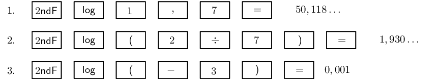

**Write the final answer:**
2. \(x = \text{50,119}\)
4. \(t = \text{1,930}\)
6. \(y = \text{0,001}\)
</Callout>

<QuizCard id="m12-02-06d" title="Interactive Exercise 2.9" question="\(\log k = \text{2}\)" options=[] answer="
                        ['100.00', '1.00e+2']
                    " hint="You should enter a number here. If you want to, you can use a space to separate thousands.                Example: 12 800,25 For scientific notation you need to use the multiply symbol                ( ∗ ) and the exponent symbol ( ^ ). For example 6,673 × 10 −11 should be written as: 6,673 ∗ 10^−11" explanation="Are you familiar with your calculator? It is very important that you know how to use the different function buttons. To determine the value of \(k\) : Press SHIFT on your CASIO or 2ndF on your SHARP calculator. Then press \(\log\) on your CASIO or SHARP calculator. Input the number \(\text{2}\) . Finally, press equals to calculate the answer. Notice that by pressing the \"2nd F\" or \"SHIFT\" button and then the \"log\" button, we are using the \" \(10^{x}\) \" function on the calculator, which is completely correct since exponentials are the inverse of logarithms. \[                         \begin{aligned}                         \log k &= \text{2} \\                         k &= \text{10}^{\text{2}} \\                         &= \text{100}                         \end{aligned}                     \] NOTE: Remember to follow the instructions given in the question statement and round your answer to two decimal places . Submit your answer as:" />

<QuizCard id="m12-02-06d" title="Interactive Exercise 2.9" question="\(\log z = \text{0}\)" options=[] answer="
                        ['1.00', '1.00e+0']
                    " hint="You should enter a number here. If you want to, you can use a space to separate thousands.                Example: 12 800,25 For scientific notation you need to use the multiply symbol                ( ∗ ) and the exponent symbol ( ^ ). For example 6,673 × 10 −11 should be written as: 6,673 ∗ 10^−11" explanation="Are you familiar with your calculator? It is very important that you know how to use the different function buttons. To determine the value of \(z\) : Press SHIFT on your CASIO or 2ndF on your SHARP calculator. Then press \(\log\) on your CASIO or SHARP calculator. Input the number \(\text{0}\) . Finally, press equals to calculate the answer. Notice that by pressing the \"2nd F\" or \"SHIFT\" button and then the \"log\" button, we are using the \" \(10^{x}\) \" function on the calculator, which is completely correct since exponentials are the inverse of logarithms. \[                         \begin{aligned}                         \log z &= \text{0} \\                         z &= \text{10}^{\text{0}} \\                         &= \text{1}                         \end{aligned}                     \] NOTE: Remember to follow the instructions given in the question statement and round your answer to two decimal places . Submit your answer as:" />

<Callout type="tip" title="Worked example 17: Using a calculator: change of base">
**Question:**
Use a calculator to find \(\log_{2}{5}\) correct to two decimal places.

**:**
\[\log_{2}{5} = \frac{\log{5}}{\log{2}}\]

**Use a change of base to convert given logarithm to base \(\text{10}\):**
\[\log_{2}{5} = \frac{\log{5}}{\log{2}}\]

**Use the common logarithm function on your calculator:**

**Write the final answer:**
\[\log_{2}{5} = \text{2,32}\]
</Callout>

**Important: **

- Do not write down an intermediate step when doing this type of calculation:
            \begin{align*}
            \log_{2}{5} &= \frac{\log{5}}{\log{2}} \\
            &= \frac{\text{0,7}}{\text{0,3}} \quad (\text{this step can cause rounding off errors}) \\
            &= \text{2,33}
            \end{align*}
  Perform the calculation in one step on your calculator:
            \begin{align*}
            \log_{2}{5} &= \frac{\log{5}}{\log{2}} \\
            &= \text{2,32}
            \end{align*}
- Do not round off before the final answer as this can affect the accuracy of the answer.
- Be sure that you determine the correct sequence and order of operations when using a calculator.

## Logarithms using a calculator

### Textbook Exercise 2.9

Calculate the following (correct to three decimal places):

**Problem:**
\(\log{3}\)

**Solution:**
\(\text{0,477}\)

**Problem:**
\(\log{30}\)

**Solution:**
\(\text{1,477}\)

**Problem:**
\(\log{300}\)

**Solution:**
\(\text{2,477}\)

**Problem:**
\(\log{0.66}\)

**Solution:**
\(-\text{0,180}\)

**Problem:**
\(\log{\frac{1}{4}}\)

**Solution:**
\(-\text{0,602}\)

**Problem:**
\(\log{\text{852}}\)

**Solution:**
\(\text{2,930}\)

**Problem:**
\(\log{(-6)}\)

**Solution:**
no value

**Problem:**
\(\log_{3}{4}\)

**Solution:**
\(\text{1,262}\)

**Problem:**
\(\log{\text{0,01}}\)

**Solution:**
\(-\text{2}\)

**Problem:**
\(\log_{2}{15}\)

**Solution:**
\(\text{3,907}\)

**Problem:**
\(\log_{4}{10}\)

**Solution:**
\(\text{1,661}\)

**Problem:**
\(\log_{\frac{1}{2}}{6}\)

**Solution:**
\(-\text{2,585}\)

Use a calculator to determine the value of \(x\) (correct to two decimal places). Check your answer by
                changing to exponential form.

**Problem:**
\(\log{x} = \text{0,6}\)

**Solution:**
\begin{align*}
                x &= \text{3,98}\\
                \text{Check exponential form: } 10^{\text{0,6}}&= \text{3,98}
                \end{align*}

**Problem:**
\(\log{x} = -\text{2}\)

**Solution:**
\begin{align*}
                x &= \text{0,01}\\
                \text{Check exponential form: } 10^{-\text{2}}&= \text{0,01}
                \end{align*}

**Problem:**
\(\log{x} = \text{1,8}\)

**Solution:**
\begin{align*}
                x &= \text{63,10}\\
                \text{Check exponential form: } 10^{\text{1,8}}&= \text{63,10}
                \end{align*}

**Problem:**
\(\log{x} = \text{5}\)

**Solution:**
\begin{align*}
                x &= \text{100 000}\\
                \text{Check exponential form: } 10^{\text{5}}&= \text{100 000}
                \end{align*}

**Problem:**
\(\log{x} = -\text{0,5}\)

**Solution:**
\begin{align*}
                x &= \text{0,32}\\
                \text{Check exponential form: } 10^{-\text{0,5}}&= \text{0,32}
                \end{align*}

**Problem:**
\(\log{x} = \text{0,076}\)

**Solution:**
\begin{align*}
                x &= \text{1,19}\\
                \text{Check exponential form: } 10^{\text{0,076}}&= \text{1,19}
                \end{align*}

**Problem:**
\(\log{x} = \frac{2}{5}\)

**Solution:**
\begin{align*}
                x &= \text{2,51}\\
                \text{Check exponential form: } 10^{\frac{2}{5}}&= \text{2,51}
                \end{align*}

**Problem:**
\(\log{x} = -\frac{6}{5}\)

**Solution:**
\begin{align*}
                x &= \text{0,06}\\
                \text{Check exponential form: } 10^{\left( -\frac{6}{5} \right)}&= \text{0,06}
                \end{align*}

**Problem:**
\(\log_{2}{x} = \text{0,25}\)

**Solution:**
\begin{align*}
                \log_{2}{x} &= \text{0,25} \\
                \therefore \frac{\log{x}}{\log{2}} &= \text{0,25} \\
                \therefore \log{x} &= \text{0,25} \times \log{2} \\
                \therefore x &= \text{1,19} \\
                \text{Check exponential form: } 2^{\text{0,25}}&= \text{1,19}
                \end{align*}

**Problem:**
\(\log_{5}{x} = -\text{0,1}\)

**Solution:**
\begin{align*}
                \log_{5}{x} &= -\text{0,1} \\
                \therefore \frac{\log{x}}{\log{5}} &= -\text{0,1} \\
                \therefore \log{x} &= -\text{0,1} \times \log{5} \\
                \therefore x &= \text{0,85} \\
                \text{Check exponential form: } 5^{(-\text{0,10})}&= \text{0,85}
                \end{align*}

**Problem:**
\(\log_{\frac{1}{4}}{x} = \text{2}\)

**Solution:**
\begin{align*}
                \log_{\frac{1}{4}}{x} &= \text{2} \\
                \therefore \frac{\log{x}}{\log{\frac{1}{4}}} &= \text{2} \\
                \therefore \log{x} &= \text{2} \times \log{\frac{1}{4}} \\
                \therefore x &= \text{0,06} \\
                \text{Check exponential form: } \left( \frac{1}{4} \right)^{\text{2}}&= \text{0,06}
                \end{align*}

**Problem:**
\(\log_{7}{x} = \text{0,3}\)

**Solution:**
\begin{align*}
                \log_{7}{x} &= \text{0,3} \\
                \therefore \frac{\log{x}}{\log{7}} &= \text{0,3} \\
                \therefore \log{x} &= \text{0,3} \times \log{7} \\
                \therefore x &= \text{1,79} \\
                \text{Check exponential form: } 7^{\text{0,3}}&= \text{1,79}
                \end{align*}

### Exponential and logarithmic graphs (EMCFN)

<Callout type="tip" title="Worked example 18: Graphs of the inverse of \(y=b^{x}\)">
**Question:**
On the same system of axes, draw the graphs of \(f(x) = 10^{x}\) and its inverse \(f^{-1}(x) = \log{x}\).
            Investigate the properties of \(f\) and \(f^{-1}\).

**Determine the properties of \(f(x)\):**
- Function: \(y = 10^{x}\)
- Shape: increasing graph
- Intercept(s): \((0;1)\)
- Asymptote(s): horizontal asymptote at \(x\)-axis, line \(y = 0\)
- Domain: \(\{x: x \in \mathbb{R} \}\)
- Range: \(\{y: y > 0, y \in \mathbb{R} \}\)

**Draw the graphs:**
The graph of the inverse \(f^{-1}\) is the reflection of \(f\) about the line \(y = x\).

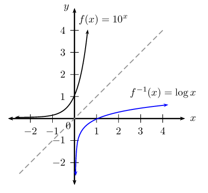

**Determine the properties of \(f^{-1}(x)\):**
- Function: \(y = \log{x}\)
- Shape: increasing graph
- Intercept(s): \((1;0)\)
- Asymptote(s): vertical asymptote at \(y\)-axis, line \(x = 0\)
- Domain: \(\{x: x > 0, x \in \mathbb{R} \}\)
- Range: \(\{y: y \in \mathbb{R} \}\)

Notice that the inverse is a function: \(f^{-1}(x) = \log{x}\) is a one-to-one function since every input
            value is associated with only one output value.
</Callout>

The exponential function and the logarithmic function are inverses of each other:

- the domain of the function is equal to the range of the inverse
- the range of the function is equal to the domain of the inverse
- the \(y\)-intercept of the function is equal to the \(x\)-intercept of the inverse
- the \(x\)-intercept of the function is equal to the \(y\)-intercept of the inverse
- the asymptote for the function is \(y = 0\) and the asymptote for the inverse is \(x = 0\)
- the graphs are reflected about the line \(y=x\)

<Callout type="tip" title="Worked example 19: Graphs of \(y=\log_{b}{x}\)">
**Question:**
2. Draw a sketch of \(g(x) = \log_{10}{x}\).
4. Reflect the graph of \(g\) about the \(x\)-axis to give the graph \(h\).
6. Investigate the properties of \(h\).
8. Use \(g\) and \(h\) to suggest a general conclusion.

**Sketch the graph of \(g(x)= \log_{10}{x}\):**
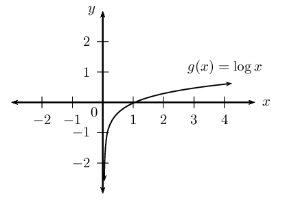

**Reflect \(g\) about the \(x\)-axis:**
An easy method for reflecting a graph about a certain line is to imagine folding the Cartesian plane along
            that line and the reflected graph is pressed onto the plane.

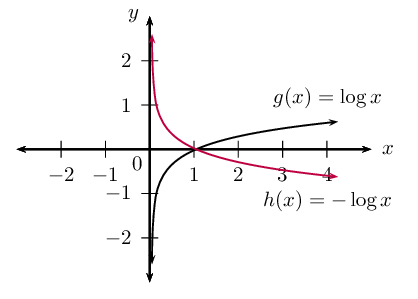

**Investigate the properties of \(h\):**
- Function: passes the vertical line test
- Shape: decreasing graph
- Intercept(s): \((1;0)\)
- Asymptote(s): vertical asymptote at \(y\)-axis, line \(x = 0\)
- Domain: \(\{x: x > 0, x \in \mathbb{R} \}\)
- Range: \(\{y: y \in \mathbb{R} \}\)

Since \(h(x)\) is symmetrical to \(g(x)\) about the \(x\)-axis, this means that every \(y\)-value of \(g\)
            corresponds to a \(y\)-value of the opposite sign for \(h\).

          \begin{align*}
          \text{Given } g(x) & = \log_{10}{x} \\
          \therefore h(x) & = - \log_{10}{x} \\
          \text{Let } y & = - \log_{10}{x} \\
          -y & = \log_{10}{x} \\
          \therefore 10^{-y} & = x \\
          \left( \frac{1}{10} \right)^{y} & = x \\
          \therefore y & = \log_{\frac{1}{10}}{x} \\
          \therefore h(x) & = - \log_{10}{x} = \log_{\frac{1}{10}}{x}
          \end{align*}

**General conclusion:**
From this example of \(g\) and \(h\) we see that:

          \[-\log_{m}{p} = \log_{\frac{1}{m}}{p}\]
</Callout>

<Callout type="tip" title="Worked example 20: Graph of \(y=\log_{b}{x}\)">
**Question:**
2. Draw a sketch of \(h(x) = \log_{\frac{1}{10}}{x}\).
4. Draw the graph of \(r(x)\), the reflection of \(h\) about the line \(y = x\).
6. Investigate the properties of \(r\).
8. Write down the new equation if \(h\) is shifted \(\text{1}\) unit upwards and \(\text{2}\) units to the
                 right.

**Sketch the graph of \(h(x)= \log_{\frac{1}{10}}{x}\):**
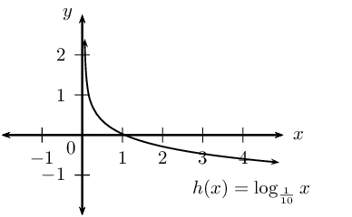

**Reflect \(h\) about the line \(y = x\):**
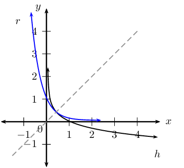

**Investigate the properties of \(r\):**
- Function: passes the vertical line test
- Shape: decreasing graph
- Intercept(s): \((0;1)\)
- Asymptote(s): horizontal asymptote at \(x\)-axis, line \(y = 0\)
- Domain: \(\{x: x \in \mathbb{R} \}\)
- Range: \(\{y: y > 0, y \in \mathbb{R} \}\)

Since \(h(x)\) is symmetrical to \(r(x)\) about the line \(y = x\), this means that \(r\) is the inverse of
            \(h\).

          \begin{align*}
          h(x) & = \log_{\frac{1}{10}}{x} \\
          \text{Let } y & = \log_{\frac{1}{10}}{x} \\
          \text{Inverse: } x & = \log_{\frac{1}{10}}{y} \\
          \therefore \left( \frac{1}{10} \right)^{x} & = y \\
          {10}^{-x} & = y \\
          & \\
          \therefore r(x) = h^{-1}(x)& = {10}^{-x}
          \end{align*}

Therefore, \(r(x)\) is an exponential function of the form \(y = b^{x}\) with \(0 < b < 1\). In
            words, the base \(b\) is a positive fraction with a value between \(\text{0}\) and \(\text{1}\).

**Vertical and horizontal shifts:**
If \(h\) is shifted \(\text{1}\) unit upwards and \(\text{2}\) units to the right, then the new equation
            will be: \[y = \log_{\frac{1}{10}}{(x - 2)} + 1\]

The vertical asymptote is \(x = 2\) and the horizontal asymptote is \(y = 1\).
</Callout>

**Summary of graphs: \(y = b^{x}\) and \(y = \log_{b}{x}\) **

|  | Exponential function | Logarithmic function | Axis of symmetry |
| --- | --- | --- | --- |
|  | \(y = b^{x}\) | \(y = \log_{b}{x}\) | \(y = x\) |
| \(b > 1\) |  |  |  |
| \(0 < b < 1\) |  |  |  |
| Axis of symmetry | \(y\)-axis, \(x = 0\) | \(x\)-axis, \(y = 0\) |  |

<Callout type="note" title="Note">
<VideoPlayer src="https://www.youtube.com/embed/vFzfOZbet0s" title="Video: 28F3" />
</Callout>

## Graphs and inverses of \(y=\log_{b}{x}\)

### Textbook Exercise 2.10

Given \(f\left(x\right)={\left(\frac{1}{5}\right)}^{x}\).

**Problem:**
Sketch the graphs of \(f\) and \({f}^{-1}\) on the same system of axes. Label both
              graphs clearly.

**Solution:**
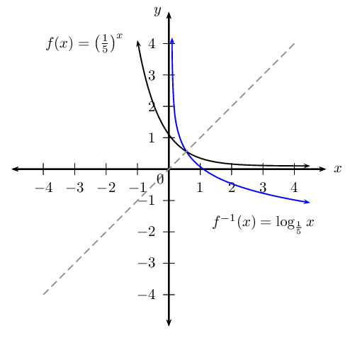

**Problem:**
State the intercept(s) for each graph.

**Solution:**
\(f: (0;1)\) and \(f^{-1}: (1;0)\)

**Problem:**
Label \(P\), the point of intersection of \(f\) and \(f^{-1}\).

**Solution:**
Notice that the function and its inverse intersect at a point that lies on the line \(y = x\).

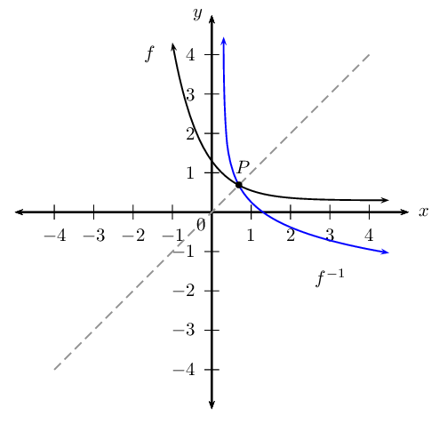

**Problem:**
State the domain, range and asymptote(s) of each function.

**Solution:**
| Function | Domain | Range | Asymptote |
| --- | --- | --- | --- |
| \(f(x) = \left( \frac{1}{5} \right)^{x}\) | \(\{x: x \in \mathbb{R} \}\) | \(\{y: y > 0, y \in \mathbb{R} \}\) | \(x\)-axis, \(y=0\) |
| \(f^{-1}(x) = \log_{\frac{1}{5}}{x}\) | \(\{x: x > 0, x \in \mathbb{R} \}\) | \(\{y: y \in \mathbb{R} \}\) | \(y\)-axis, \(x=0\) |

Given \(g\left(x\right)= t^{x}\) with \(M\left(1\frac{3}{5} ; 5\frac{4}{5}\right)\) a point on the graph
              of \(g\).

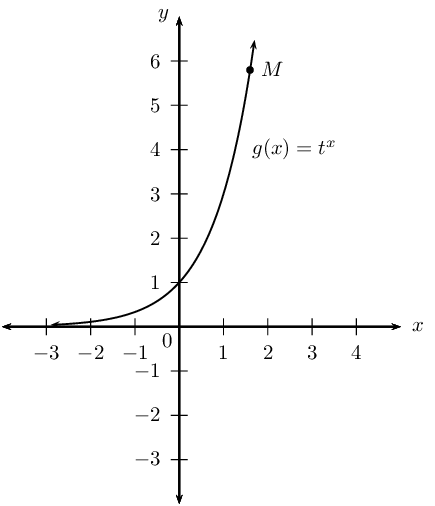

**Problem:**
Determine the value of \(t\)

**Solution:**
\begin{align*}
              \text{Let } y &= t^{x} \\
              \text{5,8} &= t^{\text{1,6}} \\
              \therefore t &= \sqrt[\text{1,6}]{\text{5,8}} \\
              &= \text{3,000} \ldots \\
              & \\
              \therefore g(x) &= 3^{x}
              \end{align*}

**Problem:**
Find the inverse of \(g\).

**Solution:**
\begin{align*}
              \text{Let } y & = 3^{x} \qquad (y > 0) \\
              \text{Interchange } x \text{ and } y: \quad x & = 3^{y} \qquad (x > 0) \\
              \frac{x}{2} & = y^{2} \\
              y & = \log_{3}{x} \\
              & \\
              \therefore g^{-1}(x) & = \log_{3}{x} \qquad (x > 0)
              \end{align*}

**Problem:**
Use symmetry about the line \(y = x\) to sketch the graphs of \(g\) and \({g}^{-1}\) on the same system
                of axes.

**Solution:**
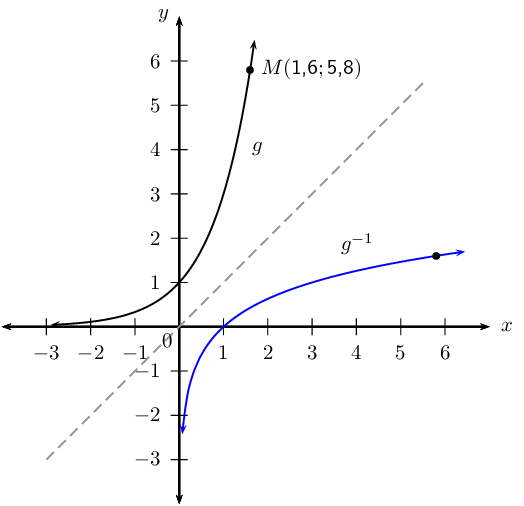

**Problem:**
Point \(N\) lies on the graph of \(g^{-1}\) and is symmetrical to point \(M\) about the line \(y = x\).
                Determine the coordinates of \(N\).

**Solution:**
\(N( \text{5,8}; \text{1,6})\)

### Applications of logarithms (EMCFP)

Logarithms have many different applications:

- seismologists use logarithms to calculate the magnitude of earthquakes
- financial institutions make use of logarithms to calculate the length of loan repayments
- scientists use logarithms to determine the rate of radioactive decay
- biologists use logarithms to calculate population growth rates
- scientists use logarithms to determine pH levels
            \[\text{pH} = - \log_{10}{[H^{+}]}\]

<Callout type="note" title="Note">
<VideoPlayer src="https://www.youtube.com/embed/8W2KbhC9mE0" title="Video: 28F6" />
</Callout>

<Callout type="tip" title="Worked example 21: Population growth">
**Question:**
The population of a city grows by \(\text{5}\%\) every two years. How long will it take for the city's
            population to triple in size?

**Write down a suitable formula and the known values:**
\[A=P{\left(1+i\right)}^{n}\]

- Let \(P = x\)
- The population triples in size, so \(A = 3x\)
- Growth rate \(i = \frac{5}{100}\)
- Growth rate is given for a \(\text{2}\) year period, so we use \(\frac{n}{2}\)

**Substitute known values and solve for \(n\):**
\begin{align*}
          3x &=x{\left(1+\frac{5}{100}\right)}^{\frac{n}{2}} \\
          3 & = {\left(1,05\right)}^{\frac{n}{2}}
          \end{align*}

**Method \(\text{1}\): take the logarithm of both sides of the equation:**
\begin{align*}
          \log{3}& = \log{\left(1,05\right)}^{\frac{n}{2}} \\
          \log{3}& = \frac{n}{2}\times \log{1,05} \\
          2 \times \frac{\log3}{\log{1,05}} & = n \\
          45,034 \ldots & = n
          \end{align*}

**Method \(\text{2}\): change from exponential form to logarithmic form:**
\begin{align*}
          \frac{n}{2} & = \log_{\text{1,05}}{3} \\
          & = \frac{\log{3}}{\log{\text{1,05}}} \\
          n & = 2 \times \frac{\log3}{\log{1,05}} \\
          n & = 45,034 \ldots
          \end{align*}

**Write the final answer:**
It will take approximately \(\text{45}\) years for the city's population to triple in size.
</Callout>

## Applications of logarithms

### Textbook Exercise 2.11

**Problem:**
The population of Upington grows \(\text{6}\%\) every \(\text{3}\) years.
                How long will it take to triple in size?

Give your answer in years and round to the nearest integer.

**Solution:**
<Callout type="tip" title="Note">
This is a compound growth problem.
                  You should first write down the initial size of the population, the final size of the population and
                  the rate at which the population grows.
                  Note that every period is \(\text{3}\) years long.
</Callout>

Let the population at the start be
                \[P = x\]

                We want to know how many periods it will take to triple in size.
                This means that the final population is
                \[A = 3x\]

Let \(n\) be the number of periods needed to grow to a size of \(A\).
                Note that every period is \(\text{3}\) years long, therefore we must use \(\frac{n}{\text{3}}\).

The growth rate is
                \[i = \text{6}\% = \frac{\text{6}}{\text{100}}\]

We use the formula for compound growth/interest:
                \begin{align*}
                A &= P(1+i)^n \\
                3x &= x\left(1 + \frac{\text{6}}{\text{100}}\right)^{\frac{n}{\text{3}}} \\
                \text{3} &= (\text{1,06})^{\frac{n}{\text{3}}}
                \end{align*}

We now use the definition of the logarithm to write the equation in terms of \(n\) and then evaluate
                with a calculator:
                \begin{align*}
                \frac{n}{\text{3}} &= \log_{(\text{1,06})} \text{3} \\
                &= \frac{\log{3}}{\log{\text{1,06}}} \\
                &= \text{18,854}\ldots \\
                \therefore n &= 3 \times \text{18,854}\ldots \\
                &= \text{56,562}\ldots \\
                &\approx \text{57}
                \end{align*}

It will take approximately \(\text{57}\) years for the population to triple in size.

An ant population of \(\text{36}\) ants doubles every month.

**Problem:**
Determine a formula that describes the growth of the population.

**Solution:**
Let the number of months be \(M_{0}; M_{1}; M_{2}; \ldots\)

| \(M_{0}\) | \(\) | \(M_{1}\) | \(\) | \(M_{2}\) | \(\) | \(\ldots\) |
| --- | --- | --- | --- | --- | --- | --- |
| \(\text{36}\) | \(\rightarrow\) | \(\text{72}\) | \(\rightarrow\) | \(\text{144}\) | \(\rightarrow\) | \(\ldots\) |
|  | \(\times 2\) |  | \(\times 2\) |  | \(\times 2\) |  |

\(36 \times 2^{0} \quad \rightarrow \quad 36 \times 2^{1} \quad \rightarrow \quad 36 \times 2^{2}
                  \quad \rightarrow \quad \ldots\)

                \[\text{Growth } = 36 \times 2^{n}\]

where \(n\) is the number of months.

**Problem:**
Calculate how long it will take for the ant population to reach a quarter of a million ants.

**Solution:**
\begin{align*}
                \text{Growth } &= 36 \times 2^{n} \\
                \frac{1}{4} \times \text{1 000 000} &= 36 \times 2^{n} \\
                \text{250 000} &= 36 \times 2^{n} \\
                \frac{\text{250 000}}{36} &= 2^{n} \\
                \therefore n &= \log_{2}{ \left( \frac{\text{250 000}}{36} \right) } \\
                n &= \frac{\log{\left( \frac{\text{250 000}}{36} \right)}}{\log{2}} \\
                \therefore n &= \frac{\log{\left( \frac{\text{250 000}}{36} \right)}}{\log{2}} \\
                &= \text{12,7} \ldots
                \end{align*}

There will be a quarter of a million ants after about \(\text{13}\) months.
