## 2.7 Summary (EMCFQ)

- Function: a rule which uniquely associates elements of one set \(A\) with the
                                          elements of another set \(B\); each element in set \(A\) maps to only one
                                          element in set \(B\).
- Functions can be one-to-one relations or many-to-one relations. A many-to-one
                                          relation associates two or more values of the independent (input) variable with
                                          a single value of the dependent (output) variable.
- Vertical line test: if it is possible to draw any vertical line which crosses the
                                          graph of the relation more than once, then the relation is not a function.
- Given the invertible function \(f(x)\), we determine the inverse \(f^{-1}(x)\) by:
  - replacing every \(x\) with \(y\) and \(y\) with \(x\);
  - making \(y\) the subject of the equation;
  - expressing the new equation in function notation.
- If we represent the function \(f\) and the inverse function \({f}^{-1}\) graphically,
                                          the two graphs are reflected about the line \(y=x\).
- The domain of the function is equal to the range of the inverse. The range of the
                                          function is equal to the domain of the inverse.
- The inverse function of a straight line is also a straight line. Vertical and
                                          horizontal lines are exceptions.
- The inverse of a parabola is not a function. However, we can limit the domain of the
                                          parabola so that the inverse of the parabola is a function.
- The inverse of the exponential function \(f(x) = b^{x}, (b > 0, b \ne 1)\) is the
                                          logarithmic function \(f^{-1}(x) = \log_{b}{x}\).
- The “common logarithm” has a base \(\text{10}\) and can be written as
                                          \(\log_{10}{x} = \log{x}\). The \(\log\) symbol written without a base means
                                          \(\log\) base
                                          \(\text{10}\).

**Logarithmic laws:**

- \(\log_{a}{x^{b}} = b \log_{a}{x} \qquad (x > 0)\)
- \(\log_{a}{x} = \frac{\log_{b}{x}}{\log_{b}{a}} \qquad (b > 0 \text{ and } b \ne 1)\)
- \(\log_{a}{xy} = \log_{a}{x} + \log_{a}{y} \qquad (x > 0 \text{ and } y > 0)\)
- \(\log_{a}{\frac{x}{y}} = \log_{a}{x} - \log_{a}{y} \qquad (x > 0 \text{ and } y >
                                  0)\)

|  | Straight line function | Quadratic function | Exponential function |
| --- | --- | --- | --- |
| Formula | \(y = ax + q\) | \(y = ax^{2}\) | \(y = b^{x}\) |
| Inverse | \(y = \frac{x}{a} - \frac{q}{a}\) | \(y = \pm \sqrt{\frac{x}{a}}\) | \(y = \log_{b}{x}\) |
| Inverse a function? | yes | no | yes |
| Graphs |  |  |  |

## End of chapter exercises

### Textbook
                                        Exercise 2.12

Given the straight line \(h\) with intercepts \((-3;0)\) and
                                                        \((0;-6)\).

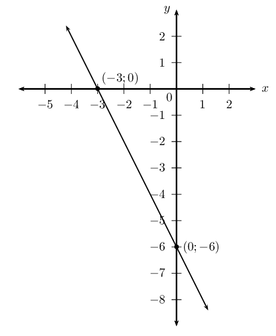

**Problem:**
Determine the equation of \(h\).

**Solution:**
\begin{align*}
                                                        \text{Gradient: } m &= \frac{y_{2} - y_{1}}{x_{2} - x_{1}}
                                                        \\
                                                        &= \frac{-6 - 0}{0 - (-3)} \\
                                                        &= \frac{-6}{3} \\
                                                        &= -2\\
                                                        \therefore h(x) &= -2x - 6
                                                        \end{align*}

**Problem:**
Find \(h^{-1}\).

**Solution:**
\begin{align*}
                                                        \text{Let } y &= -2x - 6 \\
                                                        \text{Inverse: } x &= -2y - 6 \\
                                                        x + 6 &= -2y \\
                                                        -\frac{1}{2} (x + 6) &= y \\
                                                        y &= -\frac{x}{2} - 3 \\
                                                        \therefore h^{-1}(x) &= -\frac{x}{2} - 3
                                                        \end{align*}

**Problem:**
Draw both graphs on the same system of axes.

**Solution:**
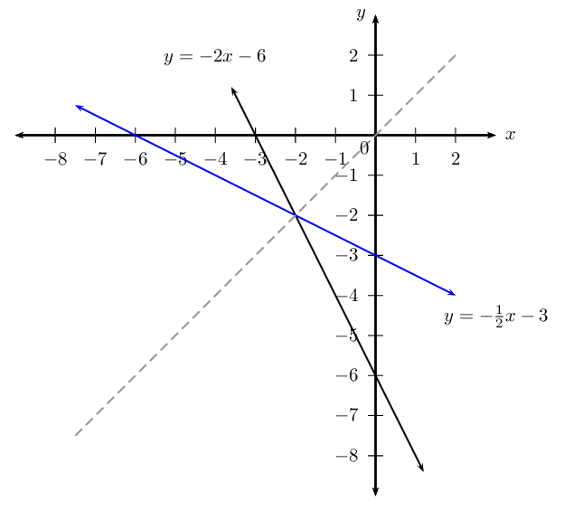

**Problem:**
Calculate the coordinates of \(S\), the point of
                                                        intersection of \(h\) and \(h^{-1}\).

**Solution:**
\begin{align*}
                                                        -\frac{x}{2} - 3 &= -2x - 6 \\
                                                        -x - 6 &= -4x - 12 \\
                                                        -x + 4x &= -12 + 6 \\
                                                        3x &= -6 \\
                                                        \therefore x &= -2 \\
                                                        \text{If } x=-2, \quad y &= -2(-2) - 6 \\
                                                        y &= -2(-2) - 6 \\
                                                        &= -2
                                                        \end{align*}

This gives the point \(S(-2;-2)\)

**Problem:**
State the property regarding the point of
                                                        intersection that will always be true for a function and its
                                                        inverse.

**Solution:**
The value of the \(x\)-coordinate and the \(y\)-coordinate
                                                                will always be the same since the point lies on the line
                                                                \(y = x\).

The inverse of a function is \(f^{-1}(x) = 2x + 4\).

**Problem:**
Determine \(f\).

**Solution:**
\begin{align*}
                                                        \text{Let } y &= 2x + 4 \\
                                                        \text{Inverse: } x &= 2y + 4 \\
                                                        x - 4 &= 2y \\
                                                        \frac{1}{2}x - 2 &= y \\
                                                        \therefore f(x) &= \frac{1}{2}x - 2
                                                        \end{align*}

**Problem:**
Draw \(f\) and \(f^{-1}\) on the same set of axes.
                                                        Label each graph clearly.

**Solution:**
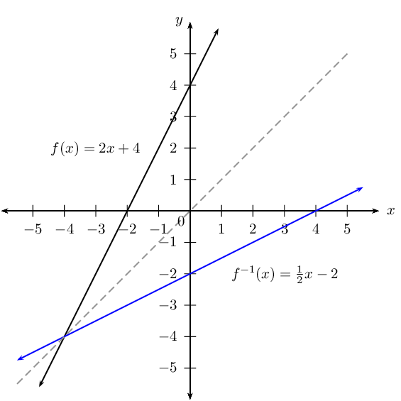

**Problem:**
Is \(f^{-1}\) an increasing or decreasing function?
                                                        Explain your answer.

**Solution:**
Increasing. As \(x\) increases, the function value increases.
                                                                Alternative reason: gradient is positive, therefore
                                                                function is increasing.

\(f\left(x\right)=2{x}^{2}\).

**Problem:**
Draw the graph of \(f\) and state its domain and range.

**Solution:**
The domain is: \(\{x: x \in \mathbb{R} \}\) and the range is:
                                                                \(\{y: y \geq 0, y \in \mathbb{R} \}\).

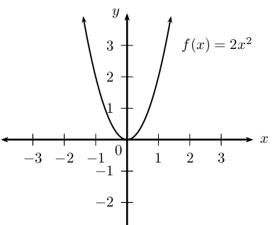

**Problem:**
Determine the inverse and state its domain and range.

**Solution:**
\begin{align*}
                                                        \text{Let } y &= 2x^{2} \\
                                                        \text{Inverse: } x &= 2y^{2} \\
                                                        \frac{1}{2}x &= y^{2} \\
                                                        \pm \sqrt{ \frac{1}{2}x } &= y \\
                                                        \therefore y &= \pm \sqrt{ \frac{x}{2} } \qquad (x \ge 0)
                                                        \end{align*}

Domain: \(\{x: x \geq 0, x \in \mathbb{R} \}\), Range: \(\{y:
                                                                y \in \mathbb{R} \}\).

Given the function \(f(x) = \left( \frac{1}{4} \right)^{x}\).

**Problem:**
Sketch the graphs of \(f\) and \(f^{-1}\) on the
                                                        same system of axes.

**Solution:**
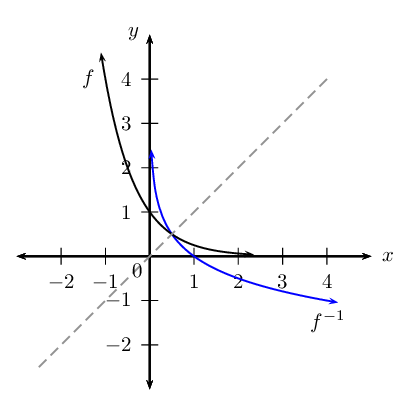

**Problem:**
Determine if the point \(\left( -\frac{1}{2}; 2
                                                        \right)\) lies on the graph of \(f\).

**Solution:**
\begin{align*}
                                                        f(x) & = \left( \frac{1}{4} \right)^{x} \\
                                                        \text{Substitute } \left( -\frac{1}{2}; 2 \right): \quad
                                                        f\left(-\frac{1}{2}\right) & = \left( \frac{1}{4}
                                                        \right)^{-\frac{1}{2}}\\
                                                        & = 4^{\frac{1}{2}} \\
                                                        & = 2
                                                        \end{align*}

Yes, the point \(\left( -\frac{1}{2}; 2 \right)\) does lie on
                                                                \(f\).

**Problem:**
Write \(f^{-1}\) in the form \(y = \ldots\)

**Solution:**
\begin{align*}
                                                        f: \quad y & = \left( \frac{1}{4} \right)^{x} \\
                                                        f^{-1}: \quad x & = \left( \frac{1}{4} \right)^{y} \\
                                                        \therefore y & = \log_{\frac{1}{4}}{x}\\
                                                        \text{or } & \\
                                                        f: \quad y & = \left( 4 \right)^{-x} \\
                                                        f^{-1}: \quad x & = \left(4 \right)^{-y} \\
                                                        -y & = \log_{4}{x}\\
                                                        \therefore y & = - \log_{4}{x}
                                                        \end{align*}

\(y = \log_{\frac{1}{4}}{x}\) or \(y = - \log_{4}{x}\)

**Problem:**
If the graphs of \(f\) and \(f^{-1}\) intersect at
                                                        \(\left( \frac{1}{2}; P \right)\), determine the value of \(P\).

**Solution:**
\(P = \frac{1}{2}\), since the point lies on the line \(y = x\).

**Problem:**
Give the equation of the new graph, \(G\), if the
                                                        graph of \(f^{-1}\) is shifted \(\text{2}\) units to the left.

**Solution:**
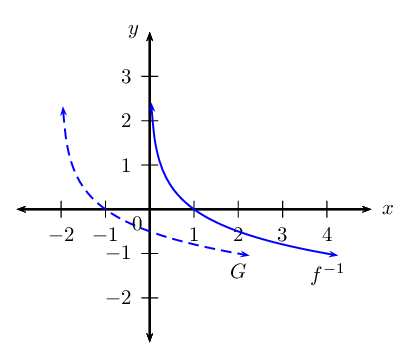

**Problem:**
Give the asymptote(s) of \(G\).

**Solution:**
Vertical asymptote: \(x = -2\)

Consider the function \(h(x) = 3^{x}\).

**Problem:**
Write down the inverse in the form \(h^{-1}(x) =
                                                        \ldots\)

**Solution:**
\begin{align*}
                                                        \text{Let: } \quad y & = 3^{x} \\
                                                        \text{Inverse: } x & = 3^{y} \\
                                                        y & = \log_{3}{x} \\
                                                        \therefore h^{-1}(x) & = \log_{3}{x}
                                                        \end{align*}

**Problem:**
State the domain and range of \(h^{-1}\).

**Solution:**
Domain: \(\{x: x > 0, x \in \mathbb{R} \}\) and range:
                                                                \(\{y: y \in \mathbb{R} \}\).

**Problem:**
Sketch the graphs of \(h\) and \(h^{-1}\) on the
                                                        same system of axes, label all intercepts.

**Solution:**
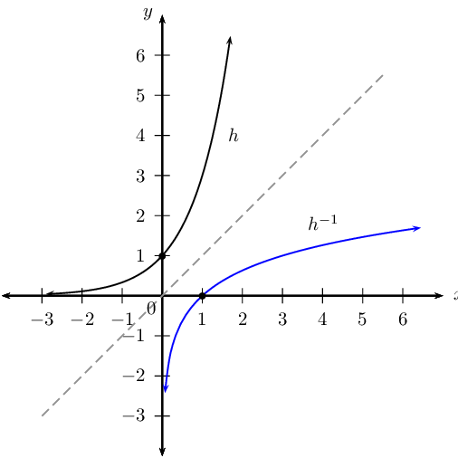

**Problem:**
For which values of \(x\) will \(h^{-1}(x) <
                                                        0\)?

**Solution:**
\(0 < x < 1\)

Consider the functions \(f(x) = 2^{x}\) and \(g(x) = x^{2}\).

**Problem:**
Sketch the graphs of \(f\) and \(g\) on the same
                                                        system of axes.

**Solution:**
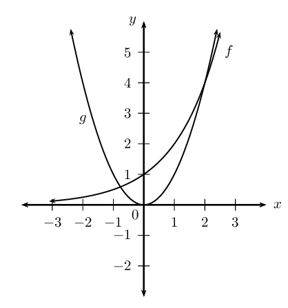

**Problem:**
Determine whether or not \(f\) and \(g\) intersect
                                                        at a point where \(x = -1\).

**Solution:**
\begin{align*}
                                                        f(x) & = 2^{x} \\
                                                        f(-1) & = 2^{-1} \\
                                                        & = \frac{1}{2}\\
                                                        g(x) & = x^{2} \\
                                                        g(-1) & = (-1)^{2} \\
                                                        & = 1 \\
                                                        \therefore f(-1) & \ne g(-1)
                                                        \end{align*}

The graphs do not intersect at \(x = -1\).

**Problem:**
How many solutions does the equation \(2^{x} =
                                                        x^{2}\) have?

**Solution:**
Two

**Problem:**
Below are three graphs and six equations. Write down the equation
                                                        that best matches each of the graphs.

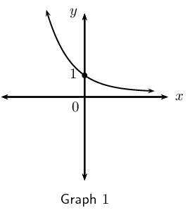

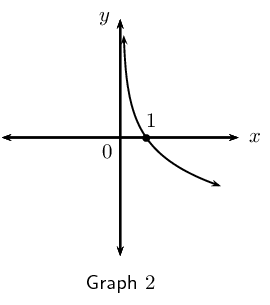

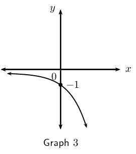

2. \(y={\log}_{3}x\)
4. \(y=-{\log}_{3}x\)
6. \(y={\log}_{\frac{1}{3}}x\)
8. \(y={3}^{x}\)
10. \(y={3}^{-x}\)
12. \(y=-{3}^{x}\)

**Solution:**
Graph \(\text{1}\): \(y = 3^{-x}\)

Graph \(\text{2}\): \(y = - \log _{3} x\) or \(y = \log
                                                        _{\frac{1}{3}}{x}\)

Graph \(\text{3}\): \(y = -3^{x}\)

Given the graph of the function \(f: \enspace y = \log_{b}{x}\)
                                                        passing through the point \((9;2)\).

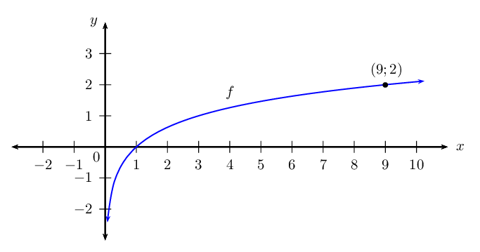

**Problem:**
Show that \(b = 3\).

**Solution:**
\begin{align*}
                                                        y &= \log_{b}{x} \\
                                                        2 &= \log_{b}{9} \\
                                                        \therefore 9 &= b^{2} \\
                                                        \therefore 3^2 &= b^{2} \\
                                                        \therefore b &= 3
                                                        \end{align*}

**Problem:**
Determine the value of \(a\) if \((a;-1)\) lies on
                                                        \(f\).

**Solution:**
\begin{align*}
                                                        y &= \log_{3}{x} \\
                                                        -1 &= \log_{3}{a} \\
                                                        \therefore 3^{-1} &= a \\
                                                        \therefore a &= \frac{1}{3}
                                                        \end{align*}

**Problem:**
Write down the new equation if \(f\) is shifted
                                                        \(\text{2}\) units upwards.

**Solution:**
\(y = \log_{3}{x} + 2\)

**Problem:**
Write down the new equation if \(f\) is shifted
                                                        \(\text{1}\) units to the right.

**Solution:**
\(y = \log_{3}{(x - 1)}\)

**Problem:**
If the rhino population in South Africa starts to
                                                        decrease at a rate of \(\text{7}\%\) per annum, determine how
                                                        long it will take for the current rhino population to halve in
                                                        size? Give your answer to the nearest integer.

**Solution:**
\begin{align*}
                                                        A &= P \left( 1 - i \right)^{n} \\
                                                        \frac{1}{2} &= \left( 1 - \frac{7}{100}\right)^{n} \\
                                                        \text{0,5} &= \left( \text{0,93} \right)^{n} \\
                                                        \log{\text{0,5}} &= \log{\left( \text{0,93} \right)^{n}} \\
                                                        \log{\text{0,5}} &= n \log{\left( \text{0,93} \right)} \\
                                                        \therefore n &= \frac{\log{\text{0,5}} }{\log{\left(
                                                        \text{0,93} \right)}} \\
                                                        &= \text{9,55} \ldots
                                                        \end{align*}

It will take less than \(\text{10}\) years for the current
                                                                rhino population to halve in size.

**Problem:**
Which of the following graphs best illustrates the rhino
                                                                population's decline? Motivate your answer.

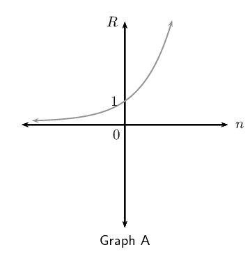

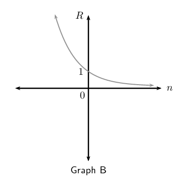

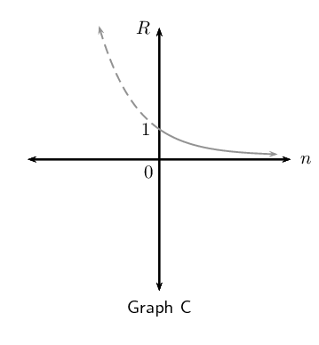

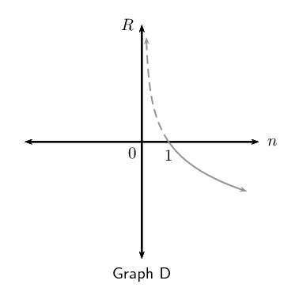

Important note: the graphs above have been drawn as a
                                                                continuous curve to show a trend. Rhino population
                                                                numbers are discrete values and should be plotted
                                                                points.

**Solution:**
Graph C

Currently \((n = 0)\) the rhino population is \(P\). After
                                                                \(\text{9,6}\) years, it will have halved,
                                                                \(\frac{P}{2}\). Note: the line in the graph indicates
                                                                the trend, rhino population numbers are discrete values
                                                                and should be plotted points.

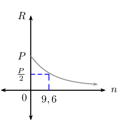

At 8 a.m. a local celebrity tweets about his new music album to
                                                        \(\text{100}\) of his followers. Five minutes later, each of his
                                                        followers retweet his message to two of their friends. Five
                                                        minutes after that, each friend retweets the message to another
                                                        two friends. Assume this process continues.

**Problem:**
Determine a formula that describes this retweeting
                                                        process.

**Solution:**
\(\text{100} \qquad \text{100} \times 2 \qquad \text{100}
                                                                \times 2^{2} \qquad \text{100} \times 2^{3}\)

This is a geometric sequence: \(r = 2\) and \(a = 100\).

Therefore \(T_{n} = 100 \times 2^{n-1}\).

**Problem:**
Calculate how many retweets of the celebrity's
                                                        message are sent an hour after his original tweet.

\(\text{1}\) hour \(= 60\) minutes \(= 12 \times 5\),
                                                                therefore \(n = 12\)

                                                        .

**Solution:**
\begin{align*}
                                                        T_{n} &= 100 \times 2^{n-1} \\
                                                        T_{12} &= 100 \times 2^{11} \\
                                                        &= \text{204 800}
                                                        \end{align*}

\(\text{204 800}\) retweets.

**Problem:**
How long will it take for the total number of
                                                        retweets to exceed \(\text{200}\) million?

**Solution:**
\begin{align*}
                                                        200 \times 10^{6} &= 2 \times 10^{8} \\
                                                        S_{n} &= \frac{a(r^{n} - 1)}{r - 1} \\
                                                        \therefore \frac{100(2^{n} - 1)}{2 - 1} & > \text{2}
                                                        \times 10^{\text{8}} \\
                                                        2^{n} & > \frac{\text{2} \times 10^{\text{8}} }{100} + 1
                                                        \\
                                                        2^{n} & > \text{2 000 001} \\
                                                        {n} & > \log_{2}{\text{2 000 001}} \qquad
                                                        (\text{use definition}) \\
                                                        n & > \frac{ \log{\text{2 000 001}}}{\log2}
                                                        \qquad (\text{change of base}) \\
                                                        n & > \text{20,9} \ldots \quad 5 \text{ minute periods}
                                                        \end{align*}

Therefore, \(\frac{21}{12} = \text{1,75}\) hours.

## Inverses (ENRICHMENT ONLY)

### Textbook Exercise 2.13

**Problem:**
Given: \(g\left(x\right)=-1+\sqrt{x}\), find the inverse of
                                                                \(g\left(x\right)\) in the form
                                                                \({g}^{-1}\left(x\right)=...\)

**Solution:**
\begin{align*}
                                                        g(x) & = -1 + \sqrt{x} \quad (x \ge 0) \\
                                                        \text{Let } y & = -1 + \sqrt{x} \\
                                                        \text{Inverse: } x & = -1 + \sqrt{y} \quad (y \ge 0) \\\\
                                                        \sqrt{y} & = x + 1 \qquad (x \ge -1)\\
                                                        \therefore y & = (x + 1)^{2} \\
                                                        & \\
                                                        \therefore g^{-1}(x) & = (x + 1)^{2} \qquad (x \ge -1)
                                                        \end{align*}

**Problem:**
Draw the graph of \(g^{-1}\).

**Solution:**
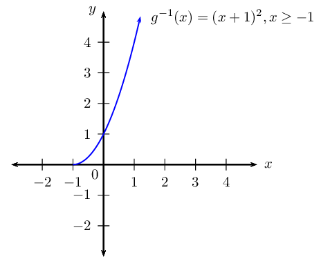

**Problem:**
Use symmetry to draw the graph of \(g\) on the same set of
                                                                axes.

**Solution:**
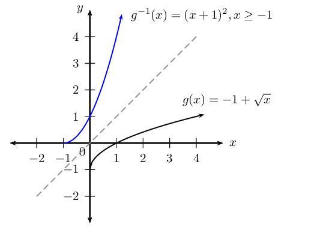

**Problem:**
Is \(g^{-1}\) a function?

**Solution:**
Yes. It passes vertical line test.

**Problem:**
Give the domain and range of \(g^{-1}\).

**Solution:**
Domain: \(\{x: x \ge -1, x \in \mathbb{R} \}\), Range: \(\{y:
                                                                y \geq 0,y \in \mathbb{R} \}\).

The graph of the inverse of \(f\) is shown below:

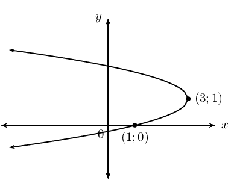

**Problem:**
Find the equation of \(f\), given that \(f\) is a
                                                        parabola of the form \(y = (x + p)^{2} + q\).

**Solution:**
First use the information provided in the graph of the
                                                                inverse:

                                                        \begin{align*}
                                                        \text{Turning point: } & (3;1) \\
                                                        x-\text{intercept: } & (1;0)
                                                        \end{align*}

To get the turning point and intercepts of the function, we
                                                                invert the given coordinates. Now we can use those
                                                                coordinates to find the equation of the function:

Now find the equation of the function:

                                                        \begin{align*}
                                                        \text{Turning point: } & (1;3) \\
                                                        x-\text{intercept: } & (0;1) \\
                                                        y & = a(x-p)^{2} + q \\
                                                        y & = a(x-1)^{2} + 3 \\
                                                        \text{Substitute } (0;1) \quad 1 & = a(0-1)^{2} + 3\\
                                                        a & = -\text{2}\\
                                                        \therefore y & = -2(x-1)^{2} + 3
                                                        \end{align*}

**Problem:**
Will \(f\) have a maximum or a minimum value?

**Solution:**
Maximum value at \((1;3)\)

**Problem:**
State the domain, range and axis of symmetry of
                                                        \(f\).

**Solution:**
Domain: \(\{x: x \in \mathbb{R} \}\) and range: \(\{y: y \leq
                                                                3,y \in \mathbb{R} \}\), Axis of symmetry: \(x =1\).

Given: \(k(x)=2{x}^{2}+1\)

**Problem:**
If \((q;3)\) lies on \(k\), determine the value(s) of \(q\).

**Solution:**
\begin{align*}
                                                        k(x) & = 2x^{2} + 1 \\
                                                        \text{Substitute } (q;3) \quad 3 & = 2(q)^{2} + 1 \\
                                                        2 & = 2(q)^{2} \\
                                                        1 & = q^{2} \\
                                                        \therefore q & = \pm 1
                                                        \end{align*}

This gives the points \((-1;3)\) and \((1;3)\).

**Problem:**
Sketch the graph of \(k\), label the point(s) \((q;3)\) on
                                                                the graph.

**Solution:**
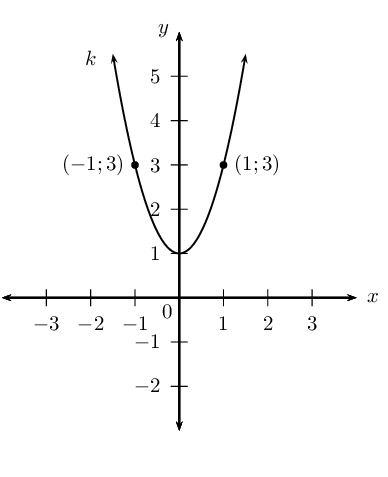

**Problem:**
Find the equation of the inverse of \(k\) in the form \(y =
                                                                \ldots\)

**Solution:**
\begin{align*}
                                                        k: \quad y & = 2x^{2} + 1 \\
                                                        \text{Inverse: } \quad x & = 2y^{2} + 1 \\
                                                        2y^{2} & = x - 1 \\
                                                        y^{2} & = \frac{x-1}{2} \\
                                                        y & = \pm \sqrt{\frac{x-1}{2}} \qquad (x \ge 1)
                                                        \end{align*}

**Problem:**
Sketch \(k\) and \(y = \sqrt{\frac{x-1}{2}}\) on the same
                                                                system of axes.

**Solution:**
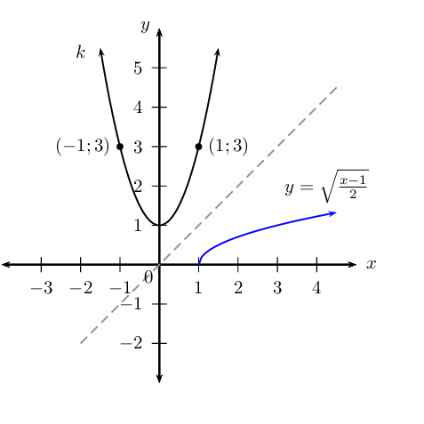

**Problem:**
Determine the coordinates of the point on the graph of the
                                                                inverse that is symmetrical to \((q;3)\) about the line
                                                                \(y=x\).

**Solution:**
\((3;1)\)

The sketch shows the graph of a parabola \(f(x) = ax^{2} + q\)
                                                        passing through the point \(P(-2;-6)\).

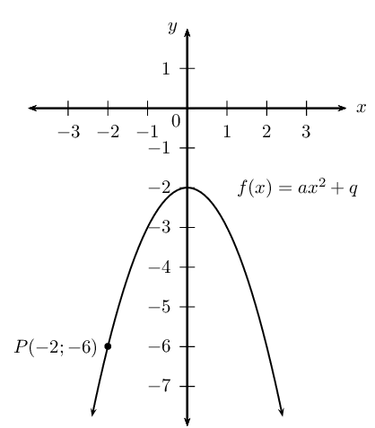

**Problem:**
Determine the equation of \(f\).

**Solution:**
\begin{align*}
                                                        q & = -2 \\
                                                        y & = ax^{2} - 2 \\
                                                        \text{Substitute } (-2;-6) \quad -6 & = a(-2)^{2} - 2 \\
                                                        -6 + 2 & = 4a \\
                                                        -4 & = 4a \\
                                                        -1 & = a \\
                                                        \therefore f(x) & = -x^{2} - 2
                                                        \end{align*}

**Problem:**
Determine and investigate the inverse.

**Solution:**
\begin{align*}
                                                        \text{Let } y & = -x^{2} - 2 \qquad (y \leq -2) \\
                                                        \text{Interchange } x \text{ and } y: \quad x & = -y^{2} - 2
                                                        \qquad (x \leq -2) \\
                                                        x + 2 & = -y^{2} \\
                                                        -x - 2 & = y^{2} \\
                                                        y & = \pm \sqrt{-x - 2} \qquad (x \leq -2)
                                                        \end{align*}

**Problem:**
Sketch the inverse and discuss the characteristics
                                                        of the graph.

**Solution:**
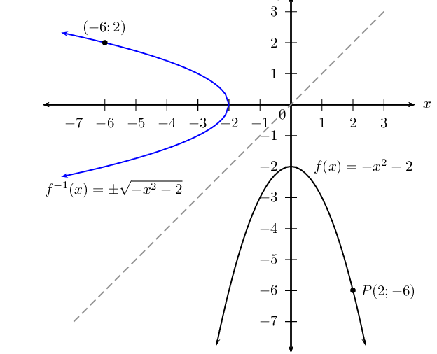

The inverse is a not a function. The turning point of the
                                                                inverse is \((-2;0)\) and \(x\)-intercept is \((-2;0)\).

                                                        \[\text{Inverse}: \qquad \text{domain } \{x: x \le -2, x \in
                                                        \mathbb{R} \} \quad \text{range } \{y: y \in \mathbb{R} \}\]

Given the function \(H: y = x^{2} - 9\).

**Problem:**
Determine the algebraic formula for the inverse of
                                                        \(H\).

**Solution:**
\begin{align*}
                                                        \text{Let } y & = x^{2} - 9 \qquad (y \geq -9) \\
                                                        \text{Interchange } x \text{ and } y: \quad x & = y^{2} - 9
                                                        \qquad (x \geq -9) \\
                                                        x + 9 & = y^{2} \\
                                                        y & = \pm \sqrt{x + 9} \qquad (x \geq -9)
                                                        \end{align*}

**Problem:**
Draw graphs of \(H\) and its inverse on the same
                                                        system of axes. Indicate intercepts and turning points.

**Solution:**
Determine the intercepts:

                                                        \begin{align*}
                                                        \text{Let } x = 0: \quad y & = (0)^{2} - 9 \\
                                                        & = - 9 \\
                                                        \text{Let } y = 0: \quad 0 & = x^{2} - 9 \\
                                                        x^2 & = 9 \\
                                                        \therefore x & = \pm 3
                                                        \end{align*}

The intercepts are \((0;-9)\) and \((-3;0),(3;0)\).

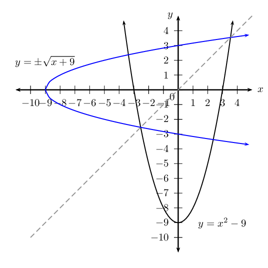

**Problem:**
Is the inverse a function? Give reasons.

**Solution:**
No. The inverse does not pass the vertical line test. It is a
                                                                one-to-many relation.

**Problem:**
Show algebraically and graphically the effect of
                                                        restricting the domain of \(H\) to \(\{x: x \le 0 \}\).

**Solution:**
If the domain of \(H\) is restricted to \(\{x: x \le 0 \}\),
                                                                then the inverse is \(H^{-1}(x) = - \sqrt{x^{2} + 9}
                                                                \quad (x \ge -9, y \le 0)\).

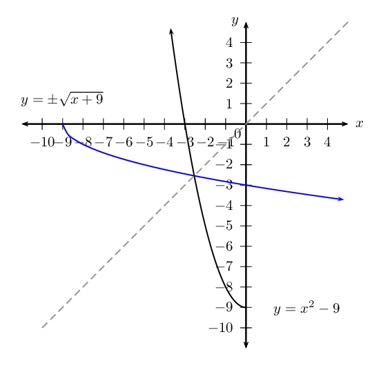

The graph of \(H^{-1}\) cuts a vertical line only once at any
                                                                one time and therefore passes the vertical line test.
