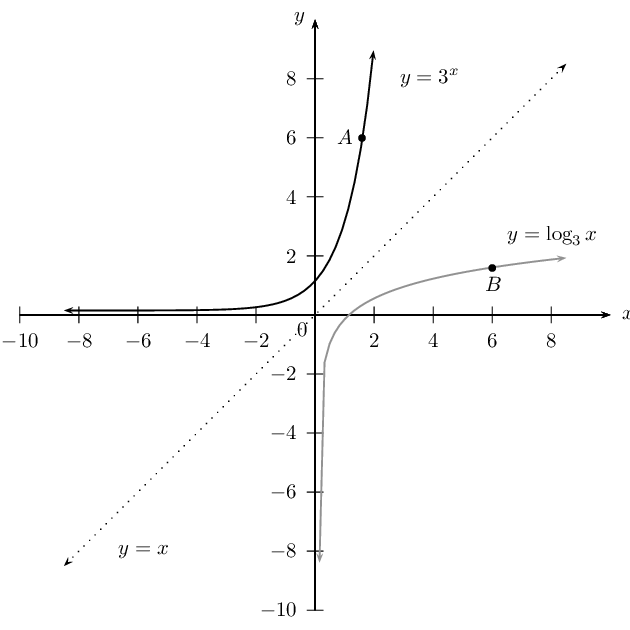
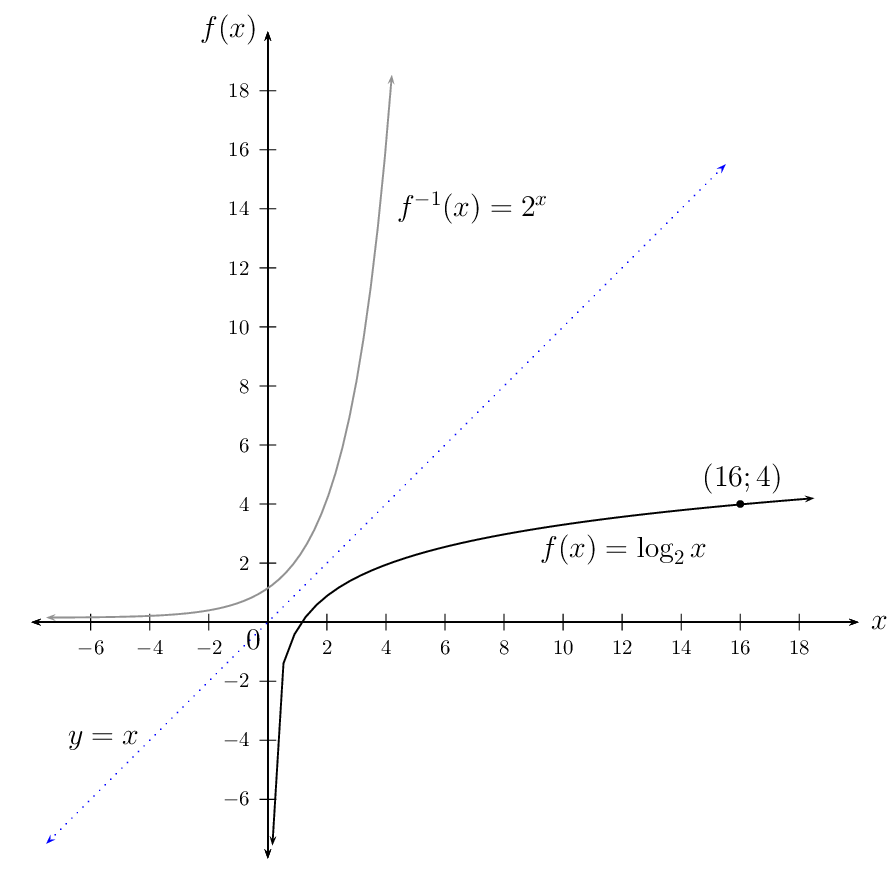

## 2.8 Enrichment: more on logarithms (EMCFR)

**NOTE: THIS SECTION IS NOT PART OF THE CURRICULUM**

### Laws of logarithms (EMCFS)

**Logarithmic law: **

        \[\log_{a}{xy} = \log_{a}{x} + \log_{a}{y} \qquad (x > 0 \text{ and } y > 0)\]
      \begin{align*}
      \text{Let } {\log}_{a}\left(x\right) = m & \quad \implies \quad x = a^{m} \ldots (1)\qquad (x > 0 )\\
      \text{and }{\log}_{a}\left(y\right) = n & \quad \implies \quad x = a^{n} \ldots (2) \qquad (y > 0)
      \end{align*}\begin{align*}
      \text{Then } (1) \times (2): \quad x \times y &= a^{m} \times a^{n}\\
      \therefore xy &= a^{m + n}
      \end{align*}

Now we change from the exponential form back to logarithmic form:

      \begin{align*}
      \log_{a}{xy} &= m + n \\
      \text{But } m = {\log}_{a}\left(x\right) & \text{ and } n = {\log}_{a}\left(y\right) \\
      \therefore \log_{a}{xy} &= {\log}_{a}\left(x\right) +{\log}_{a}\left(y\right)
      \end{align*}

In words: the logarithm of a product is equal to the sum of the logarithms of the factors.

<Callout type="tip" title="Worked example 22: Applying the logarithmic law \(\log_{a}{xy} = \log_{a}{x} + \log_{a}{y}\)">
**Question:**
Simplify: \(\log{5} + \log{2} - \log{30}\)

**Use the logarithmic law to simplify the expression:**
We combine the first two terms since the product of \(\text{5}\) and \(\text{2}\) is equal to
            \(\text{10}\), which is always useful when simplifying logarithms.

          \begin{align*}
          \log{5} + \log{2} - \log{30} &= \left( \log{5} + \log{2} \right) - \log{30} \\
          &= \log{\left( 5 \times 2\right)} - \log{30} \\
          &= \log{10} - \log{30} \\
          &= 1 - \log{30}
          \end{align*}

We expand the last term to simplify the expression further:

          \begin{align*}
          &= 1 - \log{( 3 \times 10)} \\
          &= 1 - \left( \log{3} + \log{10} \right) \\
          &= 1 - \left( \log{3} + 1 \right) \\
          &= 1 - \log{3} - 1 \\
          &= - \log{3}
          \end{align*}

**Write the final answer:**
\(\log{5} + \log{2} - \log{30} = - \log{3}\)
</Callout>

## Applying logarithmic law: \(\log_{a}{xy} = {\log}_{a}\left(x\right) +{\log}_{a}\left(y\right)\)

### Textbook Exercise 2.14

Simplify the following, if possible:

**Problem:**
\(\log_{8}{(10 \times 10)}\)

**Solution:**
\begin{align*}
                \log_{8}{(10 \times 10)} &= \log_{8}{10} + \log_{8}{10} \\
                &= 2 \log_{8}{10}
                \end{align*}

**Problem:**
\(\log_{2}{14}\)

**Solution:**
\begin{align*}
                \log_{2}{14} &= \log_{2}{(2 \times 7)} \\
                &= \log_{2}{2} +\log_{2}{7} \\
                &= 1 +\log_{2}{7}
                \end{align*}

**Problem:**
\(\log_{2}{(8 \times 5)}\)

**Solution:**
\begin{align*}
                \log_{2}{(8 \times 5)} &= \log_{2}{(2 \times 2 \times 2 \times 5)} \\
                &= \log_{2}{2} + \log_{2}{2} +\log_{2}{2} + \log_{2}{5} \\
                &= 3\log_{2}{2} +\log_{2}{5} \\
                &= 3(1) +\log_{2}{5}
                \end{align*}

**Problem:**
\(\log_{16}{(x + y)}\)

**Solution:**
\(\log_{16}{(x + y)}\) cannot be written as separate logarithms.

**Problem:**
\(\log_{2}{2xy}\)

**Solution:**
\begin{align*}
                \log_{2}{2xy} &= \log_{2}{(2 \times x \times y)} \\
                &= \log_{2}{2} + \log_{2}{x} +\log_{2}{y} \\
                &= 1 + \log_{2}{x} +\log_{2}{y}
                \end{align*}

**Problem:**
\(\log{(5 + 2)}\)

**Solution:**
\(\log{(5 + 2)} = \log{7}\)

Note: \(\log{(5 + 2)} \ne \log{5} + \log{2}\). Do not confuse this with applying the distributive
                  law: \(a(b + c) = ab + ac\).

Write the following as a single term, if possible:

**Problem:**
\(\log{15} + \log{2}\)

**Solution:**
\begin{align*}
                \log{15} + \log{2} &= \log{(15 \times 2 )} \\
                &= \log{30}
                \end{align*}

**Problem:**
\(\log{1} + \log{5} +\log{\frac{1}{5}}\)

**Solution:**
\begin{align*}
                \log{1} + \log{5} +\log{\frac{1}{5}} &= \log{\left( 1 \times 5 \times \frac{1}{5} \right) } \\
                &= \log{1} \\
                &= 0
                \end{align*}

**Problem:**
\(1 + \log_{3}{4}\)

**Solution:**
\begin{align*}
                1 + \log_{3}{4} &= \log_{3}{3} + \log_{3}{4} \\
                &= \log_{3}{(3 \times 4) } \\
                &= \log_{3}{12}
                \end{align*}

**Problem:**
\(\left( \log{x} \right) \left( \log{y} \right) + \log{x}\)

**Solution:**
\begin{align*}
                \left( \log{x} \right) \left( \log{y} \right) + \log{x} &= \left( \log{x} \right) [ \log{y} + 1 ] \\
                &= \left( \log{x} \right) \left( \log{y} + \log{10} \right) \\
                &= \left( \log{x} \right) \left( \log{10y} \right)
                \end{align*}

**Problem:**
\(\log{7} \times \log{2}\)

**Solution:**
\begin{align*}
                \log{7} \times \log{2} &= \log{7} \times \log{2} \\
                & \text{cannot be simplified further} \\
                \text{Note: } \quad \log{7} \times \log{2} &\ne \log{(7 + 2)}
                \end{align*}

**Problem:**
\(\log_{2}{7} + \log_{3}{2}\)

**Solution:**
This cannot be written as one term because the bases are not the same.

**Problem:**
\(\log_{a}{p} + \log_{a}{q}\)

**Solution:**
\begin{align*}
                \log_{a}{p} + \log_{a}{q} &= \log_{a}{(p \times q)} \\
                &= \log_{a}{pq}
                \end{align*}

**Problem:**
\(\log_{a}{p} \times \log_{a}{q}\)

**Solution:**
This is already a single term: \((\log_{a}{p})(\log_{a}{q})\)

Simplify the following:

**Problem:**
\(\log{x} + \log{y} + \log{z}\)

**Solution:**
\[\log_{x} + \log{y} + \log{z} = \log{xyz}\]

**Problem:**
\(\log{ab} + \log{bc} + \log{cd}\)

**Solution:**
\[\log{ab} + \log{bc} + \log{cd} = \log{ab^{2}c^{2}d}\]

**Problem:**
\(\log{125} + \log{2} + \log{8}\)

**Solution:**
\begin{align*}
                \log{125} + \log{2} + \log{8} &= \log{(125 \times 2 \times 8) } \\
                &= \log{2000} \\
                &= \log{(2 \times 10 \times 10 \times 10)} \\
                &= \log{2} + \log{10} + \log{10} + \log{10} \\
                &= \log{2} + 1 + 1 +1 \\
                &= \log{2} + 3
                \end{align*}

**Problem:**
\(\log_{4}{\frac{3}{8}} + \log_{4}{\frac{10}{3}} + \log_{4}{\frac{16}{5}}\)

**Solution:**
\begin{align*}
                \log_{4}{\frac{3}{8}} + \log_{4}{\frac{10}{3}} + \log_{4}{\frac{16}{5}} &= \log_{4}{\left(
                \frac{3}{8} \times \frac{10}{3} \times \frac{16}{5} \right) } \\
                &= \log_{4}{4}\\
                &= 1
                \end{align*}

**Logarithmic law: **

        \[\log_{a}{\frac{x}{y}} = \log_{a}{x} - \log_{a}{y} \qquad (x > 0 \text{ and } y > 0)\]
      \begin{align*}
      \text{Let } {\log}_{a}\left(x\right) = m & \quad \implies \quad x = a^{m} \ldots (1) \qquad (x > 0)\\
      \text{and }{\log}_{a}\left(y\right) = n & \quad \implies \quad y = a^{n} \ldots (2) \qquad (y > 0)
      \end{align*}\begin{align*}
      \text{Then } (1) \div (2): \quad \frac{x}{y} &= \frac{a^{m}}{a^{n}} \\
      \therefore \frac{x}{y} &= a^{m - n}
      \end{align*}

Now we change from the exponential form back to logarithmic form:

      \begin{align*}
      \log_{a}{\frac{x}{y}} &= m - n \\
      \text{But } m = {\log}_{a}\left(x\right) & \text{ and } n = {\log}_{a}\left(y\right) \\
      \therefore \log_{a}{\frac{x}{y}} &= {\log}_{a}\left(x\right) - {\log}_{a}\left(y\right)
      \end{align*}

In words: the logarithm of a quotient is equal to the difference of the logarithms of the numerator and the
        denominator.

<Callout type="tip" title="Worked example 23: Applying the logarithmic law \(\log_{a}{\frac{x}{y}} = \log_{a}{x} -
          \log_{a}{y}\)">
**Question:**
Simplify: \(\log{40} - \log{4} + \log_{5}{\frac{8}{5}}\)

**Use the logarithmic law to simplify the expression:**
We combine the first two terms since both terms have the same base and the quotient of \(\text{40}\) and
            \(\text{4}\) is equal to \(\text{10}\):

          \begin{align*}
          \log{40} - \log{4} + \log_{5}{\frac{8}{5}} &= \left(\log{40} - \log{4} \right) + \log_{5}{\frac{8}{5}} \\
          &= \left(\log{\frac{40}{4}} \right) + \log_{5}{\frac{8}{5}} \\
          &= \log{10} + \log_{5}{\frac{8}{5}} \\
          &= 1 + \log_{5}{\frac{8}{5}}
          \end{align*}

We expand the last term to simplify the expression further:

          \begin{align*}
          &= 1 + \left( \log_{5}{8} - \log_{5}{5} \right) \\
          &= 1 + \log_{5}{8} - 1 \\
          &= \log_{5}{8}
          \end{align*}

**Write the final answer:**
\(\log{40} - \log{4} + \log_{5}{\frac{8}{5}} = \log_{5}{8}\)
</Callout>

## Applying logarithmic law: \(\log_{a}{\frac{x}{y}} = {\log}_{a}x - {\log}_{a}y\)

### Textbook Exercise 2.15

Expand and simplify the following:

**Problem:**
\(\log{\frac{100}{3}}\)

**Solution:**
\begin{align*}
                \log{\frac{100}{3}} &= \log{100} - \log{3} \\
                &= \log{(10 \times 10)} - \log{3} \\
                &= \log{10} + \log{10} - \log{3} \\
                &= 1 + 1 - \log{3} \\
                &= 2 - \log{3}
                \end{align*}

**Problem:**
\(\log_{2}{7\frac{1}{2}}\)

**Solution:**
\begin{align*}
                \log_{2}{7\frac{1}{2}} &= \log_{2}{\frac{15}{2}} \\
                &= \log_{2}{15} - \log_{2}{2} \\
                &= \log_{2}{15} - 1
                \end{align*}

**Problem:**
\(\log_{16}{\frac{x}{y}}\)

**Solution:**
\[\log_{16}{\frac{x}{y}} = \log_{16}{x} - \log_{16}{y}\]

**Problem:**
\(\log_{16}{(x - y)}\)

**Solution:**
This cannot be simplified.

**Problem:**
\(\log_{5}{\frac{5}{8}}\)

**Solution:**
\begin{align*}
                \log_{5}{\frac{5}{8}} &= \log_{5}{5} - \log_{5}{8} \\
                &= 1 - \log_{5}{8}
                \end{align*}

**Problem:**
\(\log_{x}{\frac{y}{r}}\)

**Solution:**
\[\log_{x}{\frac{y}{r}} = \log_{x}{y} - \log_{x}{r}\]

Write the following as a single term:

**Problem:**
\(\log{10} - \log{50}\)

**Solution:**
\begin{align*}
                \log{10} - \log{50} &= \log{\frac{10}{50}} \\
                &= \log{\frac{1}{5}} \\
                &= \log{5^{-1}} \\
                &= - \log{5}
                \end{align*}

**Problem:**
\(\log_{3}{36} - \log_{3}{4}\)

**Solution:**
\begin{align*}
                \log_{3}{36} - \log_{3}{4} &= \log_{3}{\frac{36}{4}} \\
                &= \log_{3}{9} \\
                &= \log_{3}{(3 \times 3) } \\
                &= \log_{3}{3} + \log_{3}{3} \\
                &= 1 + 1 \\
                &= 2
                \end{align*}

**Problem:**
\(\log_{a}{p} - \log_{a}{q}\)

**Solution:**
\[\log_{a}{p} - \log_{a}{q} = \log_{a}{\frac{p}{q}}\]

**Problem:**
\(\log_{a}{(p - q)}\)

**Solution:**
This cannot be simplified.

**Problem:**
\(\log{15} - \log_{2}{5}\)

**Solution:**
This cannot be simplified because the bases are not the same.

**Problem:**
\(\log{15} - \log{5}\)

**Solution:**
\begin{align*}
                \log{15} - \log{5} &= \log{\frac{15}{5}} \\
                &= \log{3}
                \end{align*}

Simplify the following:

**Problem:**
\(\log{450} - \log{9} - \log{5}\)

**Solution:**
\begin{align*}
                \log{450} - \log{9} - \log{5} &= \log{ \left(\frac{450}{9 \times 5} \right) } \\
                &= \log{10} \\
                &= 1 \\
                \text{Alternative method: } & \\
                \log{450} - \log{9} - \log{5} &= \log{\frac{450}{9}} - \log{5} \\
                &= \log{50} - \log{5} \\
                &= \log{\frac{50}{5}}\\
                &= \log{10} \\
                &= 1
                \end{align*}

**Problem:**
\(\log{\frac{4}{5}} - \log{\frac{3}{25}} - \log{\frac{1}{15}}\)

**Solution:**
\begin{align*}
                \log{\frac{4}{5}} - \log{\frac{3}{25}} - \log{\frac{1}{15}} &= \log{ \left( \frac{\frac{4}{5}}{
                \frac{3}{25} \times \frac{1}{15} } \right) }\\
                &= \log{ \left( \frac{\frac{4}{5}}{ \frac{1}{125} } \right) } \\
                &= \log{100} \\
                &= 2 \\
                \text{Alternative method: } & \\
                \log{\frac{4}{5}} - \log{\frac{3}{25}} - \log{\frac{1}{15}} &= \log{\frac{4}{5}} - \left(
                \log{\frac{3}{25}} + \log{\frac{1}{15}} \right) \\
                &= \log{\frac{4}{5}} - \log{ \left( \frac{3}{25} \times \frac{1}{15} \right) } \\
                &= \log{\frac{4}{5}} - \log{ \left( \frac{3}{25 \times 15} \right) } \\
                &= \log{\frac{4}{5}} - \log{ \left( \frac{1}{125} \right) } \\
                &= \log{ \left( \frac{4}{5} \div \frac{1}{125} \right) } \\
                &= \log{ \left( \frac{4}{5} \times \frac{125}{1} \right) } \\
                &= \log{ 100} \\
                &= \log{10} + \log{10} \\
                &= 1 + 1 \\
                &= 2
                \end{align*}

**Problem:**
Vini and Dirk complete their mathematics homework and check each other's answers. Compare the two
                methods shown below and decide if they are correct or incorrect:

**Question:**

Simplify the following:

              \[\log{m} - \log{n} - \log{p} - \log{q}\]

**Vini's answer:**

              \begin{align*}
              \log{m} - \log{n} - \log{p} - \log{q} &= \left( \log{m} - \log{n} \right) - \log{p} - \log{q} \\
              &= \left( \log{\frac{m}{n}} - \log{p} \right) - \log{q} \\
              &= \log{\left( \frac{m}{n} \times \frac{1}{p} \right)} - \log{q} \\
              &= \log{\frac{m}{np} } - \log{q} \\
              &= \log{\frac{m}{np} \times \frac{1}{q}} \\
              &= \log{\frac{m}{npq} }
              \end{align*}

**Dirk's answer:**

              \begin{align*}
              \log{m} - \log{n} - \log{p} - \log{q} &= \log{m} - \left( \log{n} + \log{p} + \log{q} \right) \\
              &= \log{m} - \log{(n \times p \times q)} \\
              &= \log{m} - \log{(npq)} \\
              &= \log{\frac{m}{npq} }
              \end{align*}

**Solution:**
Both methods are correct.

** Useful summary: **

2. \(\log1=0\)
4. \(\log10=1\)
6. \(\log100=2\)
8. \(\log1000=3\)
10. \(\log{\frac{1}{10}}=-1\)
12. \(\log{\text{0,1}}=-1\)
14. \(\log{\text{0,01}}=-2\)
16. \(\log{\text{0,001}}=-3\)

### Simplification of logarithms (EMCFT)

<Callout type="tip" title="Worked example 24: Simplification of logarithms">
**Question:**
Simplify (without a calculator): \(3\log3+\log125\)

**Apply the appropriate logarithmic laws to simplify the expression:**
\begin{align*}
          3\log3+\log125 &= 3\log3+\log{5^{3}} \\
          &= 3\log3 + 3\log{5} \\
          &= 3 \left( \log3 + \log{5} \right) \\
          &= 3 \log{(3 \times 5)} \\
          &= 3 \log{15}
          \end{align*}

**Write the final answer:**
We cannot simplify any further, therefore \(3\log3+\log125 = 3 \log{15}\).
</Callout>

**Important:** all the algebraic manipulation techniques \((\times, \div, +, -\), factorisation
        etc.) also apply for logarithmic expressions. Always be aware of the number of terms in an expression as this
        will help to determine how to simplify.

## Simplification of logarithms

### Textbook Exercise 2.16

Simplify the following without using a calculator:

**Problem:**
\(8^{\frac{2}{3}} + \log_{2}{32}\)

**Solution:**
\begin{align*}
              8^{\frac{2}{3}} + \log_{2}{32} &= \left( 2^{3} \right)^{\frac{2}{3}} + \log_{2}{(2^{5})} \\
              &= 2^{2} + 5 \log_{2}{2} \\
              &= 4 + 5 \\
              &= 9
              \end{align*}

**Problem:**
\(2 \log{3} + \log{2} - \log{5}\)

**Solution:**
\begin{align*}
              2 \log{3} + \log{2} - \log{5} &= \log{3^{2}} + \log{2} - \log{5} \\
              &= \log{\frac{9 \times 2}{5}} \\
              &= \log{\frac{18}{5}}
              \end{align*}

**Problem:**
\(\log_{2}{8} - \log{1} + \log_{4}{\frac{1}{4}}\)

**Solution:**
\begin{align*}
              \log_{2}{8} - \log{1} + \log_{4}{\frac{1}{4}} &= \log_{2}{2^{3}} - 0 + \log_{4}{4^{(-1)}} \\
              &= 3 \log_{2}{2} - 1 \log_{4}{4} \\
              &= 3(1) - 1(1) \\
              &= 2
              \end{align*}

**Problem:**
\(\log_{8}{1} - \log_{5}{\frac{1}{25}} + \log_{3}{9}\)

**Solution:**
\begin{align*}
              \log_{8}{1} - \log_{5}{\frac{1}{25}} + \log_{3}{9} &= 0 - \log_{5}{5^{(-2)}} + \log_{3}{3^{2}}\\
              &= -(-2) \log_{5}{5} + 2 \log_{3}{3} \\
              &= 2(1) + 2(1) \\
              &= 4
              \end{align*}

### Solving logarithmic equations (EMCFV)

<Callout type="tip" title="Worked example 25: Solving logarithmic equations">
**Question:**
Solve for \(p\):

          \[18 \log{p} - 36 = 0\]

**Make \(\log p\) the subject of the equation:**
\begin{align*}
          18 \log{p} - 36 &= 0 \\
          18 \log{p} &= 36 \\
          \frac{18 \log{p}}{18} &= \frac{36}{18} \\
          \therefore \log{p} &= 2
          \end{align*}

**Change from logarithmic form to exponential form:**
\begin{align*}
          \log{p} &= 2 \\
          \therefore p &= 10^{2} \\
          &= 100
          \end{align*}

**Write the final answer:**
\(p = 100\)
</Callout>

<Callout type="tip" title="Worked example 26: Solving logarithmic equations">
**Question:**
Solve for \(n\) (correct to the nearest integer):

          \[(\text{1,02})^{n} = 2\]

**Change from exponential form to logarithmic form:**
\begin{align*}
          (\text{1,02})^{n} &= 2 \\
          \therefore n &= \log_{\text{1,02}}{2}
          \end{align*}

**Use a change of base to solve for \(n\):**
\begin{align*}
          n &= \frac{\log{2}}{\log{\text{1,02}}} \\
          \therefore n &= \text{35,00} \ldots
          \end{align*}

**Write the final answer:**
\(n = 35\)
</Callout>

## Solving logarithmic equations

### Textbook Exercise 2.17

Determine the value of \(a\) (correct to \(\text{2}\) decimal places):

**Problem:**
\(\log_{3}{a} - \log{\text{1,2}} = 0\)

**Solution:**
\begin{align*}
                \log_{3}{a} - \log{\text{1,2}} &= 0 \\
                \log_{3}{a} &= \log{\text{1,2}} \\
                \text{Change to exponential form: } & \\
                3^{\log{\text{1,2}}} &= a \\
                \therefore a &= \text{1,09}
                \end{align*}

Alternative (longer) method:

                \begin{align*}
                \log_{3}{a} - \log{\text{1,2}} &= 0 \\
                \log_{3}{a} &= \log{\text{1,2}} \\
                \frac{\log{a}}{\log{3}} &= \log{\text{1,2}} \\
                \log{a} &= \log{3} \times \log{\text{1,2}} \\
                \log{a} &= \text{0,037} \ldots \\
                \therefore a &= \text{1,09}
                \end{align*}

**Problem:**
\(\log_{2}{(a - 1)} = \text{1,5}\)

**Solution:**
\begin{align*}
                \log_{2}{(a - 1)} &= \text{1,5} \\
                \text{Change to exponential form: } & \\
                2^{\text{1,5}} &= a - 1 \\
                2^{\text{1,5}} + 1 &= a \\
                \therefore a &= \text{3,83}
                \end{align*}

Alternative (longer) method:

                \begin{align*}
                \log_{2}{(a - 1)} &= \text{1,5} \\
                \frac{\log{(a - 1)}}{\log{2}} &= \text{1,5} \\
                \log{(a - 1)} &= \log{2} \times \text{1,5} \\
                \therefore a - 1 &= \text{2,83} \ldots \\
                \therefore a &= \text{3,83}
                \end{align*}

**Problem:**
\(\log_{2}{a} - 1 = \text{1,5}\)

**Solution:**
\begin{align*}
                \log_{2}{a - 1} &= \text{1,5} \\
                \log_{2}{a} &= \text{2,5} \\
                \text{Change to exponential form: } & \\
                2^{\text{2,5}} &= a \\
                \therefore a &= \text{5,66}
                \end{align*}

Alternative (longer) method:

                \begin{align*}
                \log_{2}{a} - 1 &= \text{1,5} \\
                \frac{\log{a}}{\log{2}} &= \text{2,5} \\
                \log{a} &= \log{2} \times \text{2,5} \\
                \therefore a &= \text{5,66}
                \end{align*}

**Problem:**
\(3^{a} = \text{2,2}\)

**Solution:**
\begin{align*}
                3^{a} &= \text{2,2} \\
                \therefore a &= \log_{3}{\text{2,2}}\\
                &= \frac{\log{\text{2,2}}}{\log{3}} \\
                \therefore a &= \text{0,72}
                \end{align*}

**Problem:**
\(2^{(a + 1)} = \text{0,7}\)

**Solution:**
\begin{align*}
                2^{(a + 1)} &= \text{0,7} \\
                \therefore a + 1 &= \log_{2}{\text{0,7}}\\
                \therefore a &= \frac{\log{\text{0,7}}}{\log{2}} - 1 \\
                &= -\text{1,51}
                \end{align*}

**Problem:**
\((\text{1,03})^{\frac{a}{2}} = \text{2,65}\)

**Solution:**
\begin{align*}
                (\text{1,03})^{\frac{a}{2}} &= \text{2,65}\\
                \therefore \frac{a}{2}&= \log_{\text{1,03}}{\text{2,65}}\\
                \therefore a &= 2 \times \frac{\log{\text{2,65}}}{\log{\text{1,03}}}\\
                &= \text{65,94}
                \end{align*}

**Problem:**
\((\text{9})^{(1 - 2a)} = \text{101}\)

**Solution:**
\begin{align*}
                (\text{9})^{(1 - 2a)} &= \text{101}\\
                \therefore 1 - 2a &= \log_{\text{9}}{\text{101}} \\
                \therefore 1 - \frac{\log{\text{101}}}{\log{\text{9}}} &= 2a \\
                -\text{1,10} \ldots &= 2a \\
                \therefore -\text{0,55} &= a
                \end{align*}

Given \(y = 3^{x}\).

**Problem:**
Write down the equation of the inverse of \(y = 3^x\) in the form \(y = \ldots\)

**Solution:**
\(y = \log_{3}{x}\)

**Problem:**
If \(6 = 3^{p}\), determine the value of \(p\) (correct to one decimal place).

**Solution:**
\begin{align*}
                p &= \log_{3}{6} \\
                &= \frac{\log{6}}{\log{3}} \\
                &=\text{1,6}
                \end{align*}

**Problem:**
Draw the graph of \(y= 3^{x}\) and its inverse. Plot the points \(A(p; 6)\) and
                \(B(6; p)\).

**Solution:**

### Summary (EMCFW)

- The logarithm of a number \((x)\) with a certain base \((a)\) is equal to the exponent \((y)\), the value
              to which that certain base must be raised to equal the number \((x)\).
  If \(x = {a}^{y}\), then \(y = {\log}_{a}\left(x\right)\), where \(a>0\), \(a \ne 1\) and \(x>0\).
- Logarithms and exponentials are inverses of each other.
  \(f(x) = \log_{a}{x} \quad\) and \(\quad f^{-1}(x) = a^{x}\)
- Common logarithm: \(\log{a}\) means \(\log_{\text{10}}{a}\)
- The “LOG” function on your calculator uses a base of \(\text{10}\).
- Natural logarithm: \(\ln\) uses a base of \(e\).
- Special values:
  - \(a^{0} = 1 \qquad \log_{a}{1} = 0\)
  - \(a^{1} = a \qquad \log_{a}{a} = 1\)
- Logarithmic laws:
  - \(\log_{a}{xy} = \log_{a}{x} + \log_{a}{y} \qquad (x > 0 \text{ and } y > 0)\)
  - \(\log_{a}{\frac{x}{y}} = \log_{a}{x} - \log_{a}{y} \qquad (x > 0 \text{ and } y > 0)\)
  - \(\log_{a}{x^{b}} = b \log_{a}{x} \qquad (x > 0)\)
  - \(\log_{a}{x} = \frac{\log_{b}{x}}{\log_{b}{a}} \qquad (b > 0 \text{ and } b \ne 1)\)
- Special reciprocal applications:
  - \(\log_{a}{x} = \frac{1}{\log_{x}{a}}\)
  - \(\log_{a}{\frac{1}{x}} = - \log_{a}{x}\)

## Logarithms (ENRICHMENT ONLY)

### Textbook Exercise 2.18

State whether the following are true or false. If false, change the statement so that it is true.

**Problem:**
\(\log{t} + \log{d} = \log{(t + d)}\)

**Solution:**
False: \(\log{t} + \log{d} = \log{(t \times d)}\)

**Problem:**
If \(p^{q} = r\), then \(q = \log_{r}{p}\)

**Solution:**
False: \(q = \log_{p}{r}\)

**Problem:**
\(\log{\frac{A}{B}} = \log{A} - \log{B}\)

**Solution:**
True

**Problem:**
\(\log{A} - B = \frac{\log{A}}{\log{B}}\)

**Solution:**
False: \(\log{(A)} - B\) cannot be simplified further.

**Problem:**
\(\log_{\frac{1}{2}}{x} = - \log_{2}{x}\)

**Solution:**
True

**Problem:**
\(\log_{k}{m} = \frac{\log_{p}{k}}{\log_{p}{m}}\)

**Solution:**
False: \(\log_{k}{m} = \frac{\log_{p}{m}}{\log_{p}{k}}\)

**Problem:**
\(\log_{n}{\sqrt{b}} = \frac{1}{2}\log_{n}{b}\)

**Solution:**
True

**Problem:**
\(\log_{p}{q} = \frac{1}{\log_{q}{p}}\)

**Solution:**
True

**Problem:**
\(2\log_{2}{a} + 3 \log{a} = 5 \log{a}\)

**Solution:**
False: bases are different

**Problem:**
\(5\log{x} + 10 \log{x} = 5 \log{x^{3}}\)

**Solution:**
True

**Problem:**
\(\frac{\log_{n}{a}}{\log_{n}{b}} = \log_{n}{\frac{a}{b}}\)

**Solution:**
False: cannot be simplified to single logarithm

**Problem:**
\(\log{(A + B)} = \log{A} + \log{B}\)

**Solution:**
False: do not confuse with \(\log{(AB)} = \log{A} + \log{B}\) or with the distributive law \(x(a + b) =
                ax + ab\).

**Problem:**
\(\log{2a^{3}} = 3 \log{2a}\)

**Solution:**
False: \(\log{2a^{3}} = \log{2} + 3\log{a}\)

**Problem:**
\(\frac{\log_{n}{a}}{\log_{n}{b}} = \log_{n}{(a - b)}\)

**Solution:**
False: do not confuse with \(\log_{n}{ \left( \frac{a}{b} \right) } = \log_{n}{a} - \log_{n}{b}\). LHS
                cannot be simplified.

Simplify the following without using a calculator:

**Problem:**
\(\log{7} - \log{\text{0,7}}\)

**Solution:**
\begin{align*}
              \log{7} - \log{\text{0,7}} &= \log{\frac{\text{7}}{\text{0,7}}} \\
              &= \log{\text{10}} \\
              &= \text{1}
              \end{align*}

**Problem:**
\(\log{8} \times \log{\text{1}}\)

**Solution:**
\begin{align*}
              \log{8} \times \log{\text{1}} &= \log{8} \times \text{0}\\
              &= \text{0}
              \end{align*}

**Problem:**
\(\log{\frac{1}{3}} + \log{\text{300}}\)

**Solution:**
\begin{align*}
              \log{\frac{1}{3}} + \log{\text{300}} &= \log{\left( \frac{1}{3} \times \text{300} \right) }\\
              &= \log{\text{100}} \\
              &= \log{\text{10}^{2}} \\
              &= 2 \log{\text{10}} \\
              &= \text{2}
              \end{align*}

**Problem:**
\(2\log{3} + \log{2} - \log{6}\)

**Solution:**
\begin{align*}
              2\log{3} + \log{2} - \log{6} &= \log{3^{2}} + \log{2} - \log{6} \\
              &= \log{\frac{9 \times 2}{6}} \\
              &= \log{\frac{18}{6}} \\
              &= \log{3}
              \end{align*}

Given \(\log{5} = \text{0,7}\). Find the value of the following without using a calculator:

**Problem:**
\(\log{50}\)

**Solution:**
\begin{align*}
              \log{50} &= \log{5} + \log{10} \\
              &= \text{0,7} + 1 \\
              &= \text{1,7}
              \end{align*}

**Problem:**
\(\log{20}\)

**Solution:**
\begin{align*}
              \log{20} &= \log{\frac{100}{5}} \\
              &= \log{100} - \log{5} \\
              &= 2 - \text{0,7} \\
              &= \text{1,3}
              \end{align*}

**Problem:**
\(\log{25}\)

**Solution:**
\begin{align*}
              \log{25} &= \log{5^{2}} \\
              &= 2 \times \log{5} \\
              &= 2 \times \text{0,7} \\
              &= \text{1,4}
              \end{align*}

**Problem:**
\(\log_{2}{5}\)

**Solution:**
\begin{align*}
              \log_{2}{5} &= \frac{\log{5}}{\log{2}} \\
              &= \frac{\log{5}}{\log{\frac{10}{5}}} \\
              &= \frac{\log{5}}{\log{10} - \log{5}} \\
              &= \frac{\text{0,7}}{1 - \text{0,7}} \\
              &= \frac{\text{0,7}}{\text{0,3}} \\
              &= \frac{7}{10} \times \frac{10}{3} \\
              &= \frac{7}{3}
              \end{align*}

**Problem:**
\(10^{\text{0,7}}\)

**Solution:**
If \(\log{5} = \text{0,7}\) , then \(10^{\text{0,7}} = \text{5}\).

Given \(A = \log_{8}{1} - \log_{5}{\frac{1}{25}} + \log_{3}{9}\).

**Problem:**
Without using a calculator, show that \(A = 4\).

**Solution:**
\begin{align*}
              A &= \log_{8}{1} - \log_{5}{\frac{1}{25}} + \log_{3}{9} \\
              &= 0 - \log_{5}{5^{-2}} + \log_{3}{3^{2}} \\
              &= 0 - (-2)\log_{5}{5} + (2)\log_{3}{3} \\
              &= 2 + 2 \\
              &= 4
              \end{align*}

**Problem:**
Now solve for \(x\) if \(\log_{2}{x} = A\).

**Solution:**
\begin{align*}
              \log_{2}{x} &= 4 \\
              \therefore x &= 2^{4} \\
              x &= 16
              \end{align*}

**Problem:**
Let \(f(x) = \log_{2}{x}\). Draw the graph of \(f\) and \(f^{-1}\). Indicate the point
              \((x;A)\) on the graph.

**Solution:**

**Problem:**
Solve for \(x\) if \(\frac{35^{x}}{7^{x}} = \text{15}\). Give answer correct to two decimal places.

**Solution:**
\begin{align*}
            \frac{35^{x}}{7^{x}} &= \text{15} \\
            \frac{7^{x} \cdot 5^{x}}{7^{x}} &= \text{15} \\
            5^{x} &= \text{15} \\
            \therefore x &= \log_{5}{15} \\
            &= \frac{\log{15}}{\log{5}} \\
            &= \text{1,68}
            \end{align*}

Given \(f(x) = 5 \times \left( \text{1,5} \right)^{x}\) and \(g(x) = \left( \frac{1}{4} \right)^{x}\).

**Problem:**
For which integer values of \(x\) will \(f(x) < \text{295}\).

**Solution:**
\begin{align*}
              5 \times \left( \text{1,5} \right)^{x} &< \text{295} \\
              \therefore \log{(\text{1,5})^{x}} &< \log{59} \\
              x \log{(\text{1,5})} &< \log{59} \\
              x &< \frac{ \log{59}}{\log{(\text{1,5})} } \qquad \text{note: } \log{(\text{1,5})} > 0 \\
              x &< \text{10,0564} \ldots
              \end{align*}

Therefore, \(x < 10, (x \in \mathbb{Z})\).

**Problem:**
For which values of \(x\) will \(g(x) \geq \text{2,7} \times \text{10}^{-\text{7}}\).
              Give answer to the nearest integer.

**Solution:**
\begin{align*}
              \left( \frac{1}{4} \right)^{x} & \geq \text{2,7} \times \text{10}^{-\text{7}} \\
              \log{\left( \frac{1}{4} \right)^{x}} & \geq \log{\text{2,7} \times \text{10}^{-\text{7}}} \\
              x \log{\left( \frac{1}{4} \right)} & \geq \log{\text{2,7} \times \text{10}^{-\text{7}}} \\
              x & \leq \frac{\log{\text{2,7} \times \text{10}^{-\text{7}}}}{\log{\left( \frac{1}{4} \right)}} \qquad
              \text{note: } \log{\left( \frac{1}{4} \right)} < 0 \\
              & \leq \text{10,9} \ldots \\
              \therefore x & < \text{11}
              \end{align*}

Important: notice that the inequality sign changed direction when we divided both sides by
                \(\log{\left( \frac{1}{4} \right)} = -\log{4}\), since it has a negative value.
