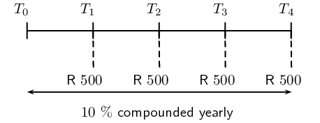

## 3.3 Future value annuities (EMCFZ)

For future value annuities, we regularly save the same amount of money into an account, which earns a
                        certain rate of compound interest, so that we have money for the future.

<Callout type="tip" title="Worked example 3: Future value annuities">
**Question:**
At the end of each year for \(\text{4}\) years, Kobus deposits
                                        \(\text{R}\,\text{500}\) into an investment account. If the interest rate on the
                                        account is \(\text{10}\%\) per annum compounded yearly, determine the value of
                                        his investment at the end of the \(\text{4}\) years.

**Write down the given information and the compound interest formula:**
\[A = P{\left(1+i\right)}^{n}\]
                                \begin{align*}
                                P &= \text{500} \\
                                i &= \text{0,1} \\
                                n &= 4
                                \end{align*}

**Draw a timeline:**

The first deposit in the account earns the highest amount of interest (three interest
                                        payments) and the last deposit earns the least interest (no interest payments).

We can summarize this information in the table below:

|  | Deposit | No. of interest payments | Calculation | Accumulated amount |
| --- | --- | --- | --- | --- |
| Year 1 | \(\text{R}\,\text{500}\) | \(\text{3}\) | \(\text{500}(1 + \text{0,1})^{3}\) | \(\text{R}\,\text{665,50}\) |
| Year 2 | \(\text{R}\,\text{500}\) | \(\text{2}\) | \(\text{500}(1 + \text{0,1})^{2}\) | \(\text{R}\,\text{605,00}\) |
| Year 3 | \(\text{R}\,\text{500}\) | \(\text{1}\) | \(\text{500}(1 + \text{0,1})^{1}\) | \(\text{R}\,\text{550,00}\) |
| Year 4 | \(\text{R}\,\text{500}\) | \(\text{0}\) | \(\text{500}(1 + \text{0,1})^{0}\) | \(\text{R}\,\text{500,00}\) |
| Total |  |  |  | \(\text{R}\,\text{2 320,50}\) |
</Callout>

### Deriving the formula (EMCG2)

Note: for this section is it important to be familiar with the formulae for the sum of a
                                geometric series (Chapter 1):

                        \begin{align*}
                        S_{n} = \frac{a\left({r}^{n}-1\right)}{r-1} & \qquad \text{for } r >1 \\
                        S_{n} = \frac{a\left(1-{r}^{n}\right)}{1-r} & \qquad \text{for } r < 1
                        \end{align*}

In the worked example above, the total value of Kobus' investment at the end of the four year
                                period is calculated by summing the accumulated amount for each deposit:

                        \(\begin{array}{c@{\;}l@{\;}l@{\;}l@{\;}l@{\;}}
                        \text{R}\,\text{2 320,50} &= \text{R}\,\text{500,00} \quad + & \text{R}\,\text{550,00}
                        \quad + & \text{R}\,\text{605,00} \quad + & \text{R}\,\text{665,50} \\
                        &= \text{500}(1 + \text{0,1})^{0} \enspace + & \text{500}(1 + \text{0,1})^{1} \enspace +
                        & \text{500}(1 + \text{0,1})^{2} \enspace + & \text{500}(1 + \text{0,1})^{3}
                        \end{array}\)

We notice that this is a geometric series with a constant ratio \(r = 1 + \text{0,1}\).

Using the formula for the sum of a geometric series:

                        \begin{align*}
                        a &= \text{500} \\
                        r &= \text{1,1} \\
                        n &= 4 \\
                        & \\
                        S_{n} &= \frac{a\left({r}^{n}-1\right)}{r-1} \\
                        &= \frac{\text{500}\left({\text{1,1}}^{4}-1\right)}{\text{1,1} - 1} \\
                        &= \text{2 320,50}
                        \end{align*}

We can therefore use the formula for the sum of a geometric series to derive a formula for
                                the future value (\(F\)) of a series of (\(n\)) regular payments of an amount (\(x\))
                                which are subject to an interest rate (\(i\)):

                        \begin{align*}
                        a &= x \\
                        r &= 1 + i \\
                        & \\
                        S_{n} &= \frac{a\left({r}^{n}-1\right)}{r-1} \\
                        \therefore F &= \frac{x\left[(1 + i)^{n}-1\right]}{(1 + i)-1} \\
                        &= \frac{x\left[(1 + i)^{n}-1\right]}{i}
                        \end{align*}

**Future value of payments: **

                                \[F = \frac{x\left[(1 + i)^{n}-1\right]}{i}\]

If we are given the future value of a series of payments, then we can calculate the value of
                                the payments by making \(x\) the subject of the above formula.

**Payment amount: **

                                \[x = \frac{F \times i}{\left[(1 + i)^{n}-1\right]}\]

<Callout type="tip" title="Worked example 4: Future value annuities">
**Question:**
Ciza decides to start saving money for the future. At the end of each month
                                                she deposits \(\text{R}\,\text{900}\) into an account at Harringstone
                                                Mutual Bank, which earns \(\text{8,25}\%\) interest p.a. compounded
                                                monthly.

2. Determine the balance of Ciza's account after \(\text{29}\) years.
4. How much money did Ciza deposit into her account over the
                                                           \(\text{29}\) year period?
6. Calculate how much interest she earned over the \(\text{29}\) year
                                                           period.

**Write down the given information and the future value formula:**
\[F = \frac{x\left[(1 + i)^{n}-1\right]}{i}\]
                                        \begin{align*}
                                        x &= \text{900} \\
                                        i &= \frac{\text{0,0825}}{12} \\
                                        n &= 29 \times 12 = \text{348}
                                        \end{align*}

**Substitute the known values and use a calculator to determine
                                                \(F\):**
\begin{align*}
                                        F &= \dfrac{\text{900}\left[(1 +
                                        \frac{\text{0,0825}}{12})^{\text{348}}-1\right]}{\frac{\text{0,0825}}{12}} \\
                                        &= \text{R}\,\text{1 289 665,06}
                                        \end{align*}

Remember: do not round off at any of the interim steps of a calculation as
                                                this will affect the accuracy of the final answer.

**Calculate the total value of deposits into the account:**
Ciza deposited \(\text{R}\,\text{900}\) each month for \(\text{29}\) years:

                                        \begin{align*}
                                        \text{Total deposits: } &= \text{R}\,\text{900} \times 12 \times 29 \\
                                        &= \text{R}\,\text{313 200}
                                        \end{align*}

**Calculate the total interest earned:**
\begin{align*}
                                        \text{Total interest } &= \text{final account balance } - \text{total value
                                        of all deposits} \\
                                        &= \text{R}\,\text{1 289 665,06} - \text{R}\,\text{313 200} \\
                                        &= \text{R}\,\text{976 465,06}
                                        \end{align*}
</Callout>

<QuizCard id="m12-03-03a" title="Interactive Exercise 3.3" question="A young woman named Hannah has just started a new job, and wants to save money for the future.  She decides to deposit \(\text{R}\,\text{1 500}\) each quarter.  Her money goes into an account at Snap Save Bank, and the account earns \(\text{7,67}\%\) interest p.a. compounded each quarter.  How much money will Hannah have in her account after \(\text{36}\) years?" options=[] answer="['1127302.02', '1.13e+6']" hint="You should enter a number here. If you want to, you can use a space to separate thousands.                Example: 12 800,25 For scientific notation you need to use the multiply symbol                ( ∗ ) and the exponent symbol ( ^ ). For example 6,673 × 10 −11 should be written as: 6,673 ∗ 10^−11" explanation="Write down the known and unknown values This is a future value problem because it involves regular payments and we need to find out what the value of the account will be in the future.  Therefore, we need to use the following equation: \[                 \begin{aligned}                   F & = \frac{x\left[(1+i)^n - 1\right]}{i}  \\                   \text{Where: }  \quad &  \\                   F & = \text{the amount of money at the end (the 'future' value)} = \text{?} \\                   x & = \; \text{the regular payment amount }\; =  \text{R}\,\text{1 500}   \\                   i &= \; \text{the interest rate} \; = \text{7,67}\% = \text{0,0767}  \\                   n & = \; \text{the number of years} \; = \text{36}                 \end{aligned}               \] Substitute the known values into the the formula We substitute the known values into the the formula and simplfiy.  Don't forget that we must adjust the interest rate and the number of years according to the number of payments per year: \( \; i = \text{0,0767} \rightarrow \frac{\text{0,0767}}{\text{4}} \;  \) and \( \; n = \text{36} \rightarrow \text{36} \times \text{4} \; \) . Also remember that we must not round off the numbers until the end. \[                 \begin{aligned}                   F & = \frac{\text{1 500} \left[ \left(1 + \frac{\text{0,0767}}{\text{4}}\right) ^{(\text{36} \times \text{4})} - 1 \right]}  {\left(\frac{\text{0,0767}}{\text{4}} \right)}        \\                   & = \frac{\text{1 500} \left[ \left( \text{1,01917...} \right) ^{\text{144}} - 1 \right]}  {\text{0,01917...}}              \\                   & = \frac{\text{1 500} \left[ (\text{15,41067...}) - 1 \right]}  {\text{0,01917...}}     \\                   & = \frac{\text{1 500} \left[ \text{14,41067...} \right]}  {\text{0,01917...}}     \\                   & = \text{1 127 302,02279} \ldots \\                   & = \text{R}\,\text{1 127 302,02}                 \end{aligned}               \] After \(\text{36}\) years, Hannah will have \(\text{R}\,\text{1 127 302,02}\) in her account. Submit your answer as:" />

**Useful tips for solving problems:**

2. Timelines are very useful for summarising the given information in a visual way.
4. When payments are made more than once per annum, we determine the total
                                                   number of payments (\(n\)) by multiplying the number of years by \(p\):
   | Term | \(p\) |
   | --- | --- |
   | yearly / annually | \(\text{1}\) |
   | half-yearly / bi-annually | \(\text{2}\) |
   | quarterly | \(\text{4}\) |
   | monthly | \(\text{12}\) |
   | weekly | \(\text{52}\) |
   | daily | \(\text{365}\) |
6. If a nominal interest rate \(\left( i^{(m)} \right)\) is given, then use the
                                                   following formula to convert it to an effective interest rate:
                                           \[1 + i = \left( 1 + \frac{i^{(m)}}{m} \right)^{m}\]

<Callout type="tip" title="Worked example 5: Calculating the monthly payments">
**Question:**
Kosma is planning a trip to Canada to visit her friend in two years' time.
                                                She makes an itinerary for her holiday and she expects that the trip
                                                will cost \(\text{R}\,\text{25 000}\). How much must she save at the end
                                                of every month if her savings account earns an interest rate of
                                                \(\text{10,7}\%\) per annum compounded monthly?

**Write down the given information and the future value formula:**
\[F = \frac{x\left[(1 + i)^{n}-1\right]}{i}\]

To determine the monthly payment amount, we make \(x\) the subject of the
                                                formula:

                                        \[x = \frac{F \times i}{\left[(1 + i)^{n}-1\right]}\]
                                        \begin{align*}
                                        F &= \text{25 000} \\
                                        i &= \frac{\text{0,107}}{12} \\
                                        n &= 2 \times 12 = \text{24}
                                        \end{align*}

**Substitute the known values and calculate \(x\):**
\begin{align*}
                                        x &= \dfrac{\text{25 000} \times \frac{\text{0,107}}{12}}{\left[(1 +
                                        \frac{\text{0,107}}{12})^{24}-1\right]} \\
                                        &= \text{R}\,\text{938,80}
                                        \end{align*}

**Write the final answer:**
Kosma must save \(\text{R}\,\text{938,80}\) each month so that she can afford
                                                her holiday.
</Callout>

<Callout type="tip" title="Worked example 6: Determining the value of an investment">
**Question:**
Simon starts to save for his retirement. He opens an investment account and
                                                immediately deposits \(\text{R}\,\text{800}\) into the account, which
                                                earns \(\text{12,5}\%\) per annum compounded monthly. Thereafter, he
                                                deposits \(\text{R}\,\text{800}\) at the end of each month for
                                                \(\text{20}\) years. What is the value of his retirement savings at the
                                                end of the \(\text{20}\) year period?

**Write down the given information and the future value formula:**
\[F = \frac{x\left[(1 + i)^{n}-1\right]}{i}\]
                                        \begin{align*}
                                        x &= \text{800} \\
                                        i &= \frac{\text{0,125}}{12} \\
                                        n &= 1 + (20 \times 12) = \text{241}
                                        \end{align*}

Note that we added one extra month to the \(\text{20}\) years because Simon
                                                deposited \(\text{R}\,\text{800}\) immediately.

**Substitute the known values and calculate \(F\):**
\begin{align*}
                                        F &= \frac{\text{800}\left[(1 +
                                        \frac{\text{0,125}}{12})^{\text{241}}-1\right]}{ \frac{\text{0,125}}{12}} \\
                                        &= \text{R}\,\text{856 415,66}
                                        \end{align*}

**Write the final answer:**
Simon will have saved \(\text{R}\,\text{856 415,66}\) for his retirement.
</Callout>

## Future value annuities

### Textbook
                                                Exercise 3.2

Shelly decides to start saving money for her son's future. At
                                                                the end of each quarter she deposits
                                                                \(\text{R}\,\text{500}\) into an account at Durban Trust
                                                                Bank, which earns an interest rate of \(\text{5,96}\%\)
                                                                per annum compounded quarterly.

**Problem:**
Determine the balance of Shelly's account after
                                                                        \(\text{35}\) years.

**Solution:**
Write down the given information and the future value
                                                                        formula:

                                                                \[F = \frac{x\left[(1 + i)^{n}-1\right]}{i}\]

                                                                \begin{align*}
                                                                x &= \text{500} \\
                                                                i &= \frac{\text{0,0596}}{4} \\
                                                                n &= 35 \times 4 = \text{140}
                                                                \end{align*}

Substitute the known values and use a calculator to
                                                                        determine \(F\):

                                                                \begin{align*}
                                                                F &= \dfrac{\text{500}\left[(1 +
                                                                \frac{\text{0,0596}}{4})^{\text{140}}-1\right]}{\frac{\text{0,0596}}{4}}
                                                                \\
                                                                &= \text{R}\,\text{232 539,41}
                                                                \end{align*}

**Problem:**
How much money did Shelly deposit into her account
                                                                        over the \(\text{35}\) year period?

**Solution:**
Calculate the total value of deposits into the
                                                                        account:

Shelly deposited \(\text{R}\,\text{500}\) each
                                                                        quarter
                                                                        for \(\text{35}\) years:

                                                                \begin{align*}
                                                                \text{Total deposits: } &= \text{R}\,\text{500}
                                                                \times 4 \times 35 \\
                                                                &= \text{R}\,\text{70 000}
                                                                \end{align*}

**Problem:**
Calculate how much interest she earned over the
                                                                        \(\text{35}\) year period.

**Solution:**
Calculate the total interest earned:

                                                                \begin{align*}
                                                                \text{Total interest } &= \text{final account
                                                                balance } - \text{total value of all deposits} \\
                                                                &= \text{R}\,\text{232 539,41} - \text{R}\,\text{70
                                                                000} \\
                                                                &= \text{R}\,\text{162539,41}
                                                                \end{align*}

**Problem:**
Gerald wants to buy a new guitar worth \(\text{R}\,\text{7
                                                                400}\) in a year's time. How much must he deposit at the
                                                                end of each month into his savings account, which earns
                                                                a interest rate of \(\text{9,5}\%\) p.a. compounded
                                                                monthly?

**Solution:**
Write down the given information and the future value
                                                                formula:

                                                        \[F = \frac{x\left[(1 + i)^{n}-1\right]}{i}\]

To determine the monthly payment amount, we make \(x\) the
                                                                subject of the formula:

                                                        \[x = \frac{F \times i}{\left[(1 + i)^{n}-1\right]}\]

                                                        \begin{align*}
                                                        F &= \text{7 400} \\
                                                        i &= \frac{\text{0,095}}{12} \\
                                                        n &= 1 \times 12 = \text{12}
                                                        \end{align*}

Substitute the known values and calculate \(x\):

                                                        \begin{align*}
                                                        x &= \dfrac{\text{7 400} \times
                                                        \frac{\text{0,095}}{12}}{\left[(1 +
                                                        \frac{\text{0,095}}{12})^{12}-1\right]} \\
                                                        &= \text{R}\,\text{590,27}
                                                        \end{align*}

Write the final answer:

Gerald must deposit \(\text{R}\,\text{590,27}\) each month so
                                                                that he can afford his guitar.

A young woman named Grace has just started a new job, and
                                                                wants to save money for the future. She decides to
                                                                deposit \(\text{R}\,\text{1 100}\) into a savings
                                                                account every month. Her money goes into an account at
                                                                First Mutual Bank, and the account earns
                                                                \(\text{8,9}\%\) interest p.a. compounded every month.

**Problem:**
How much money will Grace have in her account after
                                                                        \(\text{29}\) years?

**Solution:**
\begin{align*}
                                                                F & = \frac{x\left[(1+i)^n - 1\right]}{i} \\
                                                                \text{Where: } \quad x & = \text{R}\,\text{1 100} \\
                                                                i &= \text{0,089} \\
                                                                n & = \text{29}
                                                                \end{align*}

                                                                \begin{align*}
                                                                F & = \frac{(\text{1 100}) \left[ \left(1 +
                                                                \frac{\text{0,089}}{\text{12}}\right) ^{(\text{29}
                                                                \times \text{12})} - 1 \right]}
                                                                {\left(\frac{\text{0,089}}{\text{12}} \right)} \\
                                                                & = \text{R}\,\text{1 792 400,11}
                                                                \end{align*}

After \(\text{29}\) years, Grace will have
                                                                        \(\text{R}\,\text{1 792 400,11}\) in her
                                                                        account.

**Problem:**
How much money did Grace deposit into her account by
                                                                        the end of the \(\text{29}\) year period?

**Solution:**
The total amount of money Grace saves each
                                                                        **year** is \(\text{1 100}
                                                                        \times \text{12} = \text{R}\,\text{13 200}\).
                                                                        From that we can determine the total amount she
                                                                        saves by multiplying by the number of years:
                                                                        \(\text{13 200} \times \text{29} =
                                                                        \text{R}\,\text{382 800}\).

After \(\text{29}\) years, Grace deposited a total of
                                                                        \(\text{R}\,\text{382 800}\) into her account.

**Problem:**
Ruth decides to save for her retirement so she opens a
                                                                savings account and immediately deposits
                                                                \(\text{R}\,\text{450}\) into the account. Her savings
                                                                account earns \(\text{12}\%\) per annum compounded
                                                                monthly. She then deposits \(\text{R}\,\text{450}\) at
                                                                the end of each month for \(\text{35}\) years. What is
                                                                the value of her retirement savings at the end of the
                                                                \(\text{35}\) year period?

**Solution:**
Write down the given information and the future value
                                                                formula:

                                                        \[F = \frac{x\left[(1 + i)^{n}-1\right]}{i}\]

                                                        \begin{align*}
                                                        x &= \text{450} \\
                                                        i &= \frac{\text{0,12}}{12} \\
                                                        n &= 1 + (35 \times 12) = \text{421}
                                                        \end{align*}

Substitute the known values and calculate \(F\):

                                                        \begin{align*}
                                                        F &= \frac{\text{450}\left[(1 +
                                                        \frac{\text{0,12}}{12})^{\text{421}}-1\right]}{
                                                        \frac{\text{0,12}}{12}} \\
                                                        &= \text{R}\,\text{2 923 321,08}
                                                        \end{align*}

Write the final answer:

Ruth will have saved \(\text{R}\,\text{2 923 321,08}\) for
                                                                her retirement.

Musina MoneyLenders offer a savings account with an interest
                                                                rate of \(\text{6,13}\%\) p.a. compounded monthly.
                                                                Monique wants to save money so that she can buy a house
                                                                when she retires. She decides to open an account and
                                                                make regular monthly deposits. Her goal is to end up
                                                                with \(\text{R}\,\text{750 000}\) in her account after
                                                                \(\text{35}\) years.

**Problem:**
How much must Monique deposit into her account each
                                                                        month in order to reach her goal?

**Solution:**
\begin{align*}
                                                                F & = \frac{x\left[(1+i)^n - 1\right]}{i} \\
                                                                F & = \text{R}\,\text{750 000} \\
                                                                i & = \text{0,0613} \\
                                                                n & = \text{35}
                                                                \end{align*}

                                                                \begin{align*}
                                                                \text{750 000} & = \frac{x \left[ \left(1 +
                                                                \frac{\text{0,0613}}{\text{12}}\right) ^{(\text{35}
                                                                \times \text{12})} \right]}
                                                                {\left(\frac{\text{0,0613}}{\text{12}} \right)} \\
                                                                \therefore x &= \frac{ \text{750 000} \times
                                                                \left(\frac{\text{0,0613}}{\text{12}} \right) }{\left[
                                                                \left(1 + \frac{\text{0,0613}}{\text{12}}\right)
                                                                ^{(\text{35} \times \text{12})} \right]} \\
                                                                &= \text{510,84927} \ldots
                                                                \end{align*}

In order to save \(\text{R}\,\text{750 000}\) in
                                                                        \(\text{35}\) years, Monique will need to save
                                                                        \(\text{R}\,\text{510,85}\) in her account every
                                                                        month.

**Problem:**
How much money, to the nearest rand, did Monique
                                                                        deposit into her account by the end of the
                                                                        \(\text{35}\) year period?

**Solution:**
The final amount calculated in the question above
                                                                        includes the money Monique deposited into the
                                                                        account plus the interest paid by the bank. The
                                                                        total amount of money Monique put into her
                                                                        account during the \(\text{35}\) year is the
                                                                        product of \(\text{12}\) payments per year,
                                                                        \(\text{35}\) years, and the payment amount
                                                                        itself:

\[\text{R}\,\text{510,85} \times 12 \times 35 =
                                                                        \text{R}\,\text{214 557,00}\]

After \(\text{35}\) years, Monique deposited a total
                                                                        of \(\text{R}\,\text{214 557}\) into her
                                                                        account.

**Problem:**
Lerato plans to buy a car in five and a half years' time. She
                                                                has saved \(\text{R}\,\text{30 000}\) in a separate
                                                                investment account which earns \(\text{13}\%\) per annum
                                                                compound interest. If she doesn't want to spend more
                                                                than \(\text{R}\,\text{160 000}\) on a vehicle and her
                                                                savings account earns an interest rate of
                                                                \(\text{11}\%\) p.a. compounded monthly, how much must
                                                                she deposit into her savings account each month?

**Solution:**
First calculate the accumulated amount for the
                                                                \(\text{R}\,\text{30 000}\) in Lerato's investment
                                                                account:

                                                        \[A = P(1 + i)^{n}\]

                                                        \begin{align*}
                                                        P &= \text{30 000} \\
                                                        i &= \text{0,13} \\
                                                        n &= \text{5,5}
                                                        \end{align*}
                                                        \begin{align*}
                                                        A &= \text{30 000}(1 + \text{0,13})^{\text{5,5}}\\
                                                        &= \text{R}\,\text{58 756,06}
                                                        \end{align*}

In five and a half years' time, Lerato needs to have saved
                                                                \(\text{R}\,\text{160 000} - \text{R}\,\text{58 756,06}
                                                                = \text{R}\,\text{101 243,94}\).

                                                        \[x = \frac{F \times i}{\left[(1 + i)^{n}-1\right]}\]

                                                        \begin{align*}
                                                        F &= \text{101 243,94} \\
                                                        i &= \frac{\text{0,11}}{12} \\
                                                        n &= \text{5,5} \times 12 = \text{66}
                                                        \end{align*}

Substitute the known values and calculate \(x\):

                                                        \begin{align*}
                                                        x &= \dfrac{\text{101 243,94} \times
                                                        \frac{\text{0,11}}{12}}{\left[(1 +
                                                        \frac{\text{0,11}}{12})^{66}-1\right]} \\
                                                        &= \text{R}\,\text{1 123,28}
                                                        \end{align*}

Write the final answer:

Lerato must deposit \(\text{R}\,\text{1 123,28}\) each month
                                                                into her savings account.

**Problem:**
Every Monday Harold puts \(\text{R}\,\text{30}\) into
                                                                        a savings account at the King Bank, which
                                                                        accrues interest of \(\text{6,92}\%\) p.a.
                                                                        compounded weekly. How long will it take
                                                                        Harold's account to reach a balance of
                                                                        \(\text{R}\,\text{4 397,53}\). Give the answer
                                                                        as a number of years and days to the nearest
                                                                        integer.

**Solution:**
\begin{align*}
                                                                F & = \frac{x\left[(1+i)^n - 1\right]}{i} \\
                                                                F & = \text{R}\,\text{4 397,53} \\
                                                                x & = \text{R}\,\text{30} \\
                                                                i &= \text{0,0692}
                                                                \end{align*}

                                                                \begin{align*}
                                                                \text{4 397,53} & = \frac{(\text{30}) \left[
                                                                \left(1 + \frac{\text{0,0692}}{\text{52}}\right) ^{(n
                                                                \times \text{52})} - 1 \right]}
                                                                {\left(\frac{\text{0,0692}}{\text{52}} \right)} \\
                                                                \text{4 397,53} & = \frac{(\text{30}) \left[
                                                                \left( \text{1,00133} \right) ^{\text{52}n} - 1 \right]}
                                                                {\text{0,00133} \ldots}
                                                                \end{align*}

                                                                \begin{align*}
                                                                (\text{0,00133} \ldots)(\text{4 397,53}) & =
                                                                (\text{30}) \left[ \left( \text{1,00133} \ldots \right)
                                                                ^{\text{52}n} - 1 \right] \\
                                                                \frac{\text{5,85209} \ldots}{\text{30}} & = \left[
                                                                \left( \text{1,00133} \ldots \right) ^{\text{52}n} - 1
                                                                \right]
                                                                \end{align*}

                                                                \begin{align*}
                                                                \text{0,19506} \ldots + 1 & = \left( \text{1,00133}
                                                                \ldots \right) ^{\text{52}n} \\
                                                                \text{1,19506} \ldots & = \left( \text{1,00133}
                                                                \ldots \right) ^{\text{52}n} \\
                                                                \text{Change to logarithmic form: } \quad \text{52}n
                                                                & = \log_{\text{1,00133} \ldots} (\text{1,19506}
                                                                \ldots) \\
                                                                \text{52}n & = \text{134} \\
                                                                n & = \frac{\text{134}}{\text{52}} \\
                                                                n & = \text{2,57692} \ldots
                                                                \end{align*}

To get to the final answer for this question, convert
                                                                        \(\text{2,57692} \ldots\) years into years and
                                                                        days.

\(\qquad (\text{0,57692} \ldots) \times
                                                                        \frac{\text{365}}{\text{year}} =
                                                                        \text{210,577}\) days

Harold's investment takes \(\text{2}\) years and
                                                                        \(\text{211}\) days to reach the final value of
                                                                        \(\text{R}\,\text{4 397,53}\).

**Problem:**
How much interest will Harold receive from the bank
                                                                        during the period of his investment?

**Solution:**
The total amount Harold invests is as follows:

\(\quad \text{30} \times \text{52} \times
                                                                        \text{2,57692} \ldots = \text{R}\,\text{4
                                                                        020,00}\)

Therefore, the total amount of interest paid by the
                                                                        bank: \(\text{R}\,\text{4 397,53} -
                                                                        \text{R}\,\text{4 020,00} =
                                                                        \text{R}\,\text{377,53}\).

### Sinking funds (EMCG3)

Vehicles, equipment, machinery and other similar assets, all depreciate in value as a result
                                of usage and age. Businesses often set aside money for replacing outdated equipment or
                                old vehicles in accounts called sinking funds. Regular deposits, and sometimes lump sum
                                deposits, are made into these accounts so that enough money will have accumulated by the
                                time a new machine or vehicle needs to be purchased.

<Callout type="tip" title="Worked example 7: Sinking funds">
**Question:**
Wellington Courier Company buys a delivery truck for \(\text{R}\,\text{296
                                                000}\). The value of the truck depreciates on a reducing-balance basis
                                                at \(\text{18}\%\) per annum. The company plans to replace this truck in
                                                seven years' time and they expect the price of a new truck to increase
                                                annually by \(\text{9}\%\).

2. Calculate the book value of the delivery truck in seven years' time.
4. Determine the minimum balance of the sinking fund in order for the
                                                           company to afford a new truck in seven years' time.
6. Calculate the required monthly deposits if the sinking fund earns an
                                                           interest rate of \(\text{13}\%\) per annum compounded monthly.

**Determine the book value of the truck in seven years' time:**
\begin{align*}
                                        P &= \text{296 000} \\
                                        i &= \text{0,18} \\
                                        n &= \text{7} \\
                                        & \\
                                        A &= P(1 - i)^{n} \\
                                        &= \text{296 000}(1 - \text{0,18})^{\text{7}} \\
                                        &= \text{R}\,\text{73 788,50}
                                        \end{align*}

**Determine the minimum balance of the sinking fund:**
Calculate the price of a new truck in seven years' time:

                                        \begin{align*}
                                        P &= \text{296 000} \\
                                        i &= \text{0,09} \\
                                        n &= \text{7} \\
                                        & \\
                                        A &= P(1 + i)^{n} \\
                                        &= \text{296 000}(1 + \text{0,09})^{\text{7}} \\
                                        &= \text{R}\,\text{541 099,58}
                                        \end{align*}

Therefore, the balance of the sinking fund (\(F\)) must be greater than the
                                                cost of a new truck in seven years' time minus the money from the sale
                                                of the old truck:

                                        \begin{align*}
                                        F &= \text{R}\,\text{541 099,58} - \text{R}\,\text{73 788,50} \\
                                        &= \text{R}\,\text{467 311,08}
                                        \end{align*}

**Calculate the required monthly payment into the sinking fund:**
\[x = \frac{F \times i}{\left[(1 + i)^{n}-1\right]}\]
                                        \begin{align*}
                                        F &= \text{467 311,08} \\
                                        i &= \frac{\text{0,13}}{12} \\
                                        n &= \text{7} \times 12 = \text{84}
                                        \end{align*}

Substitute the values and calculate \(x\):

                                        \begin{align*}
                                        x &= \dfrac{\text{467 311,08} \times \frac{\text{0,13}}{12}}{\left[(1 +
                                        \frac{\text{0,13}}{12})^{84}-1\right]} \\
                                        &= \text{R}\,\text{3 438,77}
                                        \end{align*}

Therefore, the company must deposit \(\text{R}\,\text{3 438,77}\) each month.
</Callout>

## Sinking funds

### Textbook Exercise 3.3

Mfethu owns his own delivery business and he will need to
                                                                replace his truck in \(\text{6}\) years' time. Mfethu
                                                                deposits \(\text{R}\,\text{3 100}\) into a sinking fund
                                                                each month, which earns \(\text{5,3}\%\) interest p.a.
                                                                compounded monthly.

**Problem:**
How much money will be in the fund in \(\text{6}\)
                                                                        years' time, when Mfethu wants to buy the new
                                                                        truck?

**Solution:**
\begin{align*}
                                                                F & = \frac{x\left[(1+i)^n - 1\right]}{i} \\
                                                                \text {Where: } \quad & \\
                                                                x & = \text{3 100} \\
                                                                i & = \text{0,053} \\
                                                                n & = \text{6}
                                                                \end{align*}

Interest is compounded monthly: \(\; i = \text{0,053}
                                                                        \rightarrow \frac{\text{0,053}}{12} \;\) and
                                                                        \(\; n = \text{6} \rightarrow \text{6} \times
                                                                        (12) \;\).

                                                                \begin{align*}
                                                                F & = \frac{(\text{3 100}) \left[ \left(1 +
                                                                \frac{\text{0,053}}{12}\right) ^{(\text{6} \times 12)} -
                                                                1 \right]} {\left(\frac{\text{0,053}}{12} \right)} \\
                                                                & = \text{R}\,\text{262 094,55}
                                                                \end{align*}

After \(\text{6}\) years, Mfethu will have
                                                                        \(\text{R}\,\text{262 094,55}\) in his sinking
                                                                        fund.

**Problem:**
If a new truck costs \(\text{R}\,\text{285 000}\) in
                                                                        \(\text{6}\) years' time, will Mfethu have
                                                                        enough money to buy it?

**Solution:**
No, Mfethu does not have enough money in his account:

                                                                \[\text{R}\,\text{285 000} - \text{R}\,\text{262 094,55}
                                                                = \text{R}\,\text{22 905,45}\]

Atlantic Transport Company buys a van for
                                                                \(\text{R}\,\text{265 000}\). The value of the van
                                                                depreciates on a reducing-balance basis at
                                                                \(\text{17}\%\) per annum. The company plans to replace
                                                                this van in five years' time and they expect the price
                                                                of a new van to increase annually by \(\text{12}\%\).

**Problem:**
Calculate the book value of the van in five
                                                                years' time.

**Solution:**
\begin{align*}
                                                                P &= \text{265 000} \\
                                                                i &= \text{0,17} \\
                                                                n &= \text{5} \\
                                                                & \\
                                                                A &= P(1 - i)^{n} \\
                                                                &= \text{265 000}(1 - \text{0,17})^{\text{5}}
                                                                \\
                                                                &= \text{R}\,\text{104 384,58}
                                                                \end{align*}

**Problem:**
Determine the amount of money needed in the
                                                                sinking fund for the company to be able to afford a new
                                                                van in five years' time.

**Solution:**
\begin{align*}
                                                                P &= \text{265 000} \\
                                                                i &= \text{0,12} \\
                                                                n &= \text{5} \\
                                                                & \\
                                                                A &= P(1 + i)^{n} \\
                                                                &= \text{265 000}(1 + \text{0,12})^{\text{5}}
                                                                \\
                                                                &= \text{R}\,\text{467 020,55}
                                                                \end{align*}

Therefore, the balance of the sinking fund (\(F\))
                                                                        must be greater than the cost of a new van in
                                                                        five years' time less the money from the sale of
                                                                        the old van:

                                                                \begin{align*}
                                                                F &= \text{R}\,\text{467 020,55} -
                                                                \text{R}\,\text{104 384,58} \\
                                                                &= \text{R}\,\text{362 635,97}
                                                                \end{align*}

**Problem:**
Calculate the required monthly deposits if
                                                                the sinking fund earns an interest rate of
                                                                \(\text{11}\%\) per annum compounded monthly.

**Solution:**
Calculate the required monthly payment into the
                                                                        sinking fund:

                                                                \[x = \frac{F \times i}{\left[(1 + i)^{n}-1\right]}\]

                                                                \begin{align*}
                                                                F &= \text{362 635,97} \\
                                                                i &= \frac{\text{0,11}}{12} \\
                                                                n &= \text{5} \times \text{12} = \text{60}
                                                                \end{align*}

Substitute the values and calculate \(x\):

                                                                \begin{align*}
                                                                x &= \dfrac{\text{362 635,97} \times
                                                                \frac{\text{0,11}}{12}}{\left[(1 +
                                                                \frac{\text{0,11}}{12})^{60}-1\right]} \\
                                                                &= \text{R}\,\text{4 560,42}
                                                                \end{align*}

Therefore, the company must deposit
                                                                        \(\text{R}\,\text{4 560,42}\) each month.

Tonya owns Freeman Travel Company and she will need to
                                                                replace her computer in \(\text{7}\) years' time. Tonya
                                                                creates a sinking fund so that she will be able to
                                                                afford a new computer, which will cost
                                                                \(\text{R}\,\text{8 450}\). The sinking fund earns
                                                                interest at a rate of \(\text{7,67}\%\) p.a. compounded
                                                                each quarter.

**Problem:**
How much money must Tonya save quarterly so that
                                                                        there will be enough money in the account to buy
                                                                        the new computer?

**Solution:**
\begin{align*}
                                                                F & = \frac{x\left[(1+i)^n - 1\right]}{i} \\
                                                                \text{Where: } \quad & \\
                                                                F & = \text{8 450} \\
                                                                i & = \text{0,0767} \\
                                                                n & = \text{7}
                                                                \end{align*}

Interest is compounded per quarter, therefore \(\; i
                                                                        = \text{0,0767} \rightarrow
                                                                        \frac{\text{0,0767}}{\text{4}}\) and \(n =
                                                                        \text{7} \rightarrow \text{7} \times \text{4}\)

                                                                \begin{align*}
                                                                \text{8 450} & = \frac{x \left[ \left(1 +
                                                                \frac{\text{0,0767}}{\text{4}}\right) ^{(\text{7} \times
                                                                \text{4})} - 1 \right]}
                                                                {\left(\frac{\text{0,0767}}{\text{4}} \right)} \\
                                                                \therefore x & = \frac{\left( \text{8 450}
                                                                \times \frac{\text{0,0767}}{\text{4}} \right)}{ \left[
                                                                \left(1 + \frac{\text{0,0767}}{\text{4}}\right)
                                                                ^{(\text{7} \times \text{4})} - 1 \right]} \\
                                                                &= \text{230,80273} \ldots
                                                                \end{align*}

Tonya must deposit \(\text{R}\,\text{230,80}\) into
                                                                        the sinking fund quarterly.

**Problem:**
How much interest (to the nearest rand) does the bank
                                                                        pay into the account by the end of the
                                                                        \(\text{7}\) year period?

**Solution:**
Total savings:

                                                                \[\text{R}\,\text{230,80} \times \text{4} \times
                                                                \text{7} = \text{R}\,\text{6 462,40}\]

Interest earned:

                                                                \[\quad \text{R}\,\text{8 450} - \text{R}\,\text{6
                                                                462,40} = \text{R}\,\text{1 987,60}\]

To the nearest rand, the bank paid
                                                                        \(\text{R}\,\text{1 988}\) into the account.
