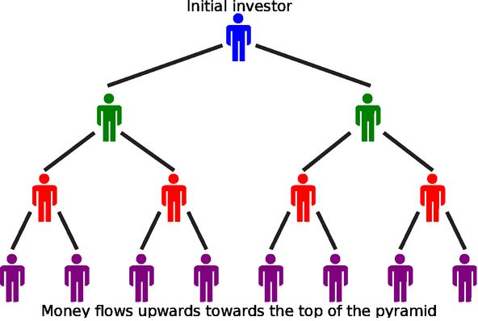

## 3.5 Analysing investment and loan options (EMCG6)

In the next worked example we consider the effects of the duration of the repayment period on the
                        total amount repaid (the amount borrowed plus the accrued interest) for a loan.

<Callout type="tip" title="Worked example 11: Repayment periods">
**Question:**
David and Julie take out a home loan of R \(\text{2,6}\) million with an interest
                                        rate of \(\text{10}\%\) per annum compounded monthly.

2. Calculate the monthly repayments for a repayment period of \(\text{30}\)
                                                   years.
4. Calculate the interest paid on the loan at the end of the \(\text{30}\) year
                                                   period.
6. Determine the monthly repayments for a repayment period of \(\text{20}\)
                                                   years.
8. Determine the interest paid on the loan at the end of the \(\text{20}\) year
                                                   period.
10. What is the difference in the monthly repayment amounts?
12. Comment on the difference in the interest paid for the two different time
                                                   periods.

**Consider a \(\text{30}\) year repayment period on the loan:**
\[x = \frac{P \times i}{\left[1 - (1 + i)^{-n}\right]}\]
                                \begin{align*}
                                P &= \text{R}\,\text{2 600 000} \\
                                i &= \frac{\text{0,1}}{12} \\
                                n &= 30 \times 12 = \text{360}
                                \end{align*}\begin{align*}
                                x &= \dfrac{\text{2 600 000} \times \frac{\text{0,1}}{12}}{\left[1 -
                                \left(1 + \frac{\text{0,1}}{12}\right)^{-360}\right]} \\
                                &= \text{R}\,\text{22 816,86}
                                \end{align*}

Therefore, the monthly repayment is \(\text{R}\,\text{22 816,86}\) for a
                                        \(\text{30}\) year period.

At the end of the \(\text{30}\) years, David and Julie will have paid a total amount
                                        of:

                                \begin{align*}
                                &= 30 \times 12 \times \text{R}\,\text{22 816,86} \\
                                &= \text{R}\,\text{8 214 069,60}
                                \end{align*}

The total amount of interest on the loan:

                                \begin{align*}
                                \text{Interest} &= \text{total amount paid} - \text{loan amount} \\
                                &= \text{R}\,\text{8 214 069,60} - \text{R}\,\text{2 600 000} \\
                                &= \text{R}\,\text{5 614 069,60}
                                \end{align*}

We notice that the interest on the loan is more than double the amount borrowed.

**Consider a \(\text{20}\) year repayment period on the loan:**
\[x = \frac{P \times i}{\left[1 - (1 + i)^{-n}\right]}\]
                                \begin{align*}
                                P &= \text{R}\,\text{2 600 000} \\
                                i &= \frac{\text{0,1}}{12} \\
                                n &= 20 \times 12 = \text{240}
                                \end{align*}\begin{align*}
                                x &= \dfrac{\text{2 600 000} \times \frac{\text{0,1}}{12}}{\left[1 -
                                \left(1 + \frac{\text{0,1}}{12}\right)^{-240}\right]} \\
                                &= \text{R}\,\text{25 090,56}
                                \end{align*}

Therefore, the monthly repayment is \(\text{R}\,\text{25 090,56}\) for a
                                        \(\text{20}\) year period.

At the end of the \(\text{20}\) years, David and Julie will have paid a total amount
                                        of:

                                \begin{align*}
                                &= 20 \times 12 \times \text{R}\,\text{25 090,56} \\
                                &= \text{R}\,\text{6 021 734,40}
                                \end{align*}

The total amount of interest on the loan:

                                \begin{align*}
                                \text{Interest} &= \text{total amount paid} - \text{loan amount} \\
                                &= \text{R}\,\text{6 021 734,40} - \text{R}\,\text{2 600 000} \\
                                &= \text{R}\,\text{3 421 734,40}
                                \end{align*}

We notice that the interest on the loan is about \(\text{1,3}\) times the borrowed
                                        amount.

**Consider the difference in the repayment and interest amounts:**
\begin{align*}
                                \text{Difference in repayments } &= \text{R}\,\text{25 090,56} - \text{R}\,\text{22
                                816,86} \\
                                &= \text{R}\,\text{2 273,70}
                                \end{align*}

It is also very interesting to look at the difference in the total interest paid:

                                \begin{align*}
                                \text{Difference in interest } &= \text{R}\,\text{5 614 069,60} - \text{R}\,\text{3
                                421 734,40} \\
                                &= \text{R}\,\text{2 192 335,20}
                                \end{align*}

Therefore, by paying an extra \(\text{R}\,\text{2 273,70}\) each month over a shorter
                                        repayment period, David and Julie could save more than \(\text{R}\,\text{2}\)
                                        million on the repayment of their home loan.
</Callout>

When considering taking out a loan, it is advisable to investigate and compare a few options offered
                        by financial institutions. It is very important to make informed decisions regarding personal
                        finances and to make sure that the monthly repayment amount is serviceable (payable). A credit
                        rating is an estimate of a person's ability to fulfill financial commitments based on their
                        previous payment history. Defaulting on a loan can affect a person's credit rating and their
                        chances of taking out another loan in the future.

<Callout type="tip" title="Worked example 12: Analysing investment opportunities">
**Question:**
Marlene wants to start saving for a deposit on a house. She can afford to invest
                                        between \(\text{R}\,\text{400}\) and \(\text{R}\,\text{600}\) each month and
                                        gets information from four different investment firms. Each firm quotes a
                                        different interest rate and a prescribed monthly installment amount. She plans
                                        to buy a house in \(\text{7}\) years' time. Calculate which company offers the
                                        best investment opportunity for Marlene.

|  | Interest rate (compounded monthly) | Monthly payment |
| --- | --- | --- |
| TBS Investments | \(\text{13,5}\%\) p.a. | \(\text{R}\,\text{450}\) |
| Taylor Anderson | \(\text{13}\%\) p.a. | \(\text{R}\,\text{555}\) |
| PHK | \(\text{12,5}\%\) p.a. | \(\text{R}\,\text{575}\) |
| Simfords Consulting | \(\text{11}\%\) p.a. | \(\text{R}\,\text{600}\) |

**Consider the different investment options:**
To compare the different investment options, we need to calculate the following for
                                        each option at the end of the seven year period:

- The future value of the monthly payments.
- The total amount paid into the investment fund.
- The total interest earned.

\[F = \frac{x\left[(1 + i)^{n}-1\right]}{i}\]

**TBS Investments:**

                                \begin{align*}
                                F &= \frac{\text{450}\left[(1 +
                                \frac{\text{0,135}}{12})^{84}-1\right]}{\frac{\text{0,135}}{12}} \\
                                &= \text{R}\,\text{62 370,99} \\
                                \text{Total amount } (T): \enspace &= 7 \times 12 \times \text{R}\,\text{450} \\
                                &= \text{R}\,\text{37 800} \\
                                \text{Total interest } (I): \enspace &= \text{R}\,\text{62 370,99} -
                                \text{R}\,\text{37 800} \\
                                &= \text{R}\,\text{24 570,99}
                                \end{align*}

**Taylor Anderson:**

                                \begin{align*}
                                F &= \frac{\text{555}\left[(1 +
                                \frac{\text{0,13}}{12})^{84}-1\right]}{\frac{\text{0,13}}{12}} \\
                                &= \text{R}\,\text{75 421,65} \\
                                \text{Total amount } (T): \enspace &= 7 \times 12 \times \text{R}\,\text{555} \\
                                &= \text{R}\,\text{46 620} \\
                                \text{Total interest } (I): \enspace &= \text{R}\,\text{75 421,65} -
                                \text{R}\,\text{46 620} \\
                                &= \text{R}\,\text{28 801,65}
                                \end{align*}

**PHK:**

                                \begin{align*}
                                F &= \frac{\text{575}\left[(1 +
                                \frac{\text{0,125}}{12})^{84}-1\right]}{\frac{\text{0,125}}{12}} \\
                                &= \text{R}\,\text{76 619,96} \\
                                \text{Total amount } (T): \enspace &= 7 \times 12 \times \text{R}\,\text{575} \\
                                &= \text{R}\,\text{48 300} \\
                                \text{Total interest } (I): \enspace &= \text{R}\,\text{76 619,96} -
                                \text{R}\,\text{48 300} \\
                                &= \text{R}\,\text{28 319,96}
                                \end{align*}

**Simfords Consulting:**

                                \begin{align*}
                                F &= \frac{\text{600}\left[(1 +
                                \frac{\text{0,11}}{12})^{84}-1\right]}{\frac{\text{0,11}}{12}} \\
                                &= \text{R}\,\text{75 416,96} \\
                                \text{Total amount } (T): \enspace &= 7 \times 12 \times \text{R}\,\text{600} \\
                                &= \text{R}\,\text{50 400} \\
                                \text{Total interest } (I): \enspace &= \text{R}\,\text{75 416,96} -
                                \text{R}\,\text{50 400} \\
                                &= \text{R}\,\text{25 016,96}
                                \end{align*}

**Draw a table of the results to compare the answers:**
|  | \(F\) | \(T\) | \(I\) |
| --- | --- | --- | --- |
| TBS Investments | \(\text{R}\,\text{62 370,99}\) | \(\text{R}\,\text{37 800}\) | \(\text{R}\,\text{24 570,99}\) |
| Taylor Anderson | \(\text{R}\,\text{75 421,65}\) | \(\text{R}\,\text{46 620}\) | \(\text{R}\,\text{28 801,65}\) |
| PHK | \(\text{R}\,\text{76 619,96}\) | \(\text{R}\,\text{48 300}\) | \(\text{R}\,\text{28 319,96}\) |
| Simfords Consulting | \(\text{R}\,\text{75 416,96}\) | \(\text{R}\,\text{50 400}\) | \(\text{R}\,\text{25 016,96}\) |

**Make a conclusion:**
An investment with PHK would provide Marlene with the highest deposit
                                        (\(\text{R}\,\text{76 619,96}\)) for her house at the end of the \(\text{7}\)
                                        year period. However, we notice that an investment with Taylor Anderson would
                                        earn the highest amount of interest (\(\text{R}\,\text{28 801,65}\)) and is
                                        therefore the better investment option.
</Callout>

<Callout type="tip" title="Worked example 13: Analysing loan options">
**Question:**
William wants to take out a loan of \(\text{R}\,\text{750 000}\), so he approaches
                                        three different banks. He plans to start repaying the loan immediately and he
                                        calculates that he can afford a monthly repayment amount between
                                        \(\text{R}\,\text{5 500}\) and \(\text{R}\,\text{7 000}\).

Calculate which of the three options would be best for William.

- West Bank offers a repayment period of \(\text{30}\) years and an interest
                                                  rate of prime compounded monthly.
- AcuBank offers a repayment period of \(\text{20}\) years and an interest
                                                  rate of prime \(+ \text{0,5}\%\) compounded monthly.
- FinTrust Bank offers a repayment period of \(\text{15}\) years and an
                                                  interest rate of prime \(+ \text{2}\%\) compounded monthly.

**Consider the different loan options:**
To compare the different loan options, we need to calculate the following for each
                                        option:

- The monthly payment amount.
- The total amount paid to repay the loan.
- The amount of interest on the loan.

\[x = \frac{P \times i}{\left[1 - (1 + i)^{-n}\right]}\]

**West Bank:**

                                \begin{align*}
                                x & = \frac{ \text{750 000} \times \frac{\text{0,085}}{12}}{\left[1 - (1 +
                                \frac{\text{0,085}}{12})^{-\text{360}}\right]} \\
                                &= \text{R}\,\text{5 766,85} \\
                                \text{Total amount } (T): \enspace &= 30 \times 12 \times \text{R}\,\text{5 766,85}
                                \\
                                &= \text{R}\,\text{2 076 066} \\
                                \text{Total interest } (I): \enspace &= \text{R}\,\text{2 076 066} -
                                \text{R}\,\text{750 000} \\
                                &= \text{R}\,\text{1 326 066}
                                \end{align*}

**AcuBank:**

                                \begin{align*}
                                x &= \frac{ \text{750 000} \times \frac{\text{0,09}}{12}}{\left[1 - (1 +
                                \frac{\text{0,09}}{12})^{-\text{240}}\right]} \\
                                &= \text{R}\,\text{6 747,94} \\
                                \text{Total amount } (T): \enspace &= 20 \times 12 \times \text{R}\,\text{6 747,94}
                                \\
                                &= \text{R}\,\text{1 619 505,60} \\
                                \text{Total interest } (I): \enspace &= \text{R}\,\text{1 619 505,60} -
                                \text{R}\,\text{750 000} \\
                                &= \text{R}\,\text{869 505,60}
                                \end{align*}

**FinTrust Bank:**

                                \begin{align*}
                                x &= \frac{ \text{750 000} \times \frac{\text{0,105}}{12}}{\left[1 - (1 +
                                \frac{\text{0,105}}{12})^{-\text{180}}\right]} \\
                                &= \text{R}\,\text{8 290,49} \\
                                \text{Total amount } (T): \enspace &= 15 \times 12 \times \text{R}\,\text{8 290,49}
                                \\
                                &= \text{R}\,\text{1 492 288,20} \\
                                \text{Total interest } (I): \enspace &= \text{R}\,\text{1 492 288,20} -
                                \text{R}\,\text{750 000} \\
                                &= \text{R}\,\text{742 288,20}
                                \end{align*}

**Draw a table of the results to compare the answers:**
|  | \(x\) | \(T\) | \(I\) |
| --- | --- | --- | --- |
| West Bank | \(\text{R}\,\text{5 766,85}\) | \(\text{R}\,\text{2 076 066,00}\) | \(\text{R}\,\text{1 326 066,00}\) |
| AcuBank | \(\text{R}\,\text{6 747,94}\) | \(\text{R}\,\text{1 619 505,60}\) | \(\text{R}\,\text{869 505,60}\) |
| FinTrust Bank | \(\text{R}\,\text{8 290,49}\) | \(\text{R}\,\text{1 492 288,20}\) | \(\text{R}\,\text{742 288,20}\) |

**Make a conclusion:**
A loan from FinTrust Bank would accumulate the lowest amount of interest but the
                                        monthly repayment amounts are not within William's budget. Although West Bank
                                        offers the lowest interest rate and monthly repayment amount, the interest
                                        earned on the loan is very high as a result of the longer repayment period. If
                                        we assume that William must repay the loan over the given time periods, then
                                        AcuBank offers the best option.

However, we know that William can afford to pay more than \(\text{R}\,\text{5
                                        766,85}\) per month, and if the bank allows him to pay back the loan earlier, he
                                        should consider taking out a loan with West Bank and take advantage of the lower
                                        interest rate.
</Callout>

## Analysing investment and loan options

### Textbook Exercise 3.5

Cokisa is \(\text{31}\) years old and starting to plan for her
                                                        future. She has been thinking about her retirement and wants to
                                                        open an annuity so that she will have money when she retires.
                                                        Her intention is to retire when she is 65 years old. Cokisa
                                                        visits the Trader's Bank of Tembisa and learns that there are
                                                        two investment options from which she can choose:

- Option A: \(\text{7,76}\%\) p.a. compounded once every four
                                                                  months
- Option B: \(\text{7,78}\%\) p.a. compounded half-yearly

**Problem:**
Which is the better investment option for Cokisa if the
                                                                amount she will deposit will always be the same?

**Solution:**
There are two separate account options for Cokisa to
                                                                consider; to determine which is the better option we
                                                                need to compare the effective interest of each option.
                                                                The higher the effective interest, the quicker the
                                                                account will grow. The effective interest formula is:

                                                        \begin{align*}
                                                        i + 1 & = \left(1 + \frac{i^{m}}{m} \right)^{m} \\
                                                        \text{Where: } \quad & \\
                                                        i & = \text{the effective interest rate} \\
                                                        i^{m} & = \text{the nominal interest rate} \\
                                                        m & = \text{the number of compounding periods each year}
                                                        \end{align*}

Work out the effective interest for option A:

                                                        \begin{align*}
                                                        i & = \left(1 + \frac{\text{0,0776}}{\text{3}}
                                                        \right)^{\text{3}} - 1 \\
                                                        & = \text{0,07962} \ldots
                                                        \end{align*}

This calculation shows that option A an effective interest
                                                                rate of about \(\text{7,9625}\%\).

Now work out the effective interest for option B:

                                                        \begin{align*}
                                                        i & = \left(1 + \frac{\text{0,0778}}{\text{2}}
                                                        \right)^{\text{2}} - 1 \\
                                                        & = \text{0,07931} \ldots
                                                        \end{align*}

For option B, the effective interest rate will be
                                                                approximately \(\text{7,9313}\%\).

By comparing the two calculations above, we see that the
                                                                option A is the better one.

NOTE: It may seem that we could answer this question by
                                                                picking an amount for the regular payment and then using
                                                                the future value formula for each of the two options to
                                                                see which one produces more money. However, this will
                                                                not work because the compounding periods are different.
                                                                If we want to work it out this way, we MUST adjust the
                                                                payment value we use according to the compounding
                                                                period, for example if we choose a regular payment of
                                                                \(\text{R}\,\text{100}\) once every four months for
                                                                option A, then we will have to use
                                                                \(\text{R}\,\text{150}\) semi-annually for option B
                                                                (because \(\text{R}\,\text{100} \times \text{3} =
                                                                \text{300}\) is the same total amount per year as
                                                                \(\text{R}\,\text{150} \times
                                                                \text{2} = \text{300}\)).

**Problem:**
Cokisa opens an account and starts saving \(\text{R}\,\text{4
                                                                000}\) every four months. How much money (to the nearest
                                                                rand) will she have saved when she reaches her planned
                                                                retirement?

**Solution:**
\begin{align*}
                                                        F & = \frac{\text{4 000} \left[ \left(1 +
                                                        \frac{\text{0,0776}}{\text{3}}\right) ^{(\text{34} \times
                                                        \text{3})} - 1 \right]} {\left(\frac{\text{0,0776}}{\text{3}}
                                                        \right)} \\
                                                        & = \text{R}\,\text{1 937 512,76}
                                                        \end{align*}

Cokisa will have \(\text{R}\,\text{1 937 512,76}\) for her
                                                                retirement.

**Problem:**
Phoebe wants to take out a home loan of R \(\text{1,6}\) million. She
                                                        approaches three different banks for their loan options:

- Bank A offers a repayment period of \(\text{30}\) years and
                                                                  an interest rate of \(\text{12}\%\) per annum compounded
                                                                  monthly.
- Bank B offers a repayment period of \(\text{20}\) years and
                                                                  an interest rate of \(\text{14}\%\) per annum compounded
                                                                  monthly.
- Bank C offers a repayment period of \(\text{30}\) years and
                                                                  an interest rate of \(\text{14}\%\) per annum compounded
                                                                  monthly.

If Phoebe will make her first repayment at the end of the first
                                                        month,
                                                        calculate which of the three options would be best for her.

**Solution:**
\[x = \frac{P \times i}{\left[1 - (1 + i)^{-n}\right]}\]

**Bank A:**

                                                \begin{align*}
                                                x & = \frac{ \text{1 600 000} \times
                                                \frac{0.12}{12}}{\left[1 - (1 + \frac{0.12}{12})^{-\text{360}}\right]}
                                                \\
                                                &= \text{R}\,\text{16 457,80} \\
                                                \text{Total amount } (T): \enspace &= 30 \times 12 \times
                                                \text{R}\,\text{16 457,80} \\
                                                &= \text{R}\,\text{5 924 808} \\
                                                \text{Total interest } (I): \enspace &= \text{R}\,\text{5 924 808} -
                                                \text{R}\,\text{1 600 000} \\
                                                &= \text{R}\,\text{4 324 808}
                                                \end{align*}

**Bank B:**

                                                \begin{align*}
                                                x &= \frac{ \text{1 600 000} \times
                                                \frac{0.14}{12}}{\left[1 - (1 + \frac{0.14}{12})^{-\text{240}}\right]}
                                                \\
                                                &= \text{R}\,\text{19 896,33} \\
                                                \text{Total amount } (T): \enspace &= 20 \times 12 \times
                                                \text{R}\,\text{19 896,33} \\
                                                &= \text{R}\,\text{4 775 119,20} \\
                                                \text{Total interest } (I): \enspace &= \text{R}\,\text{4 775
                                                119,20} - \text{R}\,\text{1 600 000} \\
                                                &= \text{R}\,\text{3 175 119,20}
                                                \end{align*}

**Bank C:**

                                                \begin{align*}
                                                x &= \frac{ \text{1 600 000} \times
                                                \frac{0.14}{12}}{\left[1 - (1 + \frac{0.14}{12})^{-\text{360}}\right]}
                                                \\
                                                &= \text{R}\,\text{18 957,95} \\
                                                \text{Total amount } (T): \enspace &= 30 \times 12 \times
                                                \text{R}\,\text{18 957,95} \\
                                                &= \text{R}\,\text{6 824 862} \\
                                                \text{Total interest } (I): \enspace &= \text{R}\,\text{6 824 862} -
                                                \text{R}\,\text{1 600 000} \\
                                                &= \text{R}\,\text{5 224 862}
                                                \end{align*}

|  | \(x\) | \(T\) | \(I\) |
| --- | --- | --- | --- |
| Bank A | \(\text{R}\,\text{16 457,80}\) | \(\text{R}\,\text{5 924 808,00}\) | \(\text{R}\,\text{4 324 808,00}\) |
| Bank B | \(\text{R}\,\text{19 896,33}\) | \(\text{R}\,\text{4 775 119,20}\) | \(\text{R}\,\text{3 175 119,20}\) |
| Bank C | \(\text{R}\,\text{18 957,95}\) | \(\text{R}\,\text{6 824 862,00}\) | \(\text{R}\,\text{5 224 862,00}\) |

A loan from Bank A would have the lowest monthly repayments, however
                                                        the interest paid is high as a result of the longer repayment
                                                        period. Therefore, Phoebe should consider taking out a loan with
                                                        Bank B, as this has the lowest total repayment amount.

### Pyramid schemes (EMCG7)

A pyramid scheme is a moneymaking scheme that promises investors unusually high returns on
                                their investment. The concept of a pyramid scheme is quite simple and should be easy to
                                identify, however, it is often cleverly disguised as a legitimate business. In some
                                cases a product is offered and in others the scheme is marketed as a highly profitable
                                investment opportunity. Unfortunately, many of these schemes have cost millions of
                                people their savings. Pyramid schemes are illegal in South Africa.

- "Ponzi schemes" are named after Charles Ponzi, a Italian businessman who lived in
                                          the U.S. and Canada. One of his investment schemes involved buying postal reply
                                          coupons in other countries and redeeming them for a higher value in the United
                                          States. He promised investors \(\text{100}\%\) profit within \(\text{90}\) days
                                          of their investment. As the scheme grew, Ponzi paid off early investors with
                                          money from investors who joined the scheme at a later stage. Ponzi's fraudulent
                                          scheme was exposed and investors lost millions of dollars. He was sent to prison
                                          for a number of years.
- South African Adriaan Nieuwoudt started a pyramid scheme commonly referred to as the
                                          "Kubus" scheme. Participants bought a biological substance called an activator
                                          that was supposed to be used in beauty products. The activator was used to grow
                                          cultures in milk that were then dried and ground up and resold to new
                                          participants. The scheme had thousands of investors and took in approximately
                                          \(\text{R}\,\text{140}\) million before it was declared an illegal lottery.

A pyramid scheme starts with one person, who finds other people to invest their money in the
                                scheme. These people then enrol more people into the scheme and the base of the pyramid
                                grows. The money invested by new investors goes to participants closer to the top of the
                                pyramid. This is unsustainable because it requires that more and more people join the
                                scheme and the growth must end at some point because there are a finite number of
                                people. Therefore, most of the investors lose their money when the scheme collapses.

The South African Reserve Bank has launched a public awareness campaign, “Beware of
                                oMashayana (crooks)”, to help educate people about pyramid schemes and how to
                                identify them.

**Beware of oMashayana**

So, you think you’ve found the perfect investment? Regular high returns with no
                                        risk? Be careful. Don’t lose all your money. If it sounds too good to be
                                        true, it’s probably a Pyramid or Ponzi scheme.

**What is a Ponzi scheme?**

A Ponzi con-artist will only ask you to give them money that they say will be
                                        invested in a scheme or project, such as supposed property developments;
                                        bridging finance; foreign-exchange transactions; venture capital to other
                                        companies; or share units.

                                        The scheme operator promises to give you back much more money than you have
                                        given them initially, in a very short space of time.

**What is a pyramid scheme?**

A pyramid con-artist will offer you the chance to make quick money for yourself,
                                        often by selling something. You pay a joining fee, buy the product and then sell
                                        it. They tell you that the more people you get to sell for you, the more money
                                        you will make. It’s easy for the first people to introduce new members,
                                        but soon everyone is part of the scheme and it gets harder to find new members
                                        to join. For example, the con-artist recruits \(\text{6}\) people who each pay a
                                        \(\text{R}\,\text{100}\) fee. Each of those people has to recruit \(\text{6}\)
                                        people. There are now up to \(\text{36}\) people. Now, those \(\text{36}\)
                                        people each have to sign up \(\text{6}\) people – this equals
                                        \(\text{216}\), and by the time you have to get to level \(\text{10}\), you have
                                        to get \(\text{60}\) million people to join to keep the scheme going. This can
                                        never work.

**What is the difference between a pyramid and a Ponzi scheme?**

The main difference is that with a pyramid scheme you have to work or sell to recruit
                                        investors, while with a Ponzi scheme the con-artist will only ask you to invest
                                        in something (for example, property development). Both schemes are illegal.

**What can I do to protect myself?**

You are your own best protection. It is your responsibility to make sure that you
                                        never give your money to any company or person that is not registered as a
                                        deposit-taking institution in terms of the Banks Act.

**Why is handing my money over so risky?**

When you hand over your money (notes and coins) to another person who then loses the
                                        money, steals it or goes bankrupt, you only have an unsecured claim against that
                                        person or their estate and you might not get all your money back.

**Why is it safer to hand my money to a bank?**

Banks and investment companies have to be registered so that they can be regulated
                                        and supervised, to make sure that your money is safe. Unregulated and
                                        unsupervised persons and groups don’t follow these rules and your money is
                                        at great risk with them.
