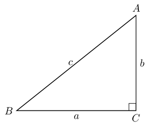
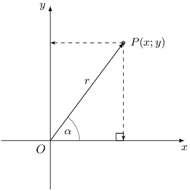
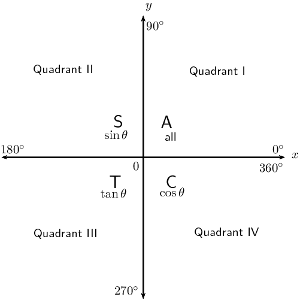

# Chapter 4: Trigonometry

- Emphasize the value and importance of making sketches, where appropriate.
- It is very important for learners to understand that it is incorrect to apply the distributive law to
                  the trigonometric ratios of compound angles and that \(\cos (\alpha - \beta) \ne \cos \alpha - \cos
                  \beta\).
- Emphasize that the area, sine and cosine rules do not require right-angled triangles.
- Remind learners that angles in the Cartesian plane are always measured from the positive \(x\)-axis.
- Important to note that \((\text{270}° \pm x)\) is not included in the curriculum.
- Note that the co-function for tangent is also not included in the curriculum.
- Remind learners to check that their answers are within the required interval.
- For the general solution, determine the solution in the correct quadrants and within the required
                  interval.
- To prove that an identity is true, remind learners that they are only allowed to manipulate **one
                      side at a time**.
- To prove identities, we usually manipulate the more complicated expression so that it looks the same as
                  the more simple expression.

## 4.1 Revision (EMCG9)

**Trigonometric ratios **

We defined the basic trigonometric ratios using the lengths of the sides of a right-angled triangle.

\(\begin{array}{r@{\;}l@{\;}l@{\;}l@{\;}cr@{\;}l@{\;}l@{\;}l@{\;}}
            \sin \hat{A}&=&\frac{\text{opposite}}{\text{hypotenuse}} &= \frac{a}{c} & \qquad \qquad
            & \qquad \sin \hat{B}&=&\frac{\text{opposite}}{\text{hypotenuse}} &= \frac{b}{c} \\
            & & & & & & & \\
            \cos \hat{A}&=&\frac{\text{adjacent}}{\text{hypotenuse}} &= \frac{b}{c} &\qquad \qquad &
            \qquad \cos \hat{B}&=&\frac{\text{adjacent}}{\text{hypotenuse}} &= \frac{a}{c} \\
            & & & & & & & \\
            \tan \hat{A}&=&\frac{\text{opposite}}{\text{adjacent}} &= \frac{a}{b} & \qquad \qquad &
            \qquad \tan \hat{B}&=&\frac{\text{opposite}}{\text{adjacent}} & = \frac{b}{a}
            \end{array}\)

**Trigonometric ratios in the Cartesian plane**

We also defined the trigonometric ratios with respect to any point in the Cartesian plane in terms of \(x\),
            \(y\) and \(r\). Using the theorem of Pythagoras, \(r^{2} = x^{2} + y^{2}\).

**CAST diagram**

The sign of a trigonometric ratio depends on the signs of \(x\) and \(y\):

**Reduction formulae and co-functions:**

2. The reduction formulae hold for any angle \(\theta\). For convenience, we assume \(\theta\) is an
                       acute angle (\(\text{0}°<\theta <\text{90}°\)).
4. When determining function values of (\(\text{180}°±\theta\)),
                       (\(\text{360}°±\theta\)) and (\(-\theta\)) the function does not change.
6. When determining function values of (\(\text{90}°±\theta\)) and (\(\theta
                       ±\text{90}°\)) the function changes to its co-function.

**Negative angles**

        \begin{align*}
        \sin (- \theta) &= - \sin \theta \\
        \cos (- \theta) &= \cos \theta \\
        \tan (- \theta) &= - \tan \theta
        \end{align*}

**Special angle triangles**

These values are useful when we need to solve a problem involving trigonometric functions without using a
            calculator. Remember that the lengths of the sides of a right-angled triangle obey the theorem of
            Pythagoras.

| θ | \(\text{0}\)° | \(\text{30}\)° | \(\text{45}\)° | \(\text{60}\)° | \(\text{90}\)° |
| --- | --- | --- | --- | --- | --- |
| \(\cos θ\) | \(\text{1}\) | \(\frac{\sqrt{3}}{2}\) | \(\frac{1}{\sqrt{2}}\) | \(\frac{1}{2}\) | \(\text{0}\) |
| \(\sin θ\) | \(\text{0}\) | \(\frac{1}{2}\) | \(\frac{1}{\sqrt{2}}\) | \(\frac{\sqrt{3}}{2}\) | \(\text{1}\) |
| \(\tan θ\) | \(\text{0}\) | \(\frac{1}{\sqrt{3}}\) | \(\text{1}\) | \(\sqrt{3}\) | undef |

**Trigonometric identities **

Quotient identity:

\[\tan \theta = \frac{\sin \theta}{\cos \theta} \qquad ( \cos \theta \ne 0)\]

Square identity:

\[\sin^{2} \theta + \cos^{2} \theta = 1\]

It also follows that:

        \begin{align*}
        \sin^2 \theta &= 1 - \cos^2 \theta \\
        \cos^2 \theta &= 1 - \sin^2 \theta \\
        & \\
        \sin \theta &= \pm \sqrt{1 - \cos^2 \theta} \\
        \cos \theta &= \pm \sqrt{1 - \sin^2 \theta}
        \end{align*}

All these relationships and identities are very useful for simplifying trigonometric expressions.

<Callout type="tip" title="Worked example 1: Revision">
**Question:**
Determine the value of the expression, without using a calculator:

                \[\frac{\cos \text{420} ° - \sin \text{225} ° \cos ( - \text{45} °)}{\tan \text{315}
                ° }\]

**Use reduction formulae to express each trigonometric ratio in terms of an acute angle:**
\begin{align*}
                &\frac{\cos \text{420} ° - \sin \text{225} ° \cos ( - \text{45} °)}{\tan \text{315}
                ° } \\
                &= \frac{\cos ( \text{360} ° + \text{60} °) - \sin ( \text{180} ° + \text{45} °)
                \cos ( - \text{45} °)}{\tan ( \text{360} ° - \text{45} °) } \\
                &= \frac{\cos \text{60} ° - ( - \sin \text{45} ° ) ( \cos \text{45} °)}{- \tan
                \text{45} ° } \\
                &= \frac{ \cos \text{60} ° + \sin \text{45} ° \cos \text{45} ° }{- \tan \text{45}
                ° }
                \end{align*}

Now use special angles to evaluate the simplified expression:

                \begin{align*}
                &= \frac{ \cos \text{60} ° + \sin \text{45} ° \cos \text{45} ° }{- \tan \text{45}
                ° } \\
                &= \frac{ \frac{1}{2} + \left( \frac{1}{\sqrt{2}} \right)\left( \frac{1}{\sqrt{2}} \right) }{- 1} \\
                &= - \left( \frac{1}{2} + \frac{1}{2} \right) \\
                &= -1
                \end{align*}
</Callout>

<Callout type="tip" title="Worked example 2: Revision">
**Question:**
Prove:

                \[\sin^{2} \alpha - (\tan \alpha - \cos \alpha)(\tan \alpha + \cos \alpha) = \frac{\cos^{2} \alpha -
                \sin^{2} \alpha}{\cos^{2} \alpha}\]

State restrictions where applicable.

**Use trigonometric identities to simplify each side separately:**
Simplify the left-hand side of the identity:

                \begin{align*}
                \text{LHS} &= \sin^{2} \alpha - (\tan \alpha - \cos \alpha)(\tan \alpha + \cos \alpha) \\
                &= \sin^{2} \alpha - (\tan^{2} \alpha - \cos^{2} \alpha) \\
                &= \sin^{2} \alpha - \tan^{2} \alpha + \cos^{2} \alpha \\
                &= \left( \sin^{2} \alpha + \cos^{2} \alpha \right) - \tan^{2} \alpha \\
                &= 1 - \tan^{2} \alpha
                \end{align*}

Simplify the right-hand side of the identity so that it equals the left-hand side:

                \begin{align*}
                \text{RHS} &= \frac{\cos^{2} \alpha - \sin^{2} \alpha}{\cos^{2} \alpha} \\
                &= \frac{\cos^{2} \alpha}{\cos^{2} \alpha} - \frac{\sin^{2} \alpha}{\cos^{2} \alpha} \\
                &= 1 - \tan^{2} \alpha \\
                & \\
                \therefore \text{LHS} &= \text{RHS}
                \end{align*}

Alternative method: we could also have started with the left-hand side of the identity and
                    substituted \(\tan \alpha = \frac{\sin \alpha}{\cos \alpha}\) and simplified to get the right-hand
                    side.

**Restrictions**

We need to determine the values of \(\alpha\) for which any of the terms in the identity will be
                    undefined:

                \begin{align*}
                \cos^{2} \alpha &= 0 \\
                \therefore \cos \alpha &= 0 \\
                \therefore \alpha &= \text{90} ° \text{ or } \text{270} °
                \end{align*}

We must also consider the values of \(\alpha\) for which \(\tan \alpha\) is undefined. Therefore, the
                    identity is undefined for \(\alpha = \text{90} ° + k \cdot \text{180} °\).
</Callout>

**Useful tips:**

- It is sometimes useful to write \(\tan \theta\) in terms of \(\sin \theta\) and \(\cos \theta\).
- Never write a trigonometric ratio without an angle. For example, \(\tan = \frac{\sin }{ \cos}\) has no
                  meaning.
- For proving identities, only simplify one side of the identity at a time.
- As seen in the worked example above, sometimes both sides of the identity need to be simplified.
- Remember to write down restrictions:
  - the values for which any of the trigonometric ratios are not defined;
  - the values of the variable which make any of the denominators in the identity equal to zero.

## Revision - reduction formulae, co-functions and identities

### Textbook Exercise 4.1

Given: \(\sin \text{31} ° = A\)

Write each of the following expressions in terms of \(A\):

**Problem:**
\(\sin \text{149} °\)

**Solution:**
\begin{align*}
                            \sin \text{149} ° &= \sin ( \text{180} ° - \text{31} °) \\
                            &= \sin \text{31} ° \\
                            &= A
                            \end{align*}

**Problem:**
\(\cos ( - \text{59} °)\)

**Solution:**
\begin{align*}
                            \cos ( - \text{59} °) &= \cos \text{59} ° \\
                            &= \cos ( \text{90} ° - \text{31} °) \\
                            &= \sin \text{31} ° \\
                            &= A
                            \end{align*}

**Problem:**
\(\cos \text{329} °\)

**Solution:**
\begin{align*}
                            \cos \text{329} ° &= \cos ( \text{360} ° - \text{31} °) \\
                            &= \cos \text{31} ° \\
                            &= \sqrt{1 - \sin^{2} \text{31} °} \\
                            &= \sqrt{1 - A^{2}}
                            \end{align*}

**Problem:**
\(\tan \text{211} ° \cos \text{211} °\)

**Solution:**
\begin{align*}
                            \tan \text{211} ° \cos \text{211} ° &= \left( \frac{\sin \text{211}
                            °}{\cos \text{211} °} \right) \cos \text{211} ° \\
                            &= \sin \text{211} ° \\
                            &= \sin ( \text{180} ° + \text{31} °) \\
                            &= - \sin \text{31} ° \\
                            &= - A
                            \end{align*}

**Problem:**
\(\tan \text{31} °\)

**Solution:**
\begin{align*}
                            \tan \text{31} ° &= \frac{\sin \text{31} °}{\cos \text{31} °} \\
                            &= \frac{A}{\sqrt{1 - A^{2}}}
                            \end{align*}

**Problem:**
Simplify \(P\) to a single trigonometric ratio:

                            \[P = \sin ( \text{360} ° + \theta) \cos ( \text{180} ° + \theta) \tan( \text{360}
                            ° + \theta)\]

**Solution:**
\begin{align*}
                            P &= \sin ( \text{360} ° + \theta) \cos ( \text{180} ° + \theta) \tan(
                            \text{360} ° + \theta) \\
                            &= \sin \theta (- \cos \theta) ( \tan \theta) \\
                            &= -\sin \theta \cos \theta \left( \frac{\sin \theta}{\cos \theta} \right) \\
                            &= -\sin^{2} \theta
                            \end{align*}

**Problem:**
Simplify \(Q\) to a single trigonometric ratio:

                            \[Q = \frac{ \cos (\theta - \text{360} °) \sin ( \text{90} ° + \theta) \sin (-
                            \theta)}{\sin (\theta + \text{180} °)}\]

**Solution:**
\begin{align*}
                            \text{Note: } & \cos (\theta - \text{360} °) \\
                            &=\cos [- ( \text{360} ° - \theta)] \\
                            &=\cos ( \text{360} ° - \theta) \\
                            &=\cos \theta \\
                            & \\
                            Q &= \frac{ \cos (\theta - \text{360} °) \sin ( \text{90} ° + \theta) \sin (-
                            \theta)}{\sin (\theta + \text{180} °)} \\
                            &= \frac{\cos \theta \cos \theta (- \sin \theta)}{- \sin \theta} \\
                            &= \cos^{2} \theta
                            \end{align*}

**Problem:**
Hence, determine:

2. \(P + Q\)
4. \(\dfrac{Q}{P}\)

**Solution:**
2. \begin{align*}
                                       P + Q &= \sin^{2} \theta + \cos^{2} \theta \\
                                       &= 1
                                       \end{align*}
4. \begin{align*}
                                       \frac{Q}{P} &= \frac{\cos^{2} \theta}{\sin^{2} \theta} \\
                                       &= \frac{1}{\tan^{2} \theta}
                                       \end{align*}

**Problem:**
If \(p = \sin \beta\), express the following in terms of \(p\):
                        \[\frac{\cos (\beta + \text{360} °) \tan (\beta - \text{360} °) \cos (\beta +
                        \text{90} °)}{\sin^{2}(\beta + \text{180} °) \cos(\beta - \text{90} °)}\]

**Solution:**
\begin{align*}
                        \text{Note: } & \tan (\beta - \text{360} °) \\
                        &= \tan [- ( \text{360} ° - \beta)] \\
                        &= - \tan ( \text{360} ° - \beta) \\
                        &= - ( - \tan \beta ) \\
                        &= \tan \beta \\
                        \text{And } & \cos (\beta - \text{90} °) \\
                        &= \cos [- ( \text{90} ° - \beta)] \\
                        &= \cos ( \text{90} ° - \beta) \\
                        &= \sin \beta \\
                        & \\
                        & \frac{\cos (\beta + \text{360} °) \tan (\beta - \text{360} °) \cos (\beta +
                        \text{90} °)}{\sin^{2}(\beta + \text{180} °) \cos(\beta - \text{90} °)} \\
                        &= \frac{ \cos \beta \tan \beta (- \sin \beta)}{(- \sin \beta )^{2} \sin \beta} \\
                        &= - \frac{ \cos \beta \left( \frac{\sin \beta}{\cos \beta} \right) \sin \beta}{( \sin^{2}
                        \beta ) \sin \beta} \\
                        &= - \frac{ \sin^{2} \beta}{ \sin^{2} \beta \sin \beta } \\
                        &= - \frac{1}{ \sin \beta } \\
                        &= - \frac{1}{p}
                        \end{align*}

Evaluate the following without the use of a calculator:

**Problem:**
\(\dfrac{\cos (- \text{120} °)}{\tan \text{150} °} + \cos
                            \text{390} °\)

**Solution:**
\begin{align*}
                            & \dfrac{\cos ( \text{120} °)}{\tan \text{150} °} + \cos \text{390} ° \\
                            &= \frac{ \cos( \text{180} ° - \text{60} °)}{ \tan ( \text{180} ° -
                            \text{30} °)} + \cos( \text{360} ° + \text{30} °) \\
                            &= \frac{ - \cos \text{60} °}{ - \tan \text{30} °} + \cos \text{30} ° \\
                            &= \frac{ \sin \text{30} °}{\frac{ \sin \text{30} °}{\cos \text{30} °}} +
                            \cos \text{30} ° \\
                            &= \cos \text{30} ° + \cos \text{30} ° \\
                            &= 2 \cos \text{30} ° \\
                            &= 2 \left( \frac{\sqrt{3}}{2} \right) \\
                            &= \sqrt{3}
                            \end{align*}

**Problem:**
\((1 - \sin \text{45} °)(1 - \sin \text{225} °)\)

**Solution:**
\begin{align*}
                            & (1 - \sin \text{45} °)(1 - \sin \text{225} °) \\
                            &= 1 - \sin \text{45} ° - \sin \text{225} ° + (\sin \text{45} °)(\sin
                            \text{225} °) \\
                            &= 1 - \sin \text{45} ° - \sin ( \text{180} ° + \text{45} °) + (\sin
                            \text{45} °)(\sin ( \text{180} ° + \text{45} °)) \\
                            &= 1 - \sin \text{45} ° + \sin \text{45} ° - \sin^{2} \text{45} ° \\
                            &= 1 - \sin^{2} \text{45} ° \\
                            &= 1 - \left( \frac{1}{\sqrt{2}} \right)^{2} \\
                            &= 1 - \frac{1}{2} \\
                            &= \frac{1}{2}
                            \end{align*}

Reduce the following to one trigonometric ratio:

**Problem:**
\(\tan^{2} \beta - \dfrac{1}{\cos^{2} \beta}\)

**Solution:**
\begin{align*}
                            \tan^{2} \beta - \dfrac{1}{\cos^{2} \beta}
                            &= \dfrac{\sin^{2} \beta}{\cos^{2} \beta} - \dfrac{1}{\cos^{2} \beta} \\
                            &= \dfrac{\sin^{2} \beta - 1}{\cos^{2} \beta} \\
                            &= \dfrac{-( 1 - \sin^{2} \beta)}{\cos^{2} \beta} \\
                            &= \dfrac{- \cos^{2} \beta}{\cos^{2} \beta} \\
                            &= -\text{1}
                            \end{align*}

**Problem:**
\(\sin^{2} ( \text{90} ° + \theta) \tan^{2} \theta + \tan^{2} \theta \cos^{2} (
                                \text{90} ° - \theta)\)

**Solution:**
\begin{align*}
                            &\sin^{2} ( \text{90} ° + \theta) \tan^{2} \theta + \tan^{2} \theta \cos^{2} (
                            \text{90} ° - \theta) \\
                            &= \cos^{2}\theta \tan^{2}\theta + \tan^{2}\theta \sin^{2}\theta \\
                            &= \tan^{2}\theta \left( \cos^{2}\theta + \sin^{2}\theta \right) \\
                            &= \tan^{2}\theta \left( 1 \right) \\
                            &= \tan^{2}\theta
                            \end{align*}

**Problem:**
\(\sin \alpha \cos \alpha \tan \alpha - 1\)

**Solution:**
\begin{align*}
                            \sin \alpha \cos \alpha \tan \alpha -1
                            &= \sin \alpha \cos \alpha \left( \frac{\sin\alpha}{\cos\alpha} \right) - 1 \\
                            &= \sin^{2} \alpha - 1 \\
                            &= - \left( 1 - \sin^{2} \alpha \right) \\
                            &= - \cos^{2} \alpha
                            \end{align*}

**Problem:**
\(\tan^2 \theta + \dfrac{\cos^2 \theta - 1}{\cos^2 \theta}\)

**Solution:**
\begin{align*}
                            \tan^2 \theta + \dfrac{\cos^2 \theta - 1}{\cos^2 \theta}
                            &= \tan^2 \theta - \dfrac{ (1 - \cos^2 \theta)}{\cos^2 \theta} \\
                            &= \tan^2 \theta - \dfrac{ \sin^2 \theta}{\cos^2 \theta} \\
                            &= \tan^2 \theta - \tan^2 \theta \\
                            &= \text{0}
                            \end{align*}

**Problem:**
Use reduction formulae and special angles to show that

                            \[\frac{\sin ( \text{180} ° + \theta) \tan ( \text{720} ° + \theta) \cos (-
                            \theta)}{\cos ( \text{90} ° + \theta) }\]

can be simplified to \(\sin \theta\).

**Solution:**
Use reduction formulae and co-functions to simplify the expression

                            \begin{align*}
                            & \frac{\sin ( \text{180} ° + \theta) \tan ( \text{720} ° + \theta) \cos (-
                            \theta)}{\cos ( \text{90} ° + \theta) }\\
                            &= \frac{ - \sin \theta \tan \left( 2( \text{360} °) + \theta \right) \cos \theta}{
                            - \sin \theta } \\
                            &= \tan \theta \cos \theta \\
                            &= \left( \frac{\sin \theta }{\cos \theta} \right) \cos \theta \\
                            &= \sin \theta
                            \end{align*}

**Problem:**
Without using a calculator, determine the value of \(\sin \text{570} °\).

**Solution:**
Use special angles to determine the value of the expression

                            \begin{align*}
                            \sin \text{570} ° &= \sin ( \text{360} ° + \text{210} °) \\
                            &= \sin ( \text{210} °) \\
                            &= \sin ( \text{180} ° + \text{30} °) \\
                            &= - \sin \text{30} ° \\
                            &= - \frac{1}{2}
                            \end{align*}

**Problem:**
Troy's mathematics teacher asks the class to answer the following question.

**Question:**

Prove that \(\dfrac{\cos\theta}{1+\sin\theta} = \dfrac{1-\sin\theta}{\cos\theta}\).

**Troy's answer:**

                        \begin{align*}
                        \dfrac{\cos\theta}{1+\sin\theta} &= \dfrac{1-\sin\theta}{\cos\theta}\\
                        (\cos \theta)(\cos \theta) &= (1+\sin\theta)(1-\sin\theta) \\
                        \cos^{2} \theta &= 1 -\sin^{2} \theta \\
                        \cos^{2} \theta &= \cos^{2} \theta \\
                        \therefore \text{LHS} &= \text{RHS}
                        \end{align*}

Comment on Troy's answer and show the correct method for proving this identity.

**Solution:**
The question requires that Troy prove the identity. However, by working with both sides of
                            the identity at the same time, he accepted that it was true. The correct method for proving
                            an identity is to work with only one side at a time and to show that one side equals the
                            other. Sometimes it is necessary to first simplify one side of the identity, and then also
                            to simplify the other side in order to show that they are equal. Troy also should have
                            stated restrictions.

Correct method:

                        \begin{align*}
                        \text{RHS} &= \dfrac{1-\sin\theta}{\cos\theta} \\
                        &= \dfrac{1-\sin\theta}{\cos\theta} \times \dfrac{1+\sin\theta}{1+\sin\theta} \\
                        &= \dfrac{1-\sin^{2}\theta}{\cos\theta(1+\sin\theta)} \\
                        &= \dfrac{\cos^{2}\theta}{\cos\theta(1+\sin\theta)} \\
                        &= \dfrac{\cos\theta}{1+\sin\theta} \\
                        &= \text{LHS}
                        \end{align*}

Restrictions: undefined where \(\cos \theta = \text{0}, \text{ and } \sin \theta = -
                            \text{1}\).

So then \(\theta \ne \text{90} + k \cdot \text{180} ° \text{ and } \theta \ne -
                            \text{90} + k \cdot \text{360} °\).

Therefore \(\theta \ne \text{90} ° + k \cdot \text{180} °, \quad k \in
                            \mathbb{Z}\).

Prove the following identities:

(State any restricted values in the interval \([ \text{0} °; \text{360} °]\), where
                            appropriate.)

**Problem:**
\({\sin}^{2}\alpha + \left(\cos\alpha - \tan\alpha \right)\left(\cos\alpha +\tan\alpha
                                \right)=1-{\tan}^{2}\alpha\)

**Solution:**
\begin{align*}
                            \text{LHS } &= \sin^2 \alpha + (\cos\alpha-\tan\alpha) (\cos\alpha+\tan\alpha) \\
                            &=\sin^2\alpha+\cos^2\alpha-\tan^2\alpha \\
                            &=1 - \tan^2\alpha \\
                            &= \text{RHS}
                            \end{align*}

Restrictions: undefined where \(\tan \alpha\) is undefined.

Therefore \(\alpha \ne \text{90} °; \text{270} °\).

**Problem:**
\(\dfrac{1}{\cos\theta}-\dfrac{\cos\theta {\tan}^{2}\theta }{1}=\cos\theta\)

**Solution:**
\begin{align*}
                            \text{LHS } &= \dfrac{1}{\cos\theta}-\dfrac{\cos\theta \tan^2\theta}{1}\\
                            &=\dfrac{1-\cos^2\theta \times \tan^2\theta}{\cos\theta}\\
                            &=\dfrac{1-\cos^2\theta \times \dfrac{\sin^2\theta}{\cos^2\theta}}{\cos\theta}\\
                            &=\dfrac{1-\sin^2\theta}{\cos\theta}\\
                            &=\dfrac{\cos^2\theta}{\cos\theta}\\
                            &=\cos\theta\\
                            &= \text{RHS}
                            \end{align*}

Restrictions: undefined where \(\cos \theta = \text{0}\) and where \(\tan \theta\) is
                                undefined.

Therefore \(\theta \ne \text{90} °; \text{270} °\).

**Problem:**
\(\dfrac{2\sin\theta\cos\theta}{\sin\theta +\cos\theta }=\sin\theta +\cos\theta
                                -\dfrac{1}{\sin\theta +\cos\theta }\)

**Solution:**
\begin{align*}
                            \text{RHS } &= \sin\theta+\cos\theta-\dfrac{1}{\sin\theta+\cos\theta} \\
                            &=\dfrac{\sin^2\theta+\sin\theta \cos\theta+\cos\theta
                            \sin\theta+\cos^2\theta-1}{\sin\theta+\cos\theta} \\
                            &=\dfrac{1+2\sin\theta \cos\theta-1}{\sin\theta+\cos\theta} \\
                            &=\dfrac{2\sin\theta \cos\theta}{\sin\theta+\cos\theta} \\
                            &= \text{LHS}
                            \end{align*}

Restrictions: undefined where \(\sin \theta = \text{0}, \enspace \cos \theta =
                                \text{0}\).

Therefore \(\theta \ne \text{0} °; \text{90} °; \text{180} °; \text{270}
                                °; \text{360} °\).

**Problem:**
\(\left(\dfrac{\cos\beta}{\sin\beta }+\tan\beta \right) \cos\beta =\dfrac{1}{\sin\beta
                                }\)

**Solution:**
\begin{align*}
                            \text{ LHS} &= \left ( \dfrac{\cos\beta}{\sin\beta}+\dfrac{\sin\beta}{\cos\beta} \right
                            ) \cos\beta \\
                            &=\left ( \dfrac{\cos^2\beta + \sin^2\beta}{\sin\beta\cos\beta} \right )\cos\beta\\
                            &=\dfrac{1}{\sin\beta}\\
                            &= \text{RHS }
                            \end{align*}

Restrictions: undefined where \(\sin \beta = \text{0}, \enspace \cos \beta = \text{0}\)
                                and where \(\tan \beta\) is undefined.

Therefore \(\beta \ne \text{0} °; \text{90} °; \text{180} °; \text{270}
                                °; \text{360} °\).

**Problem:**
\(\dfrac{1}{1 + \sin \theta} + \dfrac{1}{1 - \sin \theta} = \dfrac{2 \tan \theta}{\sin
                                \theta \cos \theta}\)

**Solution:**
\begin{align*}
                            \text{ LHS} &= \dfrac{1-\sin\theta+1+\sin\theta}{(1+\sin\theta)(1-\sin\theta)} \\
                            &=\dfrac{2}{1-\sin^2\theta} \\
                            &=\dfrac{2}{\cos^2\theta}
                            \end{align*}

                            \begin{align*}
                            \text{ RHS} &= \dfrac{2 \tan \theta}{\sin \theta \cos \theta} \\
                            &=\dfrac{2 \sin \theta}{\sin \theta \cos \theta \cos \theta} \\
                            &=\dfrac{2}{\cos^2\theta} \\
                            \therefore \text{LHS } &= \text{RHS }
                            \end{align*}

Restrictions: undefined where \(\sin \theta = \pm \text{1}, \enspace \sin \theta =
                                \text{0}, \enspace \cos \theta = \text{0}\).

Restrictions also include the values of \(\theta\) for which \(\tan \theta\) is
                                undefined.

Therefore \(\theta \ne \text{0} °; \text{90} °; \text{180} °; \text{270}
                                °; \text{360} °\).

**Problem:**
\((1 + \tan^2 \alpha) \cos \alpha = \dfrac{1 - \tan \alpha}{\cos \alpha - \sin \alpha}\)

**Solution:**
\begin{align*}
                            \text{LHS} &= (1 + \tan^2 \alpha) \cos \alpha \\
                            &= \left(1+\frac{\sin^2\alpha}{\cos^2\alpha} \right) \cos\alpha \\
                            &= \left( \frac{\cos^2\alpha+\sin^2\alpha}{\cos^2\alpha} \right) \cos\alpha \\
                            &=\dfrac{1}{\cos^{2}\alpha} \times \cos\alpha \\
                            &=\dfrac{1}{\cos\alpha}
                            \end{align*}
                            \begin{align*}
                            \text{RHS} &= \dfrac{1 - \tan \alpha}{\cos \alpha - \sin \alpha} \\
                            &= \dfrac{1 - \frac{\sin \alpha}{\cos \alpha}}{\cos \alpha - \sin \alpha} \\
                            &= \dfrac{\frac{\cos \alpha - \sin \alpha}{\cos \alpha}}{\cos \alpha - \sin \alpha} \\
                            &= \dfrac{\cos \alpha - \sin \alpha}{\cos \alpha(\cos \alpha - \sin \alpha)} \\
                            &= \dfrac{1}{\cos\alpha} \\
                            &= \text{LHS }
                            \end{align*}

Restrictions: where \(\sin \alpha = \cos \alpha\) and where \(\tan \alpha\) is undefined.

Therefore \(\alpha \ne \text{45} °; \text{90} °; \text{270} °; \text{225}
                                °\).

Determine whether the following statements are true or false.

If the statement is false, choose a suitable value between \(\text{0}\) ° and
                            \(\text{90}\) ° to confirm your answer.

**Problem:**
\(\cos ( \text{180} ° - \theta) = -1 - \cos \theta\)

**Solution:**
False

                            \begin{align*}
                            \text{Let } \theta &= \text{35} ° \\
                            \text{LHS} &= \cos ( \text{180} ° - \text{35} °) \\
                            &= \cos \text{145} ° \\
                            &= -\text{0,819} \\
                            & \\
                            \text{RHS} &= - 1 - \cos \text{35} ° \\
                            &= -\text{1,819} \\
                            & \\
                            \text{LHS} & \ne \text{RHS}
                            \end{align*}

**Problem:**
\(\sin (\alpha + \beta) = \sin \alpha + \sin \beta\)

**Solution:**
False

                            \begin{align*}
                            \text{Let } \alpha &= \text{62} ° \\
                            \text{Let } \beta &= \text{20} ° \\
                            \text{LHS} &= \sin( \text{62} ° + \text{20} ° ) \\
                            &= \sin \text{82} ° \\
                            &= \text{0,990} \\
                            & \\
                            \text{RHS} &= \sin \text{62} ° + \sin \text{20} ° \\
                            &= \text{1,224} \\
                            & \\
                            \text{LHS} &\ne \text{RHS}
                            \end{align*}

**Problem:**
\(\sin \alpha = 2 \sin \frac{\alpha}{2} \sin \frac{\alpha}{2}\)

**Solution:**
True

**Problem:**
\(\frac{1}{3} \sin 3\alpha = \sin \alpha\)

**Solution:**
False

                            \begin{align*}
                            \text{Let } \alpha &= \text{62} ° \\
                            \text{LHS} &= \frac{1}{3} \sin 3 ( \text{62} ° ) \\
                            &= -\text{0,034} \\
                            & \\
                            \text{RHS} &= \sin \text{62} ° \\
                            &= \text{0,882} \\
                            & \\
                            \text{LHS} &\ne \text{RHS}
                            \end{align*}

**Problem:**
\(\cos \beta = \sqrt{1 - \sin^{2} \beta}\)

**Solution:**
True

**Problem:**
\(\sin \theta = \tan \theta \cos \theta\)

**Solution:**
True
