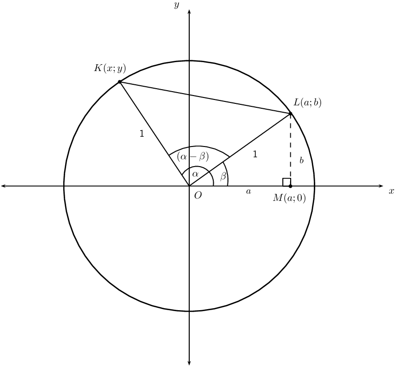
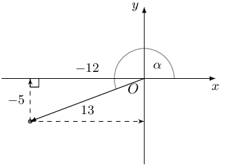
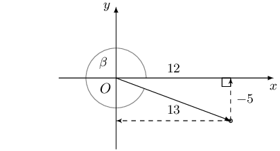
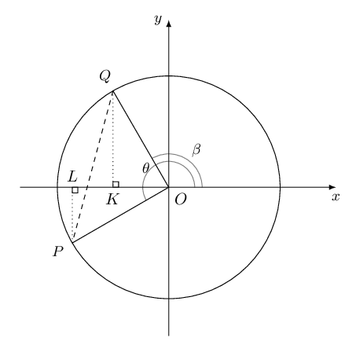

## 4.2 Compound angle identities (EMCGB)

### Derivation of \(\cos\left(\alpha - \beta \right)\) (EMCGC)

## Compound angles

Danny is studying for a trigonometry test and completes the following question:

**Question:**

Evaluate the following:

\(\cos \left( \text{180} ° - \text{120} ° \right)\)

**Danny's solution:**

        \[\begin{array}{rll}
        \cos \left( \text{180} ° - \text{120} ° \right) &= \cos \text{180} ° - \cos \text{120} °
        & (\text{line } 1 )\\
        &= -1 - \cos \left( \text{90} ° + \text{30} ° \right) & (\text{line } 2 ) \\
        &= - 1 + \sin \text{30} ° & (\text{line } 3 ) \\
        &= -1 + \frac{1}{2} & (\text{line } 4 ) \\
        &= -\frac{1}{2} & (\text{line } 5 )
        \end{array}\]

2. Consider Danny's solution and determine why it is incorrect.
4. Use a calculator to check that Danny's answer is wrong.
6. Describe in words the mistake(s) in his solution.
8. Is the following statement true or false?
   "A trigonometric ratio can be distributed to the angles that lie within the brackets."

From the investigation above, we know that \(\cos (\alpha - \beta) \ne \cos \alpha - \cos \beta\). It is wrong
        to apply the distributive law to the trigonometric ratios of compound angles.

      \begin{align*}
      \text{Distance formula: } \quad d_{AB} &= \sqrt{
      {\left({x}_{A}-{x}_{B}\right)}^{2}+{\left({y}_{A}-{y}_{B}\right)}^{2} } \\
      \text{Cosine rule: } \quad a^{2} &= b^{2} + c^{2} - 2bc \cdot \cos \hat{A}
      \end{align*}

Using the distance formula and the cosine rule, we can derive the following identity for compound angles:

\[\cos\left(\alpha -\beta \right) = \cos \alpha \cos\beta +\sin\alpha \sin\beta\]

Consider the unit circle \((r = 1)\) below. The two points \(L\left(a;b\right)\) and \(K\left(x;y\right)\) are
        shown on the circle.

We can express the coordinates of \(L\) and \(K\) in terms of the angles \(\alpha\) and \(\beta\):

      \begin{align*}
      \text{In } \triangle LOM, \quad \sin \beta &= \frac{b}{1} \\
      \therefore b &=\sin\beta \\
      \cos \beta &=\frac{a}{1} \\
      \therefore a &=\cos\beta \\
      & \\
      L &= \left(\cos\beta ;\sin\beta \right) \\
      & \\
      \text{Similarly, } K &=\left(\cos\alpha ;\sin\alpha \right)
      \end{align*}

We use the distance formula to determine \(K{L}^{2}\):

      \begin{align*}
      {d}^{2} &= {\left({x}_{K}-{x}_{L}\right)}^{2}+{\left({y}_{K}-{y}_{L}\right)}^{2} \\
      K{L}^{2}& = {\left(\cos\alpha -\cos\beta \right)}^{2}+{\left(\sin\alpha -\sin\beta \right)}^{2} \\
      & = {\cos}^{2}\alpha -2\cos\alpha\cos \beta +{\cos}^{2}\beta +{\sin}^{2}\alpha -2\sin\alpha\sin \beta
      +{\sin}^{2}\beta \\
      & = \left({\cos}^{2}\alpha +{\sin}^{2}\alpha \right)+\left({\cos}^{2}\beta +{\sin}^{2}\beta
      \right)-2\cos\alpha\cos \beta -2\sin\alpha\sin \beta \\
      & = 1+1-2\left(\cos\alpha\cos \beta +\sin\alpha\sin \beta \right) \\
      & = 2-2\left(\cos\alpha\cos \beta +\sin\alpha\sin \beta \right)
      \end{align*}

Now we determine \(K{L}^{2}\) using the cosine rule for \(\triangle KOL\):

      \begin{align*}
      K{L}^{2}& = K{O}^{2}+L{O}^{2}-2 \cdot KO \cdot LO \cdot \cos\left(\alpha -\beta \right) \\
      & = {1}^{2}+{1}^{2}-2\left(1\right)\left(1\right)\cos\left(\alpha -\beta \right) \\
      & = 2-2 \cdot \cos\left(\alpha -\beta \right)
      \end{align*}

Equating the two expressions for \(K{L}^{2}\), we have

      \begin{align*}
      2-2 \cdot \cos\left(\alpha -\beta \right) & = 2-2\left(\cos\alpha\cos \beta +\sin\alpha \sin\beta \right) \\
      2 \cdot \cos\left(\alpha -\beta \right) & = 2\left(\cos\alpha\cos \beta +\sin\alpha \sin\beta \right) \\
      \therefore \cos\left(\alpha -\beta \right) & = \cos \alpha \cos\beta +\sin\alpha \sin\beta
      \end{align*}

<Callout type="tip" title="Worked example 3: Derivation of \(\cos \left(\alpha + \beta \right) = \cos \alpha \cos\beta -
          \sin\alpha \sin \beta\)">
**Question:**
Derive an expression for \(\cos\left(\alpha + \beta \right)\) in terms of the trigonometric ratios of
            \(\alpha\) and \(\beta\).

**Use the compound angle formula for \(\cos \left(\alpha - \beta \right)\):**
We use the compound angle formula for \(\cos \left(\alpha - \beta \right)\) and manipulate the sign of
            \(\beta\) in \(\cos \left(\alpha + \beta \right)\) so that it can be written as a difference of two angles:

          \begin{align*}
          \cos (\alpha + \beta ) & = \cos (\alpha - (-\beta )) \\
          \text{And we have shown } \cos (\alpha - \beta )& = \cos \alpha \cos\beta +\sin\alpha \sin\beta \\
          \therefore \cos [\alpha - (- \beta )]& = \cos \alpha \cos(-\beta) +\sin\alpha \sin(-\beta) \\
          \therefore \cos (\alpha + \beta ) & = \cos \alpha \cos\beta - \sin\alpha \sin \beta
          \end{align*}

**Write the final answer:**
\[\cos (\alpha + \beta ) = \cos \alpha \cos\beta - \sin\alpha \sin \beta\]
</Callout>

<Callout type="tip" title="Worked example 4: Derivation of \(\sin \left(\alpha - \beta \right)\) and \(\sin \left(\alpha
          + \beta \right)\)">
**Question:**
Derive the expanded formulae for \(\sin\left(\alpha - \beta \right)\) and \(\sin\left(\alpha + \beta
            \right)\) in terms of the trigonometric ratios of \(\alpha\) and \(\beta\).

**Use the compound angle formula and co-functions to expand \(\sin\left(\alpha - \beta
            \right)\):**
Using co-functions, we know that \(\sin \hat{A} = \cos ( \text{90} ° - \hat{A} )\), so we can write
            \(\sin \left(\alpha + \beta \right)\) in terms of the cosine function as:

          \begin{align*}
          \sin ( \alpha - \beta ) & = \cos \left( \text{90} ° - ( \alpha - \beta ) \right) \\
          & = \cos \left( \text{90} ° - \alpha + \beta \right) \\
          & = \cos \left[ ( \text{90} ° - \alpha) + \beta \right] \end{align*}

Apply the compound angle formula:

          \begin{align*}
          \cos (\alpha + \beta ) & = \cos \alpha \cos\beta - \sin\alpha \sin\beta \\
          \therefore \cos \left[ ( \text{90} ° - \alpha) + \beta \right] & = \cos ( \text{90} ° - \alpha)
          \cos\beta - \sin ( \text{90} ° - \alpha) \sin\beta \\
          \therefore \sin( \alpha - \beta) & = \sin \alpha \cos\beta - \cos \alpha \sin\beta
          \end{align*}

To derive the formula for \(\sin ( \alpha + \beta )\), we use the compound formula for \(\sin ( \alpha -
            \beta )\) and manipulate the sign of \(\beta\):

          \begin{align*}
          \sin (\alpha - \beta )& = \sin \alpha \cos\beta - \cos \alpha \sin\beta \\
          \text{We can write } \sin ( \alpha + \beta ) & = \sin \left[ \alpha - (- \beta ) \right] \\
          \therefore \sin \left[ \alpha - (- \beta ) \right] &= \sin \alpha \cos (-\beta) - \cos \alpha \sin
          (-\beta) \\
          \therefore \sin ( \alpha + \beta ) & = \sin \alpha \cos\beta + \cos \alpha \sin\beta
          \end{align*}

**Write the final answers:**
\[\sin (\alpha - \beta ) = \sin \alpha \cos\beta - \cos \alpha \sin\beta\]
          \[\sin (\alpha + \beta ) = \sin \alpha \cos\beta + \cos \alpha \sin\beta\]
</Callout>

**Compound angle formulae**

- \(\cos (\alpha - \beta ) = \cos \alpha \cos\beta + \sin \alpha \sin\beta\)
- \(\cos (\alpha + \beta ) = \cos \alpha \cos\beta - \sin \alpha \sin\beta\)
- \(\sin (\alpha - \beta ) = \sin \alpha \cos\beta - \cos \alpha \sin\beta\)
- \(\sin (\alpha + \beta ) = \sin \alpha \cos\beta + \cos \alpha \sin\beta\)

Note: we can use the compound angle formulae to expand and simplify compound angles in trigonometric
        expressions (using the equations from left to right) or we can use the expanded form to determine the
        trigonometric ratio of a compound angle (using the equations from right to left).

<Callout type="tip" title="Worked example 5: Compound angle formulae">
**Question:**
Prove that \(\sin \text{75} °=\frac{\sqrt{2}\left(\sqrt{3}+1\right)}{4}\) without using a calculator.

**Consider the given identity:**
We know the values of the trigonometric functions for the special angles ( \(\text{30}\) °,
            \(\text{45}\) °, \(\text{60}\) °, etc.) and we can write \(\text{75} ° = \text{30} ° +
            \text{45} °\).

Therefore, we can use the compound angle formula for \(\sin (\alpha + \beta )\) to express \(\sin \text{75}
            °\) in terms of known trigonometric function values.

**Prove the left-hand side of the identity equals the right-hand side:**
When proving an identity is true, remember to only work with one side of the identity at a time.

          \begin{align*}
          \text{LHS }& = \sin \text{75} ° \\
          & = \sin \left( \text{45} °+ \text{30} °\right) \\
          \sin \left( \text{45} °+ \text{30} °\right) & = \sin \left( \text{45} ° \right)\cos\left(
          \text{30} ° \right)+\cos\left( \text{45} ° \right)\sin\left( \text{30} ° \right) \\
          & = \frac{1}{\sqrt{2}} \cdot \frac{\sqrt{3}}{2}+\frac{1}{\sqrt{2}} \cdot \frac{1}{2} \\
          & = \frac{\sqrt{3}+1}{2\sqrt{2}} \\
          & = \frac{\sqrt{3}+1}{2\sqrt{2}}\times \frac{\sqrt{2}}{\sqrt{2}} \\
          & = \frac{\sqrt{2}\left(\sqrt{3}+1\right)}{4} \\
          &= \text{RHS}
          \end{align*}

Therefore, we have shown that \(\sin{75}°=\frac{\sqrt{2}\left(\sqrt{3}+1\right)}{4}\).
</Callout>

<Callout type="tip" title="Worked example 6: Compound angle formulae">
**Question:**
Determine the value of the following expression without the use of a calculator:

          \[\cos \text{65} ° \cos \text{35} ° + \cos \text{25} ° \cos \text{55} °\]

**Use co-functions to simplify the expression:**
- We need to change two of the trigonometric functions from cosine to sine so that we can apply the
                compound angle formula.
- We also need to make sure that the sum (or difference) of the two angles is equal to a special angle so
                that we can determine the value of the expression without using a calculator. Notice that \(\text{35}
                ° + \text{25} ° = \text{60} °\).

\begin{align*}
          &\cos \text{65} ° \cos \text{35} ° + \cos \text{25} ° \cos \text{55} ° \\
          &= \cos ( \text{90} ° - \text{25} °) \cos \text{35} ° + \cos \text{25} ° \cos (
          \text{90} ° - \text{35} °) \\
          &= \sin \text{25} ° \cos \text{35} ° + \cos \text{25} ° \sin \text{35} °
          \end{align*}

**Apply the compound angle formula and use special angles to evaluate the expression:**
\begin{align*}
          & \sin \text{25} ° \cos \text{35} ° + \cos \text{25} ° \sin \text{35} ° \\
          &= \sin ( \text{25} ° + \text{35} ° ) \\
          &= \sin \text{60} ° \\
          &= \frac{\sqrt{3}}{2}
          \end{align*}

**Write the final answer:**
\[\cos \text{65} ° \cos \text{35} ° + \cos \text{25} ° \cos \text{55} ° =
          \frac{\sqrt{3}}{2}\]

**Checking answers: ** It is always good to check answers. The question stated that we could
            not use a calculator to find the answer, but we can use a calculator to check that the answer is correct:

          \begin{align*}
          \text{LHS}&= \cos \text{65} ° \cos \text{35} ° + \cos \text{25} ° \cos \text{55} ° =
          \text{0,866} \ldots \\
          \text{RHS}&= \frac{\sqrt{3}}{2} = \text{0,866} \ldots \\
          \therefore \text{LHS} &= \text{RHS}
          \end{align*}
</Callout>

## Compound angle formulae

### Textbook Exercise 4.2

Given:

              \[\begin{array}{rll}
              13 \sin \alpha+ 5 &= 0 & ( \text{0} ° < \alpha< \text{270} ° ) \\
              13 \cos \beta - 12 &= 0 & ( \text{90} ° < \beta < \text{360} ° )
              \end{array}\]

Draw a sketch and determine the following, without the use of a calculator:

**Problem:**
\(\tan \alpha- \tan \beta\)

**Solution:**

**Problem:**
\(\sin (\beta -\alpha)\)

**Solution:**
\begin{align*}
                \sin (\beta -\alpha) &= \sin \beta \cos\alpha - \cos \beta \sin\alpha \\
                &= \frac{-5}{13} \cdot \frac{-12}{13} - \frac{12}{13} \cdot \frac{-5}{13} \\
                &= \frac{60}{169} + \frac{60}{169} \\
                &= \frac{120}{169}
                \end{align*}

**Problem:**
\(\cos (\alpha + \beta)\)

**Solution:**
\begin{align*}
                \cos (\alpha + \beta) &= \cos\alpha \cos \beta - \sin\alpha \sin \beta \\
                &= \frac{-12}{13} \cdot \frac{12}{13} - \frac{-5}{13} \cdot \frac{-5}{13} \\
                &= - \frac{144}{169} - \frac{25}{169} \\
                &= - \frac{169}{169} \\
                &= -\text{1}
                \end{align*}

Calculate the following without the use of a calculator (leave answers in surd form):

**Problem:**
\(\sin \text{105} °\)

**Solution:**
\begin{align*}
                \sin \text{105} ° &= \sin ( \text{60} ° + \text{45} °) \\
                &= \sin \text{60} ° \cos \text{45} ° + \cos \text{60} ° \sin \text{45} ° \\
                &= \frac{\sqrt{3}}{2} \cdot \frac{1}{\sqrt{2}} + \frac{1}{2} \cdot \frac{1}{\sqrt{2}} \\
                &= \frac{\sqrt{3} + 1}{2\sqrt{2}} \\
                &= \frac{\sqrt{3} + 1}{2\sqrt{2}} \times \frac{\sqrt{2}}{\sqrt{2}} \\
                &= \frac{\sqrt{2} \left( \sqrt{3} + 1 \right)}{4}
                \end{align*}

**Problem:**
\(\cos \text{15} °\)

**Solution:**
\begin{align*}
                \cos \text{15} ° &= \cos ( \text{60} ° - \text{45} °) \\
                &= \cos \text{60} ° \cos \text{45} ° + \sin \text{60} ° \sin \text{45} ° \\
                &= \frac{1}{2} \cdot \frac{1}{\sqrt{2}} + \frac{\sqrt{3}}{2} \cdot \frac{1}{\sqrt{2}} \\
                &= \frac{1 + \sqrt{3}}{2\sqrt{2}} \\
                &= \frac{1 + \sqrt{3}}{2\sqrt{2}} \times \frac{\sqrt{2}}{\sqrt{2}} \\
                &= \frac{\sqrt{2} \left( 1 + \sqrt{3} \right)}{4}
                \end{align*}

**Problem:**
\(\sin \text{15} °\)

**Solution:**
\begin{align*}
                \sin \text{15} ° &= \sin ( \text{60} ° - \text{45} °) \\
                &= \sin \text{60} ° \cos \text{45} ° - \cos \text{60} ° \sin \text{45} ° \\
                &= \frac{\sqrt{3}}{2} \cdot \frac{1}{\sqrt{2}} - \frac{1}{2} \cdot \frac{1}{\sqrt{2}} \\
                &= \frac{\sqrt{3} - 1}{2\sqrt{2}} \\
                &= \frac{\sqrt{3} - 1}{2\sqrt{2}} \times \frac{\sqrt{2}}{\sqrt{2}} \\
                &= \frac{\sqrt{2} \left( \sqrt{3} - 1 \right)}{4}
                \end{align*}

**Problem:**
\(\tan \text{15} °\)

**Solution:**
\begin{align*}
                \tan \text{15} ° &= \frac{\sin \text{15} °}{\cos \text{15} °} \\
                &= \frac{\sqrt{2} \left( \sqrt{3} - 1 \right)}{4} \div \frac{\sqrt{2} \left( \sqrt{3} + 1
                \right)}{4} \\
                &= \frac{\sqrt{2} \left( \sqrt{3} - 1 \right)}{4} \times \frac{4}{\sqrt{2} \left( \sqrt{3} + 1
                \right)} \\
                &= \frac{ \sqrt{3} - 1 }{ \sqrt{3} + 1 } \\
                &= \frac{ \sqrt{3} - 1 }{ \sqrt{3} + 1 } \times \frac{\sqrt{3} - 1}{\sqrt{3} - 1} \\
                &= \frac{ 3 - 2 \sqrt{3} + 1 }{ 2} \\
                &= \frac{ 4 - 2 \sqrt{3} }{ 2} \\
                &= 2 - \sqrt{3}
                \end{align*}

**Problem:**
\(\cos \text{20} ° \cos \text{40} ° - \sin \text{20} ° \sin \text{40}
                °\)

**Solution:**
\begin{align*}
                &\cos \text{20} ° \cos \text{40} ° - \sin \text{20} ° \sin \text{40} ° \\
                &= \cos ( \text{20} ° + \text{40} °) \\
                &= \cos \text{60} ° \\
                &= \frac{1}{2}
                \end{align*}

**Problem:**
\(\sin \text{10} ° \cos \text{80} ° + \cos \text{10} ° \sin \text{80}
                °\)

**Solution:**
\begin{align*}
                &\sin \text{10} ° \cos \text{80} ° + \cos \text{10} ° \sin \text{80} ° \\
                &= \sin ( \text{10} ° + \text{80} °) \\
                &= \sin \text{90} ° \\
                &= \text{1}
                \end{align*}

**Problem:**
\(\cos ( \text{45} ° - x) \cos x - \sin ( \text{45} ° - x) \sin x\)

**Solution:**
\begin{align*}
                &\cos ( \text{45} ° - x) \cos x - \sin ( \text{45} ° - x) \sin x \\
                &= \cos (( \text{45} ° -x) + x ) \\
                &= \cos \text{45} ° \\
                &= \frac{1}{\sqrt{2}} \\
                &= \frac{\sqrt{2}}{2}
                \end{align*}

**Problem:**
\(\cos^{2} \text{15} ° - \sin^{2} \text{15} °\)

**Solution:**
\begin{align*}
                &\cos^{2} \text{15} ° - \sin^{2} \text{15} ° \\
                &= \cos \text{15} ° \cos \text{15} ° - \sin \text{15} ° \sin \text{15} ° \\
                &= \cos ( \text{15} ° + \text{15} °) \\
                &= \cos \text{30} ° \\
                &= \frac{\sqrt{3}}{2}
                \end{align*}

**Problem:**
Prove: \(\sin ( \text{60} ° - x) + \sin ( \text{60} ° + x) = \sqrt{3} \cos
                x\)

**Solution:**
\begin{align*}
                \text{LHS}& = \sin ( \text{60} ° - x) + \sin ( \text{60} ° + x) \\
                &= \sin \text{60} ° \cos x - \cos \text{60} ° \sin x + \sin \text{60} ° \cos x + \cos
                \text{60} ° \sin x \\
                &= 2 \sin \text{60} ° \cos x \\
                &= 2 \left( \frac{\sqrt{3}}{2} \right) \cos x \\
                &= \sqrt{3} \cos x \\
                &= \text{RHS}
                \end{align*}

**Problem:**
Hence, evaluate \(\sin \text{15} ° + \sin \text{105} °\) without using a
                calculator.

**Solution:**
We have shown that:

                \begin{align*}
                \sin ( \text{60} ° - x) + \sin ( \text{60} ° + x) &= \sqrt{3} \cos x \\
                \text{If we let } x &= \text{45} ° \\
                \sin ( \text{60} ° - \text{45} °) + \sin ( \text{60} ° + \text{45} °) &=
                \sqrt{3} \cos \text{45} ° \\
                \sin \text{15} ° + \sin \text{105} ° &= \sqrt{3} \cdot \frac{1}{\sqrt{2}} \\
                &= \frac{\sqrt{3}}{\sqrt{2}} \cdot \frac{\sqrt{2}}{\sqrt{2}} \\
                &= \frac{\sqrt{6}}{2}
                \end{align*}

**Problem:**
Use a calculator to check your answer.

**Solution:**
For \(x = \text{45} °\):

                \begin{align*}
                \text{LHS}&= \sin \text{15} ° + \sin \text{105} ° \\
                &= \text{1,2247} \ldots \\
                \text{RHS} &= \text{1,2247} \ldots \\
                \therefore \text{LHS} &= \text{RHS}
                \end{align*}

**Problem:**
Simplify the following without using a calculator:

              \[\frac{\sin p \cos( \text{45} ° - p) + \cos p \sin( \text{45} ° - p)}{\cos p \cos( \text{60}
              ° - p) - \sin p \sin( \text{60} ° - p)}\]

**Solution:**
\begin{align*}
              &\frac{\sin p \cos( \text{45} ° - p) + \cos p \sin( \text{45} ° - p)}{\cos p \cos( \text{60}
              ° - p) - \sin p \sin( \text{60} ° - p)} \\
              &=\frac{\sin [p + ( \text{45} ° - p)]}{\cos[ p + ( \text{60} ° - p)]} \\
              &= \frac{\sin \text{45} ° }{\cos \text{60} °} \\
              &= \frac{1}{\sqrt{2}} \div \frac{1}{2} \\
              &= \frac{2}{\sqrt{2}} \times \frac{\sqrt{2}}{\sqrt{2}} \\
              &= \sqrt{2}
              \end{align*}

**Problem:**
Prove: \(\sin (A + B) - \sin (A -B) = 2 \cos A \sin B\)

**Solution:**
\begin{align*}
                \text{LHS}& = \sin (A + B) - \sin (A -B) \\
                &= \sin A \cos B + \cos A \sin B - [\sin A \cos B - \cos A \sin B] \\
                &= \sin A \cos B + \cos A \sin B - \sin A \cos B + \cos A \sin B \\
                &= 2 \cos A \sin B \\
                &= \text{RHS}
                \end{align*}

**Problem:**
Hence, calculate the value of \(\cos \text{75} ° \sin \text{15} °\) without
                using a calculator.

**Solution:**
We have shown that:

                \begin{align*}
                2 \cos A \sin B &= \sin (A + B) - \sin (A -B) \\
                \therefore \cos A \sin B &= \frac{1}{2} \left( \sin (A + B) - \sin (A -B) \right) \\
                \text{Let } A &= \text{75} ° \\
                \text{And let } B &= \text{15} ° \\
                \cos \text{75} ° \sin \text{75} ° &= \frac{1}{2} \left( \sin ( \text{75} ° +
                \text{15} °) - \sin ( \text{75} ° - \text{15} °) \right) \\
                &= \frac{1}{2} \left( \sin \text{90} ° - \sin \text{60} ° \right) \\
                &= \frac{1}{2} \left( 1 - \frac{\sqrt{3}}{2} \right) \\
                &= \frac{2 - \sqrt{3}}{4}
                \end{align*}

**Problem:**
In the diagram below, points \(P\) and \(Q\) lie on the circle with radius of \(\text{2}\) units and
                centre at the origin.

Prove \(\cos (\theta - \beta) = \cos \theta \cos \beta + \sin \theta \sin \beta\).

**Solution:**
We can express the coordinates of \(P\) and \(Q\) in terms of the angles \(\theta\) and \(\beta\):

              \begin{align*}
              \text{For } Q: \quad \sin \beta &= \frac{y}{2} \\
              \therefore y &= 2 \sin \beta \\
              \text{and } x &= 2 \cos \beta \\
              \therefore & Q(2 \cos \beta; 2 \sin \beta) \\
              & \\
              \text{Similarly, } & P(2 \cos \theta; 2 \sin \theta)
              \end{align*}

We use the distance formula to determine \(PQ^{2}\):

              \begin{align*}
              \text{In } & \triangle POQ, \\
              P\hat{O}Q &= \theta - \beta \\
              {d}^{2} &= {\left({x}_{P}-{x}_{Q}\right)}^{2}+{\left({y}_{P}-{y}_{Q}\right)}^{2} \\
              PQ^{2}& = {\left(2\cos\theta -2\cos\beta \right)}^{2}+{\left(2\sin\theta -2\sin\beta \right)}^{2} \\
              & = 4{\cos}^{2}\theta -8\cos\theta\cos \beta +4{\cos}^{2}\beta +4{\sin}^{2}\theta -8\sin\theta\sin
              \beta +4 {\sin}^{2}\beta \\
              & = 4\left({\cos}^{2}\theta +{\sin}^{2}\theta \right)+4\left({\cos}^{2}\beta +{\sin}^{2}\beta
              \right)-8\cos\theta\cos \beta -8\sin\theta\sin \beta \\
              & = 8 -8 \left(\cos\theta\cos \beta +\sin\theta\sin \beta \right)
              \end{align*}

Now we determine \(PQ^{2}\) using the cosine rule for \(\triangle POQ\):

              \begin{align*}
              PQ^{2}& = {2}^{2}+{2}^{2}-2\left(2\right)\left(2\right)\cos\left(\theta -\beta \right) \\
              & = 8 -8 \cos\left(\theta -\beta \right)
              \end{align*}

Equating the two expressions for \(PQ^{2}\), we have

              \begin{align*}
              8 - 8 \cos\left(\theta -\beta \right) & = 8 - 8\left(\cos\theta\cos \beta +\sin\theta \sin\beta
              \right) \\
              \therefore \cos\left(\theta -\beta \right) & = \cos \theta \cos\beta +\sin\theta \sin\beta
              \end{align*}

Note: earlier in this chapter we derived the compound angle identities using a unit circle (radius =
                \(\text{1}\) unit) because it simplified the calculations. From the exercise above, we see that the
                compound angle identities can in fact be derived using a radius of any length.
