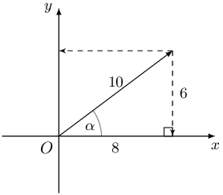
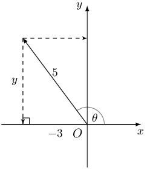

## 4.3 Double angle identities (EMCGD)

### Derivation of \(\sin2\alpha\) (EMCGF)

We have shown that \(\sin\left(\alpha +\beta \right)=\sin\alpha\cos \beta +\cos\alpha\sin \beta\). If we let
        \(\alpha =\beta\), then we can write the formula as:

      \begin{align*}
      \sin \left(2\alpha \right) &= \sin\left(\alpha +\alpha \right) \\
      & = \sin \alpha\cos \alpha +\cos\alpha\sin \alpha \\
      \therefore \sin 2\alpha & = 2\sin\alpha\cos \alpha
      \end{align*}

### Derivation of \(\cos2\alpha\) (EMCGG)

Similarly, we know that \(\cos\left(\alpha +\beta \right)=\cos\alpha\cos \beta -\sin\alpha\sin \beta\). If we
        let \(\alpha =\beta\), then we have:

      \begin{align*}
      \cos \left(2\alpha \right) &=\cos\left(\alpha +\alpha \right) \\
      & = \cos \alpha\cos \alpha -\sin\alpha\sin \alpha \\
      \therefore \cos 2\alpha & = \cos^{2}\alpha -\sin^{2}\alpha
      \end{align*}

Using the square identity, \(\sin^{2} \alpha + \cos^{2}\alpha = 1\), we can also derive the following formulae:

      \begin{align*}
      \cos 2\alpha & = \cos^{2}\alpha -\sin^{2}\alpha \\
      & = \left( 1 - \sin^{2}\alpha \right) - \sin^{2}\alpha \\
      \therefore \cos 2\alpha & = 1 - 2 \sin^{2}\alpha
      \end{align*}

And

      \begin{align*}
      \cos 2\alpha & = \cos^{2}\alpha -\sin^{2}\alpha \\
      & = \cos^{2}\alpha - \left( 1 - \cos^{2}\alpha \right) \\
      & = \cos^{2}\alpha - 1 + \cos^{2}\alpha \\
      \therefore \cos 2\alpha & = 2 \cos^{2}\alpha - 1
      \end{align*}

**Double angle formulae**

- \(\sin 2\alpha = 2\sin\alpha\cos \alpha\)
- \(\cos 2\alpha = \cos^{2}\alpha -\sin^{2}\alpha\)
- \(\cos 2\alpha = 1 - 2 \sin^{2}\alpha\)
- \(\cos 2\alpha = 2 \cos^{2}\alpha - 1\)

<Callout type="tip" title="Worked example 7: Double angle identities">
**Question:**
If \(\alpha\) is an acute angle and \(\sin \alpha = \text{0,6}\), determine the value of \(\sin 2 \alpha\)
            without using a calculator.

**Draw a sketch:**
We convert \(\text{0,6}\) to a fraction so that we can use the ratio to represent the sides of a triangle.

          \begin{align*}
          \sin \alpha &= \text{0,6} \\
          &= \frac{6}{10}
          \end{align*}

**Use the double angle formula to determine the value of \(\sin 2 \alpha\):**
\begin{align*}
          \sin 2 \alpha &= 2 \sin \alpha \cos \alpha \\
          &= 2 \left( \frac{6}{10} \right) \left( \frac{8}{10} \right) \\
          &= \frac{96}{100} \\
          &= \text{0,96}
          \end{align*}

**Write the final answer:**
\[\sin 2 \alpha = \text{0,96}\]

Check the answer using a calculator:

          \begin{align*}
          \sin \alpha &= \text{0,6} \\
          \therefore \alpha &\approx \text{36,87} ° \\
          2 \alpha &\approx \text{73,74} ° \\
          \therefore \sin \left( \text{73,74} ° \right) &\approx \text{0,96}
          \end{align*}
</Callout>

<Callout type="tip" title="Worked example 8: Double angle identities">
**Question:**
Prove that \(\frac{\sin\theta +\sin2\theta }{1 + \cos\theta +\cos2\theta } = \tan\theta\).

For which values of \(\theta\) is the identity not valid?

**Consider the given expressions:**
The right-hand side (RHS) of the identity cannot be simplified, so we simplify the left-hand side (LHS). We
            also notice that the trigonometric function on the RHS does not have a \(2\theta\) dependence, therefore we
            will need to use the double angle formulae to simplify \(\sin2\theta\) and \(\cos2\theta\) on the LHS.

**Prove the left-hand side equals the right-hand side:**
\begin{align*}
          \text{LHS}& = \frac{\sin\theta + 2\sin\theta \cos\theta }{1+\cos\theta +\left(2{\cos}^{2}\theta -1\right)}
          \\
          & = \frac{\sin\theta \left(1+2\cos\theta \right)}{\cos\theta \left(1+2\cos\theta \right)} \qquad
          \text{(factorise)} \\
          & = \frac{\sin\theta }{\cos\theta } \\
          & = \tan \theta \\
          & = \text{RHS}
          \end{align*}

**Identify restricted values of \(\theta\):**
We know that \(\tan \theta\) is undefined for \(\theta = \text{90} ° + k \cdot \text{180} °, k
            \in \mathbb{Z}\).

Note that division by zero on the LHS is not allowed, so the identity will also be undefined for:

          \begin{align*}
          1 + \cos\theta +\cos2\theta & = 0 \\
          \cos\theta \left( 1 + 2\cos\theta \right) & = 0 \\
          \therefore \cos \theta = 0 &\text{ or } 1 + 2\cos\theta = 0 \\
          & \\
          \text{For } \cos \theta = 0, \quad \theta &= \text{90} ° + k \cdot \text{180} ° \\
          & \\
          \text{For } 1 + 2 \cos \theta = 0, \quad \cos \theta &= - \frac{1}{2} \\
          \therefore \theta &= \text{120} ° + k \cdot \text{360} ° \\
          \text{or } \theta &= \text{240} ° + k \cdot \text{360} °
          \end{align*}

for \(k \in \mathbb{Z}\).
</Callout>

## Double angle identities

### Textbook Exercise 4.3

Given \(5 \cos \theta = -3\) and \(\theta < \text{180} °\). Determine the value of the
                following, without a calculator:

**Problem:**
\(\cos 2 \theta\)

**Solution:**
Draw a sketch:

**Problem:**
\(\sin \left( \text{180} ° - 2 \theta \right)\)

**Solution:**
\begin{align*}
                \sin \left( \text{180} ° - 2 \theta \right) &= \sin 2 \theta \\
                &= 2 \sin \theta \cos \theta \\
                &= 2 \left( \frac{4}{5} \right) \left( - \frac{3}{5} \right) \\
                &= - \frac{24}{25}
                \end{align*}

**Problem:**
\(\tan 2 \theta\)

**Solution:**
\begin{align*}
                \tan 2 \theta &= \frac{\sin 2 \theta}{\cos 2 \theta} \\
                &= - \frac{24}{25} \times \left( - \frac{25}{7} \right) \\
                &= \frac{24}{7}
                \end{align*}

Given \(\cos \text{40} ° = t\), determine (without a calculator):

**Problem:**
\(\cos \text{140} °\)

**Solution:**
\begin{align*}
                \cos \text{140} ° &= \cos \left( \text{180} ° - \text{40} ° \right) \\
                &= - \cos \text{40} ° \\
                &= - t
                \end{align*}

**Problem:**
\(\sin \text{40} °\)

**Solution:**
\begin{align*}
                \sin \text{40} ° &= \sqrt{1 - \cos^{2} \text{40} ° } \\
                &= \sqrt{1 - t^{2}}
                \end{align*}

**Problem:**
\(\sin \text{50} °\)

**Solution:**
\begin{align*}
                \sin \text{50} ° &= \sin \left( \text{90} ° - \text{50} ° \right) \\
                &= \cos \text{40} ° \\
                &= t
                \end{align*}

**Problem:**
\(\cos \text{80} °\)

**Solution:**
\begin{align*}
                \cos \text{80} °
                &= \cos 2 \left( \text{40} ° \right) \\
                &= 2 \cos^{2} \text{40} ° - 1 \\
                &= 2t^{2} - 1
                \end{align*}

**Problem:**
\(\cos \text{860} °\)

**Solution:**
\begin{align*}
                \cos \text{860} ° &= \cos \left[2( \text{360} °) + \text{140} ° \right] \\
                &= \cos \text{140} ° \\
                &= \cos ( \text{180} ° - \text{40} °) \\
                &= - \cos \text{40} ° \\
                &= -t
                \end{align*}

**Problem:**
\(\cos ( -\text{1 160} °)\)

**Solution:**
\begin{align*}
                \cos (- \text{1 160} °) &= \cos \text{1 160} ° \\
                &= \cos \left( 3( \text{360} °) + \text{80} ° \right) \\
                &= \cos ( \text{80} °) \\
                &= \cos 2( \text{40} °) \\
                &= 2 \cos^{2} \text{40} ° - 1 \\
                &= 2 t^{2} - 1
                \end{align*}

**Problem:**
Prove the identity: \(\frac{1}{\sin 2 A} - \frac{1}{\tan 2A} = \tan A\)

**Solution:**
\begin{align*}
                \text{LHS} &= \frac{1}{\sin 2 A} - \frac{1}{\tan 2A} \\
                &= \frac{1}{\sin 2 A} - \frac{\cos 2A}{\sin 2A} \\
                &= \frac{1 - \left( 1 - 2 \sin^{2}A \right)}{\sin 2 A} \\
                &= \frac{2 \sin^{2}A}{2 \sin A \cos A} \\
                &= \frac{\sin A}{\cos A} \\
                &= \tan A \\
                &= \text{RHS}
                \end{align*}

Restrictions:

                \begin{align*}
                \sin 2 A &\ne 0 \\
                \therefore 2A &\ne \text{0} ° + k \cdot \text{180} ° \\
                \therefore A &\ne \text{0} ° + k \cdot \text{90} °, \quad k \in \mathbb{Z} \\
                \text{And } \tan 2 A &\ne 0 \\
                \therefore 2A &\ne \text{90} ° + k \cdot \text{180} ° \\
                \therefore A &\ne \text{45} ° + k \cdot \text{90} °, \quad k \in \mathbb{Z} \\
                \text{And for } \tan A &: \\
                A &\ne \text{90} ° + k \cdot \text{180} °, \quad k \in \mathbb{Z}
                \end{align*}

**Problem:**
Hence, solve the equation \(\frac{1}{\sin 2 A} - \frac{1}{\tan 2A} = \text{0,75}\)
                for \(\text{0} ° < A < \text{360} °\).

**Solution:**
\begin{align*}
                \frac{1}{\sin 2 A} - \frac{1}{\tan 2A} &= \text{0,75} \\
                \therefore \tan A &= \text{0,75} \\
                \therefore A &= \text{36,87} ° \\
                \text{ or } A &= \text{180} ° + \text{36,87} °\\
                &= \text{216,87} °
                \end{align*}

Without using a calculator, find the value of the following:

**Problem:**
\(\sin \text{22,5} °\)

**Solution:**
\begin{align*}
                2 \times \text{22,5} ° &= \text{45} ° \\
                \cos 2 \theta &= 1 - 2 \sin^{2} \theta \\
                \cos \text{45} ° &= 1 - 2 \sin^{2} \left( \text{22,5} ° \right) \\
                \frac{1}{\sqrt{2}} &= 1 - 2 \sin^{2} \left( \text{22,5} ° \right) \\
                \frac{1}{\sqrt{2}} - 1 &= - 2 \sin^{2} \left( \text{22,5} ° \right) \\
                \frac{1 - \sqrt{2}}{\sqrt{2}} &= - 2 \sin^{2} \left( \text{22,5} ° \right) \\
                \frac{1 - \sqrt{2}}{-2\sqrt{2}} &= \sin^{2} \left( \text{22,5} ° \right) \\
                \frac{ \sqrt{2} - 1}{2\sqrt{2}} &= \sin^{2} \left( \text{22,5} ° \right) \\
                \therefore \sqrt{ \frac{ \sqrt{2} - 1}{2\sqrt{2}} } &= \sin \text{22,5} ° \\
                \sqrt{ \frac{ \sqrt{2} - 1}{2\sqrt{2}} \times \frac{\sqrt{2}}{\sqrt{2}}} &= \sin \text{22,5} °
                \\
                \sqrt{ \frac{ 2 - \sqrt{2} }{4} } &= \sin \text{22,5} °
                \end{align*}

Check the answer using a calculator.

**Problem:**
\(\cos \text{67,5} °\)

**Solution:**
\begin{align*}
                \cos \text{67,5} ° &= \cos \left( \text{90} ° - \text{22,5} ° \right) \\
                &= \sin \left( \text{22,5} ° \right) \\
                &= \sqrt{ \frac{ 2 - \sqrt{2} }{4} }
                \end{align*}

Check the answer using a calculator.

**Problem:**
Prove the identity: \(\tan 2 x + \frac{1}{\cos 2 x} = \frac{\sin x + \cos x }{\cos x
                - \sin x }\)

**Solution:**
\begin{align*}
                \text{LHS} &= \tan 2x + \frac{1}{\cos 2x} \\
                &= \frac{\sin 2x}{\cos 2x} + \frac{1}{\cos 2x} \\
                &= \frac{\sin 2x + 1}{\cos 2x} \\
                &= \frac{2 \sin x \cos x + \cos^{2}x + \sin^{2}x}{\cos^{2}x - \sin^{2}x} \\
                &= \frac{ \left( \cos x + \sin x \right)^{2}}{\left( \cos x - \sin x \right)\left( \cos x + \sin x
                \right) } \\
                &= \frac{ \cos x + \sin x }{ \cos x - \sin x } \\
                &= \text{RHS}
                \end{align*}

Restrictions:

                \begin{align*}
                \cos 2 x &\ne 0 \\
                \therefore 2x &\ne \text{90} ° + k \cdot \text{180} ° \\
                \therefore x &\ne \text{45} ° + k \cdot \text{90} °, \quad k \in \mathbb{Z} \\
                \text{And } \cos x &\ne \sin x \\
                \therefore x &\ne \text{45} ° + k \cdot \text{180} °, \quad k \in \mathbb{Z} \\
                \text{And for } & \tan 2 x \\
                \therefore 2x &\ne \text{90} ° + k \cdot \text{180} ° \\
                \therefore x &\ne \text{45} ° + k \cdot \text{90} °, \quad k \in \mathbb{Z}
                \end{align*}

**Problem:**
Explain why the identity is undefined for \(x = \text{45} °\)

**Solution:**
Consider the denominator on the LHS:

                \begin{align*}
                \cos 2x &= \cos 2 \left( \text{45} ° \right) \\
                &= \cos \text{90} ° \\
                &= 0
                \end{align*}

Consider the denominator on the RHS:

                \begin{align*}
                \cos \text{45} ° &= \sin \text{45} ° \\
                \therefore \cos \text{45} ° - \sin \text{45} ° &= 0
                \end{align*}

Therefore, the identity will be undefined because division by zero is not permitted.
