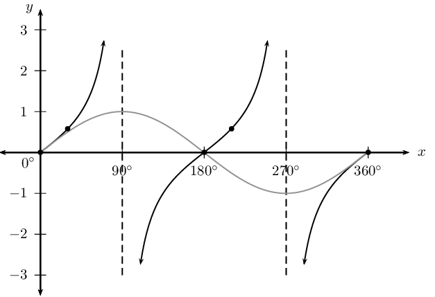
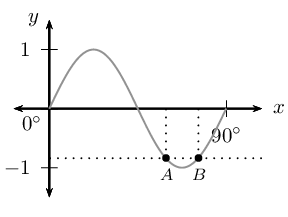
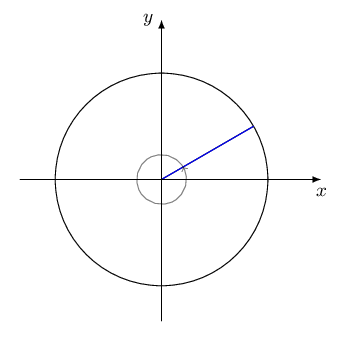
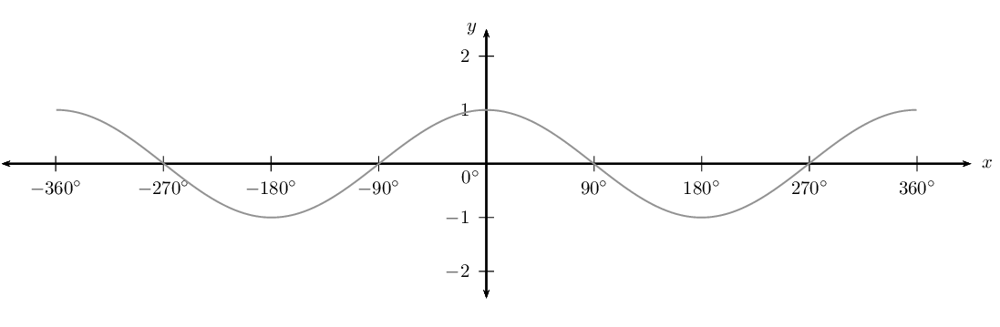
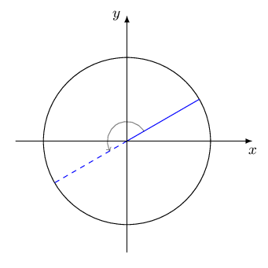
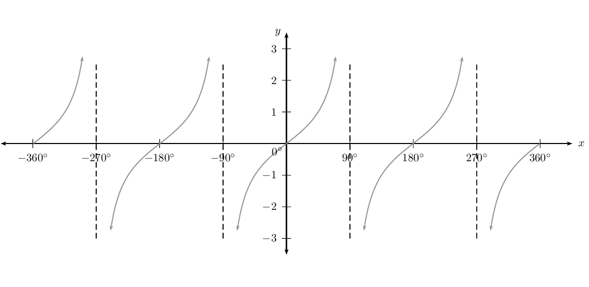

## 4.4 Solving equations (EMCGH)

### The general solution (EMCGJ)

The periodicity of the trigonometric functions means that there are an infinite number of positive and negative
        angles that satisfy an equation. If we do not restrict the solution, then we need to determine the general
        solution to the equation. We know that the sine and cosine functions have a period of \(\text{360}\)° and
        the tangent function has a period of \(\text{180}\)°.

**Method for finding the solution:**

2. Simplify the equation using algebraic methods and trigonometric identities.
4. Determine the reference angle (use a positive value).
6. Use the CAST diagram to determine where the function is positive or negative (depending on the given
             equation/information).
8. Restricted values: find the angles that lie within a specified interval by adding/subtracting multiples of
             the appropriate period.
10. General solution: find the angles in the interval \([\text{0}°; \text{360}°]\) that satisfy the
             equation and add multiples of the period to each answer.
12. Check answers using a calculator.

**General solutions:**

2. \begin{align*}
             \text{If } \sin \theta &= x \\
             \theta &= \sin^{-1}x + k \cdot \text{360}° \\
             \text{or } \theta &= \left( \text{180}° - \sin^{-1}x \right) + k \cdot \text{360}°
             \end{align*}
4. \begin{align*}
             \text{If } \cos \theta &= x \\
             \theta &= \cos^{-1}x + k \cdot \text{360}° \\
             \text{or } \theta &= \left( \text{360}° - \cos^{-1}x \right) + k \cdot \text{360}°
             \end{align*}
6. \begin{align*}
             \text{If } \tan \theta &= x \\
             \theta &= \tan^{-1}x + k \cdot \text{180}°
             \end{align*}
   for \(k \in \mathbb{Z}\).

<Callout type="tip" title="Worked example 9: Finding the general solution">
**Question:**
Determine the general solution for \(\sin \theta = \text{0,3}\) (correct to one decimal place).

**Use a calculator to find the reference angle:**
\begin{align*}
          \sin \theta &= \text{0,3} \\
          \therefore \text{ref } \angle &= \sin^{-1}\text{0,3} \\
          &= \text{17,5}°
          \end{align*}

**Use CAST diagram to determine in which quadrants \(\sin \theta\) is positive:**
The CAST diagram indicates that \(\sin \theta\) is positive in the first and second quadrants.

Using reduction formulae, we know that \(\sin (\text{180}° - \theta) = \sin \theta\).

In the first quadrant:

          \begin{align*}
          \theta &= \text{17,5}° \\
          \therefore \theta &= \text{17,5}° + k \cdot \text{360}°
          \end{align*}

In the second quadrant:

          \begin{align*}
          \theta &= \text{180}° - \text{17,5}° \\
          \therefore \theta &= \text{162,5}° + k \cdot \text{360}°
          \end{align*}

where \(k \in \mathbb{Z}\).

**Check that the solution satisfies the original equation:**
We can select random values of \(k\) to check that the answers satisfy the original equation.

Let \(k = 4\):

          \begin{align*}
          \theta &= \text{17,5}° + 4(\text{360})° \\
          \therefore \theta &= \text{1 457,5}° \\
          \text{And } \sin \text{1 457,5}° &= \text{0,3007} \ldots
          \end{align*}

This solution is correct.

Similarly, if we let \(k = -2\):

          \begin{align*}
          \theta &= \text{162,5}° - 2(\text{360})° \\
          \therefore \theta &= -\text{557,5}° \\
          \text{And } \sin (-\text{557,5}°) &= \text{0,3007} \ldots
          \end{align*}

This solution is also correct.

**Write the final answer:**
\(\theta = \text{17,5}° + k \cdot \text{360}°\) or \(\theta = \text{162,5}° + k \cdot
            \text{360}°\) for \(k \in \mathbb{Z}\).
</Callout>

<Callout type="tip" title="Worked example 10: Trigonometric equations">
**Question:**
Solve the following equation for \(y\), without using a calculator:

        \(\frac{1-\sin{y}-\cos{2y}}{\sin{2y}-\cos{y}}=-1\)

**Simplify the equation:**
We first simplify the left-hand side of the equation using the double angle formulae. To solve this equation,
          we need to manipulate the given equation to be of the form:

        \begin{align*}
        \text{single trigonometric ratio} &= \text{constant} \\
        & \\
        \frac{1-\sin{y}-\left(1-2{\sin}^{2}y\right)}{2\sin{y}\cos{y}-\cos{y}}& = -1 \\
        \frac{2{\sin}^{2}y-\sin{y}}{\cos{y}\left(2\sin y-1\right)}& = -1 \\
        \frac{\sin{y}\left(2\sin{y}-1\right)}{\cos{y}\left(2\sin{y}-1\right)}& = -1 \\
        \frac{\sin{y}}{\cos{y}}& = -1 \\
        \therefore \tan{y}& = -1
        \end{align*}

**Use a calculator to find the reference angle:**
\begin{align*}
        \tan{y}& = -1 \\
        \therefore \text{ref } \angle &= \tan^{-1} (1) \\
        &= \text{45}°
        \end{align*}

**Use CAST diagram to determine in which quadrants \(\tan{y}\) is negative:**
The CAST diagram indicates that \(\tan y\) is negative in the second and fourth quadrants.

        \begin{align*}
        y &= \left( \text{180}° - \text{45}° \right) + k \cdot \text{180}° \\
        \therefore y &= \text{135}° + k \cdot \text{180}°, \quad k \in \mathbb{Z}
        \end{align*}

Notice that for \(k=1\), \(y = \text{135}° + \text{180}° =
          \text{315}°\), which is the angle in the fourth quadrant.

**Check that the solution satisfies the original equation:**

**Write the final answer:**
\(y = \text{135}° + k \cdot \text{180}°\) where \(k \in \mathbb{Z}\).
</Callout>

<Callout type="tip" title="Worked example 11: Trigonometric equations">
**Question:**
Prove \(8 \cos^{4}x - 8 \cos^{2}x + 1 = \cos 4x\) and hence solve \(8 \cos^{4}x - 8 \cos^{2}x + 1 =
          \text{0,8}\) (correct to one decimal place).

**Prove the identity:**
Expand the right-hand side of the identity and show that it is equal to the left-hand side:

        \begin{align*}
        \text{RHS} & = \cos 4x \\
        & = 2 \cos^{2}2x - 1 \\
        & = 2 \left( 2\cos^{2}x - 1 \right)^{2} - 1 \\
        & = 2 \left( 4\cos^{4}x - 4\cos^{2}x + 1 \right) - 1 \\
        & = 8\cos^{4}x - 8\cos^{2}x + 2 - 1 \\
        & = 8\cos^{4}x - 8\cos^{2}x + 1 \\
        & = \text{LHS}
        \end{align*}

**Solve the equation:**
\begin{align*}
        8\cos^{4}x - 8\cos^{2}x + 1 & = \text{0,8} \\
        \therefore \cos 4x & = \text{0,8}
        \end{align*}

**Use a calculator to find the reference angle:**
\begin{align*}
        \cos 4x & = \text{0,8} \\
        \therefore \text{ref } \angle &= \cos^{-1} (\text{0,8}) \\
        &= \text{36,9}°
        \end{align*}

**Use CAST diagram to determine in which quadrants \(\cos 4x\) is positive:**
The CAST diagram indicates that \(\cos 4x\) is positive in the first and fourth quadrants.

In the first quadrant:

        \begin{align*}
        4x &= \text{36,9}° + k \cdot \text{360}° \\
        \therefore x &= \text{9,2}° + k \cdot \text{90}°
        \end{align*}

**Important:** remember to also divide \(k \cdot \text{360}°\) by \(\text{4}\).

In the fourth quadrant:

        \begin{align*}
        4x &= \left( \text{360}° - \text{36,9}° \right) + k \cdot \text{360}° \\
        &= \text{323,1}° + k \cdot \text{360}° \\
        \therefore x &= \text{80,8}° + k \cdot \text{90}°
        \end{align*}

where \(k \in \mathbb{Z}\).

**Check that the solution satisfies the original equation:**

**Write the final answer:**
\begin{align*}
        x &= \text{9,2}° + k \cdot \text{90}° \\
        \text{ or } x &= \text{80,8}° + k \cdot \text{90}°, \quad k \in \mathbb{Z}
        \end{align*}
</Callout>

<Callout type="tip" title="Worked example 12: Trigonometric equations">
**Question:**
Find the general solution for \(\sin \theta \cos^{2} \theta = \sin^{3} \theta\).

**Simplify the given equation:**
Do not divide both sides of the equation by \(\sin \theta\):

- part of the solution would be lost;
- we would need to restrict the values of \(\theta\) to those where \(\sin \theta \ne 0\) (division by zero
              is not permitted).

\begin{align*}
        \sin \theta \cos^{2} \theta &= \sin^{3} \theta \\
        \sin \theta \cos^{2} \theta - \sin^{3} \theta &= 0 \\
        \sin \theta \left( \cos^{2} \theta - \sin^{2} \theta \right) &= 0 \\
        \sin \theta \left( \cos \theta - \sin \theta \right) \left( \cos \theta + \sin \theta \right) &= 0
        \end{align*}

**Apply the zero product law and solve for \(\theta\):**
\begin{align*}
        \sin \theta \left( \cos \theta - \sin \theta \right) \left( \cos \theta + \sin \theta \right) &= 0 \\
        & \\
        \sin \theta &= 0 \\
        \therefore \theta &= \text{0}° + k \cdot \text{360}° \\
        \text{ or } \theta &= \text{180}° + k \cdot \text{360}°, \quad k \in \mathbb{Z}
        \end{align*}\begin{align*}
        \cos \theta - \sin \theta &= 0 \\
        \cos \theta &= \sin \theta \\
        \cos \theta &= \cos \left( \text{90}° - \theta \right) \\
        \therefore \theta &= \left( \text{90}° - \theta \right) + k \cdot \text{360}° \\
        2 \theta &= \text{90}° + k \cdot \text{360}° \\
        \therefore \theta &= \text{45}° + k \cdot \text{180}°, \quad k \in \mathbb{Z}
        \end{align*}\begin{align*}
        \cos \theta + \sin \theta &= 0 \\
        \cos \theta &= - \sin \theta \\
        \sin \left( \text{90}° + \theta \right) &= \sin (- \theta ) \\
        \therefore \text{90}° + \theta &= - \theta + k \cdot \text{360}° \\
        2 \theta &= - \text{90}° + k \cdot \text{360}° \\
        \therefore \theta &= - \text{45}° + k \cdot \text{180}°, \quad k \in \mathbb{Z}
        \end{align*}

**Write the final answer:**
\begin{align*}
        \theta &= \text{0}° + k \cdot \text{360}° \\
        \text{ or } \theta &= \text{180}° + k \cdot \text{360}° \\
        \text{ or } \theta &= \pm \text{45}° + k \cdot \text{180}°, \quad k \in \mathbb{Z}
        \end{align*}
</Callout>

## Solving trigonometric equations

### Textbook Exercise 4.4

Find the general solution for each of the following equations (correct to two decimal places):

**Problem:**
\(\sin 2x = \tan \text{28}°\)

**Solution:**
\begin{align*}
              \sin 2x &= \tan \text{28}° \\
              &= \text{0,53} \ldots \\
              \text{ref } \angle &= \text{32,12}° \\
              \text{First quadrant: } \enspace 2x &= \text{32,12}° + k \cdot \text{360}° \\
              \therefore x &= \text{16,06}° + k \cdot \text{180}°, k \in \mathbb{Z} \\
              & \\
              \text{Second quadrant: } \enspace 2x &= \left( \text{180}° - \text{32,12}° \right) + k \cdot
              \text{360}° \\
              &= \text{147,88}° + k \cdot \text{360}° \\
              \therefore x &= \text{73,9}° + k \cdot \text{180}°, \quad k \in \mathbb{Z}
              \end{align*}

**Problem:**
\(\cos y = \sin 2y\)

**Solution:**
We work with the left-hand side of the equation since it contains \(y\), which is easier to simplify
                than the double angle on the right-hand side:

              \begin{align*}
              \cos y &= \sin 2y \\
              \sin \left( \text{90}° - y \right) &= \sin 2y \\
              \text{First quadrant: } \enspace \left( \text{90}° - y \right) + k \cdot \text{360}° &= 2y
              \\
              \text{90}° + k \cdot \text{360}° &= 3y \\
              \text{30}° + k \cdot \text{120}° &= y \\
              & \\
              \text{Second quadrant: } \enspace \text{180}° - \left( \text{90}° - y \right) + k \cdot
              \text{360}° &= 2y \\
              \text{90}° + y + k \cdot \text{360}° &= 2y \\
              \text{90}° + k \cdot \text{360}° &= y
              \end{align*}

for \(k \in \mathbb{Z}\).

**Problem:**
\(\sin 2 \alpha = \cos 2 \alpha\)

**Solution:**
\begin{align*}
              \sin 2 \alpha &= \cos 2 \alpha \\
              \frac{\sin 2 \alpha}{\cos 2 \alpha} &= 1 \\
              \tan 2 \alpha &= 1 \\
              \therefore 2 \alpha &= \text{45}° + k \cdot \text{180}° \\
              \therefore \alpha &= \text{22,5}° + k \cdot \text{90}°, k \in \mathbb{Z}
              \end{align*}

**Problem:**
\(\sin 3p = \sin 2p\)

**Solution:**
\begin{align*}
              \sin 3p &= \sin 2p \\
              \text{First quadrant: } \enspace 3p &= 2p + k \cdot \text{360}° \\
              \therefore p &= k \cdot \text{360}° \\
              \text{Second quadrant: } \enspace 3p &= \left(\text{180}° - 2p \right) + k \cdot \text{360}°
              \\
              5p &= \text{180}° + k \cdot \text{360}° \\
              \therefore p &= \text{36}° + k \cdot \text{72}°, k \in \mathbb{Z}
              \end{align*}

**Problem:**
\(\tan A = \frac{1}{\tan A}\)

**Solution:**
\begin{align*}
              \tan A &= \frac{1}{\tan A} \\
              \tan^{2} A &= 1 \\
              \therefore \tan A &= \pm 1 \\
              \text{First quadrant: } \enspace A &= \text{45}° + k \cdot \text{180}° \\
              \text{Second quadrant: } \enspace A &= \left( \text{180}° - \text{45}° \right) + k \cdot
              \text{180}° \\
              &= \text{135}° + k \cdot \text{180}°, k \in \mathbb{Z}
              \end{align*}

Restrictions:

              \begin{align*}
              \text{For } & \tan A: \\
              A &\ne \text{90}° + k \cdot \text{180}°, k \in \mathbb{Z} \\
              \text{And for} \enspace \frac{1}{\tan A} & \enspace \text{we can write} \enspace \frac{\cos A}{\sin
              A}: \\
              \therefore \sin A &\ne 0 \\
              A &\ne \text{0}° + k \cdot \text{180}°, k \in \mathbb{Z}
              \end{align*}

**Problem:**
\(\sin x \tan x = 1\)

**Solution:**
\begin{align*}
              \sin x \tan x &= 1 \\
              \sin x \cdot \frac{\sin x}{\cos x} &= 1 \qquad (\cos x \ne 0)\\
              \frac{\sin^{2} x}{\cos x} &= 1 \\
              1 - \cos^{2} x &= \cos x \\
              \cos^{2} x + \cos x - 1 &= 0 \\
              \text{Let } \cos x &= p \\
              p^{2} + p - 1 &= 0 \\
              \therefore p &= \frac{-1 \pm \sqrt{1 - 4 (1)(-1)}}{2(1)} \qquad (\text{quadratic formula})\\
              &= \frac{-1 \pm \sqrt{5}}{2} \\
              \therefore p = \frac{-1 -\sqrt{5}}{2} &\text{ or } p = \frac{-1 + \sqrt{5}}{2} \\
              \therefore \cos x = \frac{-1 -\sqrt{5}}{2} &\text{ or } \cos x = \frac{-1 + \sqrt{5}}{2} \\
              \cos x = -\text{1,618} \ldots &\text{ or } \cos x = \text{0,618} \ldots \\
              \text{First answer: }\text{no solution} & \text{ since } -1 \leq \cos x \leq 1 \\
              \text{Second answer: } \text{ref } \angle &= \text{51,8}° \\
              \text{First quadrant: } \enspace x &= \text{51,8}° + k \cdot \text{360}° \\
              \text{Second quadrant: } \enspace x &= \left( \text{360}° - \text{51,8}° \right) + k \cdot
              \text{360}° \\
              &= \text{308,2}° + k \cdot \text{360}°, k \in \mathbb{Z}
              \end{align*}

Restrictions:

              \begin{align*}
              \text{For } \tan x &: \\
              x &\ne \text{90} ° + k \cdot \text{180} °, \quad k \in \mathbb{Z}
              \end{align*}

**Problem:**
\(\sin t \cdot \sin 2t + \cos 2t = 1\)

**Solution:**
\begin{align*}
              \sin t \cdot \sin 2t + \cos 2t &= 1 \\
              \sin t \cdot 2 \sin t \cos t + \left(1 - 2 \sin^{2}t \right) &= 1 \\
              2 \sin^{2} t \cos t + 1 - 2 \sin^{2}t &= 1 \\
              2 \sin^{2} t \cos t - 2 \sin^{2}t &= 0 \\
              2 \sin^{2} t \left( \cos t - 1 \right) &= 0 \\
              \text{If } \enspace 2 \sin^{2} t &= 0 \\
              \sin t &= 0 \\
              \therefore t &= \text{0}° + k \cdot \text{360}° \\
              \text{or } \enspace t &= \text{180}° + k \cdot \text{360}° \\
              \text{If } \enspace \cos t - 1 &= 0 \\
              \cos t &= 1 \\
              \therefore t &= \text{0}° + k \cdot \text{360}° \\
              \text{or } \enspace t &= \text{360}° + k \cdot \text{360}° \\
              & \\
              \text{Final answer: } t &= \text{0}° + k \cdot \text{180}°, \quad k \in \mathbb{Z}
              \end{align*}

**Problem:**
\(\sin \text{60}° \cos x + \cos \text{60}° \sin x = 1\)

**Solution:**
\begin{align*}
              \sin \text{60}° \cos x + \cos \text{60}° \sin x &= 1 \\
              \sin (\text{60}° + x ) &= 1 \\
              \therefore \text{60}° + x &= \text{90}° + k \cdot \text{360}°, \quad k \in \mathbb{Z}
              \\
              \therefore x &= \text{30}° + k \cdot \text{360}°
              \end{align*}

Given: \(\sin x \cos x = \sqrt{3} \sin^{2} x\)

**Problem:**
Solve the equation for \(x \in [\text{0}°; \text{360}°]\), without using a
              calculator.

**Solution:**
\begin{align*}
              \sin x \cos x &= \sqrt{3} \sin^{2} x \\
              \sin x \cos x - \sqrt{3} \sin^{2} x &= 0 \\
              \sin x \left( \cos x - \sqrt{3} \sin x \right) &= 0 \\
              \therefore \sin x = 0 &\text{ or } \cos x - \sqrt{3} \sin x = 0 \\
              \text{If } \sin x &= 0 \qquad \text{ for } x \in [\text{0}°; \text{360}°] \\
              \therefore x &= \text{0}°, \text{180}° \text{ or } \text{360}° \\
              \text{If } \cos x - \sqrt{3} \sin x &= 0 \qquad \text{ for } x \in [\text{0}°; \text{360}°]
              \\
              \cos x &= \sqrt{3} \sin x \\
              \frac{\cos x}{\cos x} &= \sqrt{3} \frac{\sin x}{\cos x} \\
              1 &= \sqrt{3} \tan x \\
              \frac{1}{ \sqrt{3} } &=\tan x \\
              \text{ref } \angle &= \text{30}° \\
              \therefore x &= \text{30}° + k \cdot \text{180}°, k \in \mathbb{Z} \\
              \therefore x &= \text{30}° \text{ or } \text{210}°
              \end{align*}

**Problem:**
Draw a graph and indicate the solution on the diagram.

**Solution:**
The diagram below shows the graph of \(y = \sin x\) (grey) and \(y = \tan x\) (black).

Given: \(1 + \tan^{2} 2A = 5 \tan 2A - 5\)

**Problem:**
Determine the general solution.

**Solution:**
\begin{align*}
              1 + \tan^{2} 2A &= 5 \tan 2A - 5 \\
              \tan^{2} 2A - 5 \tan 2A + 6 &= 0 \\
              \left( \tan 2A - 3 \right) \left( \tan 2A - 2 \right) &= 0 \\
              \therefore \tan 2A - 3 = 0 &\text{ or } \tan 2A - 2 = 0 \\
              \text{If } \tan 2A - 3 &= 0 \\
              \tan 2A &= 3 \\
              \therefore 2A &= \text{71,57}° + k \cdot \text{180}° \\
              \therefore A &= \text{35,79}° + k \cdot \text{90}°, \quad k \in \mathbb{Z} \\
              \text{If } \tan 2A - 2 &= 0 \\
              \tan 2A &= 2 \\
              \therefore 2A &= \text{63,43}° + k \cdot \text{180}° \\
              \therefore A &= \text{31,72}° + k \cdot \text{90}°, k \in \mathbb{Z}
              \end{align*}

**Problem:**
How many solutions does the given equation have in the interval \([- \text{90}°;
              \text{360}°]\)?

**Solution:**
\begin{align*}
              \text{If } k= -1: \qquad A &= \text{35,79}° - \text{90}° \\
              &= -\text{54,21}° \\
              A &= \text{31,72}° - \text{90}° \\
              &= -\text{58,28}° \\
              \text{If } k= 0: \qquad A &= \text{35,79}° \\
              A &= \text{31,72}° \\
              \text{If } k= 1: \qquad A &= \text{35,79}° + \text{90}° \\
              &= \text{125,79}° \\
              A &= \text{31,72}° + \text{90}° \\
              &= \text{121,72}° \\
              \text{If } k= 2: \qquad A &= \text{35,79}° + \text{180}° \\
              &= \text{215,79}° \\
              A &= \text{31,72}° + \text{180}° \\
              &= \text{211,72}° \\
              \text{If } k= 3: \qquad A &= \text{35,79}° + \text{270}° \\
              &= \text{305,79}° \\
              A &= \text{31,72}° + \text{270}° \\
              &= \text{301,72}°
              \end{align*}

Therefore, there are ten solutions that lie within the interval \([- \text{90}°;
                \text{360}°]\).

**Problem:**
Without using a calculator, solve \(\cos \left( A - \text{25}° \right)+ \cos \left(
            A + \text{25}° \right) = \cos \text{25}°\) in \([- \text{360}°; \text{360}°]\).

**Solution:**
First we simplify the left-hand side of the equation:

            \begin{align*}
            \cos \left( A - \text{25}° \right)+ \cos \left( A + \text{25}° \right) &= \cos \text{25}°
            \\
            \cos A \cos \text{25}° + \sin A \sin \text{25}° + \cos A \cos \text{25}° - \sin A \sin
            \text{25}° &= \cos \text{25}° \\
            2 \cos A \cos \text{25}° &= \cos \text{25}° \\
            \therefore 2 \cos A &= 1 \quad (\cos \text{25}° \ne 0 ) \\
            \cos A &= \frac{1}{2}\\
            \therefore A &= \text{60}° + k \cdot \text{360}° \\
            \text{ or } A = \text{300}° + k \cdot \text{360}°, & \quad k \in \mathbb{Z} \\
            \therefore A = -\text{300}°, -\text{60}°, \text{60}° & \text{ or } \text{300}°
            \end{align*}

**Problem:**
Find the general solution for \(\sin x \cos 3x + \cos x \sin 3x = \tan
              \text{140}°\).

**Solution:**
\begin{align*}
              \sin x \cos 3x + \cos x \sin 3x &= \tan \text{140}° \\
              \sin (x + 3x) &= -\text{0,839} \ldots \\
              \sin 4x &= -\text{0,839} \ldots \\
              \text{ref } \angle &= \text{57,03}° \\
              \text{Third quadrant: } \enspace 4x &= \left( \text{180}° + \text{57,03}° \right) + k \cdot
              \text{360}°, k \in \mathbb{Z} \\
              &= \text{237,03}° + k \cdot \text{360}° \\
              \therefore x &= \text{59,26}° + k \cdot \text{90}° \\
              \text{Fourth quadrant: } \enspace 4x &= \left( \text{360}° - \text{57,03}° \right) + k \cdot
              \text{360}°, k \in \mathbb{Z} \\
              &= \text{302,97}° + k \cdot \text{360}° \\
              \therefore x &= \text{75,74}° + k \cdot \text{90}°
              \end{align*}

**Problem:**
Use a graph to illustrate the solution for the interval \([\text{0}°;
              \text{90}°]\).

**Solution:**
The diagram below shows the graph of \(y = \sin 4 x\).

\(A( \text{59,26}°; -\text{0,84}),B( \text{75,74}°; -\text{0,84})\)

**Problem:**
Explain why the general solution for the equation \(\cos \theta = a\) is \(\theta =
            \cos^{-1} a + k \cdot \text{360}°\) and the general solution for \(\tan \theta = a\) is \(\theta =
            \tan^{-1} a + k \cdot \text{180}°\). Why are they different?

**Solution:**
The period of the cosine function is \(\text{360}\)°. This means that the function values repeat
              after \(\text{360}\)°.

The period of the tangent function is \(\text{180}\)°. This means that the function values repeat
              after \(\text{180}\)°.

**Problem:**
Solve for \(x\): \(\sqrt{3} \sin x + \cos x = 2\)

**Solution:**
\begin{align*}
            \sqrt{3} \sin x + \cos x &= 2 \\
            \sqrt{3} \sin x - 2 &= \cos x \\
            \text{Substitute } \cos x &= \sqrt{1 - \sin^{2}x} \\
            \therefore \sqrt{3} \sin x - 2 &= \sqrt{1 - \sin^{2}x} \\
            \text{Square both sides of eqn: } \left( \sqrt{3} \sin x - 2 \right)^{2} &= \left( \sqrt{1 - \sin^{2}x}
            \right)^{2} \\
            3 \sin^{2} x - 4\sqrt{3} \sin x + 4 &= 1 - \sin^{2}x \\
            4 \sin^{2} x - 4\sqrt{3} \sin x + 3 &= 0 \\
            \left( 2 \sin x - \sqrt{3} \right)^{2} &= 0 \\
            \therefore 2 \sin x - \sqrt{3} &= 0 \\
            \therefore \sin x &= \frac{\sqrt{3}}{2} \\
            \text{ref } \angle &= \text{60} ° \\
            \text{First quadrant: } x &= \text{60} ° + k \cdot \text{360} °, \quad k \in \mathbb{Z} \\
            \text{Second quadrant: } x &= \text{180} ° - \text{60} ° + k \cdot \text{360} ° \\
            &= \text{120} ° + k \cdot \text{360} °, \quad k \in \mathbb{Z}
            \end{align*}

Check that both answers satisfy the original equation:

            \begin{align*}
            \text{Substitute } x &= \text{60} ° \\
            \therefore \text{LHS} &= \sqrt{3} \sin \text{60} ° + \cos \text{60} ° \\
            &= \sqrt{3} \cdot \frac{\sqrt{3}}{2} + \frac{1}{2} \\
            &= \frac{3}{2} + \frac{1}{2} \\
            &= 2 \\
            &= \text{RHS} \\
            \text{Substitute } x &= \text{120} ° \\
            \therefore \text{LHS} &= \sqrt{3} \sin \text{120} ° + \cos \text{120} ° \\
            &= \sqrt{3} \cdot \frac{\sqrt{3}}{2} - \frac{1}{2} \\
            &= \frac{3}{2} - \frac{1}{2} \\
            &= 1 \\
            &\ne \text{RHS}
            \end{align*}

Therefore, \(x = \text{60} ° + k \cdot \text{360} °\).
