## 4.5 Applications of trigonometric functions (EMCGK)

**Area, sine and cosine rule**

| Area rule | Sine rule | Cosine rule |
| --- | --- | --- |
| area \(\triangle ABC = \frac{1}{2} bc \sin \hat{A}\) | \(\frac{\sin A}{a} = \frac{\sin B}{b} = \frac{\sin \hat{C}}{c}\) | \(a^2 = b^2 + c^2 - 2 bc \cos A\) |
| area \(\triangle ABC = \frac{1}{2} ac \sin \hat{B}\) | \(\frac{a}{\sin A} = \frac{b}{\sin B} = \frac{c}{\sin \hat{C}}\) | \(b^2 = a^2 + c^2 - 2 ac \cos B\) |
| area \(\triangle ABC = \frac{1}{2} ab \sin \hat{C}\) |  | \(c^2 = a^2 + b^2 - 2 ab \cos \hat{C}\) |

**How to determine which rule to use:**

2. Area rule:
   - no perpendicular height is given
4. Sine rule:
   - no right angle is given
   - two sides and an angle are given (**not** the included angle)
   - two angles and a side are given
6. Cosine rule:
   - no right angle is given
   - two sides and the included angle are given
   - three sides are given

### Problems in two dimensions (EMCGM)

<Callout type="tip" title="Worked example 13: Area, sine and cosine rule">
**Question:**
Given \(\triangle ABC\) with \(a = \text{14}\text{ cm}, c = \text{17}\text{ cm}\) and \(\hat{B} = \text{19}
            °\).

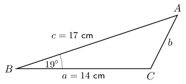

Calculate the following:

2. \(b\)
4. \(\hat{C}\)
6. Area \(\triangle ABC\)

**Use the cosine rule to determine the length of \(b\):**
\begin{align*}
          b^{2} &= a^{2} + c^{2} - 2ac \cos \hat{B} \\
          &= (14)^{2} + (17)^{2} - 2(14)(17) \cos \text{19} ° \\
          &= \text{34,93} \ldots \\
          \therefore b &= \text{5,9}\text{ cm}
          \end{align*}

**Use the sine rule to determine \(\hat{C}\):**
\begin{align*}
          \frac{\sin \hat{C}}{c} &= \frac{\sin \hat{B}}{b} \\
          \frac{\sin \hat{C}}{17} &= \frac{\sin \text{19} °}{\text{5,9}} \\
          \sin \hat{C} &= \frac{17 \times \sin \text{19} °}{\text{5,9}} \\
          \therefore \sin \hat{C} &= \text{0,938} \ldots \\
          \text{First quadrant:} \enspace \hat{C} &= \text{69,7} ° \\
          \text{Second quadrant:} \enspace \hat{C} &= \text{180} ° - \text{69,7} ° \\
          &= \text{110,3} °
          \end{align*}

From the diagram, we see that \(\hat{C} > \text{90} °\), therefore \(\hat{C} = \text{110,3}
            °\).

**Calculate the area \(\triangle ABC\):**
\begin{align*}
          \text{Area } \triangle ABC &= \frac{1}{2}ac \sin \hat{B} \\
          &= \frac{1}{2} (14)(17) \sin \text{19} ° \\
          &= \text{38,7}\text{ cm$^{2}$}
          \end{align*}
</Callout>

<QuizCard id="m12-04-05a" title="Interactive Exercise 4.5" question="The triangle below has sides labelled \(x,                 y\) , and \(z\) , and angles labelled \(X, Y\) , and \(Z\) . The area rule states: \(\text{Area} \; \Delta = \frac{1}{2} \cdot z \cdot x \cdot \sin \; \color{red}{?} \;\) Which of the following choices belongs in the place of the ' \({\color{red}{?}}\) ' in the formula?" options=["\u2220Y", "y", "\u2220Z", "\u2220X"] answer="
                    0
                " hint="" explanation="Choose the correct angle The area rule states that the area of any triangle is given by the formula: \[                     \begin{array}{c}                         \text{Area} \; \Delta = \frac{1}{2} ab \sin {\hat{C}}                     \end{array}                 \] The key thing to remember is that angle \({\hat{C}}\) must be the angle between the two sides in the equation, \(a\) and \(b\) . For example, in the triangle shown, angle \({\hat{X}}\) sits between sides \(y\) and \(z\) . In this question, the ' \(?\) ' sits in the position of an angle: \[                     \begin{array}{c}                         \text{Area} \; \Delta = \frac{1}{2} z x \sin \; \color{red}{?} \;                     \end{array}                 \] The two sides in this formula are \( z \) and \( x \) , so the angle we need is the angle which sits between those two sides.  This angle is \({\hat{Y}} \) . Submit your answer as: ∠Y" />

<QuizCard id="m12-04-05a" title="Interactive Exercise 4.5" question="The triangle below has sides labeled \( x, y \) , and \( z \) , and angles labeled \( X, Y \) , and \( Z \) . For this triangle, the sine rule states: \[\begin{array}{c}\dfrac{y}{\sin \; ? \;} = \dfrac{z}{\sin Z}\end{array}\] Which of the following choices belongs in the place of the '?' in the formula?" options=["X", "x", "Y"] answer="X" hint="" explanation="When using the sine rule, each fraction must contain a side and an angle which are opposite each other in the triangle. In this triangle, for example, the angle \( Y \) and side \( y \) are opposite each other. We are given the formula \( \dfrac{y}{\sin \; ? \;} = \dfrac{z}{\sin Z} \) ; the question mark is in the position of one of the angles. Since the fraction with the question mark has the side \( y \) in it, the angle that we need must be opposite from side \( y \) : the answer is angle \( Y \) . Submit your answer as: Y" />

<QuizCard id="m12-04-05a" title="Interactive Exercise 4.5" question="The triangle below has sides labelled \( x, y \) , and \( z \) , and angles labelled \( X, Y \) , and \( Z \) . The cosine rule states: \( x^{2} = (\color{red}{?})^{2} + z^{2} - 2(\color{red}{?})z \cos X \) Which of the following choices belongs in the place of the ' ? ' in the formula?" options=["Z", "y", "Y"] answer="Z" hint="" explanation="The cosine rule has three sides and one angle in it. You must make sure that the sides and angles go in the correct places in the formula! Specifically, the side which is opposite the angle in the triangle must go on the opposite side of the equation from the angle. In this question we are looking for one of the sides: \( \;  x^{2} = (\color{red}{?})^{2} + z^{2} - 2(\color{red}{?})z \cos X \) . The formula already includes both the angle \( X \) and the side across from it, \( x \) . That leaves the other two sides of the triangle, \( y \) and \( z \) . Since \( z \) is already in the formula, the answer must be \( y \) . Submit your answer as: y" />

<Callout type="tip" title="Worked example 14: Problem in two dimensions">
**Question:**
In the figure below, \(CD=BD=x\) and \(B\hat{A}D = \theta\).

Show that \(B{C}^{2}=2{x}^{2}\left(1+\sin\theta \right)\).

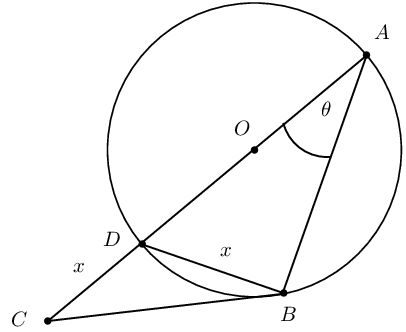

**Consider the given information:**
Use the given information to determine as many of the unknown angles as possible.

          \[\begin{array}{rll}
          CD &= BD = x & (\text{given} ) \\
          B\hat{A}D &= \theta & (\text{given} ) \\
          & \\
          D\hat{B}A &= \text{90} ° & (\angle \text{ in semi circle}) \\
          & \\
          B\hat{D}A &= \text{180} ° - \text{90} ° - \theta & (\angle \text{s sum of } \triangle ABD)
          \\
          &= \text{90} ° - \theta & \\
          & \\
          B\hat{D}C &= \text{90} ° + \theta & (\angle \text{s on a str. line} )
          \end{array}\]

**Determine the expression for \(BC\):**
To derive the required expression, we need to write \(BC\) in terms of \(x\) and \(\theta\).

In \(\triangle CDB\), we can use the cosine rule to determine \(BC\):

          \begin{align*}
          B{C}^{2}& = C{D}^{2}+B{D}^{2}-2 \cdot CD \cdot BD \cdot \cos\left(B\hat{D}C\right) \\
          & = {x}^{2}+{x}^{2}-2{x}^{2}\cos\left( \text{90} °+\theta \right) \\
          & = 2{x}^{2} - 2{x}^{2}\left( - \sin\theta \right) \\
          & = 2{x}^{2} + 2{x}^{2} \sin\theta \\
          & = 2{x}^{2}\left(1 + \sin\theta \right)
          \end{align*}
</Callout>

### Textbook Exercise 4.5

In the diagram below, \(O\) is the centre of the semi-circle \(BAE\).

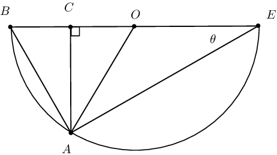

**Problem:**
Find \(A\hat{O}C\) in terms of \(\theta\).

**Solution:**
\(BE\) is a diameter of semi-circle \(BAE\). \(O\) is the centre and therefore bisects \(BE\).
                  \[\begin{array}{rll}
                  OA &= OE = OB &\text{ (equal radii)}\\
                  \therefore O \hat{A} E &= \theta &\text{ (opp. } \angle \text{'s of equal sides)}\\
                  \therefore A \hat{O} C &= \theta + \theta &\text{ (ext. } \angle \text{ of } \triangle OAE
                  \text{ = sum int. opp.)}\\
                  &=2\theta &
                  \end{array}\]

Or

                \[\begin{array}{rll}
                A \hat{O} C &= 2\theta & (\angle \text{ at centre } = 2 \angle \text{ at circum. })
                \end{array}\]

**Problem:**
In \(\triangle ABE\), determine an expression for \(\cos \theta\).

**Solution:**
\begin{align*}
                B\hat{A}E &= \text{90} ° \quad (\angle \text{ in semi circle}) \\
                \therefore \cos \theta &= \frac{AE}{BE}
                \end{align*}

**Problem:**
In \(\triangle ACE\), determine an expression for \(\sin \theta\).

**Solution:**
\begin{align*}
                A\hat{C}E &= \text{90} ° \quad (\text{given}) \\
                \therefore \sin \theta &= \frac{CA}{AE}
                \end{align*}

**Problem:**
In \(\triangle ACO\), determine an expression for \(\sin 2 \theta\).

**Solution:**
\begin{align*}
                A\hat{C}O &= \text{90} ° \quad (\text{given}) \\
                A\hat{O}C &= 2 \theta \quad (\text{proven}) \\
                \therefore \sin 2 \theta &= \frac{CA}{AO}
                \end{align*}

**Problem:**
Use the results from the previous questions to show that \(\sin2\theta =2\sin\theta\cos \theta\).

**Solution:**
\[\begin{array}{rll}
                  \cos \theta &= \frac{AE}{BE} & \\
                  \therefore AE &= BE \cos \theta & \\
                  \sin \theta &= \frac{CA}{AE} & \\
                  \therefore CA &= AE \sin \theta & \\
                  &= (BE \cos \theta) \sin \theta & \\
                  BE &= 2(OE) & \text{ (radii)}\\
                  \therefore CA &= 2(OE) \sin \theta \cos \theta & \\
                  \therefore \frac{CA}{OE} &= 2 \sin \theta \cos \theta & \\
                  \text{but }\frac{CA}{OE} &= \frac{CA}{OA} = \sin 2\theta & \text{ (in }\triangle ACO
                  \text{)}\\
                  \therefore \sin 2\theta &= 2 \sin \theta \cos \theta &
                  \end{array}\]

**Problem:**
\(DC\) is a diameter of the circle with centre \(O\) and radius \(r\). \(CA=r\), \(AE=2DE\) and
                \(D\hat{O}E=\theta\).

Show that \(\cos\theta =\frac{1}{4}\).

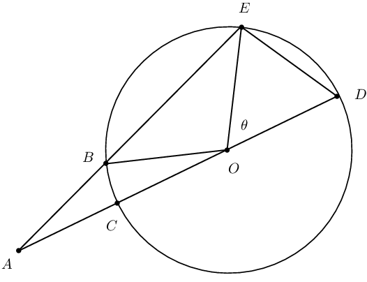

**Solution:**
\begin{align*}
                \text{In }\triangle DOE \text{, let }DE &= k \\
                k^{2} &= r^{2} + r^{2} - 2r^{2} \cos \theta \\
                &= 2r^{2} - 2r^{2} \cos \theta \ldots \ldots (1) \\
                \text{In }\triangle AOE \text{, }AE&= 2k\\
                (2k)^{2} &= (2r)^{2} + r^{2} - 2(2r)(r) \cos ( \text{180} ° - \theta) \\
                \therefore 4k^{2} &= 4r^{2} + r^{2} + 4r^{2} \cos \theta\\
                \therefore 4k^{2} &= 5r^{2} + 4r^{2} \cos \theta \ldots \ldots (2) \\
                (1) \times 4 \text{: }4k^{2} &= 8r^{2} - 8r^{2} \cos \theta \ldots \ldots (3) \\
                (3) - (2): \quad 0 &= 3r^{2} - 12r^{2} \cos \theta\\
                \therefore 12r^{2}\cos\theta&= 3r^{2}\\
                \cos \theta &= \frac{3r^{2}}{12r^{2}} \\
                \therefore \cos \theta&= \frac{1}{4}
                \end{align*}

The figure below shows a cyclic quadrilateral with \(\frac{BC}{CD}=\frac{AD}{AB}\).

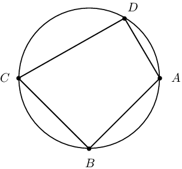

**Problem:**
Show that the area of the cyclic quadrilateral is \(DC \cdot DA \cdot \sin\hat{D}\).

**Solution:**
\[\begin{array}{rll}
                  \text{Connect } CA \text{ to construct }&\triangle ADC \text{ and }\triangle ABC &\\
                  \frac{BC}{CD} &=\frac{AD}{AB} \qquad \text{(given)} \\
                  \therefore BC \cdot AB &= AD \cdot CD \\
                  \text{Area }\triangle ADC &= \frac{1}{2} DC \cdot DA \sin \hat{D} & \\
                  \text{Area }\triangle ABC &= \frac{1}{2} AB \cdot BC \sin \hat{B} & \\
                  \hat{B} + \hat{D} &= \text{180} ° \qquad \text{ (opp. } \angle \text{s cyclic quad. supp.)}\\
                  \therefore \hat{B} &= \text{180} °- \hat{D} & \\
                  \therefore \sin \hat{B} &= \sin ( \text{180} ° - \hat{D}) = \sin \hat{D} & \\
                  \text{Area } ABCD &= \text{ area }\triangle ADC + \text{ area } \triangle ABC & \\
                  &= \frac{1}{2} DC \cdot DA \sin \hat{D} + \frac{1}{2} AB \cdot BC \sin \hat{B} & \\
                  &= \frac{1}{2} DC \cdot DA \sin \hat{D} + \frac{1}{2} DC \cdot DA \sin \hat{D} & \\
                  &= DC \cdot DA \sin \hat{D} &
                  \end{array}\]

**Problem:**
Write down two expressions for \(CA^{2}\): one in terms of \(\cos\hat{D}\) and one in terms of
                  \(\cos\hat{B}\).

**Solution:**
\begin{align*}
                  CA^{2} &= DC^{2} + DA^{2} - 2(DC)(DA) \cos \hat{D}\\
                  CA^{2} &= AB^{2} + BC^{2} - 2(AB)(BC) \cos \hat{B}
                  \end{align*}

**Problem:**
Show that \(2C{A}^{2}=C{D}^{2}+D{A}^{2}+A{B}^{2}+B{C}^{2}\).

**Solution:**
\begin{align*}
                  CA^{2} &= DC^{2} + DA^{2} - 2(DC)(DA) \cos \hat{D}\\
                  CA^{2} &= AB^{2} + BC^{2} - 2(AB)(BC) \cos \hat{B}\\
                  &= AB^{2} + BC^{2} - 2(DC)(DA) \cos \hat{B} \quad (DC \cdot DA = AB \cdot BC) \\
                  2CA^{2}& = CD^{2} + DA^{2} + AB^{2} + BC^{2} - 2(DC)(DA) \cos \hat{D} \\
                  & - 2(DC)(DA) \cos ( \text{180} ° -\hat{D})\\
                  &= CD^{2} + DA^{2} + AB^{2} + BC^{2} - 2(DC)(DA)\cos \hat{D} \\
                  & + 2(DC)(DA) \cos \hat{D}\\
                  &= CD^{2} + DA^{2} + AB^{2} + BC^{2}
                  \end{align*}

**Problem:**
Suppose that \(BC=10\) units, \(CD=15\) units, \(AD=4\) units and \(AB=6\) units. Calculate
                  \(C{A}^{2}\) (correct to one decimal place).

**Solution:**
\begin{align*}
                  2CA^{2} &= (15)^{2} + (4)^{2} + (6)^{2} + (10)^{2} \\
                  &= 377\\
                  \therefore CA^{2} &= \text{188,5}\text{ units$^{2}$}
                  \end{align*}

**Problem:**
Find the angle \(\hat{B}\). Hence, calculate the area of \(ABCD\) (correct to one decimal place).

**Solution:**
\begin{align*}
                  CA^{2} &= AB^{2} + BC^{2} - 2(AB)(BC) \cos \hat{B} \\
                  \text{188,5}&= 6^{2} + 10^{2} - 2(6)(10) \cos \hat{B} \\
                  \text{188,5}&= 136 - 120 \cos \hat{B} \\
                  \cos \hat{B} &= - \text{0,4375} \\
                  \text{ref } \angle &= \text{64,05} ° \\
                  \therefore \hat{B} &= \text{180} ° - \text{64,05} ° \\
                  &= \text{115,94} ° \\
                  & \\
                  \text{Area } ABCD &= DC \times DA \sin ( \text{115,94} °)\\
                  &= 15 \times 4 \sin ( \text{115,94} °)\\
                  &= \sin ( \text{115,94} °)\\
                  & = \text{54,0}\text{ units$^{2}$}
                  \end{align*}

Two vertical towers \(AB\) and \(CD\) are \(\text{30}\text{ m}\) and \(\text{27}\text{ m}\) high,
                respectively. Point \(P\) lies between the two towers. The angle of elevation from \(P\) to \(A\) is
                \(\text{50}\) ° and from \(P\) to \(C\) is \(\text{35}\) °. A cable is needed to connect \(A\)
                and \(C\).

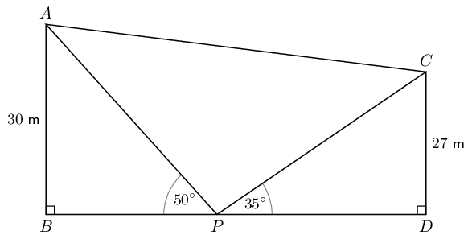

**Problem:**
Determine the minimum length of cable needed to connect \(A\) and \(C\) (to the
                nearest metre).

**Solution:**
\begin{align*}
                \hat{B} &= \hat{D} = \text{90} ° \quad (\text{vertical towers}) \\
                & \\
                \text{In } \triangle ABP: \quad \frac{30}{AP} &= \sin \text{50} ° \\
                AP &= \frac{30}{\sin \text{50} °} \\
                &= \text{39,16}\text{ m} \\
                & \\
                \text{In } \triangle CDP: \quad \frac{27}{CP} &= \sin \text{35} ° \\
                CP &= \frac{27}{\sin \text{35} °} \\
                &= \text{47,07}\text{ m} \\
                & \\
                \text{In } \triangle APC: A\hat{P}C &= \text{180} ° - ( \text{50} ° + \text{35} ° )
                \\
                &= \text{95} ° \\
                AC^{2} &= AP^{2} + PC^{2} - 2(AP)(PC) \cos A\hat{P}C \\
                &= (\text{39,16})^{2} + (\text{47,07})^{2} - 2(\text{39,16})(\text{47,07}) \cos \text{95} ° \\
                &= \text{4 070,39} \\
                \therefore AC &= \text{63,80}\text{ m} \\
                &\approx \text{64}\text{ m}
                \end{align*}

**Problem:**
How far apart are the bases of the two towers (to the nearest metre)?

**Solution:**
\begin{align*}
                \text{In } \triangle ABP: \quad \frac{BP}{\text{39,16}} &= \cos \text{50} ° \\
                \therefore BP &= \text{39,16} \cos \text{50} ° \\
                &= \text{25,17}\text{ m} \\
                & \\
                \text{In } \triangle CDP: \quad \frac{PD}{\text{47,07}} &= \cos \text{35} ° \\
                \therefore PD &= \text{47,07} \cos \text{35} ° \\
                &= \text{38,56}\text{ m} \\
                & \\
                BD &= BP + PD \\\
                &= \text{25,17}\text{ m} + \text{38,56}\text{ m} \\
                &= \text{63,7}\text{ m} \\
                &\approx \text{64}\text{ m}
                \end{align*}

### Problems in three dimensions (EMCGN)

Trigonometric formulae are useful for solving problems in two dimensions. However, in the real world all
        objects are three dimensional, so it is important that we extend the application of the area, sine and cosine
        formulae to three dimensional situations.

Drawing a three dimensional diagram is a crucial step in finding the solution to a problem. Interpreting the
        given information and sketching a three dimensional diagram are skills that need to be practised.

<Callout type="tip" title="Worked example 15: Problems in three dimensions - height of a pole">
**Question:**
\(T\) is the top of a pole and its base, \(F\), is in the same horizontal plane as the points \(A\) and
            \(B\). The angle of elevation measured from \(B\) to \(T\) is \(\text{25} °\). \(AB = \text{120}\text{
            m}\), \(F\hat{A}B = \text{40} ° \text{ and } F\hat{B}A = \text{30} °\).

Use the given information to calculate \(h\), the height of the pole, to the nearest metre.

**Draw a sketch:**
It is a challenge to analyze this situation when only a description is given. A diagram is very useful for
            representing three dimensional problems.

Draw a sketch using the given information. Indicate all right angles on the sketch, even those that do not
            look as though they are a \(\text{90}\) ° angle (for example, \(T\hat{F}B = \text{90} °\)). It is
            also helpful to shade the horizontal plane (\(\triangle FAB\)), as it adds depth to the diagram and gives a
            better visualization of the situation.

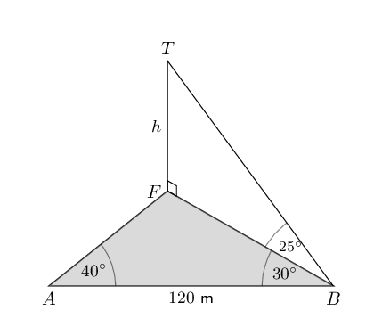

**Consider the given information:**
There are two triangles to consider: \(\triangle FAB\) and \(\triangle TFB\). We are required to find the
            length of \(FT\), but the only information we have for \(\triangle TFB\) is \(F\hat{B}T = \text{25}
            °\).

**Important:** notice that \(FB\) is a side of \(\triangle TFB\) and it is also a side of
            \(\triangle FAB\) - it is a link or bridge between the two triangles.

Therefore, to determine the height of the pole:

2. Write down all the given information on the sketch.
4. Use the information for \(\triangle FAB\) to calculate \(FB\).
6. Use \(FB\) and the information for \(\triangle TFB\) to calculate \(FT\).

**Determine the length of \(FB\):**
We notice that \(\triangle FAB\) does not have a right-angle, so we use the sine rule to determine \(FB\).

          \[\begin{array}{rll}
          \text{In } \triangle FAB: \quad \hat{F} &= \text{180} ° - \text{40} ° - \text{30} ° &
          (\angle \text{s sum of } \triangle FAB) \\
          &= \text{110} ° & \\
          & \\
          \dfrac{FB}{ \sin \hat{A} } &= \dfrac{AB}{ \sin \hat{F} } & \\
          & \\
          \dfrac{FB}{ \sin \text{40} ° }&= \dfrac{120}{ \sin \text{110} ° } & \\
          & \\
          FB &= \dfrac{120 \times \sin \text{40} ° }{\sin \text{110} ° } & \\
          & \\
          \therefore FB &= \text{82,084} \ldots &
          \end{array}\]

**Determine the length of \(FT\):**
In \(\triangle TFB\):

          \[\begin{array}{rll}
          \hat{F} &= \text{90} ° & (\text{vertical pole}) \\
          \hat{B} &= \text{25} ° & (\text{given}) \\
          \tan \hat{B} &= \frac{FT}{FB} & \\
          \tan \hat{B} \times FB &= FT & \\
          \tan \text{25} ° \times \text{82,084} \ldots &= FT & \\
          \therefore FT &= \text{38,246} \ldots & \\
          &\approx \text{38}\text{ m} & (\text{to nearest metre})
          \end{array}\]

**Note:** do not round off answers in the intermediate steps as this will affect the accuracy
            of the final answer. Always try to do the calculation in one complete step and only round off the final
            answer.

**Write the final answer:**
The height of the pole, \(h\), is \(\text{38}\text{ m}\).
</Callout>

The calculation in the above worked example is only applicable for the specific numbers given. However, if we
        derived a general formula for this contextual situation, then it could be applied to any suitable set of
        numerical values.

<Callout type="tip" title="Worked example 16: Problems in three dimensions - height of a building">
**Question:**
\(D\) is the top of a building of height \(h\). The base of the building is at \(A\) and \(\triangle ABC\)
            lies on the ground (a horizontal plane). \(BC=b\), \(D\hat{B}A=\alpha\), \(D\hat{B}C=\beta\) and
            \(D\hat{C}B=\theta\).

Show that \(h=\frac{b\sin\alpha\sin \theta }{\sin\left(\beta +\theta \right)}\).

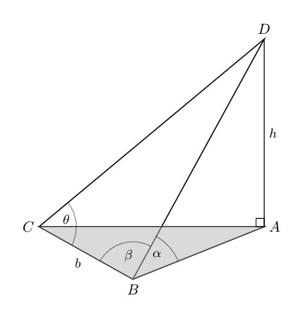

**Consider the given information:**
We know that \(\triangle ABD\) is right-angled and we are required to find a formula to calculate the
            length of \(AD\). In \(\triangle BCD\), we are given two angles and a length of \(BC\). We identify the side
            \(BD\) as the link between \(\triangle ABD\) and \(\triangle BCD\).

**Determine an expression for \(BD\):**
\(\triangle BCD\) does not have a right-angle but two angles and a side are given, so we use the sine rule
            to determine \(BD\).

          \[\begin{array}{rll}
          \text{In } \triangle BCD: \quad B\hat{D}C &= \text{180} ° - \left( \beta + \theta \right) &
          (\angle \text{s sum of } \triangle BCD) \\
          \therefore \sin \left( \text{180} ° - \left( \beta + \theta \right) \right) &= \sin \left( \beta +
          \theta \right) & \\
          \frac{BD}{\sin \theta } & = \frac{b}{\sin\left(B\hat{D}C\right)} \\
          BD & = \frac{b\sin\theta }{\sin\left(B\hat{D}C\right)} \\
          & = \frac{b\sin\theta }{\sin \left( \beta + \theta \right) }
          \end{array}\]

**Determine an expression for \(AD\):**
In \(\triangle ABD\):

          \[\begin{array}{rll}
          B\hat{A}D &= \text{90} ° & (\text{building vertical}) \\
          D\hat{B}A &= \alpha & (\text{given}) \\
          \frac{h}{BD}& = \sin \alpha \\
          h & = BD \sin \alpha \\
          \therefore h & = \frac{b \sin \alpha \sin\theta }{\sin \left( \beta + \theta \right) }
          \end{array}\]
</Callout>

### Textbook Exercise 4.6

The line \(BC\) represents a tall tower, with \(B\) at its base. The angle of elevation from \(D\) to
                \(C\) is \(\theta\). A man stands at \(A\) such that \(BA=AD=x\) and \(A\hat{D}B = \alpha\).

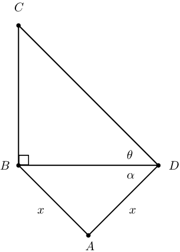

**Problem:**
Find the height of the tower \(BC\) in terms of \(x\), \(\tan\theta\) and \(\cos\alpha\).

**Solution:**
\begin{align*}
                  \text{In } \triangle BCD, \quad \tan \theta &= \frac{BC}{BD} \\
                  \therefore BC &= BD \tan \theta\\
                  \text{In } \triangle ABD, \quad \frac{\sin \hat{A}}{BD} &= \frac{\sin \alpha}{x} \\
                  \therefore BD &= \frac{x \sin \hat{A}}{\sin \alpha}\\
                  \therefore BC &= \frac{x \sin \hat{A} \tan \theta}{\sin \alpha}\\
                  \hat{A} + \alpha + \alpha &= \text{180} ° \qquad \text{(}\angle \text{'s in }\triangle
                  ABD\text{)}\\
                  \therefore \hat{A} &= \text{180} ° - 2\alpha\\
                  \therefore \sin \hat{A} & = \sin ( \text{180} ° - 2 \alpha) = \sin 2 \alpha\\
                  \therefore BC &= \frac{x \sin 2 \alpha \tan \theta}{\sin \alpha} \\
                  \text{ and } \sin 2 \alpha &= 2 \sin \alpha \cos \alpha \\
                  \therefore \frac{\sin 2 \alpha}{\sin \alpha} &= 2\cos \alpha\\
                  \therefore BC &= 2x \cos \alpha \tan \theta
                  \end{align*}

**Problem:**
Find \(BC\) if we are given that \(x= \text{140}\text{ m}\), \(\alpha = \text{21} °\) and
                  \(\theta = \text{9} °\).

**Solution:**
\begin{align*}
                  BC &= 2(140)\cos \text{21} °\tan \text{9} ° = \text{41,40}\text{ m}
                  \end{align*}

\(P\) is the top of a mast and its base, \(Q\), is in the same horizontal plane as the points \(A\) and
                \(B\). The angle of elevation measured from \(B\) to \(P\) is \(z\). \(AB = d\), \(Q\hat{A}B = x \text{
                and } Q\hat{B}A = y\).

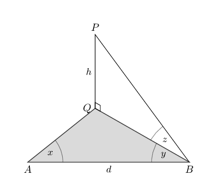

**Problem:**
Use the given information to derive a general formula for \(h\), the height of the
                mast.

**Solution:**
\[\begin{array}{rll}
                \text{In } \triangle QAB: \quad \hat{Q} &= \text{180} ° - (x + y) & (\angle \text{s sum of
                } \triangle QAB) \\
                \frac{QB}{ \sin \hat{A} } &= \frac{AB}{ \sin \hat{Q} } & \\
                \frac{QB}{ \sin x }&= \frac{d}{ \sin \left( \text{180} ° - (x + y) \right) } & \\
                \frac{QB}{ \sin x }&= \frac{d}{ \sin \left( x + y \right) } & \\
                QB &= \frac{d \sin x}{\sin \left( x + y \right) } &
                \end{array}\]

In \(\triangle PQB\):

                \[\begin{array}{rll}
                \hat{Q} &= \text{90} ° & (\text{vertical mast}) \\
                \hat{B} &= z & (\text{given}) \\
                \tan \hat{B} &= \frac{QP}{QB} & \\
                \tan \hat{B} \times QB &= QP & \\
                \therefore QP & = \tan z \times QB & \\
                \therefore h &= \tan z \times \frac{d \sin x}{\sin \left( x + y \right) } & \\
                &= \frac{d \sin x \tan z}{\sin \left( x + y \right) } &
                \end{array}\]

**Problem:**
If \(d = \text{50}\text{ m}\), \(x = \text{46} °\), \(y = \text{15} °\) and
                \(z = \text{20} °\), calculate \(h\) (to the nearest metre).

**Solution:**
\begin{align*}
                h &= \frac{d \sin x \tan z}{\sin \left( x + y \right) } \\
                &=\frac{50 \sin \text{46} ° \tan \text{20} °}{\sin \left( \text{46} ° + \text{15}
                ° \right) } \\
                &= \text{14,967} \ldots \\
                &\approx \text{15}\text{ m} \qquad (\text{to nearest metre})
                \end{align*}

\(PR\) is the height of a block of flats with \(R\) at the base and \(P\) at the top of the building.
                \(S\) is a point in the same horizontal plane as points \(Q\) and \(R\). \(SR = q \text{ units},
                S\hat{Q}R = \text{120} °, S\hat{R}Q = \alpha\) and \(R\hat{Q}P = \theta\).

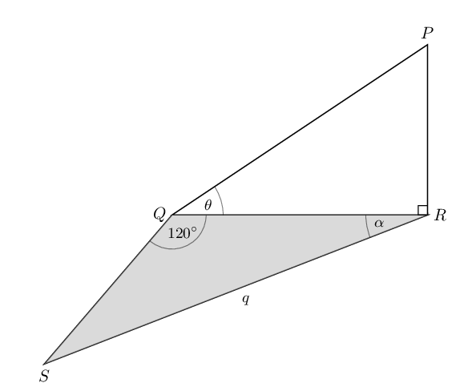

**Problem:**
Show that the height of the block of flats, \(PR\), can be expressed as:

                \[PR = q \tan \theta \left( \cos \alpha - \frac{\sqrt{3} \sin \alpha}{3} \right)\]

**Solution:**
\(QR\) is the link between \(\triangle PQR\) and \(\triangle SQR\).

                \[\begin{array}{rll}
                \text{In } \triangle SQR: \quad \hat{S} &= \text{180} ° - ( \text{120} ° + \alpha) &
                (\angle \text{s sum of } \triangle SQR) \\
                \frac{QR}{ \sin \hat{S} } &= \frac{q}{ \sin \hat{Q} } & \\
                & \\
                QR &= \dfrac{q \sin \left( \text{180} ° - ( \text{120} ° + \alpha) \right)}{ \sin \left(
                \text{120} ° \right) } & \\
                & \\
                &= \dfrac{q \sin \left( \text{60} ° - \alpha \right)}{ \sin \left( \text{180} ° -
                \text{60} ° \right)} & \\
                & \\
                &= \dfrac{q \left( \sin \text{60} ° \cos \alpha - \cos \text{60} ° \sin \alpha \right)}{
                \sin \text{60} ° } &
                \end{array}\]

                \[\begin{array}{rll}
                &= \dfrac{q \left( \frac{\sqrt{3}}{2} \cos \alpha - \frac{1}{2} \sin \alpha \right)}{
                \frac{\sqrt{3}}{2} } & \\
                & \\
                &= q \left( \dfrac{\sqrt{3} \cos \alpha -\sin \alpha }{2} \right) \times \dfrac{2}{\sqrt{3}} &
                \\
                & \\
                &= q \left( \cos \alpha - \dfrac{\sin \alpha}{\sqrt{3}} \right) & \\
                & \\
                &= q \left( \cos \alpha - \left(\dfrac{\sin \alpha}{\sqrt{3}} \times \dfrac{\sqrt{3}}{\sqrt{3}}
                \right) \right) & \\
                & \\
                &= q \left( \cos \alpha - \dfrac{\sqrt{3} \sin \alpha}{3} \right) & \\
                \end{array}\]

                \[\begin{array}{rll}
                \text{In } \triangle PQR: \quad \hat{R} &= \text{90} ° & \\
                \frac{PR}{QR} &= \tan \theta & \\
                \therefore PR &= \tan \theta \times QR & \\
                &= \tan \theta \times q \left( \cos \alpha - \frac{\sqrt{3} \sin \alpha}{3} \right) & \\
                &= q \tan \theta \left( \cos \alpha - \frac{\sqrt{3} \sin \alpha}{3} \right) &
                \end{array}\]

**Problem:**
If \(SR = \text{35}\text{ m}, S\hat{R}Q = \text{16} °\) and \(R\hat{Q}P =
                \text{30} °\), calculate \(PR\) (correct to one decimal place).

**Solution:**
\begin{align*}
                PR &= q \tan \theta \left( \cos \alpha - \frac{\sqrt{3} \sin \alpha}{3} \right) \\
                &= 35 \tan \text{30} °
                \left( \cos \text{16} ° - \frac{\sqrt{3} \sin \text{16} °}{3}\right) \\
                &= \text{16,2}\text{ m}
                \end{align*}

**Problem:**
Assuming each level is \(\text{2,5}\) \(\text{m}\) high, estimate the number of
                levels in the block of flats.

**Solution:**
\begin{align*}
                \text{Approx. no. of levels }&= \frac{16}{\text{2,5}} \\
                &= \text{6,4}
                \end{align*}

Therefore, there are approximately \(\text{6}\) levels.

Two ships at sea can see a lighthouse on the shore. The distance from the top of the lighthouse (\(H\))
                to ship \(S\) and to ship \(B\) is \(\text{200}\) \(\text{m}\). The angle of elevation from \(S\) to
                \(H\) is \(\alpha\), \(H\hat{B}S = \beta\) and \(S\hat{L}B = \theta\)

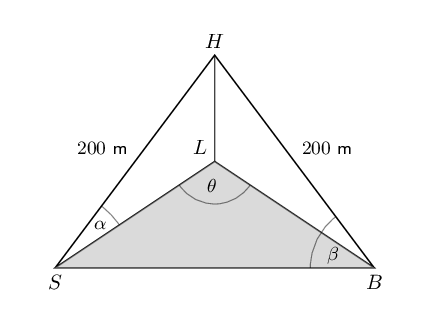

**Problem:**
Show that the distance between the two ships is given by \(SB = 400 \cos \beta\).

**Solution:**
\[\begin{array}{rll}
                \text{In } & \triangle HSB: & \\
                \quad HS &= HB = \text{200}\text{ m} & \text{(given)} \\
                SB^{2} &= HS^{2} + HB^{2} - 2(HS)(HB) \cos S\hat{H}B & (\text{cosine rule}) \\
                SB^{2} &= (200)^{2} + (200)^{2} - 2(200)(200) \cos S\hat{H}B & \\
                &= \text{40 000}+\text{40 000} - \text{80 000} \cos \left( \text{180} ° - 2
                \beta \right) & \\
                &= \text{80 000} + \text{80 000} \cos \left( 2 \beta \right) & \\
                &= \text{80 000}\left( 1 + \cos 2 \beta \right) & \\
                &= \text{80 000}\left( 1 + 2 \cos^{2} \beta - 1 \right) & \\
                &= \text{160 000} \cos^{2} \beta & \\
                \therefore SB &= \text{400} \cos \beta & (\text{distance positive})
                \end{array}\]

**Problem:**
Show that the area of the sea included in \(\triangle LSB\) is given by area
                \(\triangle LSB = \text{2 000}\cos^{2} \alpha \sin \theta\).

**Solution:**
\[\begin{array}{rll}
                \text{In } \triangle HSL &\text{ and } \triangle HBL: & \\
                HS &= HB = \text{200}\text{ m} & (\text{given}) \\
                HL &= HL & (\text{common side})\\
                H\hat{L}S &= H\hat{L}B = \text{90} ° & (\text{vertical lighthouse}) \\
                \therefore \triangle HSL &||| \triangle HBL & (\text{RHS}) \\
                \therefore H\hat{B}L &= H\hat{S}L = \alpha & (\triangle HSL ||| \triangle HBL) \\
                \text{Area} \triangle LSB &= \frac{1}{2} (LS)(LB) \sin \theta \\
                \text{In } \triangle HSL: \quad \frac{LS}{HS} &= \cos \alpha & \\
                \therefore LS &= HS \cos \alpha & \\
                &= 200 \cos \alpha & \\
                \text{In } \triangle HBL: \quad \frac{LB}{HB} &= \cos \alpha & \\
                \therefore LB &= 200 \cos \alpha & \\
                & \\
                \text{Area} LSB &= \frac{1}{2} (LS)(LB) \sin \theta \\
                &= \frac{1}{2} (200 \cos \alpha )(200 \cos \alpha ) \sin \theta \\
                &= \text{20 000} \cos^{2} \alpha \sin \theta
                \end{array}\]

**Problem:**
Calculate the triangular area of the sea if the angle of inclination from the ship to
                the top of the lighthouse is \(\text{10} °\) and the angle between the direct lines from the base
                of the lighthouse to each ship is \(\text{85} °\).

**Solution:**
\(\theta = \text{85} °\) and \(\alpha = \text{10} °\).

                \begin{align*}
                \text{Area }\triangle LSB &= \text{2 000} \cos^{2} \alpha \sin \theta \\
                &= \text{2 000}(\cos \text{10} °)^{2} \sin \text{85} ° \\
                &= \text{1 932,3}\text{ m$^{2}$}
                \end{align*}

A triangular look-out platform (\(\triangle ABC\)) is attached to a bridge that extends over a deep
                gorge. The vertical depth of the gorge, the distance from the edge of the look-out \(C\) to the bottom
                of the gorge \(D\), is \(\text{13}\) \(\text{m}\). The angle of depression from \(A\) to \(D\) is
                \(\text{34}\) ° and from \(B\) to \(D\) is \(\text{28}\) °. The angle at the edge of the
                platform, \(\hat{C}\) is \(\text{76}\) °.

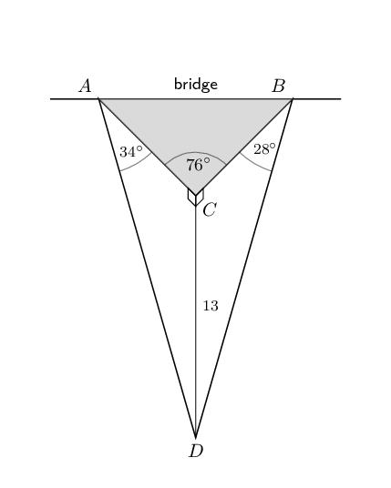

**Problem:**
Calculate the area of the look-out platform (to the nearest \(\text{m$^{2}$}\)).

**Solution:**
\begin{align*}
                \text{Area } \triangle ABC &= \frac{1}{2} AC \cdot BC \sin \hat{C} \\
                \text{In } \triangle ACD: \quad \frac{13}{AC} &= \tan \text{34} ° \\
                \therefore AC &= \frac{13}{\tan \text{34} °} \\
                &= \text{19,27} \ldots \\
                \text{In } \triangle BCD: \quad \frac{13}{BC} &= \tan \text{28} ° \\
                \therefore BC &= \frac{13}{\tan \text{28} °} \\
                &= \text{24,44} \ldots \\
                & \\
                \text{Area } \triangle ABC &= \frac{1}{2} AC \cdot BC \sin \hat{C} \\
                &= \frac{1}{2} (\text{19,27} \ldots)(\text{24,44} \ldots) \sin \text{76} ° \\
                &= \text{228,57} \ldots \\
                &\approx \text{229}\text{ m$^{2}$}
                \end{align*}

**Problem:**
If the platform is constructed so that the two angles of depression, \(C\hat{A}D\) and \(C\hat{B}D\),
                  are both equal to \(\text{45}\) ° and the vertical depth of the gorge \(CD = d\), \(AB = x\) and
                  \(A\hat{C}B = \theta\), show that \(\cos \theta = 1 - \frac{x^{2}}{2d^{2}}\).

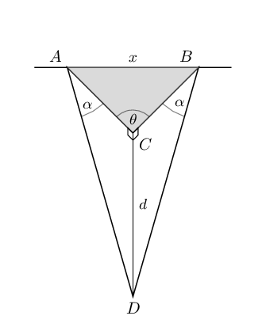

**Solution:**
\begin{align*}
                AB^{2} &= AC^{2} + BC^{2} - 2 \cdot AC \cdot BC \cos A\hat{C}B \\
                \text{In } \triangle ACD: \quad \frac{d}{AC} &= \tan \text{45} ° \\
                \therefore AC &= d \\
                \text{And } BC &= d \\
                \text{In } \triangle ABC: \quad x^{2} &= d^{2} + d^{2} - 2 \cdot d \cdot d \cos \theta \\
                &= 2d^{2} - 2d^{2} \cos \theta \\
                2d^{2} \cos \theta &= 2d^{2} - x^{2} \\
                \therefore \cos \theta &= \frac{2d^{2} - x^{2}} {2d^{2} } \\
                &= 1 - \frac{x^{2}} {2d^{2} }
                \end{align*}

**Problem:**
If \(AB = \text{25}\text{ m}\) and \(CD = \text{13}\text{ m}\), calculate
                \(A\hat{C}B\) (to the nearest integer).

**Solution:**
\begin{align*}
                \cos \theta &= 1 - \frac{x^{2}} {2d^{2} } \\
                &= 1 - \frac{(25)^{2}} {2(13)^{2} } \\
                \therefore \cos \theta&= - \text{0,849} \ldots \\
                \text{ref } \angle &= \text{31,88} ° \\
                \therefore \theta &= \text{180} ° - \text{31,88} ° \\
                &= \text{148,12} ° \\
                &\approx \text{148} ° \qquad (\text{nearest integer})
                \end{align*}
