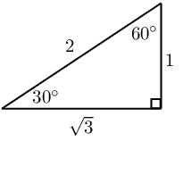
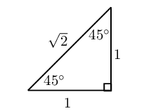
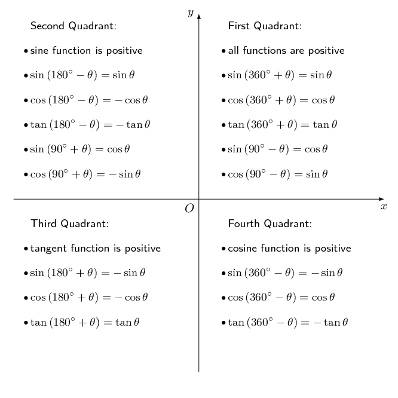
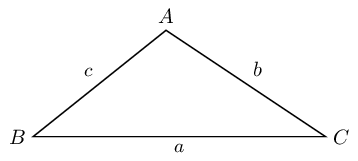

## 4.6 Summary (EMCGP)

| Pythagorean Identities | Ratio Identities |
| --- | --- |
| \({\cos}^{2}\theta +{\sin}^{2}\theta =1\) | \(\tan\theta =\frac{\sin\theta }{\cos\theta }\) |
| \({\cos}^{2}\theta = 1 - {\sin}^{2}\theta\) | \(\frac{\cos \theta}{\sin \theta} = \frac{1}{\tan \theta}\) |
| \({\sin}^{2}\theta = 1 - {\cos}^{2}\theta\) |  |

**Special angle triangles**

| θ | \(\text{0}\)° | \(\text{30}\)° | \(\text{45}\)° | \(\text{60}\)° | \(\text{90}\)° |
| --- | --- | --- | --- | --- | --- |
| \(\cos θ\) | \(\text{1}\) | \(\frac{\sqrt{3}}{2}\) | \(\frac{1}{\sqrt{2}}\) | \(\frac{1}{2}\) | \(\text{0}\) |
| \(\sin θ\) | \(\text{0}\) | \(\frac{1}{2}\) | \(\frac{1}{\sqrt{2}}\) | \(\frac{\sqrt{3}}{2}\) | \(\text{1}\) |
| \(\tan θ\) | \(\text{0}\) | \(\frac{1}{\sqrt{3}}\) | \(\text{1}\) | \(\sqrt{3}\) | undef |

**CAST diagram and reduction formulae**

| Negative angles | Periodicity Identities | Cofunction Identities |
| --- | --- | --- |
| \(\sin\left(-\theta \right)=-\sin\theta\) | \(\sin\left(\theta ±{360}°\right)=\sin\theta\) | \(\sin\left({90}°-\theta \right)=\cos\theta\) |
| \(\cos\left(-\theta \right)=\cos\theta\) | \(\cos\left(\theta ±{360}°\right)=\cos\theta\) | \(\cos\left({90}°-\theta \right)=\sin\theta\) |
| \(\tan\left(-\theta \right)=-\tan\theta\) | \(\tan\left(\theta ±{180}°\right)=\tan\theta\) | \(\sin\left({90}°+\theta \right)=\cos\theta\) |
|  |  | \(\cos\left({90}°+\theta \right)=- \sin\theta\) |

| Area Rule | Sine Rule | Cosine Rule |
| --- | --- | --- |
| \(\text{Area}=\frac{1}{2}bc\sin \hat{A}\) | \(\frac{\sin \hat{A}}{a}=\frac{\sin \hat{B}}{b}=\frac{\sin \hat{C}}{c}\) | \({a}^{2}={b}^{2}+{c}^{2}-2bc\cos \hat{A}\) |
| \(\text{Area}=\frac{1}{2}ab\sin \hat{C}\) | \(a \sin \hat{B} = b \sin \hat{A}\) | \({b}^{2}={a}^{2}+{c}^{2}-2ac\cos \hat{B}\) |
| \(\text{Area}=\frac{1}{2}ac\sin \hat{B}\) | \(b \sin{C} = c \sin \hat{B}\) | \({c}^{2}={a}^{2}+{b}^{2}-2ab\cos \hat{C}\) |
|  | \(a \sin{C} = c \sin \hat{A}\) |  |

| Compound Angle Identities | Double Angle Identities |
| --- | --- |
| \(\sin\left(\theta +\beta\right)=\sin\theta\cos \beta +\cos\theta\sin \beta\) | \(\sin\left(2\theta \right)=2\sin\theta\cos \theta\) |
| \(\sin\left(\theta -\beta \right)=\sin\theta\cos \beta -\cos\theta\sin \beta\) | \(\cos\left(2\theta \right)={\cos}^{2}\theta -{\sin}^{2}\theta\) |
| \(\cos\left(\theta +\beta \right)=\cos\theta\cos \beta -\sin\theta\sin \beta\) | \(\cos\left(2\theta \right)=1-2{\sin}^{2}\theta\) |
| \(\cos\left(\theta -\beta \right)=\cos\theta\cos \beta +\sin\theta\sin \beta\) | \(\cos\left(2\theta \right)=2{\cos}^{2}\theta - 1\) |
| \(\) | \(\tan\left(2\theta \right)=\frac{ \sin 2 \theta }{ \cos 2 \theta }\) |

<Callout type="note" title="Note">
<VideoPlayer src="http://www.khanacademy.org/embed_video?v=a70-dYvDJZY" title="Video: 28N2" />
</Callout>

<QuizCard id="m12-04-06a" title="Interactive Exercise 4.8" question="Which side is the best to work on?" options=["the left side", "the right side", "either side: they are equally complex", "1", "2", "3", "4", "5", "6", "7", "8", "9", "10", "11", "12"] answer=" 0 " hint="" explanation="Choose the more complicated side of the equation In this case, the left side is the more complex side because it has more factors and terms than the other side. The correct choice is the left side . Submit your answer as: the left side" />

<QuizCard id="m12-04-06a" title="Interactive Exercise 4.8" question="Find the numerical values of \(a\) and \(b\) for \(g(x)\) ." options=[] answer="2, 0" hint="You should enter a number here. If you want to, you can use a space to separate thousands.                Example: 12 800,25 For scientific notation you need to use the multiply symbol                ( ∗ ) and the exponent symbol ( ^ ). For example 6,673 × 10 −11 should be written as: 6,673 ∗ 10^−11" explanation="It is often easiest to first find the vertical shift of the graph, \(b\) . Examine the graph of \( g(x) \) and determine if it has gone up or down. The graph in question is shown below highlighted in blue, and the centre line is shown as well.  The centre line has not moved up or down from the \(x\) -axis. Therefore, the value of \(b\) is \(\text{0}\) . The value of \(a\) affects the amplitude: either stretching or flattening the graph.  You can find the amplitude by looking at the peaks and valleys of the graph. For \(\tan x\) it is important to remember that the normal graph passes through the point \((45° \, ; 1)\) . If the \(\tan\) graph is multiplied by a coefficient other than one, it will move that point up or down by stretching or squeezing it.  Making these comparisons, you should find that \(a = 2.  \) Submit your answer as: and" />
