## End of chapter exercises

### Textbook Exercise 4.7

Determine the following without using a calculator:

**Problem:**
\(\cos \text{15} °\)

**Solution:**
\begin{align*}
              \cos \text{15} ° &= \cos ( \text{60} ° - \text{45} °)\\
              &= \cos \text{60} °\cos \text{45} ° + \sin \text{60} ° \sin \text{45} °\\
              &= \left(\frac{1}{2}\right)\left(\frac{1}{\sqrt{2}}\right) +
              \left(\frac{\sqrt{3}}{2}\right)\left(\frac{1}{\sqrt{2}}\right)\\
              &=\frac{1}{2\sqrt{2}} + \frac{\sqrt{3}}{2\sqrt{2}} \\
              &= \frac{1+\sqrt{3}}{2\sqrt{2}}
              \end{align*}

**Problem:**
\(\cos \text{75} °\)

**Solution:**
\begin{align*}
              \cos \text{75} °&= \cos ( \text{45} ° + \text{30} °)\\
              &= \cos \text{45} ° \cos \text{30} ° - \sin \text{45} ° \sin \text{30} ° \\
              &= \left(\frac{1}{\sqrt{2}}\right)\left(\frac{\sqrt{3}}{2}\right) -
              \left(\frac{1}{\sqrt{2}}\right)\left(\frac{1}{2}\right)\\
              &= \frac{\sqrt{3}-1}{2\sqrt{2}}
              \end{align*}

**Problem:**
\(\tan \text{75} °\)

**Solution:**
\begin{align*}
              \tan \text{75} ° &= \frac{\sin \text{75} °}{\cos \text{75} °} \\
              & \\
              \sin \text{75} ° & = \sin ( \text{45} ° + \text{30} ° ) \\
              &= \sin \text{45} ° \cos \text{30} ° + \cos \text{45} ° \sin \text{30} ° \\
              &= \frac{1}{\sqrt{2}} \cdot \frac{\sqrt{3}}{2} + \frac{1}{\sqrt{2}} \cdot \frac{1}{2} \\
              &= \frac{\sqrt{3} + 1}{2\sqrt{2}} \\
              \text{And from part b) } \enspace \cos \text{75} ° &= \frac{\sqrt{3} - 1}{2\sqrt{2}} \\
              \therefore \frac{\sin \text{75} ° }{\cos \text{75} ° } &= \frac{\frac{\sqrt{3} +
              1}{2\sqrt{2}}}{\frac{\sqrt{3} - 1}{2\sqrt{2}}} \\
              &= \frac{\sqrt{3} + 1}{2\sqrt{2}} \times \frac{2\sqrt{2}}{\sqrt{3} - 1} \\
              &= \frac{\sqrt{3} + 1}{\sqrt{3} - 1} \\
              &= \frac{\sqrt{3} + 1}{\sqrt{3} - 1} \times \frac{\sqrt{3} + 1}{\sqrt{3} + 1} \\
              &= \frac{3 + 2\sqrt{3} + 1}{3 - 1} \\
              &= \frac{4 + 2\sqrt{3} }{2} \\
              &= 2 + \sqrt{3}
              \end{align*}

**Problem:**
\(\cos \text{3} ° \cos \text{42} ° -\sin \text{3} ° \sin \text{42} °\)

**Solution:**
\begin{align*}
              \cos \text{3} ° \cos \text{42} ° -\sin \text{3} ° \sin \text{42} ° &= \cos(
              \text{3} ° + \text{42} ° )\\
              &= \cos \text{45} ° \\
              &= \frac{1}{\sqrt{2}}
              \end{align*}

**Problem:**
\(1-2{\sin}^{2}\left( \text{22,5} ° \right)\)

**Solution:**
\begin{align*}
              1-2\sin^{2}( \text{22,5} ° ) &=\cos 2( \text{22,5} ° ) \\
              &= \cos \text{45} ° \\
              & = \frac{1}{\sqrt{2}}
              \end{align*}

**Problem:**
Given \(\cos \theta =\text{0,7}\). Using a diagram, find \(\cos 2 \theta\) and \(\cos 4\theta\).

**Solution:**
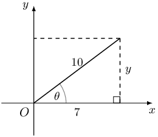

Given \(7 \sin \alpha = 3\) for \(\alpha > \text{90} °\).

Determine the following (leave answers in surd form):

**Problem:**
\(\cos 2 \alpha\)

**Solution:**
Draw a sketch.

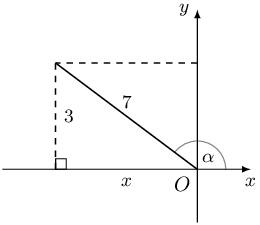

**Problem:**
\(\tan 2 \alpha\)

**Solution:**
\begin{align*}
            \tan 2 \alpha &= \frac{\sin 2 \alpha}{\cos 2 \alpha} \\
            \sin 2 \alpha &= 2 \sin \alpha \cos \alpha \\
            &= 2 \left( \frac{3}{7} \right)\left( - \frac{\sqrt{40}}{7} \right) \\
            &= - \frac{6\sqrt{40}}{49} \\
            & \\
            \tan 2 \alpha &= \frac{\sin 2 \alpha}{\cos 2 \alpha} \\
            &= \frac{- \frac{6\sqrt{40}}{49} }{\frac{31}{49}} \\
            &= - \frac{6\sqrt{40}}{49} \times \frac{49}{31} \\
            &= - \frac{6\sqrt{40}}{31}
            \end{align*}

**Problem:**
If \(4 \tan A + 3 = 0\) for \(A < \text{270} °\), determine, without the use of a calculator:

          \[\left( \sin \frac{A}{2} - \cos \frac{A}{2} \right) \left( \sin \frac{A}{2} + \cos \frac{A}{2} \right)\]

**Solution:**
Draw a sketch.

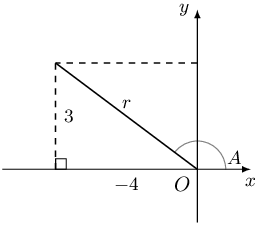

We are given that \(A < \text{270} °\), therefore \(A\) must lie in the second quadrant for the
            tangent function to be negative.

          \begin{align*}
          r^{2} &= 3^{2} + (-4)^{2} = 25 \\
          \therefore r & = 5 \\
          & \\
          & \left( \sin \frac{A}{2} - \cos \frac{A}{2} \right) \left( \sin \frac{A}{2} + \cos \frac{A}{2} \right) \\
          &= \sin^{2} \frac{A}{2} - \cos^{2} \frac{A}{2} \\
          &= - \left( \cos^{2} \frac{A}{2} - \sin^{2} \frac{A}{2} \right) \\
          &= - \cos 2 \left( \frac{A}{2} \right) \\
          &= - \cos A \\
          &= - \left( - \frac{4}{5} \right)\\
          &= \frac{4}{5}
          \end{align*}

**Problem:**
Simplify: \(\cos \text{67} ° \cos \text{7} ° + \cos \text{23} ° \cos
          \text{83} °\)

**Solution:**
\begin{align*}
          & \cos \text{67} ° \cos \text{7} ° + \cos \text{23} ° \cos \text{83} ° \\
          &= \cos ( \text{90} ° - \text{23} °) \cos ( \text{90} ° - \text{83} °) + \cos
          \text{23} ° \cos \text{83} ° \\
          &= \sin \text{23} ° \sin \text{83} ° + \cos \text{23} ° \cos \text{83} ° \\
          &= \cos( \text{83} ° - \text{23} °) \\
          &= \cos \text{60} ° \\
          &= \frac{1}{2}
          \end{align*}

**Problem:**
Solve the equation:

\(\cos3 \theta \cos \theta -\sin3 \theta \sin\theta =-\frac{1}{2}\) for \(\theta \in [- \text{90} °;
            \text{90} °]\).

**Solution:**
\begin{align*}
            \cos3 \theta \cos \theta -\sin3 \theta \sin \theta &= -\frac{1}{2} \\
            \cos( 3\theta + \theta ) &= -\frac{1}{2} \\
            \cos 4 \theta &= -\frac{1}{2} \\
            \text{ref } \angle &= \text{60} ° \\
            \text{Second quadrant: } \enspace 4 \theta &= \text{180} ° - \text{60} ° + k \cdot \text{360}
            ° \\
            &= \text{120} ° + k \cdot \text{360} ° \\
            \therefore \theta &= \text{30} ° + k \cdot \text{90} ° \\
            \therefore \theta &= - \text{60} ° \text{ or } \text{30} ° \\
            \text{Third quadrant: } \enspace 4 \theta &= \text{180} ° + \text{60} ° + k \cdot \text{360}
            ° \\
            &= \text{240} ° + k \cdot \text{360} ° \\
            \therefore \theta &= \text{60} ° + k \cdot \text{90} ° \\
            \therefore \theta &= - \text{30} ° \text{ or } \text{60} ° \\
            \text{Final answer: } \enspace \theta &\in \{ - \text{60} °; - \text{30} °; \text{30} °;
            \text{60} ° \}
            \end{align*}

Find the general solution, without a calculator, for the following equations:

**Problem:**
\(3\sin\theta =2\cos^{2}\theta\)

**Solution:**
\begin{align*}
              3\sin\theta &= 2\cos^{2}\theta\\
              3\sin\theta &= 2(1 - \sin^{2}\theta)\\
              3\sin\theta &= 2 - 2\sin^{2}\theta\\
              2\sin^{2}\theta + 3\sin\theta - 2 &= 0\\
              \text{let }k &= \sin\theta\\
              2k^{2} + 3k - 2 &= 0\\
              (k + 2)(2k - 1) &= 0 \\
              \text{So }k = -2 &\text{ or }k = \frac{1}{2}\\
              \text{if }k = -2 \text{, }&\sin\theta = -2 \text{ which has no solution.}\\
              \text{if }k = \frac{1}{2} &\text{, }\sin\theta = \frac{1}{2}\\
              \text{ref } \angle &= \text{30} ° \\
              \text{First quadrant: } \enspace \theta &= \text{30} ° + k \cdot \text{360} ° \\
              \text{Second quadrant: } \enspace \theta &= ( \text{180} ° - \text{30} °) + k \cdot
              \text{360} ° \\
              &= \text{150} ° + k \cdot \text{360} °, k \in \mathbb{Z} \\
              \text{Final answer: } \theta = \text{30} ° + k \cdot \text{360} ° &\text{ or } \theta =
              \text{150} ° + k \cdot \text{360} °, k \in \mathbb{Z}
              \end{align*}

**Problem:**
\(2 \sin 2x - 2 \cos x = \sqrt{2} - 2 \sqrt{2} \sin x\)

**Solution:**
\begin{align*}
              2 \sin 2x - 2 \cos x &= \sqrt{2} - 2\sqrt{2} \sin x \\
              0&= 2 (2\sin x \cos x) - 2 \cos x + 2\sqrt{2} \sin x - \sqrt{2} \\
              0&= 4\sin x \cos x - 2 \cos x + 2\sqrt{2} \sin x - \sqrt{2} \\
              0&= 2\cos x (2\sin x - 1) + \sqrt{2} ( 2\sin x - 1) \\
              0&= (2\sin x - 1)(2\cos x + \sqrt{2}) \\
              \text{If } 2\sin x - 1 &= 0 \\
              \therefore \sin x &= \frac{1}{2} \\
              \text{ref } \angle &= \text{30} ° \\
              \text{First quadrant: } \enspace x &= \text{30} ° + k \cdot \text{360} ° \\
              \text{Second quadrant: } \enspace x &= \text{150} ° + k \cdot \text{360} °, k \in \mathbb{Z}
              \\
              & \\
              \text{If } 2\cos x + \sqrt{2} &= 0 \\
              \therefore \cos x &= - \frac{\sqrt{2}}{2} \\
              &= - \frac{\sqrt{2}}{2} \times \frac{\sqrt{2}}{\sqrt{2}} \\
              &= - \frac{1}{\sqrt{2}} \\
              \text{ref } \angle &= \text{45} ° \\
              \text{Second quadrant: } \enspace x &= ( \text{180} ° - \text{45} °) + k \cdot \text{360}
              ° \\
              &= \text{135} ° + k \cdot \text{360} ° \\
              \text{Third quadrant: } \enspace x &= ( \text{180} ° + \text{45} °) + k \cdot \text{360}
              ° \\
              &= \text{225} ° + k \cdot \text{360} °, k \in \mathbb{Z}
              \end{align*}

**Problem:**
\(\cos x \cos \text{10} ° + \sin x \cos \text{100} ° = 1 - 2 \sin^{2} x\)

**Solution:**
\begin{align*}
            \cos x \cos \text{10} ° + \sin x \cos \text{100} ° &= 1 - 2 \sin^{2} x \\
            \cos x \cos \text{10} ° + \sin x \cos ( \text{90} ° + \text{10} °) &= \cos 2x \\
            \cos x \cos \text{10} ° - \sin x \sin \text{10} ° &= \cos 2x \\
            \cos (x + \text{10} °) &= \cos 2x \\
            \text{First quadrant: } \enspace x + \text{10} ° &= 2x + k \cdot \text{360} ° \\
            x &= \text{10} ° + k \cdot \text{360} ° \\
            & \\
            \text{Fourth quadrant: } \enspace x + \text{10} ° &= ( \text{360} ° - 2x) + k \cdot \text{360}
            ° \\
            3x &= \text{350} ° + k \cdot \text{360} ° \\
            \therefore x &= \text{116,7} ° + k \cdot \text{120} ° \\
            & \\
            \text{Final answer: } \enspace x &= \text{10} ° + k \cdot \text{360} ° \\
            x &= \text{116,7} ° + k \cdot \text{120} °, k \in \mathbb{Z}
            \end{align*}

**Problem:**
\(6 \sin^{2} \alpha + 2 \sin 2 \alpha - 1 = 0\)

**Solution:**
\begin{align*}
            6 \sin^{2} \alpha + 2 \sin 2 \alpha - 1 &= 0 \\
            6 \sin^{2} \alpha + 2 (2 \sin \alpha \cos \alpha) - 1 &= 0 \\
            6 \sin^{2} \alpha + 4\sin \alpha \cos \alpha - (\sin^{2} \alpha + \cos^{2} \alpha) &= 0 \\
            6 \sin^{2} \alpha + 4\sin \alpha \cos \alpha - \sin^{2} \alpha - \cos^{2} \alpha &= 0 \\
            5 \sin^{2} \alpha + 4\sin \alpha \cos \alpha - \cos^{2} \alpha &= 0 \\
            (5 \sin \alpha - \cos \alpha)(\sin \alpha + \cos \alpha) &= 0 \\
            \text{If } 5 \sin \alpha - \cos \alpha &= 0 \\
            5 \sin \alpha &= \cos \alpha \\
            \therefore \tan \alpha &= \frac{1}{5} \\
            \therefore \alpha &= \text{11,3} ° + k \cdot \text{180} ° \\
            & \\
            \text{If } \sin \alpha + \cos \alpha &= 0 \\
            \sin \alpha &= - \cos \alpha \\
            \therefore \tan \alpha &= - 1 \\
            \text{ref } \angle &= \text{45} ° \\
            \text{Second quadrant: } \alpha &= ( \text{180} ° - \text{45} °) + k \cdot \text{180} °
            \\
            &= \text{135} ° + k \cdot \text{180} °, k \in \mathbb{Z} \\
            & \\
            \text{Final answer: } \enspace \alpha &= \text{11,3} ° + k \cdot \text{180} ° \\
            \alpha &= \text{135} ° + k \cdot \text{180} °, k \in \mathbb{Z}
            \end{align*}

**Problem:**
Prove: \({\sin}^{3}\theta =\frac{3\sin\theta -\sin3\theta }{4}\)

**Solution:**
\begin{align*}
              \text{RHS } &= \frac{1}{4} \left( 3\sin\theta -\sin[2\theta + \theta] \right) \\
              &= \frac{1}{4}(3 \sin\theta - (\sin2\theta \cos\theta + \cos2\theta \sin\theta))\\
              &= \frac{1}{4}(3 \sin\theta - \sin2\theta \cos\theta - \cos2\theta \sin\theta)\\
              &= \frac{1}{4}(3 \sin\theta - 2 \sin\theta \cos\theta \cos\theta - \sin\theta (1 - 2
              \sin^{2}\theta))\\
              &= \frac{1}{4}(3 \sin\theta - 2 \sin\theta \cos^{2}\theta - \sin\theta + 2\sin^{3}\theta)\\
              &= \frac{1}{4}(2 \sin\theta - 2 \sin\theta \cos^{2}\theta + 2\sin^{3}\theta)\\
              &= \frac{1}{4}(2 \sin\theta - 2 \sin\theta (1 - \sin^{2}\theta) + 2\sin^{3}\theta)\\
              &= \frac{1}{4}(2 \sin\theta - 2 \sin\theta + 2\sin^{3}\theta + 2\sin^{3}\theta)\\
              &= \frac{1}{4}(4\sin^{3}\theta)\\
              &= \sin^{3}\theta\\
              &= \text{LHS}
              \end{align*}

**Problem:**
Hence, solve the equation \(3 \sin \theta - \sin 3 \theta = 2\) for \(\theta \in [
            \text{0} °; \text{360} °]\).

**Solution:**
\begin{align*}
            3 \sin \theta - \sin 3 \theta &= 2 \\
            \frac{ 3 \sin \theta - \sin 3 \theta}{4} &= \frac{2}{4} \\
            \frac{ 3 \sin \theta - \sin 3 \theta}{4} &= \frac{1}{2} \\
            \therefore \sin^{3} \theta &= \frac{1}{2} \\
            \therefore \sin \theta &= \text{0,793} \ldots \\
            \text{ref } \angle &= \text{52,53} ° \\
            \text{First quadrant: } \theta &= \text{52,53} ° + k \cdot \text{360} °, k \in \mathbb{Z} \\
            & \\
            \text{Second quadrant: } \theta &= ( \text{180} ° - \text{52,53} °) + k \cdot \text{180}
            ° \\
            &= \text{127,47} ° + k \cdot \text{360} °, k \in \mathbb{Z} \\
            & \\
            \text{Final answer: } \theta &= \text{52,53} ° \\
            \theta &= \text{127,47} °
            \end{align*}

Prove the following identities:

**Problem:**
\({\cos}^{2}\alpha \left(1-{\tan}^{2}\alpha \right)=\cos2\alpha\)

**Solution:**
\begin{align*}
              \text{LHS }&= \cos^{2}\alpha(1 - \tan^{2}\alpha)\\
              &= \cos^{2}\alpha - \cos^{2}\alpha \left( \frac{\sin^{2}\alpha}{\cos^{2}\alpha} \right) \\
              &= \cos^{2}\alpha - \sin^{2}\alpha\\
              &= \cos2\alpha\\
              &= \text{ RHS}
              \end{align*}

Restrictions: \(\alpha \ne \text{90} ° + k \cdot \text{180} °, \quad k \in \mathbb{Z}\).

**Problem:**
\(4\sin\theta \cos\theta \cos2\theta =\sin4\theta\)

**Solution:**
\begin{align*}
              \text{RHS }&= \sin4\theta\\
              &= \sin2(2\theta)\\
              &= 2\sin2\theta\cos2\theta\\
              &= 2(2\sin\theta\cos\theta)\cos2\theta\\
              &= 4\sin\theta\cos\theta\cos2\theta\\
              &= \text{ LHS}
              \end{align*}

**Problem:**
\(4\cos^{3}x-3 \cos x=\cos{3x}\)

**Solution:**
\begin{align*}
              \text{RHS }&=\cos 3x \\
              &= \cos(2x+x)\\
              & =\cos 2x \cos x - \sin 2x \sin x\\
              & =\cos2x\cos x - 2 \sin^{2}x \cos x\\
              & =\cos x( \cos2x - 2 \sin^{2}x) \\
              & =\cos x( 2\cos^{2}x - 1 - 2 [1 - \cos^{2}x]) \\
              & =\cos x( 2\cos^{2}x - 1 - 2 + 2\cos^{2}x) \\
              & =\cos x( 4\cos^{2}x - 3) \\
              & = 4\cos^{3}x - 3 \cos x \\
              & =\text{ LHS}
              \end{align*}

**Problem:**
\(\cos 2 A + 2 \sin 2A + 2 = (3 \cos A + \sin A)(\cos A + \sin A)\)

**Solution:**
\begin{align*}
              \text{LHS } &= \cos 2 A + 2 \sin 2A + 2 \\
              &= (\cos^{2} A - \sin^{2} A) + (4 \sin A \cos A) + 2(\cos^{2} A + \sin^{2} A) \\
              &= \cos^{2} A - \sin^{2} A + 4 \sin A \cos A + 2\cos^{2} A + 2\sin^{2} A) \\
              &= 3\cos^{2} A + 4 \sin A \cos A + \sin^{2} A \\
              &= (3 \cos A + \sin A)(\cos A + \sin A) \\
              & =\text{ RHS}
              \end{align*}

**Problem:**
\(\dfrac{\cos 2x}{(\cos x + \sin x)^{3}} = \dfrac{\cos x - \sin x}{1 + \sin 2x}\)

**Solution:**
\begin{align*}
              \text{LHS }&= \frac{\cos 2x}{(\cos x + \sin x)^{3}} \\
              &= \frac{\cos^{2}x - \sin^{2}x}{(\cos x + \sin x)^{3}} \\
              &= \frac{(\cos x - \sin x)(\cos x + \sin x)}{(\cos x + \sin x)^{2} (\cos x + \sin x)} \\
              &= \frac{\cos x - \sin x }{(\cos x + \sin x)^{2}} \\
              &= \frac{\cos x - \sin x }{\cos^{2} x + 2 \cos x \sin x+ \sin^{2} x} \\
              &= \frac{\cos x - \sin x }{1 + 2 \cos x \sin x } \\
              &= \frac{\cos x - \sin x }{1 + \sin 2x } \\
              & =\text{ RHS}
              \end{align*}

**Problem:**
Prove: \(\tan{y}=\dfrac{\sin2y}{\cos2y+1}\)

**Solution:**
\begin{align*}
              \text{RHS } &= \frac{\sin2y}{\cos2y+1}\\
              &= \frac{\sin 2y}{(2\cos^{2}y - 1) + 1}\\
              &= \frac{2\sin y\cos y}{2 \cos^{2}y}\\
              &= \frac{\sin y}{\cos y}\\
              &= \tan y \\
              &= \text{ LHS}
              \end{align*}

**Problem:**
For which values of \(y\) is the identity undefined?

**Solution:**
The identity is undefined for the values of \(y\) such that \(\cos2y+1 = 0\) since division by zero is
              not permitted.

            \begin{align*}
            \text{If } \cos2y+1 &= 0 \\
            \cos2y &= - 1 \\
            \therefore 2y &= \text{180} ° + k \cdot \text{360} ° \\
            \therefore y &= \text{90} ° + k \cdot \text{180} °, k \in \mathbb{Z}
            \end{align*}

Restricted values are: \(y = \text{90} ° + k \cdot \text{180} °, k \in \mathbb{Z}\)

Given: \(1 + \tan^{2} 3 \theta - 3 \tan 3 \theta = 5\)

**Problem:**
Find the general solution.

**Solution:**
\begin{align*}
            1 + \tan^{2} 3 \theta - 3 \tan 3 \theta &= 5 \\
            \tan^{2} 3 \theta - 3 \tan 3 \theta - 4 &= 0 \\
            (\tan 3 \theta - 4)(\tan 3 \theta + 1) &= 0 \\
            \text{If } \tan 3 \theta & = -1 \\
            \text{ref } \angle &= \text{45} ° \\
            \therefore 3 \theta &= ( \text{180} ° - \text{45} °)+ k \cdot \text{180} ° \\
            3 \theta &= \text{135} ° + k \cdot \text{180} ° \\
            \therefore \theta &= \text{45} ° + k \cdot \text{60} °, k \in \mathbb{Z} \\
            & \\
            \text{If } \tan 3 \theta & = 4 \\
            \text{ref } \angle &= \text{75,96} ° \\
            \therefore 3 \theta &= \text{75,96} ° + k \cdot \text{180} ° \\
            \therefore \theta &= \text{25,32} ° + k \cdot \text{60} °, k \in \mathbb{Z}
            \end{align*}

**Problem:**
Find the solution for \(\theta \in [ \text{0} °; \text{90} °]\).

**Solution:**
\begin{align*}
            k=0: \quad \theta &= \text{45} ° \\
            \theta&= \text{25,32} ° \\
            k=1: \quad \theta &= \text{85,32} °
            \end{align*}

**Problem:**
Draw a graph of \(y = \tan 3 \theta\) for \(\theta \in [ \text{0} °; \text{90}
            °]\) and indicate the solutions to the equation on the graph.

**Solution:**
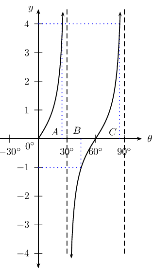

**Problem:**
Use the graph to determine where \(\tan 3 \theta < -1\).

**Solution:**
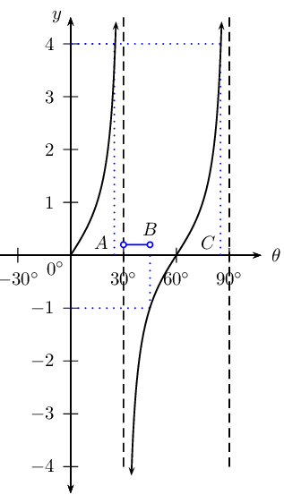

\(\text{30} ° < \theta < \text{45} °\)

**Problem:**
Show that:
            \[\sin (A + B) - \sin (A - B) = 2 \cos A \sin B\]

**Solution:**
\begin{align*}
            \text{LHS } &= \sin (A + B) - \sin (A - B) \\
            &= \sin A \cos B + \cos A \sin B - [ \sin A \cos B - \cos A \sin B ] \\
            &= \sin A \cos B + \cos A \sin B - \sin A \cos B + \cos A \sin B \\
            &= 2 \cos A \sin B \\
            &= \text{RHS}
            \end{align*}

**Problem:**
Use this result to solve \(\sin 3x - \sin x = 0\) for \(x \in [- \text{180} °;
            \text{360} ° ]\).

**Solution:**
\begin{align*}
            \sin 3x - \sin x &= 0 \\
            \sin (2x + x) - \sin (2x - x) &= 0 \\
            \text{So } A = 2x & \text{ and } B = x \\
            \therefore \text{we can write } 2 \cos 2x \sin x &= 0 \\
            & \\
            \text{If } \cos 2x &= 0 \\
            2x &= \text{90} ° + k \cdot \text{360} ° \\
            \therefore x &= \text{45} ° + k \cdot \text{180} °, k \in \mathbb{Z} \\
            & \\
            2x &= \text{270} ° + k \cdot \text{360} ° \\
            \therefore x &= \text{135} ° + k \cdot \text{180} °, k \in \mathbb{Z} \\
            & \\
            \text{If } \sin x &= 0 \\
            x &= \text{0} ° + k \cdot \text{360} °, k \in \mathbb{Z} \\
            \text{ or } x &= \text{180} ° + k \cdot \text{180} °, k \in \mathbb{Z} \\
            & \\
            \text{Final answer: }
            k=-2: \quad x &= - \text{180} ° \\
            k=-1: \quad x &= - \text{135} °; - \text{45} ° \\
            k=0: \quad x &= \text{45} °; \text{135} °; \text{0} °; \text{180} ° \\
            k=1: \quad x &= \text{225} °; \text{315} °; \text{360} ° \\
            \text{Final answer: } x &= - \text{180} °; - \text{135} °; - \text{45} °; \\
            & \text{0} °; \text{45} °; \text{135} °; \text{180} °; \\
            & \text{225} °; \text{315} °; \text{360} °
            \end{align*}

**Problem:**
On the same system of axes, draw two graphs to solve graphically: \(\sin 3x - \sin x =
            0\) for \(x \in [ \text{0} °; \text{360} ° ]\). Indicate the solutions on the graph using the
            letters \(A, B, \ldots\) etc.

**Solution:**
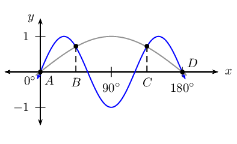

Given: \(\cos 2 x = \sin x\) for \(x \in [ \text{0} °; \text{360} °]\)

**Problem:**
Solve for \(x\) algebraically.

**Solution:**
\begin{align*}
            \cos 2x &= \sin x \\
            \cos 2x &= \cos \left( \text{90} ° - x \right) \\
            2x &= \text{90} ° - x + k \cdot \text{360} ° \\
            3x &= \text{90} ° + k \cdot \text{360} ° \\
            x &= \text{30} ° + k \cdot \text{120} ° \\
            & \\
            2x &= [ \text{360} ° - ( \text{90} ° - x )] + k \cdot \text{360} ° \\
            &= \text{270} ° + x + k \cdot \text{360} ° \\
            x &= \text{270} ° + k \cdot \text{360} ° \\
            & \\
            k=0: \quad x &= \text{30} ° \\
            x &= \text{270} ° \\
            k=1: \quad x &= \text{150} ° \\
            x &= \text{270} °
            \end{align*}

**Problem:**
Verify the solution graphically by sketching two graphs on the same system of axes.

**Solution:**
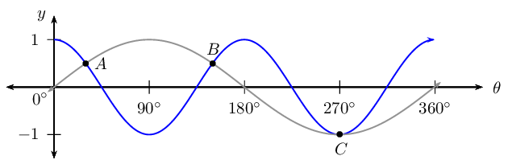

The following graphs are given below:

          \begin{align*}
          f: &= a \sin x \\
          g: &= \cos bx \qquad \left( x \in [ \text{0} °; \text{360} °] \right)
          \end{align*}

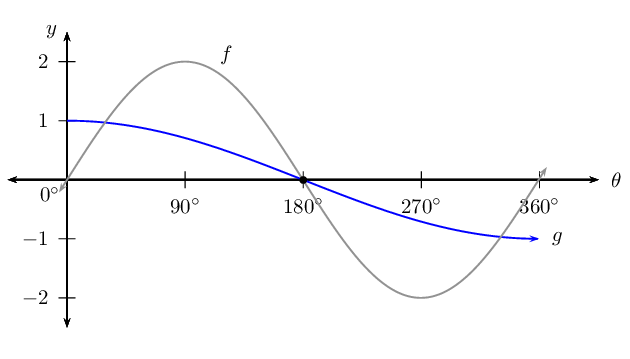

**Problem:**
Explain why \(a = 2\) and \(b = \frac{1}{2}\).

**Solution:**
From the graph we can see that the amplitude of the sine graph is \(\text{2}\), therefore \(a = 2\).

For the cosine graph, the period is \(\text{720} °\), therefore \(b = \frac{ \text{360} °}{
              \text{720} °} = \frac{1}{2}\).

**Problem:**
For how many \(x\)-values in \([ \text{0} °; \text{360} °]\) will \(f(x) - g(x)
            = 0\)?

**Solution:**
For:

            \begin{align*}
            f(x) - g(x) &= 0 \\
            f(x) &= g(x)
            \end{align*}

For the interval \([ \text{0} °; \text{360} °]\), the diagram shows that the two graphs
              intersect at three places.

**Problem:**
Use the graph to solve \(f(x) - g(x) = 1\).

**Solution:**
From the graph we have the following solution:

            \begin{align*}
            f( \text{360} °) - g( \text{360} °) &= 0 - (-1) = 1 \\
            \therefore x &= \text{360} °
            \end{align*}

**Problem:**
Solve \(a \sin x = \cos bx\) for \(x \in [ \text{0} °; \text{360} °]\) using
            trigonometric identities.

**Solution:**
\begin{align*}
            2 \sin x &= \cos \frac{1}{2}x \\
            2 \sin 2 \left( \frac{x}{2} \right) &= \cos \frac{1}{2}x \\
            2 \left( 2 \sin \frac{x}{2} \cos \frac{x}{2} \right) &= \cos \frac{1}{2}x \\
            4 \sin \frac{x}{2} \cos \frac{x}{2} - \cos \frac{1}{2}x &= 0 \\
            \cos \frac{x}{2} \left( 4 \sin \frac{x}{2} - 1 \right) &= 0
            \end{align*}
            \begin{align*}
            \text{If } \cos \frac{x}{2} &= 0 \\
            \frac{x}{2} &= \text{90} ° \\
            \therefore x &= \text{180} ° \\
            & \\
            \text{If } 4 \sin \frac{x}{2} - 1 &= 0 \\
            4 \sin \frac{x}{2} &= 1 \\
            \sin \frac{x}{2} &= \frac{1}{4} \\
            \text{ref } \angle &= \text{14,47} ° \\
            \therefore \frac{x}{2} &= \text{14,47} ° \\
            x &= \text{29} ° \\
            \text{ or } \frac{x}{2} &= \text{180} ° - \text{14,47} ° \\
            &= \text{165,53} ° \\
            \therefore x &= \text{331} ° \\
            & \\
            \text{Final answer: } x &= \text{180} °, \text{29} °, \text{331} °
            \end{align*}

**Problem:**
For which values of \(x\) will \(\frac{1}{2} \cos \left( \frac{x}{2} \right) \leq \sin
            x\) for \(x \in [ \text{0} °; \text{360} °]\)?

**Solution:**
\begin{align*}
            \frac{1}{2} \cos \left( \frac{x}{2} \right) & \leq \sin x \\
            \cos \left( \frac{x}{2} \right) & \leq 2\sin x \\
            \text{where } g(x) & \leq f(x) \\
            \text{Answer: } \text{29} ° \leq x \leq \text{180} ° &\text{ or } \text{331} ° \leq x
            \leq \text{360} °
            \end{align*}

In \(\triangle ABC\), \(AB = c, BC = a, CA = b \text{ and } \hat{C} = \text{90} °\)

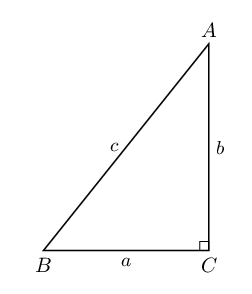

**Problem:**
Prove that \(\sin 2A = \frac{2ab}{c^{2}}\).

**Solution:**
\begin{align*}
            \text{LHS} &= \sin 2A \\
            &= 2 \sin A \cos A \\
            &= 2 \left( \frac{a}{c} \right) \left( \frac{b}{c} \right) \\
            &= \frac{2ab}{c^{2}} \\
            &= \text{RHS}
            \end{align*}

**Problem:**
Show that \(\cos 2A = \frac{b^{2} - a^{2}}{c^{2}}\).

**Solution:**
\begin{align*}
            \text{LHS} &= \cos 2A \\
            &= \cos^{2} A - \sin^{2} A \\
            &= \left( \frac{b}{c} \right)^{2} - \left( \frac{a}{c} \right)^{2} \\
            &= \frac{b^{2} - a^{2}}{c^{2}} \\
            &= \text{RHS}
            \end{align*}

**Problem:**
Given the graphs of \(f(\theta) = p \sin k\theta\) and \(g(\theta) = q \tan \theta\), determine the values
            of \(p, k\) and \(q\).

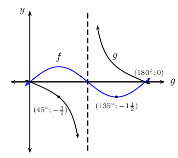

**Solution:**
\(f(\theta) = \frac{3}{2} \sin 2\theta\) and \(g(\theta) = -\frac{3}{2} \tan \theta\)

**Problem:**
\(\triangle RST\) is an acute angled triangle with \(RS = ST = t\). Show that area
          \(\triangle RST = t^{2} \sin \hat{T} \cos \hat{T}\).

**Solution:**
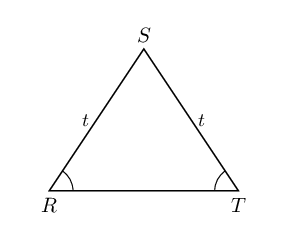

\(RSTU\) is a cyclic quadrilateral with \(RU = \text{6}\text{ cm}, UT = \text{7,5}\text{ cm}, RT =
            \text{11}\text{ cm} \text{ and } RS = \text{9,5}\text{ cm}\).

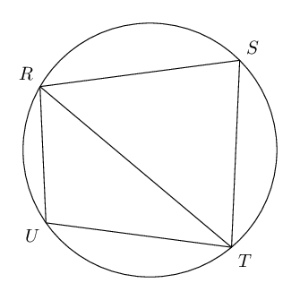

**Problem:**
Calculate \(\hat{U}\).

**Solution:**
\begin{align*}
            \text{In } \triangle RUT \quad RT^{2} &= RU^{2} + UT^{2} - 2 RU \cdot UT \cos \hat{U} \\
            \therefore \cos \hat{U} &= \frac{RU^{2} + UT^{2} - RT^{2}}{2 RU \cdot UT } \\
            &= \frac{6^{2} + (\text{7,5})^{2} - 11^{2}}{2(6)(\text{7,5}) } \\
            &= - \text{0,3194} \ldots \\
            \text{ref } \angle &= \text{71,4} ° \\
            \hat{U} &= \text{180} ° - \text{71,4} ° \\
            &= \text{108,6} °
            \end{align*}

**Problem:**
Determine \(\hat{S}\).

**Solution:**
\begin{align*}
            \hat{S} &= \text{180} ° - \text{108,6} ° \quad (\text{opp. } \angle \text{s of cyclic. quad.
            suppl.}) \\
            &= \text{71,4} °
            \end{align*}

**Problem:**
Find \(R\hat{T}S\).

**Solution:**
\begin{align*}
            \frac{\sin R\hat{T}S}{RS} &= \frac{\sin R\hat{S}T}{RT} \\
            \frac{\sin R\hat{T}S}{\text{9,5}} &= \frac{\sin \text{71,4}}{\text{11}} \\
            \sin R\hat{T}S &= \frac{\text{9,5} \sin \text{71,4}}{\text{11}} \\
            &= \text{0,8185} \ldots \\
            \therefore R\hat{T}S &= \text{54,9} °
            \end{align*}

\(BCDE\) is a cyclic quadrilateral that lies in a horizontal plane. \(AB\) is a vertical pole with base
            \(B\). The angle of elevation from \(E\) to \(A\) is \(x°\) and \(C\hat{D}E = y°\). \(\triangle
            BEC\) is an isosceles triangle with \(BE = BC\).

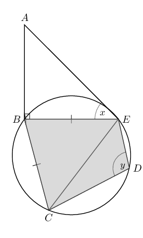

**Problem:**
Show that \(B\hat{C}E = \frac{1}{2}y\).

**Solution:**
In cyclic quadrilateral \(BCDE\):

            \begin{align*}
            \hat{B} &= \text{180} ° - y \\
            BE &= BC \qquad \text{(given)} \\
            B\hat{C}E &= B\hat{E}C \\
            &= \frac{ \text{180} ° - ( \text{180} ° - y)}{2} \\
            &= \frac{y}{2}
            \end{align*}

**Problem:**
Show that \(CE = 2BE \cos \left( \frac{y}{2} \right)\)

**Solution:**
\begin{align*}
            \text{In } \triangle BCE: \quad \frac{CE}{\sin C\hat{B}E} &= \frac{BE}{\sin B\hat{C}E} \\
            \therefore CE &= \frac{BE \sin C\hat{B}E }{\sin B\hat{C}E} \\
            &= \frac{BE \sin ( \text{180} ° - y) }{\sin \left( \frac{y}{2} \right)} \\
            &= \frac{BE \sin y}{\sin \left( \frac{y}{2} \right)} \\
            &= \frac{BE (2 \sin \left( \frac{y}{2} \right) \cos \left( \frac{y}{2} \right) )}{\sin \left(
            \frac{y}{2} \right) } \\
            &= 2BE \cos \left( \frac{y}{2} \right)
            \end{align*}

**Problem:**
If \(AB = \text{2,6}\text{ m}, x = \text{37} ° \text{ and } y = \text{109} °\),
            calculate the length of \(CE\).

**Solution:**
\begin{align*}
            \text{In } \triangle ABE: \quad \frac{AB}{BE} &= \tan x \qquad (A\hat{B}E = \text{90} °) \\
            \therefore BE &= \frac{AB}{\tan x} \\
            &= \frac{\text{2,6} }{\tan \text{37} °} \\
            &= \text{3,45} \\
            \therefore CE &= 2BE \cos \left( \frac{y}{2} \right) \\
            &= 2 (\text{3,45} ) \cos \left( \frac{ \text{109} °}{2} \right) \\
            &= \text{4}\text{ m}
            \end{align*}

The first diagram shows a rectangular box with \(SR = \text{8}\text{ cm}, PS = \text{6}\text{ cm}\) and
            \(PA = \text{4}\text{ cm}\). The lid of the box, \(ABCD\), is opened \(\text{30} °\) to the position
            \(XYCD\), as shown in the second diagram.

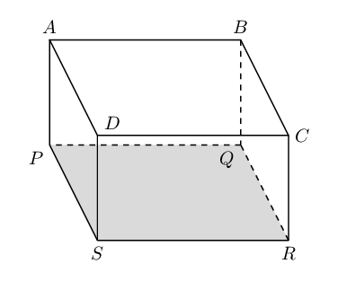

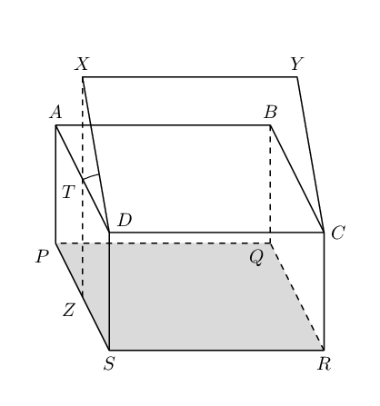

**Problem:**
Write down the dimensions (length, breadth and diagonal) of the lid \(XYCD\).

**Solution:**
\begin{align*}
            \text{length } &= XY = DC = \text{8}\text{ cm} \\
            \text{breadth } &= XD = YC = \text{6}\text{ cm} \\
            \text{diagonal } &= AC = XC \\
            &= \sqrt{8^{2} + 6^{2}} \qquad (\text{Pythagoras})\\
            &= \text{10}\text{ cm}
            \end{align*}

**Problem:**
Calculate \(XZ\), the perpendicular height of \(X\) above the base of the box.

**Solution:**
\begin{align*}
            TZ &= AP = \text{4}\text{ cm} \\
            \text{In } \triangle XTD: \quad \frac{XT}{XD} &= \sin \text{30} ° \\
            \frac{XT}{6} &= \frac{1}{2} \\
            \therefore XT &= \text{3}\text{ cm} \\
            \therefore XZ &= 4 + 3 = \text{7}\text{ cm}
            \end{align*}

**Problem:**
Calculate the ratio \(\frac{\sin X\hat{Z}C}{\sin X\hat{C}Z}\).

**Solution:**
\begin{align*}
            \text{In } \triangle XTC: \quad \frac{\sin X\hat{Z}C}{XC} &= \frac{\sin X\hat{C}Z}{XZ} \\
            \therefore \frac{\sin X\hat{Z}C}{\sin X\hat{C}Z} &= \frac{XC}{XZ} \\
            &= \frac{10}{7}
            \end{align*}

\(AB\) is a vertical pole on a horizontal plane \(BCD\). \(DC\) is \(a\) metres and the angle of elevation
            from \(D\) to \(A\) is \(\theta\). \(A\hat{C}D = \alpha\) and \(A\hat{D}C = \beta\).

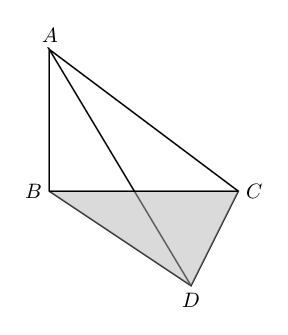

**Problem:**
Name the two right angles in the diagram.

**Solution:**
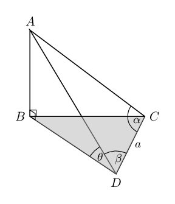

**Problem:**
Show that \(AB = \frac{a \sin \alpha \sin \theta}{\sin (\alpha + \beta)}\).

**Solution:**
\begin{align*}
            \text{In } \triangle ABC: \quad \frac{AB}{AD} &= \sin \theta \\
            \therefore AB &= AD \sin \theta \\
            \text{In } \triangle ADC: \quad \frac{AD}{\sin \alpha} &= \frac{DC}{\sin D\hat{A}C} \\
            AD &= \frac{a \sin \alpha}{\sin [ \text{180} ° - (\alpha + \beta)]} \\
            &= \frac{a \sin \alpha}{\sin (\alpha + \beta)} \\
            & \\
            \therefore AB &= \frac{a \sin \alpha \sin \theta }{\sin (\alpha + \beta)}
            \end{align*}

**Problem:**
If it is given that \(AD = AC\), show that the height of the pole is given by \(AB =
            \frac{a \sin \theta}{2 \cos \alpha}\).

**Solution:**
\begin{align*}
            AD &= AC \qquad (\text{given}) \\
            \therefore \beta &= \alpha \qquad (\text{isos. } \triangle ADC) \\
            \therefore AB &= \frac{a \sin \alpha \sin \theta }{\sin (\alpha + \alpha)} \\
            &= \frac{a \sin \alpha \sin \theta }{\sin 2 \alpha} \\
            &= \frac{a \sin \alpha \sin \theta }{2 \sin \alpha \cos \alpha} \\
            &= \frac{a \sin \theta }{2 \cos \alpha}
            \end{align*}

**Problem:**
Calculate the height of the pole if \(a = \text{13}\text{ m}, \theta = \text{33} °,
            \alpha = \beta = \text{65} °\).

**Solution:**
\begin{align*}
            AB &= \frac{a \sin \theta }{2 \cos \alpha} \\
            &= \frac{13 \times \sin \text{33} ° }{2 \cos \text{65} °} \\
            &= \text{8,4}\text{ m}
            \end{align*}

\(AB\) is a flagpole on top of a government building \(BC\). \(AB = f\) units and \(D\) is a point on the
            ground in the same horizontal plane as the base of the building, \(C\). The angle of elevation from \(D\) to
            \(A\) and \(B\) is \(\alpha\) and \(\beta\), respectively.

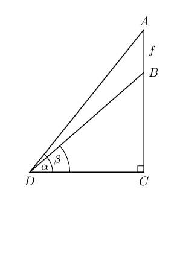

**Problem:**
Show that \(f = \frac{BC \sin (\alpha - \beta)}{\sin \beta \cos \alpha}\)

**Solution:**
\begin{align*}
            \text{In } \triangle ABD: \quad \frac{f}{\sin (\alpha - \beta)} &= \frac{DB}{\sin ( \text{90} ° -
            \alpha)} \\
            \therefore f &= \frac{DB \sin (\alpha - \beta)}{\cos \alpha} \\
            \text{In } \triangle BDC: \quad \frac{BC}{DB} &= \sin \beta \\
            \therefore DB &= \frac{BC}{\sin \beta} \\
            & \\
            \therefore f &= \frac{BC \sin (\alpha - \beta)}{\sin \beta \cos \alpha}
            \end{align*}

**Problem:**
Calculate the height of the flagpole (to the nearest metre) if the building is
            \(\text{7}\text{ m}\), \(\alpha = \text{63} °\) and \(\beta = \text{57} °\).

**Solution:**
\begin{align*}
            f &= \frac{BC \sin (\alpha - \beta)}{\sin \beta \cos \alpha} \\
            &= \frac{7 \times \sin ( \text{63} ° - \text{57} °)}{\sin \text{57} ° \cos \text{63}
            °} \\
            &= \text{1,92} \\
            \therefore \text{height} &\approx \text{2}\text{ m} \qquad (\text{nearest metre})
            \end{align*}
