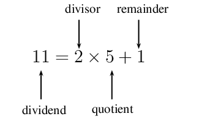
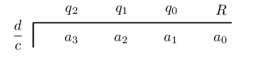

## 5.2 Cubic polynomials (EMCGT)

## Simple division

Consider the following and answer the questions below:

2. \(\text{6}\) students are at a product promotion and there are \(\text{15}\) free gifts to be given away.
               Each student must receive the same number of gifts.
   2. Determine how many gifts each student will get?
   4. How many gifts will be left over?
   6. Use the following variables to express the above situation as a mathematical equation:
      - \(a =\) total number of gifts
      - \(b =\) total number of students
      - \(q =\) number of gifts for each student
      - \(r =\) number of gifts left over
4. A group of students go to dinner together at a restaurant and the total bill is \(\text{R}\,\text{510}\).
               Each student contributes \(\text{R}\,\text{120}\) towards the bill. They count the money and find that they
               are still \(\text{R}\,\text{30}\) short.
   2. Assign variables to the known and unknown values.
   4. Write a mathematical equation to describe the situation.
   6. Use this equation to determine how many students went to dinner.

We know that \(\text{11}\) divided by \(\text{2}\) gives an answer of \(\text{5}\) with a remainder \(\text{1}\).

    \begin{align*}
    \frac{11}{2} &= 5 \text{ remainder } 1 \\
    \frac{11}{2} &= 5 + \frac{1}{2}
    \end{align*}

This means that:

We can write a general expression for the rule of division; if an integer \(a\) is divided by an integer \(b\),
      then the answer is \(q\) with a remainder \(r\).

    \begin{align*}
    \frac{a}{b} &= q + \frac{r}{b} \\
    a &= b \times q + r
    \end{align*}

where \(b \ne 0\) and \(0 \leq r < b\).

This rule can be extended to include the division of polynomials; if a polynomial \(a(x)\) is divided by a
      polynomial \(b(x)\), then the answer is \(Q(x)\) with a remainder \(R(x)\).

    \[a(x) = b(x) \times Q(x) + R(x)\]

where \(b(x) \ne 0\).

In words: the dividend is equal to the divisor multiplied by the quotient, plus the remainder.

A cubic polynomial is an expression with the highest power equal to \(\text{3}\); we say that the degree of the
      polynomial is \(\text{3}\).

The general form of a cubic polynomial is

    \[y = a{x}^{3}+b{x}^{2}+cx+d\]

where \(a \ne 0\).

In Grade 10 we learnt how to factorise the sum and difference of two cubes by first finding a factor (the first
      bracket) and then using inspection (the second bracket). For example,

    \[p^{3} + 8 = (p+2)(p^2 - 2p + 4)\]
    \[k^{3} - 1 = (k-1)(k^2 + k + 1)\]

In this section we focus on factorising cubic polynomials with one variable (univariate) where \(b\) and \(c\)
      are not zero.

We use the following methods for factorising cubic polynomials:

- long division
- synthetic division
- inspection

<Callout type="tip" title="Worked example 4: Long division">
**Question:**
Use the long division method to determine the quotient \(Q(x)\) and the remainder \(R(x)\) if \(a(x) = 2x^{3}
          - x^{2} - 6x + 16\) is divided by \(b(x) = x - 1\). Write your answer in the form \(a(x) = b(x) \cdot Q(x) +
          R(x)\).

**Write down the known and unknown expressions:**
\begin{align*}
        a(x) &= b(x) \cdot Q(x) + R(x) \\
        2x^{3} - x^{2} - 6x + 16 &= (x-1) \cdot Q(x) + R(x)
        \end{align*}

**Use long division method to determine \(Q(x)\) and \(R(x)\):**
Make sure that \(a(x)\) and \(b(x)\) are written in descending order of the exponents. If a term of a certain
          degree is missing from \(a(x)\), then write the term with a coefficient of \(\text{0}\).

        \begin{align*}
        & 2x^{2} + x - 5 \\
        x-1 & | \overline{2x^{3} - x^{2} - 6x + 16 } \\
        - & \left( \underline{2x^{3} - 2x^{2}} \right) \\
        & \text{ } 0 + x^{2} - 6x \\
        &\text{ } - \left( \underline{x^{2} - x} \right) \\
        & \text{ } \quad \quad 0 -5x + 16 \\
        & \text{ } \quad \quad - \left( \underline{-5x + 5} \right) \\
        & \text{ } \quad \quad \qquad 0 + 11
        \end{align*}

**Write the final answer:**
\begin{align*}
        Q(x) &= 2x^{2} + x - 5 \\
        R(x) &= 11 \\
        \text{and } a(x) &= b(x) \cdot Q(x) + R(x) \\
        \therefore a(x) &= (x-1)(2x^{2} + x - 5 ) + 11
        \end{align*}
</Callout>

<Callout type="note" title="Note">
<VideoPlayer src="https://www.youtube.com/embed/brpNxPAkv1c" title="Video: 28S4" />
</Callout>

Synthetic division is a simpler and more efficient method for dividing polynomials. It allows us to determine the
      quotient and the remainder by considering the coefficients of the terms in each of the polynomials without needing
      to rewrite the variable and exponent for each term. If a term of a certain degree is missing from \(a(x)\), then
      write the term with a coefficient of \(\text{0}\). For example, \(a(x) = 5x^{3} + 6x - 1\) should be written as
      \(a(x) = 5x^{3} + 0x^{2} + 6x - 1\).

Notice that for synthetic division:

- the coefficients of the dividend (\(a(x)\)) are written below the horizontal line.
- the coefficients of the quotient (\(Q(x)\)) are written above the horizontal line.
- we add coefficients instead of subtracting as is the case with long division
- we use the opposite sign of the divisor (\(b(x)\)); the divisor is \((x - 1)\) and we use \(\text{+1}\).
- the coefficient of the \(x\) term in the divisor is \(\text{1}\), so \(q_{2} = a_{3}\).

<Callout type="tip" title="Worked example 5: Synthetic division">
**Question:**
Use the synthetic division method to determine the quotient \(Q(x)\) and the remainder \(R(x)\) if \(a(x) =
          2x^{3} - x^{2} - 6x + 16\) is divided by \(b(x) = x - 1\). Write your answer in the form \(a(x) = b(x) \cdot
          Q(x) + R(x)\).

**Write down the known and unknown expressions:**
\begin{align*}
        a(x) &= b(x) \cdot Q(x) + R(x) \\
        2x^{3} - x^{2} - 6x + 16 &= (x-1) \cdot Q(x) + R(x)
        \end{align*}

**Use synthetic division to determine \(Q(x)\) and \(R(x)\):**
\begin{align*}
        & 2 \quad +1 \quad -5 \quad 11 \\
        1 & | \overline{2 \quad -1 \quad -6 \quad 16 }
        \end{align*}\begin{align*}
        q_{2}&= 2 \\
        q_{1}&= -1 + (2)(1) = 1 \\
        q_{0}&= -6 + (1)(1) = -5 \\
        R &= 16 + (-5)(1) = 11
        \end{align*}

**Write the final answer:**
The quotient will be one degree lower than the dividend if we divide by a linear expression, therefore we
          have:

        \begin{align*}
        Q(x) &= 2x^{2} + x - 5 \\
        R(x) &= 11 \\
        \text{and } a(x) &= b(x) \cdot Q(x) + R(x) \\
        \therefore a(x) &= (x-1)(2x^{2} + x - 5 ) + 11
        \end{align*}
</Callout>

**General method:** given the dividend \(a(x) = a_{3}x^{3} + a_{2}x^{2} +a_{1}x^{1} +a_{0}x^{0}\)
      and the divisor \((cx - d)\), we determine the quotient \(Q(x) = q_{2}x^{2} + q_{1}x^{1} + q_{0}x^{0}\) and the
      remainder \(R(x)\) using:

We determine the coefficients of the quotient by calculating:

    \begin{align*}
    q_{2} &= a_{3} + \left( q_{3} \times \frac{d}{c} \right) \\
    &= a_{3} \quad \text{ (since } q_{3} = 0) \\
    q_{1} &= a_{2} + \left( q_{2} \times \frac{d}{c} \right) \\
    q_{0} &= a_{1} + \left( q_{1} \times \frac{d}{c} \right) \\
    R &= a_{0} + \left( q_{0} \times \frac{d}{c} \right)
    \end{align*}

Important note: \(a(x)\) is a function and \(a_{3}, a_{2}, a_{1}, \text{ and } a_{0}\) are coefficients.

<Callout type="note" title="Note">
<VideoPlayer src="https://www.khanacademy.org/embed_video?v=1byR9UEQJN0" title="Video: 28S5" />
</Callout>

<QuizCard id="m12-05-02a" title="Interactive Exercise 5.3" question="If \(a(x) = 13x^{2} -22x -5 -3x^{3}\) is divided by \(b(x) = 3x -1\) , use the synthetic division method to determine the quotient \(Q(x)\) and the remainder \(R(x)\) . Give your answer in the form \(a(x) = b(x) \cdot Q(x) + R(x)\) ." options=[] answer="-x^2 + 4x-6, -11" hint="Your answer should be a mathematical expression. You can use the following symbols to write mathematical expressions: add: + subtract: − multiply: ∗ divide: / exponent: ^ The following special symbols are also recognised: pi (π): pi infinity (∞): oo It is also possible to write certain functions: √: sqrt( ) log: log( ) sin: sin( ) cosec: cosec( ) cos: cos( ) sec: sec( ) tan: tan( ) cot: cot( ) To write a logarithm with a specific base, use the underscore _ symbol.                For example, log of x base 3 can be written as: log_3 x" explanation="Write down the known and unknown expressions \[                     \begin{aligned}                     a(x) &= b(x) \cdot Q(x) + R(x) \\                     -3x^{3} + 13x^{2} -22x -5 &= \left(3x -1\right) \cdot Q(x) + R(x)                     \end{aligned}                 \] Use the synthetic division method to determine \(Q(x)\) and \(R(x)\) Synthetic division is an efficient method for dividing polynomials. We use the synthetic division method to determine the quotient and the remainder by considering the coefficients of the terms in each of the polynomials without needing to rewrite the variable and exponent for each term. General method for synthetic division: given the dividend \(a(x) = a_{3}x^{3} + a_{2}x^{2} + a_{1}x^{1} + a_{0}x^{0}\) and the divisor \((cx - d)\) , we determine the quotient \(Q(x) = q_{2}x^{2} + q_{1}x^{1} + q_{0}x^{0}\) and the remainder \(R(x)\) using: We determine the coefficients of the quotient by calculating the following: \[                     \begin{aligned}                     q_{2} &= a_{3} + \left( q_{3} \times \frac{d}{c} \right)  \\                     &= a_{3} \quad \text{ (because }  q_{3} =  0) \\                     q_{1} &= a_{2} + \left( q_{2} \times \frac{d}{c} \right)    \\                     q_{0} &= a_{1} + \left( q_{1} \times \frac{d}{c} \right)    \\                     R     &= a_{0} + \left( q_{0} \times \frac{d}{c} \right)                         \end{aligned}                 \] Where \(a(x)\) is a function and \(a_{3}, a_{2}, a_{1}, \text{ and } a_{0}\) are coefficients. Make sure that \(a(x)\) and \(b(x)\) are written in descending order of exponents. If a term of a certain degree is missing from \(a(x)\) , then write the term with a coefficient of \(\text{0}\) . \[\begin{array}{c}b(x) = \left( 3x -1 \right) = 3\left(x - \frac{1}{3} \right)\end{array}\] \[                     \begin{aligned}                     \\                     & -3 \quad 12 \quad -18 \quad -11 \\                     \frac{1}{3} & \vert \overline{-3 \quad 13 \quad -22 \quad -5}                     \end{aligned}                 \] \[                     \begin{aligned}                     \\                     q_{2} &= -3 \\                     q_{1} &= 13 + \left( \frac{1}{3} \right) (-3) = 12 \\                     q_{0} &= -22 + \left( \frac{1}{3} \right) (12) = -18 \\                     R &= -5 + \left(\frac{1}{3} \right) (-18) = -11                     \end{aligned}                 \] Write the final answer \[                     \begin{aligned}                     Q(x) &= -3x^2  + 12x-18 \\ R(x) &= -11 \\ \text{and } a(x) &= \frac{1}{3}b(x) \cdot Q(x) + R(x) \\ ( \text{we took}&\text{out a factor of }3\text{ for } b(x) \text{, so now we multiply by } \frac{1}{3}\text{)} \\ &= \frac{1}{3}\cdot3\left(x - \frac{1}{3}\right) \left(-3x^{2}  + 12x-18 \right) -11 \\ &= 3\left(x - \frac{1}{3} \right) \left(-x^2 + 4x-6\right) -11 \\ \therefore a(x) &= \left(3x -1 \right) \left(-x^2 + 4x-6\right) -11                     \end{aligned}                 \] Therefore, the polynomial \( - 3 x^{3} + 13 x^{2} - 22 x - 5 \) can be written as: \[\begin{array}{c}\left( 3x -1 \right) \cdot \boxed{\left( -x^2 + 4x-6 \right)} + \boxed{-11}\end{array}\] Check your answer: we can always make sure that we have performed the synthetic division method correctly by multiplying out the brackets, simplifying the terms and making sure that the final answer is the same as the expression given in the question statement: \[                     \begin{aligned}                     & \left( 3x -1 \right) \left( -x^2 + 4x-6 \right)  -11 \\                     &= - 3 x^{3} + 12 x^{2}- 18 x + x^{2}- 4 x + 6-11 \\&= - 3 x^{3} + 12 x^{2} + x^{2}- 18 x- 4 x + 6-11 \\                     &= - 3 x^{3} + 13 x^{2} - 22 x - 5                     \end{aligned}                 \] Submit your answer as: and" />

<QuizCard id="m12-05-02a" title="Interactive Exercise 5.3" question="If \(a(x) = -5 -x^{3} + 7x + 4x^{2}\) is divided by \(b(x) = x + 2\) , use the synthetic division method to determine the quotient \(Q(x)\) and the remainder \(R(x)\) . Give your answer in the form \(a(x) = b(x) \cdot Q(x) + R(x)\) ." options=[] answer="-x^2 + 6x-5, 5" hint="Your answer should be a mathematical expression. You can use the following symbols to write mathematical expressions: add: + subtract: − multiply: ∗ divide: / exponent: ^ The following special symbols are also recognised: pi (π): pi infinity (∞): oo It is also possible to write certain functions: √: sqrt( ) log: log( ) sin: sin( ) cosec: cosec( ) cos: cos( ) sec: sec( ) tan: tan( ) cot: cot( ) To write a logarithm with a specific base, use the underscore _ symbol.                For example, log of x base 3 can be written as: log_3 x" explanation="Write down the known and unknown expressions \[                     \begin{aligned}                     a(x) &= b(x) \cdot Q(x) + R(x) \\                     -x^{3} + 4x^{2} + 7x -5 &= \left(x + 2\right) \cdot Q(x) + R(x)                     \end{aligned}                 \] Use the synthetic division method to determine \(Q(x)\) and \(R(x)\) Synthetic division is an efficient method for dividing polynomials. We use the synthetic division method to determine the quotient and the remainder by considering the coefficients of the terms in each of the polynomials without needing to rewrite the variable and exponent for each term. General method for synthetic division: given the dividend \(a(x) = a_{3}x^{3} + a_{2}x^{2} + a_{1}x^{1} + a_{0}x^{0}\) and the divisor \((cx - d)\) , we determine the quotient \(Q(x) = q_{2}x^{2} + q_{1}x^{1} + q_{0}x^{0}\) and the remainder \(R(x)\) using: We determine the coefficients of the quotient by calculating the following: \[                     \begin{aligned}                     q_{2} &= a_{3} + \left( q_{3} \times \frac{d}{c} \right)  \\                     &= a_{3} \quad \text{ (because }  q_{3} =  0) \\                     q_{1} &= a_{2} + \left( q_{2} \times \frac{d}{c} \right)    \\                     q_{0} &= a_{1} + \left( q_{1} \times \frac{d}{c} \right)    \\                     R     &= a_{0} + \left( q_{0} \times \frac{d}{c} \right)                         \end{aligned}                 \] Where \(a(x)\) is a function and \(a_{3}, a_{2}, a_{1}, \text{ and } a_{0}\) are coefficients. Make sure that \(a(x)\) and \(b(x)\) are written in descending order of exponents. If a term of a certain degree is missing from \(a(x)\) , then write the term with a coefficient of \(\text{0}\) . \[\begin{array}{c}b(x) = \left( x + 2 \right)\end{array}\] \[                     \begin{aligned}                     \\                     & -1 \quad 6 \quad -5 \quad 5 \\                     -2 & \vert \overline{-1 \quad 4 \quad 7 \quad -5}                     \end{aligned}                 \] \[                     \begin{aligned}                     \\                     q_{2} &= -1 \\                     q_{1} &= 4 + \left( -2 \right) (-1) = 6 \\                     q_{0} &= 7 + \left( -2 \right) (6) = -5 \\                     R &= -5 + \left(-2 \right) (-5) = 5                     \end{aligned}                 \] Write the final answer \[                     \begin{aligned}                     Q(x) &= -x^2 + 6x-5 \\ R(x) &= 5 \\ \text{and } a(x) &= b(x) \cdot Q(x) + R(x) \\ \therefore a(x) &= \left(x + 2\right) \left(-x^2 + 6x-5\right)  + 5                     \end{aligned}                 \] Therefore, the polynomial \( - x^{3} + 4 x^{2} + 7 x - 5 \) can be written as: \[\begin{array}{c}\left( x + 2 \right) \cdot \boxed{\left( -x^2 + 6x-5 \right)} + \boxed{5}\end{array}\] Check your answer: we can always make sure that we have performed the synthetic division method correctly by multiplying out the brackets, simplifying the terms and making sure that the final answer is the same as the expression given in the question statement: \[                     \begin{aligned}                     & \left( x + 2 \right) \left( -x^2 + 6x-5 \right)  +  5 \\                     &= - x^{3} + 6 x^{2}- 5 x- 2 x^{2} + 12 x-10 + 5 \\&= - x^{3} + 6 x^{2}- 2 x^{2}- 5 x + 12 x-10 + 5 \\                     &= - x^{3} + 4 x^{2} + 7 x - 5                     \end{aligned}                 \] Submit your answer as: and" />

<QuizCard id="m12-05-02a" title="Interactive Exercise 5.3" question="Use the synthetic division method to determine the quotient \(Q(x)\) and the remainder \(R(x)\) if \(a(x) = -3x^{2} -2x^{3} -1 + 4x\) is divided by \(b(x) = x + 2\) . Write your answer in the form \(a(x) = b(x) \cdot Q(x) + R(x)\) ." options=[] answer="-2x^2 + x + 2, -5" hint="Your answer should be a mathematical expression. You can use the following symbols to write mathematical expressions: add: + subtract: − multiply: ∗ divide: / exponent: ^ The following special symbols are also recognised: pi (π): pi infinity (∞): oo It is also possible to write certain functions: √: sqrt( ) log: log( ) sin: sin( ) cosec: cosec( ) cos: cos( ) sec: sec( ) tan: tan( ) cot: cot( ) To write a logarithm with a specific base, use the underscore _ symbol.                For example, log of x base 3 can be written as: log_3 x" explanation="Write down the known and unknown expressions \[                     \begin{aligned}                     a(x) &= b(x) \cdot Q(x) + R(x) \\                     -2x^{3} -3x^{2} + 4x -1 &= \left(x + 2\right) \cdot Q(x) + R(x)                     \end{aligned}                 \] Use the synthetic division method to determine \(Q(x)\) and \(R(x)\) Synthetic division is an efficient method for dividing polynomials. We use the synthetic division method to determine the quotient and the remainder by considering the coefficients of the terms in each of the polynomials without needing to rewrite the variable and exponent for each term. General method for synthetic division: given the dividend \(a(x) = a_{3}x^{3} + a_{2}x^{2} + a_{1}x^{1} + a_{0}x^{0}\) and the divisor \((cx - d)\) , we determine the quotient \(Q(x) = q_{2}x^{2} + q_{1}x^{1} + q_{0}x^{0}\) and the remainder \(R(x)\) using: We determine the coefficients of the quotient by calculating the following: \[                     \begin{aligned}                     q_{2} &= a_{3} + \left( q_{3} \times \frac{d}{c} \right)  \\                     &= a_{3} \quad \text{ (because }  q_{3} =  0) \\                     q_{1} &= a_{2} + \left( q_{2} \times \frac{d}{c} \right)    \\                     q_{0} &= a_{1} + \left( q_{1} \times \frac{d}{c} \right)    \\                     R     &= a_{0} + \left( q_{0} \times \frac{d}{c} \right)                         \end{aligned}                 \] Where \(a(x)\) is a function and \(a_{3}, a_{2}, a_{1}, \text{ and } a_{0}\) are coefficients. Make sure that \(a(x)\) and \(b(x)\) are written in descending order of exponents. If a term of a certain degree is missing from \(a(x)\) , then write the term with a coefficient of \(\text{0}\) . \[\begin{array}{c}b(x) = \left( x + 2 \right)\end{array}\] \[                     \begin{aligned}                     \\                     & -2 \quad 1 \quad 2 \quad -5 \\                     -2 & \vert \overline{-2 \quad -3 \quad 4 \quad -1}                     \end{aligned}                 \] \[                     \begin{aligned}                     \\                     q_{2} &= -2 \\                     q_{1} &= -3 + \left( -2 \right) (-2) = 1 \\                     q_{0} &= 4 + \left( -2 \right) (1) = 2 \\                     R &= -1 + \left(-2 \right) (2) = -5                     \end{aligned}                 \] Write the final answer \[                     \begin{aligned}                     Q(x) &= -2x^2 + x + 2 \\ R(x) &= -5 \\ \text{and } a(x) &= b(x) \cdot Q(x) + R(x) \\ \therefore a(x) &= \left(x + 2\right) \left(-2x^2 + x + 2\right) -5                     \end{aligned}                 \] Therefore, the polynomial \( - 2 x^{3} - 3 x^{2} + 4 x - 1 \) can be written as: \[\begin{array}{c}\left( x + 2 \right) \cdot \boxed{\left( -2x^2 + x + 2 \right)} + \boxed{-5}\end{array}\] Check your answer: we can always make sure that we have performed the synthetic division method correctly by multiplying out the brackets, simplifying the terms and making sure that the final answer is the same as the expression given in the question statement: \[                     \begin{aligned}                     & \left( x + 2 \right) \left( -2x^2 + x + 2 \right)  -5 \\                     &= - 2 x^{3} + x^{2} + 2 x- 4 x^{2} + 2 x + 4-5 \\&= - 2 x^{3} + x^{2}- 4 x^{2} + 2 x + 2 x + 4-5 \\                     &= - 2 x^{3} - 3 x^{2} + 4 x - 1                     \end{aligned}                 \] Submit your answer as: and" />

<Callout type="tip" title="Worked example 6: Synthetic division">
**Question:**
Use the synthetic division method to determine the quotient \(Q(x)\) and the remainder \(R(x)\) if \(a(x) =
          6x^{3} + x^{2} - 4x + 5\) is divided by \(b(x) = 2x - 1\).

**Write down the known and unknown expressions:**
\begin{align*}
        a(x) &= b(x) \cdot Q(x) + R(x) \\
        6x^{3} + x^{2} - 4x + 5 &= (2x-1) \cdot Q(x) + R(x)
        \end{align*}

**Use synthetic division to determine \(Q(x)\) and \(R(x)\):**
Make the leading coefficient of the divisor equal to \(\text{1}\):

        \[b(x) = (2x - 1) = 2 \left( x - \frac{1}{2} \right)\]
        \begin{align*}
        & 6 \quad 4 \quad -2 \quad 4 \\
        \frac{1}{2} & | \overline{6 \quad 1 \quad -4 \quad 5 }
        \end{align*}\begin{align*}
        q_{2}&= 6 \\
        q_{1}&= 1 + (6) \left(\frac{1}{2}\right) = 4 \\
        q_{0}&= -4 + (4)\left(\frac{1}{2}\right) = -2 \\
        R &= 5 + (-2)\left(\frac{1}{2}\right) = 4
        \end{align*}

**Write the final answer:**
\begin{align*}
        Q(x) &= 6x^{2} + 4x - 2 \\
        &= 2 \left( 3x^{2} + 2x - 1 \right) \\
        R &= 4 \\
        \text{and } a(x) &= \frac{1}{2}b(x) \cdot Q(x) + R(x) \\
        \therefore a(x) &= \frac{1}{2} \cdot 2\left( x-\frac{1}{2} \right)(6x^{2} + 4x - 2) + 4 \\
        &= \frac{1}{2} \cdot 2\left( x-\frac{1}{2} \right)(2)(3x^{2} + 2x - 1) + 4 \\
        &= (2x- 1)(3x^{2} + 2x - 1) + 4
        \end{align*}
</Callout>

<Callout type="note" title="Note">
<VideoPlayer src="https://www.khanacademy.org/embed_video?v=-nlMXVrgtjw" title="Video: 28S6" />
</Callout>

## Cubic polynomials

### Textbook Exercise 5.3

Factorise the following:

**Problem:**
\(p^{3} - 1\)

**Solution:**
\begin{align*}
              p^{3} - 1 &= (p - 1)(p^{2} + p + 1)
              \end{align*}

**Problem:**
\(t^{3} + 27\)

**Solution:**
\begin{align*}
              t^{3} + 27 &= (t + 3)(t^{2} + 3t + 9)
              \end{align*}

**Problem:**
\(64 - m^{3}\)

**Solution:**
\begin{align*}
              64 - m^{3} &= (4 - m)(16 + 4m + m^{2})
              \end{align*}

**Problem:**
\(k - 125k^{4}\)

**Solution:**
\begin{align*}
              k - 125k^{4} &= k(1 - 125k^{3}) \\
              &= k(1 - 5k)(1 + 5k + 25k^{2})
              \end{align*}

**Problem:**
\(8a^{6} - b^{9}\)

**Solution:**
\begin{align*}
              8a^{6} - b^{9} &= \left(2a^{2} \right)^{3} - \left(b^{3} \right)^{3} \\
              &= \left(2a^{2} - b^{3}\right) \left(4a^{4} + 2a^{2}b^{3} + b^{6}\right)
              \end{align*}

**Problem:**
\(8 - (p + q)^{3}\)

**Solution:**
\begin{align*}
              8 - (p + q)^{3} &= [2 - (p +q)][4 + 2(p+q) + (p+q)^{2}] \\
              &= (2 - p - q)(4 + 2p + 2q + p^{2} + 2pq + q^{2}) \\
              &= (2 - p - q)(4 + 2p + 2q + p^{2} + 2pq + q^{2})
              \end{align*}

For each of the following:

2. Use long division to determine the quotient \(Q(x)\) and the remainder \(R(x)\).
4. Write \(a(x)\) in the form \(a(x) = b(x) \cdot Q(x) + R(x).\)
6. Check your answer by expanding the brackets to get back to the original cubic polynomial.

**Problem:**
\(a(x) = x^{3} + 2x^{2} + 3x + 7\) is divided by \((x + 1)\)

**Solution:**
\begin{align*}
              & x^{2} + x + 2 \\
              x+1 & | \overline{x^{3} + 2x^{2} + 3x + 7 } \\
              - & \left( \underline{x^{3} + x^{2}} \right) \\
              & \text{ } 0 + x^{2} + 3x \\
              &\text{ } - \left( \underline{x^{2} + x} \right) \\
              & \text{ } \quad \quad 0 + 2x + 7 \\
              & \text{ } \quad \quad - \left( \underline{2x + 2} \right) \\
              & \text{ } \quad \quad \qquad 0 + 5
              \end{align*}
              \begin{align*}
              Q(x) &= x^{2} + x + 2 \\
              R(x) &= 5 \\
              \text{and } a(x) &= b(x) \cdot Q(x) + R(x) \\
              \therefore a(x) &= (x + 1)(x^{2} + x + 2) + 5
              \end{align*}

Check:

              \begin{align*}
              (x + 1)(x^{2} + x + 2) + 5 &= x^{3} + x^{2} + 2x + x^{2} + x + 2 + 5 \\
              &= x^{3} + 2x^{2} + 3x + 7
              \end{align*}

**Problem:**
\(a(x) = 1 + 4x^{2} - 5x -x^{3}\) and \(b(x) = x + 2\)

**Solution:**
\(a(x) = -x^{3} + 4x^{2} - 5x + 1\) and \(b(x) = x + 2\)

              \begin{align*}
              & -x^{2} + 6x - 17 \\
              x+2 & | \overline{-x^{3} + 4x^{2} - 5x + 1 } \\
              - & \left( \underline{-x^{3} - 2x^{2}} \right) \\
              & \text{ } 0 + 6x^{2} - 5x \\
              &\text{ } - \left( \underline{6x^{2} + 12x} \right) \\
              & \text{ } \quad \quad 0 - 17x + 1 \\
              & \text{ } \quad \quad - \left( \underline{-17x - 34 } \right) \\
              & \text{ } \quad \quad \qquad 0 + 35
              \end{align*}
              \begin{align*}
              Q(x) &= -x^{2} + 6x - 17 \\
              R(x) &= 35 \\
              \text{and } a(x) &= b(x) \cdot Q(x) + R(x) \\
              \therefore a(x) &= (x + 2)(-x^{2} + 6x - 17) + 35
              \end{align*}

Check:

              \begin{align*}
              (x + 2)(-x^{2} + 6x - 17) + 35 &= -x^{3} + 6x^{2} - 17x - 2x^{2} + 12x - 34 + 35 \\
              &= -x^{3} + 4x^{2} - 5x + 1
              \end{align*}

**Problem:**
\(a(x) = 2x^{3} + 3x^{2} + x - 6\) and \(b(x) = x - 1\)

**Solution:**
\begin{align*}
              & 2x^{2} + 5x + 6 \\
              x-1 & | \overline{2x^{3} + 3x^{2} + x - 6} \\
              - & \left( \underline{2x^{3} - 2x^{2}} \right) \\
              & \text{ } 0 + 5x^{2} + x \\
              &\text{ } - \left( \underline{5x^{2} - 5x} \right) \\
              & \text{ } \quad \quad 0 + 6x - 6 \\
              & \text{ } \quad \quad - \left( \underline{6x - 6 } \right) \\
              & \text{ } \quad \quad \qquad 0 + 0
              \end{align*}

The remainder is equal to zero, therefore \(b(x)\) is a factor of \(a(x)\).

              \begin{align*}
              Q(x) &= 2x^{2} + 5x + 6 \\
              R(x) &= 0 \\
              \text{and } a(x) &= b(x) \cdot Q(x) + R(x) \\
              \therefore a(x) &= (x - 1)(2x^{2} + 5x + 6 )
              \end{align*}

Check:

              \begin{align*}
              (x - 1)(2x^{2} + 5x + 6 ) &= 2x^{3} + 5x^{2} + 6x - 2x^{2} - 5x - 6 \\
              &= 2x^{3} + 3x^{2} + x - 6
              \end{align*}

**Problem:**
\(a(x) = x^{3} + 2x^{2} + 5\) and \(b(x) = x - 1\)

**Solution:**
\begin{align*}
              & x^{2} + 3x + 3 \\
              x-1 & | \overline{x^{3} + 2x^{2} + 5} \\
              - & \left( \underline{x^{3} - x^{2}} \right) \\
              & \text{ } 0 + 3x^{2} + 0x \\
              &\text{ } - \left( \underline{3x^{2} - 3x} \right) \\
              & \text{ } \quad \quad 0 + 3x + 5 \\
              & \text{ } \quad \quad - \left( \underline{3x - 3 } \right) \\
              & \text{ } \quad \quad \qquad 0 + 8
              \end{align*}
              \begin{align*}
              Q(x) &= x^{2} + 3x + 3 \\
              R(x) &= 8 \\
              \text{and } a(x) &= b(x) \cdot Q(x) + R(x) \\
              \therefore a(x) &= (x - 1)(x^{2} + 3x + 3) + 8
              \end{align*}

Check:

              \begin{align*}
              (x - 1)(x^{2} + 3x + 3) + 8 &= x^{3} + 3x^{2} + 3x - x^{2} - 3x - 3 + 8 \\
              &= x^{3} + 2x^{2} + 5
              \end{align*}

**Problem:**
\((x - 1)\) is divided into \(a(x) = x^{4} + 2x^{3} - 3x^{2} + 5x + 4\)

**Solution:**
\begin{align*}
              & x^{3} + 3x^{2} + 0x + 5 \\
              x-1 & | \overline{x^{4} + 2x^{3} - 3x^{2} + 5x + 4} \\
              - & \left( \underline{x^{4} - x^{3}} \right) \\
              & \text{ } 0 + 3x^{3} - 3x^{2} \\
              &\text{ } - \left( \underline{3x^{3} - 3x^{2}} \right) \\
              & \text{ } \quad \quad 0 + 0 + 5x + 4 \\
              & \text{ } \quad \quad \qquad - \left( \underline{5x - 5 } \right) \\
              & \text{ } \quad \quad \qquad \qquad 0 + 9
              \end{align*}
              \begin{align*}
              Q(x) &= x^{3} + 3x^{2} + 5 \\
              R(x) &= 9 \\
              \text{and } a(x) &= b(x) \cdot Q(x) + R(x) \\
              \therefore a(x) &= (x - 1)(x^{3} + 3x^{2} + 5 ) + 9
              \end{align*}

Check:

              \begin{align*}
              (x - 1)(x^{3} + 3x^{2} + 5 ) + 9 &= x^{4} + 3x^{3} + 5x - x^{3} - 3x^{2} - 5 + 9 \\
              &= x^{4} + 2x^{3} - 3x^{2} + 5x + 4
              \end{align*}

**Problem:**
\(\frac{a(x)}{b(x)} = \frac{5x^{4} + 3x^{3} + 6x^{2} + x + 2}{x^{2} - 2}\)

**Solution:**
\begin{align*}
              & 5x^{2} + 3x + 16 \\
              x^{2} + 0x -2 & | \overline{5x^{4} + 3x^{3} + 6x^{2} + x + 2} \\
              - & \left( \underline{5x^{4} - 0x^{3} - 10x^{2}} \right) \\
              & \text{ } 0 + 3x^{3} + 16x^{2} + x \\
              &\text{ } - \left( \underline{3x^{3} + 0x^{2} - 6x} \right) \\
              & \text{ } \quad \quad 0 + 16x^{2} + 7x + 2 \\
              & \text{ } \quad \quad - \left( \underline{16x^{2} + 0x - 32 } \right) \\
              & \text{ } \quad \qquad \qquad \qquad 7x + 34
              \end{align*}
              \begin{align*}
              Q(x) &= 5x^{2} + 3x + 16 \\
              R(x) &= 7x + 34 \\
              \text{and } a(x) &= b(x) \cdot Q(x) + R(x) \\
              \therefore a(x) &= (x^{2}-2)(5x^{2} + 3x + 16 ) + 7x + 34
              \end{align*}

Check:

              \begin{align*}
              & (x^{2}-2)(5x^{2} + 3x + 16 ) + 7x + 34 \\
              &= 5x^{4} + 3x^{3} + 16x^{2} - 10x^{2} -6x -32 + 7x + 34 \\
              &= 5x^{4} + 3x^{3} + 6x^{2} + x + 2
              \end{align*}

**Problem:**
\(a(x) = 3x^{3} - x^{2} + 2x + 1\) is divided by \((3x - 1)\)

**Solution:**
\begin{align*}
              & x^{2} + \frac{2}{3} \\
              3x-1 & | \overline{3x^{3} - x^{2} + 2x + 1} \\
              - & \left( \underline{3x^{3} - x^{2}} \right) \\
              & \text{ } \quad 0 + 0 + 2x + 1 \\
              &\text{ } \qquad - \left( \underline{2x - \frac{2}{3}} \right) \\
              & \text{ } \quad \quad \qquad 0 + \frac{5}{3}
              \end{align*}
              \begin{align*}
              Q(x) &= x^{2} + \frac{2}{3} \\
              R(x) &= \frac{5}{3} \\
              \text{and } a(x) &= b(x) \cdot Q(x) + R(x) \\
              \therefore a(x) &= (3x - 1)\left(x^{2} + \frac{2}{3}\right) + \frac{5}{3}
              \end{align*}

Check:

              \begin{align*}
              (3x - 1)\left(x^{2} + \frac{2}{3}\right) + \frac{5}{3} &= 3x^{3} + 2x - x^{2} - \frac{2}{3} +
              \frac{5}{3} \\
              &= 3x^{3} - x^{2} + 2x + 1
              \end{align*}

**Problem:**
\(a(x) = 2x^{5} + x^{3} + 3x^{2} - 4\) and \(b(x) = x + 2\)

**Solution:**
\begin{align*}
              & 2x^{4} - 4x^{3} + 9x^{2} - 15x + 30 \\
              x+2 & | \overline{2x^{5} + 0x^{4} + x^{3} + 3x^{2} + 0x - 4} \\
              - & \left( \underline{2x^{5} + 4x^{4}} \right) \\
              & \text{ } 0 - 4x^{4} + x^{3} \\
              &\text{ } - \left( \underline{-4x^{4} - 8x^{3}} \right) \\
              & \text{ } \quad \quad 0 + 9x^{3} + 3x^{2} \\
              & \text{ } \quad \quad - \left( \underline{9x^{3} + 18x^{2}} \right) \\
              & \text{ } \qquad \qquad 0 - 15x^{2} + 0x \\
              &\text{ } \qquad \qquad - \left( \underline{-15x^{2} - 30x} \right) \\
              & \text{ } \qquad \qquad \qquad 0 + 30x - 4 \\
              & \text{ } \qquad \qquad \qquad - \left( \underline{30x + 60} \right) \\
              & \text{ } \qquad \qquad \qquad \qquad 0 - 64
              \end{align*}
              \begin{align*}
              Q(x) &= 2x^{4} - 4x^{3} + 9x^{2} - 15x + 30 \\
              R(x) &= -64 \\
              \text{and } a(x) &= b(x) \cdot Q(x) + R(x) \\
              \therefore a(x) &= (x + 2)(2x^{4} - 4x^{3} + 9x^{2} - 15x + 30 ) - 64
              \end{align*}

Check:

              \begin{align*}
              & (x + 2)(2x^{4} - 4x^{3} + 9x^{2} - 15x + 30) - 64 \\
              &= 2x^{5} - 4x^{4} + 9x^{3} - 15x^{2} + 30x + 4x^{4} - 8x^{3} + 18x^{2} - 30x + 60 - 64 \\
              &= 2x^{5} + x^{3} + 3x^{2} - 4
              \end{align*}

Use synthetic division to determine the quotient \(Q(x)\) and the remainder \(R(x)\) when \(f(x)\) is
              divided by \(g(x)\):

**Problem:**
\begin{align*}
              f(x) &= x^{2} + 5x + 1 \\
              g(x) &= x + 2
              \end{align*}

**Solution:**
\begin{align*}
              & 1 \quad 3 \quad -5 \\
              -2 & | \overline{1 \quad 5 \qquad 1 } \\
              q_{1}&= 1 \\
              q_{0}&= 5 + (-2)(1) = 3 \\
              R &= 1 + (-2)(3) = -5
              \end{align*}
              \begin{align*}
              Q(x) &= x + 3 \\
              R(x) &= -5 \\
              \text{and } f(x) &= g(x) \cdot Q(x) + R(x) \\
              \therefore f(x) &= (x + 2)(x + 3) - 5
              \end{align*}

**Problem:**
\begin{align*}
              f(x) &= x^{2} - 5x - 7 \\
              g(x) &= x - 1
              \end{align*}

**Solution:**
\begin{align*}
              & 1 \quad -4 \quad -11 \\
              1 & | \overline{1 \quad -5 \quad -7 } \\
              q_{1}&= 1 \\
              q_{0}&= -5 + (1)(1) = -4 \\
              R &= -7 + (-4)(1) = -11
              \end{align*}
              \begin{align*}
              Q(x) &= x - 4 \\
              R(x) &= -11 \\
              \text{and } f(x) &= g(x) \cdot Q(x) + R(x) \\
              \therefore f(x) &= (x - 1)(x - 4) - 11
              \end{align*}

**Problem:**
\begin{align*}
              f(x) &= 2x^{3} + 5x - 4 \\
              g(x) &= x - 1
              \end{align*}

**Solution:**
\begin{align*}
              & 2 \quad 2 \quad 7 \quad 3 \\
              1 & | \overline{2 \quad 0 \quad 5 \quad -4 } \\
              q_{2}&= 2 \\
              q_{1}&= 0 + (2)(1) = 2 \\
              q_{0}&= 5 + (2)(1) = 7 \\
              R &= -4 + (7)(1) = 3
              \end{align*}
              \begin{align*}
              Q(x) &= 2x^2 + 2x + 7 \\
              R(x) &= 3 \\
              \text{and } f(x) &= g(x) \cdot Q(x) + R(x) \\
              \therefore f(x) &= (x-1)(2x^2 + 2x + 7) + 3
              \end{align*}

**Problem:**
\begin{align*}
              f(x) &= 19 + x^{2} + 8x \\
              g(x) &= x + 3
              \end{align*}

**Solution:**
\begin{align*}
              & 1 \quad 5 \quad 4 \\
              -3 & | \overline{1 \quad 8 \quad 19 } \\
              q_{1}&= 1 \\
              q_{0}&= 8 + (-3)(1) = 5 \\
              R &= 19 + (5)(-3) = 4
              \end{align*}
              \begin{align*}
              Q(x) &= x + 5 \\
              R(x) &= 4 \\
              \text{and } f(x) &= g(x) \cdot Q(x) + R(x) \\
              \therefore f(x) &= (x + 3)(x + 5) + 4
              \end{align*}

**Problem:**
\begin{align*}
              f(x) &= x^{3} + 2x^{2} + x - 10 \\
              g(x) &= x - 1
              \end{align*}

**Solution:**
\begin{align*}
              & 1 \quad 3 \quad 4 \quad -6 \\
              1 & | \overline{1 \quad 2 \quad 1 \quad -10} \\
              q_{2}&= 1 \\
              q_{1}&= 2 + (1)(1) = 3 \\
              q_{0}&= 1 + (1)(3) = 4 \\
              R &= -10 + (1)(4) = -6
              \end{align*}
              \begin{align*}
              Q(x) &= x^{2} + 3x + 4 \\
              R(x) &= -6 \\
              \text{and } f(x) &= g(x) \cdot Q(x) + R(x) \\
              \therefore f(x) &= (x - 1)(x^{2} + 3x + 4) - 6
              \end{align*}

**Problem:**
\begin{align*}
              f(x) &= 2x^{3} + 7x^{2} + 2x - 3 \\
              g(x) &= x + 3
              \end{align*}

**Solution:**
\begin{align*}
              & 2 \quad 1 \quad -1 \quad +0 \\
              -3 & | \overline{2 \quad 7 \quad 2 \quad -3} \\
              q_{2}&= 2 \\
              q_{1}&= 7 + (-3)(2) = 1 \\
              q_{0}&= 2 + (-3)(1) = -1 \\
              R &= -3 + (-3)(-1) = 0
              \end{align*}
              \begin{align*}
              Q(x) &= 2x^{2} + x - 1 \\
              R(x) &= 0 \\
              \text{and } f(x) &= g(x) \cdot Q(x) + R(x) \\
              \therefore f(x) &= (x + 3)(2x^{2} + x - 1)
              \end{align*}

**Problem:**
\begin{align*}
              f(x) &= 4x^{3} + 4x^{2} - x - 2 \\
              g(x) &= 2x - 1 \\
              &= 2 \left( x - \frac{1}{2} \right)
              \end{align*}

**Solution:**
\begin{align*}
              & 4 \quad 6 \quad 2 \quad -1 \\
              \frac{1}{2} & | \overline{4 \quad 4 \quad -1 \quad -2} \\
              q_{2}&= 4 \\
              q_{1}&= 4 + \left(\frac{1}{2}\right)(4) = 6 \\
              q_{0}&= -1 + \left(\frac{1}{2}\right)(6) = 2 \\
              R &= -2 + \left(\frac{1}{2}\right)(2) = -1
              \end{align*}
              \begin{align*}
              Q(x) &= 4x^{2} + 6x + 2 \\
              R(x) &= -1 \\
              \text{and } f(x) &= \frac{1}{2} g(x) \cdot Q(x) + R(x) \\
              &= \frac{1}{2} \cdot 2 \left(x - \frac{1}{2}\right)(4x^{2} + 6x + 2) - 1 \\
              &= \left(x - \frac{1}{2}\right)(2)(2x^{2} + 3x + 1) - 1 \\
              \therefore f(x) &= \left(2x - 1\right)(2x^{2} + 3x + 1) - 1
              \end{align*}

**Problem:**
\begin{align*}
              f(x) &= 5x + 22 + 2x^{3} + x^{2} \\
              g(x) &= 2x + 3 \\
              &= 2 \left( x + \frac{3}{2} \right)
              \end{align*}

**Solution:**
\begin{align*}
              f(x) &= 2x^{3} + x^{2} + 5x + 22 \\
              g(x) &= 2x + 3
              \end{align*}
              \begin{align*}
              & 2 \quad -2 \quad 8 \quad 10 \\
              -\frac{3}{2} & | \overline{2 \qquad 1 \quad 5 \quad 22} \\
              q_{2}&= 2 \\
              q_{1}&= 1 + \left(-\frac{3}{2}\right)(2) = -2 \\
              q_{0}&= 5 + \left(-\frac{3}{2}\right)(-2) = 8 \\
              R &= 22 + \left(-\frac{3}{2}\right)(8) = 10
              \end{align*}
              \begin{align*}
              Q(x) &= 2x^{2} - 2x + 8 \\
              R(x) &= 10 \\
              \text{and } f(x) &= \frac{1}{2} g(x) \cdot Q(x) + R(x) \\
              &= \frac{1}{2} \cdot 2 \left(x + \frac{3}{2}\right)(2x^{2} - 2x + 8 ) + 10 \\
              &= 2\left(x + \frac{3}{2}\right)(x^{2} - x + 4 ) + 10 \\
              \therefore f(x) &= \left(2x + 3\right)(x^{2} - x + 4 ) + 10
              \end{align*}
