# Chapter 6: Differential calculus

- Explain terminology carefully as there are many new terms in this chapter.
- Encourage learners to draw a sketch, as this is a very helpful tool in solving problems.
- It is very important that learners understand that a limit is the value that the function
                                  tends towards (gets closer and closer to) and it is not an exact answer.
- Explain to learners that the function does not have to be defined for a given value of \(x\)
                                  for the limit to exist.
- Learners must understand that the derivative of a function gives the gradient of the
                                  function at a certain point **AND** the gradient of the tangent at that
                                  point.
- Learners must practise differentiating from first principles. This often asked in
                                  examinations.
- Learners must be familiar with the different notations for differentiation.

## 6.1 Limits (EMCGZ)

Calculus is one of the central branches of mathematics and was developed from algebra and geometry.
                        It is built on the concept of limits, which will be discussed in this chapter. Calculus consists
                        of two related ideas: differential calculus and integral calculus. We will only be dealing with
                        differential calculus in this chapter and will explore how it can be used to solve optimisation
                        problems and finding rates of change.

### The tale of Achilles and the tortoise (EMCH2)

Zeno (born about 490 BC) was a philosopher of southern Italy who is famous for his paradoxes
                                (a “paradox” is a statement that seems contradictory and yet may be true).

One of Zeno's paradoxes can be summarised as:

Achilles and a tortoise agree to a race, but the tortoise is unhappy because Achilles is very
                                fast. So, the tortoise asks Achilles for a head start. Achilles agrees to give the
                                tortoise a \(\text{1 000}\) \(\text{m}\) head start. Does Achilles overtake the
                                tortoise?

To solve this problem, we start by writing:

                        \begin{align*}
                        \text{Achilles:} \quad {x}_{A} & = {v}_{A}t \\
                        \text{Tortoise:} \quad {x}_{T} & = \text{1 000}\text{ m} + {v}_{T}t
                        \end{align*}

where

- \({x}_{A}\) is the distance covered by Achilles
- \({v}_{A}\) is Achilles' speed
- \(t\) is the time taken by Achilles to overtake the tortoise
- \({x}_{T}\) is the distance covered by the tortoise
- \({v}_{T}\) is the tortoise's speed

Achilles will overtake the tortoise when both of them have covered the same distance. If we
                                assume that Achilles runs at \(\text{2}\text{ m.s$^{-1}$}\) and the tortoise runs at
                                \(\text{0,25}\text{ m.s$^{-1}$}\), then this means that Achilles will overtake the
                                tortoise at a time calculated as:

                        \begin{align*}
                        {x}_{A} & = {x}_{T} \\
                        {v}_{A}t & = \text{1 000} + {v}_{T}t \\
                        2 t &= \text{1 000} + \text{0,25}t \\
                        2 - \text{0,25}t &= \text{1 000} \\
                        \frac{7}{4}t &= \text{1 000} \\
                        t &= \frac{\text{4 000}}{7} \\
                        &= \text{571,43}\text{ s}
                        \end{align*}

However, Zeno looked at it as follows:
                                Achilles takes \(t=\frac{\text{1 000}\text{ m}}{\text{2}\text{ m.s$^{-1}$}}=
                                \text{500}\text{ s}\) to travel the \(\text{1 000}\text{ m}\) head start that he
                                gave the tortoise. However, in these \(\text{500}\text{ s}\), the tortoise has travelled
                                a further \(x = \text{500}\text{ s} \times \text{0,25}\text{ m.s$^{-1}$} =
                                \text{125}\text{ m}\).

Achilles then takes another \(t=\frac{\text{125}\text{ m}}{\text{2}\text{ m.s$^{-1}$}}=
                                \text{62,5}\text{ s}\) to travel the \(\text{125}\text{ m}\). In these \(\text{62,5}\)
                                \(\text{s}\), the tortoise travels a further \(x = \text{62,5}\text{ s} \times
                                \text{0,25}\text{ m.s$^{-1}$} = \text{15,625}\text{ m}\).

Zeno saw that Achilles would always get closer and closer but wouldn't actually overtake the
                                tortoise.

So what does Zeno, Achilles and the tortoise have to do with calculus? Consider our earlier
                                studies of sequences and series:

We know that the sequence \(0;\frac{1}{2};\frac{2}{3};\frac{3}{4};\frac{4}{5}; \ldots\) can
                                be defined by the expression \({T}_{n}=1-\frac{1}{n}\) and that the terms get closer to
                                \(\text{1}\) as \(n\) gets larger.

Similarly, the sequence \(1;\frac{1}{2};\frac{1}{3};\frac{1}{4};\frac{1}{5};\ldots\) can be
                                defined by the expression \({T}_{n}=\frac{1}{n}\) and the terms get closer to
                                \(\text{0}\) as \(n\) gets larger.

We have also seen that an infinite geometric series can have a finite sum.

                        \[{S}_{\infty }=\sum _{i=1}^{\infty }{a}.{r}^{i-1}=\frac{{a}}{1-r} \quad \text{ for
                        }-1<r<1\]

where \(a\) is the first term of the series and \(r\) is the common ratio.

We see that there are some functions where the value of the function gets close to or
                                **approaches** a certain value as the number of terms increases.

### Limits (EMCH3)

Consider the function:

                        \(y=\frac{{x}^{2}+4x-12}{x+6}\)

The numerator of the function can be factorised as:

                        \(y=\frac{\left(x+6\right)\left(x-2\right)}{x+6}.\)

Then we can cancel the \(x+6\) from numerator and denominator and we are left with:

                        \(y=x-2.\)

However, we are only able to cancel the \(x+6\) term if \(x\ne -6\). If \(x=-6\), then the
                                denominator becomes \(\text{0}\) and the function is not defined. This means that the
                                domain of the function does not include \(x=-6\). But we can examine what happens to the
                                values for \(y\) as \(x\) gets closer to \(-\text{6}\). The list of values shows that as
                                \(x\) gets closer to \(-\text{6}\), \(y\) gets closer and closer to \(-\text{8}\).

| \(x\) | \(y=\frac{\left(x+6\right)\left(x-2\right)}{x+6}\) |
| --- | --- |
| \(-\text{9}\) | \(-\text{11}\) |
| \(-\text{8}\) | \(-\text{10}\) |
| \(-\text{7}\) | \(-\text{9}\) |
| \(-\text{6,5}\) | \(-\text{8,5}\) |
| \(-\text{6,4}\) | \(-\text{8,4}\) |
| \(-\text{6,3}\) | \(-\text{8,3}\) |
| \(-\text{6,2}\) | \(-\text{8,2}\) |
| \(-\text{6,1}\) | \(-\text{8,1}\) |
| \(-\text{6,09}\) | \(-\text{8,09}\) |
| \(-\text{6,08}\) | \(-\text{8,08}\) |
| \(-\text{6,01}\) | \(-\text{8,01}\) |
| \(-\text{5,9}\) | \(-\text{7,9}\) |
| \(-\text{5,8}\) | \(-\text{7,8}\) |
| \(-\text{5,7}\) | \(-\text{7,7}\) |
| \(-\text{5,6}\) | \(-\text{7,6}\) |
| \(-\text{5,5}\) | \(-\text{7,5}\) |
| \(-\text{5}\) | \(-\text{7}\) |
| \(-\text{4}\) | \(-\text{6}\) |
| \(-\text{3}\) | \(-\text{5}\) |

The graph of this function is shown below. The graph is a straight line with slope
                                \(\text{1}\) and \(y\)-intercept \(-\text{2}\), but with a hole at \(x=-6\). As \(x\)
                                approaches \(-\text{6}\) from the left, the \(y\)-value approaches \(-\text{8}\) and as
                                \(x\) approaches \(-\text{6}\) from the right, the \(y\)-value approaches \(-\text{8}\).
                                Since the function approaches the same \(y\)-value from the left and from the right, the
                                limit exists.

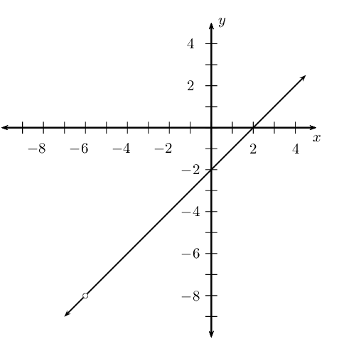

### Notation (EMCH4)

We can now introduce new notation. For the function
                                \(y=\frac{\left(x+6\right)\left(x-2\right)}{x+6}\), we can write:

                        \[\lim_{x\to -\text{6}} \frac{\left(x+6\right)\left(x-2\right)}{x+6}=-\text{8}.\]

This is read: the limit of \(\frac{\left(x+6\right)\left(x-2\right)}{x+6}\) as \(x\) tends to
                                \(-\text{6}\) (from both the left and the right) is equal to \(-\text{8}\).

## Limits

If \(f\left(x\right)=x+1\), determine:

| \(f\left(-\text{0,1}\right)\) | \(\phantom{xxxxxx}\) |
| --- | --- |
| \(f\left(-\text{0,05}\right)\) |  |
| \(f\left(-\text{0,04}\right)\) |  |
| \(f\left(-\text{0,03}\right)\) |  |
| \(f\left(-\text{0,02}\right)\) |  |
| \(f\left(-\text{0,01}\right)\) |  |
| \(f\left(\text{0,00}\right)\) |  |
| \(f\left(\text{0,01}\right)\) |  |
| \(f\left(\text{0,02}\right)\) |  |
| \(f\left(\text{0,03}\right)\) |  |
| \(f\left(\text{0,04}\right)\) |  |
| \(f\left(\text{0,05}\right)\) |  |
| \(f\left(\text{0,1}\right)\) |  |

What do you notice about the value of \(f\left(x\right)\) as \(x\) gets closer and
                                        closer to \(\text{0}\)?

<Callout type="tip" title="Worked example 1: Limit notation">
**Question:**
Write the following using limit notation: as \(x\) gets close to
                                                \(\text{1}\), the value of the function \(y=x+2\) approaches
                                                \(\text{3}\).

This is written as:

                                \[\lim_{x\to 1}(x+2)=3\]

This is illustrated in the diagram below:

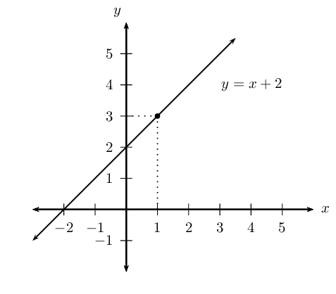
</Callout>

We can also have the situation where a function tends to a different limit depending on
                                whether \(x\) approaches from the left or the right.

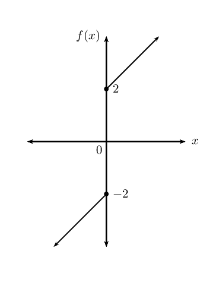

As \(x\to 0\) from the left, \(f(x)\) approaches \(-\text{2}\). As \(x\to 0\) from the right,
                                \(f(x)\) approaches \(\text{2}\).

The limit for \(x\) approaching \(\text{0}\) from the left is:

                        \[\lim_{x\to {0}^{-}}f(x)= -\text{2}\]

and for \(x\) approaching \(\text{0}\) from the right:

                        \[\lim_{x\to {0}^{+}}f(x)= \text{2}\]

where \(0^{-}\) means \(x\) approaches zero from the left and \(0^{+}\) means \(x\)
                                approaches zero from the right.

Therefore, since \(f(x)\) does not approach the same value from both sides, we can conclude
                                that the limit as \(x\) tends to zero does not exist.

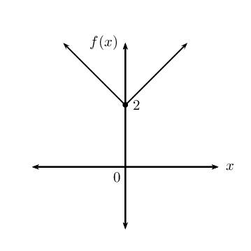

As \(x\) tends to \(\text{0}\) from the left, the function approaches \(\text{2}\) and as
                                \(x\) tends to \(\text{0}\) from the right, the function approaches \(\text{2}\). Since
                                the function approaches the same value from both sides, the limit as \(x\) tends to
                                \(\text{0}\) exists and is equal to \(\text{2}\).

<Callout type="note" title="Note">
<VideoPlayer src="https://www.youtube.com/embed/ahZ8LLtgu_w" title="Video:
                                                28VG" />
</Callout>

<QuizCard id="m12-06-01a" title="Interactive Exercise 6.1" question="Determine the value for both of the limits given below: \[                     \begin{array}{ll}                     \text{1.1} \enspace & \displaystyle\lim_{x \to 1} 7  \\ \\                     \text{1.2} \enspace & \displaystyle\lim_{x \to 2} x - 1                     \end{array}                 \]" options=["The expression becomes non-real", "The answer is zero", "The expression becomes undefined", "None of the above"] answer="7, 1" hint="You should enter a number here. If you want to, you can use a space to separate thousands.                Example: 12 800,25 For scientific notation you need to use the multiply symbol                ( ∗ ) and the exponent symbol ( ^ ). For example 6,673 × 10 −11 should be written as: 6,673 ∗ 10^−11" explanation="Find the first limit This question is about limits. The symbol \(\displaystyle\lim_{x \to 1}\) means \"the limit as \(x\) tends to 1.\" You can also think of it as \"the limit as \(x\) approaches 1\" or \" \(x\) gets closer and closer to 1.\" To evaluate a limit, we apply the value of \(x\) at the limit to the expression.                         To apply the limit, we want to try to substitute \(x = 1\) into the expression \(\text{7}\) . However, since \(\text{7}\) is a constant, we cannot make a substitution and so the answer is 7. Find the second limit Follow the same approach for the second limit, \(\displaystyle\lim_{x \to 2} x - 1\) . Unlike the first question, we can apply the limit at \(x = 2\) : \[ \begin{aligned} \displaystyle\lim_{x \to 2} x - 1 = (2)-1 = 1 \end{aligned} \] The answers are: \(\quad \displaystyle\lim_{x \to 1} 7  = 7\) and \( \displaystyle\lim_{x \to 2} x - 1 = 1\) . Submit your answer as: and" />

<Callout type="tip" title="Worked example 2: Limits">
**Question:**
Determine:

2. \(\displaystyle\lim_{x\to 1}10\)
4. \(\displaystyle\lim_{x\to 2}(x + 4)\)

Illustrate answers graphically.

**Simplify the expression and cancel all common terms:**
We cannot simplify further and there are no terms to cancel.

**Calculate the limit:**
2. \(\displaystyle\lim_{x\to 1}10=10\)
4. \(\displaystyle\lim_{x\to 2} (x + 4) = 2 + 4 = 6\)

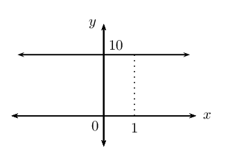

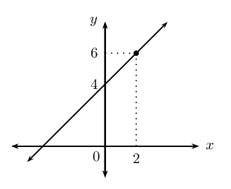
</Callout>

<Callout type="tip" title="Worked example 3: Limits">
**Question:**
Determine the following and illustrate the answer graphically:

                                        \[\lim_{x\to 10}\frac{{x}^{2}-100}{x-10}\]

**Simplify the expression:**
Factorise the numerator:

                                        \(\frac{{x}^{2}-100}{x-10}=\frac{\left(x+10\right)\left(x-10\right)}{x-10}\)

As \(x \to 10\), the denominator \((x - 10) \to 0\), therefore the expression
                                                is not defined for \(x=10\) since division by zero is not permitted.

**Cancel all common terms:**
\[\frac{\left(x+10\right)\left(x-10\right)}{x-10}=x+10\]

**Calculate the limit:**
\begin{align*}
                                        \lim_{x\to 10}\frac{{x}^{2}-100}{x-10}
                                        &=\lim_{x\to 10} (x + 10) \\
                                        &= 10 + 10 \\
                                        &= 20
                                        \end{align*}

**Draw the graph:**
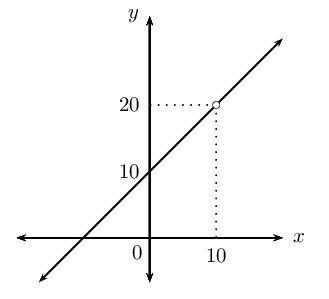
</Callout>

<Callout type="note" title="Note">
<VideoPlayer src="https://www.youtube.com/embed/CLu5CIR7uyc" title="Video:
                                                28YM" />
</Callout>

## Limits

### Textbook Exercise 6.1

Determine the following limits and draw a rough sketch to
                                                                illustrate:

**Problem:**
\(\displaystyle\lim_{x\to 3}\frac{{x}^{2}-9}{x+3}\)

**Solution:**
\begin{align*}
                                                                        \lim_{x \to 3}\dfrac{x^2-9}{x+3}
                                                                        &=\lim_{x \to 3}\dfrac{(x-3)(x+3)}{x+3}\\
                                                                        &=\lim_{x \to 3}(x-3)\\
                                                                        &=3-3\\
                                                                        &=\text{0}
                                                                        \end{align*}

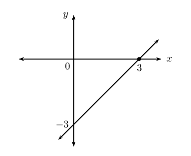

**Problem:**
\(\displaystyle\lim_{x\to 3}\frac{x+3}{{x}^{2}+3x}\)

**Solution:**
\begin{align*}
                                                                        \lim_{x \to 3}\dfrac{x+3}{x^{2}+3x}
                                                                        &=\lim_{x \to 3}\dfrac{x+3}{x(x+3)}\\
                                                                        &=\lim_{x \to 3}\dfrac{1}{x}\\
                                                                        &= \frac{1}{3}
                                                                        \end{align*}

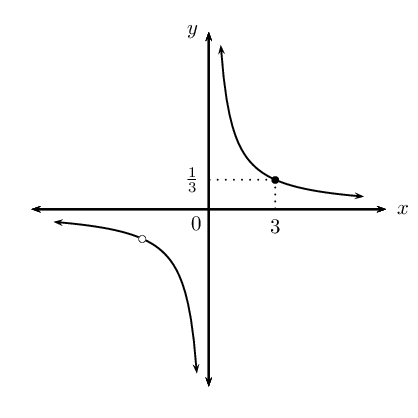

Determine the following limits (if they exist):

**Problem:**
\(\displaystyle\lim_{x\to 2}\frac{3{x}^{2}-4x}{3-x}\)

**Solution:**
\begin{align*}
                                                                        \lim_{x \to 2}\dfrac{3x^2-4x}{3-x}
                                                                        &=\lim_{x \to 2}\dfrac{3(2)^2-4(2)}{3-2}\\
                                                                        &=\lim_{x \to 2}\dfrac{12-8}{1}\\
                                                                        &= \text{4}
                                                                        \end{align*}

**Problem:**
\(\displaystyle\lim_{x\to 4}\frac{{x}^{2}-x-12}{x-4}\)

**Solution:**
\begin{align*}
                                                                        \lim_{x \to 4}\dfrac{x^2-x-12}{x-4}
                                                                        &=\lim_{x \to 4}\dfrac{(x-4)(x+3)}{x-4}\\
                                                                        &=\lim_{x \to 4}(x+3)\\
                                                                        &=4+3\\
                                                                        &= \text{7}
                                                                        \end{align*}

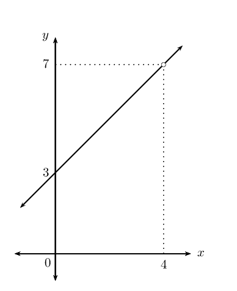

Important: notice that even though the function is
                                                                        not defined at \(x = 4\), the limit as \(x\)
                                                                        tends to \(\text{4}\) does exist and is equal to
                                                                        \(\text{7}\).

**Problem:**
\(\displaystyle\lim_{x\to 2} \left( 3x+\frac{1}{3x}
                                                                \right)\)

**Solution:**
\begin{align*}
                                                                        \lim_{x \to 2} \left( 3x+\dfrac{1}{3x} \right)
                                                                        &=6+\dfrac{1}{6}\\
                                                                        &= \frac{37}{6}
                                                                        \end{align*}

**Problem:**
\(\displaystyle\lim_{x\to 0} \frac{1}{x}\)

**Solution:**
\[\displaystyle\lim_{x\to 0} \frac{1}{x} = \frac{1}{0}
                                                                \therefore \text{ does not exist}\]

**Problem:**
\(\displaystyle\lim_{y \to 1} \frac{y-1}{y+1}\)

**Solution:**
\begin{align*}
                                                                \displaystyle\lim_{y \to 1} \frac{y-1}{y+1} &=
                                                                \frac{1-1}{1+1} \\
                                                                &=\frac{0}{2}\\
                                                                &=0
                                                                \end{align*}

**Problem:**
\(\displaystyle\lim_{y \to 1} \frac{y+1}{y-1}\)

**Solution:**
\[\displaystyle\lim_{y \to 1} \frac{y+1}{y-1} =
                                                                \frac{1+1}{1-1} \therefore \text{ does not exist}\]

**Problem:**
\(\displaystyle\lim_{h \to 0} \frac{3h + h^{2}}{h}\)

**Solution:**
\begin{align*}
                                                                \displaystyle\lim_{h \to 0} \frac{3h + h^{2}}{h} &=
                                                                \displaystyle\lim_{h \to 0} \frac{h(3 + h)}{h} \\
                                                                &= \displaystyle\lim_{h \to 0} (3 + h) \\
                                                                &=3 + 0 \\
                                                                &= 3
                                                                \end{align*}

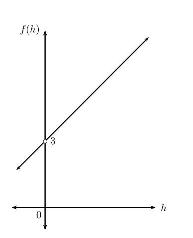

Even though the function is not defined at \(h = 0\),
                                                                        the limit as \(h\) tends to \(\text{0}\) does
                                                                        exist and is equal to \(\text{3}\).

**Problem:**
\(\displaystyle\lim_{h \to 1} \frac{h^{3} - 1 }{h - 1}\)

**Solution:**
\begin{align*}
                                                                \displaystyle\lim_{h \to 1} \frac{h^{3} - 1 }{h - 1}
                                                                &= \displaystyle\lim_{h \to 1} \frac{(h-1)(h^{2} + h
                                                                + 1) }{h - 1}\\
                                                                &= \displaystyle\lim_{h \to 1} (h^{2} + h + 1) \\
                                                                &= 1^{2} + 1 + 1 \\
                                                                &= 3
                                                                \end{align*}

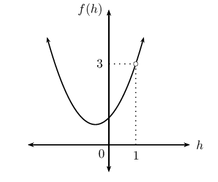

Even though the function is not defined at \(h = 1\),
                                                                        the limit as \(h\) tends to \(\text{1}\) does
                                                                        exist and is equal to \(\text{3}\).

**Problem:**
\(\displaystyle\lim_{x \to 3} \frac{\sqrt{x} -
                                                                \sqrt{3}}{x - 3}\)

**Solution:**
\begin{align*}
                                                                \displaystyle\lim_{x \to 3} \frac{\sqrt{x} - \sqrt{3}}{x
                                                                - 3} &= \displaystyle\lim_{x \to 3}
                                                                \frac{\sqrt{x}-\sqrt{3}}{x-3} \times
                                                                \frac{\sqrt{x}+\sqrt{3}}{\sqrt{x}+\sqrt{3}}\\
                                                                &= \displaystyle\lim_{x \to 3}
                                                                \frac{(x-3)}{(x-3)(\sqrt{x}+\sqrt{3})} \\
                                                                &= \frac{1}{\sqrt{x}+\sqrt{3}} \\
                                                                &= \frac{1}{\sqrt{3}+\sqrt{3}} \\
                                                                &= \frac{1}{2\sqrt{3}} \\
                                                                &= \frac{\sqrt{3}}{6}
                                                                \end{align*}

Note that the function is not defined at \(x = 3\),
                                                                        but the limit as \(x\) tends to \(\text{3}\)
                                                                        does exist and is equal to
                                                                        \(\frac{\sqrt{3}}{6}\).

### Gradient at a point (EMCH5)

**Average gradient**

In Grade 11 we learnt that the average gradient between any two points on a curve is given by
                                the gradient of the straight line that passes through both points. We also looked at the
                                gradient at a single point on a curve and saw that it was the gradient of the tangent to
                                the curve at the given point. In this section we learn how to determine the gradient of
                                the tangent.

Let us consider finding the gradient of a tangent \(t\) to a curve with equation
                                \(y=f\left(x\right)\) at a given point \(P\).

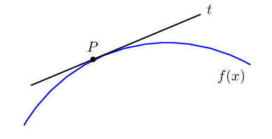

We know how to calculate the average gradient between two points on a curve, but we need two
                                points. The problem now is that we only have one point, namely \(P\). To get around the
                                problem we first consider a secant (a straight line that intersects a curve at two or
                                more points) to the curve that passes through point \(P\left ( x_{P}; y_{P}\right)\) and
                                another point on the curve \(Q \left( x_{Q}; y_{Q} \right)\), where \(Q\) is an
                                arbitrary distance from \(P\).

We can determine the average gradient of the curve between the two points:

                        \[m = \frac{y_{Q} - y_{P}}{x_{Q} - x_{P}}\]

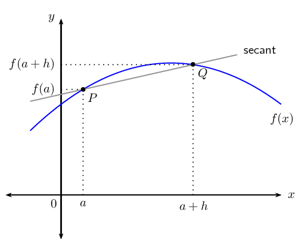

If we let the \(x\)-coordinate of \(P\) be \(a\), then the \(y\)-coordinate is
                                \(f\left(a\right)\). Similarly, if the \(x\)-coordinate of \(Q\) is (\(a + h\)), then
                                the \(y\)-coordinate is \(f\left(a + h\right)\).

We can now calculate the average gradient as:

                        \begin{align*}
                        \frac{y_{Q} - y_{P}}{x_{Q} - x_{P}} & =
                        \frac{f\left(a+h\right)-f\left(a\right)}{\left(a+h\right)-a} \\
                        & = \frac{f\left(a+h\right)-f\left(a\right)}{h}
                        \end{align*}

**Gradient at a point**

Imagine that \(Q\) moves along the curve, getting closer and closer to \(P\). The secant line
                                approaches the tangent line as its limiting position. This means that the average
                                gradient of the secant approaches the gradient of the tangent to the curve at \(P\).

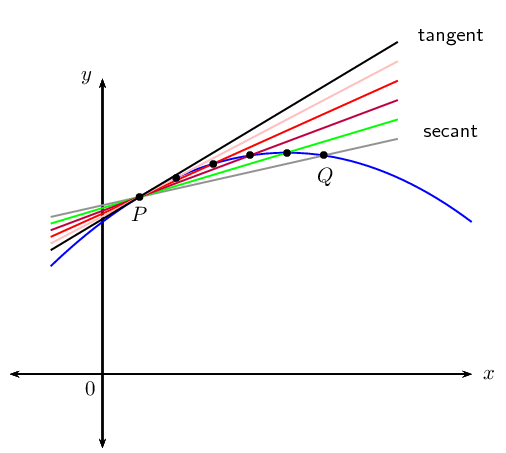

We see that as point \(Q\) approaches point \(P\), \(h\) gets closer to \(\text{0}\). If
                                point \(Q\) lies on point \(P\), then \(h = 0\) and the formula for average gradient is
                                undefined. We use our knowledge of limits to let \(h\) tend towards \(\text{0}\) to
                                determine the gradient of the tangent to the curve at point \(P\):

                        \[\text{Gradient at point } P = \lim_{h\to 0}\frac{f\left(a+h\right)-f\left(a\right)}{h}\]

<QuizCard id="m12-06-01c" title="Interactive Exercise 6.3" question="Evaluate the following limit: \[\begin{array}{c}\lim_{x \to -3} \frac{x^{2} - 9}{x + 3}\end{array}\]" options=[] answer="-6" hint="You should enter a number here. If you want to, you can use a space to separate thousands.                Example: 12 800,25 For scientific notation you need to use the multiply symbol                ( ∗ ) and the exponent symbol ( ^ ). For example 6,673 × 10 −11 should be written as: 6,673 ∗ 10^−11" explanation="Factorise the numerator Start by factorising the numerator so that you can try to cancel the denominator.  This is necessary because if you try to evaluate the limit now, you will get zero in the denominator, which means the limit will be undefined. \[\begin{array}{c}\lim_{x \to -3} \frac{x^{2} - 9}{x + 3} = \lim_{x \to -3}  \frac{\left(x - 3\right) \left(x + 3\right)}{x + 3}\end{array}\] Simplify the fraction by cancelling common factors Is there anything which can be cancelled? We can cancel the factors of \((x + 3)\) in the numerator and the denominator. \[\begin{array}{c}\lim_{x \to -3} \frac{x^{2} - 9}{x + 3} =\lim_{x \to -3} \left(x - 3\right)\end{array}\] Evaluate the limit by substitution Now we can evaluate the limit (without causing it to be undefined) by substituting \(-3\) into the remaining binomial: \[             \begin{aligned}               \lim_{x \to -3} \frac{x^{2} - 9}{x + 3} & = \lim_{x \to -3} \left(x - 3\right)     \\               & =   (-3) -3   \\               & = -6               \end{aligned}           \] Therefore, the value of the limit is \(-6\) . Submit your answer as:" />

<Callout type="tip" title="Worked example 4: Gradient at a point">
**Question:**
Given \(g\left(x\right)=3{x}^{2}\), determine the gradient of the curve at
                                                the point \(x=-1\).

**Write down the formula for the gradient at a point:**
\[\text{Gradient at a point } = \lim_{h\to
                                        0}\frac{g\left(a+h\right)-g\left(a\right)}{h}\]

**Determine \(g\left(a+h\right)\) and \(g(a)\):**
We need to find the gradient of the curve at \(x=-1\), therefore we let \(a =
                                                -1\):

                                        \begin{align*}
                                        g(x) &= 3x^{2} \\
                                        & \\
                                        g(a) &= g(-1) \\
                                        &= 3(-1)^{2} \\
                                        &= 3 \\
                                        & \\
                                        g\left(a+h\right) &= g \left( -1+h \right) \\
                                        & = 3{\left( -1+h \right)}^{2} \\
                                        & = 3\left( 1-2h+{h}^{2} \right) \\
                                        & = 3 - 6h + 3h^{2}
                                        \end{align*}

**Substitute into the formula and simplify:**
\begin{align*}
                                        \lim_{h\to 0}\frac{g\left(a+h\right)-g\left(a\right)}{h}
                                        &= \lim_{h\to 0}\frac{g\left(-1+h\right)-g\left(-1\right)}{h} \\
                                        & = \lim_{h\to 0}\frac{\left( 3 - 6h + 3h^{2} \right) - 3}{h} \\
                                        & = \lim_{h\to 0}\frac{ - 6h + 3h^{2} }{h} \\
                                        & = \lim_{h\to 0}\frac{h\left(-6 + 3h \right)}{h} \\
                                        & = \lim_{h\to 0} \left( -6 + 3h \right) \\
                                        & = -6
                                        \end{align*}

Notice that we only take the limit once we have removed \(h\) from the
                                                denominator.

**Write the final answer:**
The gradient of the curve \(g\left(x\right)=3{x}^{2}\) at \(x=-1\) is
                                                \(-\text{6}\).
</Callout>

<Callout type="tip" title="Worked example 5: Gradient at a point">
**Question:**
Given the function \(f\left(x\right)=2{x}^{2}-5x\), determine the gradient of
                                                the tangent to the curve at the point \(x=2\).

**Write down the formula for the gradient at a point:**
\[\text{Gradient at a point } = \lim_{h\to
                                        0}\frac{f\left(a+h\right)-f\left(a\right)}{h}\]

**Determine \(f\left(a+h\right)\) and \(f(a)\):**
We need to find the gradient of the tangent to the curve at \(x=2\),
                                                therefore we let \(a = 2\):

                                        \begin{align*}
                                        f(x) &= 2x^{2} - 5x \\
                                        & \\
                                        f(a) &= f(2) \\
                                        &= 2(2)^{2} - 5(2)\\
                                        &= 8- 10 \\
                                        &= -2 \\
                                        & \\
                                        f\left(a+h\right) &= f\left(2+h\right) \\
                                        & = 2{\left(2+h\right)}^{2}-5\left(2+h\right) \\
                                        & = 2\left({2}^{2}+4h+{h}^{2}\right)-10-5h \\
                                        & = 8 + 8h + 2h^{2} -10 -5h \\
                                        &= -2 + 3h + 2h^{2}
                                        \end{align*}

**Substitute into the formula and simplify:**
\begin{align*}
                                        \lim_{h\to 0}\frac{f\left(a+h\right)-f\left(a\right)}{h}
                                        &= \lim_{h\to 0}\frac{f\left(2+h\right)-f\left(2\right)}{h} \\
                                        & = \lim_{h\to 0}\frac{\left( -2 + 3h + 2h^{2} \right) - (-2)}{h} \\
                                        & = \lim_{h\to 0}\frac{ -2 + 3h + 2h^{2} + 2 }{h} \\
                                        & = \lim_{h\to 0}\frac{ 3h + 2h^{2} }{h} \\
                                        & = \lim_{h\to 0}\frac{h\left(3 + 2h \right)}{h} \\
                                        & = \lim_{h\to 0} \left( 3 + 2h \right) \\
                                        & = 3
                                        \end{align*}

**Write the final answer:**
The gradient of the tangent to the curve \(f\left(x\right)=2{x}^{2}-5x\) at
                                                \(x=2\) is \(\text{3}\).
</Callout>

<Callout type="tip" title="Worked example 6: Gradient at a point">
**Question:**
Determine the gradient of \(k(x) = -x^{3} + 2x + 1\) at the point \(x=1\).

**Write down the formula for the gradient at a point:**
\[\text{Gradient at a point } = \lim_{h\to
                                        0}\frac{k\left(a+h\right)-k\left(a\right)}{h}\]

**Determine \(k\left(a+h\right)\) and \(k(a)\):**
Let \(a = 1\):

                                        \begin{align*}
                                        k(x) &= - x^{3} + 2x + 1 \\
                                        & \\
                                        k(a) &= k(1) \\
                                        &= - (1)^{3} + 2(1) + 1\\
                                        &= - 1 + 2 + 1 \\
                                        &= 2 \\
                                        & \\
                                        k\left(a+h\right) &= k\left(1+h\right) \\
                                        & = - {\left(1+h\right)}^{3}+2\left(1+h\right) + 1 \\
                                        & = - \left( 1 + 3h + 3h^{2} + h^{3} \right) + 2 + 2h + 1 \\
                                        & = - 1 - 3h - 3h^{2} - h^{3} + 2 + 2h + 1 \\
                                        & = 2 - h - 3h^{2} - h^{3}
                                        \end{align*}

**Substitute into the formula and simplify:**
\begin{align*}
                                        \lim_{h\to 0}\frac{k\left(a+h\right)-k\left(a\right)}{h}
                                        &= \lim_{h\to 0}\frac{k\left(1+h\right)-k\left(1\right)}{h} \\
                                        & = \lim_{h\to 0}\frac{\left( 2 - h - 3h^{2} - h^{3} \right) - 2}{h} \\
                                        & = \lim_{h\to 0}\frac{ - h - 3h^{2} - h^{3}}{h} \\
                                        & = \lim_{h\to 0}\frac{h\left( - 1 - 3h - h^{2} \right)}{h} \\
                                        & = \lim_{h\to 0} \left( - 1 - 3h - h^{2} \right) \\
                                        & = -1
                                        \end{align*}

**Write the final answer:**
The gradient of \(k(x) = -x^{3} + 2x + 1\) at \(x=1\) is \(-\text{1}\).
</Callout>

## Gradient at a point

### Textbook Exercise 6.2

Given: \(f(x) = -x^{2} + 7\)

**Problem:**
Find the average gradient of function
                                                                \(f\), between \(x=-\text{1}\) and \(x=3\).

**Solution:**
\begin{align*}
                                                                \text{Average gradient }&=
                                                                \frac{f(3)-f(-\text{1})}{3-(-\text{1})} \\
                                                                &= \frac{[-(3)^{2} + 7] - [-(-\text{1})^{2}+7]}{4}
                                                                \\
                                                                &= \frac{(-\text{9}+7)-(-1+7)}{4} \\
                                                                &= \frac{-\text{2}-6}{4} \\
                                                                &=-\frac{\text{8}}{4} \\
                                                                &=-\text{2}
                                                                \end{align*}

**Problem:**
Illustrate this with a graph.

**Solution:**
\(\text{Graph:}\\
                                                                        \text{Parabola: “frown” } (a < 0)
                                                                        \\
                                                                        y_{\text{int}}: x = 0, y = 7 \\
                                                                        x_{\text{int}}: y=0, x=\pm\sqrt{7} \\
                                                                        \text{Turning point: } (0;7)\)

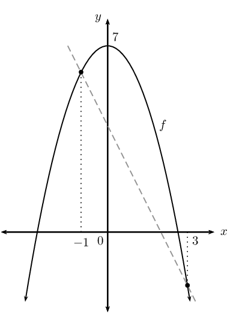

**Problem:**
Find the gradient of \(f\) at the point
                                                                \(x=3\) and illustrate this on your graph.

**Solution:**
\begin{align*}
                                                                \text{Gradient at a point }&= \lim_{h\to 0}
                                                                \frac{f(x+h)-f(x)}{h} \\
                                                                &= \lim_{h\to 0} \frac{[-(x+h)^{2}+7]-[-x^{2}+7]}{h}
                                                                \\
                                                                &= \lim_{h\to 0} \frac{-x^{2}-2xh-h^{2} + 7 +x^{2} -
                                                                7}{h} \\
                                                                &= \lim_{h\to 0} \frac{-\text{2}xh-h^{2}}{h} \\
                                                                &= \lim_{h\to 0} \frac{h(-\text{2}x-h)}{h} \\
                                                                &= \lim_{h\to 0} (-\text{2}x-h) \\
                                                                &=-\text{2}x
                                                                \end{align*}

**Problem:**
Determine the gradient of the tangent to \(g\) if \(g(x) =
                                                                \frac{3}{x} \enspace (x \ne 0) \text{ at } x=a\).

**Solution:**
\begin{align*}
                                                        \text{Gradient of tangent }&= \lim_{h\to 0}
                                                        \frac{g(x+h)-g(x)}{h} \\
                                                        &= \lim_{h\to 0} \frac{\frac{3}{x+h}-\frac{3}{x}}{h}
                                                        \end{align*}

To simplify the two fractions in the numerator, we get a
                                                                common denominator \(x(x+h)\):

                                                        \begin{align*}
                                                        &= \lim_{h\to 0} \frac{\frac{3(x)-3(x+h)}{x(x+h)}}{h} \\
                                                        &= \lim_{h\to 0} \frac{3x - 3x -3h}{h.x(x+h)} \\
                                                        &= \lim_{h\to 0} \frac{-3h}{h \cdot x(x+h)} \\
                                                        &= \lim_{h\to 0} \frac{-3}{x^{2}+xh} \\
                                                        &= \frac{-3}{x^{2}} \\
                                                        \therefore \text{Gradient at } x &=a \text{ is }
                                                        \frac{-3}{a^{2}}
                                                        \end{align*}

**Problem:**
Determine the equation of the tangent to \(H(x)=x^{2}+3x
                                                                \text{ at } x=-1\).

**Solution:**
\begin{align*}
                                                        \text{Gradient of tangent } &= \lim_{h\to 0}
                                                        \frac{H(x+h)-H(x)}{(x+h)-x} \\
                                                        &= \lim_{h\to 0} \frac{(x+h)^{2}+3(x+h)-(x^{2}+3x)}{h} \\
                                                        &= \lim_{h\to 0} \frac{x^{2}+2xh+h^{2}+3x+3h-x^{2}-3x}{h} \\
                                                        &= \lim_{h\to 0} \frac{2xh+3h+h^{2}}{h} \\
                                                        &= \lim_{h\to 0} \frac{h(2x+3+h)}{h} \\
                                                        &= 2x+3 \\
                                                        \text{At } x=-1: \enspace m&=2(-1)+3=1
                                                        \end{align*}

The tangent meets the graph of \(H\) at \((-1;y)\)

                                                        \[\therefore y = (-1)^{2} + 3(-1) = -2\]

Therefore tangent \(\) goes through \(H(-1;-2)\).

                                                        \begin{align*}
                                                        y - y_{1} &=m(x - x_{1}) \\
                                                        \text{Substitute: } y - (-2) &=1(x - (-1)) \\
                                                        y + 2 &= x + 1 \\
                                                        y &= x - 1 \\
                                                        \therefore \text{Eqn. tangent at } x = -1 \text{ is } y
                                                        &=x-1
                                                        \end{align*}
