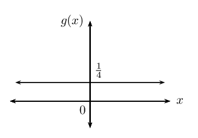

## 6.2 Differentiation from first principles (EMCH6)

We know that the gradient of the tangent to a curve with equation \(y = f(x)\) at \(x=a\) can be
                        determine using the formula:

                \[\text{Gradient at a point } = \lim_{h\to 0}\frac{f\left(a+h\right)-f\left(a\right)}{h}\]

We can use this formula to determine an expression that describes the gradient of the graph (or the
                        gradient of the tangent to the graph) at any point on the graph. This expression (or gradient
                        function) is called the derivative.

Derivative

The derivative of a function \(f\left(x\right)\) is written as \({f}'\left(x\right)\)
                                        and is defined by:

                                \[{f}'\left(x\right)=\lim_{h\to 0}\frac{f\left(x+h\right)-f\left(x\right)}{h}\]

Differentiation

The process of determining the derivative of a given function.

This method is called differentiation from first principles or using the definition.

<Callout type="tip" title="Worked example 7: Differentiation from first principles">
**Question:**
Calculate the derivative of \(g\left(x\right)=2x-3\) from first principles.

**Write down the formula for finding the derivative using first
                                        principles:**
\[{g}'\left(x\right)=\lim_{h\to 0}\frac{g\left(x+h\right)-g\left(x\right)}{h}\]

**Determine \(g\left(x+h\right)\):**
\begin{align*}
                                g(x) &= 2x - 3 \\
                                & \\
                                g\left(x+h\right) &= 2\left(x+h\right) - 3 \\
                                &= 2x + 2h - 3
                                \end{align*}

**Substitute into the formula and simplify:**
\begin{align*}
                                {g}'\left(x\right) & = \lim_{h\to 0}\frac{2x + 2h - 3 -\left(2x - 3\right)}{h} \\
                                & = \lim_{h\to 0}\frac{2h}{h} \\
                                & = \lim_{h\to 0} 2 \\
                                & = 2
                                \end{align*}

**Write the final answer:**
The derivative \({g}'\left(x\right) = 2\).
</Callout>

<QuizCard id="m12-06-02a" title="Interactive Exercise 6.5" question="Which of the following is the formula used to find a derivative from first principles? A \(\begin{aligned}f^{\prime}(x) = \lim_{h \to 0} \dfrac{f(x + h) - f(x)}{h}\end{aligned}\) B \(\begin{aligned}f^{\prime}(x) = \lim_{x \to 0} \dfrac{f(x + h) + f(x)}{h}\end{aligned}\) C \(\begin{aligned}f^{\prime}(x) = \lim_{h \to 0} \dfrac{f(x) - f(x + h)}{h}\end{aligned}\) D \(\begin{aligned}f^{\prime}(x) = \lim_{h \to x} \dfrac{f(x + h) - f(x)}{h}\end{aligned}\)" options=["A", "B", "C", "D", "A", "B", "C", "D", "A", "B", "C", "D"] answer="A" hint="" explanation="Identify the correct formula The formula for the derivative of a function \(f(x)\) is \[                         \begin{aligned}                            f^{\prime}(x) = \lim_{h \to 0} \dfrac{f(x + h) - f(x)}{h}                          \end{aligned}                     \] So the correct formula is Option A . Submit your answer as: A" />

**Notation**

There are a few different notations used to refer to derivatives. It is very important that you learn
                        to identify these different ways of denoting the derivative and that you are consistent in your
                        usage of them when answering questions.

If we use the common notation \(y=f\left(x\right)\), where the dependent variable is \(y\) and the
                        independent variable is \(x\), then some alternative notations for the derivative are as
                        follows:

                \[{f}'\left(x\right)={y}'=\frac{dy}{dx}=\frac{df}{dx}=\frac{d}{dx}[f\left(x\right)]=Df\left(x\right)={D}_{x}y\]

The symbols \(D\) and \(\frac{d}{dx}\) are called differential operators because they indicate the
                        operation of differentiation.

\(\frac{dy}{dx}\) means \(y\) differentiated with respect to \(x\). Similarly, \(\frac{dp}{dx}\)
                        means \(p\) differentiated with respect to \(x\).

**Important:** \(\frac{dy}{dx}\) is not a fraction and does not mean \(dy \div
                                dx\).

<Callout type="note" title="Note">
<VideoPlayer src="https://www.youtube.com/embed/GpMgMcA2SBY" title="Video: 28W2" />
</Callout>

<Callout type="tip" title="Worked example 8: Differentiation from first principles">
**Question:**
2. Find the derivative of \(f\left(x\right)=4x^{3}\) from first principles.
4. Determine \({f}' (\text{0,5})\) and interpret the answer.

**Write down the formula for finding the derivative from first
                                        principles:**
\[{f}'\left(x\right)=\lim_{h\to 0}\frac{f\left(x+h\right)-f\left(x\right)}{h}\]

**Substitute into the formula and simplify:**
\begin{align*}
                                {f}'\left(x\right) & = \lim_{h\to 0}\frac{4\left(x + h\right)^{3} - 4x^{3}}{h} \\
                                & = \lim_{h\to 0}\frac{4\left(x^{3} + 3x^{2}h + 3xh^{2} + h^{3}\right) - 4x^{3}}{h}
                                \\
                                & = \lim_{h\to 0}\frac{4x^{3} + 12x^{2}h + 12xh^{2} + 4h^{3} - 4x^{3}}{h} \\
                                & = \lim_{h\to 0}\frac{12x^{2}h + 12xh^{2} + 4h^{3}}{h} \\
                                & = \lim_{h\to 0}\frac{h \left(12x^{2} + 12xh + 4h^{2} \right)}{h} \\
                                & = \lim_{h\to 0} (12x^{2} + 12xh + 4h^{2}) \\
                                & = 12x^{2}
                                \end{align*}

**Calculate \({f}' (\text{0,5})\) and interpret the answer:**
\begin{align*}
                                {f}'\left(x\right) & = 12x^{2} \\
                                \therefore {f}'\left(\text{0,5}\right) & = 12(\text{0,5})^{2} \\
                                &= 12\left( \frac{1}{4} \right) \\
                                &= 3
                                \end{align*}

- The derivative of \(f(x)\) at \(x = \text{0,5}\) is \(\text{3}\).
- The gradient of the function \(f\) at \(x = \text{0,5}\) is equal to
                                                  \(\text{3}\).
- The gradient of the tangent to \(f(x)\) at \(x = \text{0,5}\) is equal to
                                                  \(\text{3}\).
</Callout>

<Callout type="tip" title="Worked example 9: Differentiation from first principles">
**Question:**
Calculate \(\frac{dp}{dx}\) from first principles if \(p\left(x\right)= -
                                        \frac{2}{x}\).

**Write down the formula for finding the derivative using first
                                        principles:**
\[\frac{dp}{dx} =\lim_{h\to 0}\frac{p\left(x+h\right)-p\left(x\right)}{h}\]

**Substitute into the formula and simplify:**
\begin{align*}
                                \frac{dp}{dx} & = \lim_{h\to 0}\frac{-\frac{2}{x + h} -\left(-
                                \frac{2}{x}\right)}{h}
                                \end{align*}

It is sometimes easier to write the right-hand side of the equation as:

                                \begin{align*}
                                \frac{dp}{dx} & = \lim_{h\to 0}\frac{1}{h} \left(\frac{-2}{x + h} + \frac{2}{x}
                                \right) \\
                                & = \lim_{h\to 0} \frac{1}{h} \left(\frac{-2x + 2(x + h)}{x(x + h)} \right) \\
                                & = \lim_{h\to 0} \frac{1}{h} \left(\frac{-2x + 2x + 2h }{x(x + h)} \right) \\
                                & = \lim_{h\to 0} \frac{1}{h} \left(\frac{2h }{x^{2} + xh} \right) \\
                                & = \lim_{h\to 0} \frac{2}{x^{2} + xh} \\
                                & = \frac{2}{x^{2}}
                                \end{align*}

Notice: even though \(h\) remains in the denominator, we can take the limit since it
                                        does not result in division by \(\text{0}\).

**Write the final answer:**
\[\frac{dp}{dx} = \frac{2}{x^{2}}\]
</Callout>

<Callout type="tip" title="Worked example 10: Differentiation from first principles">
**Question:**
Differentiate \(g\left(x\right)= \frac{1}{4}\) from first principles and interpret
                                        the answer.

**Write down the formula for finding the derivative from first
                                        principles:**
\[{g}'\left(x\right)=\lim_{h\to 0}\frac{g\left(x+h\right)-g\left(x\right)}{h}\]

**Substitute into the formula and simplify:**
\begin{align*}
                                {g}'\left(x\right) & = \lim_{h\to 0}\frac{ \frac{1}{4} - \frac{1}{4}}{h} \\
                                & = \lim_{h\to 0}\frac{0}{h} \\
                                & = \lim_{h\to 0} 0 \\
                                & = 0
                                \end{align*}

**Interpret the answer:**
The gradient of \(g(x)\) is equal to \(\text{0}\) at any point on the graph. The
                                        derivative of this constant function is equal to \(\text{0}\).

</Callout>

## Differentiation from first principles

### Textbook Exercise 6.3

Given: \(g\left(x\right)=-{x}^{2}\)

**Problem:**
Determine \(\frac{g\left(x+h\right)-g\left(x\right)}{h}\).

**Solution:**
\begin{align*}
                                                                g(x)&=-x^{2}\\
                                                                g(x+h)&=-(x+h)^{2} \\
                                                                \therefore \frac{g\left(x+h\right)-g\left(x\right)}{h}
                                                                &= \frac{-(x+h)^{2}-(-x^{2})}{h}
                                                                \end{align*}

**Problem:**
Hence, determine

                                                                \(\displaystyle\lim_{h\to
                                                                0}\frac{g\left(x+h\right)-g\left(x\right)}{h}\).

**Solution:**
\begin{align*}
                                                                \lim_{h \to 0}\dfrac{f(x+h)-f(x)}{h}
                                                                &=\lim_{h \to 0}\dfrac{-(x+h)^{2}-(-x^{2})}{h}\\
                                                                &=\lim_{h \to 0}\dfrac{-(x^{2} + 2xh +h^{2}) +
                                                                x^{2}}{h}\\
                                                                &=\lim_{h \to 0}\dfrac{-x^{2} - 2xh -h^{2} +
                                                                x^{2}}{h}\\
                                                                &=\lim_{h \to 0}\dfrac{-2xh-h^{2}}{h}\\
                                                                &=\lim_{h \to 0}\dfrac{h(-2x-h)}{h}\\
                                                                &=\lim_{h \to 0}-2x-h\\
                                                                &=-2x
                                                                \end{align*}

**Problem:**
Explain the meaning of your answer in (b).

**Solution:**
The derivative of \(g(x)\) is \(g'(x) = -2x\). The gradient
                                                                of the function \(g\) is given by the expression
                                                                \(-2x\). The gradient of the graph depends on the value
                                                                of \(x\).

**Problem:**
Find the derivative of \(f\left(x\right)=-2{x}^{2}+3x+1\) using first
                                                        principles.

**Solution:**
\begin{align*}
                                                        f(x) & = -2x^{2}+3x+1\\
                                                        f(x+h) & = -2(x+h)^{2}+3(x+h)+1\\
                                                        f'(x)&=\lim_{h \to 0}\dfrac{f(x+h)-f(x)}{h} \\
                                                        &=\lim_{h \to 0}\dfrac{-2(x+h)^{2} + 3(x+h)+1 -(-2x^{2} +
                                                        3x+1)}{h}\\
                                                        &=\lim_{h \to 0}\dfrac{-2(x^{2} + 2xh +h^{2})+1 + 3x + 3h +
                                                        2x^{2} - 3x-1}{h}\\
                                                        &=\lim_{h \to 0}\dfrac{-2x^{2} - 4xh - 2h^{2} + 3h +
                                                        2x^{2}}{h}\\
                                                        &=\lim_{h \to 0}\dfrac{-4xh - 2h^{2} + 3h}{h}\\
                                                        &=\lim_{h \to 0}\dfrac{h(-4x - 2h + 3)}{h}\\
                                                        &=\lim_{h \to 0}(-4x-2h+3)\\
                                                        f'(x)&=-4x+3
                                                        \end{align*}

**Problem:**
Determine the derivative of \(f\left(x\right)=\frac{1}{x-2}\) using
                                                        first principles.

**Solution:**
\begin{align*}
                                                        f(x) & = \frac{1}{x-2}\\
                                                        f(x+h) & = \frac{1}{x+h-2}\\
                                                        f'(x)&=\lim_{h \to 0}\dfrac{f(x+h)-f(x)}{h}\\
                                                        &=\lim_{h \to 0}\dfrac{\frac{1}{x+h-2} - \frac{1}{x-2}}{h}\\
                                                        &=\lim_{h \to
                                                        0}\dfrac{\frac{(x-2)-(x+h-2)}{(x+h-2)(x-2)}}{h}\\
                                                        &=\lim_{h \to 0}\dfrac{\frac{x-2-x-h+2}{(x+h-2)(x-2)}}{h}\\
                                                        &=\lim_{h \to 0}\left(\dfrac{-h}{(x+h-2)(x-2)}\right) \times
                                                        \frac{1}{h}\\
                                                        &=\lim_{h \to 0}\dfrac{-1}{(x+h-2)(x-2)}\\
                                                        f'(x)&=\frac{-1}{(x-2)^{2}}
                                                        \end{align*}

**Problem:**
Determine \({g}'\left(3\right)\) from first principles if
                                                        \(g\left(x\right)=-5{x}^{2}\).

**Solution:**
\begin{align*}
                                                        g(x) & = -5x^{2}\\
                                                        g(x+h) & = -5(x+h)^{2}\\
                                                        g'(x)&=\lim_{h \to 0}\dfrac{g(x+h)-g(x)}{h} \\
                                                        &=\lim_{h \to 0}\dfrac{-5(x^{2}+2xh+h^{2}) - (-5x^{2})}{h}\\
                                                        &=\lim_{h \to 0}\dfrac{-5x^{2}-10xh-5h^{2}+5x^{2}}{h}\\
                                                        &=\lim_{h \to 0}\dfrac{-10xh-5h^{2}}{h}\\
                                                        &=\lim_{h \to 0}\dfrac{h(-10x-5h)}{h}\\
                                                        &=\lim_{h \to 0}(-10x-5h)\\
                                                        &=-10x
                                                        \end{align*}

Therefore:
                                                        \begin{align*}
                                                        g'(3) & = -10(3)\\
                                                        & = -30
                                                        \end{align*}

**Problem:**
If \(p\left(x\right)=4x(x-1)\), determine \({p}'\left(x\right)\)
                                                        using first principles.

**Solution:**
\begin{align*}
                                                        p(x)&= 4x(x-1)\\
                                                        & = 4x^{2}-4x \\
                                                        p(x+h) & = 4(x+h)^{2}-4(x+h)\\
                                                        p'(x)&=\lim_{h \to 0}\dfrac{p(x+h)-p(x)}{h} \\
                                                        &=\lim_{h \to
                                                        0}\dfrac{4(x^{2}+2xh+h^{2})-4x-4h-4x^{2}+4x}{h}\\
                                                        &=\lim_{h \to 0}\dfrac{4x^{2}+8xh+4h^{2}-4h-4x^{2}}{h}\\
                                                        &=\lim_{h \to 0}\dfrac{h(8x+4h-4)}{h}\\
                                                        &=\lim_{h \to 0}(8x+4h-4)\\
                                                        &=8x-4
                                                        \end{align*}

**Problem:**
Find the derivative of \(k\left(x\right)=10{x}^{3}\) using first
                                                        principles.

**Solution:**
\begin{align*}
                                                        k(x) & = 10{x}^{3}\\
                                                        k(x+h) & = 10{(x + h)}^{3}\\
                                                        k'(x)&=\lim_{h \to 0}\dfrac{k(x+h)-k(x)}{h} \\
                                                        &=\lim_{h \to 0}\dfrac{10{(x + h)}^{3}- 10{x}^{3}}{h}\\
                                                        &=\lim_{h \to 0}\dfrac{10 \left(x^{3} + 3x^{2}h + 3xh^{2} +
                                                        h^{3} \right) - 10x^{3}}{h}\\
                                                        &=\lim_{h \to 0}\dfrac{10 x^{3} + 30x^{2}h + 30xh^{2} +
                                                        10h^{3} - 10x^{3}}{h}\\
                                                        &=\lim_{h \to 0}\dfrac{ 30x^{2}h + 30xh^{2} + 10h^{3} }{h}\\
                                                        &=\lim_{h \to 0} \left( 30x^{2} + 30xh + 10h^{2} \right) \\
                                                        k'(x) &= 30x^{2}
                                                        \end{align*}

**Problem:**
Differentiate \(f(x)=x^{n}\) using first principles.

(Hint: Use Pascal's triangle)

**Solution:**
Step 1: Use first principles to find the derivative.

                                                \[f'(x) = \lim_{h \to 0} \text{ (average gradient)}\]

                                                \begin{align*}
                                                \text{Average gradient } &=\frac{f(x+h)-f(x)}{h} \\
                                                &= \frac{(x+h)^{n}-x^{n}}{h}
                                                \end{align*}

Expand \((x+h)^{n}\) using the pattern of the coefficients given by
                                                        Pascal's Triangle:

                                                \[\begin{array}{ccccccccccccc}
                                                x \qquad & & & & & & & 1& & &
                                                & & \\
                                                (x+h) \qquad& & & & & &1& &1& &
                                                & & \\
                                                (x+h)^2 \qquad & & & & & 1& & 2& &
                                                1& & & \\
                                                (x+h)^3 \qquad& & & &1& &3& &3&
                                                &1& & \\
                                                (x+h)^4 \qquad& & & 1& & 4& & 6& &
                                                4& & 1& \\
                                                . \qquad& & & & & & & & & &
                                                & & \\
                                                . \qquad& & & & & & & & & &
                                                & & \\
                                                (x+h)^n \qquad& & 1& &n& .&.& .&.&
                                                .&n& & 1
                                                \end{array}\]

                                                \[\therefore (x+h)^{n} = x^{n} + nx^{n-1}h \cdots nxh^{n-1} + h^{n}\]

All the terms, except \(x^{n}\), contain \(h\).

                                                \begin{align*}
                                                \text{Average gradient } &=
                                                \frac{(x^{n}+nx^{n-1}h+\cdots+nxh^{n-1}+h^{n})-x^{n}}{h} \\
                                                &= \frac{nx^{n-1}h+\cdots+nxh^{n-1}+h^{n}}{h} \\
                                                &= \frac{h(nx^{n-1}+\cdots+nxh^{n-2}+h^{n-1})}{h} \\
                                                &= nx^{n-1} + \cdots + nxh^{n-2} + h^{n-1}
                                                \end{align*}
                                                \begin{align*}
                                                \therefore \text{Average gradient } &=\lim_{h \to 0}
                                                \left(nx^{n-1}+\cdots+nxh^{n-2}+h^{n-1}\right) \\
                                                \therefore &= nx^{n-1}
                                                \end{align*}
                                                \begin{align*}
                                                \text{If } f(x) &= x^{n} \\
                                                f'(x) &= nx^{n-1}
                                                \end{align*}

This is a very valuable general rule for finding the derivative of a
                                                        function.
