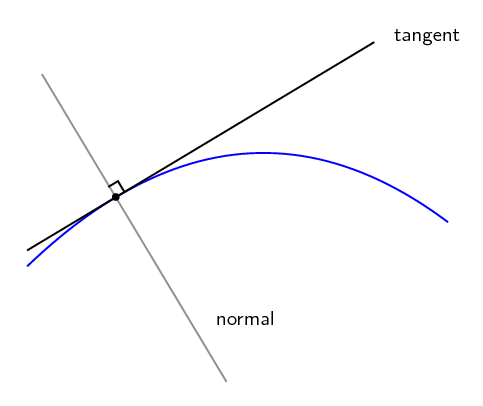
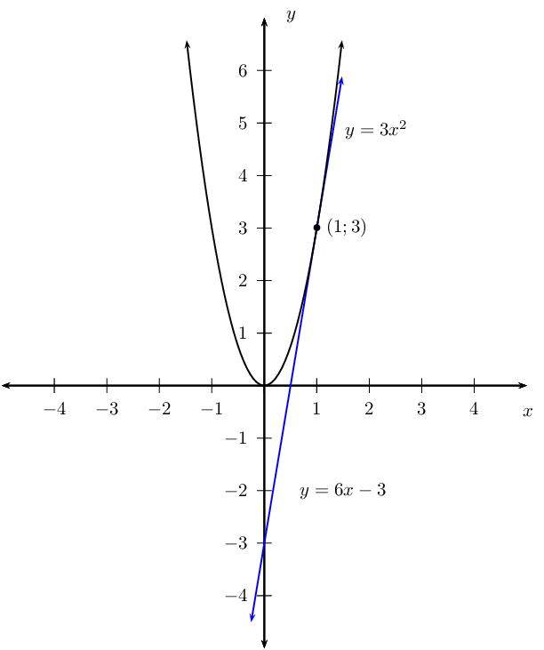
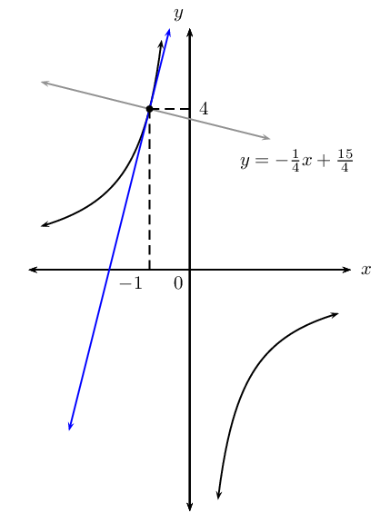
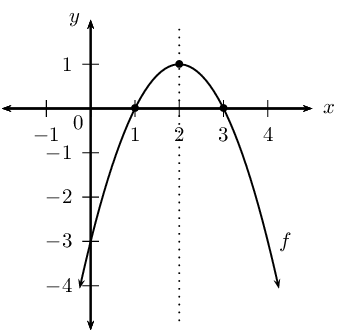
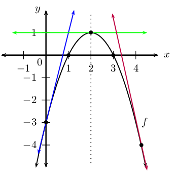

## 6.4 Equation of a tangent to a curve (EMCH8)

<QuizCard id="m12-06-04a" title="Interactive Exercise 6.8" question="The diagram below shows a line. The line has a gradient \(m = - \dfrac{3}{2} \) and it passes through the point \( A \left( 1\, ; - \dfrac{9}{2} \right) \) . Calculate the equation of the line. INSTRUCTION: Give only the right side of the equation, following \" \(y =\) \" below." options=[] answer=" -3*x/2 - 3 " hint="Your answer should be a mathematical expression. You can use the following symbols to write mathematical expressions: add: + subtract: − multiply: ∗ divide: / exponent: ^ The following special symbols are also recognised: pi (π): pi infinity (∞): oo It is also possible to write certain functions: √: sqrt( ) log: log( ) sin: sin( ) cosec: cosec( ) cos: cos( ) sec: sec( ) tan: tan( ) cot: cot( ) To write a logarithm with a specific base, use the underscore _ symbol.                For example, log of x base 3 can be written as: log_3 x" explanation="Start building the equation using the gradient The first thing to remember is that a straight line has this general form: \[\begin{array}{c}y = mx + c\end{array}\] where \(m\) is the gradient and \(c\) is the \(y\) -intercept. We have the gradient \(m\) of the line (it is given in the question) so we can substitute that into the equation of the line: \[                     \begin{aligned}                     y & = \left( - \frac{3}{2} \right) x + c \\                     y & = - \frac{3 x}{2} + c                     \end{aligned}                 \] Use the coordinates of the point to find \(c\) Now we need the value of \(c\) for the line. We can find this by substituing the coordinates of any point into the general form for a straight line. This works because every point on the line solves the equation (the coordinates of the points agree with the equation). Since we have the coordinates of point \(A\) we will use them. \[                     \begin{aligned}                     y & = - \frac{3 x}{2} + c \\                     \left( - \frac{9}{2} \right) & = - \frac{3 \left( 1 \right)}{2} + c  \\                     - \frac{9}{2} & = - \frac{3}{2} + c \\                     -3 & = c                     \end{aligned}                 \] Notice that \(c\) is negative: this agrees with the diagram, because the \(y\) -intercept is below the \(x\) -axis. The equation of the line is: \[\begin{array}{c}y = - \frac{3 x}{2} - 3\end{array}\] Submit your answer as:" />

At a given point on a curve, the gradient of the curve is equal to the gradient of the tangent to the
                        curve.

The derivative (or gradient function) describes the gradient of a curve at any point on the curve.
                        Similarly, it also describes the gradient of a tangent to a curve at any point on the curve.

**To determine the equation of a tangent to a curve: **

2. Find the derivative using the rules of differentiation.
4. Substitute the \(x\)-coordinate of the given point into the derivative to calculate the
                                   gradient of the tangent.
6. Substitute the gradient of the tangent and the coordinates of the given point into an
                                   appropriate form of the straight line equation.
8. Make \(y\) the subject of the formula.

The normal to a curve is the line perpendicular to the tangent to the curve at a given point.

                \[m_{\text{tangent}} \times m_{\text{normal}} = -1\]

<Callout type="tip" title="Worked example 13: Finding the equation of a tangent to a curve">
**Question:**
Find the equation of the tangent to the curve \(y=3{x}^{2}\) at the point
                                        \(\left(1;3\right)\). Sketch the curve and the tangent.

**Find the derivative:**
Use the rules of differentiation:

                                \begin{align*}
                                y &= 3{x}^{2} \\
                                & \\
                                \therefore \frac{dy}{dx} &= 3 \left( 2x \right) \\
                                &= 6x
                                \end{align*}

**Calculate the gradient of the tangent:**
To determine the gradient of the tangent at the point \(\left(1;3\right)\), we
                                        substitute the \(x\)-value into the equation for the derivative.

                                \begin{align*}
                                \frac{dy}{dx} &= 6x \\
                                \therefore m &= 6(1) \\
                                &= 6
                                \end{align*}

**Determine the equation of the tangent:**
Substitute the gradient of the tangent and the coordinates of the given point into
                                        the gradient-point form of the straight line equation.

                                \begin{align*}
                                y-{y}_{1} & = m\left(x-{x}_{1}\right) \\
                                y-3 & = 6\left(x-1\right) \\
                                y & = 6x-6+3 \\
                                y & = 6x-3
                                \end{align*}

**Sketch the curve and the tangent:**

</Callout>

<Callout type="tip" title="Worked example 14: Finding the equation of a tangent to a curve">
**Question:**
Given \(g(x)= (x + 2)(2x + 1)^{2}\), determine the equation of the tangent to the
                                        curve at \(x = -1\) .

**Determine the \(y\)-coordinate of the point:**
\begin{align*}
                                g(x) &= (x + 2)(2x + 1)^{2} \\
                                g(-1) &= (-1 + 2)[2(-1) + 1]^{2} \\
                                &= (1)(-1)^{2} \\
                                & = 1
                                \end{align*}

Therefore the tangent to the curve passes through the point \((-1;1)\).

**Expand and simplify the given function:**
\begin{align*}
                                g(x) &= (x + 2)(2x + 1)^{2} \\
                                &= (x + 2)(4x^{2} + 4x + 1) \\
                                &= 4x^{3} + 4x^{2} + x + 8x^{2} + 8x + 2 \\
                                &= 4x^{3} + 12x^{2} + 9x + 2
                                \end{align*}

**Find the derivative:**
\begin{align*}
                                g'(x) &= 4(3x^{2}) + 12(2x) + 9 + 0 \\
                                &= 12x^{2} + 24x + 9
                                \end{align*}

**Calculate the gradient of the tangent:**
Substitute \(x = -\text{1}\) into the equation for \(g'(x)\):

                                \begin{align*}
                                g'(-1) &= 12(-1)^{2} + 24(-1) + 9 \\
                                \therefore m &= 12 - 24 + 9 \\
                                &= -3
                                \end{align*}

**Determine the equation of the tangent:**
Substitute the gradient of the tangent and the coordinates of the point into the
                                        gradient-point form of the straight line equation.

                                \begin{align*}
                                y-{y}_{1} & = m\left(x-{x}_{1}\right) \\
                                y-1 & = -3\left(x-(-1)\right) \\
                                y & = -3x - 3 + 1 \\
                                y & = -3x - 2
                                \end{align*}
</Callout>

<Callout type="tip" title="Worked example 15: Finding the equation of a normal to a curve">
**Question:**
2. Determine the equation of the normal to the curve \(xy = -4\) at
                                                   \(\left(-1;4\right)\).
4. Draw a rough sketch.

**Find the derivative:**
Make \(y\) the subject of the formula and differentiate with respect to \(x\):

                                \begin{align*}
                                y &= -\frac{4}{x} \\
                                &= -4x^{-1} \\
                                & \\
                                \therefore \frac{dy}{dx} &= -4 \left( -1x^{-2} \right) \\
                                &= 4x^{-2} \\
                                &= \frac{4}{x^{2}}
                                \end{align*}

**Calculate the gradient of the normal at \(\left(-1;4\right)\):**
First determine the gradient of the tangent at the given point:

                                \begin{align*}
                                \frac{dy}{dx} &= \frac{4}{(-1)^{2}} \\
                                \therefore m &= 4
                                \end{align*}

Use the gradient of the tangent to calculate the gradient of the normal:

                                \begin{align*}
                                m_{\text{tangent}} \times m_{\text{normal}} &= -1 \\
                                4 \times m_{\text{normal}} &= -1 \\
                                \therefore m_{\text{normal}} &= -\frac{1}{4}
                                \end{align*}

**Find the equation of the normal:**
Substitute the gradient of the normal and the coordinates of the given point into the
                                        gradient-point form of the straight line equation.

                                \begin{align*}
                                y-{y}_{1} & = m\left(x-{x}_{1}\right) \\
                                y-4 & = -\frac{1}{4}\left(x-(-1)\right) \\
                                y & = -\frac{1}{4}x - \frac{1}{4} + 4\\
                                y & = -\frac{1}{4}x + \frac{15}{4}
                                \end{align*}

**Draw a rough sketch:**

</Callout>

## Equation of a tangent to a curve

### Textbook Exercise 6.5

**Problem:**
Determine the equation of the tangent to the curve defined by
                                                        \(F(x)=x^{3}+2x^{2}-7x+1\) at \(x=2\).

**Solution:**
\begin{align*}
                                                \text{Gradient of tangent }&= F'(x) \\
                                                F'(x) &=3x^{2} +4x - 7 \\
                                                F'(2) &=3(2)^{2} + (4)(2) -7 \\
                                                &=13 \\
                                                \therefore \text{Tangent: } y &=13x +c
                                                \end{align*}

where \(c\) is the \(y\)-intercept.

Tangent meets \(F(x)\) at \((2;F(2))\)

                                                \begin{align*}
                                                F(2) &=(2)^{3} + 2(2)^{2} - 7(2) +1 \\
                                                &= 8 + 8 -14 +1 \\
                                                &=3 \\
                                                \text{Tangent: } 3 &=13(2) + c \\
                                                \therefore c &= - 23 \\
                                                y & = 13x - 23
                                                \end{align*}

Determine the point where the gradient of the tangent to the curve:

**Problem:**
\(f(x)=1-3x^{2}\) is equal to \(\text{5}\).

**Solution:**
\begin{align*}
                                                        \text{Gradient of tangent } = f'(x) = -6x \\
                                                        \therefore -6x &= 5 \\
                                                        \therefore x &= - \frac{5}{6} \\
                                                        \text{And } f\left(- \frac{5}{6} \right) &=1-3 \left( -
                                                        \frac{5}{6} \right)^{2} \\
                                                        &=1-3 \left( \frac{25}{36} \right) \\
                                                        &=1 - \frac{25}{12} \\
                                                        &= - \frac{13}{12} \\
                                                        \therefore & \left( - \frac{5}{6};- \frac{13}{12} \right)
                                                        \end{align*}

**Problem:**
\(g(x)=\frac{1}{3}x^{2}+2x+1\) is equal to \(\text{0}\).

**Solution:**
\begin{align*}
                                                        \text{Gradient of tangent } = g'(x) = \frac{2}{3}x+2 \\
                                                        \therefore \frac{2}{3}x+2 &=0 \\
                                                        \frac{2}{3}x &= -2\\
                                                        \therefore x&=-2 \times \frac{3}{2} \\
                                                        &=-3 \\
                                                        \text{And } g(-3) &= \frac{1}{3}(-3)^{2}+2(-3)+1 \\
                                                        &= \frac{1}{3}(9)-6+1 \\
                                                        &= 3-6+1 \\
                                                        &= -2 \\
                                                        \therefore & (-3;-2)
                                                        \end{align*}

Determine the point(s) on the curve \(f(x)=(2x-1)^{2}\) where the
                                                        tangent is:

**Problem:**
parallel to the line \(y=4x-2\).

**Solution:**
\begin{align*}
                                                        \text{Gradient of tangent }&= f'(x) \\
                                                        f(x)&=(2x-1)^{2} \\
                                                        &= 4x^{2}-4x+1 \\
                                                        \therefore f'(x)&= 8x-4 \\
                                                        \text{Tangent is parallel to } y&=4x-2 \\
                                                        \therefore m&=4 \\
                                                        \therefore f'(x) = 8x-4 &= 4 \\
                                                        8x &= 8 \\
                                                        x & = 1\\
                                                        \text{For } x=1: \quad y & = (2(1)-1)^{2} \\
                                                        & = 1
                                                        \end{align*}

Therefore, the tangent is parallel to the given line at the
                                                                point \((1;1)\).

**Problem:**
perpendicular to the line \(2y+x-4=0\).

**Solution:**
\begin{align*}
                                                        \text{Perpendicular to } 2y + x - 4 &= 0 \\
                                                        y&= -\frac{1}{2}x+2\\
                                                        \therefore \text{ gradient of } \perp \text{ line } & = 2
                                                        \quad (m_1 \times m_2 = -1) \\
                                                        \therefore f'(x) &= 8x-4 \\
                                                        \therefore 8x-4 &=2\\
                                                        8x&=6\\
                                                        x&=\frac{3}{4} \\
                                                        \therefore y&=\left[2\left(\frac{3}{4}\right)-1\right]^{2}
                                                        \\
                                                        &=\frac{1}{4} \\
                                                        \therefore \left(\frac{3}{4};\frac{1}{4}\right)
                                                        \end{align*}

Therefore, the tangent is perpendicular to the given line at
                                                                the point \(\left(\frac{3}{4};\frac{1}{4}\right)\).

Given the function \(f\): \(y=-x^{2}+4x-3\).

**Problem:**
Draw a graph of \(f\), indicating all intercepts
                                                        and turning points.

**Solution:**
Complete the square:

                                                        \begin{align*}
                                                        y&=-[x^{2}-4x+3] \\
                                                        &=-[(x-2)^{2}-4+3] \\
                                                        &=-(x-2)^{2}+1\\
                                                        \text{Turning point}:&(2;1)
                                                        \end{align*}
                                                        \(\text{Intercepts:}\\
                                                        y_{\text{int}}: x = 0, y = -3 \\
                                                        x_{\text{int}}: y=0, \\
                                                        -x^{2} +4x -3 = 0 \\
                                                        x^{2} - 4x + 3 = 0 \\
                                                        (x-3)(x-1) = 0 \\
                                                        x=3 \text{ or } x=1 \\
                                                        \text{Shape: “frown” } (a < 0) \\\)

**Problem:**
Find the equations of the tangents to \(f\) at:

2. the \(y\)-intercept of \(f\).
4. the turning point of \(f\).
6. the point where \(x = \text{4,25}\).

**Solution:**
2. \begin{align*}
                                                                           y_{\text{int}}: (0;-3) \\
                                                                           m_{\text{tangent}} = f'(x) &= -2x + 4 \\
                                                                           f'(0) &=-2(0) + 4 \\
                                                                           \therefore m &=4\\
                                                                           \text{Tangent }y&=4x+c\\
                                                                           \text{Through }(0;-3) \therefore y&=4x-3
                                                                           \end{align*}
4. \begin{align*}
                                                                           \text{Turning point: } (2;1) \\
                                                                           m_{\text{tangent}} = f'(2) &= -2(2) + 4 \\
                                                                           &=0\\
                                                                           \text{Tangent equation } y &= 1
                                                                           \end{align*}
6. \begin{align*}
                                                                           \text{If } x &=\text{4,25} \\
                                                                           f(\text{4,25})&=-\text{4,25}^{2}+4(\text{4,25})-3
                                                                           \\
                                                                           &= -\text{4,0625} \\
                                                                           m_{\text{tangent}} \text{ at } x&=
                                                                           \text{4,25} \\
                                                                           m&=-2(\text{4,25})+4\\
                                                                           &=-\text{4,5} \\
                                                                           \text{Tangent }y&=-\text{4,5}x+c\\
                                                                           \text{Through }(\text{4,25};-\text{4,0625}) \\
                                                                           -\text{4,0625}&=-\text{4,5}(\text{4,25})+c\\
                                                                           \therefore c&= \text{15,0625} \\
                                                                           y&=-\text{4,5}x+\text{15,0625}
                                                                           \end{align*}

**Problem:**
Draw the three tangents above on your graph of
                                                        \(f\).

**Solution:**

**Problem:**
Write down all observations about the three
                                                        tangents to \(f\).

**Solution:**
Tangent at \(y_{\text{int}}\) (blue line): gradient is
                                                                positive, the function is increasing at this point.

Tangent at turning point (green line): gradient is zero,
                                                                tangent is a horizontal line, parallel to \(x\)-axis.

Tangent at \(x=\text{4,25}\) (purple line): gradient is
                                                                negative, the function is decreasing at this point.
