## 6.6 Sketching graphs (EMCHB)

<QuizCard id="m12-06-06a" title="Interactive Exercise 6.12" question="The following table shows input and output values for the function \(f(x) = x^{2}\) . Note that one of the output values is missing. \(x\) \(f(x)\) \(-\text{3}\) \(\text{9}\) \(-\text{2}\) \(\text{4}\) \(-\text{1}\) \(\text{1}\) \(\text{0}\) \(\text{0}\) \(\text{1}\) \(\text{1}\) \(\text{2}\) \(\text{?}\) \(\text{3}\) \(\text{9}\) What is the missing value? Why are there no negative output values?" options=["negative square roots are non-real", "the square cancels negative signs on input values", "there are no negative signs in the function", "negative signs do not really matter"] answer="4, 1" hint="You should enter a number here. If you want to, you can use a space to separate thousands.                Example: 12 800,25 For scientific notation you need to use the multiply symbol                ( ∗ ) and the exponent symbol ( ^ ). For example 6,673 × 10 −11 should be written as: 6,673 ∗ 10^−11" explanation="Calculate the value of \(f(2)\) We need to find the missing value from the table. The missing value is the output value for \(x = 2\) . So we just need to evaluate the function for \(x = 2\) . \[                     \begin{aligned}                         f(x) & = x^{2} \\                         f(2) & = (2)^{2} \\                         & = 4                     \end{aligned}                 \] The value of \(f(2)\) is \(\text{4}\) . Determine why the output values cannot be negative We need to figure out why the output values in the table are never negative. This is a result of the exponent, \(\text{2}\) . Whenever we square a number, the answer has to be positive (or zero) - it cannot be negative. This is because if the exponent is \(\text{2}\) and the base is negative, there will be two negative signs. For example: \[                     \begin{aligned}                         & \; (-3)^{2} \\                         ^{\text{the square leads to a }}_{\text{negative times a negative!}} \; \rightarrow \quad = & \; (-3)(-3) \\                          = & \; 9                     \end{aligned}                 \] This is also the reason why the graph of \(f(x) = x^{2}\) \"turns around\". It cannot go down forever because the output values will start going back up again. So it is the exponent of \(\text{2}\) which gives this graph its special shape. The correct answers are: The missing value is \(\text{4}\) . The correct choice is the square cancels negative signs on input values . Submit your answer as: and the square cancels negative signs on input values" />

### Functions of the form \(y = ax^{3} + bx^{2} + cx + d\) (EMCHC)

## The effects of \(a\) on a cubic function

Complete the table below and plot the graphs of \(f(x)\) and \(g(x)\) on the same
                                        system of axes.

Be careful to choose a suitable scale for the \(y\)-axis.

                                \[f(x) = 2x^{3} - 5x^{2} - 14x + 8 \qquad \qquad g(x) = -2x^{3} + 5x^{2} + 14x - 8\]

| \(x\) | \(-\text{3}\) | \(-\text{2}\) | \(-\text{1}\) | \(\text{0}\) | \(\text{1}\) | \(\text{2}\) | \(\text{3}\) | \(\text{4}\) | \(\text{5}\) |
| --- | --- | --- | --- | --- | --- | --- | --- | --- | --- |
| \(f(x)\) |  |  |  |  |  |  | \(-\text{25}\) |  |  |
| \(g(x)\) |  |  |  |  |  |  | \(\text{25}\) |  |  |

**The effects of \(a\) on a cubic graph**

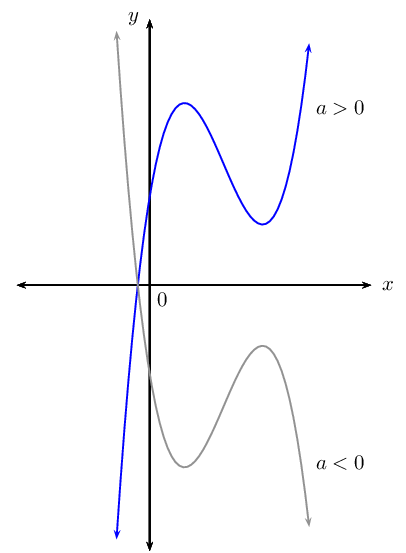

### Intercepts (EMCHD)

## Number of intercepts

Complete the table:

|  | \(y = x + 1\) | \(y = x^{2} - x - 6\) | \(y = x^{3} + x^{2} - 26x + 24\) |
| --- | --- | --- | --- |
| Degree of function |  |  |  |
| Type of function |  |  |  |
| Factorised form |  |  |  |
| No. of \(x\)-intercepts |  |  |  |
| No. of \(y\)-intercepts |  |  |  |

<Callout type="tip" title="Worked example 17: Determining the intercepts">
**Question:**
Given \(f\left(x\right)=-{x}^{3} + 4{x}^{2} + x - 4\), find the \(x\)- and
                                                \(y\)-intercepts.

**Determine the \(y\)-intercept:**
The \(y\)-intercept is obtained by letting \(x = 0\):

                                        \begin{align*}
                                        y &= -(0)^{3} + 4(0)^{2} + (0) - 4 \\
                                        &= -4
                                        \end{align*}

This gives the point \((0;-4)\).

**Use the factor theorem to factorise the expression:**
We use the factor theorem to find a factor of \(f(x)\) by trial and error:

                                        \begin{align*}
                                        f(x) &= -x^{3} + 4x^{2} + x - 4 \\
                                        f(1) &= -(1)^{3} + 4(1)^{2} + (1) - 4 \\
                                        &= 0 \\
                                        \therefore (x - 1) & \text{ is a factor of } f(x)
                                        \end{align*}

Factorise further by inspection:

                                        \begin{align*}
                                        f(x) &= (x - 1)(-x^{2} + 3x + 4) \\
                                        &= - (x - 1)(x^{2} - 3x - 4) \\
                                        &= - (x - 1)(x + 1)(x - 4)
                                        \end{align*}

The \(x\)-intercepts are obtained by letting \(f(x) = 0\):

                                        \begin{align*}
                                        0 &= - (x - 1)(x + 1)(x - 4) \\
                                        \therefore x = -1, x = 1 & \text{ or } x = 4
                                        \end{align*}

This gives the points \((-1;0)\), \((1;0)\) and \((4;0)\).
</Callout>

## Intercepts

### Textbook Exercise 6.7

Given the function \(f(x) = x^{3} + x^{2} - 10x + 8\).

**Problem:**
Determine the \(x\)- and \(y\)-intercepts of
                                                                        \(f(x)\).

**Solution:**
For the \(y\)-intercept, let \(x = 0\):

                                                                \begin{align*}
                                                                f(0) &= (0)^{3} + (0)^{2} - 10(0) + 8 \\
                                                                &= 8
                                                                \end{align*}

This gives the point \((0;8)\).

We use the factor theorem to find a factor of
                                                                        \(f(x)\) by trial and error:

                                                                \begin{align*}
                                                                f(x) &= x^{3} + x^{2} - 10x + 8 \\
                                                                f(1) &= (1)^{3} + (1)^{2} - 10(1) + 8 \\
                                                                &= 0 \\
                                                                \therefore (x - 1) & \text{ is a factor of } f(x)
                                                                \end{align*}

Factorise further by inspection:

                                                                \begin{align*}
                                                                f(x) &= (x - 1)(x^{2} + 2x - 8) \\
                                                                &= (x - 1)(x - 2)(x + 4)
                                                                \end{align*}

For the \(x\)-intercept, let \(f(x) = 0\):

                                                                \begin{align*}
                                                                0 &= (x - 1)(x - 2)(x + 4) \\
                                                                \therefore x = 1, x = 2 & \text{ or } x = -4
                                                                \end{align*}

This gives the points \((-4;0)\), \((1;0)\) and
                                                                        \((2;0)\).

**Problem:**
Draw a rough sketch of the graph.

**Solution:**
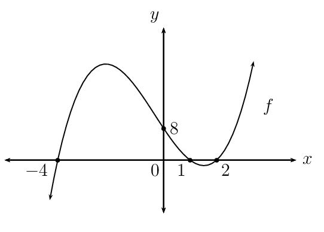

**Problem:**
Is the function increasing or decreasing at \(x =
                                                                        -5\)?

**Solution:**
Increasing

Determine the \(x\)- and \(y\)-intercepts for each of the
                                                                following:

**Problem:**
\(y = -x^{3} - 5x^{2} + 9x + 45\)

**Solution:**
For the \(y\)-intercept, let \(x = 0\):

                                                                \begin{align*}
                                                                y &= -(0)^{3} - 5(0)^{2} + 9(0) + 45 \\
                                                                &= 45
                                                                \end{align*}

This gives the point \((0;45)\).

We use the factor theorem to find a factor by trial
                                                                        and error:

                                                                \begin{align*}
                                                                \text{Let } f(x) &= -x^{3} - 5x^{2} + 9x + 45 \\
                                                                f(3) &= -(3)^{3} - 5(3)^{2} + 9(3) + 45 \\
                                                                &= 0 \\
                                                                \therefore (x - 3) & \text{ is a factor of } f(x)
                                                                \end{align*}

Factorise further by inspection:

                                                                \begin{align*}
                                                                f(x) &= (x - 3)(-x^{2} - 8x - 15) \\
                                                                &= -(x - 3)(x^{2} + 8x + 15) \\
                                                                &= -(x - 3)(x + 3)(x + 5)
                                                                \end{align*}

For the \(x\)-intercept, let \(y = 0\):

                                                                \begin{align*}
                                                                0 &= -(x - 3)(x + 3)(x + 5) \\
                                                                \therefore x = 3, x = -3 & \text{ or } x = -5
                                                                \end{align*}

This gives the points \((-5;0)\), \((-3;0)\) and
                                                                        \((3;0)\) .

**Problem:**
\(y = x^{3} - \frac{5}{4}x^{2} -
                                                                \frac{7}{4}x + \frac{1}{2}\)

**Solution:**
For the \(y\)-intercept, let \(x = 0\):

                                                                \begin{align*}
                                                                y &= (0)^{3} - \frac{5}{4}(0)^{2} - \frac{7}{4}(0) +
                                                                \frac{1}{2} \\
                                                                &= \frac{1}{2}
                                                                \end{align*}

This gives the point \((0;\frac{1}{2})\).

We use the factor theorem to find a factor by trial
                                                                        and error:

                                                                \begin{align*}
                                                                \text{Let } f(x) &= x^{3} - \frac{5}{4}x^{2} -
                                                                \frac{7}{4}x + \frac{1}{2} \\
                                                                f(-1) &= (-1)^{3} - \frac{5}{4}(-1)^{2} -
                                                                \frac{7}{4}(-1) + \frac{1}{2} \\
                                                                &= -1 - \frac{5}{4} + \frac{7}{4} + \frac{1}{2} \\
                                                                &= -\frac{4}{4} - \frac{5}{4} + \frac{7}{4} +
                                                                \frac{2}{4} \\
                                                                &= 0 \\
                                                                \therefore (x + 1) & \text{ is a factor of } f(x)
                                                                \end{align*}

Factorise further by inspection:

                                                                \begin{align*}
                                                                f(x) &= (x + 1)(x^{2} - \frac{9}{4}x + \frac{1}{2})
                                                                \\
                                                                &= (x +1)(x - 2)\left(x - \frac{1}{4}\right)
                                                                \end{align*}

For the \(x\)-intercept, let \(y = 0\):

                                                                \begin{align*}
                                                                0 &= (x +1)(x - 2)\left(x - \frac{1}{4}\right) \\
                                                                \therefore x = -1, x = 2 & \text{ or } x =
                                                                \frac{1}{4}
                                                                \end{align*}

This gives the points \((-1;0)\),
                                                                        \(\left(\frac{1}{4};0\right)\), \((2;0)\) and
                                                                        \(\left(0;\frac{1}{2}\right)\).

**Problem:**
\(y = x^{3} - x^{2} - 12x + 12\)

**Solution:**
For the \(y\)-intercept, let \(x = 0\):

                                                                \begin{align*}
                                                                y &= (0)^{3} - (0)^{2} - 12(0) + 12\\
                                                                &= 12
                                                                \end{align*}

This gives the point \((0;12)\).

We use the factor theorem to find a factor by trial
                                                                        and error:

                                                                \begin{align*}
                                                                \text{Let } f(x) &= x^{3} - x^{2} - 12x + 12 \\
                                                                f(1) &= (1)^{3} - (1)^{2} - 12(1) + 12 \\
                                                                &= 0 \\
                                                                \therefore (x - 1) & \text{ is a factor of } f(x)
                                                                \end{align*}

Factorise further by inspection:

                                                                \begin{align*}
                                                                f(x) &= (x - 1)(x^{2} - 12) \\
                                                                &= (x - 1)(x - \sqrt{12})(x + \sqrt{12})
                                                                \end{align*}

For the \(x\)-intercept, let \(y = 0\):

                                                                \begin{align*}
                                                                0 &= (x - 1)(x - \sqrt{12})(x + \sqrt{12}) \\
                                                                \therefore x = 1, x = \sqrt{12} & \text{ or } x =
                                                                -\sqrt{12}
                                                                \end{align*}

This gives the points \((1;0)\), \((\sqrt{12};0)\)
                                                                        and \((- \sqrt{12};0)\) .

**Problem:**
\(y = x^{3} - 16x\)

**Solution:**
For the \(y\)-intercept, let \(x = 0\):

                                                                \begin{align*}
                                                                y &= (0)^{3} - 16(0) \\
                                                                &= 0
                                                                \end{align*}

This gives the point \((0;0)\).

We take out a common factor of \(x\) and then
                                                                        factorise the difference of two squares:

                                                                \begin{align*}
                                                                y &= x(x^{2} - 16) \\
                                                                &= x(x - 4)(x + 4)
                                                                \end{align*}

For the \(x\)-intercept, let \(y = 0\):

                                                                \begin{align*}
                                                                0 &= x(x - 4)(x + 4) \\
                                                                \therefore x = 0, x = 4 & \text{ or } x = -4
                                                                \end{align*}

This gives the points \((0;0)\), \((-4;0)\) and
                                                                        \((4;0)\) .

**Problem:**
\(y = x^{3} -5x^{2} + 6\)

**Solution:**
For the \(y\)-intercept, let \(x = 0\):

                                                                \begin{align*}
                                                                y &= (0)^{3} -5(0)^{2} + 6 \\
                                                                &= 6
                                                                \end{align*}

This gives the point \((0;6)\).

We use the factor theorem to find a factor by trial
                                                                        and error:

                                                                \begin{align*}
                                                                f(x) &= x^{3} -5x^{2} + 6 \\
                                                                f(-1) &= (-1)^{3} -5(-1)^{2} + 6 \\
                                                                &= -1 - 5 + 6 \\
                                                                &= 0 \\
                                                                \therefore (x + 1) & \text{ is a factor of } f(x)
                                                                \end{align*}

Factorise further by inspection:

                                                                \begin{align*}
                                                                f(x) &= (x + 1)(x^{2} - 6x + 6)
                                                                \end{align*}

For the \(x\)-intercept, let \(y = 0\):

                                                                \begin{align*}
                                                                0 &= (x + 1)(x^{2} - 6x + 6) \\
                                                                \therefore x = -1, & \text{ or } x = \frac{-(-6) \pm
                                                                \sqrt{6^{2} - 4(1)(6)}}{2(1)} \\
                                                                & = \frac{6 \pm \sqrt{36-24}}{2} \\
                                                                & = \frac{6 \pm \sqrt{12}}{2} \\
                                                                & = \frac{6 \pm 2\sqrt{3}}{2} \\
                                                                & = 3 \pm \sqrt{3}
                                                                \end{align*}

This gives the points \((-1;0)\), \(( 3 -
                                                                        \sqrt{3};0)\) and \(( 3 + \sqrt{3};0)\) .

**Problem:**
Determine all intercepts for \(g(x) = x^{3} + 3x^{2} - 10x\)
                                                                and draw a rough sketch of the graph.

**Solution:**
For the \(y\)-intercept, let \(x = 0\):

                                                        \begin{align*}
                                                        y &= (0)^{3} + 3(0)^{2} - 10(0) \\
                                                        &= 0
                                                        \end{align*}

This gives the point \((0;0)\).

                                                        \begin{align*}
                                                        y &= x^{3} + 3x^{2} - 10x \\
                                                        &= x(x^{2} + 3x - 10) \\
                                                        &= x(x + 5)(x - 2)
                                                        \end{align*}

For the \(x\)-intercept, let \(y = 0\):

                                                        \begin{align*}
                                                        0 &= x(x + 5)(x - 2) \\
                                                        \therefore x = 0, x = -5 & \text{ or } x = 2
                                                        \end{align*}

This gives the points \((0;0)\), \((-5;0)\) and \((2;0)\) .

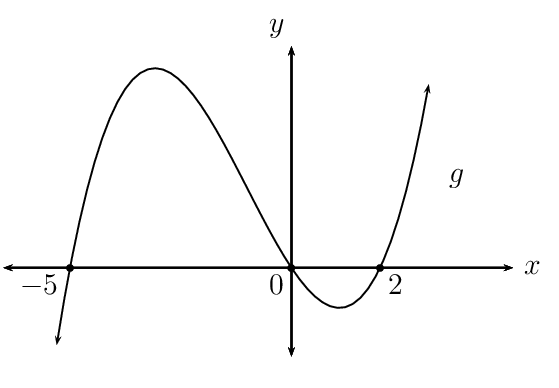

### Stationary points (EMCHF)

<QuizCard id="m12-06-06c" title="Interactive Exercise 6.14" question="Given: \[         \begin{aligned}             g =  6x^2 + \frac{1}{2}x         \end{aligned}     \] Determine \(\dfrac{dg}{dx}\) using the rules for differentiation." options=[] answer=" 12*x +1/2  " hint="Your answer should be a polynomial. You can use the following symbols to write mathematical expressions: add: + subtract: − multiply: ∗ divide: / exponent: ^ Example of a factorised polynomial: (x−1)(x+2) Example of an expanded polynomial: x^2 − x/4 + 1" explanation="Recall the rule for differentiation The rule for differentiation tells us to multiply the coefficient of each term by the exponent, and then subtract one from the exponent. The rule for differentiation is: \[                 \begin{aligned}                     \dfrac{d}{dx} ax^n = (an)x^{n-1}                 \end{aligned}             \] Differentiate the first term Let's consider the first term of the function: \[             \begin{aligned}                 \frac{d}{dx} \left(6x^\text{2} \right)                 & = \text{2} \left(6\right)x^{(\text{2}-1)}\\                 & = 12x^{\text{1}}             \end{aligned}           \] We follow the same rule for all the remaining terms. Differentiate the rest of the function \[             \begin{aligned}                 & \frac{d}{dx} \left( 6x^2 + \frac{1}{2}x \right) \\                 & = 2\left(6\right)x^{(2-1)} + 1\left(\frac{1}{2}\right)x^{(1-1)}\\                 & = 12 x + \frac{1}{2}             \end{aligned}           \] Therefore, we can write the final answer: \[                 \begin{aligned}                     \dfrac{dg}{dx} = 12 x + \frac{1}{2}                 \end{aligned}             \] Submit your answer as:" />

2. Complete the table below for the quadratic function \(f(x)\):
                                                   \begin{align*}
                                                   f(x) &= x^{2} + 2x + 1 \\
                                                   f'(x) &= \ldots \ldots \ldots
                                                   \end{align*}
   | \(x\)-value | \(-\text{3}\) | \(-\text{1}\) | \(\text{0}\) | \(\text{1}\) | \(\text{3}\) |
   | --- | --- | --- | --- | --- | --- |
   | Gradient of \(f\) |  |  |  |  |  |
   | Sign of gradient |  |  |  |  |  |
   | \(\begin{array}{c@{\;}c@{\;}l}
                                                                           \text{Increasing function }
                                                                           \left(\nearrow\right) & & \\
                                                                           \text{Decreasing function }
                                                                           \left(\searrow\right) & & \\
                                                                           \text{Maximum TP } \left(\cap\right) &&
                                                                           \\
                                                                           \text{Minimum TP } \left(\cup\right) &&
                                                                           \end{array}\) |  |  |  |  |  |
4. Use the table to draw a rough sketch of the graph of \(f(x)\).
6. Solve for \(x\) if \(f'(x) = 0\).
8. Indicate solutions to \(f'(x) = 0\) on the graph.
10. Complete the table below for the cubic function \(g(x)\):
                                                   \begin{align*}
                                                   g(x) &= 2x^{3} + 3x^{2} -12x \\
                                                   g'(x) &= \ldots \ldots \ldots
                                                   \end{align*}
   | \(x\)-value | \(-\text{3}\) | \(-\text{2}\) | \(\text{0}\) | \(\text{1}\) | \(\text{3}\) |
   | --- | --- | --- | --- | --- | --- |
   | Gradient of \(g\) |  |  |  |  |  |
   | Sign of gradient |  |  |  |  |  |
   | \(\begin{array}{c@{\;}c@{\;}l}
                                                                           \text{Increasing function }
                                                                           \left(\nearrow\right) & & \\
                                                                           \text{Decreasing function }
                                                                           \left(\searrow\right) & & \\
                                                                           \text{Maximum TP } \left(\cap\right) &&
                                                                           \\
                                                                           \text{Minimum TP } \left(\cup\right) &&
                                                                           \end{array}\) |  |  |  |  |  |
12. Use the table to draw a rough sketch of the graph of \(g(x)\).
14. Solve for \(x\) if \(g'(x) = 0\).
16. Indicate solutions to \(g'(x) = 0\) on the graph.
18. Complete the following sentence:
   The derivative describes the \(\ldots\ldots\) of a tangent to a curve
                                                           at a given point and we have seen that the \(\ldots\ldots\) of a
                                                           curve at its stationary point(s) is equal to \(\ldots\ldots\).
                                                           Therefore, we can use \(\ldots\ldots\) as a tool for finding the
                                                           stationary points of the graphs of quadratic and cubic
                                                           functions.

To determine the coordinates of the stationary point(s) of \(f(x)\):

- Determine the derivative \(f'(x)\).
- Let \(f'(x) = 0\) and solve for the \(x\)-coordinate(s) of the stationary point(s).
- Substitute value(s) of \(x\) into \(f(x)\) to calculate the \(y\)-coordinate(s) of
                                          the stationary point(s).

<Callout type="tip" title="Worked example 18: Finding stationary points">
**Question:**
Calculate the stationary points of the graph of \(p\left(x\right)= {x}^{3} -
                                                6{x}^{2} + 9x - 4\).

**Determine the derivative of \(p\left(x\right)\):**
Using the rules of differentiation we get:

                                        \[{p}'\left(x\right)=3{x}^{2} - 12x + 9\]

**Let \({p}'\left(x\right)=0\) and solve for \(x\):**
\begin{align*}
                                        3{x}^{2} - 12x + 9 & = 0 \\
                                        {x}^{2}-4x+3 & = 0 \\
                                        \left(x-3\right)\left(x-1\right) & = 0 \\
                                        \therefore x = 1 & \text{ or } x = 3
                                        \end{align*}

Therefore, the \(x\)-coordinates of the turning points are \(x=1\) and
                                                \(x=3\).

**Substitute the \(x\)-values into \(p\left(x\right)\):**
We use the \(x\)-coordinates to calculate the corresponding \(y\)-coordinates
                                                of the stationary points.

                                        \begin{align*}
                                        p\left(1\right) & = {\left(1\right)}^{3}-6{\left(1\right)}^{2} +
                                        9\left(1\right)-4 \\
                                        & = 1 - 6 + 9 - 4\\
                                        & = 0
                                        \end{align*}\begin{align*}
                                        p\left(3\right) & = {\left(3\right)}^{3}- 6{\left(3\right)}^{2} +
                                        9\left(3\right)-4 \\
                                        & = 27 - 54 + 27 - 4 \\
                                        & = -4
                                        \end{align*}

**Write final answer:**
The turning points of the graph of \(p\left(x\right)= {x}^{3} - 6{x}^{2} + 9x
                                                - 4\) are \(\left(1;0\right)\) and \(\left(3;-4\right)\).
</Callout>

**Local maximum and local minimum**

We have seen that the graph of a quadratic function can have either a minimum turning point
                                (“smile”) or a maximum turning point (“frown”).

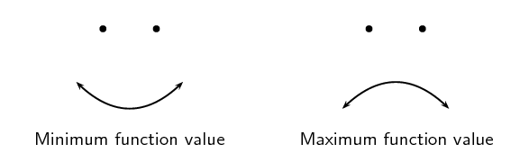

For cubic functions, we refer to the turning (or stationary) points of the graph as local
                                minimum or local maximum turning points. The diagram below shows local minimum turning
                                point \(A(1;0)\) and local maximum turning point \(B(3;4)\). These points are described
                                as a local (or relative) minimum and a local maximum because there are other points on
                                the graph with lower and higher function values.

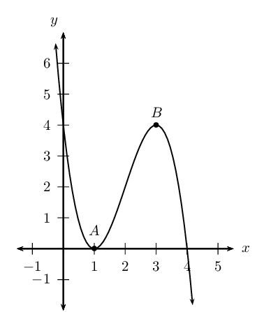

## Stationary points

### Textbook Exercise 6.8

**Problem:**
Use differentiation to determine the stationary point(s) for
                                                                \(g(x) = -x^{2}+5x-6\).

**Solution:**
\begin{align*}
                                                        g(x) &= -x^{2}+5x-6 \\
                                                        g'(x) &= -2x+5 \\
                                                        \text{At stationary point: } y'&=0 \\
                                                        -2x+5&=0 \\
                                                        -2x&=-5\\
                                                        x&=\text{2,5} \\
                                                        \text{Substitute } x &=\text{2,5} \\
                                                        \therefore y&=-(\text{2,5})^{2} + 5(\text{2,5}) - 6 \\
                                                        &=-\text{6,25} + \text{12,5} - 6 \\
                                                        &=\text{0,25} \\
                                                        \therefore \text{ Stationary point } &
                                                        \left(\frac{5}{2};\frac{1}{4}\right)
                                                        \end{align*}

**Problem:**
Determine the \(x\)-values of the stationary points for
                                                                \(f(x) = -\frac{1}{3}x^{3} + \frac{1}{2}x^2 + 6x + 5\).

**Solution:**
\begin{align*}
                                                        f(x) &= -\frac{1}{3}x^{3} + \frac{1}{2}x^2 + 6x + 5 \\
                                                        f'(x) &=-x^{2}+x+6 \\
                                                        \text{At stationary point: } y'&=0 \\
                                                        -x^{2}+x+6 &=0 \\
                                                        x^{2}-x-6&=0 \\
                                                        (x + 2)(x - 3)&=0 \\
                                                        \therefore x = -2 &\text{ or } x = 3
                                                        \end{align*}

Find the coordinates of the stationary points of the
                                                                following functions using the rules of differentiation:

**Problem:**
\(y = (x-1)^{3}\)

**Solution:**
\begin{align*}
                                                                y &= (x-1)^{3} \\
                                                                y&=x^{3}-3x^{2}+3x-1 \\
                                                                y'&=3x^{2}-6x+3\\
                                                                \text{At stationary point: } y'&=0 \\
                                                                3(x^{2}-2x+1)&=0 \\
                                                                (x-1)^{2}&=0 \\
                                                                \therefore x&=1 \\
                                                                \text{Substitute } x&=1 \\
                                                                y &= (1-1)^{3} = 0 \\
                                                                \therefore \text{ Stationary point }& (1;0)
                                                                \end{align*}

**Problem:**
\(y = x^{3}-5x^{2} + 1\)

**Solution:**
\begin{align*}
                                                                y &= x^{3}-5x^{2} + 1 \\
                                                                y'&=3x^{2}-10x\\
                                                                \text{At stationary point: } y'&=0 \\
                                                                3x^{2}-10x&=0 \\
                                                                x(3x-10)&=0 \\
                                                                \therefore x&=0, x=\frac{10}{3}
                                                                \end{align*}
                                                                \begin{align*}
                                                                \text{Substitute } x&=0 \\
                                                                y &= (0)^{3}-5(0)^{2}+ 1 = 1 \\
                                                                \therefore \text{ Stationary point }&(0;1) \\
                                                                \text{Substitute } x&=\frac{10}{3} \\
                                                                y &=
                                                                \left(\frac{10}{3}\right)^{3}-5\left(\frac{10}{3}\right)^{2}+
                                                                1\\
                                                                &= \frac{1000}{27} - \frac{500}{9} + 1 \\
                                                                &= -\frac{473}{27} \\
                                                                \therefore \text{ Stationary point
                                                                }&\left(\frac{10}{3};-\frac{473}{27}\right)
                                                                \end{align*}

**Problem:**
\(y+7x = 1\)

**Solution:**
\begin{align*}
                                                                y &= - 7 x + 1 \\
                                                                y'&=-7
                                                                \end{align*}

This is a straight line with a constant gradient,
                                                                        therefore there is no stationary point.

### Sketching cubic graphs (EMCHG)

**General method for sketching cubic graphs:**

2. Consider the sign of \(a\) and determine the general shape of the graph.
4. Determine the \(y\)-intercept by letting \(x=0\).
6. Determine the \(x\)-intercepts by factorising \(a{x}^{3}+b{x}^{2}+cx+d=0\)
                                                   and solving for \(x\).
8. Find the \(x\)-coordinates of the turning points of the function by letting
                                                   \(f'(x) = 0\) and solving for \(x\).
10. Determine the \(y\)-coordinates of the turning points by substituting the
                                                   \(x\)-values into \(f\left(x\right)\).
12. Plot the points and draw a smooth curve.

<Callout type="tip" title="Worked example 19: Sketching cubic graphs">
**Question:**
Sketch the graph of \(g\left(x\right)={x}^{3}-3{x}^{2}-4x\).

**Determine the shape of the graph:**
The coefficient of the \(x^{3}\) term is greater than zero, therefore the
                                                graph will have the following shape:

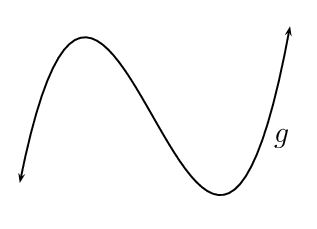

**Determine the intercepts:**
The \(y\)-intercept is obtained by letting \(x = 0\):

                                        \begin{align*}
                                        g\left(0\right)&=\left(0\right)^{3}-3\left(0\right)^{2}-4\left(0\right)\\
                                        & = 0
                                        \end{align*}

This gives the point \((0;0)\).

The \(x\)-intercept is obtained by letting \(g(x) = 0\) and solving for
                                                \(x\):

                                        \begin{align*}
                                        0 & = {x}^{3}-3{x}^{2}-4x \\
                                        & = x(x^{2} - 3x - 4) \\
                                        & = x(x - 4)(x+1)\\
                                        \therefore x=-1, \enspace & x = 0 \text{ or } x = 4
                                        \end{align*}

This gives the points \((-1;0)\), \((0;0)\) and \((4;0)\).

**Calculate the stationary points:**
Find the \(x\)-coordinates of the stationary points by setting
                                                \({g}'\left(x\right)=0\):

                                        \begin{align*}
                                        {g}'\left(x\right) & = 3x^{2} - 6x - 4 \\
                                        0 & = 3x^{2} - 6x - 4 \\
                                        \text{Using the quadratic formula} \enspace x & = \frac{-(-6) \pm
                                        \sqrt{(-6)^{2} - 4(3)(-4)}}{2(3)} \\
                                        & = \frac{6 \pm \sqrt{36 + 48}}{6} \\
                                        \therefore x = \text{2,53} & \text{ or } x = -\text{0,53}
                                        \end{align*}

Substitute these \(x\)-coordinates into \(g(x)\) to determine the
                                                corresponding \(y\)-coordinates:

                                        \begin{align*}
                                        g\left(x\right)&=\left(\text{2,53}\right)^{3}-3\left(\text{2,53}\right)^{2}-4\left(\text{2,53}\right)\\
                                        & = -\text{13,13}
                                        \end{align*}\begin{align*}
                                        g\left(x\right)&=\left(-\text{0,53}\right)^{3}-3\left(-\text{0,53}\right)^{2}-4\left(-\text{0,53}\right)
                                        \\
                                        & = \text{1,13}
                                        \end{align*}

Therefore, the stationary points are \(\left(\text{2,53};
                                                -\text{13,13}\right)\) and \(\left(-\text{0,53}; \text{1,13}\right)\).

**Draw a neat sketch:**
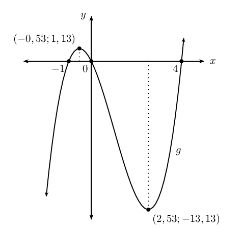
</Callout>

**Concavity**

Concavity indicates whether the gradient of a curve is increasing, decreasing or stationary.

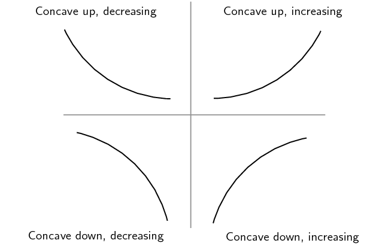

- Concave up: the gradient of the curve increases as \(x\) increases.
- Concave down: the gradient of the curve decreases as \(x\) increases.
- Zero concavity: the gradient of the curve is constant.

The diagram below shows the graph of the cubic function \(k(x) = x^{3}\). The first
                                derivative of \(k(x)\) is a quadratic function, \(k'(x) = 3x^{2}\) and the second
                                derivative is a linear function, \(k''(x) = 6x\).

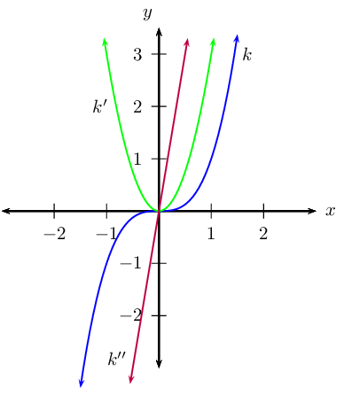

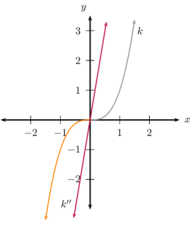

Notice the following:

- \(k''(x) > 0\), the graph is concave up.
- \(k''(x) < 0\), the graph is concave down.
- \(k''(x) = 0\), change in concavity (point of inflection).

**Points of inflection**

This is the point where the concavity of a curve changes, as shown in the diagram below. If
                                \(a < 0\), then the concavity changes from concave up (purple) to concave down (grey)
                                and if \(a > 0\), concavity changes from concave down (blue) to concave up (green).
                                Unlike a turning point, the gradient of the curve on the left-hand side of an inflection
                                point (\(P\) and \(Q\)) has the same sign as the gradient of the curve on the right-hand
                                side.

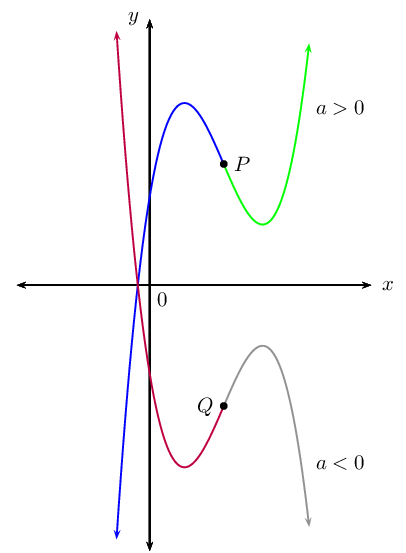

A graph has a horizontal point of inflection where the derivative is zero but the sign of the
                                gradient of the curve does not change. That means the graph (shown below) will continue
                                to increase or decrease after the stationary point.

In the example above, the equation \(k'(x) = 3x^{2}\) indicates that the gradient of this
                                curve will always be positive (except where \(x = 0\)). Therefore, the stationary point
                                is a point of inflection.

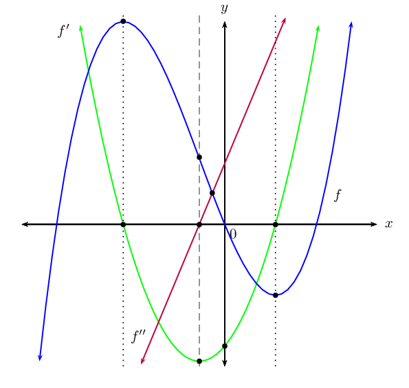

| \(f\): cubic function | \(f'\): quadratic function | \(f''\): linear function |
| --- | --- | --- |
| (blue graph) | (green graph) | (red graph) |
| turning points \(\rightarrow\) | \(x\)-intercepts |  |
| point of inflection | \(\leftarrow\) turning point \(\rightarrow\) | \(x\)-intercept |

## Concavity and points of inflection

### Textbook Exercise 6.9

Complete the following for each function:

- Determine and discuss the change in gradient of the
                                                                  function.
- Determine the concavity of the graph.
- Find the inflection point.
- Draw a sketch of the graph.

**Problem:**
\(f: y=-2x^{3}\)

**Solution:**
2. Gradient: \(f'(x) = -6x^{2}\)
   \(f'(x) < 0\) for \(x < 0\): function
                                                                                   decreasing
   \(f'(x) = 0\) for \(x = 0\): function
                                                                                   stationary
   \(f'(x) > 0\) for \(x > 0\): function
                                                                                   increasing
4. Concavity: \(f''(x)=-12x\)
   \(f''(x) > 0\) for \(x < 0\): concave
                                                                                   up
   \(f''(x) = 0\) for \(x = 0\): point of
                                                                                   inflection
   \(f''(x) < 0\) for \(x > 0\): concave
                                                                                   down
6. Point of inflection: \((0;0)\)

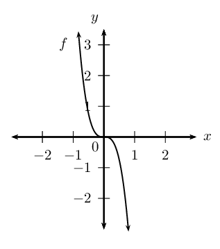

**Problem:**
\(g(x)=\frac{1}{8}x^{3}+1\)

**Solution:**
\(g(x)=y=\frac{1}{8}x^{3}+1\)

2. Gradient: \(g'(x)=\frac{3}{8}x^{2}\)
   Gradient always \(>0\) (since
                                                                                   \(\frac{3}{8}x^{2}\geq0\)) for all \(x\)
                                                                                   except \(x=0\) where the gradient will
                                                                                   be \(\text{0}\).
4. Concavity: \(g''(x) = \frac{3}{4}x\)
   \(g''(x) < 0\) for \(x < 0\): concave
                                                                                   down
   \(g''(x) = 0\) for \(x = 0\): point of
                                                                                   inflection
   \(g''(x) > 0\) for \(x > 0\): concave
                                                                                   up
6. Point of inflection: \((0;1)\)

Intercepts:

                                                        \begin{align*}
                                                        y_{\text{int}}: \text{ let } x &= 0\\
                                                        \therefore y & = 1 \\
                                                        \therefore & (0;1)
                                                        \end{align*}
                                                        \begin{align*}
                                                        y_{\text{int}}: \text{ let } y&=0\\
                                                        \frac{1}{8}x^{3}+1&=0\\
                                                        x^{3}&=-8 \\
                                                        x&=-2 \\
                                                        \therefore x_{\text{int}} & (-2;0)
                                                        \end{align*}

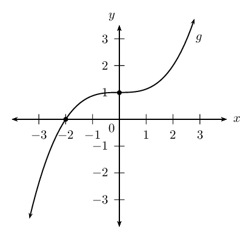

**Problem:**
\(h: x \rightarrow (x-2)^{3}\)

**Solution:**
\(h(x)=(x-2)^{3}=x^{3}-6x^{2}+12x-8\)

2. Gradient:
                                                                                   \begin{align*}
                                                                                   h'(x)&=3x^{2}-12x+12 \\
                                                                                   &=3(x^{2}-4x+4) \\
                                                                                   &= 3(x-2)^{2}
                                                                                   \end{align*}
   Gradient always \(>0\) for all \(x\)
                                                                                   except \(x=2\) where the gradient will
                                                                                   be \(\text{0}\).
   Stationary point: \((2;0)\)
4. Concavity: \(h''(x) = 6x-12\)
   \(h''(x) < 0\) for \(x < 2\): concave
                                                                                   down
   \(h''(x) = 0\) for \(x = 2\): point of
                                                                                   inflection
   \(h''(x) > 0\) for \(x > 2\): concave
                                                                                   up
6. Point of inflection: \((2;0)\)

Intercepts:

\(y_{\text{int}}: (0;-8)\)

\(x_{\text{int}}: (2;0)\)

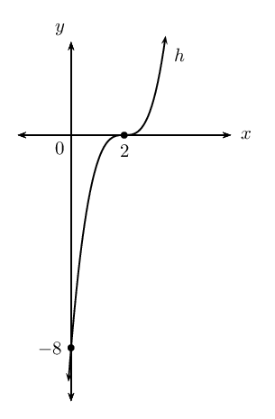

#### Interpreting graphs

<QuizCard id="m12-06-06e" title="Interactive Exercise 6.16" question="The graph below shows a parabolic function. There are two points labelled on the function. Point \(A\) is the turning point of the parabola with coordinates \(\left( \text{0} \, ; -\text{4} \right) \) . Point \(B\) is at \(\left(\text{1}\, ; -3\right)\) . The function has the form: \(f(x) = ax^2 + q\) . Determine the values of \(a\) and \(q\) ." options=[] answer=" 1 ,  -4 " hint="You should enter a number here. If you want to, you can use a space to separate thousands.                Example: 12 800,25 For scientific notation you need to use the multiply symbol                ( ∗ ) and the exponent symbol ( ^ ). For example 6,673 × 10 −11 should be written as: 6,673 ∗ 10^−11" explanation="Read the value of \(q\) from the turning point We need to determine the values of \(a\) and \(q\) in the function \(f(x) = ax^2 + q\) . The values of \(a\) and \(q\) determine the position and shape of the parabola on the graph. So we can use the points given in the question to find the values we need. It is easiest to start with the value of \(q\) . The \( q \) -term moves the parabola up or down (it causes a vertical shift, or translation, of the graph). In fact, by looking at the turning point of the parabola, we can see how much the graph moved up (or down). In this case, the turning point of the parabola is at \(( \text{0} \, ; -\text{4}) \) . That means the turning point has been moved down \(\text{4}\) spaces from \( (0 \, ; 0) \) . (If we remove \( q \) from the equation, the turning point will be at the origin.) Since the parabola shifted down, \(q\) must be negative. So the value of \( q \) is \(-\text{4}\) . Use the coordinates of Point \(B\) to calculate \( a \) Now we know the function is \(f(x) = ax^2 -4 \) . And we still need to find the value of \(a\) . Unfortunately, we cannot just steal it from the graph like we did with \( q \) . We must calculate it somehow. We can do that using the coordinates of Point \(B\) and the equation with the \( q \) -value in it . We will substitute the coordinates into the equation and solve for \(a\) . It is important to understand that the reason we can do this is because every point on the parabola solves the equation . In other words, the coordinates of points on the graph 'agree' with the equation. That is the reason the points are on the graph in the first place! When we put the coordinates of Point \(B\) into the equation, we are forcing the equation to show us the value of \(a\) which makes everything work out correctly. Substitute the coordinates of Point \(B\) into the equation. Point \(B\) is at \(\left(\text{1}\, ; -3 \right)\) . So \( x = \text{1} \) is the input value and \( f = -3 \) is the output value. \[                     \begin{aligned}                     f(x) & = ax^2 -4     \\                     ^{\text{Substitute in the}}_{\text{coordinates of a point!}} \quad \longrightarrow \quad \left( -3 \right) & = a(\text{1})^2 -4  \\                     -3 & = a -4     \\                     -3 +4 & = a     \\                     1 & = a                      \end{aligned}                 \] TIP: It is always a good idea to check if your answer agrees with the graph. In this case, we got a value for \( a \) which is positive. This means that the parabola should be smiling. Does that agree with the graph in the question? Yup! The value of \( a \) is \( 1 \) , and the function for the parabola is \(f(x) = x^{2} -4 \) . The correct answers are \( a = 1 \) and \( q = -4 \) . Submit your answer as: and" />

<Callout type="tip" title="Worked example 20: Interpreting graphs">
**Question:**
Consider the graph of the derivative of \(g(x)\).

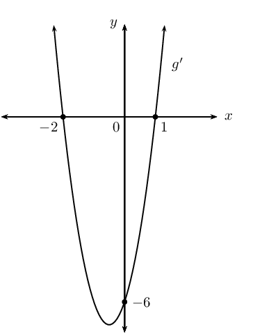

2. For which values of \(x\) is \(g(x)\) decreasing?
4. Determine the \(x\)-coordinate(s) of the turning point(s) of
                                                                   \(g(x)\).
6. Given that \(g(x) = ax^{3} + bx^{2} + cx\), calculate \(a\),
                                                                   \(b\) and \(c\).

**Examine the parabolic graph and interpret the given
                                                        information:**
We know that \(g'(x)\) describes the gradient of \(g(x)\). To
                                                        determine where the cubic function is decreasing, we must find
                                                        the values of \(x\) for which \(g'(x) < 0\):

                                                \[\{x: - 2 < x < 1; x \in \mathbb{R} \} \text{ or we can write } x
                                                \in (-2;1)\]

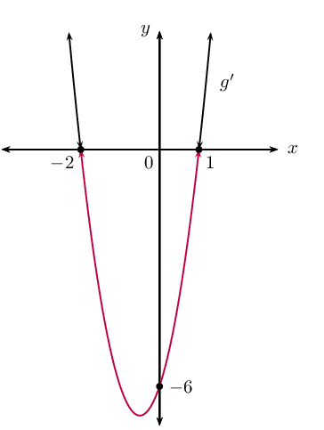

**Determine the \(x\)-coordinate(s) of the turning
                                                        point(s):**
To determine the turning points of a cubic function, we let \(g'(x) =
                                                        0\) and solve for the \(x\)-values. These \(x\)-values are the
                                                        \(x\)-intercepts of the parabola and are indicated on the given
                                                        graph:

                                                \[x = -2 \text{ or } x = 1\]

**Determine the equation of \(g(x)\):**
\begin{align*}
                                                g(x) &= ax^{3} + bx^{2} + cx \\
                                                g'(x) &= 3ax^{2} + 2bx + c
                                                \end{align*}

From the graph, we see that the \(y\)-intercept of \(g'(x)\) is
                                                        \(-\text{6}\).

                                                \begin{align*}
                                                \therefore c &= - 6 \\
                                                g'(x) &= 3ax^{2} + 2bx - 6 \\
                                                \text{Substitute } x = -2: \enspace g'(-2) &= 3a(-2)^{2} + 2b(-2) -
                                                6 \\
                                                0 &= 12a - 4b - 6 \ldots \ldots (1) \\
                                                \text{Substitute } x = 1: \enspace g'(1) &= 3a(1)^{2} + 2b(1) - 6 \\
                                                0 &= 3a + 2b - 6 \ldots \ldots (2)
                                                \end{align*}\begin{align*}
                                                \text{Eqn. }(1) - 4 \text{ Eqn. }(2): \quad 0 &= 0 -12b + 18 \\
                                                \therefore b &= \frac{3}{2} \\
                                                \text{And } 0 &= 3a + 2 \left( \frac{3}{2} \right) - 6 \\
                                                0 &= 3a - 3 \\
                                                \therefore a &= 1 \\
                                                & \\
                                                g(x) &= x^{3} + \frac{3}{2}x^{2} - 6x
                                                \end{align*}

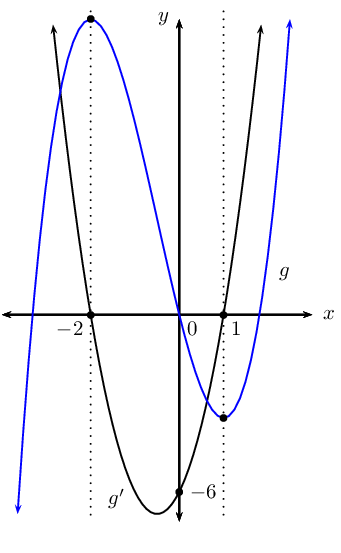
</Callout>

<Callout type="note" title="Note">
<VideoPlayer src="https://www.youtube.com/embed/lEd9nNuYTow" title="Video: 28VW" />
</Callout>

## Mixed exercises on cubic graphs

### Textbook Exercise 6.10

Given \(f\left(x\right)={x}^{3}+{x}^{2}-5x+3\).

**Problem:**
Show that \(\left(x-1\right)\) is a factor of
                                                                \(f\left(x\right)\) and hence factorise
                                                                \(f\left(x\right)\).

**Solution:**
First substitute in \(x=1\) to check if \((x-1)\) is a
                                                                factor:

                                                        \begin{align*}
                                                        f(1) & = (1)^{3} + (1)^{2} - 5(1) + 3 \\
                                                        & = 1 + 1 - 5 + 3 \\
                                                        & = 0
                                                        \end{align*}

Therefore \((x-1)\) is a factor of \(f(x)\).

                                                        \begin{align*}
                                                        f(x) & = (x-1)(x^{2}+2x-3)\\
                                                        & = (x-1)(x+3)(x-1)
                                                        \end{align*}

**Problem:**
Determine the coordinates of the intercepts and the turning
                                                                points.

**Solution:**
For the \(y\)-intercept, let \(x = 0\): \(f(0) = 0^{3} +
                                                                0^{2} - 5(0) + 3 = 3\), which gives the point \((0;3)\).

For the \(x\)-intercepts, let \(f(x) = 0\):

                                                        \begin{align*}
                                                        0 & = (x-1)(x+3)(x-1)
                                                        \end{align*}

Therefore, the \(x\)-intercepts are: \((1;0)\) and
                                                                \((-3;0)\).

Find the turning points:

                                                        \begin{align*}
                                                        f'(x) & = 3x^{2} + 2x - 5 \\
                                                        0 & = 3x^{2} + 2x - 5 \\
                                                        0 & = (3x+5)(x-1) \\
                                                        \therefore x = -\frac{5}{3} &\text{ or } x = 1
                                                        \end{align*}

To find the \(y\)-values, we substitute these two values for
                                                                \(x\) into the original equation. We already know that
                                                                when \(x=1\), \(y=0\). Substituting in the other value
                                                                gives:

                                                        \begin{align*}
                                                        f\left(-\frac{5}{3}\right) & = \left(-\frac{5}{3}
                                                        \right)^{3} + \left(-\frac{5}{3} \right)^{2} -
                                                        5\left(-\frac{5}{3} \right) + 3 \\
                                                        & = \frac{256}{27}
                                                        \end{align*}

Therefore the turning points are: \((1;0)\) and
                                                                \(\left(-\frac{5}{3};\frac{256}{27}\right)\)

**Problem:**
Sketch the graph.

**Solution:**
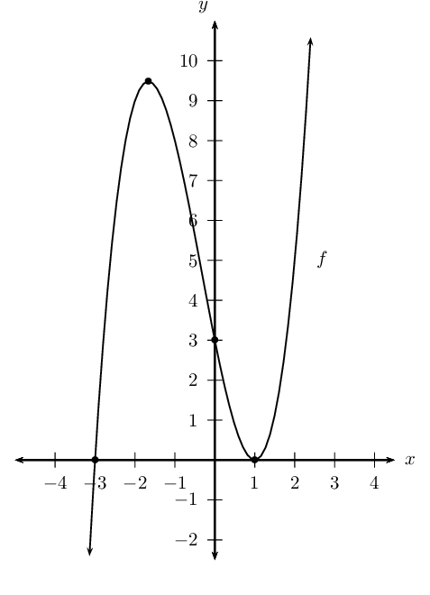

**Problem:**
Sketch the graph of
                                                                \(f\left(x\right)=-{x}^{3}+4{x}^{2}+11x-30\). Show all
                                                                the turning points and intercepts with the axes.

**Solution:**
We find the \(y\)-intercept by letting \(x = 0\):

                                                        \begin{align*}
                                                        f(x) & = -x^{3} +4x^{2} +11x - 30 \\
                                                        f(0) & = -(0)^{3} + 4(0)^{2} +11(0) - 30\\
                                                        & = -30
                                                        \end{align*}

The \(y\)-intercept is: \((0;-30)\)

We find the \(x\)-intercepts by letting \(f(x) = 0\).

We use the factor theorem to check if \((x-1)\) is a factor.

                                                        \begin{align*}
                                                        f(x) & = -x^{3} + 4x^{2} + 11x - 30 \\
                                                        f(1) & = -(1)^{3} + 4(1)^{2} + 11(1) - 30 \\
                                                        & = -16
                                                        \end{align*}

Therefore, \((x-1)\) is not a factor.

We now use the factor theorem to check if \((x+1)\) is a
                                                                factor.

                                                        \begin{align*}
                                                        f(x) & = -x^{3} + 4x^{2} + 11x - 30 \\
                                                        f(-1) & = -(-1)^{3} + 4(-1)^{2} + 11(-1) - 30 \\
                                                        & = -36
                                                        \end{align*}

Therefore, \((x+1)\) is not a factor.

We now try \((x-2)\):

                                                        \begin{align*}
                                                        f(x) & = -x^{3} + 4x^{2} + 11x - 30 \\
                                                        f(2) & = -(2)^{3} + 4(2)^{2} + 11(2) - 30 \\
                                                        & = 0
                                                        \end{align*}

Therefore, \((x-2)\) is a factor.

                                                        \begin{align*}
                                                        f(x) & = (x-2)(-x^{2} + 2x + 15) \\
                                                        & = -(x-2)(x^{2} - 2x - 15) \\
                                                        & = - (x - 2)(x + 3)(x - 5)
                                                        \end{align*}

The \(x\)-intercepts are: \((2;0), (-3;0), (5;0)\).

For the turning points, let \(f'(x)=0\).

                                                        \begin{align*}
                                                        f'(x) & = -3x^{2} + 8x + 11 \\
                                                        &= -(3x^{2}-8x-11) \\
                                                        \therefore 0 & = (3x-11)(x+1)
                                                        \end{align*}

The \(x\)-coordinates of the turning points are: \(x=-1\) and
                                                                \(x=\frac{11}{3}\).

The \(y\)-coordinates of the turning points are calculated
                                                                as:

                                                        \begin{align*}
                                                        f(-1) & = -(-1)^{3} + 4(-1)^{2} +11(-1) - 30 \\
                                                        & = -36
                                                        \end{align*}

and

                                                        \begin{align*}
                                                        f(\frac{11}{3}) & = -\left(\frac{11}{3}\right)^{3} +
                                                        4\left(\frac{11}{3}\right)^{2} + 11\left(\frac{11}{3}\right) -
                                                        30 \\
                                                        & = \frac{400}{3}
                                                        \end{align*}

Therefore, the turning points are: \((-1;-36)\) and
                                                                \((\frac{11}{3};\frac{400}{27})\).

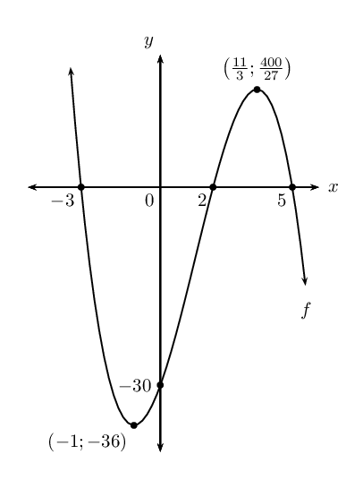

**Problem:**
Given \(g(x)=x^{3}-4x^{2}-11x+30\), sketch the graph of \(g\)
                                                                without any further calculations. Describe the method
                                                                for drawing the graph.

**Solution:**
It is the mirror image of \(f\) in the \(x\)-axis. In other
                                                                words, we reflect the graph of \(f\) about the
                                                                \(x\)-axis.

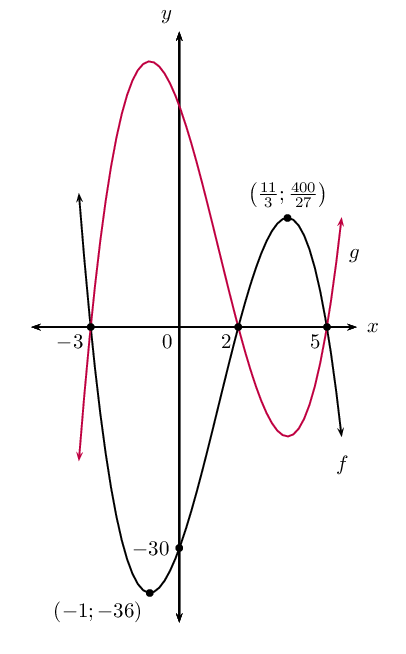

The sketch shows the graph of a cubic function, \(f\), with a turning
                                                        point at \((2;0)\), going through \((5;0)\) and \((0;-20)\).

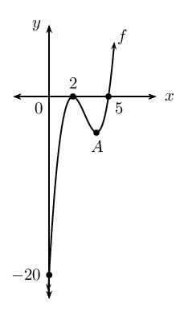

**Problem:**
Find the equation of \(f\).

**Solution:**
\(x\)-intercepts are \((2;0)\), \((2;0)\) and \((5;0)\).

                                                        \begin{align*}
                                                        \therefore \text{ Equation of } f: \enspace
                                                        y&=a(x-2)^{2}(x-5) \\
                                                        &=a(x^{2}-4x+4)(x-5) \\
                                                        &=a(x^{3} - 9x^{2} + 24x -20) \\
                                                        &=ax^{3}-9ax^{2}+24ax-20a
                                                        \end{align*}

From the graph, \(y_{\text{int}}\) is \((0;20)\).

                                                        \begin{align*}
                                                        \therefore -20a&=-20 \\
                                                        a&=1 \\
                                                        \therefore f: \enspace y &= x^{3}-9x^{2}+24x-20
                                                        \end{align*}

**Problem:**
Find the coordinates of turning point \(A\).

**Solution:**
The turning points are where \(f'(x)=0\):

                                                        \begin{align*}
                                                        f'(x)&=3x^{2}-18x+24 \\
                                                        3x^{2}-18x+24&=0 \\
                                                        (3x-12)(x-2)&=0\\
                                                        \therefore 3x-12=0 &\text{ or } x-2 =0 \\
                                                        \therefore x = 4 &\text{ or } x=2 \\
                                                        \therefore \text{ Point } A \text{ is } (4;y)
                                                        \end{align*}

Substitute \(x=4\) into the equation of \(f\) to calculate
                                                                corresponding \(y\)-value:

                                                        \begin{align*}
                                                        y&=(4)^{3}-(9)(4)^{2}+24(4)-20 \\
                                                        &=64-144+96-20\\
                                                        &=-4 \\
                                                        \therefore \text{ Point } A \text{ is } (4;-4)
                                                        \end{align*}

**Problem:**
Find the intercepts and stationary point(s) of
                                                        \(f(x)=-\frac{1}{3}x^{3}+2\) and draw a sketch of the graph.

**Solution:**
\begin{align*}
                                                        y_{\text{int}}: \text{ Let }x&=0 \\
                                                        \therefore y&=-\frac{1}{3}(0)^{3}+2\\
                                                        y&=2
                                                        \end{align*}

This gives the point \((0;2)\).

                                                        \begin{align*}
                                                        x_{\text{int}}: \text{ Let }y&=0 \\
                                                        -\frac{1}{3}x^{3}+2&=0\\
                                                        -\frac{1}{3}x^{3} &= - 2\\
                                                        x^{3}&=6\\
                                                        x &= \sqrt[3]{6}
                                                        \end{align*}

This gives the point \(\left(\sqrt[3]{6};0\right)\).

                                                        \begin{align*}
                                                        \text{Stationary points: where } f'(x)&=0 \\
                                                        f'(x)&=-x^{2} \\
                                                        -x^{2}&=0 \\
                                                        \therefore x &=0 \\
                                                        \text{Substitute into } f \therefore y
                                                        &=-\frac{1}{3}(0)^{2}+2\\
                                                        y&=2
                                                        \end{align*}

There is only one stationary point at \((0;2)\). From \(f'(x)
                                                                = -x^{2}\), we know that the gradient of the function is
                                                                always negative, therefore this is a point of
                                                                inflection.

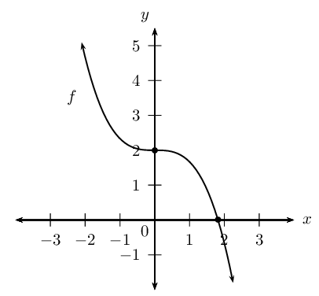

**Problem:**
For which values of \(x\) will:

2. \(f(x)<0\)
4. \(f'(x)<0\)
6. \(f''(x)<0\)

Motivate each answer.

**Solution:**
2. For \(f(x)<0\), the function values are negative
                                                                           and this is true for \(x>\sqrt[3]{6}\).
4. For \(f'(x)<0\), the gradient of \(f(x)\) is
                                                                           negative, so where \(f'(x)<0\), and this is
                                                                           true for \(x \in R\), \(x \ne 0\).
6. \(f''(x)<0\) where \(f(x)\) is concave down and
                                                                           this is true where \(x > 0\).

Use the information below to sketch a graph of each cubic function
                                                        (do not find the equations of the functions).

**Problem:**
\begin{align*}
                                                        g(-6)&=g(-\text{1,5})=g(2)=0 \\
                                                        g'(-4)&=g'(1)=0\\
                                                        g'(x)&>0 \text{ for } x <-4 \text{ or } x > 1\\
                                                        g'(x)& <0 \text{ for } -4<x<1
                                                        \end{align*}

**Solution:**
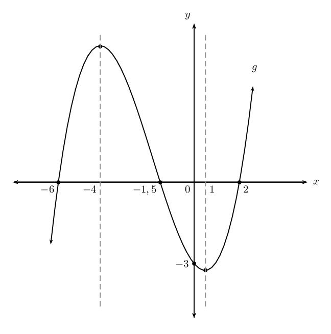

**Problem:**
\begin{align*}
                                                        h(-3)&=0 \\
                                                        h(0)&=4\\
                                                        h(-1)&=3 \\
                                                        h'(-1)&=0 \\
                                                        h''(-1)&=0 \\
                                                        h'(x)& >0 \text{ for all } x \text{ values except } x=-1
                                                        \end{align*}

**Solution:**
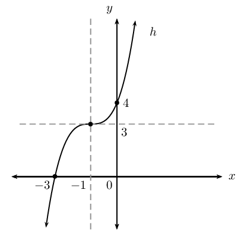

The sketch below shows the curve of \(f(x)=-(x+2)(x-1)(x-6)\) with
                                                        turning points at \(C\) and \(F\). \(AF\) is parallel to the
                                                        \(x\)-axis.

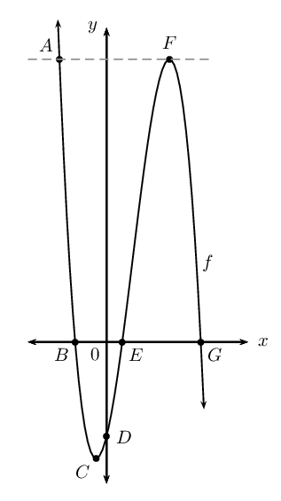

Determine the following:

**Problem:**
length \(OB\)

**Solution:**
\begin{align*}
                                                        \text{Find } x_{\text{int}} \text{ of } f \text{: let }
                                                        y&=0\\
                                                        \therefore -(x+2)(x-1)(x-6)&=0\\
                                                        x=-2 \enspace (B), \enspace x=1 \enspace (E), \enspace x&=6
                                                        \enspace (G) \\
                                                        \therefore OB&=\text{2}\text{ units} \quad (\text{Note
                                                        length is always positive})
                                                        \end{align*}

**Problem:**
length \(OE\)

**Solution:**
\(OE = \text{1}\text{ unit}\)

**Problem:**
length \(EG\)

**Solution:**
\(EG = 6 - 1 = \text{5}\text{ units}\)

**Problem:**
length \(OD\)

**Solution:**
Find \(y_{\text{int}}\) by writing \(f\) in expanded form:

                                                        \begin{align*}
                                                        y&=-(x+2)(x^{2}-7x+6)\\
                                                        &= -(x^{3}-5x^{2}-8x+12) \\
                                                        &= -x^{3} + 5x^{2} + 8x - 12 \\
                                                        \therefore OD&= \text{12}\text{ units}
                                                        \end{align*}

**Problem:**
coordinates of \(C\) and \(F\)

**Solution:**
\(C\) and \(F\) are the turning points.

To find the \(x\)-coordinates of \(C\) and \(F\), find
                                                                \(f'(x)\):

                                                        \begin{align*}
                                                        f'(x)&=-3x^{2}+10x+8\\
                                                        \text{At turning points, } f'(x)&=0\\
                                                        \therefore -3x^{2} +10x +8&=0\\
                                                        3x^{2}-10x-8&=0\\
                                                        (3x+2)(x-4)& = 0\\
                                                        x=-\frac{2}{3} \text{ or } x&=4
                                                        \end{align*}

Substitute to find \(y\)-coordinates of the turning points:

                                                        \begin{align*}
                                                        x = -\frac{2}{3}: \enspace y&=-\left(-\frac{2}{3}\right)^{3}
                                                        + 5\left(-\frac{2}{3}\right)^{2} +
                                                        8\left(-\frac{2}{3}\right)-12\\
                                                        &= \frac{8}{27} + \frac{20}{9} - \frac{16}{3} -12 \\
                                                        &= \frac{8+60-144-324}{27} \\
                                                        &= -\frac{400}{27} \\
                                                        &\approx -\text{14,8} \\
                                                        \therefore C&= \left(-\frac{2}{3};-\frac{400}{27}\right) \\
                                                        x = 4: \enspace y&=-(4)^{3} + 5(4)^{2} + 8(4)-12\\
                                                        &= -64 + 80 + 32 -12 \\
                                                        &= 36 \\
                                                        \therefore F&= \left(4;36\right)
                                                        \end{align*}

**Problem:**
length \(AF\)

**Solution:**
\(A\) has same \(y\)-coordinate as \(F\), \(y=36\). Therefore
                                                                \(-x^{3} + 5x^{2} +8x -12 = 36\) at \(F\).

Solve for \(x\) to find the \(x\)-coordinate of \(A\):
                                                                \(x^{3}-5x^{2}-8x+48=0\).

We know that \(x=4\) is a solution of this equation,
                                                                therefore \((x-4)\) is a factor.

                                                        \begin{align*}
                                                        \therefore x^{3}-5x^{2} -8x + 48 &= (x-4)(x^{2}-x-12)=0 \\
                                                        \text{Solve } x^{2}-x-12&=0 \\
                                                        (x-4)(x+3)&=0 \\
                                                        \therefore x=4, \enspace x&=-3 \\
                                                        \therefore x\text{-coordinate of } A \text{ is } -3 \\
                                                        x\text{-coordinate of } F \text{ is } 4 \\
                                                        \therefore AF = \text{7}\text{ units}
                                                        \end{align*}

**Problem:**
average gradient between \(E\) and \(F\)

**Solution:**
\begin{align*}
                                                        \text{Average gradient} &= \frac{f(4)-f(1)}{4-1} \\
                                                        &=\frac{36-0}{3} \\
                                                        &=12
                                                        \end{align*}

**Problem:**
the equation of the tangent to the graph at \(E\)

**Solution:**
\begin{align*}
                                                        \text{Gradient at } E&= f'(1) \\
                                                        f'(x)&=-3x^{2}+10x+8 \\
                                                        f'(1)&=-3(1)^{2} + 10(1)+8 \\
                                                        &=15 \\
                                                        \therefore y&=15x+c\\
                                                        \text{Tangent goes through } (1;0) \\
                                                        \therefore 0 &= 15(1) +c\\
                                                        \therefore c &= -15
                                                        \end{align*}

Therefore the equation of the tangent is \(y=15x-15\).

**Problem:**
Given the graph of a cubic function with the stationary point
                                                        \((3;2)\), sketch the graph of the derivative function if it is
                                                        also given that the gradient of the graph is \(-5\) at \(x=0\).

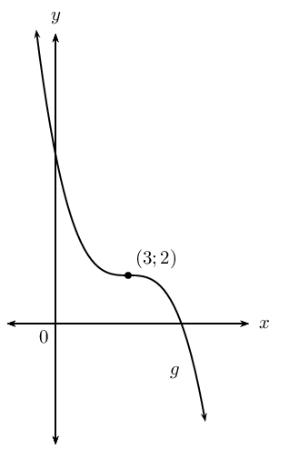

**Solution:**
Derivative will be of the second degree: parabola. Gradient of
                                                        function is negative throughout, except at \((3;2)\), where
                                                        gradient \(=0, \quad \therefore g'(3) = 0\). \(g'\) has a
                                                        maximum value of \(\text{0}\) where \(x = 3\). Therefore
                                                        \(g'(0)=-5\).

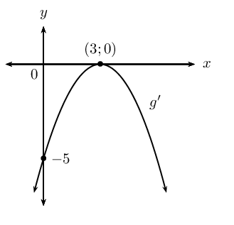

**Problem:**
The sketch below shows the graph of \(h'(x)\) with \(x\)-intercepts
                                                        at \(-\text{5}\) and \(\text{1}\).

Draw a sketch graph of \(h(x)\) if \(h(-\text{5})=2\) and \(h(1)=6\).

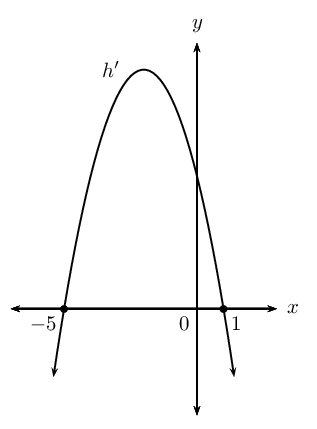

**Solution:**
\(h(x)\) is a cubic function because \(h'(x)\) is a parabola.
                                                        \(h(x)\) has two turning points because \(h'(x)\) has two
                                                        \(x\)-intercepts.

The \(x\)-values of the turning points of \(h(x)\) are the
                                                        \(x\)-intercepts of \(h'(x)\), where \(h'(x)=0\).

So \(h(x)\) will have turning points at \((-5;2)\): minimum turning
                                                        point (where gradient changes from negative to positive) and at
                                                        \((1;6)\): maximum turning point (where gradient changes from
                                                        positive to negative).

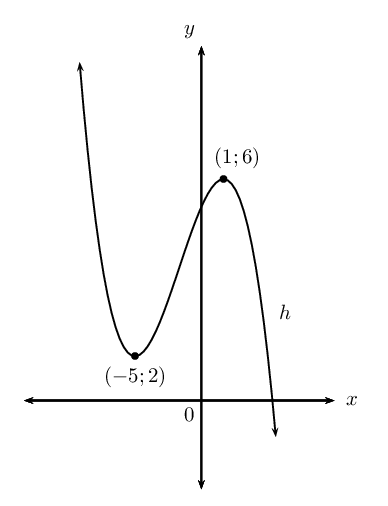
