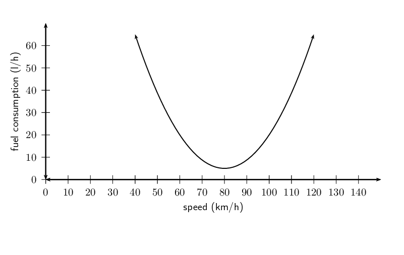
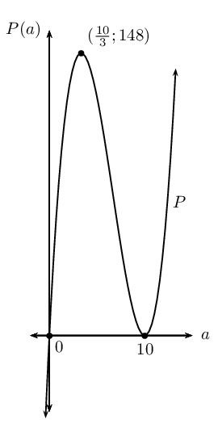
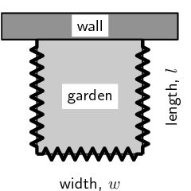
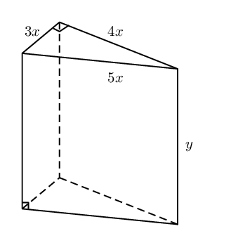
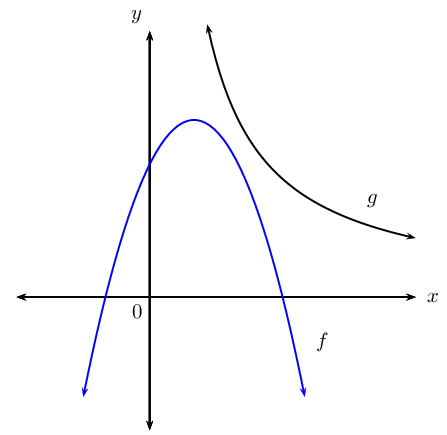
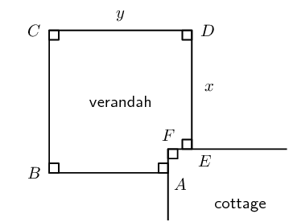
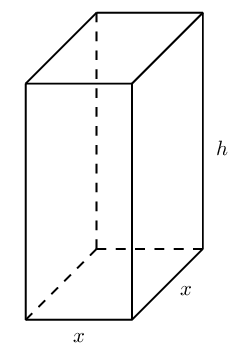
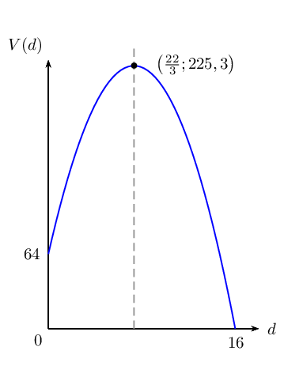
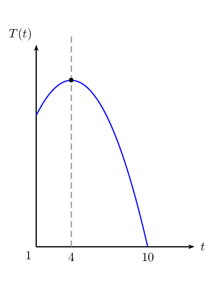

## 6.7 Applications of differential calculus (EMCHH)

<QuizCard id="m12-06-07a" title="Interactive Exercise 6.18" question="Calculate the \(x\) -coordinates of the stationary points of \(f\) . INSTRUCTION: You can type your answers in any order." options=["<", "\u2264", "=", ">", "\u2265", "A", "B", "C", "D"] answer="-2, 1/3" hint="You should enter a number here. If you want to, you can use a space to separate thousands.                Example: 12 800,25 For scientific notation you need to use the multiply symbol                ( ∗ ) and the exponent symbol ( ^ ). For example 6,673 × 10 −11 should be written as: 6,673 ∗ 10^−11" explanation="Let \(f^{\prime}(x) = 0\) and solve for \(x\) Let \(f^{\prime}(x) = 0\) and solve for the \(x\) -coordinates of the                         stationary points. \[                         \begin{aligned}                             f^{\prime}(x) &= 3 x^{2} + 5 x - 2 \\                             0 &= 3 x^{2} + 5 x - 2  \\                             0 &= \left(x + 2\right) \left(3 x - 1\right)                          \end{aligned}                     \] \[                         \begin{aligned}                              x = -2 \quad \text{or} \quad x = \dfrac{1}{3}                          \end{aligned}                     \] The \(x\) -coordinates of the stationary points are \(x = -2\) or \(x = \dfrac{1}{3}\) . Submit your answer as: and" />

### Optimisation problems (EMCHJ)

We have seen that differential calculus can be used to determine the stationary points of
                                functions, in order to sketch their graphs. Calculating stationary points also lends
                                itself to the solving of problems that require some variable to be maximised or
                                minimised. These are referred to as optimisation problems.

The fuel used by a car is defined by \(f\left(v\right)=\frac{3}{80}{v}^{2}-6v+245\), where
                                \(v\) is the travelling speed in \(\text{km/h}\).

What is the most economical speed of the car? In other words, determine the speed of the car
                                which uses the least amount of fuel.

If we draw the graph of this function we find that the graph has a minimum. The speed at the
                                minimum would then give the most economical speed.

We have seen that the coordinates of the turning point can be calculated by differentiating
                                the function and finding the \(x\)-coordinate (speed in the case of the example) for
                                which the derivative is \(\text{0}\).

                        \[{f}'\left(v\right)=\frac{3}{40}v-6\]

If we set \({f}'\left(v\right)=0\) we can calculate the speed that corresponds to the turning
                                point:

                        \begin{align*} {f}'\left(v\right) & = \frac{3}{40}v-6 \\ 0 & = \frac{3}{40}v-6 \\ v
                        & = \frac{6\times 40}{3} \\ & = 80 \end{align*}

This means that the most economical speed is \(\text{80}\text{ km/h}\).

**Finding the optimum point: **

Let \(f'(x) = 0\) and solve for \(x\) to find the optimum point.

To check whether the optimum point at \(x = a\) is a local minimum or a local
                                        maximum, we find \(f''(x)\):

- If \(f''(a) < 0\), then the point is a local maximum.
- If \(f''(a) > 0\), then the point is a local minimum.

<Callout type="tip" title="Worked example 21: Optimisation problems">
**Question:**
The sum of two positive numbers is \(\text{10}\). One of the numbers is
                                                multiplied by the square of the other. If each number is greater than
                                                \(\text{0}\), find the numbers that make this product a maximum.

Draw a graph to illustrate the answer.

**Analyse the problem and formulate the equations that are
                                                required:**
Let the two numbers be \(a\) and \(b\) and the product be \(P\).

                                        \begin{align*}
                                        a+b &=10 \ldots \ldots (1) \\
                                        P &= a \times b^{2} \ldots \ldots (2)
                                        \end{align*}

Make \(b\) the subject of equation (\(\text{1}\)) and substitute into
                                                equation (\(\text{2}\)):

                                        \begin{align*}
                                        P &= a\left(10-a\right)^{2} \\
                                        &=a \left( 100 - 20a + a^{2} \right) \\
                                        \therefore P(a) &= 100a - 20a^{2} + a^{3}
                                        \end{align*}

**Differentiate with respect to \(a\):**
\[{P}'\left(a\right)= 100 - 40a + 3a^{2}\]

**Determine the stationary points by letting \(P'(a) = 0\):**
We find the value of \(a\) which makes \(P\) a maximum:

                                        \begin{align*}
                                        {P}'\left(a\right) & = 3a^{2} -40a + 100 \\
                                        0 &= (3a - 10)(a - 10) \\
                                        \therefore a = 10 & \text{ or } a = \frac{10}{3}
                                        \end{align*}

Substitute into the equation (\(\text{1}\)) to solve for \(b\):

                                        \begin{align*}
                                        \text{If } a = 10 : \enspace b & = 10 - 10 \\
                                        & = 0 \enspace (\text{but } b > 0 ) \\
                                        \therefore \text{no solution} \\
                                        \\
                                        \text{If } a = \frac{10}{3} : \enspace b & = 10 - \frac{10}{3} \\
                                        & = \frac{20}{3}
                                        \end{align*}

**Determine the second derivative \(P''(a)\):**
We check that the point \(\left(\frac{10}{3};\frac{20}{3}\right)\) is a local
                                                maximum by showing that \({P}''\left(\frac{10}{3}\right) < 0\):

                                        \begin{align*}
                                        {P}''\left(a\right) & = 6a -40 \\
                                        \therefore {P}''\left(\frac{10}{3}\right) & = 6\left(\frac{10}{3}\right) -40
                                        \\
                                        & = 20 -40 \\
                                        & = -20
                                        \end{align*}

**Write the final answer:**
The product is maximised when the two numbers are \(\frac{10}{3}\) and
                                                \(\frac{20}{3}\).

**Draw a graph:**
To draw a rough sketch of the graph we need to calculate where the graph
                                                intersects with the axes and the maximum and minimum function values of
                                                the turning points:

Intercepts:

                                        \begin{align*}
                                        P(a) &= a^{3} -20a^{2} + 100a \\
                                        &= a(a - 10)^{2} \\
                                        & \\
                                        \text{Let } P(a) = 0: \enspace & (0;0) \text{ and } (10;0)
                                        \end{align*}

Turning points:

                                        \begin{align*}
                                        P'(a) & = 0 \\
                                        \therefore a = \frac{10}{3} & \text{ or } a = 10
                                        \end{align*}

Maximum and minimum function values:

                                        \begin{align*}
                                        \text{Substitute } \left( \frac{10}{3}; \frac{20}{3} \right): \enspace P &=
                                        ab^{2} \\
                                        &= \left( \frac{10}{3} \right) \left( \frac{20}{3} \right)^{2} \\
                                        &= \frac{4000}{27} \\
                                        & \approx 148 \qquad (\text{Maximum turning point})\\
                                        & \\
                                        \text{Substitute } (0;10): \enspace P &= ab^{2} \\
                                        &= \left( 10 \right) \left( 0 \right)^{2} \\
                                        &= 0 \qquad (\text{Minimum turning point})
                                        \end{align*}

Note: the above diagram is not drawn to scale.
</Callout>

<Callout type="tip" title="Worked example 22: Optimisation problems">
**Question:**
Michael wants to start a vegetable garden, which he decides to fence off in
                                                the shape of a rectangle from the rest of the garden. Michael has only
                                                \(\text{160}\text{ m}\) of fencing, so he decides to use a wall as one
                                                border of the vegetable garden. Calculate the width and length of the
                                                garden that corresponds to the largest possible area that Michael can
                                                fence off.

**Examine the problem and formulate the equations that are
                                                required:**
The important pieces of information given are related to the area and
                                                modified perimeter of the garden. We know that the area of the garden is
                                                given by the formula:

                                        \[\text{Area }= w \times l\]

The fencing is only required for \(\text{3}\) sides and the three sides must
                                                add up to \(\text{160}\text{ m}\).

                                        \[160 = w + l + l\]

Rearrange the formula to make \(w\) the subject of the formula:

                                        \[w=160 -2 l\]

Substitute the expression for \(w\) into the formula for the area of the
                                                garden. Notice that this formula now contains only one unknown variable.

                                        \begin{align*}
                                        \text{Area } &= l(160 - 2l) \\
                                        &= 160l - 2l^{2}
                                        \end{align*}

**Differentiate with respect to \(l\):**
We are interested in maximising the area of the garden, so we differentiate
                                                to get the following:

                                        \begin{align*}
                                        \frac{dA}{dl} = A' &= 160 - 4l
                                        \end{align*}

**Calculate the stationary point:**
To find the stationary point, we set \({A}'\left(l\right)=0\) and solve for
                                                the value(s) of \(l\) that maximises the area:

                                        \begin{align*}
                                        {A}'\left(l\right) & = 160 - 4l \\
                                        0 &= 160 - 4l \\
                                        4l &= 160 \\
                                        \therefore l &= 40
                                        \end{align*}

Therefore, the length of the garden is \(\text{40}\text{ m}\).

Substitute to solve for the width:

                                        \begin{align*}
                                        w & = 160 -2l \\
                                        & = 160 -2\left(40 \right) \\
                                        & = 160 - 80 \\
                                        & = 80
                                        \end{align*}

Therefore, the width of the garden is \(\text{80}\text{ m}\).

**Determine the second derivative \({A}''\left(l\right)\):**
We can check that this gives a maximum area by showing that
                                                \({A}''\left(l\right) < 0\):

                                        \[{A}''\left(l\right) = -4\]

**Write the final answer:**
A width of \(\text{80}\text{ m}\) and a length of \(\text{40}\text{ m}\) will
                                                give the maximum area for the garden.
</Callout>

**Important note:**

The quantity that is to be minimised or maximised must be expressed in terms of only one
                                variable. To find the optimised solution we need to determine the derivative and we only
                                know how to differentiate with respect to one variable (more complex rules for
                                differentiation are studied at university level).

## Solving optimisation problems

### Textbook Exercise 6.11

**Problem:**
The sum of two positive numbers is \(\text{20}\). One of the
                                                                numbers is multiplied by the square of the other. Find
                                                                the numbers that make this product a maximum.

**Solution:**
Let the first number be \(x\) and the second number be \(y\)
                                                                and let the product be \(P\). We get the following two
                                                                equations:

                                                        \begin{align*}
                                                        x + y & = 20 \\
                                                        xy^{2} & = P
                                                        \end{align*}

Rearranging the first equation and substituting into the
                                                                second gives:

                                                        \begin{align*}
                                                        P & = (20 - x)^{2}x \\
                                                        & = 400x - 40x^{2} + x^{3}
                                                        \end{align*}

Differentiating and setting to \(\text{0}\) gives:

                                                        \begin{align*}
                                                        P' & = 400 - 80x + 3x^{2} \\
                                                        0 & = 3x^{2} - 80x + 400 \\
                                                        & = (3x-20)(x-20)
                                                        \end{align*}

Therefore, \(x=20\) or \(x=\frac{20}{3}\).

If \(x=20\) then \(y=0\) and the product is a minimum, not a
                                                                maximum.

Therefore, \(x=\frac{20}{3}\) and \(y=20-\frac{20}{3} =
                                                                \frac{40}{3}\).

Therefore the two numbers are \(\frac{20}{3}\) and
                                                                \(\frac{40}{3}\) (approximating to the nearest integer
                                                                gives \(\text{7}\) and \(\text{13}\)).

A wooden block is made as shown in the diagram. The ends are
                                                                right-angled triangles having sides \(3x\), \(4x\) and
                                                                \(5x\). The length of the block is \(y\). The total
                                                                surface area of the block is \(\text{3 600}\text{
                                                                cm$^{2}$}\).

**Problem:**
Show that \(y= \frac{\text{300} - x^{2}}{x}\).

**Solution:**
We start by finding the surface area of the prism:

                                                                \begin{align*}
                                                                \text{Surface area} & = 2 \left(\frac{1}{2}b \times
                                                                h\right) + 3xy + 4xy +5xy \\
                                                                \text{3 600} & = (3x \times 4x) + 12xy \\
                                                                & = 12x^{2} + 12 xy
                                                                \end{align*}

Solving for \(y\) gives:

                                                                \begin{align*}
                                                                12 xy & = \text{3 600} - 12x^{2} \\
                                                                y & = \frac{\text{3 600} - 12x^{2}}{12 x}\\
                                                                y& = \frac{\text{300} - x^{2}}{x}
                                                                \end{align*}

**Problem:**
Find the value of \(x\) for which the block will have
                                                                        a maximum volume.

(Volume = area of base \(\times\) height)

**Solution:**
Start by finding an expression for volume in terms of
                                                                        \(x\):

                                                                \begin{align*}
                                                                V&=\text{ area of triangle } \times y \\
                                                                V & = 6x^{2} \times \frac{\text{300} - x^{2}}{x} \\
                                                                & = 6x ( \text{300} - x^{2})\\
                                                                & = \text{1 800}x - 6x^{3}
                                                                \end{align*}

Now take the derivative and set it equal to
                                                                        \(\text{0}\):

                                                                \begin{align*}
                                                                V' & = \text{1 800} - 18x^{2} \\
                                                                0 & = \text{1 800} - 18x^{2} \\
                                                                18x^{2} & = \text{1 800} \\
                                                                x^{2} & = 100\\
                                                                x & = \pm 10
                                                                \end{align*}

Since the length can only be positive, \(x=10\)

\(\therefore x = \text{10}\text{ cm}\)

**Problem:**
Determine the shortest vertical distance between the curves
                                                                of \(f\) and \(g\) if it is given that:
                                                                \begin{align*}
                                                                f(x)&= -x^{2}+2x+3 \\
                                                                \text{and } g(x)&= \frac{8}{x}, \quad x > 0
                                                                \end{align*}

**Solution:**
\begin{align*}
                                                        \text{Let the distance } P(x) &= g(x) - f(x)\\
                                                        &=\frac{8}{x} - (-x^{2}+2x+3) \\
                                                        &=\frac{8}{x} +x^{2} - 2x - 3
                                                        \end{align*}

To minimise the distance between the curves, let \(P'(x) =
                                                                0:\)

                                                        \begin{align*}
                                                        P'(x) &= - \frac{8}{x^2 } + 2x - 2 \qquad (x \ne 0) \\
                                                        0 &= - \frac{8}{x^2 } + 2x - 2 \\
                                                        \therefore 0 &= - 8 + 2x^3 - 2x \\
                                                        0 &= 2x^3 - 2x - 8 \\
                                                        0 &= x^3 - x - 4 \\
                                                        0 &= (x - 2)(x^2 + x + 2) \\
                                                        \therefore x =2 & \text{ or } x = \frac{-1 \pm \sqrt{(1)^2 -
                                                        4(1)(2)}}{2(1)} \\
                                                        & \quad = \text{ no real solutions } \\
                                                        \therefore x & =2
                                                        \end{align*}

Therefore, the shortest distance:

                                                        \begin{align*}
                                                        P(2) &=\frac{8}{(2)} +(2)^{2} - 2(2) - 3 \\
                                                        &= 4 + 4 - 4 -3 \\
                                                        &= \text{1}\text{ unit}
                                                        \end{align*}

**Problem:**
The diagram shows the plan for a verandah which is to be
                                                                built on the corner of a cottage. A railing \(ABCDE\) is
                                                                to be constructed around the four edges of the verandah.

If \(AB=DE=x\) and \(BC=CD=y\), and the length of the railing
                                                                must be \(\text{30}\text{ m}\), find the values of \(x\)
                                                                and \(y\) for which the verandah will have a maximum
                                                                area.

**Solution:**
We need to determine an expression for the area in terms of
                                                                only one variable.

The perimeter is:

                                                        \begin{align*}
                                                        P & = 2x + 2y \\
                                                        30 & = 2x + 2y \\
                                                        15 & = x + y \\
                                                        y&=15-x
                                                        \end{align*}

The area is:

                                                        \begin{align*}
                                                        A & = y^{2} - (y-x)^{2} \\
                                                        & = y^{2} - (y^{2} - 2xy + x^{2}) \\
                                                        & = y^{2} - y^{2} + 2xy - x^{2} \\
                                                        & = 2xy - x^{2}
                                                        \end{align*}

We use the expression for perimeter to eliminate the \(y\)
                                                                variable so that we have an expression for area in terms
                                                                of \(x\) only:

                                                        \begin{align*}
                                                        A(x) & = 2x(15-x) - x^{2} \\
                                                        & = 30x - 2x^{2} - x^{2} \\
                                                        & = 30x - 3x^{2}
                                                        \end{align*}

To find the maximum, we need to take the derivative and set
                                                                it equal to \(\text{0}\):

                                                        \begin{align*}
                                                        A'(x) & = 30 - 6x \\
                                                        0 & = 30 - 6x \\
                                                        6x & = 30 \\
                                                        x & = 5
                                                        \end{align*}

Therefore, \(x=\text{5}\text{ m}\) and substituting this
                                                                value back into the formula for perimeter gives
                                                                \(y=\text{10}\text{ m}\).

A rectangular juice container, made from cardboard, has a
                                                                square base and holds \(\text{750}\text{ cm}^{3}\) of
                                                                juice. The container has a specially designed top that
                                                                folds to close the container. The cardboard needed to
                                                                fold the top of the container is twice the cardboard
                                                                needed for the base, which only needs a single layer of
                                                                cardboard.

**Problem:**
If the length of the sides of the base is \(x\) cm,
                                                                        show that the total area of the cardboard needed
                                                                        for one container is given by:
                                                                        \[A (\text{in square centimetres}) =
                                                                        \frac{\text{3 000}}{x} + 3x^{2}\]

**Solution:**
\begin{align*}
                                                                V & = x^2h \\
                                                                750 & = x^2h \\
                                                                \therefore h & = \frac{750}{x^2}\\
                                                                A & = \text{ area of sides } + \text{ area of base }
                                                                + \text{ area of top } \\
                                                                &= 4xh + x^2 + 2x^2 \\
                                                                &= 4xh + 3x^2 \\
                                                                \text{Substitute } h &= \frac{750}{x^2}: \\
                                                                A &= 4x\left( \frac{750}{x^2} \right) + 3x^2 \\
                                                                &= \frac{3000}{x}+ 3x^2
                                                                \end{align*}

**Problem:**
Determine the dimensions of the container so that the
                                                                        area of the cardboard used is minimised.

**Solution:**
\begin{align*}
                                                                A(x) &= \frac{3000}{x}+ 3x^2 \\
                                                                A'(x) &= - \frac{3000}{x^2}+ 6x \\
                                                                \therefore 0 &= - \frac{3000}{x^2}+ 6x \\
                                                                6x &= \frac{3000}{x^2} \\
                                                                x^3 &= 500 \\
                                                                \therefore x &= \sqrt[3]{500} \\
                                                                &\approx \text{7,9}\text{ cm} \\
                                                                \therefore h & = \frac{750}{(\text{7,9})^2}\\
                                                                &\approx \text{12,0}\text{ cm}
                                                                \end{align*}

### Rates of change (EMCHK)

<QuizCard id="m12-06-07c" title="Interactive Exercise 6.20" question="Determine the derivative of the following function from first principles and find the value of \(g'(1)\) . \[                 \begin{array}{c}                     g(y) = 8 y^{2} - 10 y - 1                 \end{array}             \] NOTE: If you know the rule for differentiation, this question can be answered very quickly.  However, in tests and exams you will only get full marks if you show your working for the 'first principles' calculation." options=[] answer="16*y - 10, 6" hint="Your answer should be a mathematical expression. You can use the following symbols to write mathematical expressions: add: + subtract: − multiply: ∗ divide: / exponent: ^ The following special symbols are also recognised: pi (π): pi infinity (∞): oo It is also possible to write certain functions: √: sqrt( ) log: log( ) sin: sin( ) cosec: cosec( ) cos: cos( ) sec: sec( ) tan: tan( ) cot: cot( ) To write a logarithm with a specific base, use the underscore _ symbol.                For example, log of x base 3 can be written as: log_3 x" explanation="Determine \(g(y+h)\) The formula for the derivative from first principles is: \[                     \begin{aligned}                         \frac{d}{dy}g(y) = \lim_{h \to 0} \frac{g(y+h) - g(y)}{h}                     \end{aligned}                 \] Calculate \(g(y+h)\) for the function by substituting \((y+h)\) for every \(y\) : \[                     \begin{aligned}                         g(y) & = 8 y^{2} - 10 y - 1 \\[0.3cm]                         \therefore & \;g(y+h) \\                         & = 8(y+h)^{2} -10(y+h) -1 \\                         & = 8(y^{2}+2yh+h^{2}) -10y -10h -1 \\                         & = 8y^{2} +16yh +8h^{2} -10y -10h -1                     \end{aligned}                 \] Simplify the numerator Let's simplify the expression \[                     \begin{array}{c}                         g(y+h) - g(y)                     \end{array}                 \] before we substitute back into the formula for the derivative. Make sure that you distribute (multiply) the negative sign into the brackets and then collect like terms. \[                     \begin{aligned}                         & g(y+h) - g(y) \\                         & = \left(8y^{2} +16yh +8h^{2} -10y -10h -1\right) - \left(8 y^{2} - 10 y - 1\right) \\                         & = 8y^{2} +16yh +8h^{2} -10y -10h -1- 8 y^{2} + 10 y + 1 \\                         & = 8 h^{2} + 16 h y - 10 h                     \end{aligned}                 \] Substitute the work from above into the numerator: \[                     \begin{aligned}                         \frac{d}{dy}g(y)                         &= \lim_{h \to 0} \frac{g(y+h) - g(y)}{h} \\                         &= \lim_{h \to 0} \frac{8 h^{2} + 16 h y - 10 h}{h}                     \end{aligned}                 \] Calculate the derivative using the formula Notice that all of the terms in the numerator have a common factor.  We need to take out the common \(h\) so that it will cancel the \(h\) in the denominator: \[                     \begin{aligned}                         \frac{d}{dy}g(y) &= \lim_{h \to 0} \frac{h \left(8 h + 16 y - 10\right)}{h} \\                         & = \lim_{h \to 0} \left(8 h + 16 y - 10\right)                     \end{aligned}                 \] Now, if we apply the limit and let \(h=0\) , the expression is not undefined: \[                     \begin{aligned}                         \frac{d}{dy}g(y) & = 8(0)+16y -10 \\                         & = 16 y - 10                     \end{aligned}                 \] Determine \(g'(1)\) Substitute \(y = \text{1}\) into the derivative formula: \[                     \begin{aligned}                         \frac{d}{dy}g(y) & = 16 y - 10 \\[0.2cm]                         \therefore g'(1) &=  16(1) -10 \\                         &= 6                     \end{aligned}                 \] So the answers are: \(\dfrac{d}{dy}g(y)=16 y - 10\) \(g'(1) = 6\) Submit your answer as: and" />

It is very useful to determine how fast (the rate at which) things are changing.
                                Mathematically we can represent change in different ways. For example we can use
                                algebraic formulae or graphs.

Graphs give a visual representation of the rate at which the function values change as the
                                independent (input) variable changes. This rate of change is described by the gradient
                                of the graph and can therefore be determined by calculating the derivative.

We have learnt how to determine the average gradient of a curve and how to determine the
                                gradient of a curve at a given point. These concepts are also referred to as the average
                                rate of change and the instantaneous rate of change.

                        \[\text{Average rate of change } = \frac{f\left(x+h\right)-f\left(x\right)}{(x + h) - x}\]
                        \[\text{Instantaneous rate of change } = \lim_{h\to
                        0}\frac{f\left(x+h\right)-f\left(x\right)}{h}\]

When we mention rate of change, the instantaneous rate of change (the derivative) is implied.
                                When average rate of change is required, it will be specifically referred to as average
                                rate of change.

Velocity is one of the most common forms of rate of change:

\begin{align*}
                                \text{Average velocity } &= \text{Average rate of change } \\
                                & \\
                                \text{Instantaneous velocity } &= \text{Instantaneous rate of change } \\
                                &= \text{Derivative}
                                \end{align*}

Velocity refers to the change in distance (\(s\)) for a corresponding change in time (\(t\)).

                        \[v\left(t\right)=\frac{ds}{dt}={s}'\left(t\right)\]

Acceleration is the change in velocity for a corresponding change in time. Therefore,
                                acceleration is the derivative of velocity

                        \[a\left(t\right)={v}'\left(t\right)\]

This implies that acceleration is the second derivative of the distance.

                        \[a\left(t\right)={s}''\left(t\right)\]

<Callout type="tip" title="Worked example 23: Rate of change">
**Question:**
The height (in metres) of a golf ball \(t\) seconds after it has been hit
                                                into the air, is given by \(H\left(t\right)=20t-5{t}^{2}\). Determine
                                                the following:

2. The average vertical velocity of the ball during the first
                                                                   two seconds.
4. The vertical velocity of the ball after \(\text{1,5}\)
                                                                   \(\text{s}\).
6. The time at which the vertical velocity is zero.
8. The vertical velocity with which the ball hits the ground.
10. The acceleration of the ball.

**Determine the average vertical velocity during the first two
                                                seconds:**
\begin{align*} {v}_{\text{ave}} & =
                                        \frac{H\left(2\right)-H\left(0\right)}{2-0} \\ & =
                                        \frac{\left[20\left(2\right)-5{\left(2\right)}^{2}\right]-\left[20\left(0\right)-5{\left(0\right)}^{2}\right]}{2}
                                        \\ & = \frac{40-20}{2} \\ & = \text{10}\text{ m.s$^{-1}$}\end{align*}

**Calculate the instantaneous vertical velocity:**
\begin{align*} v\left(t\right) & = H'(t) \\
                                        &= \frac{dH}{dt} \\ & = 20-10t \end{align*}

Velocity after \(\text{1,5}\) \(\text{s}\):

                                        \begin{align*} v\left(\text{1,5}\right) & = 20-10\left(\text{1,5}\right) \\
                                        & = \text{5}\text{ m.s$^{-1}$} \end{align*}

**Determine the time at which the vertical velocity is zero:**
\begin{align*} v\left(t\right) & = 0 \\ 20-10t & = 0 \\ 10t & = 20
                                        \\ t & = 2 \end{align*}

Therefore, the velocity is zero after \(\text{2}\text{ s}\)

**Find the vertical velocity with which the ball hits the ground:**
The ball hits the ground when \(H\left(t\right)=0\)

                                        \begin{align*} 20t-5{t}^{2} & = 0 \\ 5t\left(4-t\right) & = 0 \\
                                        t=0& \text{ or } t=4 \end{align*}

The ball hits the ground after \(\text{4}\) \(\text{s}\). The velocity after
                                                \(\text{4}\) \(\text{s}\) will be:

                                        \begin{align*} v\left(4\right) & = {H}'\left(4\right) \\ & =
                                        20-10\left(4\right) \\ & = -\text{20}\text{ m.s$^{-1}$} \end{align*}

The ball hits the ground at a speed of \(\text{20}\text{ m.s$^{-1}$}\).
                                                Notice that the sign of the velocity is negative which means that the
                                                ball is moving downward (a positive velocity is used for upwards
                                                motion).

**Acceleration:**
\begin{align*}
                                        a=v'(t)&=H''(t) \\
                                        &=-10
                                        \end{align*}\begin{align*} \therefore a & = -\text{10}\text{ m.s$^{-2}$}
                                        \end{align*}

Just because gravity is constant does not mean we should necessarily think of
                                                acceleration as a constant. We should still consider it a function.
</Callout>

## Rates of change

### Textbook Exercise 6.12

A pump is connected to a water reservoir. The volume of the
                                                                water is controlled by the pump and is given by the
                                                                formula:
                                                                \begin{align*}
                                                                V(d)&=64+44d-3d^{2} \\
                                                                \text{where } V&= \text{ volume in kilolitres}\\
                                                                d&= \text{ days}
                                                                \end{align*}

**Problem:**
Determine the rate of change of the volume
                                                                of the reservoir with respect to time after \(\text{8}\)
                                                                days.

**Solution:**
\begin{align*}
                                                                \text{Rate of change }&= V'(d) \\
                                                                V'(d)&= 44 -6d \\
                                                                \text{After 8 days, rate of change will be:}\\
                                                                V'(8)&=44-6(8)\\
                                                                &= -\text{4}\text{ kℓ per day}
                                                                \end{align*}

**Problem:**
Is the volume of the water increasing or
                                                                decreasing at the end of \(\text{8}\) days. Explain your
                                                                answer.

**Solution:**
The rate of change is negative, so the function is
                                                                        decreasing.

**Problem:**
After how many days will the reservoir be
                                                                empty?

**Solution:**
\begin{align*}
                                                                \text{Reservoir empty: } V(d)&=0 \\
                                                                \therefore 64 + 44d -3d^{2}&=0 \\
                                                                (16-d)(4+3d)&=0\\
                                                                \therefore d = 16 \text{ or } & d = -\frac{4}{3} \\
                                                                \therefore \text{ It will be empty after }
                                                                \text{16}\text{ days}
                                                                \end{align*}

**Problem:**
When will the amount of water be at a
                                                                maximum?

**Solution:**
Maximum at turning point.

                                                                \begin{align*}
                                                                \text{Turning point where } V'(d)&= 0 \\
                                                                \therefore 44 - 6d&=0\\
                                                                d &=\frac{44}{6} \\
                                                                &= 7\frac{1}{3} \text{ days}
                                                                \end{align*}

**Problem:**
Calculate the maximum volume.

**Solution:**
Maximum at turning point.

                                                                \begin{align*}
                                                                \text{Maximum volume } &= V\left(\frac{22}{3}\right)
                                                                \\
                                                                V\left(\frac{22}{3}\right) &= 64 +
                                                                44\left(\frac{22}{3}\right) -
                                                                3\left(\frac{22}{3}\right)^{2} \\
                                                                &= \text{225,3}\text{ kℓ}
                                                                \end{align*}

**Problem:**
Draw a graph of \(V(d)\).

**Solution:**

A soccer ball is kicked vertically into the air and its
                                                                motion is represented by the equation:
                                                                \begin{align*}
                                                                D(t)&=1 + 18t -3t^{2} \\
                                                                \text{where } D &= \text{distance above the ground
                                                                (in metres)} \\
                                                                t&= \text{ time elapsed (in seconds)}
                                                                \end{align*}

**Problem:**
Determine the initial height of the ball at
                                                                the moment it is being kicked.

**Solution:**
\begin{align*}
                                                                D(t)&=1 + 18t - 3t^{2} \\
                                                                D(0)&=1 + 18(0) - 3(0)^{2} \\
                                                                &= 1 \text{ metre}
                                                                \end{align*}

**Problem:**
Find the initial velocity of the ball.

**Solution:**
\begin{align*}
                                                                \text{Velocity } = D'(t) &= 18 - 6t \\
                                                                \text{Initial velocity } &= D'(0) \\
                                                                D'(0) =18 - 6(0) &=\text{18}\text{ m.s$^{-1}$}
                                                                \end{align*}

**Problem:**
Determine the velocity of the ball after
                                                                \(\text{1,5}\) \(\text{s}\).

**Solution:**
\begin{align*}
                                                                \text{Velocity after } \text{1,5}\text{
                                                                s}&=D'(\text{1,5}) \\
                                                                D'(\text{1,5})&=18-6(\text{1,5})^{2} \\
                                                                &=18-9 \\
                                                                &=\text{9}\text{ m.s$^{-1}$}
                                                                \end{align*}

**Problem:**
Calculate the maximum height of the ball.

**Solution:**
Maximum height is at the turning point.

                                                                \begin{align*}
                                                                \text{Turning point: } D'(t)&=0 \\
                                                                \therefore 18 - 6t&=0\\
                                                                6t&=18 \\
                                                                t&=\text{3}\text{ s} \\
                                                                \text{Maximum height }&=D(3) \\
                                                                &=1+(18)(3)-(3)(3)^{2} \\
                                                                &=\text{28}\text{ metres}
                                                                \end{align*}

**Problem:**
Determine the acceleration of the ball
                                                                after \(\text{1}\) second and explain the meaning of the
                                                                answer.

**Solution:**
\begin{align*}
                                                                \text{Acceleration }&= D''(t) \\
                                                                D''(t)&= -\text{6}\text{ m.s$^{-2}$}
                                                                \end{align*}

Interpretation: the velocity is decreasing by
                                                                        \(\text{6}\) metres per second per second.

**Problem:**
Calculate the average velocity of the ball
                                                                during the third second.

**Solution:**
Average velocity during third second:

                                                                \begin{align*}
                                                                &= \frac{D(3)-D(2)}{3-2} \\
                                                                &=
                                                                \frac{1+18(3)-3(3)^{2}-\left[1+18(2)-3(2)^{2}\right]}{1}
                                                                \\
                                                                &= \text{3}\text{ m.s$^{-1}$}
                                                                \end{align*}

**Problem:**
Determine the velocity of the ball after
                                                                \(\text{3}\) seconds and interpret the answer.

**Solution:**
\begin{align*}
                                                                \text{Instantaneous velocity}&= D'(3) \\
                                                                &= 18-6(3) \\
                                                                &= \text{0}\text{ m.s$^{-1}$}
                                                                \end{align*}

Interpretation: this is the stationary point, where
                                                                        the derivative is zero. The ball has stopped
                                                                        going up and is about to begin its descent.

**Problem:**
How long will it take for the ball to hit
                                                                the ground?

**Solution:**
\begin{align*}
                                                                \text{Hits ground: } D(t)&=0 \\
                                                                -3t^{2}+18t+1&=0\\
                                                                t&=\frac{-18 \pm\sqrt{(18^{2}-4(1)(-3)}}{2(-3)} \\
                                                                t&=\frac{-18\pm\sqrt{336}}{-6} \\
                                                                \therefore t&=-\text{0,05} \text{ or } t=\text{6,05}
                                                                \end{align*}

The ball hits the ground at \(\text{6,05}\)
                                                                        \(\text{s}\) (time cannot be negative).

**Problem:**
Determine the velocity of the ball when it
                                                                hits the ground.

**Solution:**
\begin{align*}
                                                                \text{Velocity after } \text{6,05}\text{ s}&=
                                                                D'(\text{6,05}) \\
                                                                D'(\text{6,05})=18-5(\text{6,05})&=
                                                                -\text{18,3}\text{ m.s$^{-1}$}
                                                                \end{align*}

**Problem:**
If the displacement \(s\) (in metres) of a particle at time
                                                                \(t\) (in seconds) is governed by the equation
                                                                \(s=\frac{1}{2}{t}^{3}-2t\), find its acceleration after
                                                                \(\text{2}\) seconds.

**Solution:**
We know that velocity is the rate of change of displacement.
                                                                This means that \(\frac{dS}{dt} = v\):
                                                                \begin{align*}
                                                                s &=\frac{1}{2}t^{3} - 2t \\
                                                                v &=\frac{3}{2}t^{2} - 2
                                                                \end{align*}

We also know that acceleration is the rate of change of
                                                                velocity. This means that \(\frac{dv}{dt} = a\):
                                                                \begin{align*}
                                                                v &=\frac{3}{2}t^{2} - 2 \\
                                                                a &= 3t
                                                                \end{align*}

Substituting \(t=2\) gives \(a=\text{6}\text{ m.s$^{-2}$}\).

During an experiment the temperature \(T\) (in degrees
                                                                Celsius) varies with time \(t\) (in hours) according to
                                                                the formula: \(T\left(t\right)=30+4t-\frac{1}{2}{t}^{2},
                                                                \enspace t \in \left[1;10\right]\).

**Problem:**
Determine an expression for the rate of change of
                                                                        temperature with time.

**Solution:**
We find the rate of change of temperature with time
                                                                        by differentiating:
                                                                        \begin{align*}
                                                                        T(t) &=30+4t-\frac{1}{2}t^{2} \\
                                                                        T'(t) &= 4 - t
                                                                        \end{align*}

**Problem:**
During which time interval was the temperature
                                                                        dropping?

**Solution:**
We set the derivative equal to \(\text{0}\):
                                                                        \begin{align*}
                                                                        0 &= 4 - t \\
                                                                        t &= 4
                                                                        \end{align*}
                                                                        We look at the coefficient of the \(t^{2}\) term
                                                                        to decide whether this is a minimum or maximum
                                                                        point. The coefficient is negative and therefore
                                                                        the function must have a maximum value. The
                                                                        interval in which the temperature is increasing
                                                                        is \([1;4)\). The interval in which the
                                                                        temperature is dropping is \((4;10]\). We can
                                                                        check this by drawing the graph or by
                                                                        substituting in the values for \(t\) into the
                                                                        original equation.

