## End of chapter exercises

### Textbook Exercise 6.13

**Problem:**
Determine \({f}'\left(x\right)\) from first principles if
                                                \(f\left(x\right)=2x-{x}^{2}\).

**Solution:**
\begin{align*}
                                                f(x) & = 2x - x^{2}\\
                                                f(x+h) & = -(x+h)^{2}+2(x+h)\\
                                                f'(x) &= \lim_{h \to 0}\dfrac{f(x+h)-f(x)}{h} \\
                                                &=\lim_{h \to 0}\dfrac{-(x+h)^{2} + 2(x+h) -(-x^{2} + 2x)}{h}\\
                                                &=\lim_{h \to 0}\dfrac{-x^{2} - 2xh - h^{2} + 2x + 2h + x^{2} -
                                                2x}{h}\\
                                                &=\lim_{h \to 0}\dfrac{-2xh - h^{2} + 2h}{h}\\
                                                &=\lim_{h \to 0}\dfrac{h(-2x - h + 2)}{h}\\
                                                &=\lim_{h \to 0}(-2x - h + 2)\\
                                                &= -2x + 2
                                                \end{align*}

**Problem:**
Given \(f\left(x\right)=\frac{1}{x}+3\), find \({f}'\left(x\right)\) using
                                                the definition of the derivative.

**Solution:**
\begin{align*}
                                                f'(x) &=\lim_{h \to 0}
                                                \frac{\left(\frac{1}{x+h}+3\right)-\left(\frac{1}{x}+3\right)}{h}\\
                                                &=\lim_{h \to 0} \frac{\frac{1+3(x+h)}{x+h}-\frac{1+3x}{x}}{h}\\
                                                &=\lim_{h \to 0} \frac{\frac{x(1+3x+3h) - (x+h)(1+3x)}{x(x+h)}}{h}\\
                                                &=\lim_{h \to 0} \frac{x(1+3x+3h)-(x+h)(1+3x)}{h \cdot x(x+h)}\\
                                                &=\lim_{h \to 0} \frac{x +3x^{2}+3xh-x - 3x^{2} - h -
                                                3xh}{hx(x+h)}\\
                                                &=\lim_{h \to 0} \frac{-h}{hx(x+h)}\\
                                                &=\lim_{h \to 0} \frac{-1}{x^{2}+xh}\\
                                                &= -\frac{1}{x^{2}}
                                                \end{align*}

**Problem:**
Calculate:
                                                \(\displaystyle\lim_{x\to 1}\frac{1-{x}^{3}}{1-x}\)

**Solution:**
\begin{align*}
                                                \lim_{x \to 1} \frac{x^{3}-1}{x-1} & = \lim_{x \to 1}
                                                \frac{(x-1)(x^{2}+x+1)}{x-1} \\
                                                & = \lim_{x \to 1} (x^{2} + x + 1)\\
                                                &= 3
                                                \end{align*}

Determine \(\frac{dy}{dx}\) if:

**Problem:**
\(y=(x+2)(7-5x)\)

**Solution:**
\begin{align*}
                                                        y &=14-3x-5x^{2} \\
                                                        \frac{dy}{dx} &= -3-10x
                                                        \end{align*}

**Problem:**
\(y=\frac{8x^{3}+1}{2x+1}\)

**Solution:**
\begin{align*}
                                                        y & = \frac{8x^{3}+1}{2x+1} \\
                                                        & = \frac{(2x+1)(4x^{2}-2x+1)}{2x+1} \\
                                                        & = 4x^{2}-2x+1 \\
                                                        \frac{dy}{dx} &= 8x-2
                                                        \end{align*}

**Problem:**
\(y={\left(2x\right)}^{2}-\frac{1}{3x}\)

**Solution:**
\begin{align*}
                                                        f(x) & = (2x)^{2} - \frac{1}{3x}\\
                                                        f(x) & = 4x^{2} - \frac{x^{-1}}{3} \\
                                                        f'(x) & = 8x + \frac{x^{-2}}{3} \\
                                                        f'(x) & = 8x + \frac{1}{3x^{2}}
                                                        \end{align*}

**Problem:**
\(y=\frac{2\sqrt{x}-5}{\sqrt{x}}\)

**Solution:**
\begin{align*}
                                                        f(x) & = \frac{2\sqrt{x}-5}{\sqrt{x}}\\
                                                        & = \frac{2x^{\frac{1}{2}}}{x^{\frac{1}{2}}} -
                                                        \frac{5}{x^{\frac{1}{2}}}\\
                                                        & = 2 - 5x^{\frac{-1}{2}}\\
                                                        f'(x) & = -5(\frac{-1}{2})x^{\frac{-3}{2}}\\
                                                        & = \frac{5}{2\sqrt{x^{3}}}
                                                        \end{align*}

Given: \(f\left(x\right)=2{x}^{2}-x\)

**Problem:**
Use the definition of the derivative to calculate
                                                        \({f}'\left(x\right)\).

**Solution:**
\begin{align*}
                                                        f(x) & = 2x^{2} - x \\
                                                        f(x + h) & = 2(x + h)^{2} - (x + h) \\
                                                        & = 2(x^{2} + 2xh + h^{2}) - x - h \\
                                                        & = 2x^{2} + 4xh + 2h^{2} - x - h \\
                                                        & \\
                                                        f'(x) &=\lim_{h \to 0} \frac{f(x+h)-f(x)}{h}\\
                                                        &=\lim_{h \to 0} \frac{(2x^{2} + 4xh + 2h^{2} - x - h)-(
                                                        2x^{2} - x)}{h}\\
                                                        &=\lim_{h \to 0} \frac{2x^{2} + 4xh + 2h^{2} - x - h -
                                                        2x^{2} + x}{h}\\
                                                        &=\lim_{h \to 0} \frac{4xh + 2h^{2} - h }{h}\\
                                                        &=\lim_{h \to 0} \frac{h(4x + 2h - 1) }{h}\\
                                                        &=\lim_{h \to 0} (4x + 2h - 1)\\
                                                        &= 4x - 1
                                                        \end{align*}

**Problem:**
Hence, calculate the coordinates of the point at which the gradient
                                                        of the tangent to the graph of \(f\) is \(\text{7}\).

**Solution:**
\begin{align*}
                                                        m & = 4x - 1 = 7 \\
                                                        0 & = 4x - 8 \\
                                                        0 & = x - 2 \\
                                                        \therefore x &= 2
                                                        \end{align*}

The \(y\) value is:
                                                        \begin{align*}
                                                        f(x) & = 2x^{2} - x \\
                                                        \therefore f(2) & = 2(2)^{2} - 2\\
                                                        & = 8 - 2\\
                                                        & = 6
                                                        \end{align*}
                                                        The coordinates of the point are \((\text{2};\text{6}).\)

**Problem:**
If \(g\left(x\right)={\left({x}^{-2}+{x}^{2}\right)}^{2}\), calculate
                                                \({g}'\left(2\right)\).

**Solution:**
\begin{align*}
                                                g(x) & = \left(x^{-2}+x^{2}\right)\left(x^{-2}+x^{2}\right) \\
                                                & = x^{-4} + x^{0} +x^{0} +x^{4}\\
                                                & = x^{-4} + 1 + 1 +x^{4}\\
                                                & = x^{-4} + 2 + x^{4}\\
                                                g'(x) & = -4x^{-5}+4x^{3}\\
                                                g'(2) & = -4(2)^{-5}+4(2)^{3}\\
                                                &=\frac{-4}{32} + 32\\
                                                &=-\frac{1}{8}+32 \\
                                                &=31\frac{7}{8} \\
                                                &=\frac{255}{8}
                                                \end{align*}

Given: \(f\left(x\right)=2x-3\)

**Problem:**
Find \({f}^{-1}\left(x\right)\).

**Solution:**
\begin{align*}
                                                y & = 2x-3\\
                                                f^{-1}: \enspace x & = 2y-3 \\
                                                2y& = x+3 \\
                                                y&=\frac{x}{2}+\frac{3}{2}
                                                \end{align*}

**Problem:**
Solve \({f}^{-1}\left(x\right)=3{f}'\left(x\right)\).

**Solution:**
\begin{align*}
                                                        \frac{x+3}{2} & = 3(2)\\
                                                        x+3&=12\\
                                                        & = 9
                                                        \end{align*}

Find the derivative for each of the following:

**Problem:**
\(p(t)=\frac{\sqrt[5]{{t}^{3}}}{3}+10\)

**Solution:**
\begin{align*}
                                                        p(t) & = \frac{\sqrt[5]{t^{3}}}{3} + 10\\
                                                        p(t) &= \frac{t^{\frac{3}{5}}}{3} + 10\\
                                                        p'(t) & =
                                                        \frac{1}{3}\left(\frac{3}{5}t^{-\frac{2}{5}}\right)\\
                                                        &=\frac{1}{5\sqrt[5]{t^{2}}}
                                                        \end{align*}

**Problem:**
\(k(n)=\frac{\left(2{n}^{2}-5\right)\left(3n+2\right)}{{n}^{2}}\)

**Solution:**
\begin{align*}
                                                        k(n) &=\frac{6n^{3}+4n^{2}-15n-10}{n^{2}}\\
                                                        &=6n+4-15n^{-1}-10n^{-2}\\
                                                        k'(n) &= 6 + 15n^{-2} + 20n^{-3}\\
                                                        &= 6 + \frac{15}{n^{2}} + \frac{20}{n^{3}}
                                                        \end{align*}

**Problem:**
If \(xy-5=\sqrt{{x}^{3}}\), determine \(\frac{dy}{dx}\).

**Solution:**
\begin{align*}
                                                xy - 5 & = \sqrt{x^{3}}\\
                                                y & = \frac{x^{\frac{3}{2}}+5}{x}\\
                                                & = x^{\frac{1}{2}}+5x^{-1}\\
                                                \frac{dy}{dx} & = \frac{1}{2}x^{-\frac{1}{2}} - 5x^{-2}\\
                                                &=\frac{1}{2\sqrt{x}}-\frac{5}{x^{2}}
                                                \end{align*}

Given: \(y=x^{3}\)

**Problem:**
Determine \(\frac{dy}{dx}\).

**Solution:**
Differentiate \(y\) with respect to \(x\).

                                                \[\frac{dy}{dx}=3x^{2}\]

**Problem:**
Find \(\frac{dx}{dy}\).

**Solution:**
To differentiate \(x\) with respect to \(y\), express \(x\) in terms
                                                        of \(y\):

                                                \begin{align*}
                                                x&=\sqrt[3]{y}\\
                                                &=y^{\frac{1}{3}}\\
                                                \frac{dx}{dy}&=\frac{1}{3}y^{-\frac{2}{3}}\\
                                                &=\frac{1}{3\sqrt[3]{y^{2}}}
                                                \end{align*}

**Problem:**
Show that \(\frac{dy}{dx} \times \frac{dx}{dy} = 1\).

**Solution:**
\begin{align*}
                                                \frac{dy}{dx} \times \frac{dx}{dy} &= 3x^{2} \times
                                                \frac{y^{-\frac{2}{3}}}{3} \\
                                                \text{But } y&=x^{3} \\
                                                \therefore \frac{dy}{dx} \times \frac{dx}{dy} &= 3x^{2} \times
                                                \frac{\left(x^{3}\right)^{-\frac{2}{3}}}{3} \\
                                                &=x^{2} \times x^{-2} \\
                                                &=x^{0} \\
                                                &=1
                                                \end{align*}

Given: \(f\left(x\right)={x}^{3}-3{x}^{2}+4\)

**Problem:**
Calculate \(f\left(-1\right)\).

**Solution:**
\begin{align*}
                                                        f(-1) & = (-1)^{3} -3(-1)^{2} + 4\\
                                                        & = \text{0}
                                                        \end{align*}

**Problem:**
Hence, solve \(f\left(x\right)=0\).

**Solution:**
We know that \((x + 1)\) is a factor of \(f(x)\) because \(f(-1) =
                                                        0\). We factorise further using inspection:

\begin{align*}
                                                        f(x) & = (x+1)(x^{2} - 4x + 4) \\
                                                        & = (x+1)(x-2)(x-2) \\
                                                        \therefore \enspace f(x)&=(x+1)(x-2)(x-2) \\
                                                        0 &=(x+1)(x-2)(x-2) \\
                                                        \therefore \enspace x = -1 & \text{ or } x=2
                                                        \end{align*}

**Problem:**
Determine \({f}'\left(x\right)\).

**Solution:**
\begin{align*}
                                                        f'(x) & = 3x^{2} - 6x\\
                                                        & = 3x(x-2)
                                                        \end{align*}

**Problem:**
Sketch the graph of \(f\), showing the coordinates of the turning
                                                        points and the intercepts on both axes.

**Solution:**
The \(y\)-intercept is \(y=4\).

The \(x\)-intercepts are \((2;0) \text{ and } (-1;0)\).

To find the turning points we let the derivative equal \(0\).
                                                        \(f'(x)=3x(x-2)=0\). The \(x\)-values of the turning points are:
                                                        \(x=0\) and \(x=2\).

Therefore, the turning points are \((0;4)\) and \((2;0)\).

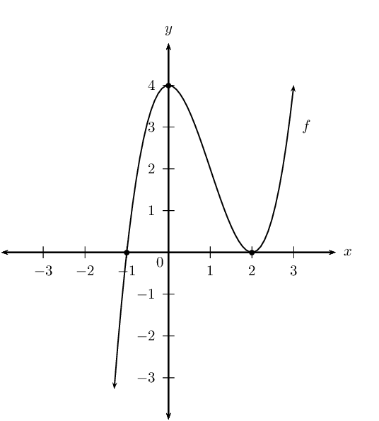

**Problem:**
Determine the coordinates of the points on the graph of \(f\) where
                                                        the gradient is \(\text{9}\).

**Solution:**
\begin{align*}
                                                f'(x)& = 3x^{2} - 6x \\
                                                3x^{2} - 6x &= 9\\
                                                3x^{2} - 6x - 9& = 0 \\
                                                x^{2} - 2x -3 &=0 \\
                                                (x-3)(x+1)&=0\\
                                                \therefore \enspace x=3 \text{ or } x&=-1 \\
                                                \text{If } x = 3: \enspace f(3) & ={(3)}^{3}-3{(3)}^{2}+4 \\
                                                & = 27 -27 +4 \\
                                                & = 4 \\
                                                \text{If } x = -1: \enspace f(-1) & ={(-1)}^{3}-3{(-1)}^{2}+4 \\
                                                & = -1 - 3 + 4 \\
                                                &= 0
                                                \end{align*}

Therefore, at \((-1;0)\) and \((3;4)\).

**Problem:**
Draw the graph of \(f'(x)\) on the same system of axes.

**Solution:**
\begin{align*}
                                                f'(x) &=3x^{2}-6x \\
                                                y_{\text{int}}:& \enspace(0;0) \\
                                                x_{\text{int}}:& \enspace 3x(x-2)=0 \\
                                                \therefore \enspace x&=0 \text{ or } x=2 \\
                                                \therefore (0;0) & \text{ or } (2;0) \\
                                                & \\
                                                \text{Turning point }&\text{ is where } f''(x)=0 \\
                                                \therefore \enspace&6x-6=0 \\
                                                \therefore \enspace x&=1\\
                                                \text{Turning point: }&(1;-3)
                                                \end{align*}

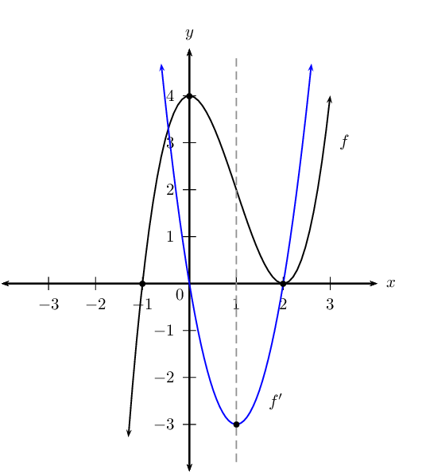

**Problem:**
Determine \(f''(x)\) and use this to make conclusions about the
                                                        concavity of \(f\).

**Solution:**
\begin{align*}
                                                f''(x) &=6x-6 \\
                                                6x-6&=0 \text{ for } x=1 \\
                                                x<1, \enspace f''(x)<0&\therefore f(x) \text{ is concave down}
                                                \\
                                                x>1, \enspace f''(x)>0&\therefore f(x) \text{ is concave up}
                                                \\
                                                x=1, \enspace f''(x)=0&\therefore \enspace f(x) \text{ is point of
                                                inflection}
                                                \end{align*}

Given \(f\left(x\right)=2{x}^{3}-5{x}^{2}-4x+3\).

**Problem:**
If \(f(-1)=0\), determine the \(x\)-intercepts of \(f\).

**Solution:**
\begin{align*}
                                                f\left(x\right)&=2{x}^{3}-5{x}^{2}-4x+3 \\
                                                f(-1)&=0 \text{, so } (x+1) \text{ is a factor of } f(x) \\
                                                f(x) &= (x+1)(2x^{2}-7x+3) \\
                                                &=(x+1)(2x-1)(x-3) \\
                                                \text{Let } \enspace f(x)&=0 \\
                                                \therefore \enspace&(x+1)(2x-1)(x-3)=0\\
                                                \therefore \enspace x&=-1, \enspace x=\frac{1}{2} \text{ or } x=3
                                                \end{align*}

The \(x\)-intercepts of \(f\) are \(\left(-1;0\right)\),
                                                        \(\left(\frac{1}{2};0\right)\) and \(\left(3;0\right)\).

**Problem:**
Determine the coordinates of the turning points of \(f\).

**Solution:**
\begin{align*}
                                                f'(x) & = 6x^{2} -10x - 4\\
                                                0 & = 2(3x^{2} - 5x - 2)\\
                                                & = 3x^{2} - 5x - 2 = 0\\
                                                &= (3x+1)(x-2)=0\\
                                                \therefore \enspace x&=-\frac{1}{3} \text{ or } x=2 \\
                                                \text{Substitute } x&= -\frac{1}{3}:\\
                                                y&=2\left(-\frac{1}{3}\right)^{3}-5\left(-\frac{1}{3}\right)^{2}-4\left(-\frac{1}{3}\right)+3
                                                \\
                                                &=\frac{100}{27} \\
                                                &=\text{3,7} \\
                                                \text{Substitute } x&= 2:\\
                                                y&=2(2)^{3} -5(2)^{2}-4(2)+3 \\
                                                &=-9 \\
                                                \therefore \text{ Turning points are }& A\left(-\frac{1}{3};
                                                \text{3,7}\right) \text{ and } B\left(2;-9\right)
                                                \end{align*}

**Problem:**
Draw a sketch graph of \(f\). Clearly indicate the coordinates of the
                                                        turning points and the intercepts with the axes.

**Solution:**
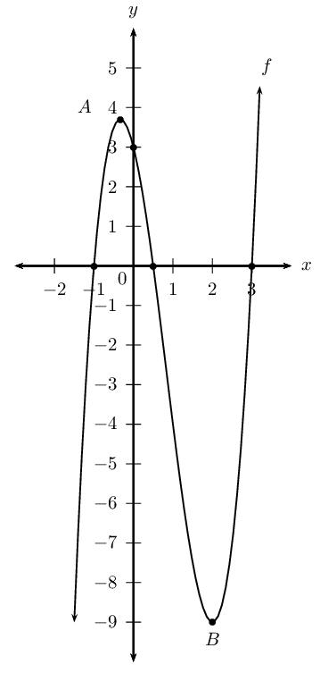

**Problem:**
For which value(s) of \(k\) will the equation \(f\left(x\right)=k\)
                                                        have three real roots of which two are equal?

**Solution:**
To find the point when the cubic function has two real roots, we need
                                                        to find the points where one of the turning points lies on the
                                                        \(x\)-axis. We look at the \(y\)-values of the turning points to
                                                        determine this. For the maximal turning point we lower the graph
                                                        and for the minimal one we raise the graph.
                                                        This gives: \(k=\text{3,7}\) or \(k=-\text{9}\)

**Problem:**
Determine the equation of the tangent to the graph of
                                                        \(f\left(x\right)=2{x}^{3}-5{x}^{2}-4x+3\) at the point where
                                                        \(x=1\).

**Solution:**
Find the \(y\)-value at \(x=1\):
                                                        \begin{align*}
                                                        f(1) & = 2(1)^{3}-5(1)^{2}-4(1)+ 3\\
                                                        & = -4
                                                        \end{align*}
                                                        Determine the value of \(m\) substituting \(x=1\) into the
                                                        derivative:
                                                        \begin{align*}
                                                        f'(x) & = 6x^{2} - 10x - 4 \\
                                                        f'(1) & = 6(1)^{2} - 10(1) - 4 \\
                                                        m & = -8
                                                        \end{align*}

The equation of the tangent is:
                                                        \begin{align*}
                                                        y - y_{1} & = m(x - x_{1}) \\
                                                        y + 4 & = -8(x - 1) \\
                                                        y & = -8x + 4
                                                        \end{align*}

Given the function \(f(x)=x^{3}+bx^{2}+cx+d\) with \(y\)-intercept
                                                \((0;26)\), \(x\)-intercept \((-2;0)\) and a point of inflection at
                                                \(x=-3\).

**Problem:**
Show by calculation that \(b=9\), \(c=27\) and \(d=26\).

**Solution:**
\begin{align*}
                                                y_{\text{int}} (0;26): \enspace & d=26 \\
                                                \therefore f(x) &= x^{3} + bx^{2} +cx + 26 \\
                                                x_{\text{int}} (-2;0): \enspace f(-2)&=(-2)^{3} + b(-2)^{2} + c(-2)
                                                +26 \\
                                                \therefore 0 &=-8+4b-2c+26 \\
                                                0 &=4b-2c+18 \\
                                                2b-c&=-9 \quad \textbf{ eqn 1}\\
                                                \text{Stationary point at } x&=-3 \\
                                                \therefore f'(-3) &=0 \\
                                                f'(x) &=3x^{2}+2bx+c \\
                                                f'(-3) &= 3(-3)^{2} +2b(-3) +c \\
                                                0 &=27 - 6b +c \\
                                                6b-c&=27 \quad \textbf{ eqn 2}\\
                                                2b-c&=-9 \quad \textbf{ eqn 1}\\
                                                \textbf{ eqn 1 } - \textbf{ eqn 2 }: \enspace 4b &=36 \\
                                                b&=9\\
                                                \text{Substitute } b&=9 \text{ into } \enspace \textbf{ eqn 1} \\
                                                2(9)-c&=-9\\
                                                -c&-27 \\
                                                c&=27\\
                                                \therefore f(x) &=x^{3} + 9x^{2} +27x + 26
                                                \end{align*}

**Problem:**
Find the \(y\)-coordinate of the point of inflection.

**Solution:**
\begin{align*}
                                                \text{Passes through }(-3;y) \\
                                                \therefore y &= (-3)^{3} + 9(-3)^{2} + 27(-3) +26 \\
                                                &= -27 + 81 -81 + 26 \\
                                                &=-1 \\
                                                \therefore \text{ Point of inflection: }&A(-3;-1)
                                                \end{align*}

**Problem:**
Draw the graph of \(f\).

**Solution:**
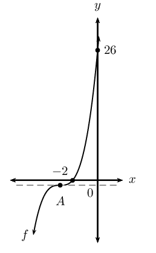

**Problem:**
Discuss the gradient of \(f\).

**Solution:**
Gradient always positive except at \(A(-3;-1)\) where the gradient is
                                                        at its minimum value, zero.

**Problem:**
Discuss the concavity of \(f\).

**Solution:**
Concavity changes at inflection point \(A(-3;-1)\):

                                                \begin{align*}
                                                f'(x)&=3x^{2}+18x+27 \\
                                                f''(x):&=6x+18 \\
                                                x<-3, \enspace f''(x)<0&\therefore f(x) \text{ is concave
                                                down} \\
                                                x=-3, \enspace f''(x)=0&\therefore \enspace f(x) \text{ is point of
                                                inflection} \\
                                                x>1, \enspace f''(x)>0&\therefore f(x) \text{ is concave up}
                                                \end{align*}

The sketch shows the graph of \(g'(x)\).

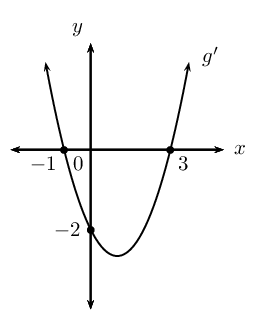

**Problem:**
Identify the stationary points of the cubic function, \(g(x)\).

**Solution:**
Turning points are at \(x = -1\) and \(x = 3\):

For \(x = -1\): this is a local maximum turning point (the gradient
                                                        of \(g\) changes from positive to negative).

For \(x = 3\): this is a local minimum turning point (the gradient of
                                                        \(g\) changes from negative to positive).

**Problem:**
What is the gradient of function \(g\)

                                                where \(x=0\).

**Solution:**
At \(x = 0\), the gradient of the function is equal to \(-\text{2}\).
                                                        We can write this as \(g'(0)= -2\).

**Problem:**
If it is further given that \(g(x)\) has only two real roots, draw a
                                                        rough sketch of \(g(x)\). Intercept values do not need to be
                                                        shown.

**Solution:**
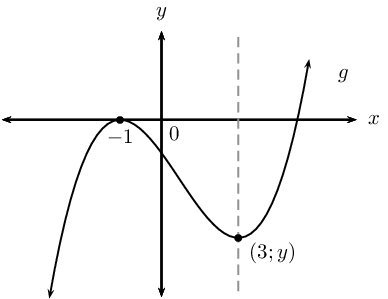

**Problem:**
Given that \(h(x)\) is a linear function with \(h(2)=11\) and \(h'(2)=-1\),
                                                find the equation of \(h(x)\).

**Solution:**
\(h(x)\) is a linear function and is therefore of the form \(y = mx + c\).
                                                The derivative of a linear function is \(\frac{dy}{dx} = m\), therefore
                                                from \(h'(2) = -1\), we know that \(m = -1\).

                                        \begin{align*}
                                        \therefore y &= -x + c \\
                                        \text{Substitute } (2;11): \enspace 11 &= -2 + c \\
                                        \therefore c &= 13 \\
                                        \therefore y &= -x + 13
                                        \end{align*}

Therefore, \(h(x) = -x + 13\).

The graphs of \(f\) and \(g\) and the following points are given below:

                                        \[A(-3;0) \quad B(3;0) \quad C(-1;-32) \quad D(0;-27) \quad E(2;y)\]

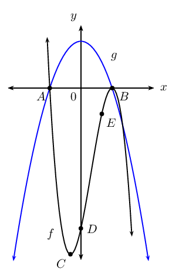

**Problem:**
Use the graphs and determine the values of \(x\) for which:

2. \(f(x)\) is a decreasing function.
4. \(f(x) \cdot g(x) \geq 0\).
6. \(f'(x)\) and \(g(x)\) are both negative.

**Solution:**
2. \(x < -1\) and \(x > 3\)
4. \(x = -3\) or \(x \geq 3\) (both \(f\) and \(g\) are
                                                                           negative)
6. \(f'(x) < 0\) where the gradient of \(f\) is
                                                                           negative. Therefore, \(x < -1\) or \(x >
                                                                           3\).
   And \(g < 0\) for \(x < -3\) or \(x > 3\).
   Therefore, \(f'\) and \(g < 0\) for \(x < -3\)
                                                                           or \(x > 3\).

**Problem:**
Given \(f(x)=-x^{3}+3x^{2}+9x-27\), determine the equation of the
                                                        tangent to \(f\) at the point \(E (2;y)\).

**Solution:**
Equation of tangent to \(f\) at \(E(2;y)\):

                                                \begin{align*}
                                                f'(x) &= -3x^{2} + 6x + 9 \\
                                                \text{At } x=2: \enspace f'(2) &= -3(2)^{2} + 6(2) + 9 \\
                                                &= -12 +12 + 9 \\
                                                &= 9 \\
                                                \therefore y &= 9x + c
                                                \end{align*}

To calculate the value of \(y\) at \(E\), substitute \(x = 2\) into
                                                        \(f(x)\):

                                                \begin{align*}
                                                f(2) & =-(2)^{3}+3(2)^{2}+9(2)-27 \\
                                                & =-8 + 12 + 18 -27 \\
                                                & =-5
                                                \end{align*}

Substitute \((2;-5)\) into \(f'(x)\) to determine \(c\):

                                                \begin{align*}
                                                y &= 9x + c\\
                                                -5 & = 9(2) + c \\
                                                \therefore c & = -23 \\
                                                y &= 9x - 23
                                                \end{align*}

**Problem:**
Find the coordinates of the point(s) where the tangent in the
                                                        question above meets the graph of \(f\) again.

**Solution:**
Equate the equation of the tangent and \(f(x)\):

                                                \begin{align*}
                                                9x - 23 &= -x^{3}+3x^{2}+9x-27 \\
                                                \therefore 0 & = -x^{3}+3x^{2} - 4 \\
                                                \text{Let } k(x) & = -x^{3}+3x^{2} - 4 \\
                                                k(-1) & = -(-1)^{3}+3(-1)^{2} - 4 \\
                                                &= 1 + 3 -4 \\
                                                &= 0 \\
                                                \therefore k(x) & = (x + 1)(- x^2 + 4x - 4) \\
                                                & = - (x + 1)(x^2 - 4x + 4) \\
                                                & = - (x + 1)(x - 2)^{2} \\
                                                \therefore 0 & = - (x + 1)(x - 2)^{2} \\
                                                \therefore x = -1 & \text{ or } x = 2 \text{ or } x = 2
                                                \end{align*}

Therefore, tangent meets graph of \(f\) at the turning point
                                                        \(C(-1;-32)\).

**Problem:**
Without any calculations, give the \(x\)-intercepts of the graph of
                                                        \(f'(x)\). Explain reasoning.

**Solution:**
\(x\)-intercepts of \(f'\) are at \((-1;0)\) and \((3;0)\), the
                                                        turning points of \(f\) (points \(B\) and \(C\)). At these two
                                                        points the gradient of the graph is equal to zero, where
                                                        \(f'(x)\) cuts the \(x\)-axis.

**Problem:**
Sketch the graph of \(f\left(x\right)={x}^{3}-9{x}^{2}+24x-20\), show
                                                        all intercepts with the axes and turning points.

**Solution:**
We find the \(y\)-intercept by finding the value for \(f(0)\).

                                                \begin{align*}
                                                f(x) & = x^{3} -9x^{2} + 24x - 20 \\
                                                f(0) & = (0)^{3} - 9(0)^{2} + 24(0) - 20\\
                                                & = -20
                                                \end{align*}

The \(y\)-intercept is: \((0;-20)\)

We find the \(x\)-intercepts by finding the values for which the
                                                        function \(f(x) = 0\).

We use the factor theorem to check if \((x-1)\) is a factor.

                                                \begin{align*}
                                                f(x) & = x^{3} -9x^{2} + 24x - 20 \\
                                                f(1) & = (1)^{3} - 9(1)^{2} + 24(1) - 20 \\
                                                & = -4
                                                \end{align*}

Therefore, \((x-1)\) is not a factor.

We now use the factor theorem to check if \((x+1)\) is a factor.

                                                \begin{align*}
                                                f(x) & = x^{3} -9x^{2} + 24x - 20 \\
                                                f(-1) & = (-1)^{3} - 9(-1)^{2} + 24(-1) - 20 \\
                                                & = -54
                                                \end{align*}

Therefore, \((x+1)\) is not a factor.

We now try \((x-2)\):

                                                \begin{align*}
                                                f(x) & = x^{3} -9x^{2} + 24x - 20 \\
                                                f(1) & = (2)^{3} - 9(2)^{2} + 24(2) - 20 \\
                                                & = 0
                                                \end{align*}

Therefore, \((x-2)\) is a factor.

If we divide \(f(x)\) by \((x-2)\) we are left with:
                                                        \[f(x) = (x-2)(x^{2} - 7x + 10)\]

This has factors:
                                                        \[f(x) = (x-2)(x-5)(x-2)\]

The \(x\)-intercepts are: \((2;0), (5;0)\).

Find the turning points by setting \(f'(x)=0\).

If we use the rules of differentiation we get:

                                                \begin{align*}
                                                f'(x) & = 3x^{2} - 18x + 24 \\
                                                0 & = 3(x^{2} - 6x + 8) \\
                                                & = 3(x-2)(x-4)
                                                \end{align*}

The \(x\)-coordinates of the turning points are: \(x=4\) and \(x=2\).

The \(y\)-coordinates of the turning points are calculated as:
                                                        \begin{align*}
                                                        f(2) & = (2)^{3} - 9(2)^{2} + 24(2) - 20 \\
                                                        & = 0
                                                        \end{align*}
                                                        and
                                                        \begin{align*}
                                                        f(4) & = (4)^{3} - 9(4)^{2} + 24(4) - 20 \\
                                                        & = -4
                                                        \end{align*}

Therefore the turning points are: \((2;0)\) and \((4;-4)\).

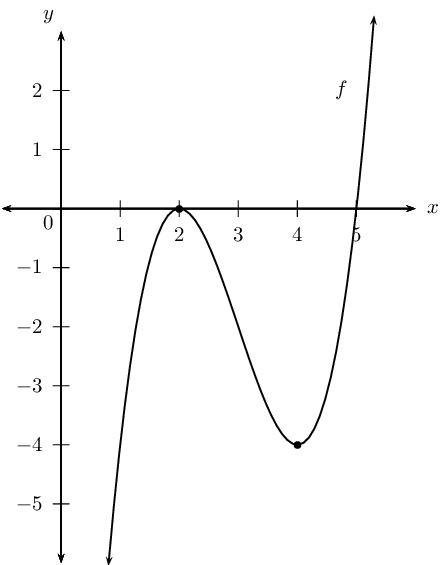

**Problem:**
Find the equation of the tangent to \(f\left(x\right)\) at \(x=4\).

**Solution:**
We know that at \(x=4\), \(y=-4\) (this is a turning point of the
                                                        graph).

We substitute \(x=4\) into the derivative of the function to get
                                                        \(m\):
                                                        \begin{align*}
                                                        m & = 3(4-2)(4-4) \\
                                                        m & = 0
                                                        \end{align*}

Substituting this and the coordinates of the point into: \(y-y_{1} =
                                                        m(x-x_{1})\) gives:
                                                        \begin{align*}
                                                        y - (-4) & = 0(x-4)\\
                                                        y & = -4
                                                        \end{align*}

The equation of the tangent to the graph at \(x=4\) is \(y=-4\).

**Problem:**
Determine the point of inflection and discuss the concavity of \(f\).

**Solution:**
Point of inflection:

                                                \begin{align*}
                                                f'(x) & = 3x^{2} - 18x + 24 \\
                                                f''(x) & = 6x - 18 \\
                                                \therefore 0 &= 6x - 18 \\
                                                6x &= 18 \\
                                                \therefore x &= 3 \\
                                                \text{Substitute } x = 3: \enspace f(3) & = (3)^{3} -9(3)^{2} +
                                                24(3) - 20 \\
                                                & = 27 - 81 + 72 - 20 \\
                                                & = -2
                                                \end{align*}

This gives the point \((3;-2)\).

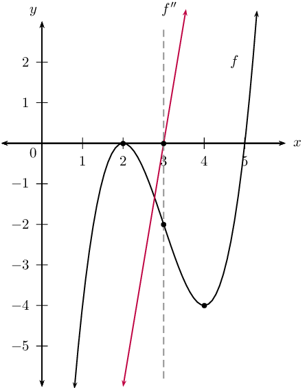

Concavity:

\(f''(x) < 0\) for \(x < 3\): concave down

\(f''(x) = 0\) for \(x = 3\): point of inflection

\(f''(x) > 0\) for \(x > 3\): concave up

**Problem:**
Determine the minimum value of the sum of a positive number and its
                                                reciprocal.

**Solution:**
Let the number be \(x\) and the reciprocal be \(\frac{1}{x}\). The sum of
                                                these two numbers is \(S = x + \frac{1}{x}\). To find the minimum value
                                                we must differentiate the expression for the sum and set it equal to
                                                zero:
                                                \begin{align*}
                                                S &=x + \frac{1}{x}\\
                                                S' &= 1 - \frac{1}{x^{2}}\\
                                                0 &= 1 - \frac{1}{x^{2}}\\
                                                1 &= \frac{1}{x^{2}}\\
                                                x^{2} & = 1\\
                                                x & = 1 \\
                                                \therefore S &=1 + \frac{1}{1} \\
                                                &= 2
                                                \end{align*}
                                                Therefore, the minimum value for the sum of a positive number and it's
                                                reciprocal is \(\text{2}\).

\(t\) minutes after a kettle starts to boil, the height of the water in the
                                                kettle is given by \(d=86-\frac{1}{8}t-\frac{1}{4}{t}^{3}\), where \(d\)
                                                is measured in millimetres.

**Problem:**
Calculate the height of the water level in the kettle just before it
                                                        starts to boil.

**Solution:**
The kettle starts to boil at \(t = \text{0}\):
                                                        \begin{align*}
                                                        d &= 86 -\frac{1}{8} t - \frac{1}{4}t^{3} \\
                                                        &= 86 - \frac{1}{8}(0) - \frac{1}{4}(0)^{3}\\
                                                        &= \text{86}\text{ mm}
                                                        \end{align*}

**Problem:**
As the water boils, the water level in the kettle decreases.
                                                        Determine the rate at which the water level is decreasing when
                                                        \(t = \text{2}\text{ minutes}\).

**Solution:**
To find the rate at which the water level is decreasing we take the
                                                        derivative of the depth:
                                                        \begin{align*}
                                                        d(t) &= 86 -\frac{1}{8} t - \frac{1}{4}t^{3} \\
                                                        d'(t) &= - \frac{1}{8} - \frac{1}{4} (3)t^{2}\\
                                                        &= - \frac{1}{8} - \frac{3}{4} t^{2}\\
                                                        d'(2) &= - \frac{1}{8} - \frac{3}{4}(2)^{2}\\
                                                        &= - \frac{1}{8} - 3\\
                                                        &= - \frac{25}{8} \\
                                                        &=-\text{3,125}\text{ mm per minute}
                                                        \end{align*}
                                                        This rate is negative since the water level is decreasing.

**Problem:**
How many minutes after the kettle starts to boil will the water level
                                                        be decreasing at a rate of \(12\frac{1}{8}\) \(\text{mm}\) per
                                                        minute?

**Solution:**
To find the number of minutes when the rate will be
                                                        \(-\text{12,125}\) \(\text{mm.min$^{-1}$}\) (water level is
                                                        decreasing) we set the derivative equal to this and solve for
                                                        \(t\):
                                                        \begin{align*}
                                                        d'(t) &= - \frac{1}{8} - \frac{3}{4}t^{2}\\
                                                        -\text{12,125} &= - \frac{1}{8} - \frac{3}{4}t^{2}\\
                                                        \frac{97}{8} - \frac{1}{8}&= \frac{3}{4}t^{2}\\
                                                        \frac{3}{4}t^{2}&= 12\\
                                                        t^{2} &= 16\\
                                                        t &= 4
                                                        \end{align*}
                                                        After \(\text{4}\) minutes the water level will be decreasing at
                                                        \(\text{12,125}\) \(\text{mm.min$^{-1}$}\).

**Problem:**
The displacement of a moving object is represented by the equation:
                                                \begin{align*}
                                                D(t)&=\frac{4}{3}t^{3}-3t \\
                                                \text{where } D&= \text{ distance travelled in metres} \\
                                                t &= \text{ time in seconds}
                                                \end{align*}

Calculate the acceleration of the object after \(\text{3}\) seconds.

**Solution:**
\begin{align*}
                                        D(t)&=\frac{4}{3}t^{3}-3t \\
                                        D'(t)&= 4t^{2} - 3 \\
                                        D''(t)&= 8t \\
                                        \therefore D''(3)&= 8(3) \\
                                        &= 24
                                        \end{align*}

After \(\text{3}\) seconds, the acceleration is \(\text{24}\)
                                                \(\text{m.s$^{-2}$}\).

**Problem:**
In the figure \(PQ\) is the diameter of the semi-circle \(PRQ\). The sum of
                                                the lengths of \(PR\) and \(QR\) is \(\text{10}\) \(\text{units}\).
                                                Calculate the perimeter of \(\triangle PQR\) when \(\triangle PQR\)
                                                covers the maximum area in the semi-circle. Leave the answer in
                                                simplified surd form.

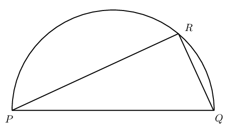

**Solution:**
Let \(PR\) be \(x\) units and \(QR\) be \((10 - x)\) units.

                                        \begin{align*}
                                        \text{Area } \triangle PQR &= \frac{1}{2} PR \cdot QR \quad (\angle \text{
                                        in semi-circle})\\
                                        \therefore A(x) &= \frac{1}{2} x(10 - x) \\
                                        &= 5x - \frac{1}{2}x^2
                                        \end{align*}

To find maximum area, let \(A'(x) = 0\):

                                        \begin{align*}
                                        A'(x) &= 5 - x \\
                                        0 &= 5 - x \\
                                        \therefore x &= 5
                                        \end{align*}

Therefore, \(PR = 5\) units and \(QR = 5\) units.

                                        \begin{align*}
                                        PQ^{2} &= 5^2 + 5^2 \quad (\text{Pythagoras}) \\
                                        &= 50 \\
                                        \therefore PQ &= \sqrt{50} \\
                                        &= 5\sqrt{2}
                                        \end{align*}
                                        \begin{align*}
                                        \text{Perimeter } \triangle PQR &= 5 + 5 + 5\sqrt{2} \\
                                        &= 5 + 5 + 5\sqrt{2} \\
                                        &= 10+ 5\sqrt{2} \text{ units}
                                        \end{align*}

Perimeter of the triangle is \(10+ 5\sqrt{2}\) units.

The capacity of a cylindrical water tank is \(\text{1 000}\)
                                                \(\text{litres}\). Let the height be \(H\) and the radius be \(r\). The
                                                material used for the bottom of the tank is twice as thick and also
                                                twice as expensive as the material used for the curved part of the tank
                                                and the top of the tank.

Remember: \(\text{1 000}\text{ ℓ}=\text{1}\text{ m}^{3}\)

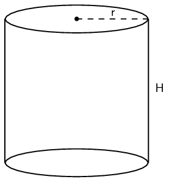

**Problem:**
Express \(H\) in terms of \(r\).

**Solution:**
\begin{align*}
                                                V &= \pi r^2 H \\
                                                1 &= \pi r^2 H \\
                                                \therefore H &= \frac{1}{\pi r^2}
                                                \end{align*}

**Problem:**
Show that the cost of the material for the tank can be expressed as:
                                                        \[C=3\pi r^{2}+\frac{2}{r}\]

**Solution:**
\begin{align*}
                                                \text{Cost of material} &= \left( 2 \times \text{area bottom}
                                                \right) + \text{area top} + \text{curved part} \\
                                                &= \left( 2 \times \pi r^{2} \right) + \pi r^{2} + (2\pi r H) \\
                                                &= 3 \pi r^{2} + 2\pi r H \\
                                                \text{Substitute } H &= \frac{1}{\pi r^2}: \\
                                                \text{Cost of material} &= 3 \pi r^{2} + \left( 2\pi r \times
                                                \frac{1}{\pi r^2} \right) \\
                                                &= 3 \pi r^{2} + \frac{2}{r}
                                                \end{align*}

**Problem:**
Determine the diameter of the tank that gives the minimum cost of the
                                                        materials.

[IEB, 2006]

**Solution:**
Let the cost of the material be \(C(r)\).

                                                \begin{align*}
                                                C(r) &= 3 \pi r^{2} + \frac{2}{r} \\
                                                C'(r) &= 6 \pi r - \frac{2}{r^2} \\
                                                \therefore 0 &= 6 \pi r - \frac{2}{r^2} \\
                                                r^{3} &= \frac{2}{6 \pi} \\
                                                \therefore r &= \text{0,47}\text{ m} \\
                                                \therefore d &= 2 \times \text{0,47}\text{ m} \\
                                                &= \text{0,94}\text{ m}
                                                \end{align*}

The diameter of an icecream cone is \(d\) and the vertical height is \(h\).
                                                The sum of the diameter and the height of the cone is \(\text{10}\)
                                                \(\text{cm}\).

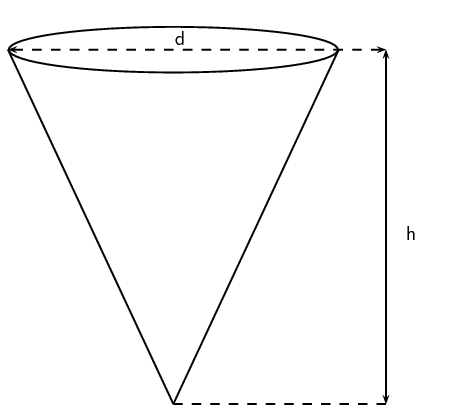

**Problem:**
Determine the volume of the cone in terms of \(h\) and \(d\).

(Volume of a cone: \(V=\frac{1}{3}\pi r^{3}h\))

**Solution:**
\begin{align*}
                                                r &= \frac{d}{2} \\
                                                h + d &= 10\\
                                                \therefore h &= 10 - d \\
                                                V &= \frac{1}{3} \pi r^2 h \\
                                                &= \frac{1}{3} \pi \left( \frac{d}{2} \right)^2 (10 - d) \\
                                                &= \frac{1}{12} \pi d^{2} (10 - d) \\
                                                &= \frac{1}{12} (10 \pi d^{2} - \pi d^{3})
                                                \end{align*}

**Problem:**
Determine the radius and height of the cone for the volume to be a
                                                        maximum.

**Solution:**
Let the volume of the cone be \(V(d)\).

                                                \begin{align*}
                                                V(d) &= \frac{1}{12} (10 \pi d^{2} - \pi d^{3}) \\
                                                V'(d) &= \frac{1}{12} (20 \pi d - 3 \pi d^{2}) \\
                                                \therefore 0 &= \frac{1}{12} (20 \pi d - 3 \pi d^{2}) \\
                                                0 &= 20 \pi d - 3 \pi d^{2} \\
                                                0 &= \pi d( 20 - 3 d) \\
                                                \therefore d = 0 & \text{ or } d = \frac{20}{3}
                                                \end{align*}
                                                \begin{align*}
                                                \therefore d &= \text{6,67}\text{ cm} \\
                                                \therefore r &= \frac{1}{2} \times \frac{20}{3} \\
                                                &= \frac{10}{3} \\
                                                &= \text{3,34}\text{ cm} \\
                                                h &= 10 - \frac{20}{3} \\
                                                &= \frac{10}{3} \\
                                                &= \text{3,34}\text{ cm}
                                                \end{align*}

**Problem:**
Calculate the maximum volume of the cone.

**Solution:**
\begin{align*}
                                                V &= \frac{1}{3} \pi r^2 h \\
                                                &= \frac{1}{3} \pi \left( \frac{10}{3} \right) ^2 \left(
                                                \frac{10}{3} \right) \\
                                                &= \frac{1}{3} \pi \left( \frac{100}{9} \right) \left( \frac{10}{3}
                                                \right) \\
                                                &= \frac{1000 \pi }{81} \\
                                                &= \text{38,79}\text{ cm$^{3}$}
                                                \end{align*}

A water reservoir has both an inlet and an outlet pipe to regulate the depth
                                                of the water in the reservoir. The depth is given by the function:
                                                \begin{align*}
                                                D(h)&= 3 +\frac{1}{2}h - \frac{1}{4}h^{3} \\
                                                \text{where } D&= \text{ depth in metres} \\
                                                h&= \text{ hours after 06h00}
                                                \end{align*}

**Problem:**
Determine the rate at which the depth of the water is changing at
                                                        10h00.

**Solution:**
\begin{align*}
                                                D(h)&= 3 +\frac{1}{2}h - \frac{1}{4}h^{3} \\
                                                D'(h)&= \frac{1}{2} - \frac{3}{4}h^{2} \\
                                                \therefore D'(4)&= \frac{1}{2} - \frac{3}{4}(4)^{2} \\
                                                &= \frac{1}{2} - 12 \\
                                                &= -11 \frac{1}{2}
                                                \end{align*}

Therefore, rate of change of the depth of the water is
                                                        \(-\text{11,5}\) \(\text{m}\) per hour at 10h00.

**Problem:**
Is the depth of the water increasing or decreasing?

**Solution:**
Decreasing (rate is negative).

**Problem:**
At what time will the inflow of water be the same as the outflow?

[IEB, 2006]

**Solution:**
\begin{align*}
                                                D'(h)&= \frac{1}{2} - \frac{3}{4}h^{2} \\
                                                0 &= \frac{1}{2} - \frac{3}{4}h^{2} \\
                                                \frac{3}{4}h^{2} &= \frac{1}{2} \\
                                                h^{2} &= \frac{2}{3} \\
                                                \therefore h &= \text{0,82} \text{ hours}
                                                \end{align*}

We can convert this to minutes: \(\text{0,82} \times \text{60}
                                                        \approx \text{49}\) minutes. Therefore, at 06h49
