# Chapter 7: Analytical geometry

## 7.1 Revision (EMCHN)

- Integrate Euclidean Geometry knowledge with Analytical Geometry.
- Emphasize the value and importance of making sketches.
- Emphasize the importance of writing coordinates consistently for the distance formula and gradient.
- Learners must revise the method of completing the square for finding the general form of the equation of a
            circle with centre \((a;b)\).
- Remind learners that the tangent to a circle is perpendicular to the radius (and the diameter).

### Straight line equations (EMCHP)

| Theorem of Pythagoras: | \(AB^2 = AC^2 + BC^2\) |
| --- | --- |
| Distance formula: | \(AB = \sqrt{(x_2 - x_1)^2 + (y_2 - y_1)^2}\) |
| Gradient: | \(m_{AB} = \frac{y_2 - y_1}{x_2 - x_1} \quad \text{ or } \quad m_{AB} = \frac{y_1 - y_2}{x_1 - x_2}\) |
| Mid-point of a line segment: | \(M(x;y) = \left( \frac{x_1 + x_2}{2}; \frac{y_1 + y_2}{2} \right)\) |
| Points on a straight line: | \(m_{AB} = m_{AM} = m_{MB}\) |

| Horizontal lines: | \(y = k\) |  |
| --- | --- | --- |
| Vertical lines: | \(x = k\) |  |

| Two-point form: | \(\dfrac{y - y_1}{x - x_1} = \dfrac{y_2 - y_1}{x_2 - x_1}\) |  |
| --- | --- | --- |
| Gradient-point form: | \(y - y_1 = m (x - x_{1})\) |  |
| Gradient-intercept form: | \(y = mx + c\) |  |

<Callout type="tip" title="Worked example 1: Revision">
**Question:**
Given quadrilateral \(PQRS\) with vertices \(P(0;3), Q(4;3), R(5;-1)\) and \(S(1;-1)\).

2. Determine the equation of the lines \(PS\) and \(QR\).
4. Show that \(PS \parallel QR\).
6. Calculate the lengths of \(PS\) and \(QR\).
8. Determine the equation of the diagonal \(QS\).
10. What type of quadrilateral is \(PQRS\)?

**Draw a sketch:**
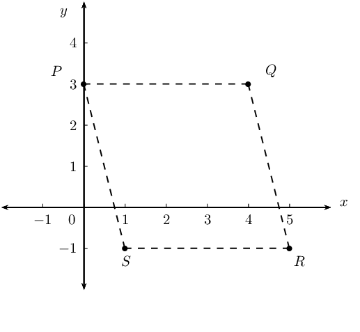

**Use the given information to determine the equation of lines \(PS\) and \(QR\):**
\begin{align*}
          \text{Gradient: } & m = \frac{y_2 - y_1}{x_2 - x_1} \\
          & \\
          \text{Two-point form: } & \dfrac{y - y_1}{x - x_1} = \dfrac{y_2 - y_1}{x_2 - x_1} \\
          & \\
          \text{Gradient-intercept form: } & y = mx + c
          \end{align*}

Determine the equation of the line \(PS\) using the two point form of the straight line equation:

          \[x_1 = 0; \qquad y_1 = 3; \qquad x_2 = 1; \qquad y_2 = -1\]
          \begin{align*}
          \dfrac{y - y_1}{x - x_1} &= \dfrac{y_2 - y_1}{x_2 - x_1} \\
          \dfrac{y - 3}{x - 0} &= \dfrac{-1 - 3}{1 - 0} \\
          \dfrac{y - 3}{x} &= -4 \\
          y - 3 &= -4x \\
          \therefore y &= -4x + 3
          \end{align*}

Determine the equation of the line \(QR\) using the gradient-intercept form of the straight line equation:

          \begin{align*}
          m_{QR} &= \frac{y_2 - y_1}{x_2 - x_1} \\
          &= \frac{-1-3}{5-4} \\
          &= \frac{-4}{1} \\
          &= -4 \\
          y &= mx + c \\
          y &= -4x + c \\
          \text{Substitute } (4;3) \quad 3 &= -4(4) + c \\
          \therefore c &= 19 \\
          y &= -4x + 19
          \end{align*}

There is often more than one method for determining the equation of a line. The different forms of the
            straight line equation are used, depending on the information provided in the problem.

**Show that line \(PS\) and line \(QR\) have equal gradients:**
\begin{align*}
          y &= -4x + 3 \\
          \therefore m_{PS} &= -4 \\
          \text{And } y &= -4x + 19 \\
          \therefore m_{QR} &= -4 \\
          \therefore m_{PS} &= m_{QR} \\
          \therefore PS &\parallel QR
          \end{align*}

**Use the distance formula to determine the lengths of \(PS\) and \(QR\):**
\begin{align*}
          PS &= \sqrt{ \left( x_2 - x_1 \right)^2 + \left( y_2 - y_1 \right)^2} \\
          &= \sqrt{ \left(1-0 \right)^2 + \left( -1-3 \right)^2} \\
          &= \sqrt{ 1 + \left( -4 \right)^2} \\
          &= \sqrt{17} \text{ units}
          \end{align*}\begin{align*}
          QR &= \sqrt{ \left( x_2 - x_1 \right)^2 + \left( y_2 - y_1 \right)^2} \\
          &= \sqrt{ \left( 5-4 \right)^2 + \left( -1-3 \right)^2} \\
          &= \sqrt{ 1 + \left( -4 \right)^2} \\
          &= \sqrt{17} \text{ units}
          \end{align*}

**Determine the equation of the diagonal \(QS\):**
Determine the gradient of the line:

          \begin{align*}
          m_{QS} &= \frac{y_2 - y_1}{x_2 - x_1} \\
          &= \frac{-1 -3}{1-4} \\
          &= \frac{-4}{-3} \\
          &= \frac{4}{3}
          \end{align*}

Use gradient and the point \(Q(4;3)\) to determine the equation of the line \(QS\):

          \begin{align*}
          y - y_{1}&= m(x - x_{1}) \\
          y - y_{1}&= \frac{4}{3}(x - x_{1}) \\
          \text{Substitute } (4;3) \quad y - 3 &= \frac{4}{3}(x - 4) \\
          y - 3 &= \frac{4}{3}x - \frac{16}{3} \\
          y &= \frac{4}{3}x - \frac{16}{3} + 3 \\
          \therefore y &= \frac{4}{3}x - \frac{7}{3}
          \end{align*}

**Examine the properties of quadrilateral \(PQRS\):**
We have shown that \(PS \parallel QR\) and \(PS = QR\), therefore quadrilateral \(PQRS\) is a parallelogram
            (one pair of opposite sides equal and parallel).
</Callout>

## Revision

### Textbook Exercise 7.1

Determine the following for the line segment between the given points:

- length
- mid-point
- gradient
- equation

**Problem:**
\((-2;-4)\) and \((3;11)\)

**Solution:**
\begin{align*}
                \text{Distance } &= \sqrt{(x_{2} - x_{1})^{2} + (y_{2} - y_{1})^2} \\
                &= \sqrt{(3 - (-2))^{2} + (11 - (-4))^2} \\
                &= \sqrt{(5)^{2} + (15)^2} \\
                &= \sqrt{25 + 225} \\
                &= \sqrt{250} \\
                &= 5\sqrt{10}
                \end{align*}
                \begin{align*}
                M(x;y) &= \left( \frac{x_{1} + x_{2}}{2}; \frac{y_{1} + y_{2}}{2} \right) \\
                &= \left( \frac{-2 + 3}{2}; \frac{-4 + 11 }{2} \right) \\
                &= \left( \frac{1}{2}; \frac{7}{2} \right)
                \end{align*}
                \begin{align*}
                m &= \frac{y_{2} - y_{1}}{x_{2}- x_{1}} \\
                &= \frac{11 - (-4)}{3 - (-2)} \\
                &= \frac{15}{5} \\
                &= 3
                \end{align*}
                \begin{align*}
                y &= mx + c \\
                y &= 3x + c \\
                \text{Substitute } (-2;-4) \quad -4 &= 3(-2) + c \\
                -4 + 6 &= c \\
                2 &= c \\
                \therefore y &= 3x + 2
                \end{align*}

**Problem:**
\((-5;-3)\) and \((10;6)\)

**Solution:**
\begin{align*}
                \text{Distance } &= \sqrt{(x_{2} - x_{1})^{2} + (y_{2} - y_{1})^2} \\
                &= \sqrt{(10 - (-5))^{2} + (6 - (-3))^2} \\
                &= \sqrt{(15)^{2} + (9)^2} \\
                &= \sqrt{225+81} \\
                &= \sqrt{306}
                \end{align*}
                \begin{align*}
                M(x;y) &= \left( \frac{x_{1} + x_{2}}{2}; \frac{y_{1} + y_{2}}{2} \right) \\
                &= \left( \frac{-5 + 10}{2}; \frac{-3 + 6 }{2} \right) \\
                &= \left( \frac{5}{2}; \frac{3}{2} \right)
                \end{align*}
                \begin{align*}
                m &= \frac{y_{2} - y_{1}}{x_{2}- x_{1}} \\
                &= \frac{6 - (-3)}{10 - (-5)} \\
                &= \frac{9}{15} \\
                &= \frac{3}{5}
                \end{align*}
                \begin{align*}
                y &= mx + c \\
                y &= \frac{3}{5} x + c \\
                \text{Substitute } (10;6) \quad 6 &= \frac{3}{5} (10) + c \\
                6 - 6 &= c \\
                0 &= c \\
                \therefore y &= \frac{3}{5}x
                \end{align*}

**Problem:**
\((h; -h - k)\) and \((2k; h - 5k)\)

**Solution:**
\begin{align*}
                \text{Distance } &= \sqrt{(x_{2} - x_{1})^{2} + (y_{2} - y_{1})^2} \\
                &= \sqrt{(h - 2k)^{2} + (-h - k - (h - 5k))^2} \\
                &= \sqrt{(h - 2k)^{2} + (-2h + 4k)^2} \\
                &= \sqrt{h^2 - 4hk + 4k^2 + +4h^2 -16hk + 16k^2} \\
                &= \sqrt{5h^2 - 20hk + 20k^2}
                \end{align*}
                \begin{align*}
                M(x;y) &= \left( \frac{x_{1} + x_{2}}{2}; \frac{y_{1} + y_{2}}{2} \right) \\
                &= \left( \frac{h + 2k}{2}; \frac{-h - k + (h - 5k) }{2} \right) \\
                &= \left( \frac{h + 2k}{2}; \frac{-6k) }{2} \right) \\
                &= \left( \frac{h + 2k}{2}; - 3k \right)
                \end{align*}
                \begin{align*}
                m &= \frac{y_{2} - y_{1}}{x_{2}- x_{1}} \\
                &= \frac{(h - 5k) - (-h - k)}{2k - h} \\
                &= \frac{2h - 4k}{-h + 2k} \\
                &= \frac{-2(-h + 2k)}{-h + 2k} \\
                &= -2
                \end{align*}
                \begin{align*}
                y &= mx + c \\
                y &= -2x + c \\
                \text{Substitute } (h; -h-k) \quad -h - k &= -2(h) + c \\
                -h + 2h - k &= c \\
                h - k &= c \\
                \therefore y &= -2x + h - k
                \end{align*}

**Problem:**
\((2;9)\) and \((0;-1)\)

**Solution:**
\begin{align*}
                \text{Distance } &= \sqrt{(x_{2} - x_{1})^{2} + (y_{2} - y_{1})^2} \\
                &= \sqrt{(2 - (0))^{2} + (9 - (-1))^2} \\
                &= \sqrt{(2)^{2} + (10)^2} \\
                &= \sqrt{4 + 100} \\
                &= \sqrt{104}
                \end{align*}
                \begin{align*}
                M(x;y) &= \left( \frac{x_{1} + x_{2}}{2}; \frac{y_{1} + y_{2}}{2} \right) \\
                &= \left( \frac{2 + 0}{2}; \frac{9 - 1 }{2} \right) \\
                &= \left( 1 ; 4 \right)
                \end{align*}
                \begin{align*}
                m &= \frac{y_{2} - y_{1}}{x_{2}- x_{1}} \\
                &= \frac{-1 - 9}{0 - 2} \\
                &= \frac{-10}{-2} \\
                &= 5
                \end{align*}
                \begin{align*}
                y &= mx + c \\
                y &= 5 x + c \\
                \text{Substitute } (0;-1) \quad -1 &= 5(0) + c \\
                -1 &= c \\
                \therefore y &= 5x - 1
                \end{align*}

**Problem:**
The line joining \(A(x;y)\) and \(B(-3;6)\) has the mid-point \(M(2;3)\). Determine the values of \(x\)
                and \(y\).

**Solution:**
\begin{align*}
              M(x;y) &= \left( \frac{x_{A} + x_{B}}{2}; \frac{y_{A} + y_{B}}{2} \right) \\
              M(2;3) &= \left( \frac{x - 3}{2}; \frac{y + 6}{2} \right) \\
              \therefore 2 &= \frac{x - 3}{2} \\
              4 &= x - 3 \\
              \therefore 7 &= x \\
              \text{And } 3 &= \frac{y + 6}{2} \\
              6 &= y + 6 \\
              \therefore 0 &= y
              \end{align*}
              \(A(7;0)\)

**Problem:**
Given \(F(2; 11), G(-4; r)\) and length \(FG = 6\sqrt{5}\) units, determine the value(s) of \(r\).

**Solution:**
There are two possible values of \(r\) such that the length \(FG = 6\sqrt{5}\) units\(\):

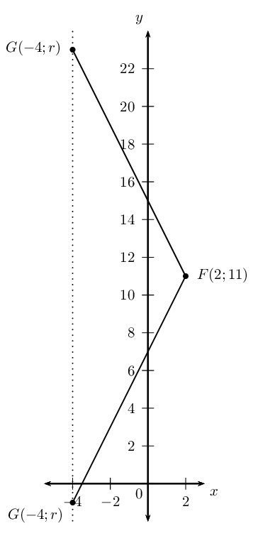

Determine the equation of the straight line:

**Problem:**
passing through the point \((\frac{1}{2};4)\) and \((1;5)\).

**Solution:**
\begin{align*}
                \frac{y - y_{1}}{x - x_{2}} &= \frac{y_{2} - y_{1}}{x_{2} - x_{1}} \\
                \frac{y - 4}{x - \frac{1}{2}} &= \frac{5 - 4}{1 - \frac{1}{2}} \\
                \frac{y - 4}{x - \frac{1}{2}} &= \frac{1}{\frac{1}{2}} \\
                \frac{y - 4}{x - \frac{1}{2}} &= 2 \\
                y - 4 &= 2 \left(x - \frac{1}{2} \right) \\
                y &= 2x - 1 + 4 \\
                \therefore y &= 2x + 3
                \end{align*}

**Problem:**
passing through the points \((2;-3)\) and \((-1;0)\).

**Solution:**
\begin{align*}
                y &= mx + c \\
                -3 &= 2m + c \ldots (1) \\
                0 &= -m + c \ldots (2) \\
                (1) - (2): \quad -3 &= 2m + m \\
                -3 &= 3m \\
                \therefore -1 &= m \\
                \therefore c &= -1 \\
                \therefore y &= -x - 1
                \end{align*}

**Problem:**
passing through the point \((9;1)\) and with \(m=\frac{1}{3}\).

**Solution:**
\begin{align*}
                y - y_1 &= m(x - x_1)\\
                y - 1 &= \frac{1}{3}(x - 9)\\
                y - 1 &= \frac{1}{3}x - 3 \\
                \therefore y &= \frac{1}{3}x -2
                \end{align*}

**Problem:**
parallel to the \(x\)-axis and passing through the point \((0;-4)\).

**Solution:**
\begin{align*}
                y - y_1 &= m(x - x_1) \\
                y -(-4)&= 0(x - 0) \\
                \therefore y &= -4
                \end{align*}

**Problem:**
passing through the point \((\frac{1}{2};-1)\) and with \(m=-4\).

**Solution:**
\begin{align*}
                y - y_1 &= m(x - x_1) \\
                y - (-1) &= -4(x - \frac{1}{2}) \\
                y + 1 &=-4x + 2 \\
                \therefore y &= -4x + 1
                \end{align*}

**Problem:**
perpendicular to the \(x\)-axis and passing through the point \((5;0)\).

**Solution:**
\(x = 5\)

**Problem:**
with undefined gradient and passing through the point \((\frac{3}{4};0)\).

**Solution:**
\(x = \frac{3}{4}\)

**Problem:**
with \(m= 2p\) and passing through the point \((3; 6p + 3)\).

**Solution:**
\begin{align*}
                y - y_1 &= m(x - x_1) \\
                y - (6p + 3) &= 2p(x - 3 ) \\
                y - 6p - 3 &= 2px - 6p \\
                \therefore y &= 2px + 3
                \end{align*}

**Problem:**
which cuts the \(y\)-axis at \(y=-\frac{3}{5}\) and with \(m=4\).

**Solution:**
\begin{align*}
                y &= mx + c \\
                y &= mx - \frac{3}{5} \\
                \therefore y &= 4x -\frac{3}{5}
                \end{align*}

**Problem:**
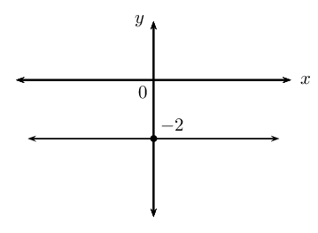

**Solution:**
\(y = - 2\)

**Problem:**
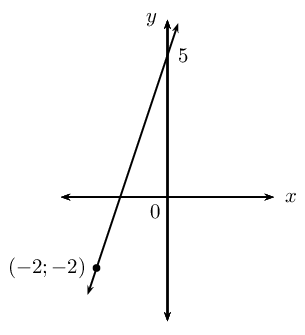

**Solution:**
\begin{align*}
                c &= 5 \\
                y &= mx + c \\
                y &= mx + 5 \\
                \text{Substitute } (-2;-2) \quad -2 &= -2m + 5 \\
                -7 &= -2m \\
                m &= \frac{7}{2} \\
                \therefore y &= \frac{7}{2}x + 5
                \end{align*}

**Problem:**
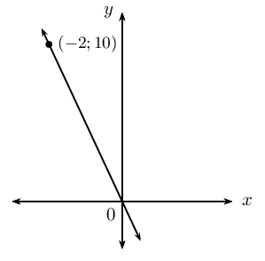

**Solution:**
\begin{align*}
                c &= 0 \\
                y &= mx + c \\
                y &= mx + 0\\
                \text{Substitute } (-2;10) \quad 10 &= -2m \\
                -2m &= 10 \\
                \therefore m &= -5 \\
                \therefore y &= -5x
                \end{align*}

### Inclination of a line (EMCHQ)

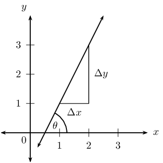

The diagram shows a straight line which forms an acute angle \(\theta\) with the positive \(x\)-axis. This is
        called the **angle of inclination** of a straight line.

The gradient of a straight line is equal to the tangent of the angle formed between the line and the positive
        direction of the \(x\)-axis.

\[m = \tan \theta \qquad \text{ for } \text{0}° \leq \theta < \text{180}°\]

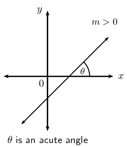

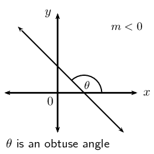

**Lines with positive gradients**

A line with a positive gradient (\(m > 0\)) has an acute angle of inclination (\(\text{0}° < \theta
        < \text{90}°\)).

For example, we can determine the angle of inclination of a line with \(m = \text{1,2}\):

      \begin{align*}
      \tan \theta &= m \\
      &= \text{1,2} \\
      \therefore \theta &= \tan^{-1}(\text{1,2}) \\
      &= \text{50,2}°
      \end{align*}

**Lines with negative gradients**

If we are calculating the angle of inclination of a line with a negative gradient (\(m < 0\)), then we add
        \(\text{180}°\) to change the negative angle to an obtuse angle (\(\text{90}° < \theta <
        \text{180}°\)).

For example, we can determine the angle of inclination for a line with \(m = -\text{0,7}\):

      \begin{align*}
      \tan \theta &= m \\
      &= -\text{0,7} \\
      \therefore \theta &= \tan^{-1}(-\text{0,7}) \\
      &= -\text{35,0}° \\
      \text{Obtuse angle: } \theta &= -\text{35,0}° + \text{180}° \\
      &= \text{145}°
      \end{align*}

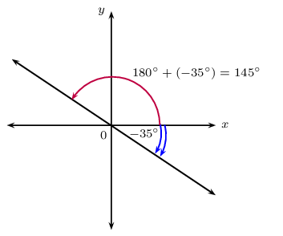

<Callout type="tip" title="Worked example 2: Inclination of a straight line">
**Question:**
Determine the acute angle (correct to \(\text{1}\) decimal place) between the line passing through the
            points \(P(-2;0)\) and \(Q(3;1)\) and the straight line \(y = - \frac{4}{3}x + 5\).

**Draw a sketch:**
Draw the line through points \(P(-2;0)\) and \(Q(3;1)\) and the line \(y = - \frac{4}{3}x + 5\) on a
            suitable system of axes. Label \(\alpha\) and \(\beta\), the angles of inclination of the two lines. Label
            \(\theta\), the acute angle between the two straight lines.

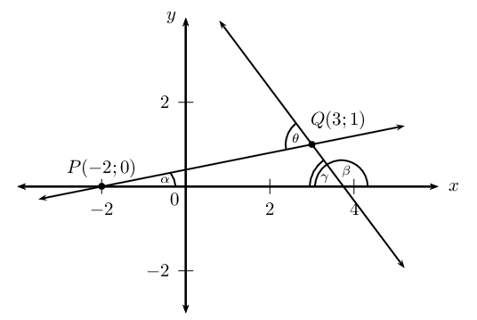

Notice that \(\alpha\) and \(\theta\) are acute angles and \(\beta\) is an obtuse angle.

          \[\begin{array}{rll}
          \gamma &= \text{180}° - \beta & (\angle \text{ on str. line}) \\
          \text{and } \theta &= \alpha + \gamma \quad & (\text{ext. } \angle \text{ of } \triangle = \text{ sum
          int. opp}) \\
          \therefore \theta &= \alpha + (\text{180}° - \beta) \\
          &= \text{180}° + \alpha - \beta
          \end{array}\]

**Use the gradient to determine the angle of inclination \(\beta\):**
From the equation \(y = - \frac{4}{3}x + 5\) we see that \(m < 0\), therefore \(\beta\) is an obtuse
            angle.

          \begin{align*}
          m &= -\frac{4}{3} \\
          \tan \beta &= -\frac{4}{3} \\
          \therefore \beta &= \tan^{-1} \left(-\frac{4}{3}\right) \\
          &= -\text{53,1}° \\
          \beta &= -\text{53,1}° + \text{180}°\\
          &= \text{126,9}°
          \end{align*}

**Determine the gradient and angle of inclination of the line through \(P\) and \(Q\):**
Determine the gradient
            \begin{align*}
            m & = \frac{y_P - y_Q}{x_P - x_Q} \\
            & = \dfrac{- 1}{-5} \\
            &= \frac{1}{5}
            \end{align*}

Determine the angle of inclination
            \begin{align*}
            \tan \alpha & = m\\
            & = \frac{1}{5} \\
            \therefore \alpha & = \tan^{-1} \left( \frac{1}{5} \right) \\
            &= \text{11,3}°
            \end{align*}

**Write the final answer:**
\begin{align*}
            \theta & = \text{180}° + \alpha - \beta \\
            & = \text{180}° + \text{11,3}° - \text{126,9}° \\
            & = \text{64,4}°
            \end{align*}

The acute angle between the two straight lines is \(\text{64,4}\)°.
</Callout>

### Parallel and perpendicular lines (EMCHR)

| Parallel lines |  | \(m_1 = m_2\) | \(\theta_1 = \theta_2\) |
| --- | --- | --- | --- |
| Perpendicular lines |  | \(m_1 \times m_2 = -1\) | \(\theta_{1} = \text{90}° + \theta_{2}\) |

<Callout type="tip" title="Worked example 3: Parallel lines">
**Question:**
Line \(AB\) passes through the point \(A(0;3)\) and has an angle of inclination of \(\text{153,4}\)°.

2. Determine the equation of line \(CD\) which passes through the point \(C(2;-3)\) and is parallel to
                 \(AB\).
4. Determine the equation of line \(EF\), which passes through the origin and is perpendicular to both
                 \(AB\) and \(CD\).
6. Sketch lines \(AB\), \(CD\) and \(EF\) on the same system of axes.
8. Use two different methods to determine the angle of inclination of \(EF\).

**Draw a rough sketch and use the angle of inclination to determine the equation of \(CD\):**
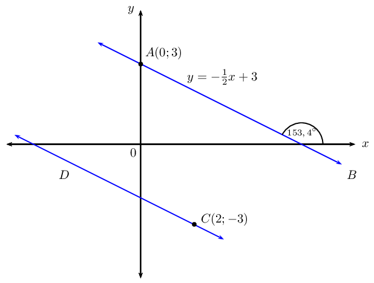

Since we are given \(AB \parallel CD\),

          \begin{align*}
          m_{CD} = m_{AB} &= -\text{0,5} = -\frac{1}{2} \\
          y - y_1 &= m(x - x_1) \\
          y - y_1 &= -\frac{1}{2}(x - x_1)
          \end{align*}

Substitute the given point \((2;-3)\):

          \begin{align*}
          y - (-3) & = -\frac{1}{2}(x - 2) \\
          y + 3 & = -\frac{1}{2}x + 1\\
          y & = -\frac{1}{2}x - 2
          \end{align*}

**Determine the equation of \(EF\):**
\(EF\) is perpendicular to \(AB\), therefore the product of their gradients is equal to \(-1\):

          \begin{align*}
          m_{AB} \times m_{EF} & = -1 \\
          -\frac{1}{2} \times m_{EF} & = - 1 \\
          \therefore m_{EF} & = 2
          \end{align*}

We know line \(EF\) passes through \((0;0)\), therefore the equation of the line is:

          \[y = 2x\]

**Determine the angle of inclination of \(EF\):**
Let the angle of inclination of \(EF\) be \(\beta\).

Method \(\text{1}\):

          \begin{align*}
          \beta & = \text{153,4}° - \text{90}° \\
          & = \text{63,4}°
          \end{align*}

Method \(\text{2}\):

          \begin{align*}
          m & = 2 \\
          \tan \beta & = 2 \\
          \therefore \beta & = \text{63,4}°
          \end{align*}

**Draw a sketch:**
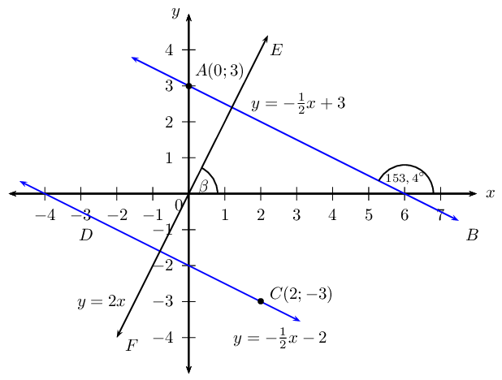
</Callout>

## Inclination of a straight line

### Textbook Exercise 7.2

Determine the angle of inclination (correct to \(\text{1}\) decimal place) for each of the following:

**Problem:**
a line with \(m = \frac{3}{4}\)

**Solution:**
\begin{align*}
                \tan \theta &= m \\
                &= \frac{3}{4} \\
                \theta &= \tan^{-1} \left( \text{0,75} \right) \\
                \therefore \theta &= \text{36,9}°
                \end{align*}

**Problem:**
\(6 + x = 2y\)

**Solution:**
\begin{align*}
                6 + x &= 2y \\
                2y &= x + 6 \\
                y &= \frac{1}{2}x + 3 \\
                \tan \theta &= m \\
                &= \frac{1}{2} \\
                \theta &= \tan^{-1} \left( \text{0,5} \right) \\
                \therefore \theta &= \text{26,6}°
                \end{align*}

**Problem:**
the line passes through the points \((-4;0)\) and \((2;6)\)

**Solution:**
\begin{align*}
                m &= \frac{y_2 - y_1}{x_2 - x_1} \\
                &= \frac{6 - 0}{2 - (-4)} \\
                &= \frac{6}{6} \\
                \therefore m &= 1 \\
                \tan \theta &= 1 \\
                \theta &= \tan^{-1} \left( \text{1} \right) \\
                \therefore \theta &= \text{45}°
                \end{align*}

**Problem:**
\(y=4\)

**Solution:**
Horizontal line

**Problem:**
a line with a gradient of \(\text{1,733}\)

**Solution:**
\begin{align*}
                m &= \text{1,733} \\
                \theta &= \tan^{-1} \left( \text{1,733} \right) \\
                \therefore \theta &= \text{60}°
                \end{align*}

**Problem:**
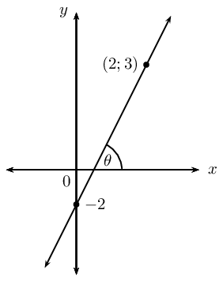

**Solution:**
\begin{align*}
                m &= \frac{y_2 -y_1}{x_2 - x_1} \\
                &= \frac{3 + 2}{2 - 0} \\
                &= \frac{5}{2} \\
                \theta &= \tan^{-1} \left( \frac{5}{2} \right) \\
                \therefore \theta &= \text{68,2}°
                \end{align*}

**Problem:**
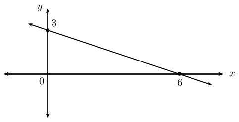

**Solution:**
\begin{align*}
                m &= \frac{y_2 -y_1}{x_2 - x_1} \\
                &= \frac{3 - 0}{0 - 6} \\
                &= \frac{3}{-6} \\
                \therefore m &= -\frac{1}{2} \\
                \theta &= \tan^{-1} \left( -\frac{1}{2} \right) \\
                \therefore \theta &= -\text{26,6}° \\
                \therefore \theta &= \text{180} ° - \text{26,6} ° \\
                \therefore \theta &= \text{153,4} °
                \end{align*}

**Problem:**
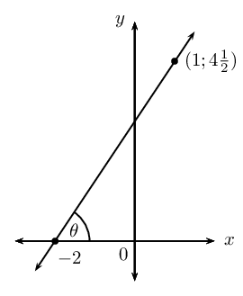

**Solution:**
\begin{align*}
                m &= \frac{y_2 -y_1}{x_2 - x_1} \\
                &= \frac{\frac{9}{2} - 0}{1 + 2} \\
                &= \frac{\frac{9}{2}}{3} \\
                &= \frac{3}{2} \\
                \theta &= \tan^{-1} \left( \frac{3}{2} \right) \\
                \therefore \theta &= \text{56,3}°
                \end{align*}

**Problem:**
Find the angle between the line \(2y = 5x\) and the line passing through points \(T(2;1\frac{1}{3})\)
                and V\((-3;3)\).

**Solution:**
Let the angle of inclination for the line \(2y = 5x\) be \(\beta\) and let the angle of inclination for
                the other line be \(\alpha\). Let the angle between the two lines be \(\theta\).

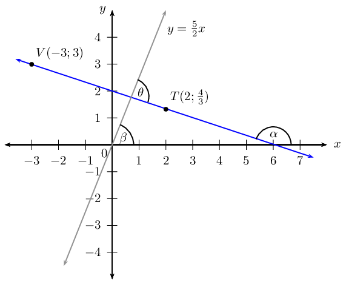

**Problem:**
Determine the equation of the straight line that passes through the point \((1;2)\) and is parallel to
                the line \(y + 3x = 1\).

**Solution:**
\begin{align*}
              y + 3x &= 1 \\
              y &= -3x + 1 \\
              \therefore m &= -3 \\
              y - y_1&= m(x - x_1) \\
              y - 2 &= -3(x - 1) \\
              y &= -3x + 3 + 2 \\
              \therefore y &= -3x + 5
              \end{align*}

**Problem:**
Determine the equation of the straight line that passes through the point \((-4;-4)\) and is parallel
                to the line with angle of inclination \(\theta = \text{56,31}°\).

**Solution:**
\begin{align*}
              \theta &= \text{56,31}° \\
              \therefore m &= \tan \theta \\
              &= \tan \text{56,31}° \\
              \therefore m &= \text{1,5} \\
              y - y_1&= m(x - x_1) \\
              y + 4 &= \frac{3}{2}(x + 4) \\
              y &= \frac{3}{2}x + 6 - 4 \\
              \therefore y &= \frac{3}{2}x + 2
              \end{align*}

**Problem:**
Determine the equation of the straight line that passes through the point \((1;-6)\) and is
                perpendicular to the line \(5y = x\).

**Solution:**
\begin{align*}
              5y &= x \\
              y &= \frac{1}{5}x \\
              \therefore m_1 &= \frac{1}{5} \\
              \text{For } \perp: m_1 \times m_2 &= -1 \\
              \frac{1}{5} \times m_2 &= -1 \\
              \therefore m_2 &= -5 \\
              y &= mx + c \\
              y &= -5x + c \\
              \text{Substitute } (1;-6): \quad -6 &= -5(1) + c \\
              -6 &= -5 + c \\
              \therefore c &=-1 \\
              \therefore y &= -5x - 1
              \end{align*}

**Problem:**
Determine the equation of the straight line that passes through the point \((3;-1)\) and is
                perpendicular to the line with angle of inclination \(\theta = \text{135}°\).

**Solution:**
\begin{align*}
              \theta &= \text{135}° \\
              \therefore m_{1} &= \tan \theta \\
              &= \tan \text{135}° \\
              \therefore m_{1} &= -1 \\
              m_{1} \times m_{2} &= -1 \\
              \therefore m_{2} &= 1 \\
              y &= mx + c \\
              y &= x + c \\
              \text{Substitute } (3;-1): \quad -1 &= (3) + c \\
              \therefore c &= -4 \\
              \therefore y &= x - 4
              \end{align*}

\(A(2;3)\), \(B(-4;0)\) and \(C(5;-3)\) are the vertices of \(\triangle ABC\) in the Cartesian plane.
                \(AC\) intersects the \(x\)-axis at \(D\). Draw a sketch and determine the following:

**Problem:**
the equation of line \(AC\)

**Solution:**
Draw a sketch:

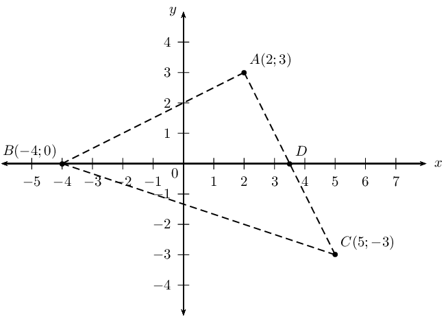

**Problem:**
the coordinates of point \(D\)

**Solution:**
\begin{align*}
                y &= -2x + 7 \\
                0 &= -2x + 7 \\
                \therefore x &= \frac{7}{2} \\
                \therefore &D\left( \frac{7}{2}; 0 \right)
                \end{align*}

**Problem:**
the angle of inclination of \(AC\)

**Solution:**
\begin{align*}
                \therefore m &= -2 \\
                \tan \theta &= m \\
                \tan \theta &= -2 \\
                \therefore \theta &= \tan^{-1} \left( -2 \right) \\
                \theta &= -\text{63,4} ° + \text{180} ° \\
                \therefore \theta &= \text{116,6} °
                \end{align*}

**Problem:**
the gradient of line \(AB\)

**Solution:**
\begin{align*}
                m &= \frac{y_2 - y_1}{x_2 - x_1}\\
                &= \frac{3-0}{2+4} \\
                &= \frac{3}{6} \\
                \therefore m &= \frac{1}{2}
                \end{align*}

**Problem:**
\(B\hat{A}C\)

**Solution:**
\(B\hat{A}C = \text{90} °\) because \(m_{AB} \times m_{AC} = -1\)

**Problem:**
the equation of the line perpendicular to \(AB\) and passing through the origin

**Solution:**
\begin{align*}
                m_{PQ} &= \frac{1}{2}\\
                \therefore m_{\perp}&= -2 \\
                y &= -2x + c \\
                c &= 0 \\
                \therefore y &= -2x
                \end{align*}

**Problem:**
the mid-point \(M\) of \(BC\)

**Solution:**
\begin{align*}
                M(x;y) &= \left( \frac{x_1 + x_2}{2}; \frac{y_1 + y_2}{2} \right) \\
                &= \left( \frac{-4+5}{2}; \frac{0-3}{2} \right) \\
                &= \left( \frac{1}{2}; -\frac{3}{2} \right)
                \end{align*}

**Problem:**
the equation of the line parallel to \(AC\) and passing through point \(M\)

**Solution:**
\begin{align*}
                m &= -2 \\
                y &= mx + c \\
                y &= -2x + c \\
                \text{Substitute } \left( \frac{1}{2}; -\frac{3}{2} \right): \quad -\frac{3}{2} &= -2\left(
                \frac{1}{2} \right) + c \\
                c &= -\frac{1}{2} \\
                y &= - 2x -\frac{1}{2}
                \end{align*}

Points \(F(-3;5)\), \(G(-7;-4)\) and \(H(2;0)\) are given.

**Problem:**
Plot the points on the Cartesian plane.

**Solution:**
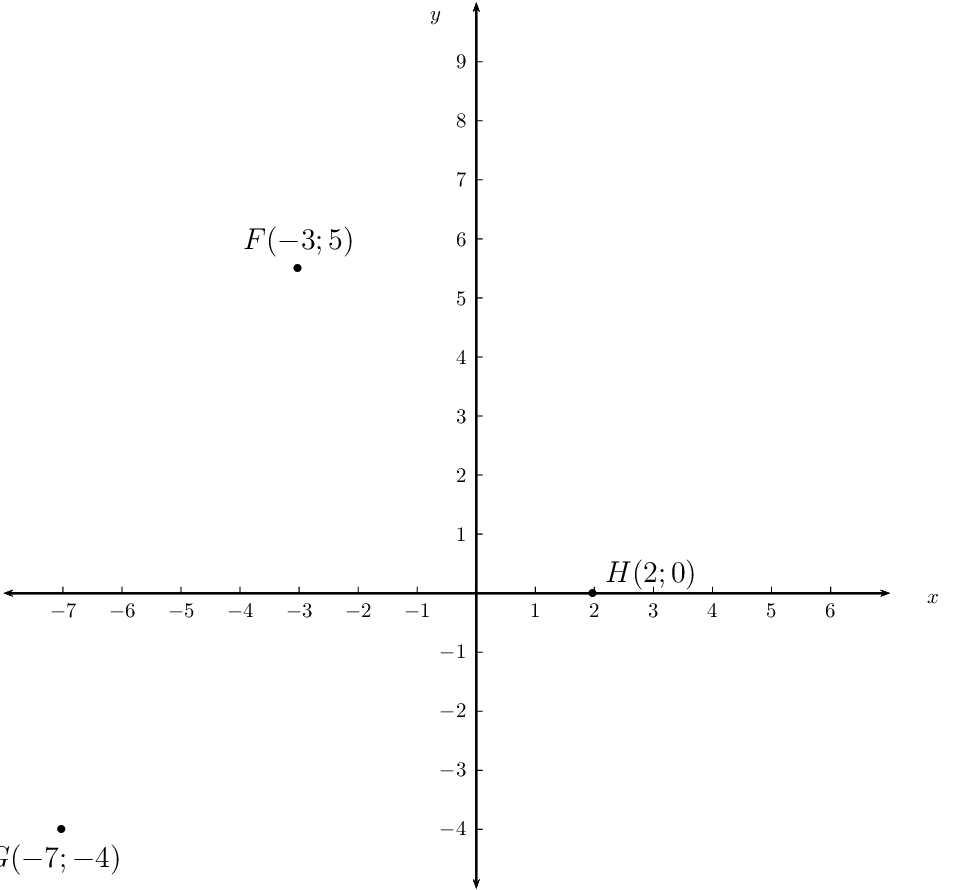

**Problem:**
Determine the coordinates of \(I\) if \(FGHI\) is a parallelogram.

**Solution:**
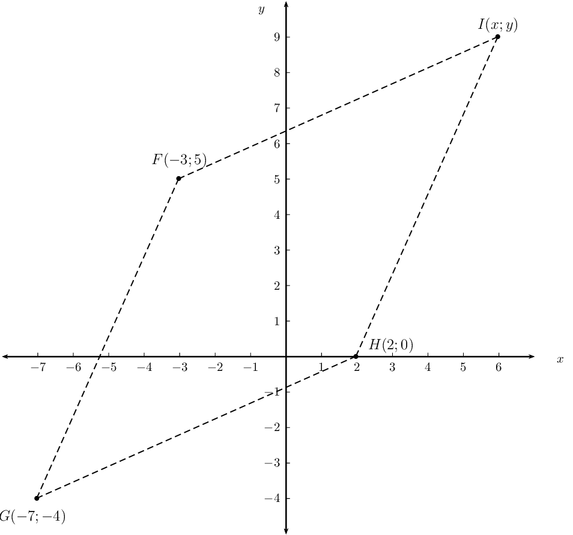

**Problem:**
Prove that \(FGHI\) is a rhombus.

**Solution:**
\begin{align*}
                FG &= \sqrt{(x_2 - x_1)^2 + (y_2 - y_1)^2} \\
                &= \sqrt{(-7-(-3))^2 + (-4-5)^2} \\
                &= \sqrt{(-4)^2 + (-9)^2} \\
                &= \sqrt{16 + 81} \\
                &= \sqrt{97} \\
                HG &= \sqrt{(x_2 - x_1)^2 + (y_2 - y_1)^2} \\
                &= \sqrt{(2+7)^2 + (0+4)^2} \\
                &= \sqrt{(9)^2 + (4)^2} \\
                &= \sqrt{81 + 16} \\
                &= \sqrt{97} \\
                \therefore FG &= HG \\
                \therefore FGHI &\text{ is a rhombus (parallelogram with adj. sides equal ) }
                \end{align*}

Given points \(S(2;5)\), \(T(-3;-4)\) and \(V(4;-2)\).

**Problem:**
Show that the equation of the line \(ST\) is \(5y = 9x + 7\).

**Solution:**
Draw a sketch:

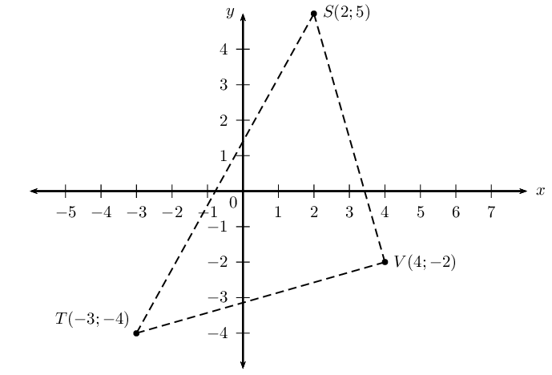

**Problem:**
Determine the size of \(T\hat{S}V\).

**Solution:**
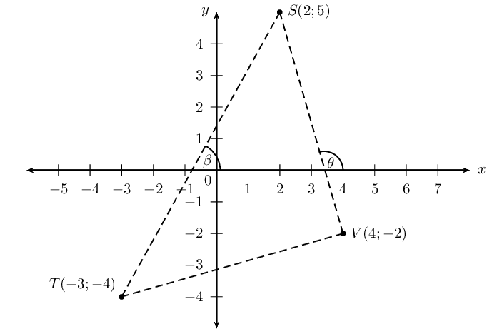

Let the angle of inclination of the line \(ST\) be \(\beta\).

Let the angle of inclination of the line \(SV\) be \(\theta\).

\(T\hat{S}V = \theta - \beta.\) (exterior \(\angle\) of \(\triangle =\) sum on opp. interior
                  \(\angle\)'s)

                \begin{align*}
                m_{ST} &= \frac{9}{5} \\
                \tan \beta &= \frac{9}{5} \\
                \therefore \beta &= \tan^{-1} \left( \frac{9}{5} \right) \\
                &= \text{60,9} ° \\
                m_{SV} &= \frac{5+2}{2-4} \\
                &= \frac{7}{-2} \\
                \tan \theta &= -\frac{7}{2} \\
                \therefore \theta &= \tan^{-1} \left( -\frac{7}{2} \right) \\
                &= -\text{74,1} ° + \text{180} ° \\
                &= \text{105,9} ° \\
                \therefore T\hat{S}V &= \text{105,9} ° - \text{60,9} ° \\
                &= \text{45} °
                \end{align*}
