## 7.2 Equation of a circle (EMCHS)

### Equation of a circle with centre at the origin (EMCHT)

2. Draw a system of axes with a scale of \(\text{1}\text{ cm} = 1\) unit on the
                                                   \(x\)-axis and on the \(y\)-axis.
4. Draw the lines \(y = x\) and \(y = -x\).
6. Plot the following points:
   2. \(O(0;0)\)
   4. \(D(2;0)\)
   6. \(E(\sqrt{2};\sqrt{2})\)
   8. \(F(0;2)\)
   10. \(G(-\sqrt{2};\sqrt{2})\)
   12. \(H(-2;0)\)
   14. \(I(-\sqrt{2};-\sqrt{2})\)
   16. \(J(0;-2)\)
   18. \(K(\sqrt{2};-\sqrt{2})\)
   What object do the points form?
8. Measure the following distances and complete the table below:
   | Line segment | Distance \((cm)\) |
   | --- | --- |
   | \(DO\) |  |
   | \(EO\) |  |
   | \(FO\) |  |
   | \(GO\) |  |
   | \(HO\) |  |
   | \(IO\) |  |
   | \(JO\) |  |
   | \(KO\) |  |
10. Use the distance formula to check the results of the above table:
                                                   \[\text{Distance} = \sqrt{(x_{2} - x_{1})^{2} + (y_{2} - y_{1})^2}\]
   | Line segment | Distance |
   | --- | --- |
   | \(DO\) |  |
   | \(EO\) |  |
   | \(FO\) |  |
   | \(GO\) |  |
   | \(HO\) |  |
   | \(IO\) |  |
   | \(JO\) |  |
   | \(KO\) |  |
12. What do you notice about the length of each line segment?
14. What is the general term given to this type of line segment?
16. If the point \(P(x;y)\) lies on the circle, use the distance formula to
                                                   determine an expression for the length of \(PO\).
18. Can you deduce a general equation for a circle with centre at the origin?

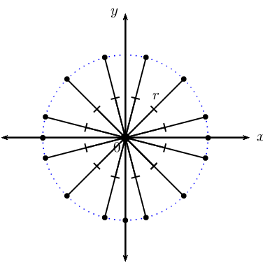

A circle is the set of all points that are an equal distance (radius) from a given point
                                (centre). In other words, every point on the circumference of a circle is equidistant
                                from its centre.

The radius of a circle is the distance from the centre of a circle to any point on the
                                circumference.

A diameter of a circle is any line passing through the centre of the circle which connects
                                two points on the circle. The diameter is also the name given to the maximum distance
                                between two points on a circle.

Consider a point \(P\left( x;y \right)\) on the circumference of a circle of radius \(r\)
                                with centre at \(O\left( 0;0 \right)\).

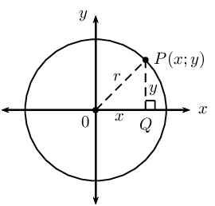

In \(\triangle OPQ\):

                        \begin{align*}
                        O{P}^{2} & = P{Q}^{2}+O{Q}^{2} \quad \left( \text{Pythagoras} \right) \\
                        OP & = r \\
                        PQ & = y - 0 \\
                        OQ & = x - 0 \\
                        {r}^{2} & = {\left( y - 0\right)}^{2}+{\left( x - 0 \right)}^{2} \\
                        \therefore {r}^{2} & = x^{2} + y^{2}
                        \end{align*}

**Equation of a circle with centre at the origin: **

If \(P(x;y)\) is a point on a circle with centre \(O(0;0)\) and radius \(r\), then
                                        the equation of the circle is:

                                \[x^{2} + y^{2} = r^{2}\]

**Circle symmetry**

A circle with centre \((0;0)\) is symmetrical about the origin: for every point \((x;y)\) on
                                the circumference of a circle, there is also the point \((-x;-y)\).

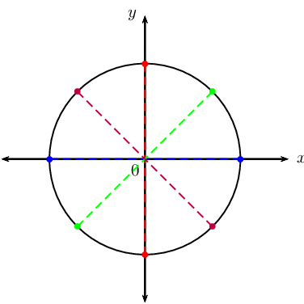

A circle centred on the origin is also symmetrical about the \(x\)- and \(y\)-axis. Is a
                                circle centred on the origin symmetrical about the lines \(y = x\) and \(y = -x\)? How
                                many lines of symmetry does a circle have?

<Callout type="tip" title="Worked example 4: Equation of a circle with centre at the origin">
**Question:**
Given: circle with centre \(O(0;0)\) and a radius of \(\text{3}\) units.

2. Sketch the circle on the Cartesian plane.
4. Determine the equation of the circle.
6. Show that the point \(T \left( - \sqrt{4}; \sqrt{5} \right)\) lies
                                                           on the circle.

**Draw a sketch:**
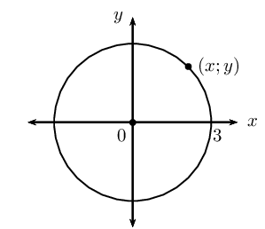

**Determine the equation of the circle:**
Write down the general form of the equation of a circle with centre
                                                \((0;0)\):

                                        \begin{align*}
                                        x^{2} + y^{2} &= r^{2} \\
                                        \text{Substitute } r = 3: \quad x^{2} + y^{2} &= (3)^{2} \\
                                        x^{2} + y^{2} &= 9
                                        \end{align*}

**Show that point \(T\) lies on the circle:**
Substitute the \(x\)-coordinate and the \(y\)-coordinate into the left-hand
                                                side of the equation and show that it is equal to the right-hand side:

                                        \begin{align*}
                                        \text{LHS } &= x^{2} + y^{2} \\
                                        &= \left( - \sqrt{4} \right)^{2} + \left( \sqrt{5} \right)^{2} \\
                                        &= 4 + 5 \\
                                        &= 9 \\
                                        &= r^{2} \\
                                        &= \text{RHS }
                                        \end{align*}

Therefore, \(T \left( - \sqrt{4}; \sqrt{5} \right)\) lies on the circle
                                                \(x^{2} + y^{2} = 9\).
</Callout>

<QuizCard id="m12-07-02a" title="Interactive Exercise 7.3" question="Use the diagram and the given information to determine the equation of the circle." options=[] answer="x^2 + y^2 = 49" hint="Your answer should be a mathematical equation. Here is an example of a famous                equation: E = mc^2 You can use the following symbols to write equations: add: + subtract: − multiply: ∗ divide: / exponent: ^ The following special symbols are also recognised: pi (π): pi infinity (∞): oo It is also possible to write certain functions: √: sqrt( ) log: log( ) sin: sin( ) cosec: cosec( ) cos: cos( ) sec: sec( ) tan: tan( ) cot: cot( ) To write a logarithm with a specific base, use the underscore _ symbol.                For example, log of x base 3 can be written as: log_3 x" explanation="Write down the given information Start by writing down the information that we have from the question. \[                         \begin{aligned}                         r  &= 7 \\                         \text{Centre } &= (0 ; 0) \\                         \text{Given point } &=  (q;\sqrt{11}) \\                         \end{aligned}                     \] Write down the general form of the equation of a circle We write down the general form of the equation of a circle with centre at the origin and substitute the known value of the radius for \(r\) : \[                         \begin{aligned}                         x^{2} + y^{2} &= r^{2}   \\                         \text{Subst. } r = 7: \quad x^{2} + y^{2} &= \left( 7 \right)^{2}   \\                         x^{2} + y^{2} &= 49                         \end{aligned}                     \] Therefore, the equation of the circle is \(x^{2} + y^{2} = 49 \) . Submit your answer as:" />

<Callout type="tip" title="Worked example 5: Equation of a circle with centre at the origin">
**Question:**
A circle with centre \(O(0;0)\) passes through the points \(P(-5;5)\) and
                                                \(Q(5;-5)\).

2. Plot the points and draw a rough sketch of the circle.
4. Determine the equation of the circle.
6. Calculate the length of \(PQ\).
8. Explain why \(PQ\) is a diameter of the circle.

**Draw a sketch:**
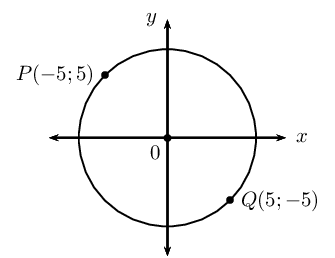

**Determine the equation of the circle:**
Write down the general form of the equation of a circle with centre \((0;0)\)
                                                and substitute \(P(-5;5)\):

                                        \begin{align*}
                                        x^{2} + y^{2} &= r^{2} \\
                                        (-5)^{2} + (5)^{2} &= r^{2} \\
                                        25 + 25 &= r^{2} \\
                                        50 &= r^{2} \\
                                        \therefore r &= \sqrt{50} \quad (r \text{ is always positive}) \\
                                        r &= 5\sqrt{2} \text{ units}
                                        \end{align*}

Therefore, the equation of the circle passing through \(P\) and \(Q\) is
                                                \(x^{2} + y^{2} = 50\).

**Calculate the length \(PQ\):**
Use the distance formula to determine the distance between the two points.

                                        \begin{align*}
                                        PQ &= \sqrt{(x_{2} - x_{1})^{2} + (y_{2} - y_{1})^2} \\
                                        &= \sqrt{(5 - (-5))^{2} + (-5 - 5)^2} \\
                                        &= \sqrt{(10)^{2} + (-10)^2} \\
                                        &= \sqrt{100 + 100} \\
                                        &= \sqrt{100 \cdot 2} \\
                                        &= 10\sqrt{2} \text{ units}
                                        \end{align*}

**Determine if \(PQ\) is a diameter of the circle:**
\begin{align*}
                                        r &= 5\sqrt{2} \\
                                        \text{And } d &= 2 \times r \\
                                        &= 2 \times 5\sqrt{2} \\
                                        &= 10 \sqrt{2} \\
                                        \therefore d &= PQ
                                        \end{align*}

Since \(PQ\) connects two points, \(P\) and \(Q\), on the circle and is a
                                                line of length \(10 \sqrt{2}\) units, \(PQ\) is a diameter of the
                                                circle.

**Alternative method \(\text{1}\):** Use symmetry to show that
                                                \(PQ\) is a diameter of the circle.

The diameter is the name given to the maximum distance between two points on
                                                a circle; this means that the two points must lie opposite each other
                                                with respect to the centre.

Using symmetry about the origin, we know that \((x;y)\) lies opposite
                                                \((-x;-y)\) on the circle and vice versa:

- \(P(-5;5)\) lies opposite \((5; -5)\), which are the coordinates of
                                                          \(Q\)
- \(Q(5;-5)\) lies opposite \((-5; 5)\), which are the coordinates of
                                                          \(P\)

Therefore, \(PQ\) is a diameter of the circle.

**Alternative method \(\text{2}\):** Show that \(PQ\) passes
                                                through the centre.

Determine the equation of \(PQ\) and show that it passes through the origin.

                                        \begin{align*}
                                        \dfrac{y - y_{Q}}{x - x_{Q}} &= \dfrac{y_{P} - y_{Q}}{x_{P} - x_{Q}} \\
                                        \dfrac{y + 5}{x - 5} &= \dfrac{5 + 5}{-5 - 5} \\
                                        \dfrac{y + 5}{x - 5} &= \dfrac{10}{-10} \\
                                        y + 5 &= -(x - 5) \\
                                        y &= -x + 5 - 5 \\
                                        y &= -x
                                        \end{align*}

\(\therefore (0;0)\) lines on the line \(PQ\).

Therefore, \(PQ\) passes through the centre and is a diameter of the circle.
</Callout>

<QuizCard id="m12-07-02b" title="Interactive Exercise 7.4" question="Use the diagram and the given information provided to determine the equation of the circle. INSTRUCTION: If necessary, give your answer with simplifed surds (not decimals)." options=[] answer="x**2+y**2 = 85" hint="Your answer should be a mathematical equation. Here is an example of a famous                equation: E = mc^2 You can use the following symbols to write equations: add: + subtract: − multiply: ∗ divide: / exponent: ^ The following special symbols are also recognised: pi (π): pi infinity (∞): oo It is also possible to write certain functions: √: sqrt( ) log: log( ) sin: sin( ) cosec: cosec( ) cos: cos( ) sec: sec( ) tan: tan( ) cot: cot( ) To write a logarithm with a specific base, use the underscore _ symbol.                For example, log of x base 3 can be written as: log_3 x" explanation="Write down the general form of the equation of a circle We write down the general form of the equation of a circle with centre at the origin and substitute the \(x\) - and \(y\) -values from either of the given points \(P\) or \(Q\) and solve for \(r\) : \[ 			\begin{aligned} 			  x^{2} + y^{2} &= r^{2}   \\ 			  \left(-9\right)^{2} + \left(-2\right)^{2} &= r^{2}   \\ 			  81 + \text{4} &= r^{2}   \\ 			  \text{85} &= r^{2} 			\end{aligned} 	      \] Therefore, the equation of the circle is \(x^{2} + y^{2}= 85 \) . Notice that we did not solve for \(r\) , but have stopped at the value of \(r^{2}\) . This is because the circle equation is \(x^{2} + y^{2} = r^{2}\) . Submit your answer as:" />

<Callout type="tip" title="Worked example 6: Equation of a circle with centre at the origin">
**Question:**
Given a circle with centre \(O(0;0)\) and a radius of \(\sqrt{45}\) units.
                                                Determine the possible coordinates of the point(s) on the circle which
                                                have an \(x\)-value that is twice the \(y\)-value.

**Determine the equation of the circle:**
\begin{align*}
                                        x^{2} + y^{2} &= r^{2} \\
                                        x^{2} + y^{2} &= \left( \sqrt{45} \right)^{2} \\
                                        x^{2} + y^{2} &= 45
                                        \end{align*}

**Determine the coordinates of the points on the circle:**
To calculate the possible coordinates of the point(s) on the circle which
                                                have an \(x\)-value that is twice the \(y\)-value, we substitute \(x =
                                                2y\) into the equation of the circle:

                                        \begin{align*}
                                        x^{2} + y^{2} &= 45 \\
                                        (2y)^{2} + y^{2} &= 45 \\
                                        4y^{2} + y^{2} &= 45 \\
                                        5y^{2} &= 45 \\
                                        y^{2} &= 9 \\
                                        \therefore y &= \pm 3 \\
                                        \text{If } y = -3: \quad x &= 2(-3) \\
                                        &= -6 \\
                                        \text{If } y = 3: \quad x &= 2(3) \\
                                        &= 6
                                        \end{align*}

This gives the points \((6;3)\) and \((-6; -3)\).

Note: we can check that both points lie on the circle by substituting the
                                                coordinates into the equation of the circle:

                                        \begin{align*}
                                        (6)^2 + (3)^2 &= 36 + 9 = 45 \\
                                        (-6)^2 + (-3)^2 &= 36 + 9 = 45
                                        \end{align*}
</Callout>

<QuizCard id="m12-07-02c" title="Interactive Exercise 7.5" question="A circle has a radius of \(\sqrt{\frac{\text{245}}{4}}\) units and is centred at the origin. What are the possible coordinates of the point(s) on the circle which have an \(x\) -value that is half the \(y\) -value? Type one coordinate pair into each answer box. The order of your answers does not matter." options=[] answer=" (-7/2;-7) ,  (7/2;7) " hint="You are expected to write a coordinate here. A coordinate is a list of numbers, separated by semi-colons ( ; ).                Coordinates are surrounded by brackets. Example: (1,5 ; 3) The spaces are optional." explanation="Write down the general form of the equation of a circle Before we can determine the coordinates of the points, we first need to find the equation of the circle. We know that the centre is \((0;0)\) and the length of the radius is \(\sqrt{\frac{\text{245}}{4}}\) units. \[                     \begin{aligned}                         x^{2} + y^{2} &= r^{2}   \\                         x^{2} + y^{2} &= \left(\sqrt{\frac{\text{245}}{4}}\right)^{2}   \\                         \therefore x^{2} + y^{2} &= \dfrac{\text{245}}{4}                     \end{aligned}                 \] Therefore, the equation of the circle is \(x^{2} + y^{2} = \dfrac{\text{245}}{4} \) . Determine the coordinates of the points on the circle Now we must determine the possible coordinates of the point(s) on the circle. The question states that the \(x\) -value is half the \(y\) -value. We can express this statement mathematically as \(x = \frac{y}{2}\) . We can now substitute this expression for \(x\) into the equation and solve for \(y\) : \[                     \begin{aligned}                         x^{2} + y^{2} &= \dfrac{\text{245}}{4} \\\left(\frac{y}{2}\right)^{2} + y^{2} &= \dfrac{\text{245}}{4} \\y^{2} + 4 y^{2} &= \dfrac{\text{245}}{4} \cdot 4  \\5 y^{2} &= \text{245}  \\ y^{2} &= 49  \\\therefore y &= \pm 7 \\& \\\text{If  } y = -7: \quad x &= \frac{1}{2} \left( - 7 \right) \\&= - \frac{7}{2} \\ \text{If  } y = 7: \quad x &= \frac{1}{2} \left( 7 \right)  \\&= \frac{7}{2}                       \end{aligned}                 \] We can check that our calculations are correct and that both points lie on the circle by making sure that the values of the coordinates statisfy the equation of the circle. So we substitute the coordinates into the equation of the circle and simplify: \[                     \begin{aligned}                         \left(- \frac{7}{2}\right)^{2} + \left(-7\right)^{2} &=  \left(\frac{49}{4}\right) + 49= \dfrac{\text{245}}{4} \\                         \left(\frac{7}{2}\right)^{2} + \left(7\right)^{2} &=  \left(\frac{49}{4}\right) + 49= \dfrac{\text{245}}{4}                     \end{aligned}                 \] We see that the coordinates statisfy the equation of the circle and therefore our calculations are correct. The correct answers are: \(\left(- \dfrac{7}{2};-7\right)\) and \(\left(\dfrac{7}{2};7\right)\) . Submit your answer as: and" />

## Equation of a circle with centre at the origin

### Textbook
                                                Exercise 7.3

Complete the following for each circle given below:

- Determine the radius.
- Draw a sketch.
- Calculate the coordinates of two points on the
                                                                          circle.

**Problem:**
\(x^{2} + y^{2} = 16\)

**Solution:**
\begin{align*}
                                                                x^{2} + y^{2} &= 16 \\
                                                                r^{2} &= 16 \\
                                                                \therefore r &= 4
                                                                \end{align*}

This gives the points \(\left( 1; \sqrt{15} \right)\)
                                                                        and \(\left( 1; -\sqrt{15} \right)\).

**Problem:**
\(x^{2} + y^{2} = 100\)

**Solution:**
\begin{align*}
                                                                x^{2} + y^{2} &= 100 \\
                                                                r^{2} &= 100 \\
                                                                \therefore r &= 10
                                                                \end{align*}

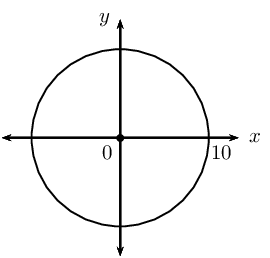

This gives the points \(\left( 2; \sqrt{96} \right)\)
                                                                        and \(\left( 2; -\sqrt{96} \right)\).

**Problem:**
\(3x^{2} + 3y^{2} = 27\)

**Solution:**
\begin{align*}
                                                                3x^{2} + 3y^{2} &= 27 \\
                                                                x^{2} + y^{2} &= 9 \\
                                                                r^{2} &= 9 \\
                                                                \therefore r &= 3
                                                                \end{align*}

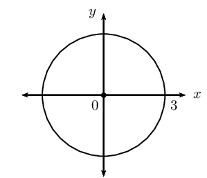

This gives the points \(\left( 1; \sqrt{8} \right)\)
                                                                        and \(\left( 1; -\sqrt{8} \right)\).

**Problem:**
\(y^{2} = 20 - x^{2}\)

**Solution:**
\begin{align*}
                                                                x^{2} + y^{2} &= 20 \\
                                                                r^{2} &= 20 \\
                                                                \therefore r &= \sqrt{20}
                                                                \end{align*}

This gives the points \(\left( 2; 4 \right)\) and
                                                                        \(\left( 2; -4 \right)\).

**Problem:**
\(x^{2} + y^{2} = \text{2,25}\)

**Solution:**
\begin{align*}
                                                                x^{2} + y^{2} &= \text{2,25} \\
                                                                \text{Convert to a fraction:} \quad \text{2,25} &=
                                                                \frac{225}{100} = \frac{45}{20} = \frac{9}{4} \\
                                                                \therefore x^{2} + y^{2} &= \frac{9}{4} \\
                                                                r^{2} &= \frac{9}{4} \\
                                                                \therefore r &= \frac{3}{2}
                                                                \end{align*}

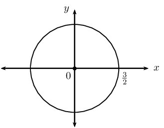

This gives the points \(\left( 1; \frac{\sqrt{5}}{2}
                                                                        \right)\) and \(\left( 1; -\frac{\sqrt{5}}{2}
                                                                        \right)\).

**Problem:**
\(y^{2} = - x^{2} + \frac{10}{9}\)

**Solution:**
\begin{align*}
                                                                x^{2} + y^{2} &= \frac{10}{9} \\
                                                                r^{2} &= \frac{10}{9} \\
                                                                \therefore r &= \frac{\sqrt{10}}{3}
                                                                \end{align*}

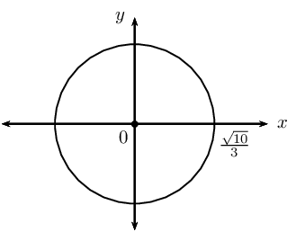

This gives the points \(\left( 1; \frac{1}{3}
                                                                        \right)\) and \(\left( 1; -\frac{1}{3}
                                                                        \right)\).

Determine the equation of the circle:

**Problem:**
with centre at the origin and a radius of
                                                                \(\text{5}\) units.

**Solution:**
\(x^{2} + y^{2} = 25\)

**Problem:**
with centre at \((0;0)\) and \(r =
                                                                \sqrt{11}\) units.

**Solution:**
\(x^{2} + y^{2} = 11\)

**Problem:**
passing through the point \((3;5)\) and
                                                                with centre \((0;0)\).

**Solution:**
\begin{align*}
                                                                x^{2} + y^{2} &= r^{2} \\
                                                                (3)^{2} + (5)^{2} &= r^{2} \\
                                                                34 &= r^{2} \\
                                                                \therefore x^{2} + y^{2} &= 34
                                                                \end{align*}

**Problem:**
centred at the origin and \(r =
                                                                \text{2,5}\) units.

**Solution:**
\begin{align*}
                                                                x^{2} + y^{2} &= r^{2} \\
                                                                x^{2} + y^{2} &= (\text{2,5})^{2} \\
                                                                x^{2} + y^{2} &= \left( \frac{5}{2} \right)^{2} \\
                                                                x^{2} + y^{2} &= \frac{25}{4}
                                                                \end{align*}

**Problem:**
with centre at the origin and a diameter of
                                                                \(\text{30}\) units.

**Solution:**
\begin{align*}
                                                                x^{2} + y^{2} &= r^{2} \\
                                                                r &= \frac{30}{2} = 15 \\
                                                                x^{2} + y^{2} &= \left( 15 \right)^{2} \\
                                                                x^{2} + y^{2} &= 225
                                                                \end{align*}

**Problem:**
passing through the point \((p;3q)\) and
                                                                with centre at the origin.

**Solution:**
\begin{align*}
                                                                x^{2} + y^{2} &= r^{2} \\
                                                                (p)^{2} + (3q)^{2} &= r^{2} \\
                                                                p^{2} + 9q^{2} &= r^{2} \\
                                                                \therefore x^{2} + y^{2} &= p^{2} + 9q^{2}
                                                                \end{align*}

**Problem:**
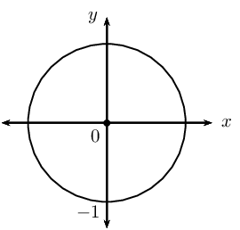

**Solution:**
\(x^{2} + y^{2} = 1\)

**Problem:**
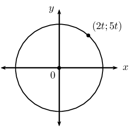

**Solution:**
\begin{align*}
                                                                x^{2} + y^{2} &= r^{2} \\
                                                                (2t)^{2} + (5t)^{2} &= r^{2} \\
                                                                4t^{2} + 25t^{2} &= r^{2} \\
                                                                29t^{2} &= r^{2} \\
                                                                \therefore x^{2} + y^{2} &= 29t^{2}
                                                                \end{align*}

**Problem:**
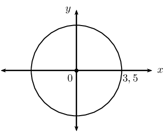

**Solution:**
\begin{align*}
                                                                x^{2} + y^{2} &= r^{2} \\
                                                                x^{2} + y^{2} &= (\text{3,5})^{2} \\
                                                                x^{2} + y^{2} &= \left( \frac{7}{2} \right)^{2} \\
                                                                \therefore x^{2} + y^{2} &= \frac{49}{4}
                                                                \end{align*}

**Problem:**
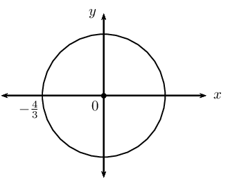

**Solution:**
\begin{align*}
                                                                x^{2} + y^{2} &= r^{2} \\
                                                                x^{2} + y^{2} &= \left( -\frac{4}{3} \right)^{2} \\
                                                                \therefore x^{2} + y^{2} &= \frac{16}{9}
                                                                \end{align*}

Determine whether or not the following equations represent a
                                                                circle:

**Problem:**
\(x^{2} + y^{2} - 8 = 0\)

**Solution:**
Yes: \(x^{2} + y^{2} = 8\)

**Problem:**
\(y^{2} - x^{2} + 25 = 0\)

**Solution:**
No, cannot be written in the form \(x^{2}
                                                                + y^{2} = r^{2}\).

**Problem:**
\(3x^{2} + 6y^{2} = 18\)

**Solution:**
No, cannot be written in the form \(x^{2}
                                                                + y^{2} = r^{2}\).

**Problem:**
\(x^{2} = \sqrt{6} - y^{2}\)

**Solution:**
Yes: \(x^{2} + y^{2}= \sqrt{6}\)

**Problem:**
\(y(y + x) = -x(x - y) + 11\)

**Solution:**
Yes: \(x^{2} + y^{2}= 11\)

**Problem:**
\(\sqrt{80} + x^{2} - y^{2} = 0\)

**Solution:**
No, cannot be written in the form \(x^{2}
                                                                + y^{2} = r^{2}\).

**Problem:**
\(\frac{y^{2}}{3} + \frac{x^{2}}{3} = 3\)

**Solution:**
Yes: \(x^{2} + y^{2}= 9\)

**Problem:**
Determine the value(s) of \(g\) if \(\left( \sqrt{3}; g
                                                                \right)\) is a point on the circle \(x^{2} + y^{2} =
                                                                19\).

**Solution:**
\begin{align*}
                                                        x^{2} + y^{2} &= 19 \\
                                                        \left( \sqrt{3} \right)^{2} + (g)^{2} &= 19 \\
                                                        g^{2} &= 19 - 3 \\
                                                        \therefore g^{2} &= 16 \\
                                                        \therefore g &= \pm 4
                                                        \end{align*}

This gives the points \(\left( \sqrt{3}; 4 \right)\) and
                                                                \(\left( \sqrt{3}; -4 \right)\).

\(A(s;t)\) is a point on the circle with centre at the origin
                                                                and a diameter of \(\text{40}\) \(\text{cm}\).

**Problem:**
Determine the possible coordinates of \(A\)
                                                                if the value of \(s\) is triple the value of \(t\).

**Solution:**
\begin{align*}
                                                                d &= 40 \\
                                                                r &= \frac{d}{2} \\
                                                                &= \frac{40}{2} \\
                                                                &= 20
                                                                \end{align*}
                                                                \begin{align*}
                                                                s &= 3t \\
                                                                x^{2} + y^{2} &= r^{2} \\
                                                                (3t)^{2} + (t)^{2} &= (20)^{2} \\
                                                                9t^{2} + t^{2} &= 400 \\
                                                                10t^{2} &= 400 \\
                                                                t^{2} &= 40 \\
                                                                \therefore t &= \pm \sqrt{40} \\
                                                                &= \pm \sqrt{4 \cdot 10} \\
                                                                &= \pm 2\sqrt{10} \\
                                                                \therefore s &= 3t \\
                                                                &= 3 \left( \pm 2\sqrt{10} \right) \\
                                                                &= \pm 6\sqrt{10}
                                                                \end{align*}

Therefore, \(A \left( 6 \sqrt{10}; 2\sqrt{10}
                                                                        \right)\) or \(A \left( -6 \sqrt{10};
                                                                        -2\sqrt{10} \right)\)

**Problem:**
Determine the possible coordinates of \(A\)
                                                                if the value of \(s\) is half the value of \(t\).

**Solution:**
\begin{align*}
                                                                d &= 40 \\
                                                                r &= \frac{d}{2} \\
                                                                &= \frac{40}{2} \\
                                                                &= 20
                                                                \end{align*}
                                                                \begin{align*}
                                                                s &= \frac{t}{2} \\
                                                                x^{2} + y^{2} &= r^{2} \\
                                                                \left( \frac{t}{2} \right)^{2} + (t)^{2} &= (20)^{2}
                                                                \\
                                                                \frac{t^{2}}{4} + t^{2} &= 400 \\
                                                                \frac{t^{2}}{4} + \frac{4t^{2}}{4} &= 400 \\
                                                                5t^{2} &= 1600 \\
                                                                t^{2} &= 320 \\
                                                                \therefore t &= \pm \sqrt{320} \\
                                                                &= \pm \sqrt{64 \cdot 5} \\
                                                                &= \pm 8\sqrt{5} \\
                                                                \therefore s &= \frac{t}{2} \\
                                                                &= \frac{\pm 8\sqrt{5} }{2} \\
                                                                &= \pm 4 \sqrt{5}
                                                                \end{align*}

Therefore, \(A \left(4 \sqrt{5}; 8\sqrt{5} \right)\)
                                                                        or \(A \left( -4 \sqrt{5}; -8\sqrt{5} \right)\)

\(P(-2;3)\) lies on a circle with centre at \((0;0)\).

**Problem:**
Determine the equation of the circle.

**Solution:**
\begin{align*}
                                                                x^{2} + y^{2} &= r^{2} \\
                                                                (-2)^{2} + (3)^{2} &= r^{2} \\
                                                                4 + 9 &= r^{2} \\
                                                                13 &= r^{2} \\
                                                                x^{2} + y^{2} &= 13
                                                                \end{align*}

**Problem:**
Sketch the circle and label point \(P\).

**Solution:**
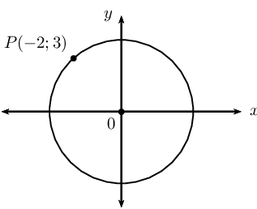

**Problem:**
If \(PQ\) is a diameter of the circle,
                                                                determine the coordinates of \(Q\).

**Solution:**
If \(PQ\) is a diameter of the circle, then point
                                                                        \(Q\) must lie opposite point \(P\) on the
                                                                        circumference of the circle. Using symmetry
                                                                        about the origin, the coordinates of point \(Q\)
                                                                        are \((2;-3)\).

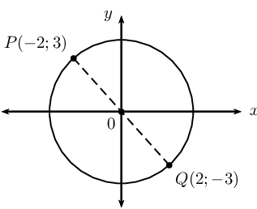

**Problem:**
Calculate the length of \(PQ\).

**Solution:**
\begin{align*}
                                                                r^{2} &= 13 \\
                                                                \therefore r &= \sqrt{13} \\
                                                                \text{And } d &= 2 \times r \\
                                                                &= 2 \sqrt{13} \text{ units}
                                                                \end{align*}

Alternative: Use the distance formula

                                                                \begin{align*}
                                                                PQ &= \sqrt{(x_{2} - x_{1})^{2} + (y_{2} - y_{1})^2}
                                                                \\
                                                                &= \sqrt{(-2-2)^{2} + (3-(-3))^2} \\
                                                                &= \sqrt{(-4)^{2} + (6)^2} \\
                                                                &= \sqrt{16 + 36} \\
                                                                &= \sqrt{52} \\
                                                                &= \sqrt{4 \cdot 13} \\
                                                                &= 2 \sqrt{13} \text{ units}
                                                                \end{align*}

**Problem:**
Determine the equation of the line \(PQ\).

**Solution:**
\begin{align*}
                                                                m_{PQ} &= \frac{y_{2} - y_{1}}{x_{2}- x_{1}} \\
                                                                &= \frac{3 - (-3)}{- 2 - 2} \\
                                                                &= \frac{6}{- 4} \\
                                                                &= - \frac{3}{2} \\
                                                                y - y_{1} &= m (x - x_{1}) \\
                                                                y - y_{1} &= - \frac{3}{2} (x - x_{1}) \\
                                                                \text{Substitute } P(-2;3) \quad y - 3 &= -
                                                                \frac{3}{2} (x - (-2))\\
                                                                y - 3 &= - \frac{3}{2}x - 3 \\
                                                                \therefore y &= - \frac{3}{2}x
                                                                \end{align*}

\(PQ\) passes through the origin, therefore \(c =
                                                                        0\).

**Problem:**
Determine the equation of the line
                                                                perpendicular to \(PQ\) and passing through the point
                                                                \(P\).

**Solution:**
For perpendicular line:

                                                                \begin{align*}
                                                                m_{PQ} \times m_{\perp} &= -1 \\
                                                                - \frac{3}{2} \times m_{\perp} &= -1 \\
                                                                m_{\perp} &= \frac{2}{3} \\
                                                                y - y_{1} &= m (x - x_{1}) \\
                                                                y - y_{1} &= \frac{2}{3} (x - x_{1}) \\
                                                                \text{Substitute } P(-2;3) \quad y - 3 &=
                                                                \frac{2}{3} (x - (-2)) \\
                                                                y - 3 &= \frac{2}{3}x + \frac{4}{3} \\
                                                                y &= \frac{2}{3}x + \frac{4}{3} + \frac{9}{3} \\
                                                                &= \frac{2}{3}x + \frac{13}{3}
                                                                \end{align*}

### Equation of a circle with centre at \((a;b)\) (EMCHV)

## Shifting the centre of a circle

Complete the following for each equation in the table below:

- Write down the shifted equation (do not simplify).
- Draw a rough sketch to illustrate the shift(s).

2. Vertical shift: the graph is shifted \(\text{1}\) unit up.
4. Horizontal shift: the graph is shifted \(\text{2}\) units to the right.
6. Combined shifts: the graph is shifted \(\text{1}\) unit up and \(\text{2}\)
                                                   units to the right.

The first example has been completed.

| Equation | Vertical shift | Horizontal shift | Combined shift |
| --- | --- | --- | --- |
| \(y - 3x^{2} = 0\) | \((y - 1) - 3x^{2} = 0\) | \(y - 3(x - 2)^{2} = 0\) | \((y - 1) - 3(x - 2)^{2} = 0\) |
| \(y - 5^{x} = 0\) |  |  |  |
| \(x^{2} + y^{2} = 4\) |  |  |  |

Use the table to answer the following questions:

2. Write down the general equation of a circle with centre \((0;0)\).
4. Write down the general equation of a circle with centre \((0;b)\).
6. Write down the general equation of a circle with centre \((a;0)\).
8. Write down the general equation of a circle with centre \((a;b)\).

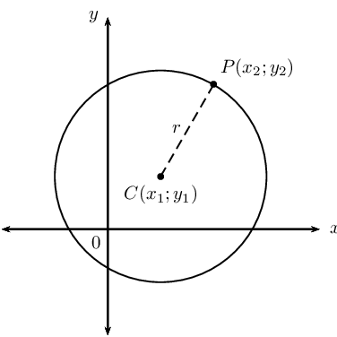

Consider a circle in the Cartesian plane with centre at \(C(x_{1}; y_{1})\) and with a radius
                                of \(r\) units. If \(P(x_{2}; y_{2})\) is any point on the circumference of the circle,
                                we can use the distance formula to calculate the distance between the two points:

                        \[PC = \sqrt{(x_{2} - x_{1})^{2} + (y_{2} - y_{1})^2}\]

The distance \(PC\) is equal to the radius (\(r\)) of the circle:

                        \begin{align*}
                        r &= \sqrt{(x_{2} - x_{1})^{2} + (y_{2} - y_{1})^2} \\
                        \therefore r^{2} &= (x_{2} - x_{1})^{2} + (y_{2} - y_{1})^2
                        \end{align*}

If the coordinates of the centre of the circle are \((a;b)\), then the equation of a circle
                                not centred on the origin is:

                        \[(x_{2} - a)^{2} + (y_{2} - b)^2 = r^{2}\]

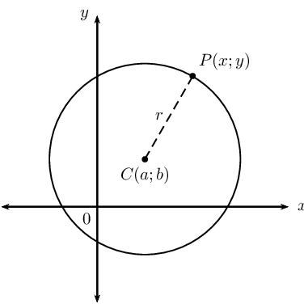

**Equation of a circle with centre at \((a;b)\): **

If \(P(x;y)\) is a point on a circle with centre \(C(a;b)\) and radius \(r\), then
                                        the equation of the circle is:

                                \[(x - a)^{2} + (y - b)^{2} = r^{2}\]

A circle with centre \((0;0)\) is a special case of the general equation:

                        \[(x - a)^{2} + (y - b)^{2} = r^{2}\]
                        \begin{align*}
                        (x - 0)^{2} + (y - 0)^{2} &= r^{2} \\
                        \therefore x^{2} + y^{2} &= r^{2}
                        \end{align*}

<Callout type="tip" title="Worked example 7: Equation of a circle with centre at \((a;b)\)">
**Question:**
\(F(6;-4)\) is a point on the circle with centre \((3;-4)\).

2. Draw a rough sketch of the circle and label \(F\).
4. Determine the equation of the circle.
6. Does the point \(G \left( \frac{3}{2} ; -2 \right)\) lie on the
                                                           circle?
8. Does the circle cut the \(y\)-axis? Motivate your answer.

**Draw a sketch:**
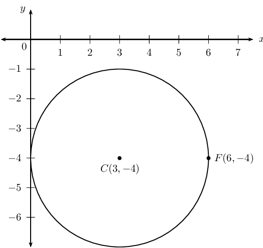

**Determine the equation of the circle:**
Write down the general equation of a circle with centre \((a;b)\) and
                                                substitute the coordinates \((3;-4)\):

                                        \begin{align*}
                                        (x - a)^{2} + (y - b)^{2} &= r^{2} \\
                                        (x - 3)^{2} + (y - (-4))^{2} &= r^{2} \\
                                        (x - 3)^{2} + (y + 4)^{2} &= r^{2}
                                        \end{align*}

Substitute the coordinates of \(F(6;-4)\) to determine the value of
                                                \(r^{2}\):

                                        \begin{align*}
                                        (6 - 3)^{2} + (-4 + 4)^{2} &= r^{2} \\
                                        (3)^{2} + (0)^{2} &= r^{2} \\
                                        9 &= r^{2} \\
                                        \therefore (x - 3)^{2} + (y + 4)^{2} &= 9
                                        \end{align*}

**Determine whether or not \(G\) lies on the circle:**
If \(G \left( \frac{3}{2} ; -2 \right)\) lies on the circle, then it will
                                                satisfy the equation of the circle:

                                        \begin{align*}
                                        \text{LHS } &= \left( \frac{3}{2} - 3 \right)^{2} + \left( -2 + 4
                                        \right)^{2} \\
                                        &= \left( - \frac{3}{2} \right)^{2} + \left( 2 \right)^{2} \\
                                        &= \frac{9}{4} + 4 \\
                                        &= \frac{9}{4} + \frac{16}{4} \\
                                        &= \frac{25}{4}
                                        \end{align*}\begin{align*}
                                        \text{RHS } &= 9 \\
                                        \therefore \text{LHS } &\ne \text{ RHS}
                                        \end{align*}

Therefore \(G\) does not lie on the circle.

**Determine the \(y\)-intercept(s):**
To determine the \(y\)-intercept(s), we let \(x = 0\):

                                        \begin{align*}
                                        (0 - 3)^{2} + (y + 4)^{2} &= 9 \\
                                        9 + (y + 4)^{2} &= 9 \\
                                        (y + 4)^{2} &= 0 \\
                                        y + 4 &= 0 \\
                                        \therefore y &= -4
                                        \end{align*}

The circle cuts the \(y\)-axis at \((0;-4)\).
</Callout>

<QuizCard id="m12-07-02e" title="Interactive Exercise 7.7" question="Find the equation of the circle with centre \(C(7 ; -8)\) which passes through \(G(5 ; -8)\) . Write your answer in standard form." options=[] answer=" ['(x - 7)**2 + (y + 8)**2 = 4', '(x - 7)**2 + (y + 8)**2 = 2^2', '(y + 8)**2 + (x - 7)**2 = 4', '(y + 8)**2 + (x - 7)**2 = 2^2'] " hint="Your answer should be a mathematical equation. Here is an example of a famous                equation: E = mc^2 You can use the following symbols to write equations: add: + subtract: − multiply: ∗ divide: / exponent: ^ The following special symbols are also recognised: pi (π): pi infinity (∞): oo It is also possible to write certain functions: √: sqrt( ) log: log( ) sin: sin( ) cosec: cosec( ) cos: cos( ) sec: sec( ) tan: tan( ) cot: cot( ) To write a logarithm with a specific base, use the underscore _ symbol.                For example, log of x base 3 can be written as: log_3 x" explanation="Given: the centre of the circle \(C(a ; b) = (7 ; -8)\) a point on the circumference of the circle \( G(x_1 ; y_1) = (5 ; -8)\) Draw a rough sketch of the information you have: Required: the equation for this circle in the form \((x - a)^2 + (y - b)^2 = r^2\) To complete the equation for this circle we need the centre of the circle (which is given) and the radius (which we need to calculate now). The radius of this circle will be the distance between the centre and the point through which the circle passes. You can use the distance formula to determine the radius; \[                 \begin{aligned}                   r & = \sqrt{(x_{G} - a)^2 + (y_{G} - b)^2} \\                     & = \sqrt{(5-7)^2 + (-8+8)^2} \\                     & = \sqrt{(-2)^2 + (0)^2} \\                     & = \sqrt{4} \\                     & = 2                 \end{aligned}               \] Note: In this case there is also a quicker way of finding the radius. Since the centre of the circle \(O\) and point \(G\) are horizontally aligned, we can also just read the difference in the \(x\) -coordinates off our graph, to calculate the radius. Now we have all the information we need to determine the required formula for this circle. \[                 \begin{aligned}                   (x-a)^2+ (y-b)^2 & = r^2 \\                   (x - (7))^2 + (y-(-8))^2 & = (2)^2 \\                   \left(x - 7\right)^{2} + \left(y + 8\right)^{2} & = 4                 \end{aligned}               \] Therefore, the equation for this circle, written in standard form, is \( \left(x - 7\right)^{2} + \left(y + 8\right)^{2} = 4\) . Submit your answer as:" />

<Callout type="tip" title="Worked example 8: Equation of a circle with centre at \((a;b)\)">
**Question:**
Determine the coordinates of the centre of the circle and the length of the
                                                radius for \(3x^{2} + 6x + 3y^{2} - 12y - 33 = 0\).

**Make the coefficient of the \(x^{2}\) term and the \(y^{2}\)
                                                term equal to \(\text{1}\):**
The coefficient of the \(x^{2}\) and \(y^{2}\) term must be \(\text{1}\), so
                                                we take out \(\text{3}\) as a common factor:

                                        \[x^{2} + 2x + y^{2} - 4y - 11 = 0\]

**Complete the square:**
Take half the **coefficient of the \(x\) term**, square it; then
                                                add and subtract it from the equation.

The coefficient of the \(x\) term is \(\text{2}\), so then \(\left(
                                                \frac{2}{2} \right)^{2} = (1)^{2} = 1\).

Take half the **coefficient of the \(y\) term**, square it; then
                                                add and subtract it from the equation.

The coefficient of the \(y\) term is \(-\text{4}\), so then \(\left(
                                                \frac{-4}{2} \right)^{2} = (-2)^{2} = 4\).

                                        \begin{align*}
                                        x^{2} + 2x + y^{2} - 4y - 11 &= 0 \\
                                        (x^{2} + 2x + 1 ) - 1 + (y^{2} - 4y + 4) -4 - 11 &= 0 \\
                                        \left( x + 1 \right)^{2} + \left( y - 2 \right)^{2} - 16 &= 0 \\
                                        \left( x + 1 \right)^{2} + \left( y - 2 \right)^{2} &= 16
                                        \end{align*}

The centre of the circle is \((-1;2)\) and the radius is \(\text{4}\) units.
</Callout>

<QuizCard id="m12-07-02f" title="Interactive Exercise 7.8" question="Find the central coordinates and the radius for a circle with the equation \( x^{2} + 12 x + y^{2} - 4 y = 41\) ." options=[] answer="-6, 2, 9" hint="You should enter a number here. If you want to, you can use a space to separate thousands.                Example: 12 800,25 For scientific notation you need to use the multiply symbol                ( ∗ ) and the exponent symbol ( ^ ). For example 6,673 × 10 −11 should be written as: 6,673 ∗ 10^−11" explanation="Given: the equation for the circle \( x^{2} + 12 x + y^{2} - 4 y = 41\) Required: the centre of the circle \((a ; b)\) the radius \(r\) of the circle The standard form of the equation for a circle is \((x-a)^2+ (y-b)^2 = r^2 \) . The equation for this circle is \( x^{2} + 12 x + y^{2} - 4 y = 41\) . To write this equation in the standard form we use the method of completing the square. First, we need to identify the constants needed to complete the squares for both the \(x\) -terms and \(y\) -terms. \[             \begin{aligned}               (x^{2} + 12 x+\spadesuit) + (y^{2} - 4 y+\clubsuit) & = 41+\spadesuit+\clubsuit\\             \end{aligned}           \] The spade symbol ( \(\spadesuit\) ) represents the constant needed to complete the square for the \(x\) -terms and will be \(\spadesuit = (\frac{1}{2}\text{ coefficient of }x)^2\) . The club symbol ( \(\clubsuit\) ) represents the constant needed to complete the square for the \(y\) -terms and will be \(\clubsuit = (\frac{1}{2}\text{ coefficient of }y)^2\) . Remember that if you add a constant on one side of the equation you must do the same on the other side. Now we have: \[             \begin{aligned}               (x^{2} + 12 x + 36)+ (y^{2} - 4 y + 4) & = 41+(36)+(4)\\               (x^{2} + 12 x + 36)+ (y^{2} - 4 y + 4) & = 81\\               \left(x + 6\right)^{2} + \left(y - 2\right)^{2} & = (9)^2 \\             \end{aligned}           \] Now the equation for the circle is in the standard form. To make sure we read the coordinates correctly, we can rewrite it as: \[             \begin{aligned}               (x - (-6))^2 + (y-(2))^2 & = (9)^2 \\             \end{aligned}           \] Therefore the centre of the circle is \((a ; b) = (-6;2)\) the radius of the circle is \(r = 9\) Submit your answer as: and and" />

<Callout type="note" title="Note">
<VideoPlayer src="https://www.youtube.com/embed/KA4nOBywEpI" title="Video:
                                                293G" />
</Callout>

<Callout type="tip" title="Worked example 9: Equation of a circle with centre at \((a;b)\)">
**Question:**
Given \(S(-3;4)\) and \(T(-3;-4)\) on the Cartesian plane.

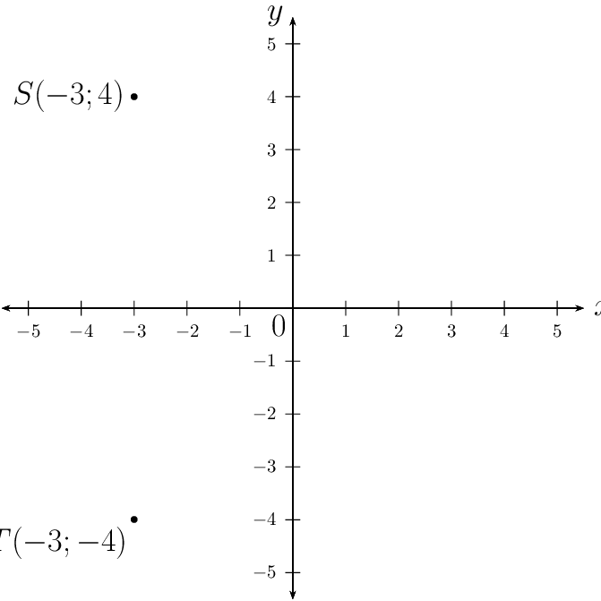

2. The points \(U\) and \(V\) are symmetrical about the origin to \(S\)
                                                           and \(T\) respectively. Determine the coordinates of \(U\) and
                                                           \(V\).
4. Determine the mid-point of \(SU\).
6. Write down the equation of the circle \(STUV\).
8. Is \(S\hat{T}U = \text{90} °\)? Give reasons.
10. Determine the equation of the line perpendicular to \(SU\) and
                                                           passing through point \(S\).

**Determine the coordinates of \(U\) and \(V\):**
For symmetry about the origin, every point \((x; y)\) is symmetrical to
                                                \((−x; −y)\). So \(S(-3;4)\) is symmetrical to \(U(3;-4)\)
                                                and \(T(-3;-4)\) is symmetrical to \(V(3;4)\).

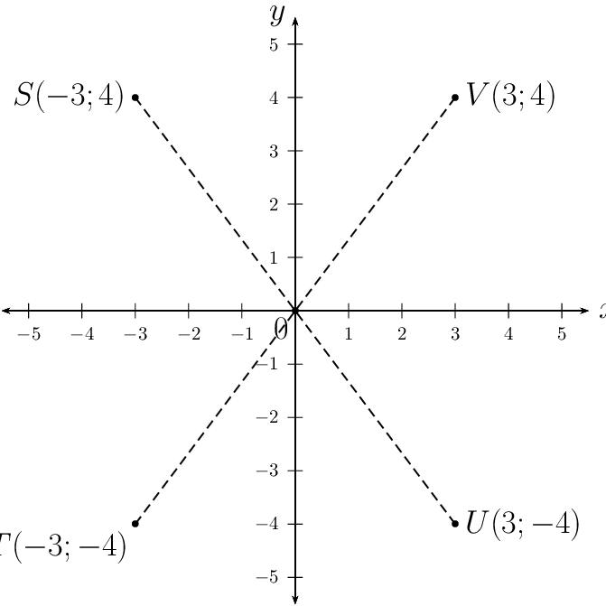

**Determine the mid-point of \(SU\):**
\begin{align*}
                                        M(x;y) &= \left( \frac{x_{U} + x_{S}}{2}; \frac{y_{U} + y_{S}}{2} \right) \\
                                        &= \left( \frac{3 - 3}{2}; \frac{- 4 + 4}{2} \right) \\
                                        &= \left( 0; 0 \right)
                                        \end{align*}

The mid-point of the line \(SU\) is the origin.

**Determine the equation of the circle:**
\begin{align*}
                                        x^{2} + y^{2} &= r^{2} \\
                                        (-3)^{2} + (4)^{2} &= r^{2} \\
                                        9 + 16 &= r^{2} \\
                                        25 &= r^{2} \\
                                        \therefore x^{2} + y^{2} &= 25
                                        \end{align*}

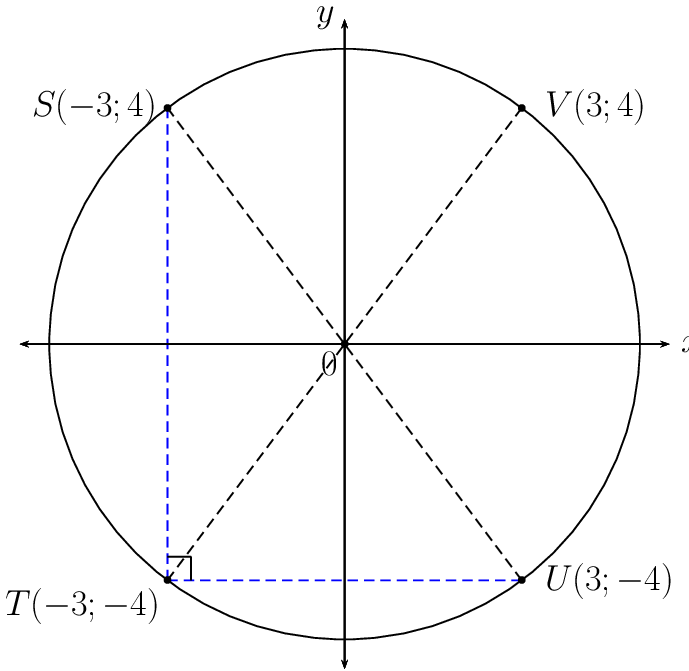

\(SU\) passes through the centre of the circle and is therefore a diameter.
                                                From Euclidean geometry, we know that the diameter of the circle
                                                subtends a right-angle at the circumference, therefore \(S\hat{T}U =
                                                \text{90} °\) (angle in semi-circle).

**Determine the equation of the line perpendicular to \(SU\) at
                                                point \(S\):**
Determine the gradient of \(SU\):

                                        \begin{align*}
                                        m_{SU} &= \frac{y_{S} - y_{U}}{x_{S}- x_{U}} \\
                                        &= \frac{4 - (- 4)}{-3 - 3} \\
                                        &= \frac{8}{-6} \\
                                        &= - \frac{4}{3}
                                        \end{align*}

Let the gradient of the line perpendicular to \(SU\) be \(m_{P}\):

                                        \begin{align*}
                                        m_{SU} \times m_{P} &= -1 \\
                                        - \frac{4}{3} \times m_{P} &= -1 \\
                                        \therefore m_{P} &= \frac{3}{4} \\
                                        y - y_{1} &= m(x - x_{1}) \\
                                        \text{Substitute } S(-3;4): \quad y - 4 &= \frac{3}{4} (x - (-3)) \\
                                        y - 4 &= \frac{3}{4} (x + 3) \\
                                        y &= \frac{3}{4}x + \frac{25}{4}
                                        \end{align*}
</Callout>

<Callout type="tip" title="Worked example 10: Equation of a circle with centre at \((a;b)\)">
**Question:**
Given: a circle with centre \((0;0)\) and a radius of \(\text{4}\) units.

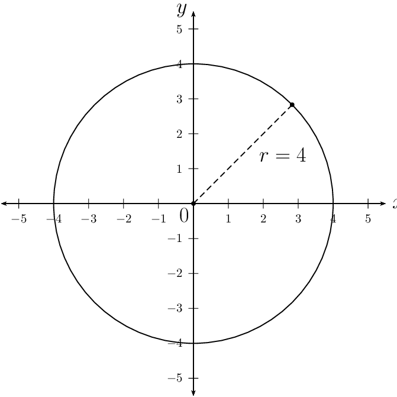

2. If the circle is shifted \(\text{2}\) units down and \(1\) unit to
                                                           the right, write down the equation of the shifted circle.
4. Sketch the original circle and the shifted circle on the same system
                                                           of axes.
6. The shifted circle is reflected about the line \(y = x\). Sketch the
                                                           reflected circle on the same system of axes as the question
                                                           above.
8. Write down the equation of the reflected circle.

**Write down the equation of the circle:**
\[x^{2} + y^{2} = 16\]

**Determine the equation of the shifted circle:**
- Vertical shift: \(\text{2}\) units down: \(y\) is replaced with \(y
                                                          + 2\)
- Horizontal shift: \(\text{1}\) unit to the right: \(x\) is replaced
                                                          with \(x - 1\)

Therefore the equation of the shifted circle is \((x - 1)^{2} + (y + 2)^{2} =
                                                16\) with centre at \((1;-2)\) and radius of \(4\) units.

**Draw a sketch of the circles:**
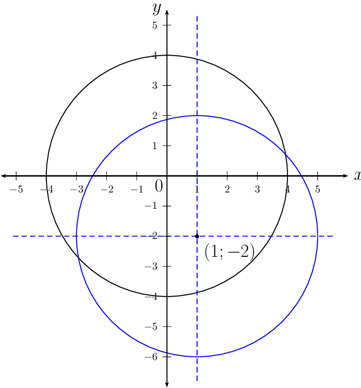

The shifted circle is reflected about the line \(y = x\). The \(x\) and \(y\)
                                                variables are interchanged to give the circle with equation \((y -
                                                1)^{2} + (x + 2)^{2} = 16\) and centre at \((-2;1)\).

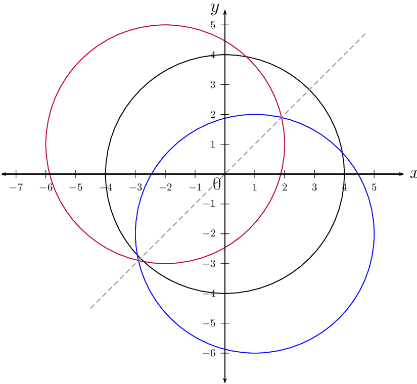
</Callout>

<Callout type="tip" title="Worked example 11: Equation of a circle with centre at \((a;b)\)">
**Question:**
A circle with centre on the line \(y = -x + 5\) passes through the points
                                                \(P(5;8)\) and \(Q(9;4)\). Determine the equation of the circle.

**Draw a rough sketch:**
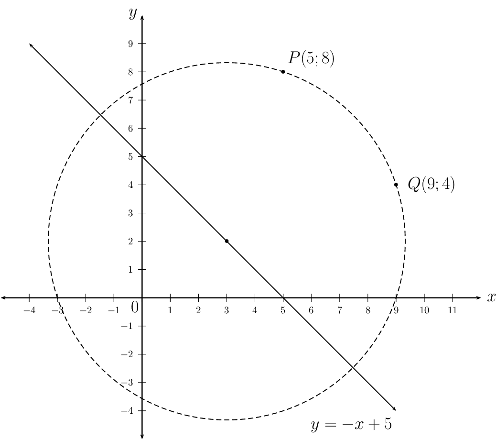

**Write down the general equation of a circle:**
\[(x - a)^{2} + (y - b)^{2} = r^{2}\]

Consider the line \(y = -x + 5\). Any point on this line will have the
                                                coordinates \((x; - x + 5)\). Since the centre of the circle lies on the
                                                line \(y = -x + 5\), we can write the equation of the circle as

                                        \begin{align*}
                                        (x - a)^{2} + (y - (- a + 5))^{2} & = r^{2} \\
                                        (x - a)^{2} + (y + a - 5)^{2} & = r^{2}
                                        \end{align*}

**Solve for the unknown variables \(a\) and \(r\):**
We need two equations to solve for the two unknown variables. We substitute
                                                the two given points, \(P(5;8)\) and \(Q(9;4)\) and solve for \(a\) and
                                                \(r\) simultaneously:

                                        \begin{align*}
                                        \text{Substitute } P(5;8): \quad (5 - a)^{2} + (8 + a - 5)^{2} & = r^{2} \\
                                        (5 - a)^{2} + (a + 3)^{2} & = r^{2} \\
                                        25 - 10a + a^{2} + a^{2} + 6a + 9 & = r^{2} \\
                                        2a^{2} - 4a + 34 & = r^{2} \ldots (1) \\
                                        & \\
                                        \text{Substitute } Q(9;4): \quad (9 - a)^{2} + (4 + a - 5)^{2} & = r^{2} \\
                                        (9 - a)^{2} + (a - 1)^{2} & = r^{2} \\
                                        81 - 18a + a^{2} + a^{2} - 2a + 1 & = r^{2} \\
                                        2a^{2} - 20a + 82 & = r^{2} \ldots (2) \\
                                        & \\
                                        (1) - (2): \quad 16a - 48 &= 0 \\
                                        16a &= 48 \\
                                        \therefore a &= 3 \\
                                        \text{Substitute into } (2): \quad r^{2} &= 2(3)^{2} - 20 (3) + 82 \\
                                        &= 18 - 60 + 82 \\
                                        &= 40 \\
                                        \text{And } \quad b &= -a + 5 \\
                                        &= -3 + 5 \\
                                        &= 2
                                        \end{align*}

**Write the final answer:**
The equation of the circle is \((x - 3)^{2} + (y - 2)^{2} = 40\).
</Callout>

|  | Circles with the same centre. |
| --- | --- |
|  | Circles touch internally at one point: the distance between the
                                                        centres is equal to the difference between the radii. \(d = r_{2} - r_{1}\) |
|  | Circles intersect at two points: the distance between the centres is
                                                        less than the sum of the radii. \(d < r_{1} + r_{2}\) |
|  | Circles touch externally at one point: the distance between the
                                                        centres is equal to the sum of the radii. \(d = r_{1} + r_{2}\) |
|  | Circles do not touch or intersect: the distance between the centres
                                                        is greater than the sum of the radii. \(d > r_{1} + r_{2}\) |

## Equation of a circle with centre at \((a;b)\)

### Textbook Exercise 7.4

Determine whether or not each of the following equations
                                                                represents a circle. If not, give a reason.

**Problem:**
\(x^{2} + y^{2} + 6y - 10 = 0\)

**Solution:**
Yes

**Problem:**
\(3x^{2} - 35 + 3y^{2} = 9y\)

**Solution:**
Yes

**Problem:**
\(40 = x^{2} + 2x + 4y^{2}\)

**Solution:**
No, coefficients of \(x^{2}\) term and
                                                                \(y^{2}\) term are different.

**Problem:**
\(x^{2} - 4x = \sqrt{21} + 5y + y^{2}\)

**Solution:**
No, cannot be written in general form \((x
                                                                - a)^{2} + (y - b)^{2} = r^{2}\)

**Problem:**
\(3\sqrt{7} - x^{2} - y^{2} + 6y - 8x = 0\)

**Solution:**
Yes

**Problem:**
\((x - 1)^{2} + (y + 2)^{2} + 9 = 0\)

**Solution:**
No, \(r^{2}\) must be greater than zero.

Write down the equation of the circle:

**Problem:**
with centre \((0;4)\) and a radius of
                                                                \(\text{3}\) units.

**Solution:**
\(x^{2} + (y - 4)^{2} = 9\)

**Problem:**
such that \(r = 5\) and the centre is the
                                                                origin.

**Solution:**
\(x^{2} + y^{2} = 25\)

**Problem:**
with centre \((-2;3)\) and passing through
                                                                the point \((4;5)\).

**Solution:**
\begin{align*}
                                                                (x - a)^{2} + (y - b)^{2} &= r^{2} \\
                                                                (x - (-2))^{2} + (y - 3)^{2} &= r^{2} \\
                                                                (x + 2)^{2} + (y - 3)^{2} &= r^{2} \\
                                                                \text{Substitute } (4;5): \quad (4 + 2)^{2} + (5 -
                                                                3)^{2} &= r^{2} \\
                                                                (6)^{2} + (2)^{2} &= r^{2} \\
                                                                36 + 4 &= r^{2} \\
                                                                40 &= r^{2} \\
                                                                \therefore (x + 2)^{2} + (y - 3)^{2} &= 40
                                                                \end{align*}

**Problem:**
with centre \((p;-q)\) and \(r =
                                                                \sqrt{6}\).

**Solution:**
\((x - p)^{2} + (y + q)^{2} = 6\)

**Problem:**
with \(r = \sqrt{10}\) and centre \(\left(
                                                                -\frac{1}{2}; \frac{3}{2} \right)\) and

**Solution:**
\(\left( x + \frac{1}{2} \right)^{2} +
                                                                \left( y - \frac{3}{2} \right)^{2} = 10\)

**Problem:**
with centre \((1;-5)\) and passing through
                                                                the origin.

**Solution:**
\begin{align*}
                                                                (x - a)^{2} + (y - b)^{2} &= r^{2} \\
                                                                (x - 1)^{2} + (y - (-5))^{2} &= r^{2} \\
                                                                (x - 1)^{2} + (y + 5)^{2} &= r^{2} \\
                                                                \text{Substitute } (0;0): \quad (0 - 1)^{2} + (0 +
                                                                5)^{2} &= r^{2} \\
                                                                1 + 25 &= r^{2} \\
                                                                26 &= r^{2} \\
                                                                \therefore (x - 1)^{2} + (y + 5)^{2} &= 26
                                                                \end{align*}

Determine the centre and the length of the radius for the
                                                                following circles:

**Problem:**
\(x^{2} = 21 - y^{2} + 4y\)

**Solution:**
\begin{align*}
                                                                x^{2} &= 21 - y^{2} + 4y \\
                                                                x^{2} + y^{2} - 4y &= 21 \\
                                                                x^{2} + (y^{2} - 4y + 4) - 4 &= 21 \\
                                                                x^{2} + (y - 2)^{2} &= 25
                                                                \end{align*}

Centre: \((0;2)\), \(r = 5\) units

**Problem:**
\(y^{2} + x + x^{2} - \frac{15}{4} = 0\)

**Solution:**
\begin{align*}
                                                                y^{2} + x + x^{2} - \frac{15}{4} &= 0 \\
                                                                x^{2} + x + y^{2} &= \frac{15}{4} \\
                                                                \left( x^{2} + x + \frac{1}{4} \right) - \frac{1}{4} +
                                                                y^{2} &= \frac{15}{4} \\
                                                                \left( x + \frac{1}{2} \right)^{2} + y^{2} &=
                                                                \frac{16}{4} \\
                                                                \left( x + \frac{1}{2} \right)^{2} + y^{2} &= 4
                                                                \end{align*}

Centre: \(\left(-\frac{1}{2}; 0 \right)\), \(r = 2\)
                                                                        units

**Problem:**
\(x^{2} - 4x + y^{2} + 2y - 5 = 0\)

**Solution:**
\begin{align*}
                                                                x^{2} - 4x + y^{2} + 2y - 5 &= 0 \\
                                                                (x^{2} - 4x + 4) - 4 + (y^{2} + 2y + 1) - 1 - 5 &= 0
                                                                \\
                                                                (x - 2)^{2} + (y + 1)^{2} - 10 &= 0 \\
                                                                (x - 2)^{2} + (y + 1)^{2} &= 10
                                                                \end{align*}

Centre: \((2;-1)\), \(r = \sqrt{10}\) units

**Problem:**
\(x^{2} + y^{2} - 6y + 2x - 15 = 0\)

**Solution:**
\begin{align*}
                                                                x^{2} + 2x + y^{2} - 6y &= 15 \\
                                                                (x^{2} + 2x + 1) - 1 + (y^{2} - 6y + 9) - 9 &= 15 \\
                                                                (x + 1)^{2} + (y - 3)^{2} &= 25
                                                                \end{align*}

Centre: \((-1;3)\), \(r = 5\) units

**Problem:**
\(5 - x^{2} - 6x - 8y - y^{2} = 0\)

**Solution:**
\begin{align*}
                                                                5 - x^{2} - 6x - 8y - y^{2} &= \\
                                                                x^{2} + 6x + y^{2} + 8y &= 5 \\
                                                                (x^{2} + 6x + 9) - 9 + (y^{2} + 8y + 16) - 16 &= 5
                                                                \\
                                                                (x + 3)^{2} + (y + 4)^{2} &= 30
                                                                \end{align*}

Centre: \((-3;-4 )\), \(r = \sqrt{30}\) units

**Problem:**
\(x^{2} - \frac{2}{3}x + y^{2} - 4y =
                                                                \frac{35}{9}\)

**Solution:**
\begin{align*}
                                                                x^{2} - \frac{2}{3}x + y^{2} - 4y &= \frac{35}{9} \\
                                                                \left( x^{2} - \frac{2}{3}x + \frac{1}{9} \right) -
                                                                \frac{1}{9} + (y^{2} - 4y + 4) - 4 &= \frac{35}{9}
                                                                \\
                                                                \left( x - \frac{1}{3} \right)^{2} + (y - 2)^{2} &=
                                                                \frac{35}{9} + \frac{1}{9} + 4 \\
                                                                \left( x - \frac{1}{3} \right)^{2} + (y - 2)^{2} &=
                                                                8
                                                                \end{align*}

Centre: \(\left( \frac{1}{3}; 2\right)\), \(r =
                                                                        \sqrt{8}\) units

**Problem:**
\(16x + 2y^{2} - 20y + 2x^{2} + 42 = 0\)

**Solution:**
\begin{align*}
                                                                16x + 2y^{2} - 20y + 2x^{2} + 42 &= 0 \\
                                                                2x^{2} + 16x + 2y^{2} -20y &= -42 \\
                                                                x^{2} + 8x + y^{2} - 10y &= -21 \\
                                                                (x^{2} + 8x + 16) - 16 + (y^{2} - 10y + 25) - 25 &=
                                                                -21 \\
                                                                (x + 4)^{2} + (y - 5)^{2} &= 20
                                                                \end{align*}

Centre: \((-4;5 )\), \(r = \sqrt{20}\) units

**Problem:**
\(6x - 6y - x^{2} - y^{2} = 6\)

**Solution:**
\begin{align*}
                                                                6x - 6y - x^{2} - y^{2} &= 6 \\
                                                                x^{2} - 6x + y^{2} + 6y &= -6 \\
                                                                (x^{2} - 6x + 9) - 9 + (y^{2} + 6y + 9) - 9 &= -6 \\
                                                                (x - 3)^{2} + (y + 3)^{2} &= 12
                                                                \end{align*}

Centre: \((3;-3)\), \(r = \sqrt{12}\) units

**Problem:**
A circle cuts the \(x\)-axis at \(R(-2;0)\) and \(S(2;0)\).
                                                                If \(r = \sqrt{20}\) units, determine the possible
                                                                equation(s) of the circle. Draw a sketch.

**Solution:**
\begin{align*}
                                                        (x - a)^{2} + (y - b)^{2} &= r^{2} \\
                                                        (x - a)^{2} + (y - b)^{2} &= 20 \\
                                                        \text{Substitute } R(-2;0): \quad (-2 - a)^{2} + (0 - b)^{2}
                                                        &= 20 \\
                                                        4 + 4a + a^{2} + b^{2} &= 20 \\
                                                        4a + a^{2} + b^{2} &= 16 \ldots (1) \\
                                                        \text{Substitute } S(2;0): \quad (2 - a)^{2} + (0 - b)^{2}
                                                        &= 20 \\
                                                        4 - 4a + a^{2} + b^{2} &= 20 \\
                                                        - 4a + a^{2} + b^{2} &= 16 \ldots (2) \\
                                                        (1) - (2): \quad 4a - (-4a) &= 0 \\
                                                        8a &= 0 \\
                                                        \therefore a &= 0 \\
                                                        \text{And } b^{2} &= 16 \\
                                                        \therefore b &= \pm 4
                                                        \end{align*}

The equation of the circle passing through points \(R\) and
                                                                \(S\) is \(x^{2} + (y + 4)^{2} = 20\) or \(x^{2} + (y -
                                                                4)^{2} = 20\).

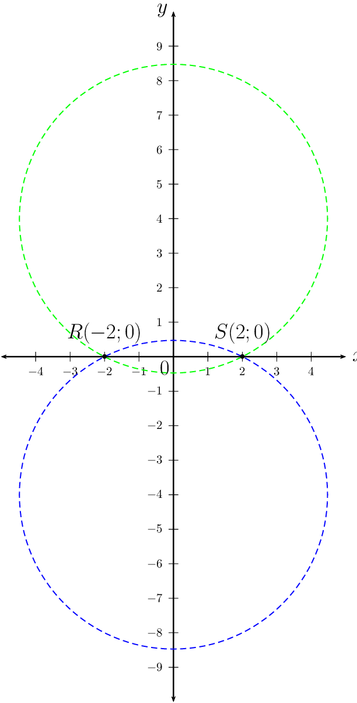

**Problem:**
\(P(1;2)\) and \(Q(-5;-6)\) are points on a circle such that
                                                                \(PQ\) is a diameter. Determine the equation of the
                                                                circle.

**Solution:**
Use the distance formula to determine the length of the
                                                                diameter.

                                                        \begin{align*}
                                                        PQ &= \sqrt{ (x_{2} - x_{1})^{2} + (y_{2} - y_{1})^{2} } \\
                                                        &= \sqrt{ (- 5 - 1)^{2} + (-6 - 2)^{2} } \\
                                                        &= \sqrt{ (- 6)^{2} + (-8)^{2} } \\
                                                        &= \sqrt{36 +64} \\
                                                        &= \sqrt{100} \\
                                                        &= 10 \\
                                                        \text{And } r &= \frac{1}{2} \times \text{ diameter} \\
                                                        &= \frac{1}{2} \times 10 \\
                                                        &= 5 \\
                                                        (x - a)^{2} + (y - b)^{2} &= (5)^{2} \\
                                                        (x - a)^{2} + (y - b)^{2} &= 25
                                                        \end{align*}

Given \(PQ\) is a diameter of the circle, then the centre is
                                                                the mid-point of PG:

                                                        \begin{align*}
                                                        M(x;y) &= \left( \frac{x_{1} + x_{2}}{2}; \frac{y_{1} +
                                                        y_{2}}{2} \right) \\
                                                        &= \left( \frac{1 - 5}{2}; \frac{2 - 6}{2} \right) \\
                                                        &= \left( \frac{-4}{2}; \frac{-4}{2} \right) \\
                                                        &= \left(-2; -2 \right)
                                                        \end{align*}

Therefore the centre is \((-2;-2)\) and the equation of the
                                                                circle is \((x + 2)^{2} + (y + 2)^{2} = 25\).

A circle with centre \(N(4;4)\) passes through the points
                                                                \(K(1;6)\) and \(L(6;7)\).

**Problem:**
Determine the equation of the circle.

**Solution:**
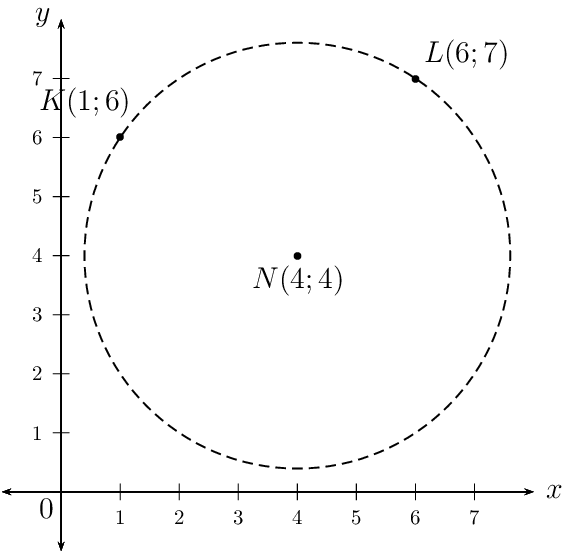

The equation of the circle is \((x - 4)^{2} + (y -
                                                                        4)^{2} = 13\) .

**Problem:**
Determine the coordinates of \(M\), the
                                                                mid-point of \(KL\).

**Solution:**
\begin{align*}
                                                                M(x;y) &= \left( \frac{x_{1} + x_{2}}{2};
                                                                \frac{y_{1} + y_{2}}{2} \right) \\
                                                                &= \left( \frac{1 + 6}{2}; \frac{6 + 7}{2} \right)
                                                                \\
                                                                &= \left( \frac{7}{2}; \frac{13}{2} \right)
                                                                \end{align*}

**Problem:**
Show that \(MN \perp KL\).

**Solution:**
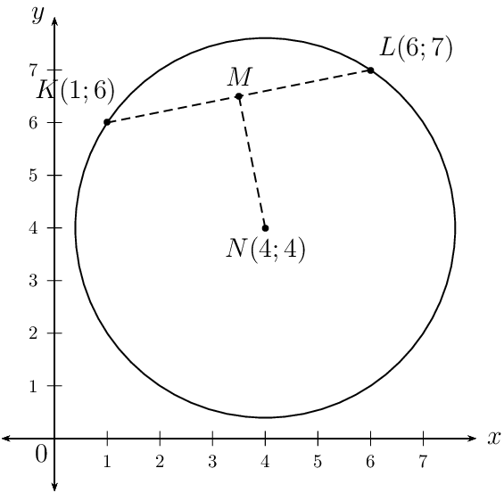

**Problem:**
If \(P\) is a point on the circle such that
                                                                \(LP\) is a diameter, determine the coordinates of
                                                                \(P\).

**Solution:**
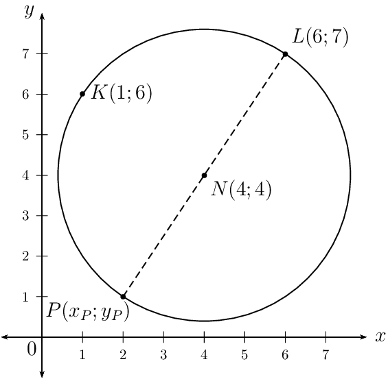

Use the mid-point formula to calculate the
                                                                        coordinates of \(P\):

                                                                \begin{align*}
                                                                (x;y) = \left( \frac{x_{1} + x_{2}}{2}; \frac{y_{1} +
                                                                y_{2}}{2} \right) \\
                                                                N(4;4) = \left( \frac{x_{P} + 6}{2}; \frac{y_{P} + 7}{2}
                                                                \right) \\
                                                                \therefore 4 &= \frac{x_{P} + 6}{2} \\
                                                                8 &= x_{P} + 6 \\
                                                                x_{P} &= 2 \\
                                                                \text{And } 4 &= \frac{y_{P} + 7}{2} \\
                                                                8 &= y_{P} + 7\\
                                                                y_{P} &= 1 \\
                                                                \therefore & P(2;1)
                                                                \end{align*}

**Problem:**
Determine the equation of the line \(LP\).

**Solution:**
\begin{align*}
                                                                m_{LP} &= \frac{y_{2} - y_{1}}{x_{2}- x_{1}} \\
                                                                &= \frac{7 - 1}{6 - 2 } \\
                                                                &= \frac{6}{4} \\
                                                                &=\frac{3}{2} \\
                                                                y - y_{1} &= m(x - x_{1}) \\
                                                                y - y_{1} &=\frac{3}{2}(x - x_{1}) \\
                                                                \text{Substitute } L(6;7) y -7 &=\frac{3}{2}(x - 6)
                                                                \\
                                                                y &=\frac{3}{2}x - 9 + 7 \\
                                                                y &=\frac{3}{2}x - 2
                                                                \end{align*}

**Problem:**
A circle passes through the point \(A(7;-4)\) and
                                                        \(B(-5;-2)\). If its centre lies on the line \(y + 5 = 2x\),
                                                        determine the equation of the circle.

**Solution:**
Given that the centre of the circle lies on the line \(y = 2x
                                                                - 5\), we can write the coordinates of the circle as
                                                                \((p; 2p - 5)\) and the equation of the circle becomes:

                                                        \begin{align*}
                                                        (x - a)^{2} + (y - b)^{2} &= r^{2} \\
                                                        (x - p)^{2} + (y - (2p - 5))^{2} &= r^{2} \\
                                                        (x - p)^{2} + (y - 2p + 5)^{2} &= r^{2} \\
                                                        \text{Substitute } A(7;4): \quad (7 - p)^{2} + (-4 - 2p + 5)^{2}
                                                        &= r^{2} \\
                                                        (7 - p)^{2} + (1 - 2p)^{2} &= r^{2} \\
                                                        49 - 14p + p^{2} + 1 -4p + 4p^{2} &= r^{2} \\
                                                        5p^{2} - 18p + 50 &= r^{2} \ldots (1) \\
                                                        \text{Substitute } B(-5;-2): \quad (-5 - p)^{2} + (-2 - 2p +
                                                        5)^{2} &= r^{2} \\
                                                        (-5 - p)^{2} + (3 - 2p)^{2} &= r^{2} \\
                                                        25 + 10p + p^{2} + 9 - 12p + 4p^{2} &= r^{2} \\
                                                        5p^{2} - 2p + 34 &= r^{2} \ldots (2) \\
                                                        (1) - (2): \quad -16p + 16 &= 0 \\
                                                        -16p &= -16 \\
                                                        \therefore p = x &= 1 \\
                                                        \text{And } y &= 2(1) - 5 \\
                                                        &= -3 \\
                                                        \text{And } r^{2} &= 5(1)^{2} - 2(1) + 34 \\
                                                        &= 5 - 2 + 34 \\
                                                        \therefore r^{2} &= 37
                                                        \end{align*}

The equation of the circle is \((x - 1)^{2} + (y + 3)^{2} =
                                                                37\).

A circle with centre \((0;0)\) passes through the point
                                                                \(T(3;5)\).

**Problem:**
Determine the equation of the circle.

**Solution:**
\begin{align*}
                                                                x^{2} + y^{2} &= r^{2} \\
                                                                (3)^{2} + (5)^{2} &= r^{2} \\
                                                                9 + 25 &= r^{2} \\
                                                                34 &= r^{2} \\
                                                                \therefore x^{2} + y^{2} &= 34
                                                                \end{align*}

**Problem:**
If the circle is shifted \(\text{2}\) units
                                                                to the right and \(\text{3}\) units down, determine the
                                                                new equation of the circle.

**Solution:**
\begin{align*}
                                                                x^{2} + y^{2} &= 34 \\
                                                                \text{Horizontal shift: } x & \text{ is replaced
                                                                with } x - 2 \\
                                                                \text{Vertical shift: } y & \text{ is replaced with
                                                                } y + 3 \\
                                                                \therefore (x - 2)^{2} + (y + 3)^{2} &= 34
                                                                \end{align*}

**Problem:**
Draw a sketch of the original circle and
                                                                the shifted circle on the same system of axes.

**Solution:**
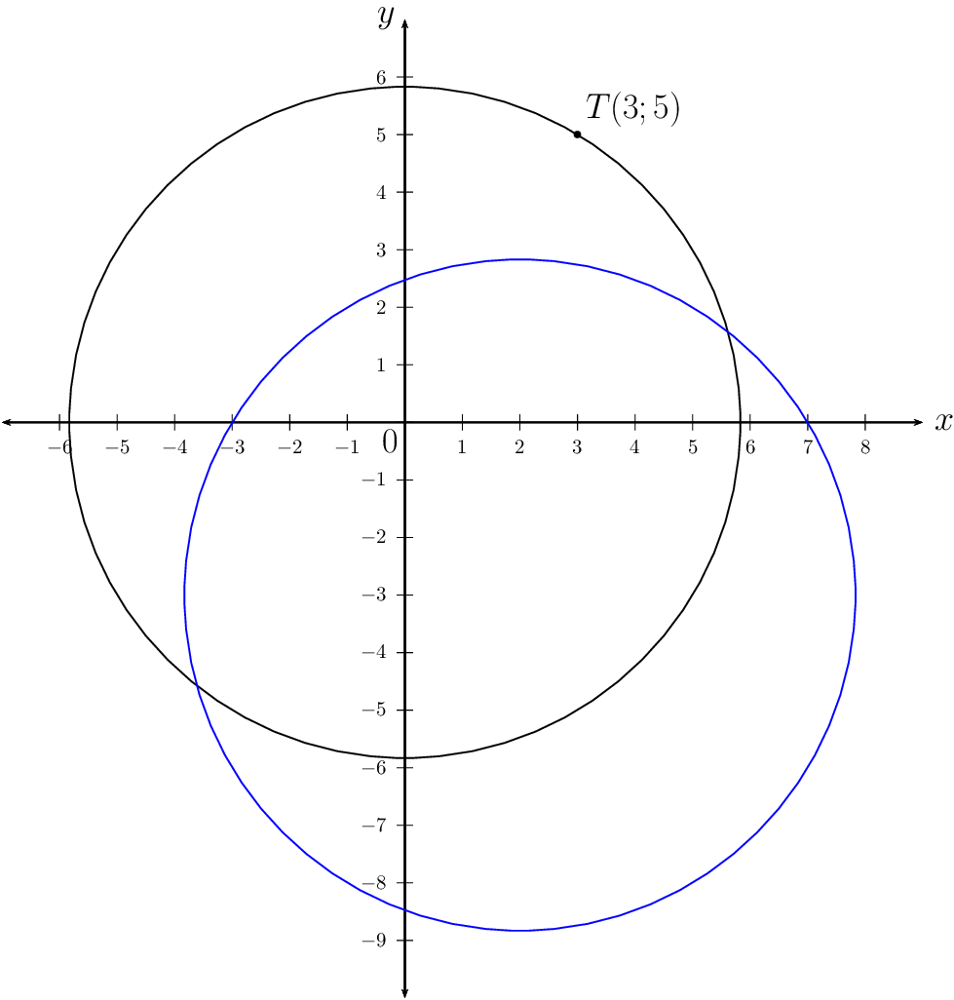

**Problem:**
On the same system of axes as the previous
                                                                question, draw a sketch of the shifted circle reflected
                                                                about the \(x\)-axis. State the coordinates of the
                                                                centre of this circle.

**Solution:**
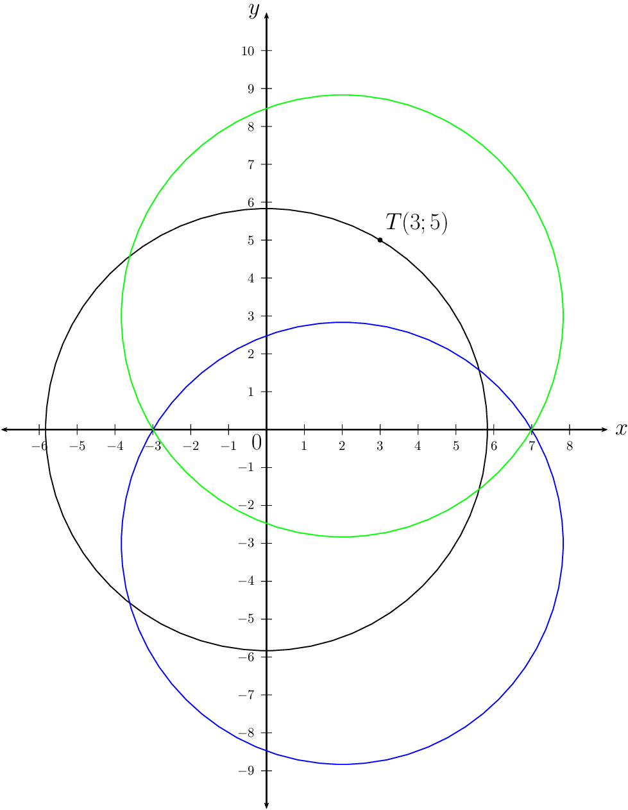

Centre of the shifted circle: \((2;3)\)

**Problem:**
Determine whether the circle \(x^{2} - 4x + y^{2} - 6y + 9 =
                                                                0\) cuts, touches or does not intersect the \(x\)-axis
                                                                and the \(y\)-axis.

**Solution:**
\begin{align*}
                                                        x^{2} - 4x + y^{2} - 6y + 9 &= 0 \\
                                                        (x - 2)^{2} - 4 + (y - 3)^{2} - 9 &= -9 \\
                                                        (x - 2)^{2} + (y - 3)^{2} &= 4 \\
                                                        \therefore (x - 2)^{2} + (y - 3)^{2} &= 4
                                                        \end{align*}

The radius of the circle is \(\text{2}\) units. The distance
                                                                from the centre to the \(y\)-axis is \(\text{2}\) units,
                                                                therefore the circle will touch the \(y\)-axis. The
                                                                distance from the centre to the \(x\)-axis is
                                                                \(\text{3}\) units, therefore the circle will not
                                                                intersect with the \(x\)-axis.

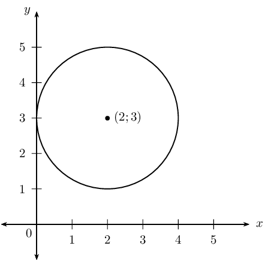
