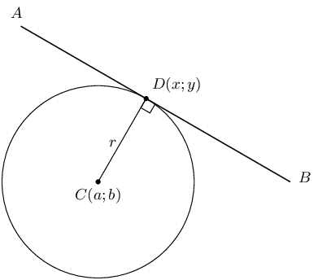
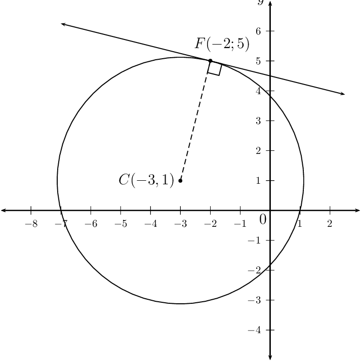
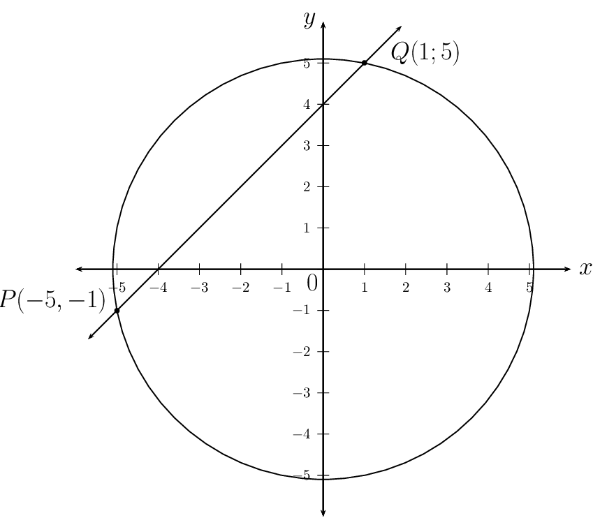
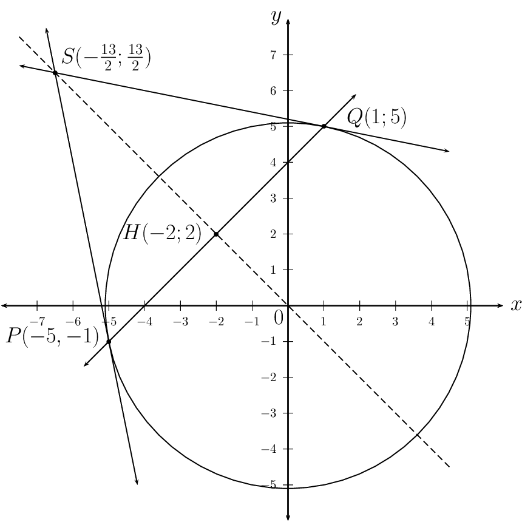
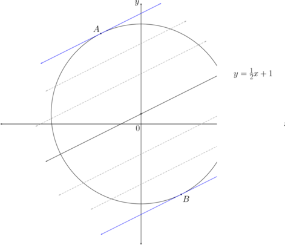
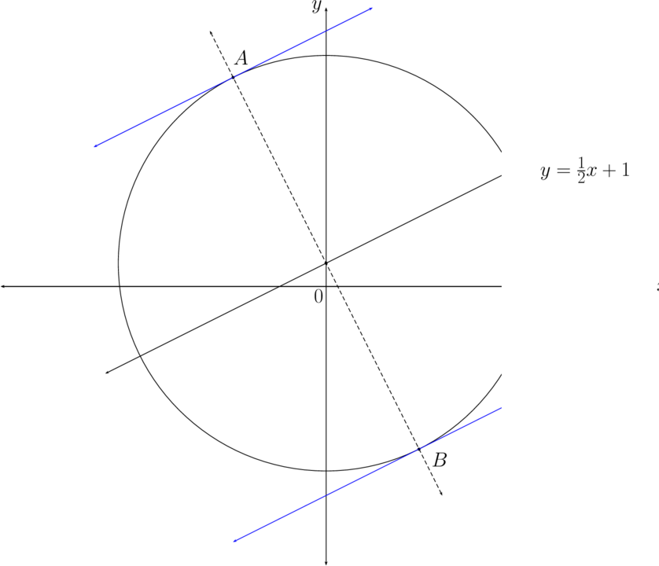
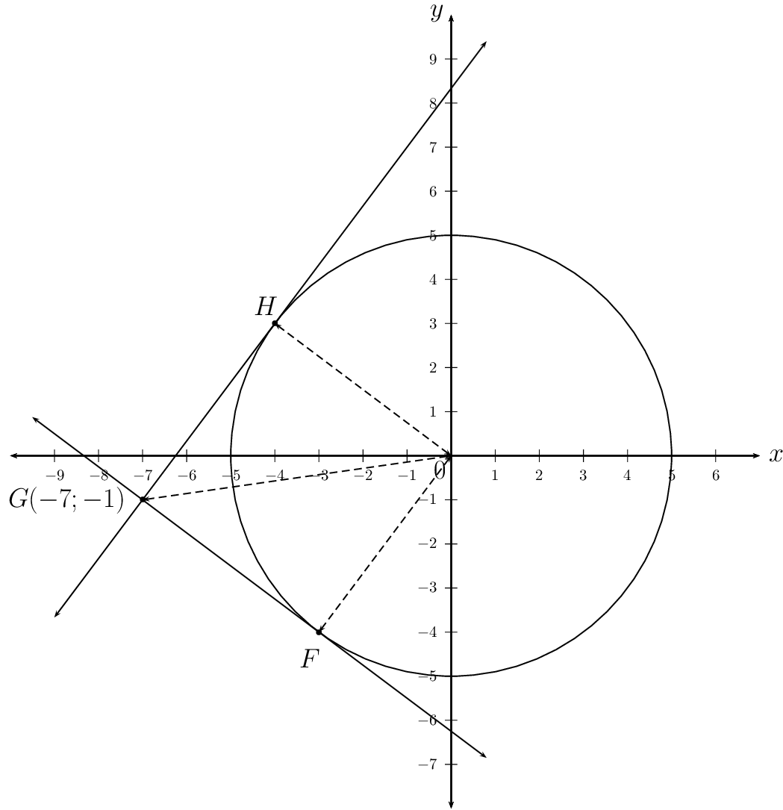
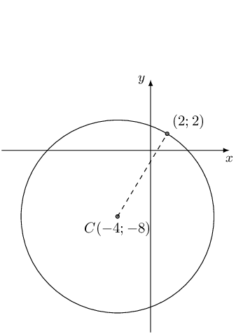
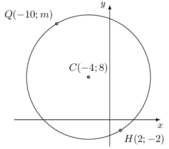

## 7.3 Equation of a tangent to a circle (EMCHW)

2. On a suitable system of axes, draw the circle \(x^{2} + y^{2} = 20\) with centre at
                                           \(O(0;0)\).
4. Plot the point \(T(2;4)\).
6. Plot the point \(P(0;5)\). Draw \(PT\) and extend the line so that is cuts the
                                           positive \(x\)-axis.
8. Measure \(O\hat{T}P\).
10. Determine the gradient of the radius \(OT\).
12. Determine the gradient of \(PT\).
14. Prove that \(PT \perp OT\).
16. Plot the point \(S(2;-4)\) and join \(OS\).
18. Draw a tangent to the circle at \(S\).
20. Measure the angle between \(OS\) and the tangent line at \(S\).
22. Make a conjecture about the angle between the radius and the tangent to a circle at
                                           a point on the circle.
24. Complete the sentence: the product of the \(\ldots \ldots\) of the radius and the
                                           gradient of the \(\ldots \ldots\) is equal to \(\ldots \ldots\).

A circle with centre \(C(a;b)\) and a radius of \(r\) units is shown in the diagram above. \(D(x;y)\)
                        is a point on the circumference and the equation of the circle is:

                \[(x - a)^{2} + (y - b)^{2} = r^{2}\]

A tangent is a straight line that touches the circumference of a circle at only one place.

The tangent line \(AB\) touches the circle at \(D\).

The radius of the circle \(CD\) is perpendicular to the tangent \(AB\) at the point of contact \(D\).

                \begin{align*}
                CD & \perp AB \\
                \text{and } C\hat{D}A &= C\hat{D}B = \text{90} °
                \end{align*}

The product of the gradient of the radius and the gradient of the tangent line is equal to
                        \(-\text{1}\).

                \[m_{CD} \times m_{AB} = - 1\]

**How to determine the equation of a tangent: **

2. Determine the equation of the circle and write it in the form \[(x - a)^{2} + (y - b)^{2} =
                                   r^{2}\]
4. From the equation, determine the coordinates of the centre of the circle \((a;b)\).
6. Determine the gradient of the radius: \[m_{CD} = \frac{y_{2} - y_{1}}{x_{2}- x_{1}}\]
8. The radius is perpendicular to the tangent of the circle at a point \(D\) so: \[m_{AB} = -
                                   \frac{1}{m_{CD}}\]
10. Write down the gradient-point form of a straight line equation and substitute \(m_{AB}\) and
                                   the coordinates of \(D\). Make \(y\) the subject of the equation. \[y - y_{1} = m(x -
                                   x_{1})\]

<Callout type="tip" title="Worked example 12: Equation of a tangent to a circle">
**Question:**
Determine the equation of the tangent to the circle \(x^{2} + y^{2} - 2y + 6x - 7 =
                                        0\) at the point \(F(-2;5)\).

**Write the equation of the circle in the form \((x - a)^{2} + (y -
                                        b)^{2} = r^{2}\):**
Use the method of completing the square:

                                \begin{align*}
                                x^{2} + y^{2} - 2y + 6x - 7 &= 0 \\
                                x^{2} + 6x + y^{2} - 2y &= 7 \\
                                (x^{2} + 6x + 9) - 9 + (y^{2} - 2y + 1) - 1 &= 7 \\
                                (x + 3)^{2} + (y - 1)^{2} &= 17
                                \end{align*}

**Draw a sketch:**
The centre of the circle is \((-3;1)\) and the radius is \(\sqrt{17}\) units.

**Determine the gradient of the radius \(CF\):**
\begin{align*}
                                m_{CF} &= \frac{y_{2} - y_{1}}{x_{2}- x_{1}}\\
                                &= \frac{5 - 1}{-2 + 3}\\
                                &= 4
                                \end{align*}

**Determine the gradient of the tangent:**
Let the gradient of the tangent line be \(m\).

                                \begin{align*}
                                m_{CF} \times m &= -1 \\
                                4 \times m &= -1 \\
                                \therefore m &= - \frac{1}{4}
                                \end{align*}

**Determine the equation of the tangent to the circle:**
Write down the gradient-point form of a straight line equation and substitute \(m = -
                                        \frac{1}{4}\) and \(F(-2;5)\).

                                \begin{align*}
                                y - y_{1} &= m (x - x_{1}) \\
                                y - y_{1} &= - \frac{1}{4} (x - x_{1}) \\
                                \text{Substitute } F(-2;5): \quad y - 5 &= - \frac{1}{4} (x - (-2)) \\
                                y - 5 &= - \frac{1}{4} (x + 2) \\
                                y &= - \frac{1}{4}x - \frac{1}{2} + 5 \\
                                &= - \frac{1}{4}x + \frac{9}{2}
                                \end{align*}

**Write the final answer:**
The equation of the tangent to the circle at \(F\) is \(y = - \frac{1}{4}x +
                                        \frac{9}{2}\).
</Callout>

<QuizCard id="m12-07-03a" title="Interactive Exercise 7.10" question="The point \(R(1;-1)\) lies on the circle \( \left(x + 4\right)^{2} + \left(y + 4\right)^{2} = 34\) . Find the equation of the tangent to the circle at \(R\) . Give your answer in standard form. If the equation contains non-integer fractions, write them as proper or improper fractions. INSTRUCTION: Type the entire equation in the answer box. Be sure to include the \"=\" sign." options=[] answer="y = -5*x/3 + 2/3" hint="Your answer should be a mathematical equation. Here is an example of a famous                equation: E = mc^2 You can use the following symbols to write equations: add: + subtract: − multiply: ∗ divide: / exponent: ^ The following special symbols are also recognised: pi (π): pi infinity (∞): oo It is also possible to write certain functions: √: sqrt( ) log: log( ) sin: sin( ) cosec: cosec( ) cos: cos( ) sec: sec( ) tan: tan( ) cot: cot( ) To write a logarithm with a specific base, use the underscore _ symbol.                For example, log of x base 3 can be written as: log_3 x" explanation="Write down all of the information you have been given Given: the equation for the circle \( \left(x + 4\right)^{2} + \left(y + 4\right)^{2} = 34\) in the standard form \((x - a)^2 + (y - b)^2 = r^2\) a point in the circumference of the circle \( R (1;-1)\) Required: the equation of the tangent to the circle in the form \(y = m x + c\) Draw a sketch of the information you have been given Since you are given the equation of the circle in its standard form you can directly read off the coordinates of the centre of the circle. They are \((-4;-4)\) . Draw a rough sketch of the information you have: Determine the gradient of the tangent Now we can use the gradient of the radius to determine the gradient of the tangent. This is because the gradient of the radius is perpendicular to the gradient of the tangent.  For the gradient of the radius we calculate the difference in the \(y\) -coordinates over the  difference in the \(x\) -coordinates: \[                     \begin{aligned}                         m_r & = \frac{y_1 - y_0}{x_1 - x_0} \\                         &= \frac{-1 - (-4)}{1 - (-4)} \\                         &= \frac{3}{5}                     \end{aligned}                 \] The gradient of the radius is perpendicular to the gradient of the tangent \(m_{\bot} \times m_r = -1\) . \[                     \begin{aligned}                         m_{\bot} \times {m_r} &= -1 \\                         m_{\bot} \times \left(\frac{3}{5}\right) & = -1 \\                         m_{\bot} & = - \frac{5}{3}                     \end{aligned}                 \] Determine the \(y\) -intercept of the tangent Now that we have \(m_{\bot} = - \frac{5}{3}\) we can determine the \(y\) -intercept \(c\) of the line by substituting in the point \(R(x;y) = (1;-1)\) . \[\begin{aligned} y & = m_{\bot} x + c \\ -1 & = - \frac{5}{3} (1) + c \\ c & = \frac{2}{3} \end{aligned}\] The equation for the tangent to the circle at the point \( R(1;-1)\) is: \[                     \begin{aligned}                     y & =  - \frac{5 x}{3} + \frac{2}{3}                     \end{aligned}                 \] Submit your answer as:" />

<Callout type="tip" title="Worked example 13: Equation of a tangent to a circle">
**Question:**
The straight line \(y = x + 4\) cuts the circle \(x^{2} + y^{2} = 26\) at \(P\) and
                                        \(Q\).

2. Calculate the coordinates of \(P\) and \(Q\).
4. Sketch the circle and the straight line on the same system of axes. Label
                                                   points \(P\) and \(Q\).
6. Determine the coordinates of \(H\), the mid-point of chord \(PQ\).
8. If \(O\) is the centre of the circle, show that \(PQ \perp OH\).
10. Determine the equations of the tangents to the circle at \(P\) and \(Q\).
12. Determine the coordinates of \(S\), the point where the two tangents
                                                   intersect.
14. Show that \(S\), \(H\) and \(O\) are on a straight line.

**Determine the coordinates of \(P\) and \(Q\):**
Substitute the straight line \(y = x + 4\) into the equation of the circle and solve
                                        for \(x\):

                                \begin{align*}
                                x^{2} + y^{2} &= 26 \\
                                x^{2} + (x + 4)^{2} &= 26 \\
                                x^{2} + x^{2} + 8x + 16 &= 26 \\
                                2x^{2} + 8x - 10 &= 0 \\
                                x^{2} + 4x - 5 &= 0 \\
                                (x - 1)(x + 5) &= 0 \\
                                \therefore x = 1 &\text{ or } x = -5 \\
                                \text{If } x = 1 \quad y &= 1 + 4 = 5 \\
                                \text{If } x = -5 \quad y &= -5 + 4 = -1
                                \end{align*}

This gives the points \(P(-5;-1)\) and \(Q(1;5)\).

**Draw a sketch:**

**Determine the coordinates of the mid-point \(H\):**
\begin{align*}
                                H(x;y) &= \left( \frac{x_{1} + x_{2}}{2}; \frac{y_{1} + y_{2}}{2} \right) \\
                                &= \left( \frac{1 - 5}{2}; \frac{5 - 1}{2} \right) \\
                                &= \left( \frac{-4}{2}; \frac{4}{2} \right) \\
                                &= \left( -2; 2 \right)
                                \end{align*}

**Show that \(OH\) is perpendicular to \(PQ\):**
We need to show that the product of the two gradients is equal to \(-\text{1}\). From
                                        the given equation of \(PQ\), we know that \(m_{PQ} = 1\).

                                \begin{align*}
                                m_{OH} &= \frac{2 - 0}{-2 - 0} \\
                                &= - 1 \\
                                & \\
                                m_{PQ} \times m_{OH} &= - 1 \\
                                & \\
                                \therefore PQ & \perp OH
                                \end{align*}

**Determine the equations of the tangents at \(P\) and \(Q\):**
**Tangent at \(P\): **

Determine the gradient of the radius \(OP\):

                                \begin{align*}
                                m_{OP} &= \frac{-1 - 0}{- 5 - 0} \\
                                &= \frac{1}{5}
                                \end{align*}

The tangent of a circle is perpendicular to the radius, therefore we can write:

                                \begin{align*}
                                \frac{1}{5} \times m_{P} &= -1 \\
                                \therefore m_{P} &= - 5
                                \end{align*}

Substitute \(m_{P} = - 5\) and \(P(-5;-1)\) into the equation of a straight line.

                                \begin{align*}
                                y - y_{1} &= - 5 (x - x_{1}) \\
                                \text{Substitute } P(-5;-1): \quad y + 1 &= - 5 (x + 5) \\
                                y &= -5x - 25 - 1 \\
                                &= -5x - 26
                                \end{align*}

**Tangent at \(Q\): **

Determine the gradient of the radius \(OQ\):

                                \begin{align*}
                                m_{OQ} &= \frac{5 - 0}{1 - 0} \\
                                &= 5
                                \end{align*}

The tangent of a circle is perpendicular to the radius, therefore we can write:

                                \begin{align*}
                                5 \times m_{Q} &= -1 \\
                                \therefore m_{Q} &= - \frac{1}{5}
                                \end{align*}

Substitute \(m_{Q} = - \frac{1}{5}\) and \(Q(1;5)\) into the equation of a straight
                                        line.

                                \begin{align*}
                                y - y_{1} &= - \frac{1}{5} (x - x_{1}) \\
                                \text{Substitute } Q(1;5): \quad y - 5 &= - \frac{1}{5} (x - 1) \\
                                y &= - \frac{1}{5}x + \frac{1}{5} + 5 \\
                                &= - \frac{1}{5}x + \frac{26}{5}
                                \end{align*}

The equations of the tangents are \(y = -5x - 26\) and \(y = - \frac{1}{5}x +
                                        \frac{26}{5}\).

**Determine the coordinates of \(S\):**
Equate the two linear equations and solve for \(x\):

                                \begin{align*}
                                -5x - 26 &= - \frac{1}{5}x + \frac{26}{5} \\
                                -25x - 130 &= - x + 26 \\
                                -24x &= 156 \\
                                x &= - \frac{156}{24} \\
                                &= - \frac{13}{2} \\
                                \text{If } x = - \frac{13}{2} \quad y &= - 5 \left( - \frac{13}{2} \right) - 26 \\
                                &= \frac{65}{2} - 26 \\
                                &= \frac{13}{2}
                                \end{align*}

This gives the point \(S \left( - \frac{13}{2}; \frac{13}{2} \right)\).

**Show that \(S\), \(H\) and \(O\) are on a straight line:**
We need to show that there is a constant gradient between any two of the three
                                        points. We have already shown that \(PQ\) is perpendicular to \(OH\), so we
                                        expect the gradient of the line through \(S\), \(H\) and \(O\) to be
                                        \(-\text{1}\).

                                \begin{align*}
                                m_{SH} &= \dfrac{\frac{13}{2} - 2}{- \frac{13}{2} + 2} \\
                                &= - 1
                                \end{align*}\begin{align*}
                                m_{SO} &= \dfrac{\frac{13}{2} - 0}{- \frac{13}{2} - 0} \\
                                &= - 1
                                \end{align*}

Therefore \(S\), \(H\) and \(O\) all lie on the line \(y=-x\).
</Callout>

<Callout type="tip" title="Worked example 14: Equation of a tangent to a circle">
**Question:**
Determine the equations of the tangents to the circle \(x^{2} + (y - 1)^{2} = 80\),
                                        given that both are parallel to the line \(y = \frac{1}{2}x + 1\).

**Draw a sketch:**

The tangents to the circle, parallel to the line \(y = \frac{1}{2}x + 1\), must have
                                        a gradient of \(\frac{1}{2}\). From the sketch we see that there are two
                                        possible tangents.

**Determine the coordinates of \(A\) and \(B\):**
To determine the coordinates of \(A\) and \(B\), we must find the equation of the
                                        line perpendicular to \(y = \frac{1}{2}x + 1\) and passing through the centre of
                                        the circle. This perpendicular line will cut the circle at \(A\) and \(B\).

Notice that the line passes through the centre of the circle.

To determine the coordinates of \(A\) and \(B\), we substitute the straight line \(y
                                        = - 2x + 1\) into the equation of the circle and solve for \(x\):

                                \begin{align*}
                                x^{2} + (y-1)^{2} &= 80 \\
                                x^{2} + \left( - 2x + 1 - 1 \right)^{2} &= 80 \\
                                x^{2} + 4x^{2} &= 80 \\
                                5x^{2} &= 80 \\
                                x^{2} &= 16 \\
                                \therefore x &= \pm 4 \\
                                \text{If } x = 4 \quad y &= - 2(4) + 1 = - 7 \\
                                \text{If } x = -4 \quad y &= - 2(-4) + 1 = 9
                                \end{align*}

This gives the points \(A(-4;9)\) and \(B(4;-7)\).

**Determine the equations of the tangents to the circle:**
**Tangent at \(A\): **

                                \begin{align*}
                                y - y_{1} &= \frac{1}{2} (x - x_{1}) \\
                                y - 9 &= \frac{1}{2} (x + 4 ) \\
                                y &= \frac{1}{2} x + 11
                                \end{align*}

**Tangent at \(B\): **

                                \begin{align*}
                                y - y_{1} &= \frac{1}{2} (x - x_{1}) \\
                                y + 7 &= \frac{1}{2} (x - 4 ) \\
                                y &= \frac{1}{2}x - 9
                                \end{align*}

The equation of the tangent at point \(A\) is \(y = \frac{1}{2}x + 11\) and the
                                        equation of the tangent at point \(B\) is \(y = \frac{1}{2}x - 9\).
</Callout>

<Callout type="tip" title="Worked example 15: Equation of a tangent to a circle">
**Question:**
Determine the equations of the tangents to the circle \(x^{2} + y^{2} = 25\), from
                                        the point \(G(-7;-1)\) outside the circle.

**Draw a sketch:**

**Consider where the two tangents will touch the circle:**
Let the two tangents from \(G\) touch the circle at \(F\) and \(H\).

                                \begin{align*}
                                OF = OH &= \text{5}\text{ units} \quad (\text{equal radii}) \\
                                OG &= \sqrt{(0 + 7)^{2} + (0 + 1)^2} \\
                                &= \sqrt{50} \\
                                GF &= \sqrt{ (x + 7)^{2} + (y + 1)^2} \\
                                \therefore GF^{2} &= (x + 7)^{2} + (y + 1)^2 \\
                                \text{And } G\hat{F}O = G\hat{H}O &= \text{90} °
                                \end{align*}

Consider \(\triangle GFO\) and apply the theorem of Pythagoras:

                                \begin{align*}
                                GF^{2} + OF^{2} &= OG^{2} \\
                                \left( x + 7 \right)^{2} + \left( y + 1 \right)^{2} + 5^{2} &= \left( \sqrt{50}
                                \right)^{2} \\
                                x^{2} + 14x + 49 + y^{2} + 2y + 1 + 25 &= 50 \\
                                x^{2} + 14x + y^{2} + 2y + 25 &= 0 \ldots \ldots (1) \\
                                \text{Substitute } y^{2} = 25 - x^{2} & \text{ into equation } (1) \\
                                \quad x^{2} + 14x + \left( 25 - x^{2} \right) + 2\left( \sqrt{25 - x^{2}} \right) + 25
                                &= 0 \\
                                14x + 50 &= - 2\left( \sqrt{25 - x^{2}} \right) \\
                                7x + 25 &= - \sqrt{25 - x^{2}} \\
                                \text{Square both sides: } (7x + 25)^{2} &= \left( - \sqrt{25 - x^{2}} \right)^{2}
                                \\
                                49x^{2} + 350x + 625 &= 25 - x^{2} \\
                                50x^{2} + 350x + 600 &= 0 \\
                                x^{2} + 7x + 12 &= 0 \\
                                (x + 3)(x + 4) &= 0 \\
                                \therefore x = -3 & \text{ or } x = -4 \\
                                \text{At } F: x = -3 \quad y &= - \sqrt{25 - (-3)^{2}} = - \sqrt{16} = - 4 \\
                                \text{At } H: x = -4 \quad y &= \sqrt{25 - (-4)^{2}} = \sqrt{9} = 3
                                \end{align*}

**Note:** from the sketch we see that \(F\) must have a negative
                                        \(y\)-coordinate, therefore we take the negative of the square root. Similarly,
                                        \(H\) must have a positive \(y\)-coordinate, therefore we take the positive of
                                        the square root.

This gives the points \(F(-3;-4)\) and \(H(-4;3)\).

**Tangent at \(F\): **

                                \begin{align*}
                                m_{FG} &= \frac{-1 + 4}{-7 + 3} \\
                                &= - \frac{3}{4}
                                \end{align*}\begin{align*}
                                y - y_{1} &= m (x - x_{1}) \\
                                y - y_{1} &= - \frac{3}{4} (x - x_{1}) \\
                                y + 1 &= - \frac{3}{4} (x + 7) \\
                                y &= - \frac{3}{4}x - \frac{21}{4} - 1 \\
                                y &= - \frac{3}{4}x - \frac{25}{4}
                                \end{align*}

**Tangent at \(H\): **

                                \begin{align*}
                                m_{HG} &= \frac{-1 - 3}{-7 + 4} \\
                                &= \frac{4}{3}
                                \end{align*}\begin{align*}
                                y + 1 &= \frac{4}{3} \left(x + 7 \right) \\
                                y &= \frac{4}{3}x + \frac{28}{3} - 1 \\
                                y &= \frac{4}{3}x + \frac{25}{3}
                                \end{align*}

**Write the final answer:**
The equations of the tangents to the circle are \(y = - \frac{3}{4}x - \frac{25}{4}\)
                                        and \(y = \frac{4}{3}x + \frac{25}{3}\).
</Callout>

<Callout type="note" title="Note">
<VideoPlayer src="https://www.youtube.com/embed/WmBT-hY48mc" title="Video: 293H" />
</Callout>

## Equation of a tangent to a circle

### Textbook Exercise 7.5

**Problem:**
A circle with centre \((8;-7)\) and the point \((5;-5)\) on
                                                                the circle are given. Determine the gradient of the
                                                                radius.

**Solution:**
Given:

- the centre of the circle \((a;b) = (8;-7)\)
- a point on the circumference of the circle
                                                                          \((x_1;y_1) = (5;-5)\)

Required:

- the gradient of the radius, \(m\)

                                                        \begin{align*}
                                                        m & = \frac{y_2 - y_1}{x_2 - x_1}\\
                                                        & = \frac{-5+7}{5-8}\\
                                                        & = - \frac{2}{3}
                                                        \end{align*}

The gradient of the radius is \(m = - \frac{2}{3}\).

**Problem:**
Determine the gradient of the tangent to the circle at the
                                                                point \((5;-5)\).

**Solution:**
The tangent to the circle at the point \((5;-5)\) is
                                                                perpendicular to the radius of the circle to that same
                                                                point: \(m \times m_{\bot} = -1\)

                                                        \begin{align*}
                                                        m_{\bot} & = - \frac{1}{m}\\
                                                        & = \frac{-1}{- \frac{2}{3} }\\
                                                        & = \frac{3}{2}
                                                        \end{align*}

The gradient for the tangent is \(m_{\bot} = \frac{3}{2}\).

Given the equation of the circle: \(\left(x + 4\right)^{2} + \left(y
                                                        + 8\right)^{2} = 136\)

**Problem:**
Find the gradient of the radius at the point \((2;2)\) on the
                                                                circle.

**Solution:**
Given:

- the equation for the circle \(\left(x + 4\right)^{2}
                                                                          + \left(y + 8\right)^{2} = 136\)
- a point on the circumference of the circle
                                                                          \((x_1;y_1) = (2;2)\)

Required:

- the gradient of the radius, \(m\)

The coordinates of the centre of the circle are \((-4;-8)\).

Draw a rough sketch:

The gradient for this radius is \(m = \frac{5}{3}\).

**Problem:**
Determine the gradient of the tangent to the circle at the
                                                                point \((2;2)\).

**Solution:**
Given:

The tangent to the circle at the point \((2;2)\) is
                                                                perpendicular to the radius, so \(m \times
                                                                m_{\text{tangent}} = -1\)

                                                        \begin{align*}
                                                        m_{\text{tangent}} & = - \frac{1}{m}\\
                                                        & = - \frac{1}{\frac{5}{3} }\\
                                                        & = - \frac{3}{5}
                                                        \end{align*}

The gradient for the tangent is \(m_{\text{tangent}} = -
                                                                \frac{3}{5}\).

**Problem:**
Given a circle with the central coordinates \((a;b) = (-9;6)\).
                                                        Determine the equation of the tangent to the circle at the point
                                                        \((-2;5)\).

**Solution:**
\begin{align*}
                                                m_r & = \frac{y_1 - y_0}{x_1 - x_0} \\
                                                & = \frac{5 - 6 }{ -2 -(-9)} \\
                                                & = - \frac{1}{7}
                                                \end{align*}

The tangent is perpendicular to the radius, therefore \(m \times
                                                        m_{\bot} = -1\).

                                                \begin{align*}
                                                m & = - \frac{1}{m_r} \\
                                                & = \frac{1}{ \frac{1}{7} } \\
                                                & = 7
                                                \end{align*}

Write down the equation of a straight line and substitute \(m = 7\)
                                                        and \((-2;5)\).

                                                \begin{align*}
                                                y_1 & =m x_1 + c\\
                                                5 & = 7 (-2) + c \\
                                                c & = 19
                                                \end{align*}

The equation of the tangent to the circle is \(y = 7 x + 19\).

**Problem:**
Given the diagram below:

Determine the equation of the tangent to the circle with centre \(C\)
                                                        at point \(H\).

**Solution:**
Given:

- the centre of the circle \(C(a;b) = (1;5)\)
- a point on the circumference of the circle \(H(-2;1)\)

Required:

- the equation for the tangent to the circle in the form \(y
                                                                  = mx + c\)

Calculate the gradient of the radius:

                                                \begin{align*}
                                                m_r & = \frac{y_1 - y_0}{x_1 - x_0} \\
                                                & = \frac{1 - 5}{-2 - 1 } \\
                                                & = \frac{-4}{-3 } \\
                                                & = \frac{4}{3}
                                                \end{align*}
                                                \begin{align*}
                                                m_r \times m &= -1 \\
                                                m & = - \frac{1}{m_r} \\
                                                & = - \frac{1}{\frac{4}{3} } \\
                                                & = - \frac{3}{4}
                                                \end{align*}

Equation of the tangent:

                                                \begin{align*}
                                                y & = m x + c\\
                                                1 & = - \frac{3}{4} (-2) + c \\
                                                1 & = \frac{3}{2} + c \\
                                                c & = - \frac{1}{2}
                                                \end{align*}

The equation for the tangent to the circle at the point \(H\) is:

                                                \begin{align*}
                                                y & = - \frac{3}{4} x - \frac{1}{2}
                                                \end{align*}

**Problem:**
Given the point \(P(2;-4)\) on the circle \(\left(x - 4\right)^{2} +
                                                        \left(y + 5\right)^{2} = 5\). Find the equation of the tangent
                                                        at \(P\).

**Solution:**
Given:

- the equation for the circle \(\left(x - 4\right)^{2} +
                                                                  \left(y + 5\right)^{2} = 5\)
- a point on the circumference of the circle \(P(2;-4)\)

Required:

- the equation of the tangent in the form \(y = mx + c\)

The coordinates of the centre of the circle are \((a;b) = (4;-5)\).

The gradient of the radius:

                                                \begin{align*}
                                                m_r & = \frac{y_1 - y_0}{x_1 - x_0} \\
                                                & = \frac{ -4 - (-5)}{2 - 4} \\
                                                & = - \frac{1}{2}
                                                \end{align*}
                                                \begin{align*}
                                                m \times m_{\bot} & = -1 \\
                                                \therefore m_{\bot} & = - \frac{1}{m_r} \\
                                                & = \frac{1}{\frac{1}{2}} \\
                                                & = 2
                                                \end{align*}

Equation of the tangent:

                                                \begin{align*}
                                                y & = m_{\bot} x + c\\
                                                -4 & = 2 (2) + c \\
                                                c & = -8
                                                \end{align*}

The equation of the tangent to the circle is

                                                \begin{align*}
                                                y & = 2 x - 8
                                                \end{align*}

\(C(-4;8)\) is the centre of the circle passing through \(H(2;-2)\)
                                                        and \(Q(-10;m)\).

**Problem:**
Determine the equation of the circle.

**Solution:**
Use the distance formula to determine the length of the
                                                                radius:

                                                        \begin{align*}
                                                        r & = \sqrt{(x_1 - x_2)^2 + (y_1 - y_2)^2} \\
                                                        & = \sqrt{(2+4)^2 + (-2-8)^2} \\
                                                        & = \sqrt{(6)^2 + (-10)^2} \\
                                                        & = \sqrt{136}
                                                        \end{align*}

Write down the general equation of a circle and substitute
                                                                \(r\) and \(H(2;-2)\):

                                                        \begin{align*}
                                                        (x-a)^2+ (y-b)^2 & = r^2 \\
                                                        (x - (-4))^2 + (y-(8))^2 & = (\sqrt{136})^2 \\
                                                        \left(x + 4\right)^{2} + \left(y - 8\right)^{2} & = 136
                                                        \end{align*}

The equation of the circle is \(\left(x + 4\right)^{2} +
                                                                \left(y - 8\right)^{2} = 136\).

**Problem:**
Determine the value of \(m\).

**Solution:**
Substitute the \(Q(-10;m)\) and solve for the \(m\) value.

                                                        \begin{align*}
                                                        \left(x + 4\right)^{2} + \left(y - 8\right)^{2} & = 136 \\
                                                        \left(-10 + 4\right)^{2} + \left(m - 8\right)^{2} & = 136 \\
                                                        36 + \left(m - 8\right)^{2} & = 136 \\
                                                        m^{2} - 16 m + 100 & = 136 \\
                                                        m^{2} - 16 m - 36 & = 0 \\
                                                        (m+2)(m-18) & = 0
                                                        \end{align*}

The solution shows that \(y = -2\) or \(y = 18\). From the
                                                                graph we see that the \(y\)-coordinate of \(Q\) must be
                                                                positive, therefore \(Q(-10;18)\).

**Problem:**
Determine the equation of the tangent to the circle at point
                                                                \(Q\).

**Solution:**
Calculate the gradient of the radius:

                                                        \begin{align*}
                                                        m_r & = \frac{y_2 - y_0}{x_2 - x_0} \\
                                                        & = \frac{18 - 8}{-10 + 4 } \\
                                                        & = - \frac{10}{6 } \\
                                                        & = - \frac{5}{3}
                                                        \end{align*}

The radius is perpendicular to the tangent, so \(m \times
                                                                m_{\bot} = -1\).

                                                        \begin{align*}
                                                        m_{\bot} & = - \frac{1}{m_r} \\
                                                        & = \frac{1}{\frac{5}{3}} \\
                                                        & = \frac{3}{5}
                                                        \end{align*}

The equation for the tangent to the circle at the point \(Q\)
                                                                is:

                                                        \begin{align*}
                                                        y & = m_{\bot} x + c\\
                                                        18 & = \frac{3}{5} (-10) + c \\
                                                        18 & = -6 + c \\
                                                        c & = 24
                                                        \end{align*}

                                                        \begin{align*}
                                                        y & = \frac{3}{5} x + 24
                                                        \end{align*}

The straight line \(y = x + 2\) cuts the circle \(x^{2} + y^{2} =
                                                        20\) at \(P\) and \(Q\).

**Problem:**
Calculate the coordinates of \(P\) and \(Q\).

**Solution:**
Substitute the straight line \(y = x + 2\) into the equation
                                                                of the circle and solve for \(x\):

                                                        \begin{align*}
                                                        x^{2} + y^{2} &= 20 \\
                                                        x^{2} + (x + 2)^{2} &= 20 \\
                                                        x^{2} + x^{2} + 4x + 4 &= 20 \\
                                                        2x^{2} + 4x - 16 &= 0 \\
                                                        x^{2} + 2x - 8 &= 0 \\
                                                        (x - 2)(x + 4) &= 0 \\
                                                        \therefore x = 2 &\text{ or } x = -4 \\
                                                        \text{If } x = 2 \quad y &= 2 + 2 = 4 \\
                                                        \text{If } x = -4 \quad y &= -4 + 2 = -2
                                                        \end{align*}

This gives the points \(P(-4;-2)\) and \(Q(2;4)\).

**Problem:**
Determine the length of \(PQ\).

**Solution:**
\begin{align*}
                                                        PQ &= \sqrt{(x_{2} - x_{1})^{2} + (y_{2} - y_{1})^2} \\
                                                        &= \sqrt{(-4 -2)^{2} + (-2-4 )^2} \\
                                                        &= \sqrt{(-6)^{2} + (-6)^2} \\
                                                        &= \sqrt{36 + 36} \\
                                                        &= \sqrt{36 \cdot 2} \\
                                                        &= 6\sqrt{2}
                                                        \end{align*}

**Problem:**
Determine the coordinates of \(M\), the mid-point
                                                        of chord \(PQ\).

**Solution:**
\begin{align*}
                                                        M(x;y) &= \left( \frac{x_{1} + x_{2}}{2}; \frac{y_{1} +
                                                        y_{2}}{2} \right) \\
                                                        &= \left( \frac{-4 + 2}{2}; \frac{-2 + 4}{2} \right) \\
                                                        &= \left( \frac{-2}{2}; \frac{2}{2} \right) \\
                                                        &= \left( -1; 1 \right)
                                                        \end{align*}

**Problem:**
If \(O\) is the centre of the circle, show that
                                                        \(PQ \perp OM\).

**Solution:**
\begin{align*}
                                                        m_{PQ} &= \frac{4 - (-2)}{2 - (-4)} \\
                                                        &= \frac{6}{6} \\
                                                        &= 1 \\
                                                        & \\
                                                        m_{OM} &= \frac{1 - 0}{-1 - 0} \\
                                                        &= - 1 \\
                                                        m_{PQ} \times m_{OM} &= - 1 \\
                                                        & \\
                                                        \therefore PQ & \perp OM
                                                        \end{align*}

**Problem:**
Determine the equations of the tangents to the
                                                        circle at \(P\) and \(Q\).

**Solution:**
**Tangent at \(P\): **

Determine the gradient of the radius \(OP\):

                                                        \begin{align*}
                                                        m_{OP} &= \frac{y_{2} - y_{1}}{x_{2}- x_{1}} \\
                                                        &= \frac{-2 - 0}{- 4 - 0} \\
                                                        &= \frac{1}{2}
                                                        \end{align*}

Let the gradient of the tangent at \(P\) be \(m_{P}\). The
                                                                tangent of a circle is perpendicular to the radius,
                                                                therefore we can write:

                                                        \begin{align*}
                                                        m_{OP} \times m_{P} &= -1 \\
                                                        \frac{1}{2} \times m_{P} &= -1 \\
                                                        \therefore m_{P} &= - 2
                                                        \end{align*}

Substitute \(m_{P} = - 2\) and \(P(-4;-2)\) into the equation
                                                                of a straight line.

                                                        \begin{align*}
                                                        y - y_{1} &= m (x - x_{1}) \\
                                                        y - y_{1} &= - 2 (x - x_{1}) \\
                                                        \text{Substitute } P(-4;-2): \quad y + 2 &= - 2 (x + 4) \\
                                                        y &= -2x - 8 - 2 \\
                                                        &= -2x - 10
                                                        \end{align*}

**Tangent at \(Q\): **

Determine the gradient of the radius \(OQ\):

                                                        \begin{align*}
                                                        m_{OQ} &= \frac{y_{2} - y_{1}}{x_{2}- x_{1}} \\
                                                        &= \frac{4 - 0}{2 - 0} \\
                                                        &= 2
                                                        \end{align*}

Let the gradient of the tangent at \(Q\) be \(m_{Q}\). The
                                                                tangent of a circle is perpendicular to the radius,
                                                                therefore we can write:

                                                        \begin{align*}
                                                        m_{OQ} \times m_{Q} &= -1 \\
                                                        2 \times m_{Q} &= -1 \\
                                                        \therefore m_{Q} &= - \frac{1}{2}
                                                        \end{align*}

Substitute \(m_{Q} = - \frac{1}{2}\) and \(Q(2;4)\) into the
                                                                equation of a straight line.

                                                        \begin{align*}
                                                        y - y_{1} &= m (x - x_{1}) \\
                                                        y - y_{1} &= - \frac{1}{2} (x - x_{1}) \\
                                                        \text{Substitute } Q(2;4): \quad y - 4 &= - \frac{1}{2} (x -
                                                        2) \\
                                                        y &= - \frac{1}{2}x + 1 + 4 \\
                                                        &= - \frac{1}{2}x + 5
                                                        \end{align*}

Therefore the equations of the tangents to the circle are \(y
                                                                = -2x - 10\) and \(y = - \frac{1}{2}x + 5\).

**Problem:**
Determine the coordinates of \(S\), the point where
                                                        the two tangents intersect.

**Solution:**
Equate the two linear equations and solve for \(x\):

                                                        \begin{align*}
                                                        -2x - 10 &= - \frac{1}{2}x + 5 \\
                                                        -4x - 20 &= - x + 10 \\
                                                        -3x &= 30 \\
                                                        x &= - 10 \\
                                                        \text{If } x = - 10 \quad y &= - 2 \left( - 10 \right) - 10
                                                        \\
                                                        &= 10
                                                        \end{align*}

This gives the point \(S \left( - 10;10 \right)\).

**Problem:**
Show that \(PS = QS\).

**Solution:**
\begin{align*}
                                                        PS &= \sqrt{(x_{2} - x_{1})^{2} + (y_{2} - y_{1})^2} \\
                                                        &= \sqrt{(-4 -(-10))^{2} + (-2 - 10)^2} \\
                                                        &= \sqrt{(6)^{2} + (-12)^2} \\
                                                        &= \sqrt{36 + 144} \\
                                                        &= \sqrt{180}
                                                        \end{align*}
                                                        \begin{align*}
                                                        QS &= \sqrt{(x_{2} - x_{1})^{2} + (y_{2} - y_{1})^2} \\
                                                        &= \sqrt{(2 -(-10))^{2} + (4 - 10)^2} \\
                                                        &= \sqrt{(12)^{2} + (-6)^2} \\
                                                        &= \sqrt{144 + 36} \\
                                                        &= \sqrt{180}
                                                        \end{align*}

**Problem:**
Determine the equations of the two tangents to the
                                                        circle, both parallel to the line \(y + 2x = 4\).

**Solution:**
The tangent at \(P\), \(y = -2x - 10\), is parallel to \(y =
                                                                - 2x + 4\). To find the equation of the second parallel
                                                                tangent:

                                                        \begin{align*}
                                                        y &= -2x + 4 \\
                                                        \therefore m &= -2 \\
                                                        \therefore m_{\text{radius}}&= \frac{1}{2} \\
                                                        \text{Eqn. of radius: } y &= \frac{1}{2}x \ldots(1) \\
                                                        \text{Substitute } (1): \quad x^{2} + y^{2} &= 20 \\
                                                        x^{2} + \left( \frac{1}{2}x \right)^{2} &= 20 \\
                                                        x^{2} + \frac{1}{4}x^{2} &= 20 \\
                                                        \frac{5}{4}x^{2} &= 20 \\
                                                        x^{2} &= 16 \\
                                                        x &= \pm 4 \\
                                                        \text{If } x = 4, y &= 2 \\
                                                        \text{Substitute } (4;2): \quad y &= -2x + c \\
                                                        2 &=-2(4) + c \\
                                                        10 &= c \\
                                                        y &= -2x + 10
                                                        \end{align*}
