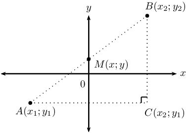

## 7.4 Summary (EMCHX)

<Callout type="note" title="Note">
<VideoPlayer src="https://www.youtube.com/embed/FwAcdhnphPM" title="Video: 294R" />
</Callout>

| Theorem of Pythagoras: | \(AB^2 = AC^2 + BC^2\) |
| --- | --- |
| Distance formula: | \(AB = \sqrt{(x_2 - x_1)^2 + (y_2 - y_1)^2}\) |
| Gradient: | \(m_{AB} = \frac{y_2 - y_1}{x_2 - x_1} \quad \text{ or } \quad m_{AB} = \frac{y_1 - y_2}{x_1 - x_2}\) |
| Mid-point of a line segment: | \(M(x;y) = \left( \frac{x_1 + x_2}{2}; \frac{y_1 + y_2}{2} \right)\) |
| Points on a straight line: | \(m_{AB} = m_{AM} = m_{MB}\) |

| Straight line equations | Formulae |
| --- | --- |
| Two-point form: | \(\dfrac{y - y_1}{x - x_1} = \dfrac{y_2 - y_1}{x_2 - x_1}\) |
| Gradient-point form: | \(y - y_1 = m (x - x_{1})\) |
| Gradient-intercept form: | \(y = mx + c\) |
| Horizontal lines: | \(y = k\) |
| Vertical lines | \(x = k\) |

| Parallel lines |  | \(m_1 = m_2\) | \(\theta_1 = \theta_2\) |
| --- | --- | --- | --- |
| Perpendicular lines |  | \(m_1 \times m_2 = -1\) | \(\theta_{1} = \text{90} ° + \theta_{2}\) |

- Inclination of a straight line: the gradient of a straight line is equal to the tangent of the angle formed
            between the line and the positive direction of the \(x\)-axis.
  \[m = \tan \theta \qquad \text{ for } \text{0}° \leq \theta < \text{180}°\]
- Equation of a circle with centre at the origin:
  If \(P(x;y)\) is a point on a circle with centre \(O(0;0)\) and radius \(r\), then the equation of the circle
            is:
          \[x^{2} + y^{2} = r^{2}\]
- General equation of a circle with centre at \((a;b)\):
  If \(P(x;y)\) is a point on a circle with centre \(C(a;b)\) and radius \(r\), then the equation of the circle
            is:
          \[(x - a)^{2} + (y - b)^{2} = r^{2}\]
- A tangent is a straight line that touches the circumference of a circle at only one point.
- The radius of a circle is perpendicular to the tangent at the point of contact.

<QuizCard id="m12-07-04a" title="Interactive Exercise 7.12" question="Determine the equation of the circle." options=[] answer="x^2 + y^2 = 16" hint="Your answer should be a mathematical equation. Here is an example of a famous                equation: E = mc^2 You can use the following symbols to write equations: add: + subtract: − multiply: ∗ divide: / exponent: ^ The following special symbols are also recognised: pi (π): pi infinity (∞): oo It is also possible to write certain functions: √: sqrt( ) log: log( ) sin: sin( ) cosec: cosec( ) cos: cos( ) sec: sec( ) tan: tan( ) cot: cot( ) To write a logarithm with a specific base, use the underscore _ symbol.                For example, log of x base 3 can be written as: log_3 x" explanation="Write down the given information Start by writing down the information that we have from the question. \[                         \begin{aligned}                         r  &= 4 \\                         \text{Centre } &= (0 ; 0) \\                         \text{Given point } &=  (2;q) \\                         \end{aligned}                     \] Write down the general form of the equation of a circle We know the length of the radius \((r)\) , so we write down the general form of the equation of a circle with centre at the origin and substitute: \[                         \begin{aligned}                         x^{2} + y^{2} &= r^{2}   \\                         \text{Subst. } r = 4: \quad x^{2} + y^{2} &= \left( 4 \right)^{2}   \\                         x^{2} + y^{2} &= 16                         \end{aligned}                     \] Therefore, the equation of the circle is \(x^{2} + y^{2} = 16 \) . Submit your answer as:" />

<QuizCard id="m12-07-04a" title="Interactive Exercise 7.12" question="Use the diagram and the given information provided to determine the equation of the circle. INSTRUCTION: If necessary, give your answer with simplifed surds (not decimals)." options=[] answer="x**2+y**2 = 142" hint="Your answer should be a mathematical equation. Here is an example of a famous                equation: E = mc^2 You can use the following symbols to write equations: add: + subtract: − multiply: ∗ divide: / exponent: ^ The following special symbols are also recognised: pi (π): pi infinity (∞): oo It is also possible to write certain functions: √: sqrt( ) log: log( ) sin: sin( ) cosec: cosec( ) cos: cos( ) sec: sec( ) tan: tan( ) cot: cot( ) To write a logarithm with a specific base, use the underscore _ symbol.                For example, log of x base 3 can be written as: log_3 x" explanation="Write down the general form of the equation of a circle We write down the general form of the equation of a circle with centre at the origin and substitute the \(x\) - and \(y\) -values from either of the given points \(C\) or \(D\) and solve for \(r\) : \[ 			\begin{aligned} 			  x^{2} + y^{2} &= r^{2}   \\ 			  \left(\sqrt{19}\right)^{2} + \left(\sqrt{123}\right)^{2} &= r^{2}   \\ 			  19 + \text{123} &= r^{2}   \\ 			  \text{142} &= r^{2} 			\end{aligned} 	      \] The equation of the circle passing through \(C\) and \(D\) is \(x^{2} + y^{2} = 142 \) . Notice that we did not solve for \(r\) , but have stopped at the value of \(r^{2}\) . This is because the circle equation is \(x^{2} + y^{2} = r^{2}\) . Submit your answer as:" />

<QuizCard id="m12-07-04a" title="Interactive Exercise 7.12" question="Given a circle with centre \(O (0; 0)\) and a radius of \(\sqrt{\frac{\text{405}}{4}}\) units. Determine the possible coordinates of the point(s) on the circle that have an \(x\) -value that is half the \(y\) -value. Type one coordinate pair into each answer box. The order of your answers does not matter." options=[] answer=" (-9/2;-9) ,  (9/2;9) " hint="You are expected to write a coordinate here. A coordinate is a list of numbers, separated by semi-colons ( ; ).                Coordinates are surrounded by brackets. Example: (1,5 ; 3) The spaces are optional." explanation="Write down the general form of the equation of a circle We write down the general form of the equation of a circle with centre at the origin and substitute the given value of the radius: \[                     \begin{aligned}                         x^{2} + y^{2} &= r^{2}   \\                         x^{2} + y^{2} &= \left(\sqrt{\frac{\text{405}}{4}}\right)^{2}   \\                         \therefore x^{2} + y^{2} &= \dfrac{\text{405}}{4}                     \end{aligned}                 \] Therefore, the equation of the circle is \(x^{2} + y^{2} = \dfrac{\text{405}}{4} \) . Determine the coordinates of the points on the circle Now we must determine the possible coordinates of the point(s) on the circle. The question states that the \(x\) -value is half the \(y\) -value. We can express this statement mathematically as \(x = \frac{y}{2}\) . We can now substitute this expression for \(x\) into the equation and solve for \(y\) : \[                     \begin{aligned}                         x^{2} + y^{2} &= \dfrac{\text{405}}{4} \\\left(\frac{y}{2}\right)^{2} + y^{2} &= \dfrac{\text{405}}{4} \\y^{2} + 4 y^{2} &= \dfrac{\text{405}}{4} \cdot 4  \\5 y^{2} &= \text{405}  \\ y^{2} &= 81  \\\therefore y &= \pm 9 \\& \\\text{If  } y = -9: \quad x &= \frac{1}{2} \left( - 9 \right) \\&= - \frac{9}{2} \\ \text{If  } y = 9: \quad x &= \frac{1}{2} \left( 9 \right)  \\&= \frac{9}{2}                       \end{aligned}                 \] We can check that our calculations are correct and that both points lie on the circle by making sure that the values of the coordinates statisfy the equation of the circle. So we substitute the coordinates into the equation of the circle and simplify: \[                     \begin{aligned}                         \left(- \frac{9}{2}\right)^{2} + \left(-9\right)^{2} &=  \left(\frac{81}{4}\right) + 81= \dfrac{\text{405}}{4} \\                         \left(\frac{9}{2}\right)^{2} + \left(9\right)^{2} &=  \left(\frac{81}{4}\right) + 81= \dfrac{\text{405}}{4}                     \end{aligned}                 \] We see that the coordinates statisfy the equation of the circle and therefore our calculations are correct. The correct answers are: \(\left(- \dfrac{9}{2};-9\right)\) and \(\left(\dfrac{9}{2};9\right)\) . Submit your answer as: and" />

<QuizCard id="m12-07-04a" title="Interactive Exercise 7.12" question="The point \((\frac{18}{11};0)\) lies on the circle." options=[] answer="x^2 + y^2 = 324/121" hint="Your answer should be a mathematical equation. Here is an example of a famous                equation: E = mc^2 You can use the following symbols to write equations: add: + subtract: − multiply: ∗ divide: / exponent: ^ The following special symbols are also recognised: pi (π): pi infinity (∞): oo It is also possible to write certain functions: √: sqrt( ) log: log( ) sin: sin( ) cosec: cosec( ) cos: cos( ) sec: sec( ) tan: tan( ) cot: cot( ) To write a logarithm with a specific base, use the underscore _ symbol.                For example, log of x base 3 can be written as: log_3 x" explanation="Write down the general form of the equation of a circle and substitute in the value of the radius We need to find the equation of the circle. We know that the centre is \((0;0)\) and the length of the radius is \(\frac{18}{11}~\text{m}\) . \[                         \begin{aligned}                         x^{2} + y^{2} & = r^{2} \\                         x^{2} + y^{2} & = \left(\frac{18}{11}\right)^{2} \\                         x^{2} + y^{2} & = \frac{324}{121}                         \end{aligned}                     \] Therefore, the equation of the circle is \(x^{2} + y^{2} = \frac{324}{121}\) . Submit your answer as:" />

<QuizCard id="m12-07-04a" title="Interactive Exercise 7.12" question="Find the central coordinates and the radius for a circle with the equation \( \left(x - 3\right)^{2} + \left(y + 4\right)^{2} = 1\) . Give your answer in simplified form." options=[] answer="3, -4, 1" hint="You should enter a number here. If you want to, you can use a space to separate thousands.                Example: 12 800,25 For scientific notation you need to use the multiply symbol                ( ∗ ) and the exponent symbol ( ^ ). For example 6,673 × 10 −11 should be written as: 6,673 ∗ 10^−11" explanation="Given: the equation for the circle \( \left(x - 3\right)^{2} + \left(y + 4\right)^{2} = 1\) Required: the centre of the circle \((a ; b)\) the radius \(r\) of the circle The standard form of the equation for a circle is \((x-a)^2+ (y-b)^2 = r^2 \) . The equation for this circle is \( \left(x - 3\right)^{2} + \left(y + 4\right)^{2} = 1\) . We need rewrite this equation in the standard form. \[             \begin{aligned}               \left(x - 3\right)^{2} + \left(y + 4\right)^{2} & = 1 \\               (x - (3))^2 + (y-(-4))^2 & = (1)^2 \\             \end{aligned}           \] Now we can directly read \((a ; b)\) and \(r\) from the equation: \[             \begin{aligned}               (x - ({\bf{}\text{3}}))^2 + (y-(-4))^2 = (1)^2 & \Longrightarrow a={\bf{}\text{3}}\\               (x - (3))^2 + (y-({\bf{}-\text{4}}))^2 = (1)^2 & \Longrightarrow b={\bf-\text{4}} \\               (x - (3))^2 + (y-(-4))^2 = ({\bf{}\text{1}})^2& \Longrightarrow r={\bf{}\text{1}}\\             \end{aligned}           \] Therefore the centre of the circle is \((a ; b) = (3 ; -4)\) the radius of the circle is \(r = 1\) Submit your answer as: and and" />

<QuizCard id="m12-07-04a" title="Interactive Exercise 7.12" question="Find the equation of the circle with centre \((8 ; 0)\) which passes through \((-1 ; 0)\) . Write your answer in standard form." options=[] answer="
                    ['y**2 + (x - 8)**2=81', 'y**2 + (x - 8)**2=9^2']
                " hint="Your answer should be a mathematical equation. Here is an example of a famous                equation: E = mc^2 You can use the following symbols to write equations: add: + subtract: − multiply: ∗ divide: / exponent: ^ The following special symbols are also recognised: pi (π): pi infinity (∞): oo It is also possible to write certain functions: √: sqrt( ) log: log( ) sin: sin( ) cosec: cosec( ) cos: cos( ) sec: sec( ) tan: tan( ) cot: cot( ) To write a logarithm with a specific base, use the underscore _ symbol.                For example, log of x base 3 can be written as: log_3 x" explanation="Given: the centre of the circle \((a ; b) = (8 ; 0)\) a point on the circumference of the circle \( (x_1 ; y_1) = (-1 ; 0)\) Draw a rough sketch of the information you have: Required: the equation for this circle in the form \((x - a)^2 + (y - b)^2 = r^2\) To complete the equation for this circle we need the centre of the circle (which is given) and the radius (which we need to calculate now).                     The radius of this circle will be the distance between the centre and the point through which the circle passes. You can use the distance                     formula to determine the radius; \[                     \begin{aligned}                         r & = \sqrt{(x_1 - a)^2 + (y_1 - b)^2} \\                         & = \sqrt{(-1-8)^2 +                         (0+0)^2} \\                         & = \sqrt{(-9)^2 + (0)^2} \\                         & = \sqrt{\text{81}}                     \end{aligned}                 \] It is worth noting here that we can keep the radius length in surd form since in the final equation (for the standard form) of the circle we                     need \(r^2\) . Now we have all the information we need to determine the required formula for this circle. \[                     \begin{aligned}                         (x-a)^2+ (y-b)^2 & = r^2 \\                         (x - (8))^2 + (y-(0))^2 & =                         (\sqrt{\text{81}})^2 \\                         y^{2} + \left(x - 8\right)^{2} & =\text{81}                     \end{aligned}                 \] Therefore, the equation for this circle is \( y^{2} + \left(x - 8\right)^{2} =                     \text{81}\) . Submit your answer as:" />

<QuizCard id="m12-07-04a" title="Interactive Exercise 7.12" question="Find the central coordinates and the radius for a circle with the equation \[\begin{array}{c}2 \left(x + 3\right)^{2} + 2 \left(y - 2\right)^{2} = 50\end{array}\] Give your answer in simplified form." options=[] answer="-3, 2, 5" hint="You should enter a number here. If you want to, you can use a space to separate thousands.                Example: 12 800,25 For scientific notation you need to use the multiply symbol                ( ∗ ) and the exponent symbol ( ^ ). For example 6,673 × 10 −11 should be written as: 6,673 ∗ 10^−11" explanation="Given: the equation for the circle \( 2 \left(x + 3\right)^{2} + 2 \left(y - 2\right)^{2} = 50\) Required: the centre of the circle \((a ; b)\) the radius \(r\) of the circle The equation for this circle is \( 2 \left(x + 3\right)^{2} + 2 \left(y - 2\right)^{2} = 50\) . First, we need rewrite this equation in the standard form, \((x-a)^2+ (y-b)^2 = r^2 \) . \[             \begin{aligned}               2 \left(x + 3\right)^{2} + 2 \left(y - 2\right)^{2} & = 50 \quad \Longleftarrow \text{divide through by }2\text{ (common factor)} \\ \left(x + 3\right)^{2} + \left(y - 2\right)^{2} & = 25\\               (x - (-3))^2 + (y-(2))^2 & = (5)^2 \\             \end{aligned}           \] Now we can read \((a ; b)\) and \(r\) from the equation: \[             \begin{aligned}               (x - ({\bf{}-\text{3}}))^2 + (y-(2))^2 = (5)^2 & \quad \Longrightarrow a={\bf{}-\text{3}}\\               (x - (-3))^2 + (y-({\bf{}\text{2}}))^2 = (5)^2 &\quad \Longrightarrow b={\bf{}\text{2}} \\               (x - (-3))^2 + (y-(2))^2 = ({\bf{}\text{5}})^2&\quad \Longrightarrow r={\bf{}\text{5}}\\             \end{aligned}           \] Note: Notice that the coordinates of the centre have the opposite sign to what you see in the equation. Therefore, we have that: the centre of the circle is \((a ; b) = (-3;2)\) the radius of the circle is \(r = 5\) Submit your answer as: and and" />

<QuizCard id="m12-07-04a" title="Interactive Exercise 7.12" question="Find the central coordinates and the radius for a circle with the equation \( x^{2} - 10 x + y^{2} - 12 y = -45\) ." options=[] answer="5, 6, 4" hint="You should enter a number here. If you want to, you can use a space to separate thousands.                Example: 12 800,25 For scientific notation you need to use the multiply symbol                ( ∗ ) and the exponent symbol ( ^ ). For example 6,673 × 10 −11 should be written as: 6,673 ∗ 10^−11" explanation="Given: the equation for the circle \( x^{2} - 10 x + y^{2} - 12 y = -45\) Required: the centre of the circle \((a ; b)\) the radius \(r\) of the circle The standard form of the equation for a circle is \((x-a)^2+ (y-b)^2 = r^2 \) . The equation for this circle is \( x^{2} - 10 x + y^{2} - 12 y = -45\) . To write this equation in the standard form we use the method of completing the square. First, we need to identify the constants needed to complete the squares for both the \(x\) -terms and \(y\) -terms. \[             \begin{aligned}               (x^{2} - 10 x+\spadesuit) + (y^{2} - 12 y+\clubsuit) & = -45+\spadesuit+\clubsuit\\             \end{aligned}           \] The spade symbol ( \(\spadesuit\) ) represents the constant needed to complete the square for the \(x\) -terms and will be \(\spadesuit = (\frac{1}{2}\text{ coefficient of }x)^2\) . The club symbol ( \(\clubsuit\) ) represents the constant needed to complete the square for the \(y\) -terms and will be \(\clubsuit = (\frac{1}{2}\text{ coefficient of }y)^2\) . Remember that if you add a constant on one side of the equation you must do the same on the other side. Now we have: \[             \begin{aligned}               (x^{2} - 10 x + 25)+ (y^{2} - 12 y + 36) & = -45+(25)+(36)\\               (x^{2} - 10 x + 25)+ (y^{2} - 12 y + 36) & = 16\\               \left(x - 5\right)^{2} + \left(y - 6\right)^{2} & = (4)^2 \\             \end{aligned}           \] Now the equation for the circle is in the standard form. To make sure we read the coordinates correctly, we can rewrite it as: \[             \begin{aligned}               (x - (5))^2 + (y-(6))^2 & = (4)^2 \\             \end{aligned}           \] Therefore the centre of the circle is \((a ; b) = (5;6)\) the radius of the circle is \(r = 4\) Submit your answer as: and and" />

<QuizCard id="m12-07-04a" title="Interactive Exercise 7.12" question="The point \(T(-3;0)\) lies on the circle \( \left(x - 4\right)^{2} + \left(y - 1\right)^{2} = 50\) . Find the equation of the tangent to the circle at \(T\) . Give your answer in standard form. If the equation contains non-integer fractions, write them as proper or improper fractions. INSTRUCTION: Type the entire equation in the answer box. Be sure to include the \"=\" sign." options=[] answer="y = -7*x - 21" hint="Your answer should be a mathematical equation. Here is an example of a famous                equation: E = mc^2 You can use the following symbols to write equations: add: + subtract: − multiply: ∗ divide: / exponent: ^ The following special symbols are also recognised: pi (π): pi infinity (∞): oo It is also possible to write certain functions: √: sqrt( ) log: log( ) sin: sin( ) cosec: cosec( ) cos: cos( ) sec: sec( ) tan: tan( ) cot: cot( ) To write a logarithm with a specific base, use the underscore _ symbol.                For example, log of x base 3 can be written as: log_3 x" explanation="Write down all of the information you have been given Given: the equation for the circle \( \left(x - 4\right)^{2} + \left(y - 1\right)^{2} = 50\) in the standard form \((x - a)^2 + (y - b)^2 = r^2\) a point in the circumference of the circle \( T (-3;0)\) Required: the equation of the tangent to the circle in the form \(y = m x + c\) Draw a sketch of the information you have been given Since you are given the equation of the circle in its standard form you can directly read off the coordinates of the centre of the circle. They are \((4;1)\) . Draw a rough sketch of the information you have: Determine the gradient of the tangent Now we can use the gradient of the radius to determine the gradient of the tangent. This is because the gradient of the radius is perpendicular to the gradient of the tangent.  For the gradient of the radius we calculate the difference in the \(y\) -coordinates over the  difference in the \(x\) -coordinates: \[                     \begin{aligned}                         m_r & = \frac{y_1 - y_0}{x_1 - x_0} \\                         &= \frac{0 - (1)}{-3 - (4)} \\                         &= \frac{1}{7}                     \end{aligned}                 \] The gradient of the radius is perpendicular to the gradient of the tangent \(m_{\bot} \times m_r = -1\) . \[                     \begin{aligned}                         m_{\bot} \times {m_r} &= -1 \\                         m_{\bot} \times \left(\frac{1}{7}\right) & = -1 \\                         m_{\bot} & = -7                     \end{aligned}                 \] Determine the \(y\) -intercept of the tangent Now that we have \(m_{\bot} = -7\) we can determine the \(y\) -intercept \(c\) of the line by substituting in the point \(T(x;y) = (-3;0)\) . \[\begin{aligned} y & = m_{\bot} x + c \\ 0 & = -7 (-3) + c \\ c & = -21 \end{aligned}\] The equation for the tangent to the circle at the point \( T(-3;0)\) is: \[                     \begin{aligned}                     y & =  - 7 x - 21                     \end{aligned}                 \] Submit your answer as:" />

<QuizCard id="m12-07-04a" title="Interactive Exercise 7.12" question="Find the gradient of the line between the point \((4;1)\) on the circle and the centre of the circle. INSTRUCTION: Write your answer as a simplified fraction." options=[] answer="4" hint="You are expected to write a fraction here. You can write pure fractions using the division symbol: / For example, to write the fraction \(-\frac{2}{3}\) the correct input would be: -2/3 You can also write mixed numbers by first writing the integer part, then a space and                then the fraction part. For example, to write \(2 \frac{1}{8}\) the correct input                would be: 2 1/8" explanation="Given: the equation for the circle \( \left(x - 6\right)^{2} + \left(y - 9\right)^{2} = 68\) in the standard form \((x - a)^2 + (y - b)^2 = r^2\) a point in the circumference of the circle \( (x_1 ; y_1) = (4;1)\) Required: the gradient \(m\) of the radius, the line between the given point on the circle and its centre Since you are given the equation of the circle in its standard form you can directly read off the coordinates of the centre of the circle. They are \((a ; b) = (6;9)\) . Draw a rough sketch of the information you have: For the gradient we calculate the difference in the \(y\) -coordinates over the  difference in the \(x\) -coordinates: \[                 \begin{aligned}                   m & = \frac{\Delta y}{\Delta x}\\[0.2cm]                     & = \frac{y_1 - y_0}{x_1 - x_0}\\[0.2cm]                     & = \frac{1-9}{4-6}\\[0.2cm]                     & = 4                 \end{aligned}               \] Therefore, the gradient of this radius is \( m = 4\) . Submit your answer as:" />

<QuizCard id="m12-07-04a" title="Interactive Exercise 7.12" question="Determine the gradient of the radius between the point \((-1 ; 5)\) on the circle and 					its centre. INSTRUCTION: Give your answer as a simplified fraction." options=[] answer="
						1/5
					" hint="You are expected to write a fraction here. You can write pure fractions using the division symbol: / For example, to write the fraction \(-\frac{2}{3}\) the correct input would be: -2/3 You can also write mixed numbers by first writing the integer part, then a space and                then the fraction part. For example, to write \(2 \frac{1}{8}\) the correct input                would be: 2 1/8" explanation="Given: the centre of the circle \((a ; b) = (9 ; 7)\) a point on the circumference of the circle \((x_1 ; y_1) = (-1 ; 5)\) Required: the gradient \(m\) of the radius, the line between the given point on the circle and its centre For the gradient we calculate the difference in the \(y\) -coordinates over the  difference in the \(x\) -coordinates: \[ 						\begin{aligned} 							m & = \frac{\Delta y}{\Delta x} \\ 							& = \frac{y_1 - y_0}{x_1 - x_0} \\ 							& = \frac{5-7}{-1-9} \\ 							& = \dfrac{1}{5} 						\end{aligned} 					\] So the gradient for this radius is \(m = \dfrac{1}{5}\) . Submit your answer as:" />

<QuizCard id="m12-07-04a" title="Interactive Exercise 7.12" question="Determine the gradient of the line between the point \((-2;5)\) on the circle \(\left(x - 6\right)^{2} + \left(y - 8\right)^{2} = 73\) and the centre of the circle. INSTRUCTION: Write your answer as a simplified fraction." options=[] answer="
					3/8
				" hint="You are expected to write a fraction here. You can write pure fractions using the division symbol: / For example, to write the fraction \(-\frac{2}{3}\) the correct input would be: -2/3 You can also write mixed numbers by first writing the integer part, then a space and                then the fraction part. For example, to write \(2 \frac{1}{8}\) the correct input                would be: 2 1/8" explanation="Given: the equation for the circle \(\left(x - 6\right)^{2} + \left(y - 8\right)^{2} = 73\) in the standard 						form \((x - a)^2 + (y - b)^2 = r^2\) a point in the circumference of the circle \((x_1 ; y_1) = (-2 ; 5)\) Required: the gradient \(m\) of the radius, the line between the given point on the circle and its centre Since you are given the equation of the circle in its standard form you can directly read off the coordinates of the centre of the circle. They are \((a ; b) = (6 ; 8)\) . Draw a rough sketch of the information you have: For the gradient, we calculate the difference in the \(y\) -coordinates divided by the  difference in the \(x\) -coordinates: \[ 					\begin{aligned} 						m & = \frac{\Delta y}{\Delta x} \\ 						& = \frac{y_1 - y_0}{x_1 - x_0} \\ 						& = \frac{5-8}{-2-6} \\ 						& = \dfrac{3}{8} 					\end{aligned} 				\] Therefore, the gradient of this radius is \(m = \dfrac{3}{8}\) . Submit your answer as:" />
