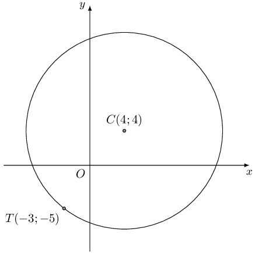
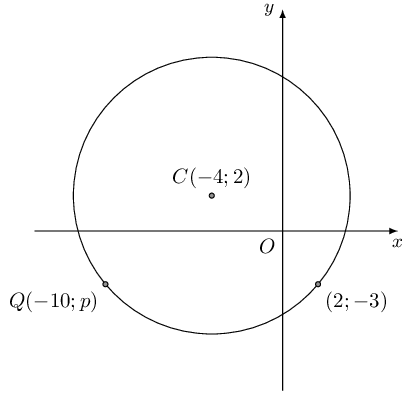
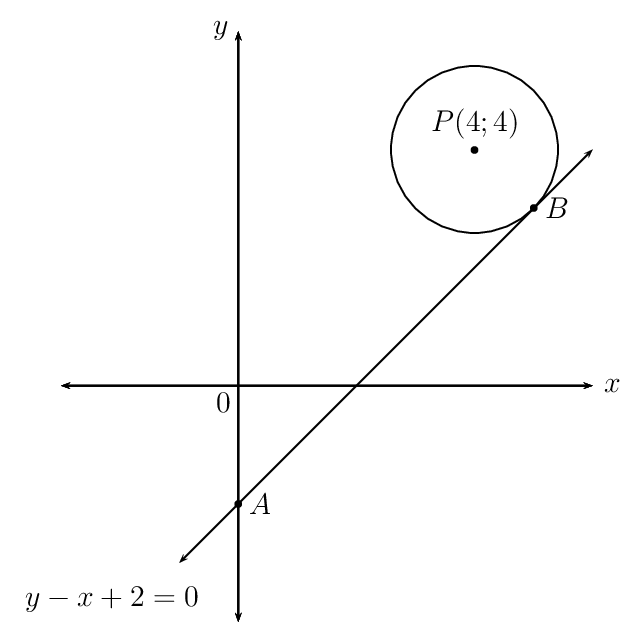
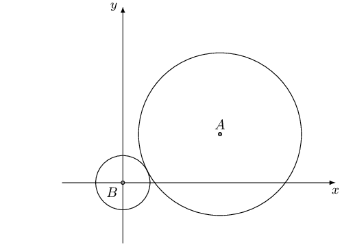

## End of chapter exercises

### Textbook Exercise 7.6

Find the equation of the circle:

**Problem:**
with centre \(\left(0;5\right)\) and radius \(\text{5}\)

**Solution:**
\begin{align*}
            (x)^2 + (y-5)^2 &= 5^{2} \\
            (x)^2 + (y-5)^2 &= 25 \\
            & \\
            \text{Expanded: } x^2 + y^2 -10y + 25 &= 25 \\
            x^2 + y^2 - 10y &=0
            \end{align*}

**Problem:**
with centre \(\left(2;0\right)\) and radius \(\text{4}\)

**Solution:**
\begin{align*}
            (x-2)^2 + y^2 &= 16 \\
            & \\
            \text{Expanded: } x^2 -4x + 4 + y^2 &= 16 \\
            x^2 - 4x + y^2 - 12 &= 0
            \end{align*}

**Problem:**
with centre \(\left(-5;7\right)\) and radius \(\text{18}\)

**Solution:**
\begin{align*}
            (x+5)^2 + (y-7)^2 &= 18^{2} \\
            (x+5)^2 + (y-7)^2 &= 324\\
            & \\
            \text{Expanded: } x^2 + 10x + 25 + y^2 -14y + 49 &= 324 \\
            x^2 + 10x + y^2 -14y - 250 &=0
            \end{align*}

**Problem:**
with centre \(\left(-2;0\right)\) and diameter \(\text{6}\)

**Solution:**
\begin{align*}
            (x+2)^2 + y^2 &= 9 \\
            & \\
            \text{Expanded: } x^2 + 4x + 4 + y^2 - 9 &= 0 \\
            x^2 + 4x + y^2 - 5 &= 0
            \end{align*}

**Problem:**
with centre \(\left(-5;-3\right)\) and radius \(\sqrt{3}\)

**Solution:**
\begin{align*}
            (x+5)^2 + (y+3)^2 &= 3 \\
            & \\
            \text{Expanded: } x^2 + 10x + 25 + y^2 + 6y + 9 &= 3 \\
            x^2 + 10x + y^2 + 6y + 31 &= 0
            \end{align*}

**Problem:**
Find the equation of the circle with centre \(\left(2;1\right)\) which passes through
              \(\left(4;1\right)\).

**Solution:**
\begin{align*}
            (x - 2)^2 + (y - 1)^2 &= r^{2} \\
            (4 - 2)^2 + (1 - 1)^2 &= r^{2} \\
            (2)^2 + (0)^2 &= r^{2} \\
            4 &= r^{2} \\
            \therefore r &= 2 \\
            (x - 2)^2 + (y - 1)^2 &= 4 \\
            & \\
            \text{Expanded: } x^2 - 4x + y^2 - 2y + 1 &= 0
            \end{align*}

**Problem:**
Where does it cut the line \(y=x+1\)?

**Solution:**
\begin{align*}
            (x - 2)^2 + (y - 1)^2 &= 4 \\
            (x - 2)^2 + (x + 1 - 1)^2 &= 4 \\
            (x - 2)^2 + (x)^2 &= 4 \\
            x^2 - 4x + 4 + x^2 &= 4 \\
            2x^2 - 4x &= 0 \\
            x^2 - 2x &= 0 \\
            x(x - 2) &= 0 \\
            \therefore x = 0 &\text{ or } x = 2 \\
            \text{If } x = 0, y &= 1 \quad (0;1) \\
            \text{If } x = 2, y &= 3 \quad (2;3)
            \end{align*}

**Problem:**
Find the equation of the circle with centre \(\left(-3;-2\right)\) which passes through
              \(\left(1;-4\right)\).

**Solution:**
\begin{align*}
            (x + 3)^2 + (y + 2)^2 &= r^{2} \\
            (1 + 3)^2 + (-4 + 2)^2 &= r^{2} \\
            (4)^2 + (-2)^2 &= r^{2} \\
            16 + 4 &= r^{2} \\
            20 &= r^{2} \\
            (x + 3)^2 + (y + 2)^2 &= 20
            \end{align*}

**Problem:**
Find the equation of the circle with centre \(\left(3;1\right)\) which passes through
              \(\left(2;5\right)\).

**Solution:**
\begin{align*}
            (x - 3)^2 + (y - 1)^2 &= r^{2} \\
            (2 - 3)^2 + (5 - 1)^2 &= r^{2} \\
            (-1)^2 + (4)^2 &= r^{2} \\
            1 + 16 &= r^{2} \\
            17&= r^{2} \\
            (x - 3)^2 + (y - 1)^2 &= 17
            \end{align*}

Find the centre and radius of the following circles:

**Problem:**
\({\left(x+9\right)}^{2}+{\left(y-6\right)}^{2}=36\)

**Solution:**
\((-9;6)\), \(r = 6\) units

**Problem:**
\(\frac{1}{2}{\left(x-2\right)}^{2}+\frac{1}{2}{\left(y-9\right)}^{2}=1\)

**Solution:**
\((2;9)\), \(r = \sqrt{2}\) unit

**Problem:**
\({\left(x+5\right)}^{2}+{\left(y+7\right)}^{2}=12\)

**Solution:**
\((-5;-7)\), \(r = \sqrt{12}\) units

**Problem:**
\(x^{2}+{\left(y+4\right)}^{2}=23\)

**Solution:**
\((0;-4)\), \(r = \sqrt{23}\) units

**Problem:**
\(3{\left(x-2\right)}^{2}+3{\left(y+3\right)}^{2}=12\)

**Solution:**
\((2;-3)\), \(r = 2\) units

Find the \(x\) and \(y\) intercepts of the following graphs:

**Problem:**
\({x}^{2}+{\left(y-6\right)}^{2}=100\)

**Solution:**
\begin{align*}
            {x}^{2}+{\left(y-6\right)}^{2}&=100 \\
            \text{Let } x = 0: \quad {\left(y-6\right)}^{2}&=100 \\
            y^{2} - 12y + 36 &= 100 \\
            y^{2} - 12y - 64 &= 0 \\
            (y - 16)(y + 4) &= 0 \\
            \therefore y = 16 &\text{ or } y = -4 \\
            (0;16) &\text{ and } (0;-4)\\
            & \\
            {x}^{2}+{\left(y-6\right)}^{2}&=100 \\
            \text{Let } y = 0: \quad {x}^{2}+{\left(-6\right)}^{2}&=100 \\
            {x}^{2}+ 36 &=100 \\
            {x}^{2} &= 64 \\
            \therefore x = -8 &\text{ or } x = 8 \\
            (-8;0) &\text{ and } (8;0)
            \end{align*}

**Problem:**
\({\left(x+4\right)}^{2}+{y}^{2}=16\)

**Solution:**
\begin{align*}
            {\left(x+4\right)}^{2}+{y}^{2} &= 16 \\
            \text{Let } x = 0: \quad {\left(x+4\right)}^{2}+{y}^{2} &= 16 \\
            4^{2} + y^{2} &= 16 \\
            y^{2} &= 0 \\
            \therefore & (0;0) \\
            & \\
            {\left(x+4\right)}^{2}+{y}^{2} &= 16 \\
            \text{Let } y = 0: \quad ({x} + 4)^{2}&=16 \\
            x^{2} + 8x + 16 &=16 \\
            x^{2} + 8x &= 0 \\
            x(x + 8) &= 0 \\
            \therefore x = 0 &\text{ or } x = -8 \\
            (0;0) &\text{ and } (-8;0)
            \end{align*}

Find the centre and radius of the following circles:

**Problem:**
\({x}^{2}+6x+{y}^{2}-12y=-20\)

**Solution:**
\begin{align*}
            {x}^{2}+6x+{y}^{2}-12y &= -20 \\
            ({x} + 3)^{2} - 9 + ({y} - 6)^{2} - 36 &= -20 \\
            ({x} + 3)^{2} + ({y} - 6)^{2} &= 25
            \end{align*}

The centre of the circle is \((-3;6)\) and \(r = 5\) units.

**Problem:**
\({x}^{2}+4x+{y}^{2}-8y=0\)

**Solution:**
\begin{align*}
            {x}^{2}+4x+{y}^{2}-8y &= 0 \\
            ({x} + 2)^{2} - 4 + ({y} - 4)^{2} - 16 &= 0 \\
            ({x} + 2)^{2} + ({y} - 4)^{2} &= 20
            \end{align*}

The centre of the circle is \((-2;4)\) and \(r = \sqrt{20}\) units.

**Problem:**
\({x}^{2}+{y}^{2}+8y=7\)

**Solution:**
\begin{align*}
            {x}^{2}+{y}^{2}+8y &= 7 \\
            {x}^{2} + ({y} + 4)^{2} - 16 &= 7 \\
            {x}^{2} + ({y} + 4)^{2} &= 23
            \end{align*}

The centre of the circle is \((0;-4)\) and \(r = \sqrt{23}\) units.

**Problem:**
\({x}^{2}-6x+{y}^{2}=16\)

**Solution:**
\begin{align*}
            {x}^{2}-6x+{y}^{2} &= 16 \\
            (x - 3)^{2} - 9 + y^{2} &= 16 \\
            (x - 3)^{2} + y^{2} &= 25
            \end{align*}

The centre of the circle is \((3;0)\) and \(r = 5\) units.

**Problem:**
\({x}^{2}-5x+{y}^{2}+3y=-\frac{3}{4}\)

**Solution:**
\begin{align*}
            {x}^{2}-5x+{y}^{2}+3y &= -\frac{3}{4} \\
            \left(x - \frac{5}{2}\right)^{2} - \frac{25}{4} + \left(y + \frac{3}{2}\right)^{2} - \frac{9}{4} &=
            -\frac{3}{4} \\
            \left(x - \frac{5}{2}\right)^{2} + \left(y + \frac{3}{2}\right)^{2} &= \frac{31}{4}
            \end{align*}

The centre of the circle is \((\frac{5}{2};-\frac{3}{2})\) and \(r = \frac{\sqrt{31}}{2}\) units.

**Problem:**
\({x}^{2}-6nx+{y}^{2}+10ny=9{n}^{2}\)

**Solution:**
\begin{align*}
            {x}^{2}-6nx+{y}^{2}+10ny &= 9{n}^{2} \\
            (x - 3n)^{2} - 9n^{2} + (y + 5n)^{2} - 25n^{2} &= 9{n}^{2} \\
            (x - 3n)^{2} + (y + 5n)^{2} &= 43{n}^{2}
            \end{align*}

The centre of the circle is \((3n;-5n)\) and \(r = \sqrt{43}n\) units.

**Problem:**
Find the gradient of the radius between the point \((4;5)\) on the circle and its centre \((-8;4)\).

**Solution:**
Given:

- the centre of the circle \((a;b) = (-8;4)\)
- a point on the circumference of the circle \((4;5)\)

Required:

- the gradient \(m\) of the radius

            \begin{align*}
            m & = \frac{y_2 - y_1}{x_2 - x_1}\\
            & = \frac{5-4}{4+8}\\
            & = \frac{1}{12}
            \end{align*}

The gradient for this radius is \(m = \frac{1}{12}\).

**Problem:**
Find the gradient line tangent to the circle at the point \((4;5)\).

**Solution:**
The tangent to the circle at the point \((4;5)\) is perpendicular to the radius of the circle to that
              same point:

            \begin{align*}
            m_{\bot} & = - \frac{1}{m}\\
            & = \frac{-1}{\frac{1}{12} }\\
            & = -12
            \end{align*}

The gradient for the tangent is \(m_{\bot} = -12\).

**Problem:**
Given \(\left(x - 1\right)^{2} + \left(y - 7\right)^{2} = 10\), determine the value(s) of \(x\) if
              \((x;4)\) lies on the circle.

**Solution:**
\begin{align*}
            (x - 1)^{2} + (4 - 7)^{2} &= 10 \\
            x^{2} - 2x + 1 + 9 &= 10 \\
            x(x - 2) &= 0 \\
            \therefore x = 0 &\text{ or } x = 2
            \end{align*}

The points \((0;4)\) and \((2;4)\) lie on the circle.

            \((0;4),(2;4)\)

**Problem:**
Find the gradient of the tangent to the circle at the point \((2;4)\).

**Solution:**
\begin{align*}
            m_r & = \frac{y_1 - y_0}{x_1 - x_0} \\
            & = \frac{4 - 7}{2 - 1} \\
            & = -3
            \end{align*}
            \begin{align*}
            m_{\text{tangent}} & = - \frac{1}{m}\\
            & = - \dfrac{1}{-3}\\ \\
            & = \frac{1}{3}
            \end{align*}

The gradient of the tangent is \(m_{\text{tangent}} = \frac{1}{3}\).

            \(m = \frac{1}{3}\)

**Problem:**
Given a circle with the central coordinates \((a;b) = (-2;-2)\). Determine the equation of the tangent line
            of the circle at the point \((-1;3)\).

**Solution:**
\begin{align*}
          m_r & = \frac{y_1 - y_0}{x_1 - x_0} \\
          & = \frac{3 - (-2)}{-1 -(-2)} \\
          & = 5
          \end{align*}

The radius is perpendicular to the tangent, therefore \(m_{r} \times m_{\bot} = -1\):

          \[m_{\bot} = - \frac{1}{5}\]

Substitute \(m = - \frac{1}{5}\) and \((-1;3)\) to determine \(c\):

          \begin{align*}
          y & =m_{\bot} x + c\\
          3 & = - \frac{1}{5} (-1) + c \\
          c & = \frac{14}{5}
          \end{align*}

The equation of the tangent to the circle at the point \((-1;3)\) is \(y = - \frac{1}{5} x +
            \frac{14}{5}\).

          \(y = - \frac{1}{5} x + \frac{14}{5}\)

**Problem:**
Consider the diagram below:

Find the equation of the tangent to the circle at point \(T\).

**Solution:**
\begin{align*}
          m_r & = \frac{y_{1} - y_0}{x_{1} - x_0} \\
          & = \frac{4+5}{4+3 } \\
          & = \frac{9}{7}
          \end{align*}
          \begin{align*}
          m_r \times m & = -1 \\
          \therefore m & = - \frac{1}{m_r} \\
          & = - \dfrac{1}{\frac{9}{7} } \\
          & = - \frac{7}{9}
          \end{align*}

Determine the \(y\)-intercept (\(c\)) of the line by substituting the point \(T(-3;-5)\).

          \begin{align*} y & = m x + c\\ -5 & = - \frac{7}{9} (-3) + c \\ c & = - \frac{22}{3} \end{align*}

The equation of the tangent to the circle at \(T\) is

          \begin{align*}
          y & = - \frac{7}{9} x - \frac{22}{3}
          \end{align*}
          \(y = - \frac{7}{9} x - \frac{22}{3}\)

**Problem:**
\(M(-2;-5)\) is a point on the circle \(x^{2} + y^{2} + 18y + 61 = 0\). Determine the equation of the
            tangent at \(M\).

**Solution:**
Complete the square:

          \begin{align*}
          x^{2} + y^{2} + 18y + 61 &= 0 \\
          x^{2} + (y^{2} + 18y) &= -61 \\
          x^{2} + (y + 9)^{2} - 81 &= -61 \\
          x^{2} + (y + 9)^{2} &= 20
          \end{align*}

Therefore the centre of the circle is \((0;-9)\) and \(r = \sqrt{20}\) units.

Calculate the gradient of the radius:

          \begin{align*}
          m_r & = \frac{y_1 - y_0}{x_1 - x_0} \\
          & = \frac{-5 - (-9)}{-2 - 0} \\
          & = \frac{4}{-2} \\
          & = -2
          \end{align*}
          \begin{align*}
          m_{\bot} & = - \frac{1}{m_r} \\
          & = - \frac{1}{-2} \\
          & = \frac{1}{2}
          \end{align*}

Determine the \(y\)-intercept \(c\) of the line by substituting the point \(M(-2;-5)\).

          \begin{align*}
          y & = m_{\bot} x + c\\
          -5 & = \frac{1}{2} (-2) + c \\
          c & = -4
          \end{align*}

The equation for the tangent to the circle at the point \(M(-2;-5)\) is

          \begin{align*}
          y & = \frac{1}{2} x - 4
          \end{align*}
          \(y = \frac{1}{2} x - 4\)

\(C(-4;2)\) is the centre of the circle passing through \((2;-3)\) and \(Q(-10;p)\).

**Problem:**
Find the equation of the circle given.

**Solution:**
\begin{align*}
            r & = \sqrt{(x_1 - x_0)^2 + (y_1 - y_0)^2} \\
            & = \sqrt{(2+4)^2 + (-3-2)^2} \\
            & = \sqrt{(6)^2 + (-5)^2} \\
            & = \sqrt{61}
            \end{align*}

            \begin{align*}
            (x-a)^2+ (y-b)^2 & = r^2 \\
            (x - (-4))^2 + (y-(2))^2 & = (\sqrt{61})^2 \\
            \left(x + 4\right)^{2} + \left(y - 2\right)^{2} & = 61
            \end{align*}

The equation of the circle is \(\left(x + 4\right)^{2} + \left(y - 2\right)^{2} = 61\).

            \(\left(x + 4\right)^{2} + \left(y - 2\right)^{2} = 61\)

**Problem:**
Determine the value of \(p\).

**Solution:**
\begin{align*}
            \left(x + 4\right)^{2} + \left(y - 2\right)^{2} & = 61 \\
            \left(-10 + 4\right)^{2} + \left(p - 2\right)^{2} & = 61 \\
            \left(-10 + 4\right)^{2} + p^{2} - 4p + 4 & = 61 \\
            36 + p^{2} - 4p + 4 & = 61 \\
            p^{2} - 4p - 21 & = 0 \\
            (p+3)(p-7) & = 0 \\
            \therefore p = -3 & \text{ or } p = 7
            \end{align*}

From the graph we see that the correct \(y\)-value is \(-\text{3}\).

The coordinates for point \(Q\) is \(Q(-10;-3)\)

            \(p = -3\)

**Problem:**
Determine the equation of the tangent to the circle at point \(Q\).

**Solution:**
\begin{align*}
            m_r & = \frac{y_2 - y_0}{x_2 - x_0} \\
            & = \frac{-3 -2}{-10 -(-4) } \\
            & = \frac{5}{6}
            \end{align*}

\(m_{r} \times m_{\bot} = -1\).

            \begin{align*}
            m_{\bot} & = - \frac{1}{m_r} \\
            & = - \dfrac{1}{\frac{5}{6}} \\
            & = - \frac{6}{5}
            \end{align*}

Determine the \(y\)-intercept \(c\) of the line by substituting the point \(Q(x_2;y_2) = (-10;-3)\).

            \begin{align*} y_2 & = m_{\bot} x_2 + c\\ -3 & = - \frac{6}{5} (-10) + c \\ c & = -15
            \end{align*}

The equation of the tangent to the circle at \(Q\) is \(y = - \frac{6}{5} x - 15\).

Find the equation of the tangent to each circle:

**Problem:**
\({x}^{2}+{y}^{2}=17\) at the point \(\left(1;4\right)\)

**Solution:**
The centre of the circle is \((0;0)\) and \(r = \sqrt{17}\) units.

            \begin{align*}
            m_{r} & = \frac{y_2 - y_1}{x_2 - x_1} \\
            & = \frac{4 - 0}{1 - 0} \\
            & = 4
            \end{align*}

            \begin{align*}
            m_{r} & \times m_{\bot} = -1 \\
            m_{\bot} & = - \frac{1}{m_{r}} \\
            & = - \dfrac{1}{4} \\
            & = - \frac{1}{4}
            \end{align*}
            \begin{align*}
            y_2 & = m_{\bot} x_2 + c\\
            4 & = - \frac{1}{4}(1) + c \\
            c & = \frac{17}{4}
            \end{align*}

The equation of the tangent to the circle is \(y = - \frac{1}{4} x + \frac{17}{4}\).

**Problem:**
\({x}^{2}+{y}^{2}=25\) at the point \(\left(3;4\right)\)

**Solution:**
The centre of the circle is \((0;0)\) and \(r = 5\) units.

            \begin{align*}
            m_{r} & = \frac{y_2 - y_1}{x_2 - x_1} \\
            & = \frac{4 - 0}{3 - 0} \\
            & = \frac{4}{3}
            \end{align*}
            \begin{align*}
            m_{r} & \times m_{\bot} = -1 \\
            m_{\bot} & = - \frac{1}{m_{r}} \\
            & = - \dfrac{1}{\frac{4}{3} } \\
            & = - \frac{3}{4}
            \end{align*}
            \begin{align*}
            y_2 & = m_{\bot} x_2 + c\\
            4 & = - \frac{3}{4}(3) + c \\
            c & = \frac{25}{4}
            \end{align*}

The equation of the tangent to the circle is \(y = - \frac{3}{4} x + \frac{25}{4}\).

**Problem:**
\({\left(x+1\right)}^{2}+{\left(y-2\right)}^{2}=25\) at the point \(\left(3;5\right)\)

**Solution:**
The centre of the circle is \((-1;2)\) and \(r = 5\) units.

            \begin{align*}
            m_{r} & = \frac{y_2 - y_1}{x_2 - x_1} \\
            & = \frac{5-2}{3 - (-1)} \\
            & = \frac{3}{4}
            \end{align*}
            \begin{align*}
            m_{r} & \times m_{\bot} = -1 \\
            m_{\bot} & = - \frac{1}{m_{r}} \\
            & = - \dfrac{1}{\frac{3}{4} } \\
            & = - \frac{4}{3}
            \end{align*}
            \begin{align*}
            y_2 & = m_{\bot} x_2 + c\\
            5 & = - \frac{4}{3}(3) + c \\
            c & = 9
            \end{align*}

The equation of the tangent to the circle is \(y = - \frac{4}{3} x + 9\).

**Problem:**
\({\left(x-2\right)}^{2}+{\left(y-1\right)}^{2}=13\) at the point \(\left(5;3\right)\)

**Solution:**
The centre of the circle is \((2;1)\) and \(r = \sqrt{13}\) units.

            \begin{align*}
            m_{r} & = \frac{y_2 - y_1}{x_2 - x_1} \\
            & = \frac{3-1}{5-2} \\
            & = \frac{2}{3}
            \end{align*}
            \begin{align*}
            m_{r} & \times m_{\bot} = -1 \\
            m_{\bot} & = - \frac{1}{m_{r}} \\
            & = - \dfrac{1}{\frac{2}{3} } \\
            & = - \frac{3}{2}
            \end{align*}
            \begin{align*}
            y_2 & = m_{\bot} x_2 + c\\
            3 & = - \frac{3}{2}(5) + c \\
            c & = \frac{21}{2}
            \end{align*}

The equation of the tangent to the circle is \(y = - \frac{3}{2} x + \frac{21}{2}\).

**Problem:**
Determine the equations of the tangents to the circle \(x^{2} + y^{2} = 50\), given that both lines have an
            angle of inclination of \(\text{45} °\).

**Solution:**
The centre of the circle is \((0;0)\) and \(r = \sqrt{50}\) units.

Gradient of the tangents:

          \begin{align*}
          m & = \tan \theta \\
          & = \tan{ \text{45} °} \\
          & = 1
          \end{align*}
          \begin{align*}
          m & \times m_{\bot} = -1 \\
          m & = - 1
          \end{align*}

The line perpendicular to the tangents and passing through the centre of the circle is \(y = -x\).
            Substitute \(y = -x\) into the equation of the circle and solve for \(x\):

          \begin{align*}
          x^{2} + (-x)^{2} &= 50 \\
          2x^{2} &= 50 \\
          x^{2} &= 25 \\
          x &= \pm 5
          \end{align*}

This gives the points \(P(-5;5)\) and \(Q(5;-5)\).

Tangent at \(P(-5;5)\):

          \begin{align*}
          y - 5 & = (1)(x - (-5)) \\
          y & = x + 10
          \end{align*}

Tangent at \(Q(5;-5)\):

          \begin{align*}
          y - (-5) & = (1)(x - 5) \\
          y & = x - 10
          \end{align*}

The equations of the tangents to the circle are \(y = x - 10\) and \(y = x + 10\).

The circle with centre \(P(4; 4)\) has a tangent \(AB\) at point \(B\). The equation of \(AB\) is \(y - x +
            2 = 0\) and \(A\) lies on the \(y\)-axis.

**Problem:**
Determine the equation of \(PB\).

**Solution:**
\begin{align*}
            m_{AB} & = 1 \\
            \therefore m_{PB} & = - 1 \\
            y & = mx + c \\
            \text{Substitute } P(4;4): \quad 4 & = -(4) + c \\
            \therefore c &= 8 \\
            y &= -x + 8
            \end{align*}

            \(y = -x + 8\)

**Problem:**
Determine the coordinates of \(B\).

**Solution:**
Equate the two equations and solve for \(x\):

            \begin{align*}
            x -2 & = -x + 8 \\
            2x & = 10 \\
            x & = 5 \\
            y &= -5 + 8 \\
            \therefore y &= 3
            \end{align*}

\(B(5;3)\)

**Problem:**
Determine the equation of the circle.

**Solution:**
\begin{align*}
            PB^{2} & = (5 -4)^{2} + (3 - 4)^{2} \\
            & = 1 + 1 \\
            & = 2 \\
            (x -4)^{2} + (y - 4)^{2} & = 2
            \end{align*}

            \((x -4)^{2} + (y - 4)^{2} = 2\)

**Problem:**
Describe in words how the circle must be shifted so that \(P\) is at the origin.

**Solution:**
The circle must be shifted \(\text{4}\) units down and \(\text{4}\) units to the left.

**Problem:**
If the length of \(PB\) is tripled and the circle is shifted \(\text{2}\) units to the right and
              \(\text{1}\) unit up, determine the equation of the new circle.

**Solution:**
\begin{align*}
            PB & = \sqrt{2} \\
            3 \times PB & = 3\sqrt{2} \\
            \text{Horizontal shift: } (x -4 - 2)^{2} + (y - 4)^{2} & = \left( 3\sqrt{2} \right)^2 \\
            (x -6)^{2} + (y - 4)^{2} & = 9(2) \\
            \text{Vertical shift: } (x -6)^{2} + (y - 4 -1)^{2} & = 18 \\
            (x -6)^{2} + (y - 5)^{2} & = 18
            \end{align*}

**Problem:**
The equation of a circle with centre \(A\) is \(x^{2} + y^{2} + 5 = 16x + 8y - 30\) and the equation of a
              circle with centre \(B\) is \(5x^{2} + 5y^{2} = 25\). Prove that the two circles touch each other.

**Solution:**
\begin{align*}
            x^{2} + y^{2} + 5 & = 16x + 8y - 30 \\
            x^{2} -16x + y^{2} - 8y & = - 35 \\
            (x - 8)^{2} -64 + (y - 4)^{2} -16 & = - 35 \\
            (x - 8)^{2} + (y - 4)^{2} & = 45 \\
            & \\
            5x^{2} + 5y^{2} &= 25 \\
            x^{2} + y^{2} &= 5 \\
            & \\
            AB^{2} &= (8 - 0)^{2} + (4 - 0)^{2} \\
            &= 64 + 16 \\
            &= 80\\
            \therefore AB &= \sqrt{80} \\
            AB &= 4\sqrt{5} \\
            & \\
            \text{And } \text{radius}_{A} + \text{radius}_{B} &= \sqrt{45} + \sqrt{5} \\
            &= 3\sqrt{5} + \sqrt{5} \\
            &= 4\sqrt{5} \\
            &=AB
            \end{align*}

Therefore the two circles touch each other.

