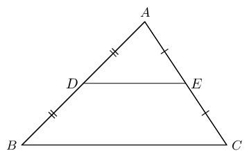
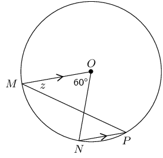
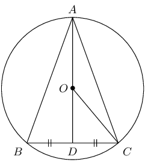
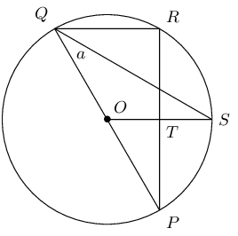
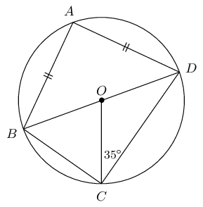
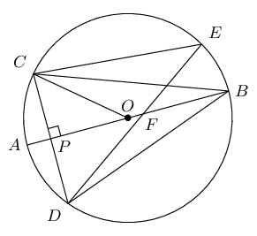
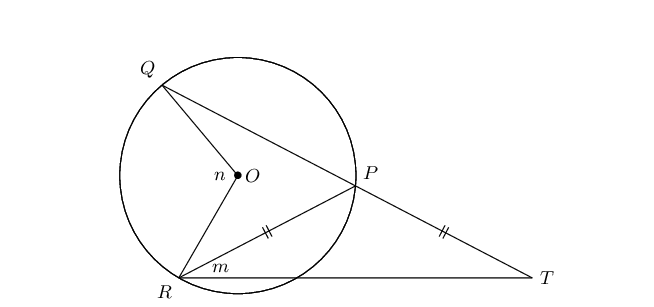
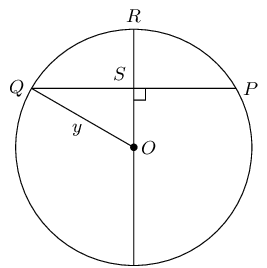
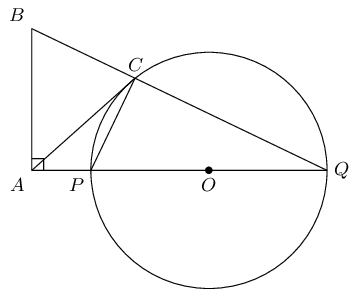
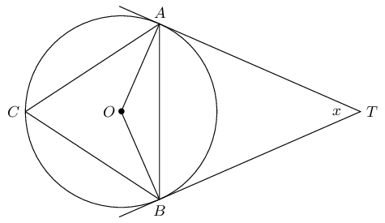

# Chapter 8: Euclidean geometry

- Sketches are valuable and important tools. Encourage learners to draw accurate diagrams to solve problems.
- It is important to stress to learners that proportion gives no indication of actual length. It only indicates
          the ratio between lengths.
- To prove triangles are similar, we need to show that two angles (AAA) are equal OR three sides in proportion
          (SSS).
- Theorems are examinable and are often asked in examinations. It is also important that learners remember the
          correct construction required for each proof.
- Notation - emphasize to learners the importance of the correct ordering of letters, as this indicates which
          angles are equal and which sides are in the same proportion.
- If a length has to be calculated from a proportion, it helps to re-write the proportion with the unknown
          length in the top left position.

## 8.1 Revision (EMCHY)

<QuizCard id="m12-08-01a" title="Interactive Exercise 8.1" question="What type of triangle is \(\Delta ABC\) ? Choose the most correct option." options=["scalene", "equilateral", "isosceles", "unequal"] answer="scalene" hint="" explanation="Identify the triangle A triangle with all sides equal to each other is called equilateral . A triangle with two sides equal to each other is called isosceles . A triangle with three different sides is called scalene . All of the sides in this triangle are different. So this triangle is scalene . Submit your answer as: scalene" />

<QuizCard id="m12-08-01a" title="Interactive Exercise 8.1" question="Which of the following are rhombuses? A B C D" options=["A & D only", "A only", "B & D only", "All of them"] answer="A & D only" hint="" explanation="Identify the quadrilaterals that meet the definition of a rhombus A rhombus is a quadrilateral with two pairs of opposite sides that are parallel and equal adjacent sides. We can easily recognise Quadrilateral A as a rhombus. However, this is not the only type of rhombus in the options. Quadrilateral D has two pairs of opposite sides that are parallel and equal adjacent sides. So, it is also a type of rhombus. This is true even though its exact name is a square (because it has a few extra properties too). Submit your answer as: A & D only" />

<QuizCard id="m12-08-01a" title="Interactive Exercise 8.1" question="The following diagram shows \(\Delta ABC\) with a line drawn from one 				vertex to the opposite side: Determine whether each of the following statements is definitely true." options=["True", "False", "True", "False", "True", "False"] answer="
					1
				,
					0
				,
					1
				" hint="" explanation="Use the information on the diagram to determine which statements are definitely true We should know the following terms: In maths, bisect means to cut into two equal pieces. A line is perpendicular \((\perp)\) to another line if they meet at \(\text{90}\text{°}\) . A point is a midpoint if it is in the middle of a line. It cuts the line into two equal pieces. We will look at each of the statements separately. \(CD \perp AB\) . False . We were not given any information about the angles at Point \(D\) . They might be equal to \(\text{90}\text{°}\) , but they might not. This actually depends on the relative lengths of \(BC\) and \(AC\) , which we don't know. We can't be sure about the size of the angle, so the statement is false . \(CD\) bisects \(\hat{C}\) . True . The line \(CD\) cuts the angle at \(C\) into two angles which are both equal to \(\text{48}\text{°}\) . \(CD\) bisects \(AB\) . False . We were not told that \(AD\) is equal to \(DB\) . The lines might be equal to each other, or they might not. We don't know for sure, so the statement is false . TIP: Only use the information given to you in the question or on the diagram. Just because something looks like it might be true, 					does not mean that it is. Submit your answer as: False and True and False" />

<QuizCard id="m12-08-01a" title="Interactive Exercise 8.1" question="Complete the following statement:" options=["which is the radius of", "at the centre of", "bisecting", "at the opposite side of", "tangent to", "\u2220O\u2081 = 2\u2220K", "\u2220O\u2081 = 180\u00b0 - \u2220K", "\u2220O\u2081 = 2\u2220M", "\u2220O\u2081 = \u2220L + \u2220N", "2\u2220L + 2\u2220N = 360\u00b0", "\u2220O\u2081 + \u2220O\u2082 = 360\u00b0", "\u2220O\u2081 + \u2220O\u2082 = 180\u00b0", "\u2220L + \u2220N = 180\u00b0", "\u2220L + \u2220N = 180\u00b0", "2\u2220K + 2\u2220M = 360\u00b0", "2\u2220L + 2\u2220N = 360\u00b0", "\u2220O\u2081 + \u2220O\u2082 = \u2220K + \u2220M"] answer="at the centre of" hint="" explanation="Complete the statement The angle subtended by a chord at the centre of a circle is twice the angle subtended by the same chord at the circumference of the circle. Submit your answer as: at the centre of" />

### Types of triangles (EMCHZ)

| Name | Diagram | Properties |
| --- | --- | --- |
| Scalene |  | All sides and angles are different. |
| Isosceles |  | Two sides are equal in length. The angles opposite the equal sides
              are also equal. |
| Equilateral |  | All three sides are equal in length and all three angles are equal. |
| Acute-angled |  | Each of the three interior angles is less than \(\text{90}\)°. |
| Obtuse-angled |  | One interior angle is greater than \(\text{90}\)°. |
| Right-angled |  | One interior angle is \(\text{90}\)°. |

### Congruent triangles (EMCJ2)

| Condition | Diagram |
| --- | --- |
| SSS (side, side, side) | \(\triangle ABC \equiv \triangle EDF\) |
| SAS (side, incl. angle, side) | \(\triangle GHI \equiv \triangle JKL\) |
| AAS (angle, angle, side) | \(\triangle MNO \equiv \triangle PQR\) |
| RHS (\(\text{90}\)°, hypotenuse, side) | \(\triangle STU \equiv \triangle VWX\) |

### Similar triangles (EMCJ3)

| Condition | Diagram |
| --- | --- |
| AAA (angle, angle, angle) | \(\hat{A} = \hat{D}, \enspace \hat{B} = \hat{E}, \enspace \hat{C} = \hat{F}\) \(\therefore \triangle ABC \enspace ||| \enspace \triangle DEF\) |
| SSS (sides in prop.) | \(\frac{MN}{RS} = \frac{ML}{RT} = \frac{NL}{ST}\) \(\therefore \triangle MNL \enspace ||| \enspace \triangle RST\) |

### Circle geometry (EMCJ4)

|  | If \(O\) is the centre and \(OM \perp AB\), then \(AM = MB\). If \(O\) is the centre and \(AM = MB\), then \(A\hat{M}O = B\hat{M}O = \text{90}°\). If \(AM = MB\) and \(OM \perp AB\), then \(\Rightarrow MO\) passes through centre \(O\). |
| --- | --- |

|  | If an arc subtends an angle at the centre of a circle and at the circumference, then the angle at the
              centre is twice the size of the angle at the circumference. |
| --- | --- |

|  | Angles at the circumference subtended by arcs of equal length (or by the same arc) are equal. |
| --- | --- |

### Cyclic quadrilaterals (EMCJ5)

|  | If the four sides of a quadrilateral \(ABCD\) are the chords of a circle with centre \(O\), then: \(D\hat{A}B + \hat{C} = \text{180}°\) Reason: (opp. \(\angle\)s cyclic quad. supp.) \(A\hat{B}C + \hat{D} = \text{180}°\) Reason: (opp. \(\angle\)s cyclic quad. supp.) \(E\hat{B}C = \hat{D}\) Reason: (ext. \(\angle\) cyclic quad. = int. opp \(\angle\)) \(\hat{A}_1 = \hat{A}_2 = \hat{C}\) Reason: (vert. opp. \(\angle\)s, ext. \(\angle\) cyclic quad.) |
| --- | --- |

**Proving a quadrilateral is cyclic: **

|  | If \(\hat{A} + \hat{C} = \text{180}°\) or \(\hat{B} + \hat{D} = \text{180}°\), then \(ABCD\) is
              a cyclic quadrilateral. |
| --- | --- |

|  | If \(\hat{A}_1 = \hat{C}\) or \(\hat{D}_1 = \hat{B}\), then \(ABCD\) is a cyclic quadrilateral. |
| --- | --- |

|  | If \(\hat{A} = \hat{B}\) or \(\hat{C} = \hat{D}\), then \(ABCD\) is a cyclic quadrilateral. |
| --- | --- |

### Tangents to a circle (EMCJ6)

|  | A tangent is perpendicular to the radius (\(OT \perp ST\)), drawn to the point of contact with the
              circle. |
| --- | --- |

|  | If \(AT\) and \(BT\) are tangents to a circle with centre \(O\), then: \(OA \perp AT\) (tangent \(\perp\) radius) \(OB \perp BT\) (tangent \(\perp\) radius) \(TA = TB\) (tangents from same point are equal) |
| --- | --- |

|  | If \(DC\) is a tangent, then \(D\hat{T}A = T\hat{B}A\) and \(C\hat{T}B = T\hat{A}B\). If \(D\hat{T}A = T\hat{B}A\) or \(C\hat{T}B = T\hat{A}B\), then \(DC\) is a tangent touching at \(T\). |
| --- | --- |

### The mid-point theorem (EMCJ7)

The line joining the mid-points of two sides of a triangle
        is parallel to the third side and equal to half the length of the
        third side.

Given: \(AD = DB\) and \(AE = EC\), we can conclude that \(DE \parallel BC\) and \(DE = \frac{1}{2}BC\).

## Revision

### Textbook Exercise 8.1

**Problem:**
\(MO \parallel NP\) in a circle with centre \(O\). \(M\hat{O}N = \text{60}°\) and \(O\hat{M}P = z\).
              Calculate the value of \(z\), giving reasons.

**Solution:**
\[\begin{array}{rll}
            \hat{P} &= \frac{1}{2} M\hat{O}N & (\angle \text{ at centre = twice } \angle \text{ at
            circumference})\\
            &= \text{30}° & \\
            \therefore z &= \text{30}° &(\text{alt. } \angle\text{s, } MO \parallel NP)
            \end{array}\]

\(O\) is the centre of the circle with \(OC = \text{5}\text{ cm}\) and chord \(BC = \text{8}\text{ cm}\).

Determine the lengths of:

**Problem:**
\(OD\)

**Solution:**
\[\begin{array}{rll}
              \text{In } \triangle ODC, \quad OC^2 &= OD^2 + DC^2 &(\text{Pythagoras})\\
              5^2 &= OD^2 + 4^2 & \\
              \therefore OD &= \text{3}\text{ cm} &
              \end{array}\]

**Problem:**
\(AD\)

**Solution:**
\[\begin{array}{rll}
              AO &= \text{5}\text{ cm} &\text{(radius)} \\
              AD &= AO + OD & \\
              &= \text{5} + \text{3} & \\
              \therefore AD &= \text{8}\text{ cm} & \\
              \end{array}\]

**Problem:**
\(AB\)

**Solution:**
\[\begin{array}{rll}
              \text{In } \triangle ABD, \quad AB^2 &= BD^2 + AD^2 &(\text{Pythagoras}) \\
              AB^2 &= 4^2 + 8^2 & \\
              AB &= \sqrt{80} & \\
              \therefore AB &= 4\sqrt{5}\text{cm} &
              \end{array}\]

\(PQ\) is a diameter of the circle with centre \(O\). \(SQ\) bisects \(P\hat{Q}R\) and \(P\hat{Q}S = a\).

**Problem:**
Write down two other angles that are also equal to \(a\).

**Solution:**
\[\begin{array}{rll}
              R\hat{Q}S &= a & (\text{given } SQ \text{ bisects } P\hat{Q}R) \\
              OQ &= OS & (\text{equal radii}) \\
              \therefore O\hat{Q}S &= O\hat{S}Q = a & (\text{isosceles } \triangle OQS)
              \end{array}\]

**Problem:**
Calculate \(P\hat{O}S\) in terms of \(a\), giving reasons.

**Solution:**
\[\begin{array}{rll}
              P\hat{O}S &= \text{2}\times P\hat{Q}S&(\angle \text{s at centre and circumference on same chord})
              \\
              &= \text{2}a &
              \end{array}\]

**Problem:**
Prove that \(OS\) is a perpendicular bisector of \(PR\).

**Solution:**
\[\begin{array}{rll}
              R\hat{Q}S &= Q\hat{S}O = a & (\text{proven}) \\
              \therefore QR &\parallel OS & (\text{alt. } \angle \text{s equal}) \\
              \therefore \hat{R} &= R\hat{T}S & (\text{alt. } \angle \text{s, } QR \parallel OS)\\
              &= \text{90}° &(\hat{R} = \angle \text{ in semi-circle})\\
              \therefore PT &= TR & (\perp \text{from centre bisects chord})\\
              \therefore OS &\text{ perp. bisector of } PR &
              \end{array}\]

\(BD\) is a diameter of the circle with centre \(O\). \(AB = AD\) and \(O\hat{C}D = \text{35}°\).

Calculate the value of the following angles, giving reasons:

**Problem:**
\(O\hat{D}C\)

**Solution:**
\[\begin{array}{rll}
              OC &= OD &(\text{equal radii }) \\
              \therefore O\hat{D}C &= \text{35}°&(\text{isosceles } \triangle OCD)
              \end{array}\]

**Problem:**
\(C\hat{O}D\)

**Solution:**
\[\begin{array}{rll}
              C\hat{O}D &= \text{180}° - \left( \text{35}° + \text{35}° \right)&(\text{sum }
              \angle\text{s } \triangle = \text{180}°) \\
              &=\text{110}° &
              \end{array}\]

**Problem:**
\(C\hat{B}D\)

**Solution:**
\[\begin{array}{rll}
              C\hat{B}D &= \frac{1}{2} C\hat{O}D&(\angle\text{ at centre } = 2\angle\text{ at circum. } )\\
              &= \text{55}° &
              \end{array}\]

**Problem:**
\(B\hat{A}D\)

**Solution:**
\[\begin{array}{rll}
              B\hat{A}D &= \text{90}° & (\angle\text{ in semi-circle})
              \end{array}\]

**Problem:**
\(A\hat{D}B\)

**Solution:**
\[\begin{array}{rll}
              A\hat{D}B &= A\hat{B}D &(\text{isosceles } \triangle ABD) \\
              \therefore A\hat{D}B &= \frac{\text{180}°-\text{90}°}{2}&(\text{sum } \angle\text{s in }
              \triangle = \text{180}°)\\
              &= \text{45}° &
              \end{array}\]

\(O\) is the centre of the circle with diameter \(AB\). \(CD \perp AB\) at \(P\) and chord \(DE\)
              intersects \(AB\) at \(F\).

Prove the following:

**Problem:**
\(C\hat{B}P = D\hat{B}P\)

**Solution:**
\[\begin{array}{rll}
              \text{In } \triangle CBP &\text{ and } \triangle DBP\text{:}& \\
              CP &= DP& (OP \perp CD)\\
              C\hat{P}B &= D\hat{P}B = \text{90}° & (\text{given}) \\
              BP &= BP & (\text{common})\\
              \therefore \triangle CBP &\equiv \triangle DBP &(\text{SAS} ) \\
              \therefore C\hat{B}P &= D\hat{B}P & (\triangle CBP \equiv \triangle DBP)
              \end{array}\\\]

**Problem:**
\(C\hat{E}D = 2 C\hat{B}A\)

**Solution:**
\[\begin{array}{rll}
              C\hat{E}D &= C\hat{B}D& (\angle\text{s on chord } CD)\\
              \text{But } C\hat{B}A &= D\hat{B}A & (\triangle CBP \equiv \triangle DBP)\\
              \therefore C\hat{E}D &= 2 C\hat{B}A
              \end{array}\]

**Problem:**
\(A\hat{B}D = \frac{1}{2} C\hat{O}A\)

**Solution:**
\[\begin{array}{rll}
              D\hat{B}A &= C\hat{B}A & (\triangle CBP \equiv \triangle DBP)\\
              C\hat{B}A &= \frac{1}{2} C\hat{O}A &(\angle\text{ at centre } = 2\angle\text{ at circum. } )\\
              \therefore A\hat{B}D &= \frac{1}{2} C\hat{O}A &
              \end{array}\]

**Problem:**
\(QP\) in the circle with centre \(O\) is extended to \(T\) so that \(PR = PT\). Express \(m\) in terms
              of \(n\).

**Solution:**
\[\begin{array}{rll}
            \hat{T} &= m &(PT = PR)\\
            \therefore Q\hat{P}R &= \text{2}m &(\text{ext. } \angle \triangle = \text{ sum int. }
            \angle\text{s})\\
            \therefore n &= \text{2}(\text{2}m)& (\angle\text{s at centre and circumference on } QR)\\
            n &= 4m & \\
            \therefore m &= \frac{1}{4}n &
            \end{array}\]

**Problem:**
In the circle with centre \(O\), \(OR \perp QP\), \(QP = \text{30}\text{ mm}\) and \(RS = \text{9}\text{
              mm}\). Determine the length of \(y\).

**Solution:**
\[\begin{array}{rll}
            \text{In } &\triangle QOS, & \\
            QP &= 30 & ( \text{given}) \\
            QS &= \frac{1}{2}QP & (\perp \text{ from centre bisects chord}) \\
            \therefore QS &= 15 & \\
            QO^2 &= OS^2 + QS^2 & ( \text{Pythagoras}) \\
            y^2 &= (y-9)^2 + 15^2 & \\
            y^2 &= y^2 - 18y + 81 + 225 & \\
            \therefore 18y &= 306 & \\
            \therefore y &= \text{17}\text{ mm} &
            \end{array}\]

\(PQ\) is a diameter of the circle with centre \(O\). \(QP\) is extended to \(A\) and \(AC\) is a tangent
              to the circle. \(BA \perp AQ\) and \(BCQ\) is a straight line.

Prove the following:

**Problem:**
\(P\hat{C}Q = B\hat{A}P\)

**Solution:**
\[\begin{array}{rll}
              P\hat{C}Q &= \text{90}° & (\angle \text{ in semi-circle} ) \\
              B\hat{A}Q &= \text{90}° & (\text{given } BA \perp AQ) \\
              \therefore P\hat{C}Q &= B\hat{A}Q &
              \end{array}\]

**Problem:**
\(BAPC\) is a cyclic quadrilateral

**Solution:**
\[\begin{array}{rll}
              P\hat{C}Q &= B\hat{A}Q & ( \text{proven} ) \\
              \therefore &BAPC \text{ is a cyclic quad. } & ( \text{ext. angle = int. opp. } \angle )
              \end{array}\]

**Problem:**
\(AB = AC\)

**Solution:**
\[\begin{array}{rll}
              C\hat{P}Q &= A\hat{B}C & ( \text{ext. } \angle \text{ of cyclic quad.}) \\
              B\hat{C}P &= C\hat{P}Q + C\hat{Q}P & ( \text{ext. } \angle \text{ of } \triangle) \\
              A\hat{C}P &= C\hat{Q}P & ( \text{tangent-chord} ) \\
              \therefore B\hat{C}A &= C\hat{P}Q & \\
              &= A\hat{B}C & \\
              \therefore AB &= AC & (\angle \text{s opp. equal sides})
              \end{array}\]

\(TA\) and \(TB\) are tangents to the circle with centre \(O\). \(C\) is a point on the circumference and
              \(A\hat{T}B = x\).

Express the following in terms of \(x\), giving reasons:

**Problem:**
\(A\hat{B}T\)

**Solution:**
\[\begin{array}{rll}
              A\hat{B}T &= B\hat{A}T & (TA = TB) \\
              &= \frac{\text{180}° - x}{2} & ( \text{sum } \angle \text{s of } \triangle TAB) \\
              &= \text{90}° - \frac{x}{2}
              \end{array}\]

**Problem:**
\(O\hat{B}A\)

**Solution:**
\[\begin{array}{rll}
              O\hat{B}T &= \text{90}° & (\text{tangent } \perp \text{ radius}) \\
              \therefore O\hat{B}A &= \text{90}° - \left( \text{90}° - \frac{x}{2} \right) & \\
              &= \frac{x}{2}
              \end{array}\]

**Problem:**
\(\hat{C}\)

**Solution:**
\[\begin{array}{rll}
              \hat{C} &= A\hat{B}T & (\text{tangent chord}) \\
              &= \text{90}° - \frac{x}{2} &
              \end{array}\]
