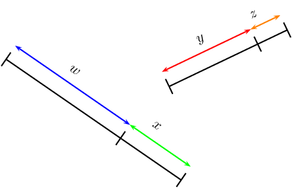
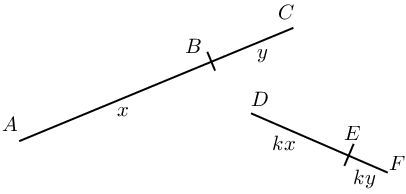
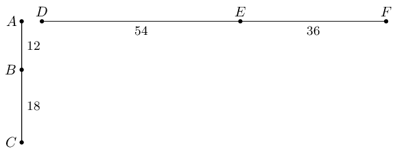
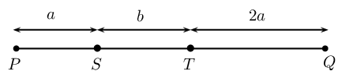
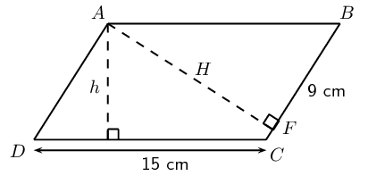
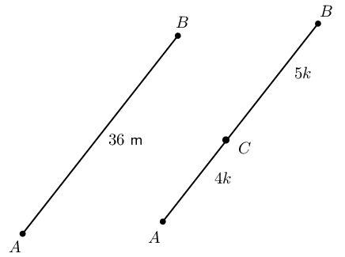
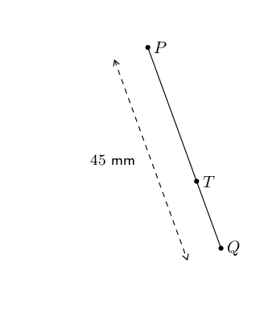
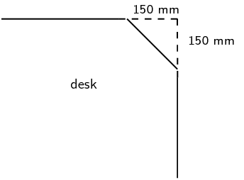

## 8.2 Ratio and proportion (EMCJ8)

<QuizCard id="m12-08-02a" title="Interactive Exercise 8.3" question="Based on the diagram here: Is the following equation true or false? Show calculations to justify your answer. \[\begin{array}{c}\dfrac{PQ}{QR} = \dfrac{UV}{TU}\end{array}\]" options=["True", "False"] answer="False" hint="" explanation="Check the equation by substituting the lengths of the line segments We have an equation which summarises a proportion about the diagram, and we need to determine if the equation is true or not. Note that the question says, \"Show calculations to justify your answer.\" You cannot submit your work here, but on a test or exam the calculation is required for full marks. We need to substitute the lengths from the diagram into the equation and then check if it is true or false. \[                     \begin{aligned}                         \dfrac{PQ}{QR} &= \frac{4}{9} \\                         & \\ \\                         \dfrac{UV}{TU} &= \frac{6}{2} \\ &= 3 \\                         & \\ \\                         \therefore \dfrac{PQ}{QR} &\neq \dfrac{UV}{TU}                     \end{aligned}                 \] The numbers are not equal. This means that the four sides named in the equation are not proportional to each other. (Note that it is possible that the segments in the diagram are proportional; however, the equation in this question is not true.) The correct answer is: False. Submit your answer as: False" />

**Ratio **

A ratio describes the relationship between two quantities which have the same units. We can use ratios to compare
      weights, heights, lengths, currencies, etc. A ratio is a comparison between two quantities of the same kind and
      has no units.

Example: if the length of a rectangle is \(\text{20}\) \(\text{cm}\) and the width is \(\text{60}\)
      \(\text{cm}\), then we can express the ratio between the length and width of the rectangle as:

    \begin{align*}
    \text{length to width } &= 20 \text{ to } 60 \\
    &= 1 \text{ to } 3 \\
    & \\
    \text {Or } \quad \frac{\text{length}}{\text{width}} &= \frac{20}{60} \\
    &= \frac{1}{3} \\
    & \\
    \text {Or } \quad \text{length} : \text{width } &= 20: 60 \\
    &= 1: 3
    \end{align*}

- The ratio of \(\frac{1}{3}\) describes the length of the rectangle **relative** to its width.
- A ratio written as a fraction is usually given in its simplest form.
- A ratio gives no indication of actual length. For example,
          \[\frac{\text{length}}{\text{width}} = \frac{\text{50}\text{ cm}}{\text{150}\text{ cm}} \enspace \text{also
          gives a ratio of} \enspace \frac{1}{3}\]
          \[\text{And} \enspace \frac{\text{length}}{\text{width}} = \frac{\text{0,8}\text{ m}}{\text{2,4}\text{ m}}
          \enspace \text{also gives a ratio of} \enspace \frac{1}{3}\]
- Do not convert a ratio to a decimal (even though \(\frac{1}{3}\) and \(\text{0,}\dot{3}\) have the same
          numerical value).

**Proportion **

## Predicting heights

A record of heights is given.

If the ratio \(\frac{\text{height of a person at two years old}} {\text{height of a person as an adult}}\) is
        \(\text{1}\) to \(\text{2}\), complete the table below:

| Name | Height at two years | Height as an adult |
| --- | --- | --- |
| Hendrik | \(\text{84}\) \(\text{cm}\) |  |
| Kagiso |  | \(\text{162}\) \(\text{cm}\) |
| Linda | \(\text{86}\) \(\text{cm}\) |  |
| Mandisa | \(\text{0,87}\) \(\text{m}\) |  |
| Prashna |  | \(\text{1}\) \(\text{m}\) \(\text{64}\) \(\text{cm}\) |

Consider the diagram below:

If two or more ratios are equal to each other, then we say that they are in the same proportion. Proportionality
      describes the equality of ratios.

If \(\dfrac{w}{x} = \dfrac{y}{z}\), then \(w\) and \(x\) are in the same proportion as \(y\) and \(z\).

2. \(wz = xy\)
4. \(\dfrac{x}{w} = \dfrac{z}{y}\)
6. \(\dfrac{w}{y} = \dfrac{x}{z}\)
8. \(\dfrac{y}{w} = \dfrac{z}{x}\)

Given

    \[\frac{AB}{BC}=\frac{x}{y}=\frac{kx}{ky}=\frac{DE}{EF}\]

The line segments \(AB\) and \(BC\) are in the same proportion as \(DE\) and \(EF\). The following statements are
      also true:

| Proportion | Reciprocal proportion | Cross multiplication |
| --- | --- | --- |
| \(\frac{AB}{BC}=\frac{DE}{FE}\) | \(\frac{BC}{AB}=\frac{FE}{DE}\) | \(AB \cdot FE = BC \cdot DE\) |
| \(\frac{AB}{AC}=\frac{DE}{DF}\) | \(\frac{AC}{AB}=\frac{DF}{DE}\) | \(AB \cdot DF = AC \cdot DE\) |
| \(\frac{BC}{AC}=\frac{EF}{DF}\) | \(\frac{AC}{BC}=\frac{DF}{EF}\) | \(BC \cdot DF = AC \cdot EF\) |

We can also substitute \(x\), \(y\), \(kx\), and \(ky\) to show algebraically that the statements are true.

For example,

    \begin{align*}
    BC \cdot DF &= y \times (kx + ky) \\
    &= ky (x + y) \\
    \text{And } AC \cdot EF &= (x+y) \times ky \\
    &= ky(x+y) \\
    \therefore BC \cdot DF &= AC \cdot EF
    \end{align*}

## Ratio and proportion

### Textbook Exercise 8.2

Solve for \(p\):

**Problem:**
\(\frac{8}{40} = \frac{p}{25}\)

**Solution:**
\begin{align*}
              \frac{8}{40} &= \frac{p}{25} \\
              \frac{8 \times 25}{40} &= p \\
              \frac{200}{40} &= p \\
              \therefore 5 &= p
              \end{align*}

**Problem:**
\(\frac{6}{9} = \frac{29 + p}{54}\)

**Solution:**
\begin{align*}
              \frac{6}{9} &= \frac{29 + p}{54} \\
              \frac{6 \times 54}{9} &= 29 + p \\
              36 &= 29 + p \\
              \therefore 7 &= p
              \end{align*}

**Problem:**
\(\frac{3}{1 + \frac{p}{4}} = \frac{4}{p + 1}\)

**Solution:**
\begin{align*}
              \frac{3}{1 + \frac{p}{4}} &= \frac{4}{p + 1} \\
              3(p + 1) &= 4 \left( 1 + \frac{p}{4} \right) \\
              3p + 3 &= 4 + p \\
              2p &= 1 \\
              \therefore p &= \frac{1}{2}
              \end{align*}

**Problem:**
\(\frac{14}{100 - p} = \frac{49}{343}\)

**Solution:**
\begin{align*}
              \frac{14}{100 - p} &= \frac{49}{343} \\
              14 \times 343 &= 49( 100 - p) \\
              \frac{4802}{49} &= 100 - p \\
              98 &= 100 - p \\
              \therefore p &= 2
              \end{align*}

**Problem:**
A packet of \(\text{160}\) sweets contains red, blue and yellow sweets in the ratio of \(3:2:3\)
              respectively. Determine how many sweets of each colour there are in the packet.

**Solution:**
\begin{align*}
            3 + 2 + 3 &= 8 \\
            \text{Red } &= \frac{3}{8} \times 160 \\
            &= 60 \\
            \text{Blue } &= \frac{2}{8} \times 160 \\
            &= 40 \\
            \text{Yellow } &= \frac{3}{8} \times 160 \\
            &= 60
            \end{align*}

**Problem:**
A mixture contains \(\text{2}\) parts of substance \(A\) for every \(\text{5}\) parts of substance \(B\).
              If the total weight of the mixture is \(\text{50}\) \(\text{kg}\), determine how much of substance \(B\)
              is in the mixture (correct to \(\text{2}\) decimal places).

**Solution:**
\begin{align*}
            \text{Ratio substance } A \text{ to substance B } &= 2 : 5 \\
            2 + 5 &= 7 \\
            \text{Substance } B &= \frac{5}{7} \times 50 \\
            &= \text{35,71}\text{ kg}
            \end{align*}

Given the diagram below.

Show that:

**Problem:**
\(\frac{AB}{BC} = \frac{FE}{ED}\)

**Solution:**
\begin{align*}
              \frac{AB}{BC} &= \frac{12}{18} \\
              &= \frac{2}{3} \\
              \frac{FE}{ED} &= \frac{36}{54} \\
              &= \frac{2}{3} \\
              \therefore \frac{AB}{BC} &= \frac{FE}{ED}
              \end{align*}

**Problem:**
\(\frac{AC}{BC} = \frac{FD}{EF}\)

**Solution:**
\begin{align*}
              \frac{AC}{BC} &= \frac{12 + 18}{18} \\
              &= \frac{30}{18} \\
              &= \frac{5}{3} \\
              \frac{FD}{EF} &= \frac{36 + 54}{54} \\
              &= \frac{90}{54} \\
              &= \frac{5}{3} \\
              \therefore \frac{AC}{BC} &= \frac{FD}{EF}
              \end{align*}

**Problem:**
\(AB \cdot DF = AC \cdot FE\)

**Solution:**
\begin{align*}
              AB \cdot DF &= 12 \times (36 + 54) \\
              &= 12 \times 90 \\
              &= 1080 \\
              AC \cdot FE &= (12 + 18) \times 36 \\
              &= 30 \times 36 \\
              &= 1080 \\
              \therefore AB \cdot DF &= AC \cdot FE
              \end{align*}

Consider the line segment shown below.

Express the following in terms of \(a\) and \(b\):

**Problem:**
\(PT: ST\)

**Solution:**
\((a + b): b\)

**Problem:**
\(\frac{PS}{TQ}\)

**Solution:**
\(\frac{a}{2a} = \frac{1}{2}\)

**Problem:**
\(\frac{SQ}{PQ}\)

**Solution:**
\(\frac{2a + b}{3a + b}\)

**Problem:**
\(QT: TS\)

**Solution:**
\(2a: b\)

**Problem:**
\(ABCD\) is a parallelogram with \(DC = \text{15}\text{ cm}\), \(h = \text{8}\text{ cm}\) and \(BF =
              \text{9}\text{ cm}\).

Calculate the ratio \(\dfrac{\text{area } ABF}{\text{area } ABCD}\).

**Solution:**
The area of a parallelogram \(ABCD =\) base \(\times\) height:

            \begin{align*}
            \text{Area} &= \text{15} \times \text{8} \\
            &= \text{120}\text{ cm$^{2}$}
            \end{align*}

The perimeter of a parallelogram \(ABCD = 2DC + 2BC\).

To find the length of \(AF\), we use \(AF \perp BC\) and the theorem of Pythagoras.

            \begin{align*}
            \text{In \(\triangle ABF\):} \quad AF^2 &= AB^2 - BF^2 \\
            &= \text{15}^2 - \text{9}^2 \\
            &= \text{144} \\
            \therefore AF &= \text{12}\text{ cm} \\
            \therefore \text{area } ABF &= \frac{1}{2} AF \cdot BF \\
            &= \frac{1}{2}(12)(9)\\
            &= \text{54}\text{ cm}
            \end{align*}
            \begin{align*}
            \therefore \frac{\text{area } ABF}{\text{area } ABCD} &= \frac{54}{120} \\
            &= \frac{9}{20}
            \end{align*}

**Problem:**
\(AB = \text{36}\text{ m}\) and \(C\) divides \(AB\) in the ratio \(4:5\). Determine \(AC\) and \(CB\).

**Solution:**
\begin{align*}
            \frac{AC}{AB} &= \frac{4k}{(4k + 5k)} \\
            \therefore AC &= 36 \times \frac{4}{9} \\
            &= \text{16}\text{ m} \\
            CB &= 36 - 16 \\
            &= \text{20}\text{ m} \\
            \text{Or } \frac{CB}{AC} &= \frac{5k}{(4k + 5k)} \\
            \therefore CB &= 36 \times \frac{5}{9} \\
            &= \text{20}\text{ m}
            \end{align*}

**Problem:**
If \(PQ = \text{45}\text{ mm}\) and the ratio of \(TQ:PQ\) is \(2:3\), calculate \(PT\) and \(TQ\).

**Solution:**
\begin{align*}
            \frac{TQ}{PQ} &= \frac{2}{3} \\
            \therefore TQ &= PQ \times \frac{2}{3} \\
            &= 45 \times \frac{2}{3} \\
            &= \text{30}\text{ mm} \\
            PT &= 45 - 30 \\
            &= \text{15}\text{ mm} \\
            \text{Or } \quad \frac{PT}{PQ} &= \frac{1}{3} \\
            \therefore PT &= 45 \times \frac{1}{3} \\
            &= \text{15}\text{ mm}
            \end{align*}

Luke's biology notebook is \(\text{30}\) \(\text{cm}\) long and \(\text{20}\) \(\text{cm}\) wide. The
              dimensions of his desk are in the same proportion as the dimensions of his notebook.

**Problem:**
If the desk is \(\text{90}\text{ cm}\) wide, calculate the area of the top of the desk.

**Solution:**
\begin{align*}
              \text{Ratio } &= \frac{\text{table width}}{\text{book width}} \\
              &=\frac{90}{20} \\
              &=\text{4,5} \\
              \therefore \text{Length of table } &= 30 \times \text{4,5} \text{cm} \\
              &=\text{135}\text{ cm}\\
              \text{Area table} &= 135 \times 90 \\
              &=\text{12 150}\text{ cm$^{2}$}\\
              &=\text{1,2}\text{ m$^{2}$}
              \end{align*}

**Problem:**
Luke covers each corner of his desk with an isosceles triangle of cardboard, as shown in the diagram:

Calculate the new perimeter and area of the visible part of the top of his desk.

**Solution:**
\begin{align*}
              x^2&=15^2+15^2 \\
              x&=\text{21,2}\text{ cm}\\
              \text{New length}&=135-2(15) \\
              &=\text{105}\text{ cm} \\
              \text{New breadth}&=90-2(15) \\
              &=\text{60}\text{ cm}\\
              \text{New perimeter }&=2(105)+2(60)+4(\text{21,2})\\
              &=\text{414,8}\text{ cm}
              \end{align*}
              \begin{align*}
              \text{Area cut off}&=2\times(15^2) \\
              &=\text{450}\text{ m$^{2}$} \\
              \text{New area } &= \text{12 150}\text{ cm$^{2}$} - \text{450}\text{ m$^{2}$} \\
              &= \text{11 700}\text{ cm$^{2}$}
              \end{align*}

**Problem:**
Use this new area to calculate the dimensions of a square desk with the same desk top
              area.

**Solution:**
\begin{align*}
              s^2&= \text{11 700}\text{ cm$^{2}$} \\
              \therefore s&= \text{108,2}\text{ cm}\\
              \text{Square table of length} &\approx 108 \times 108 \text{cm$^{2}$}
              \end{align*}
