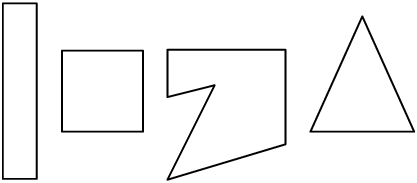
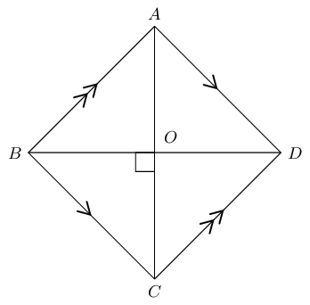
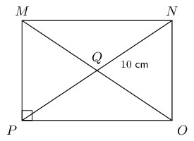
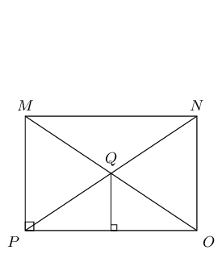
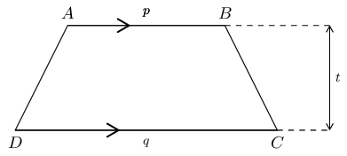
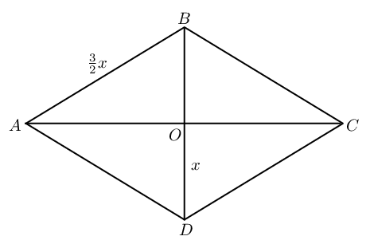
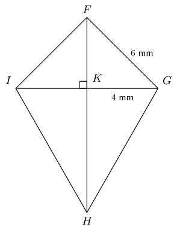
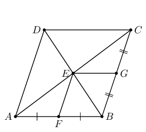

## 8.3 Polygons (EMCJ9)

<QuizCard id="m12-08-03a" title="Interactive Exercise 8.5" question="Prove that \[                     \begin{aligned}                         \dfrac{TP}{PQ} = \dfrac{3x}{2y}                     \end{aligned}                 \] Which of the following equations is part of your proof? Choose a reason for your answer. A \(\dfrac{TP}{PQ} = \dfrac{VP}{VQ}\) B \(\dfrac{TR}{TQ} = \dfrac{PS}{PQ}\) C \(\dfrac{VS}{SQ} = \dfrac{SQ}{QP}\) D \(\dfrac{PS}{SV} = \dfrac{TQ}{TR}\)" options=["A", "B", "C", "D", "similar triangles", "tangent chord thm.", "RS || TP", "PQRS cyclic", "A", "B", "C"] answer="0, 0" hint="" explanation="Choose the correct equation and reason We are given in the question that \(\Delta VPQ \;|||\; \Delta VTP\) . This means that \[                         \begin{aligned}                             \dfrac{TP}{PQ} = \dfrac{VP}{VQ}                         \end{aligned}                     \] because the ratios of corresponding sides of similar triangles are equal. Submit your answer as: A and similar triangles" />

Proportionality in polygons

A plane, closed shape consisting of three or more line segments.

In previous grades we studied the properties of the following polygons:

| Triangle |  | Area \(= \frac{1}{2}b \times h\) |
| --- | --- | --- |
| Parallelogram |  | Area \(= b \times h\) |
| Rectangle |  | Area \(= b \times h\) |
| Rhombus |  | Area \(= \frac{1}{2} AC \times BD\) |

| Square |  | Area \(= s^{2}\) |
| --- | --- | --- |
| Trapezium |  | Area \(= \frac{1}{2}(a + b) \times h\) |
| Kite |  | Area \(= \frac{1}{2}(AC \times DB)\) |

<Callout type="tip" title="Worked example 1: Properties of polygons">
**Question:**
\(ABCD\) is a rhombus with \(BD = \text{12}\text{ cm}\) and \(AB:BD = 3:4\).

Calculate the following (correct to two decimal places) and provide reasons:

2. Length of \(AB\).
4. Length of \(AO\).
6. Area of \(ABCD\).

**Use the ratio to determine the length of \(AB\):**
\begin{align*}
        AB:BD &= 3:4 \\
        \therefore \frac{AB}{BD} &= \frac{3}{4} \\
        \frac{AB}{12} &= \frac{3}{4} \\
        AB &= 12 \times \frac{3}{4} \\
        &= \text{9}\text{ cm}
        \end{align*}

**Calculate the length of \(AO\):**
We use the properties of a rhombus and the theorem of Pythagoras to find \(AO\).

        \[\begin{array}{rll}
        BD &= \text{12}\text{ cm} & \\
        BO &= \text{6}\text{ cm} & \text{(diagonals bisect each other)} \\
        \text{In } \triangle ABO, \quad A\hat{O}B &= \text{90}° & (\text{diagonals intersect at } \perp )\\
        AO^{2} &= AB^{2} - BO^{2} & (\text{Pythagoras}) \\
        &= 9^{2} - 6^{2} & \\
        \therefore AO &= \sqrt{ 45} & \\
        &= \text{6,71}\text{ cm}
        \end{array}\]

**Determine the area of rhombus \(ABCD\):**
\begin{align*}
        \text{Area } ABCD &= \frac{1}{2} AC \times BD \\
        &= \frac{1}{2} (2 \times \sqrt{45})(12) \\
        &= \text{80,50}\text{ cm$^{2}$}
        \end{align*}
</Callout>

## Proportionality of polygons

### Textbook Exercise 8.3

\(MNOP\) is a rectangle with \(MN : NO = 5:3\) and \(QN = \text{10}\text{ cm}\).

**Problem:**
Calculate \(MN\) (correct to \(\text{2}\) decimal places).

**Solution:**
\[\begin{array}{rll}
              QN &= 10 & \\
              \therefore NP &= 2 \times QN & (\text{diagonals bisect each other}) \\
              &= 20 & \\
              \text{In } \triangle NOP, \quad \hat{O} &= \text{90}° &(MNOP \text{ rectangle }) \\
              \text{Let } MN &= 5x & \\
              \text{And } NO &= 3x & \\
              NP^{2} &= NO^{2} + OP^{2} & (\text{Pythagoras}) \\
              (20)^{2} &= (3x)^{2} + (5x)^{2} & \\
              400 &= 9x^{2} + 25x^{2} & \\
              400 &= 34x^{2} & \\
              \therefore x &= \sqrt{\frac{400}{34}} & \\
              &= \text{3,43} \ldots & \\
              \therefore MN &= 5x = \text{17,15}\text{ cm} &
              \end{array}\]

**Problem:**
Calculate the area of \(\triangle OPQ\) (correct to \(\text{2}\) decimal places).

**Solution:**

**Problem:**
Consider the trapezium \(ABCD\) shown below. If \(t:p:q = 2:3:5\) and area \(ABCD = \text{288}\text{
              cm$^{2}$}\), calculate \(t, p \text{ and } q\).

**Solution:**
\begin{align*}
            \text{Let } t &= 2x \\
            \text{And } p &= 3x \\
            \text{And } q &= 5x \\
            \text{Area } ABCD &= \frac{1}{2} (p + q) \times t \\
            288 &= \frac{1}{2} (3x + 5x ) \times 2x \\
            288 &= 8x^{2} \\
            36 &= x^{2} \\
            \therefore 6 &= x \quad (\text{length always positive}) \\
            \therefore t &= 2(6) = \text{12}\text{ cm} \\
            p &= 3(6) = \text{18}\text{ cm} \\
            q &= 5(6) = \text{30}\text{ cm}
            \end{align*}

**Problem:**
\(ABCD\) is a rhombus with sides of length \(\frac{3}{2}x\) millimetres. The diagonals intersect at \(O\)
              and length \(DO = x\) millimetres. Express the area of \(ABCD\) in terms of \(x\).

**Solution:**
\begin{align*}
            AD &= \frac{3}{2}x \\
            DO&=x \\
            AO^2&=\left ( \frac{3}{2}x \right )^2-x^2 \quad (\text{ Pythagoras})\\
            &=\frac{9}{4}x^2-x^2\\
            &=\frac{5}{4}x^2 \\
            \therefore AO&=\frac{x\sqrt{5}}{2} \\
            \therefore AC&=x\sqrt{5} \\
            \text{Area }&=\frac{1}{2}AC\times BD\\
            &=\frac{1}{2}\times x \sqrt{5} \times 2x \\
            &= \sqrt{5} x^2
            \end{align*}

In the diagram below, \(FGHI\) is a kite with \(FG = \text{6}\text{ mm}\), \(GK = \text{4}\text{ mm}\)
              and \(\frac{GH}{FI} = \frac{5}{2}\).

**Problem:**
Determine \(FH\) (correct to the nearest integer).

**Solution:**
\begin{align*}
              \frac{GH}{FI} &= \frac{5}{2} \\
              \text{And } FG &= FI \quad (\text{adj. sides of kite equal}) \\
              \frac{GH}{FG} &= \frac{5}{2} \\
              \frac{GH}{6} &= \frac{5}{2} \\
              \therefore GH &= \text{15}\text{ mm} \\
              \text{In } \triangle FGK, \quad FG^{2} &= GK^{2} + FK^{2} \\
              FK^{2} &= 6^{2} - 4^{2} \\
              &= 36 - 16 \\
              \therefore FK &= \sqrt{20} \\
              \text{In } \triangle GKH, \quad GH^{2} &= GK^{2} + FH^{2} \\
              15^{2} &= 4^{2} + KH^{2} \\
              225 - 16 &= KH^{2} \\
              \therefore KH &= \sqrt{209} \\
              FH &= FK + KH \\
              &= \sqrt{20} + \sqrt{209} \\
              &= \text{19}\text{ mm}
              \end{align*}

**Problem:**
Calculate area \(FGHI\).

**Solution:**
\begin{align*}
              \text{Area } FGHI &= \frac{1}{2} GI \times FH \\
              &= \frac{1}{2} (4 + 4)(19) \\
              &= \text{76}\text{ mm$^{2}$}
              \end{align*}

**Problem:**
\(ABCD\) is a rhombus. \(F\) is the mid-point of \(AB\) and \(G\) is the mid-point of \(CB\). Prove that
              \(EFBG\) is also a rhombus.

**Solution:**
\[\begin{array}{rll}
            AF &= FB & (\text{given}) \\
            AE &= EC & (\text{diagonals bisect}) \\
            \therefore FE &\parallel BC & \\
            \therefore FE &\parallel BG & \\
            \therefore FE &= \frac{1}{2} BG & (\text{mid-point th.}) \\
            FE &= BG & \\
            \therefore EFBG & \text{ is a parallelogram} & (\text{one pair opp. sides} = \text{ and } \parallel)
            \\
            \therefore FB &\parallel EG & (\text{opp. sides of parm.}) \\
            \text{And } AB &= BC & (\text{adj. sides of rhombus}) \\
            \therefore \frac{1}{2} AB &= \frac{1}{2} BC & \\
            \therefore FB &= BG = GE = EF & \\
            \therefore EFBG &(\text{is a rhombus}) & (\text{parm. with }4 \text{ equal sides})
            \end{array}\]
