## 8.4 Triangles (EMCJB)

<QuizCard id="m12-08-04a" title="Interactive Exercise 8.7" question="In the diagram below there are three parallel lines cut by the transversals \(CE\) and \(EG\) . Given that \(CD:DE = 9:6\) , determine the value of \(\frac{EF}{EG}\) . Write your answer as a fraction and make sure that it is completely simplified." options=[] answer="2/5" hint="You are expected to write a fraction here. You can write pure fractions using the division symbol: / For example, to write the fraction \(-\frac{2}{3}\) the correct input would be: -2/3 You can also write mixed numbers by first writing the integer part, then a space and                then the fraction part. For example, to write \(2 \frac{1}{8}\) the correct input                would be: 2 1/8" explanation="Write a proportion for the segments in the diagram In this question, we need to determine the ratio of two segments of one of the transversals. We have information about the ratio of the sizes of the segments on the other transversal, \(CD:DE = 9 : 6\) . Let's break the diagram up a bit: there are two different triangles in the picture. Drawing one inside the other or overlapping each other helps to show their similarity. Notice that \(G \hat{C} E\) and \(F\hat{D}E\) are equal because they are corresponding angles for a transversal intersecting parallel lines. This is also true for \(C\hat{G}E\) and \(D\hat{F}E\) (for the same reason). Since the triangles have three equal angles, they must be similar (AAA). And similar triangles are proportional to each other. The ratio given in the question, \(CD:DE = 9 : 6\) tells us the ratio that we need to solve the question. Now write a proportion for corresponding parts of the triangles. \[                     \begin{aligned}                     \frac{EF}{EG} & = \frac{DE}{CE} \\  & = \frac{6}{9+6} \\ & = \frac{6}{15} \\                     & = \frac{2}{5}                     \end{aligned}                 \] The value of \(\frac{EF}{EG}\) is \(\frac{2}{5}\) . Submit your answer as:" />

### Proportionality of triangles (EMCJC)

2. In the diagram below, \(\triangle ABC\) and \(\triangle DEF\) have the same
                                                   height \((h)\) since both triangles are between the same parallel lines.
   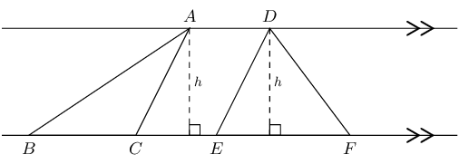
   Triangles with equal heights have areas which are proportional to
                                                           their bases.
4. \(\triangle WXY\) and \(\triangle ZXY\) have the same base \((XY)\) and the
                                                   same height \((h)\) since both triangles lie between the same parallel
                                                   lines.
   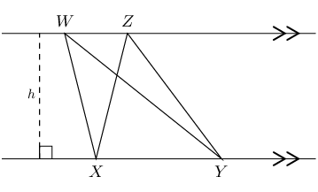
   Triangles with equal bases and between the same parallel lines are
                                                           equal in area.
6. \(\triangle PQR\) and \(\triangle SQR\) have the same base \((QR)\) and are
                                                   equal in area.
   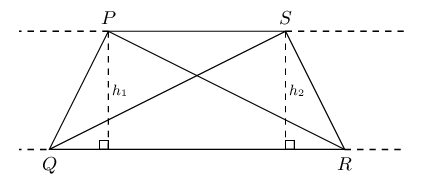

Triangles on the same side of the same base and equal in area, lie between parallel
                                        lines.

<Callout type="tip" title="Worked example 2: Proportionality of triangles">
**Question:**
Given parallelogram \(PQRS\) with \(QR\) produced to \(T\). \(RS =
                                                \text{45}\text{ cm}\), \(QR = \text{30}\text{ cm}\) and \(h =
                                                \text{10}\text{ cm}\).

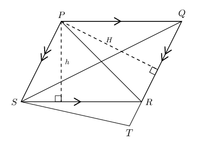

2. Calculate \(H\).
4. If \(TR:TQ = 1:4\), show that \(\frac{\text{Area } \triangle
                                                                   STR}{\text{Area } \triangle PRQ} = \frac{1}{3}\).

**Determine the length of \(H\):**
We use the formula for area of a parallelogram to calculate \(H\).

                                        \begin{align*}
                                        \text{Area } PQRS &= SR \times h \\
                                        &= 45 \times 10 \\
                                        &= \text{450}\text{ cm$^{2}$} \\
                                        & \\
                                        \text{Area } PQRS &= QR \times H \\
                                        450 &= 30 \times H \\
                                        \therefore H &= \text{15}\text{ cm}
                                        \end{align*}

**Use proportionality to show that \(\frac{\text{Area }
                                                \triangle STR}{\text{Area } \triangle PRQ} = \frac{1}{3}\):**
We are given the ratio \(TR:TQ = 1:4\).

                                        \begin{align*}
                                        \frac{TR}{TQ} &= \frac{1}{4} \\
                                        \text{So then } \frac{RQ}{TQ} &= \frac{3}{4} \\
                                        \text{And } \frac{TR}{RQ} &= \frac{TR}{TQ} \times \frac{TQ}{RQ} \\
                                        &= \frac{1}{4} \times \frac{4}{3} \\
                                        &= \frac{1}{3}
                                        \end{align*}\begin{align*}
                                        \text{Area } \triangle STR &= \frac{1}{2} TR \times H \quad (PS \parallel
                                        QT, \text{ equal heights}) \\
                                        \text{Area } \triangle PRQ &= \frac{1}{2} RQ \times H \\
                                        & \\
                                        \therefore \frac{\text{Area } \triangle STR}{\text{Area } \triangle PRQ} &=
                                        \frac{\frac{1}{2} TR \times H}{\frac{1}{2} RQ \times H} \\
                                        &= \frac{TR}{RQ} \\
                                        &= \frac{1}{3}
                                        \end{align*}
</Callout>

## Proportionality of triangles

### Textbook Exercise 8.4

The diagram below shows three parallel lines cut by two
                                                                transversals \(EC\) and \(AC\) such that \(ED: DC =
                                                                4:6\).

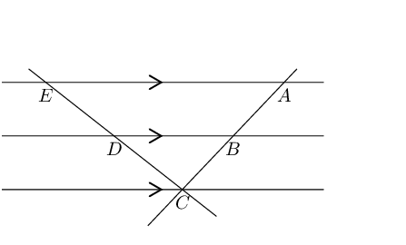

Determine:

**Problem:**
\(\frac{BC}{AB}\)

**Solution:**
We are given that \(ED: DC = 4:6\), which we can
                                                                        write as a fraction and simplify:

                                                                \begin{align*}
                                                                \frac{ED}{DC} &= \frac{4}{6} \\
                                                                &= \frac{2}{3} \\
                                                                & \\
                                                                \text{And } \frac{ED}{DC} &= \frac{AB}{BC} \\
                                                                \frac{AB}{BC} &= \frac{2}{3} \\
                                                                \therefore \frac{BC}{AB} &= \frac{3}{2}
                                                                \end{align*}

**Problem:**
\(AB:AC\)

**Solution:**
\begin{align*}
                                                                \frac{AB}{AC} &= \frac{ED}{EC} \\
                                                                &= \frac{2}{2 + 3} \\
                                                                &= \frac{2}{5}
                                                                \end{align*}

**Problem:**
The lengths of \(AC\) and \(ED\), if it is
                                                                given that \(AB = \text{12}\text{ mm}\).

**Solution:**
\begin{align*}
                                                                \frac{AB}{AC} &= \frac{ED}{EC} \\
                                                                &= \frac{2}{2 + 3} \\
                                                                &= \frac{2}{5} \\
                                                                \text{And we know } AB &= \text{12}\text{ mm} \\
                                                                \frac{AB}{AC} &= \frac{2}{5} \times \frac{6}{6} \\
                                                                &= \frac{12}{30} \\
                                                                \therefore AC &= \text{30}\text{ mm}
                                                                \end{align*}

We cannot determine the length of \(ED\) since we do
                                                                        not know the lengths of \(DC\), or \(EC\). We
                                                                        only know that \(\frac{ED}{EC} = \frac{2}{5}\).

**Problem:**
In right-angled \(\triangle MNP\), \(QR\) is drawn parallel
                                                                to \(NM\), with \(R\) the mid-point of \(MP\). \(NP =
                                                                \text{16}\text{ cm}\) and \(RQ = \text{60}\text{ mm}\).
                                                                Determine \(QP\) and \(RP\).

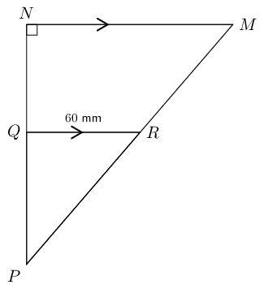

**Solution:**
\begin{align*}
                                                        \frac{RP}{MP} &= \frac{QP}{NP} \\
                                                        &= \frac{1}{2} \\
                                                        \therefore \frac{QP}{16} &= \frac{1}{2} \\
                                                        \therefore QP &= \text{8}\text{ cm}
                                                        \end{align*}

Use the theorem of Pythagoras to determine \(RP\).

                                                        \begin{align*}
                                                        \text{In } \triangle RQP: \quad PR^{2} &= QR^{2} + QP^{2} \\
                                                        &= (8)^{2} + (6)^{2} \\
                                                        &= 64 + 36 \\
                                                        &= 100 \\
                                                        \therefore PR &= \text{10}\text{ cm}
                                                        \end{align*}

Given trapezium \(ABCD\) with \(DA = AB = BC\) and
                                                                \(A\hat{D}C = B\hat{C}D\).

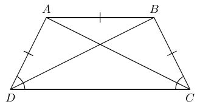

**Problem:**
Prove that \(BD\) bisects \(\hat{D}\).

**Solution:**
\[\begin{array}{rll}
                                                                A\hat{D}B &= A\hat{B}D & (AD = AB) \\
                                                                A\hat{B}D &= B\hat{D}C & (AB \parallel DC,
                                                                \text{ alt. } \angle \text{s}) \\
                                                                \therefore A\hat{D}B &= B\hat{D}C & \\
                                                                \therefore BD & \text{ bisects } \hat{D} &
                                                                \end{array}\]

**Problem:**
Prove that the two diagonals are equal in
                                                                length.

**Solution:**
\[\begin{array}{rll}
                                                                AD &= BC & (\text{given}) \\
                                                                A\hat{D}C &= B\hat{C}D & (\text{given}) \\
                                                                DC &= DC & \\
                                                                \therefore \triangle ADC &\equiv \triangle BCD &
                                                                (\text{SAS}) \\
                                                                \therefore AC &= BD &
                                                                \end{array}\]

**Problem:**
If \(DC:AB = 5:4\), show that area \(ABCD =
                                                                \text{2,25} \times \text{ area } \triangle ABC\).

**Solution:**
\[\begin{array}{rll}
                                                                \frac{DC}{AB} &= \frac{5}{4} & (\text{given}) \\
                                                                & & \\
                                                                \therefore \dfrac{\text{Area } \triangle BDC}{\text{Area
                                                                } \triangle BDA} &= \frac{5}{4} & (\text{same
                                                                height, } DC \parallel AB ) \\
                                                                & & \\
                                                                \therefore \dfrac{\text{Area } ABCD}{\text{Area }
                                                                \triangle BDA} &= \frac{9}{4} & \\
                                                                & & \\
                                                                \text{And } \triangle BDA &= \triangle ABC &
                                                                (\text{same height, same base }AB) \\
                                                                & & \\
                                                                \therefore \dfrac{\text{Area } ABCD}{\text{Area }
                                                                \triangle ABC} &= \text{2,25} & \\
                                                                & & \\
                                                                \text{Area } ABCD &= \text{2,25} \left( \text{Area }
                                                                \triangle ABC \right) &
                                                                \end{array}\]

**Problem:**
In the diagram below, \(\triangle PQR\) is given with \(QR
                                                                \parallel TS\).

Show that area \(\triangle PQS = \text{ area } \triangle
                                                                PRT\).

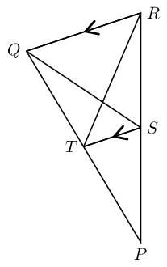

**Solution:**
\[\begin{array}{rll}
                                                        \text{Area } \triangle PQS &= \text{Area } \triangle PTS +
                                                        \text{Area } \triangle SQT & \\
                                                        \text{Area } \triangle PRT &= \text{Area } \triangle PTS +
                                                        \text{Area } \triangle SRT & \\
                                                        \text{Consider } \triangle SQT &\text{ and } \triangle SRT
                                                        & \\
                                                        ST &\text{ is common base } & \\
                                                        QR \parallel TS, & \text{ therefore same height } & \\
                                                        \therefore \text{Area } \triangle SQT &= \text{Area }
                                                        \triangle SRT & \\
                                                        \therefore \text{Area } \triangle PQS &= \text{Area }
                                                        \triangle PRT &
                                                        \end{array}\]

In Grade \(\text{10}\) we proved the mid-point theorem using
                                                                congruent triangles.

**Problem:**
Complete the following statement of the mid-point
                                                                        theorem:

"The line joining \(\ldots \ldots\) of a triangle is
                                                                        \(\ldots \ldots\) to the third side and equal to
                                                                        \(\ldots \ldots\)"

**Solution:**
"The line joining **the mid-points of two
                                                                                sides** of a triangle is
                                                                        **parallel** to the third side and
                                                                        equal to **half the length of the third
                                                                                side.**"

**Problem:**
In \(\triangle PQR\), \(T\) and \(S\) are the
                                                                        mid-points of \(PR\) and \(PQ\) respectively.
                                                                        Prove \(TS \parallel RQ\).

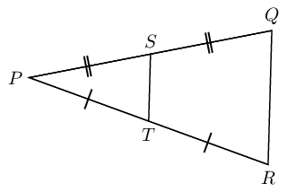

**Solution:**
Hint: make a construction by drawing \(SR\) and
                                                                        \(TQ\).

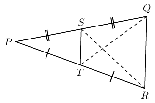

**Problem:**
Write down the converse of the mid-point
                                                                theorem.

**Solution:**
Converse: a line through the mid-point of one side of
                                                                        a triangle, parallel to a second side, bisects
                                                                        the third side.

# Chapter 8: Theorem: Proportion theorem

A line drawn parallel to one side of a triangle divides the other two sides
                                                of the triangle in the same proportion.

(Reason: line \(\parallel\) to one side \(\triangle\))

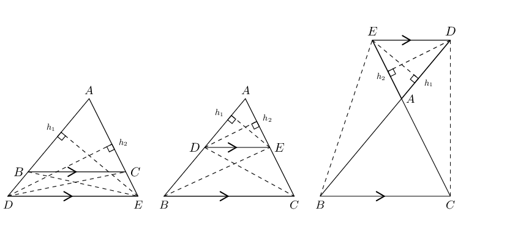

\(\triangle ABC\) with line \(DE\parallel BC\)

\(\frac{AD}{DB}=\frac{AE}{EC}\)

Draw \({h}_{1}\) from \(E\) perpendicular to \(AD\), and \({h}_{2}\) from
                                                \(D\) perpendicular to \(AE\).

Draw \(BE\) and \(CD\).

                                        \begin{align*}
                                        \dfrac{\text{Area }\triangle ADE}{\text{Area }\triangle BDE} & =
                                        \dfrac{\frac{1}{2}AD.{h}_{1}}{\frac{1}{2}DB.{h}_{1}}=\dfrac{AD}{DB} \\
                                        & \\
                                        \dfrac{\text{Area }\triangle ADE}{\text{Area }\triangle CED} & =
                                        \dfrac{\frac{1}{2}AE.{h}_{2}}{\frac{1}{2}EC.{h}_{2}}=\dfrac{AE}{EC} \\
                                        & \\
                                        \text{but} \enspace \text{Area }\triangle BDE & = \text{Area }\triangle CED
                                        \quad \text{(equal }\text{base }\text{and }\text{height)} \\
                                        & \\
                                        \therefore \frac{\text{Area }\triangle ADE}{\text{Area }\triangle BDE} & =
                                        \frac{\text{Area }\triangle ADE}{\text{Area }\triangle CED} \\
                                        & \\
                                        \therefore \frac{AD}{DB} & = \frac{AE}{EC}
                                        \end{align*}

Similarly, we use the same method to show that:

                                        \[\frac{AD}{AB} = \frac{AE}{AC} \quad \text{ and } \quad \frac{AB}{BD} =
                                        \frac{AC}{CE}\]

<QuizCard id="m12-08-04b" title="Interactive Exercise 8.8" question="The picture below shows a sketch of \(\Delta UWY\) with \(UY \parallel VX\) . Determine the values of \(a\) and \(b\) if: \(UV = b\) , \(VW = 12\text{ cm}\) , \(XY = \frac{3 a}{7}\) , \(WX = 20\text{ cm}\) and \(WY = a\) . Note that the diagram is not necessarily drawn to scale." options=[] answer="35, 9" hint="You should enter a number here. If you want to, you can use a space to separate thousands.                Example: 12 800,25 For scientific notation you need to use the multiply symbol                ( ∗ ) and the exponent symbol ( ^ ). For example 6,673 × 10 −11 should be written as: 6,673 ∗ 10^−11" explanation="Find the value of \(a\) The question gives us a triangle with a pair of parallel line segments. A triangle with parallel segments should bring the proportion theorem to mind — chances are good that we will use it at some point in the solution. To start, focus on the left side of the diagram. Since \(XY + WX = WY\) , we can write the following equation and solve: \[                     \begin{aligned}                     \frac{3 a}{7} + 20 & = a \\                     7\left(\frac{3 a}{7} + 20\right) & = 7\left(a\right)\\                     3 a + 140 & = 7 a\\                     140 & = 7 a - 3 a \\ 140 & = 4 a \\ \therefore a & = 35                     \end{aligned}                 \] Use the proportion theorem to write a proportion including \(b\) Now we need to focus on finding \(b\) . Now is the time to use the proportion theorem, because it links the segments on the left side of the triangle to the segments on the other side. Specifically, it tells us that the segment \(VX\) divides sides \(UW\) and \(WY\) proportionally. We can use that fact to write a proportion about the sides. Then solve for \(b\) . \[                     \begin{aligned}                     \frac{UV}{VW} & = \frac{XY}{WX} \\                     \frac{b}{12} & = \frac{\frac{3 a}{7}}{20} \\                     \frac{b}{12} & = \frac{\frac{3(35)}{7}}{20} \\                     \frac{b}{12} & = \frac{15}{20} \\                     \left(b\right)\left(20\right) & = \left(15\right)\left(12\right) \\                     20 b & = 180 \\                     b & = 9                     \end{aligned}                 \] The answers for the question are \(a = \text{35}\ \text{cm}\) and \(b = \text{9}\ \text{cm}\) . Submit your answer as: and" />

**Converse: proportion theorem**

If a line divides two sides of a triangle in the same proportion, then the line is parallel
                                to the third side.

(Reason: line divides sides in prop.)

<Callout type="tip" title="Worked example 3: Proportion theorem">
**Question:**
In \(\triangle TQP\), \(SR \parallel QP\), \(SQ = \text{12}\text{ cm}\) and
                                                \(RP = \text{15}\text{ cm}\). If \(TR = \frac{x}{3}\), \(TP = x\) and
                                                \(TS = y\), determine the values of \(x\) and \(y\), giving reasons.

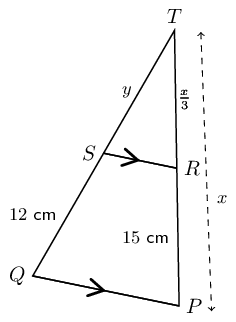

**Use the proportion theorem to determine the values of \(x\)
                                                and \(y\):**
Consider \(TP\):

                                        \[\begin{array}{rll}
                                        RP & = x - \frac{1}{3}x& \\
                                        & & \\
                                        & = \frac{2}{3}x &\\
                                        & & \\
                                        \therefore 15 & = \frac{2}{3}x& \\
                                        & & \\
                                        x & = \text{22,5}\text{ cm} & \\
                                        & &\\
                                        TR & = \frac{1}{3}(\text{22,5})& \\
                                        & & \\
                                        & = \text{7,5}\text{ cm} & \end{array}\]

Consider \(TQ\):

                                        \[\begin{array}{rll}
                                        \frac{TS}{SQ} & = \frac{TR}{RP} & (\text{line } \parallel \text{ one
                                        side of } \triangle) \\
                                        & & \\
                                        \frac{y}{12} & = \frac{\text{7,5}}{15} & \\
                                        & & \\
                                        \therefore y & = \text{6}\text{ cm} &
                                        \end{array}\]
</Callout>

<QuizCard id="m12-08-04c" title="Interactive Exercise 8.9" question="Compute the ratio \(LN:MN\) . INSTRUCTION: Give your answer as a simplified fraction." options=[] answer="
                        6/1
                    " hint="You should enter a number here. If you want to, you can use a space to separate thousands.                Example: 12 800,25 For scientific notation you need to use the multiply symbol                ( ∗ ) and the exponent symbol ( ^ ). For example 6,673 × 10 −11 should be written as: 6,673 ∗ 10^−11" explanation="Determine the size of \(LM\) using the given ratio The question gives us a large triangle, \(\Delta LNQ\) , with a smaller triangle inside of it. We need to find the value of the                         ratio of sides, \(LN:MN\) . The key fact about the diagram is that the segment running through \(\Delta LNQ\) is parallel to side \(LQ\) of the triangle. That means we can use the proportion theorem . It says: a line drawn parallel                         to one side of a triangle divides the other two sides of the triangle in the same proportion. From the question we know that \(NP:PQ = 1:5\) . The proportion theorem says that the same ratio applies to the segments on the other side of the triangles: \[                         \begin{aligned}                             \dfrac{NP}{PQ} =                             \dfrac{MN}{LM} =                             \dfrac{1}{5}                         \end{aligned}                     \] We can use this proportionality to label both \(LM\) and \(PQ\) on the                         diagram. Whenever you find more information about a diagram while solving a question, add that information to the picture. Evaluate the ratio \(LN:MN\) using the diagram Now we can use the information labelled in the diagram to evaluate \(LN:MN\) . Note that the segment \(LN\) is the sum of \(LM\) and \(MN\) , so: \(LN = 5 x + x\) . \[                         \begin{aligned}                             \frac{LN}{MN} & = \frac{5 x + x}{x} \\                             & = \frac{6}{1}                         \end{aligned}                     \] The correct answer is \(LN:MN = \dfrac{6}{1}\) . Submit your answer as:" />

**Special case: the mid-point theorem **

A corollary of the proportion theorem is the mid-point theorem: the line joining the
                                mid-points of two sides of a triangle is parallel to the third side and equal to half
                                the length of the third side.

If \(AB = BD\) and \(AC = CE\), then \(BC \parallel DE\) and \(BC = \frac{1}{2}DE\).

We also know that \(\frac{AC}{CE} = \frac{AB}{BD}\).

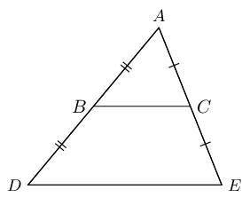

**Converse: the mid-point theorem**

The line drawn from the mid-point of one side of a triangle parallel to another side, bisects
                                the third side of the triangle.

If \(AB = BD\) and \(BC \parallel DE\), then \(AC = CE\).

## Proportion theorem

### Textbook Exercise 8.5

In \(\triangle MNP\), \(\hat{M} = \text{90}°\) and \(HJ
                                                                \parallel MP\).

\(HN:MH = 3:1\), \(HM = x \text{ and } JP = y\).

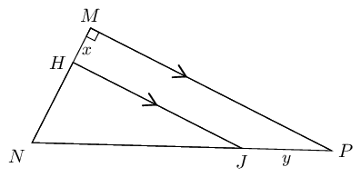

**Problem:**
Calculate \(JP:NP\).

**Solution:**
\[\begin{array}{rll}
                                                                \dfrac{JP}{NP}&= \dfrac{HM}{NM} & (HJ \parallel
                                                                MP) \\
                                                                &= \frac{x}{x + 3x} & \\
                                                                &= \frac{x}{4x} & \\
                                                                &= \frac{1}{4} &
                                                                \end{array}\]

**Problem:**
Calculate \(\dfrac{\text{area } \triangle
                                                                        HNJ}{\text{area } \triangle MNP}\).

**Solution:**
\[\begin{array}{rll}
                                                                \dfrac{HN}{MH} &= \dfrac{3}{1} & \\
                                                                \therefore HN &= 3x & \\
                                                                NJ &= 3y & \\
                                                                & & \\
                                                                \text{In } \triangle HNJ: \quad H&= \text{90}°
                                                                & (HJ \parallel MP) \\
                                                                \therefore HJ^{2} &= NJ^{2} - NH^{2} & \\
                                                                &= (3y)^{2} - (3x)^{2} & \\
                                                                &= 9y^{2} - 9x^{2} & \\
                                                                HJ &= \sqrt{9(y^{2}-x^{2})} & \\
                                                                &= 3 \sqrt{y^{2} - x^{2}} & \\
                                                                \end{array}\]

                                                                \[\begin{array}{rll}
                                                                \text{In } \triangle MNP: \quad \hat{M} &=
                                                                \text{90}° & \\
                                                                MP^{2} &= (4y)^{2} - (4x)^{2} & \\
                                                                MP &= \sqrt{16(y^{2}-x^{2})} & \\
                                                                MP &= 4 \sqrt{y^{2}-x^{2}} & \\
                                                                & & \\
                                                                \dfrac{\text{area } \triangle HNJ}{\text{area }
                                                                \triangle MNP} &= \dfrac{\frac{1}{2} HJ \times
                                                                HN}{\frac{1}{2} MP \times MN} & \\
                                                                &= \dfrac{3 \sqrt{y^{2}-x^{2}} \times 3x}{4
                                                                \sqrt{y^{2}-x^{2}} \times 4x} & \\
                                                                &= \frac{9}{16} &
                                                                \end{array}\]

**Problem:**
Use the given diagram to prove the Proportion Theorem.

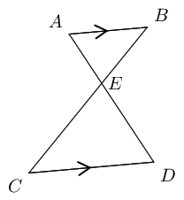

**Solution:**
**Given: **\(AB \parallel CD\)

**Required to prove: ** \(AE:ED = BE:EC\)

**Construction: **Draw \(AC\) and \(BD\)

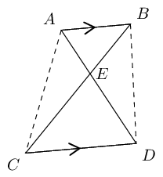

**Proof: **use area of \(\triangle\)'s

                                                        \[\begin{array}{rll}
                                                        \dfrac{\triangle AEB}{\triangle ACB}&= \dfrac{EB}{CB} &
                                                        (\text{same height}) \\
                                                        \dfrac{\triangle AEB}{\triangle ADB}&= \dfrac{AE}{AD} &
                                                        (\text{same height}) \\
                                                        \text{But } \quad \triangle ACB &= \triangle ADB & (AB
                                                        \parallel CD \enspace \therefore \text{ same height}) \\
                                                        \therefore \dfrac{EB}{CB} &= \dfrac{EA}{DA} & \\
                                                        \therefore \dfrac{EB}{CE} &= \dfrac{EA}{DE} &
                                                        \end{array}\]

**Problem:**
In the diagram below, \(JL = 2, LI = y, IM =7 \text{ and } MK
                                                                = y - 2.\)

If \(LM \parallel JK\), calculate \(y\) (correct to two
                                                                decimal places).

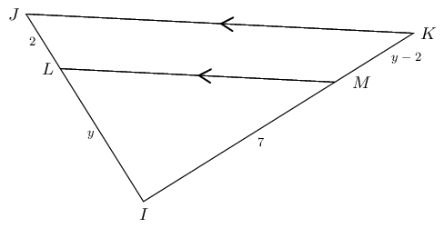

**Solution:**
\[\begin{array}{rll}
                                                        \frac{LI}{JL} &= \frac{MI}{KM} & (LM \parallel JK) \\
                                                        \frac{y}{2} &= \frac{7}{y-2} & \\
                                                        y (y-2) &= 14 & \\
                                                        y^{2}-2y-14 &= 0 & \\
                                                        y &= \dfrac{-(-2)±\sqrt{4-4(-14)}}{2} & \\
                                                        &= \dfrac{2±\sqrt{60}}{2} & \\
                                                        y &= \text{4,87} \text{ or } -\text{2,87} & \\
                                                        \text{But } y & > 0 & \\
                                                        \therefore y &= \text{4,87} &
                                                        \end{array}\]

**Problem:**
Write down the converse of the proportion theorem and
                                                                illustrate with a diagram.

**Solution:**
Converse of the proportion theorem: a line cutting two sides
                                                                of a triangle proportionally will be parallel to the
                                                                third side.

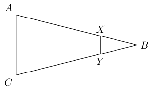

In \(\triangle ABC\), \(X\) is a point on \(BC\). \(N\) is
                                                                the mid-point of \(AX\), \(Y\) is the mid-point of
                                                                \(AB\) and \(M\) is the mid-point of \(BX\).

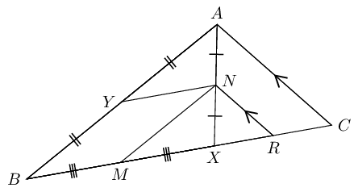

**Problem:**
Prove that \(YBMN\) is a parallelogram.

**Solution:**
Consider \(\triangle ABX:\)

                                                                \[\begin{array}{rll}
                                                                YN &\parallel BX & (Y \text{ and } N \text{
                                                                mid-points of } AB \text { and } AX ) \\
                                                                MN &\parallel BA & (M \text{ and } N \text{
                                                                mid-points of } BX \text { and } XA ) \\
                                                                \therefore YBMN &\text{ is a parallelogram} &
                                                                (\text{both opp. sides } \parallel)
                                                                \end{array}\]

**Problem:**
Prove that \(MR = \frac{1}{2}BC\).

**Solution:**
Consider \(\triangle AXC:\)

                                                                \[\begin{array}{rll}
                                                                RN &\parallel CA & (\text{given}) \\
                                                                \text{And } XN &= NA & (N \text{ mid-point of }
                                                                AB ) \\
                                                                \therefore XR &= RC & \\
                                                                M &\text{ is the mid-point } BX & (\text{given})
                                                                \\
                                                                \therefore MX + XR &= \frac{1}{2}BX + \frac{1}{2}XC
                                                                & \\
                                                                \therefore MR &= \frac{1}{2}(BX + XC) & \\
                                                                MR &= \frac{1}{2}(BC) &
                                                                \end{array}\]
