## 8.5 Similarity (EMCJD)

<QuizCard id="m12-08-05a" title="Interactive Exercise 8.11" question="The diagram below shows two polygons. The figure is drawn to scale. Are the shapes here similar to one another (select from the choices below)? Select the correct reason which explains the first answer. Shape A Shape B" options=["Yes", "No", "Impossible to know", "Corresponding sides are in proportion", "The angles are not all equal", "The angles are not equal and the sides are not equal", "The sides are not proportional"] answer="0, 0" hint="" explanation="Recall similarities in triangles If two objects are similar to each other, one of them can be \"zoomed in or out\" to make it identical to the other one. We can conclude that two triangles are similar if: all three matching angles are equal, or all three matching sides are proportional (have the same ratio). Compare the sides of the two polygons If we divide the matching sides of the triangles by each other we get a fraction equal to \(\dfrac{1}{3}\) in each case: \(\dfrac{20}{60} = \dfrac{20}{60} = \dfrac{19}{57}\) . So we can say that the sides of these triangles are all proportional. Therefore, the two shapes are similar. Shape A Shape B Question 2: Choose the correct reason or reasons As shown above, the reason that we know that the shapes are similar is because the corresponding sides are in proportion. Therefore, the correct choice from the list is: Corresponding sides are in proportion Submit your answer as: Yes and Corresponding sides are in proportion" />

### Similar polygons (EMCJF)

Polygons are similar if they are the same shape but differ in size. In other words, one polygon is
                        an enlargement of the other. Congruent polygons are also similar since they are the same shape
                        and the same size, only their position or orientation is different.

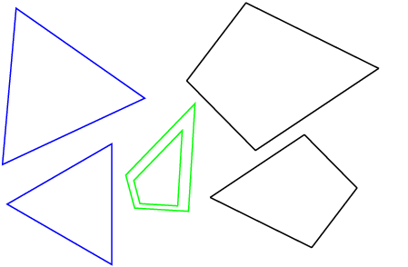

Two polygons with the same number of sides are similar when:

2. All pairs of corresponding angles are equal, **and**
4. All pairs of corresponding sides are in the same proportion.

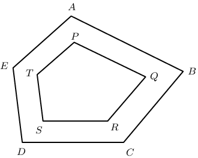

In the diagram above, polygon \(ABCDE\) is similar to polygon \(PQRST\) if:

Condition 1:

                  \[\hat{A} =\hat{P}, \quad
                  \hat{B} =\hat{Q}, \quad
                  \hat{C} =\hat{R}, \quad
                  \hat{D} =\hat{S}, \quad
                  \hat{E} =\hat{T}\]

**AND**

Condition 2:

\[\frac{AB}{PQ}=\frac{BC}{QR}=\frac{CD}{RS}=\frac{DE}{ST}=\frac{EA}{TP}\]

**Important:**

- Both conditions must be true for two polygons to be similar.
- If we are given two polygons that are similar, then we know that both conditions are true.

<Callout type="tip" title="Worked example 4: Similar polygons">
**Question:**
Polygons \(PQTU\) and \(PRSU\) are similar. Determine the value of \(x\).

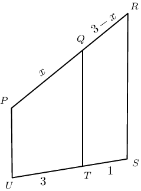

**Identify pairs of corresponding sides:**
Since the two polygons are similar,

                              \begin{align*}
                              \frac{PQ}{PR} & = \frac{TU}{SU} \\
                              \therefore \frac{x}{x+\left(3-x\right)} & = \frac{3}{3 + 1} \\
                              \therefore \frac{x}{3} & = \frac{3}{4} \\
                              \therefore x & = \frac{9}{4}
                              \end{align*}
</Callout>

## Similar polygons

### Textbook Exercise 8.6

Determine whether or not the following polygons are similar, giving
                                                reasons.

**Problem:**
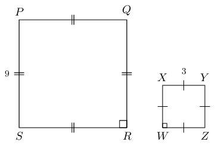

**Solution:**
Similar, all angles \(= \text{90}°\) and sides are in the same
                                                proportion.

**Problem:**
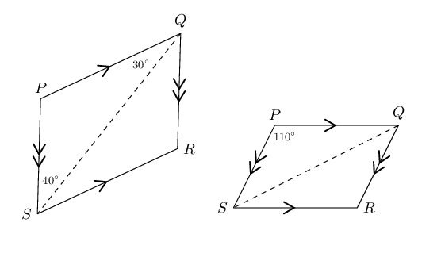

**Solution:**
Not enough information is given. Corresponding angles are equal.

**Problem:**
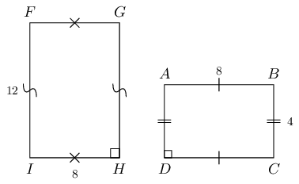

**Solution:**
Not similar, sides are not in the same proportion.

Are the following statements true or false? If false, state reasons or draw
                                                an appropriate diagram.

**Problem:**
All squares are similar.

**Solution:**
True

**Problem:**
All rectangles are similar.

**Solution:**
False. Pairs of corresponding sides not necessarily in the same
                                                      proportion.

**Problem:**
All rhombi are similar.

**Solution:**
False. Corresponding angles not necessarily equal.

**Problem:**
All congruent polygons are similar.

**Solution:**
True

**Problem:**
All similar polygons are congruent.

**Solution:**
False. Corresponding angles are equal but not necessarily true that
                                                      corresponding sides are equal.

**Problem:**
All congruent triangles are similar.

**Solution:**
True

**Problem:**
Isosceles triangles are similar.

**Solution:**
False. Corresponding angles not necessarily equal and pairs of
                                                      corresponding sides not necessarily in the same proportion.

**Problem:**
Equilateral triangles are similar.

**Solution:**
True

### Similarity of triangles (EMCJG)

To prove two polygons are similar, we need to show that two conditions are true: (a) all pairs of
                        corresponding angles are equal and (b) all pairs of corresponding sides are in the same
                        proportion.

To prove two triangles are similar, we need only show that **one** of the conditions
                        is true. If one of the conditions is true for two triangles, then the other condition is also
                        true.

# Chapter 8: Theorem: Equiangular triangles are similar

Equiangular triangles are similar.

(Reason: equiangular \(\triangle\)s)

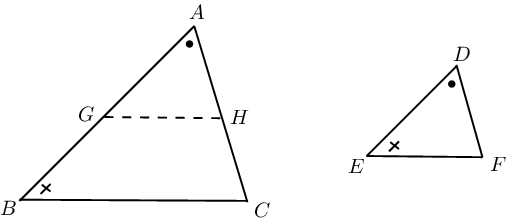

\(\triangle ABC\) and \(\triangle DEF\) with \(\hat{A}=\hat{D}\); \(\hat{B}=\hat{E}\);
                                    \(\hat{C}=\hat{F}\)

\(\frac{AB}{DE}=\frac{AC}{DF} = \frac{BC}{EF}\)

**Construction:** mark \(G\) on \(AB\) so that \(AG=DE\), and mark \(H\)
                                    on \(AC\) so that \(AH=DF\).

In \(\triangle AGH\) and \(\triangle DEF\)

                              \[\begin{array}{rll}
                              AG&=DE & \text{(by construction)} \\
                              AH&=DF& \text{(by construction)} \\
                              \hat{A}&=\hat{D} &\text{(given)} \\
                              \triangle AGH &\equiv \triangle DEF &\text{(SAS)} \\
                              \therefore A\hat{G}H &=\hat{E} & \\
                              \hat{E} &= \hat{B} & \text{(given)} \\
                              \therefore A\hat{G}H &=\hat{B} & \\
                              \therefore GH &\parallel BC &\text{(corresp. }\angle \text{s}\text{ equal)}
                              \end{array}\]

                              \[\begin{array}{rll}
                              \frac{AB}{AG}&=\frac{AC}{AH} &\text{(prop. }\text{theorem)} \\
                              \therefore \frac{AB}{DE}&=\frac{AC}{DF} &\text{(}AG=DE\text{, }AH=DF\text{)}
                              \end{array}\]

Similarly, by constructing \(Q\) on \(CA\) so that \(CQ = FD\), and mark \(P\) on
                                    \(BC\) so that \(CP=FE\).

                              \[\begin{array}{rll}
                              \frac{CA}{FD} &= \frac{CB}{FE} & \\
                              & & \\
                              \therefore \frac{AB}{DE}&=\frac{AC}{DF} = \frac{BC}{EF} & \\
                              & & \\
                              \therefore \triangle ABC & \enspace ||| \enspace \triangle DEF &
                              \end{array}\]

Therefore equiangular triangles are similar.

**Notation**

- The symbol for congruency is \(\equiv\).
- The symbol for similarity is \(|||\).
- Be careful to label similar triangles correctly.
  For example, if \(\hat{P} = \hat{B}\), \(\hat{Q} = \hat{A}\) and \(\hat{R} = \hat{C}\),
                                      then \(\triangle PQR \enspace ||| \enspace \triangle BAC\).
  Do not write \(\triangle PQR \enspace ||| \enspace \triangle ABC\).
- \(\triangle PQR \enspace ||| \enspace \triangle BAC\) also indicates which sides of the
                                      triangles are in the same proportion:
  \(\frac{PQ}{BA} = \frac{QR}{AC} = \frac{PR}{BC}\)

<QuizCard id="m12-08-05b" title="Interactive Exercise 8.12" question="In the diagram below, \(PQTU\; ||| \;\) \(WRSU\) . Determine the value of \(y\) . The diagram is not necessarily drawn to scale." options=[] answer="4/3" hint="You should enter a number here. If you want to, you can use a space to separate thousands.                Example: 12 800,25 For scientific notation you need to use the multiply symbol                ( ∗ ) and the exponent symbol ( ^ ). For example 6,673 × 10 −11 should be written as: 6,673 ∗ 10^−11" explanation="Identify corresponding sides and write a proportion for these sides We have a diagram with quadrilaterals, and we need to figure out the value of the variable \(y\) . The question tells us that the quadrilaterals are similar, which means that the sides of the shapes are proportional. Therefore, we can write a proportion for the sides of the polygons and solve it for \(y\) . There are a number of different proportions that we can write to summarise the lengths of the sides in the diagram: we can write a proportion for any pairs of corresponding sides. Here are two proportions which are accurate (but there are others): \[\begin{array}{c}\frac{PQ}{RW} = \frac{TU}{SU} \qquad \frac{PQ}{TU} = \frac{RW}{SU}\end{array}\] Solve the equation for \(y\) We will use the first proportion from above to find the value of \(y\) . If you use a different correct proportion and solve it without any mistakes, you will get the correct answer for \(y\) (and full marks). Remember: \[     \begin{aligned}     SU &= TU + ST \\     &= - 3 y + 6 + 12 \\     &= - 3 y + 18     \end{aligned}     \] So now we can calculate \(y\) : \[                     \begin{aligned}                     \frac{PQ}{RW} & = \frac{TU}{SU} \\                         \frac{2 y}{2 y + 16} & = \frac{- 3 y + 6}{- 3 y + 18} \\                         \left( 2 y \right) \left( - 3 y + 18 \right) & = \left(- 3 y + 6 \right) \left( 2 y + 16 \right) \\                         - 6 y^{2} + 36 y & = - 6 y^{2} - 36 y + 96 \qquad \longleftarrow ^{- 6 y^{2} \text{ terms}}_\text{cancel} \\                         72 y&= 96 \\ y &= \frac{96}{72} \\ y & = \frac{4}{3}                     \end{aligned}                 \] Therefore, the value of the variable is \(y = \frac{4}{3}\) . Submit your answer as:" />

**Proving equiangular triangles are similar:**

The sum of the interior angles of any triangle is \(\text{180}\)°. If we know that two pairs
                        of angles are equal, then the remaining angle in each triangle must also be equal. Therefore the
                        two triangles are similar.

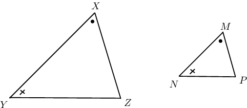

In other words, to prove that two triangles are equiangular, we need only show that
                        **two** pairs of angles are equal.

<Callout type="tip" title="Worked example 5: Similarity of triangles">
**Question:**
Prove that \(\triangle XYZ\) is similar to \(\triangle SRT\).

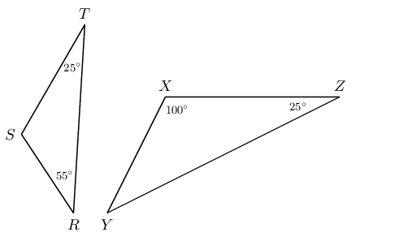

**Calculate the unknown angles in each triangle:**
\[\begin{array}{rll}
                              \text{In } \triangle XYZ: \quad \hat{Y} &= \text{180}° - \left( \text{180}°
                              + \text{25}° \right) & (\text{sum of int. } \angle \text{s of } \triangle) \\
                              &= \text{55}° & \\
                              & & \\ & & \\
                              \text{In } \triangle SRT: \quad \hat{S} &= \text{180}° - \left( \text{55}° +
                              \text{25}° \right) & (\text{sum of int. } \angle \text{s of } \triangle) \\
                              &= \text{100}° &
                              \end{array}\]

**Prove that the two triangles are similar:**
\[\begin{array}{rll}
                              \text{In } \triangle XYZ & \text{and } \triangle SRT: & \\
                              \hat{X} &= \hat{S} = \text{100}° & (\text{proved}) \\
                              \hat{Z} &= \hat{T} = \text{25}° & (\text{given}) \\
                              \therefore \triangle XYZ \enspace & ||| \enspace \triangle SRT & (\text{AAA})
                              \end{array}\]
</Callout>

## Similarity of triangles

### Textbook Exercise 8.7

In the diagram below, \(AB \parallel DE\).

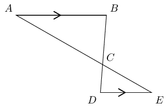

**Problem:**
Prove \(\triangle ABC \enspace ||| \enspace \triangle EDC\).

**Solution:**
In \(\triangle ABC \text{ and } \triangle EDC:\)

                                                \[\begin{array}{rll}
                                                \hat{A}&= \hat{E} & (\text{alt. } \angle \text{s, } AB \parallel
                                                DE ) \\
                                                \hat{B}&= \hat{D} & (\text{alt. } \angle \text{s, } AB \parallel
                                                DE ) \\
                                                \therefore \triangle ABC & \enspace ||| \enspace \triangle EDC &
                                                (\text{AAA})
                                                \end{array}\]

**Problem:**
If \(\dfrac{AC}{AE} = \dfrac{5}{7} \text{ and } AB = \text{4}\text{
                                                      cm}\), calculate the length of \(DE\) (correct to one decimal
                                                      place).

**Solution:**
In \(\triangle ABC \text{ and } \triangle EDC:\)

                                                \[\begin{array}{rll}
                                                \dfrac{AC}{AE}&= \dfrac{5}{7} & (\text{given}) \\
                                                & & \\
                                                \therefore \dfrac{AC}{CE} &= \dfrac{5}{2} & \\
                                                & & \\
                                                \dfrac{DE}{AB} &= \dfrac{CE}{AC} & (\triangle ABC \enspace |||
                                                \enspace \triangle EDC) \\
                                                & & \\
                                                \dfrac{DE}{4} &= \dfrac{2}{5} & \\
                                                & & \\
                                                \therefore DE &= \dfrac{8}{5} & \\
                                                & & \\
                                                &= \text{1,6}\text{ cm} &
                                                \end{array}\]

In circle \(O\), \(RP \perp PQ.\)

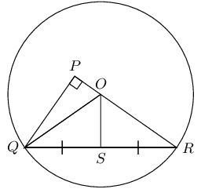

**Problem:**
Prove \(\triangle PRQ \enspace ||| \enspace \triangle SRO\).

**Solution:**
In \(\triangle PRQ \text{ and } \triangle SRO\):

                                                \[\begin{array}{rll}
                                                \hat{P} &= \text{90}° & (\text{given}) \\
                                                \hat{S} &= \text{90}° & (QS = SR) \\
                                                \therefore \hat{P} &= \hat{S} & \\
                                                \hat{R} &= \hat{R} & (\text{common } \angle) \\
                                                \therefore \triangle PRQ & \enspace ||| \enspace \triangle SRO &
                                                (\text{AAA})
                                                \end{array}\]

**Problem:**
Prove \(\dfrac{OR}{SR} = \dfrac{QR}{PR}\).

**Solution:**
\[\begin{array}{rll}
                                                \dfrac{PR}{SR}&= \dfrac{RQ}{RO} = \dfrac{PQ}{SO} & (\triangle
                                                SRO \enspace ||| \enspace \triangle PRQ) \\
                                                & & \\
                                                \text{So } \quad \dfrac{RQ}{RO} & = \dfrac{PR}{SR} & \\
                                                & & \\
                                                \dfrac{QR}{OR} & = \dfrac{PR}{SR} & \\
                                                & & \\
                                                QR \cdot SR & = PR \cdot OR & \\
                                                & & \\
                                                \therefore \dfrac{QR}{PR} &= \dfrac{OR}{SR} &
                                                \end{array}\]

**Problem:**
If \(SR = \text{18}\text{ mm} \text{ and } QP = \text{20}\text{
                                                      mm}\), calculate the radius of circle \(O\) (correct to one
                                                      decimal place).

**Solution:**
\[\begin{array}{rll}
                                                \dfrac{OR}{SR}&= \dfrac{QR}{PR} & (\text{proved}) \\
                                                & & \\
                                                \text{In } \triangle PQR: \quad PR^{2} &= QR^{2} - QP^{2} &
                                                (\text{Pythagoras}) \\
                                                &= (36)^2 - (20)^2 & \\
                                                \therefore PR &= \sqrt{896} & \\
                                                &= 8\sqrt{14} & \\
                                                \therefore \dfrac{OR}{18} &= \dfrac{36}{8\sqrt{14}} & \\
                                                \therefore OR &= 18 \times \dfrac{36}{8\sqrt{14}} & \\
                                                \therefore \text{radius} &= \text{21,6}\text{ mm} &
                                                \end{array}\]

**Problem:**
Given the following figure with the following lengths, find \(AE\), \(EC\)
                                                and \(BE\).

\(BC = \text{15}\text{ cm}, AB = \text{4}\text{ cm}, CD = \text{18}\text{
                                                cm} \text{ and } ED = \text{9}\text{ cm}.\)

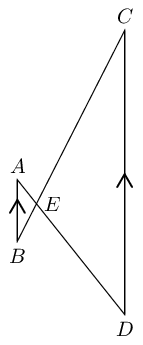

**Solution:**
\[\begin{array}{rll}
                                          B\hat{A}E &=C\hat{D}E & (\text{alt. } \angle \text{s, } AB \parallel
                                          CD) \\
                                          A\hat{B}E &=D\hat{C}E & (\text{alt. } \angle \text{s, } AB \parallel
                                          CD) \\
                                          A\hat{E}B &=D\hat{E}C & (\text{vert. opp. } \angle \text{s}) \\
                                          \therefore \triangle AEB & \enspace ||| \enspace \triangle DEC &
                                          (\text{AAA}) \\
                                          & & \\
                                          \therefore \dfrac{AE}{DE} &= \dfrac{AB}{DC} = \dfrac{4}{18} = \dfrac{2}{9}
                                          & (\triangle AEB \enspace ||| \enspace \triangle DEC) \\
                                          & & \\
                                          AE &= \frac{2}{9} DE & \\
                                          & & \\
                                          &= \frac{2}{9} (9) & \\
                                          & & \\
                                          &= \text{2}\text{ cm} &
                                          \end{array}\]

                                          \[\begin{array}{rll}
                                          \dfrac{EC}{BC} &= \dfrac{ED}{AD} = \dfrac{9}{11} & (AB \parallel CD)
                                          \\
                                          & & \\
                                          EC &= \dfrac{ED}{AD} (BC) & \\
                                          & & \\
                                          &= \frac{9}{11} (15) & \\
                                          & & \\
                                          &= \text{12,3}\text{ cm} &
                                          \end{array}\]

                                          \[\begin{array}{rll}
                                          \dfrac{BE}{BC} &= \dfrac{AE}{AD} = \dfrac{2}{11} & (AB \parallel CD)
                                          \\
                                          & & \\
                                          BE &= \dfrac{AE}{AD} (BC) & \\
                                          & & \\
                                          &= \frac{2}{11} (15) & \\
                                          & & \\
                                          &= \text{2,7}\text{ cm} &
                                          \end{array}\]

# Theorem: Triangles with sides in proportion are similar

If the corresponding sides of two triangles are in proportion, then the two triangles
                                    are similar.

(Reason: sides of \(\triangle\)s in prop.)

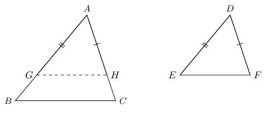

 \(\triangle ABC\) and \(\triangle DEF\) with
                              \(\frac{AB}{DE}=\frac{AC}{DF}=\frac{BC}{EF}\)
\(\hat{A}=\hat{D}\), \(\hat{B}=\hat{E}\) and \(\hat{C}=\hat{F}\)

**Construction: ** draw \(GH\) such that \(AG=DE\) and \(AH=DF\).

                              \[\begin{array}{rll}
                              \dfrac{AB}{DE} &= \dfrac{AC}{DF} &(\text{given}) \\
                              & \\
                              \dfrac{AB}{AG} &= \dfrac{AC}{AH} &(\text{by construction}) \\
                              & \\
                              \therefore GH &\parallel BC &(\text{sides in prop.}) \\
                              & \\
                              \therefore \hat{B} &= A\hat{G}H &(\text{corresp. } \angle \text{s, }GH \parallel
                              BC) \\
                              & \\
                              \text{and } \hat{C} &= A\hat{H}G &(\text{corresp. } \angle \text{s, }GH \parallel
                              BC) \\
                              & \\
                              \therefore \triangle AGH & \enspace ||| \enspace \triangle ABC & (
                              \text{equiangular } \triangle \text{s})\\
                              & \\
                              \therefore \dfrac{GH}{BC} &= \dfrac{AG}{AB} & \\
                              & \\
                              &= \dfrac{DE}{AB} &(AG=DE \text{, by construction}) \\
                              & \\
                              &= \dfrac{EF}{BC} & \left(\text{given } \frac{AB}{DE}=\frac{BC}{EF} \right) \\
                              & \\
                              \therefore GH &=EF &\\
                              & \\
                              \therefore \triangle AGH &\equiv \triangle DEF & (\text{SSS}) \\
                              & \\
                              \therefore \triangle ABC &\text{ and } \triangle DEF \text{ are equiangular} &\\
                              & \\
                              \therefore \triangle ABC & \enspace ||| \enspace \triangle DEF & \\
                              \end{array}\]

# Theorem: Triangles with two sides in proportion and equal included angles, are similar
                              (PROOF NOT FOR EXAMS)

If two sides of one triangle are in proportion to two sides of another triangle and the
                                    included angles are equal, then the two triangles are similar.

(Reason: \(\triangle\)s with \(\text{2}\) sides in prop. and equal incl. \(\angle\)s)

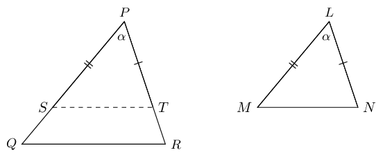

\(\triangle PQR\) and \(\triangle LMN\) with
                              \(\dfrac{LM}{PQ}=\dfrac{LN}{PR}\) and \(\hat{L}=\hat{P} = \alpha\)
\(\hat{M}=\hat{Q}\) and \(\hat{N}=\hat{R}\)

**Construction: ** draw \(ST\) such that \(PS=LM\) and \(PT=LN\).

In \(\triangle PQR\) and \(\triangle LMN\):
                                    \[\begin{array}{rll}
                                    PS&=LM &(\text{by construction}) \\
                                    & \\
                                    \hat{P}&= \hat{L} & (\text{given}) \\
                                    & \\
                                    PT&= LN & (\text{by construction}) \\
                                    & \\
                                    \therefore \triangle PST & \equiv \triangle LMN &(\text{SAS}) \\
                                    & \\
                                    \therefore P\hat{S}T &=\hat{M} &\\
                                    & \\
                                    P\hat{T}S &=\hat{N} &\\
                                    & \\
                                    \text{and } \dfrac{PS}{PQ} &= \dfrac{PT}{PR} &(\text{by construction}) \\
                                    & \\
                                    \therefore ST &\parallel QR &(\text{sides in prop.}) \\
                                    & \\
                                    \therefore \hat{Q} &= P\hat{S}T=\hat{M} &(\text{corresp. } \angle \text{s, }
                                    ST \parallel QR) \\
                                    & \\
                                    \text{and } \hat{R} &= P\hat{T}S=\hat{N} &(\text{corresp. } \angle \text{s,
                                    } ST \parallel QR) \\
                                    & \\
                                    \therefore \triangle PQR &\enspace ||| \enspace \triangle LMN &
                                    (\text{equiangular } \triangle \text{s})
                                    \end{array}\]

<QuizCard id="m12-08-05c" title="Interactive Exercise 8.13" question="The figure below shows the trapezium \(CDEF\) with \(CD \parallel FE\) . The figure is not necessarily drawn to scale. You want to prove that \(EF \cdot CG = CD \cdot EG\) . The proof is shown below, but it is not finished. Complete the proof by selecting the correct steps and reasons where necessary." options=["D\u2082 = F\u2082", "D\u2081 = F\u2081", "EF \u00b7 CG = CD \u00b7 EG", "CD || FE", "SSS", "vertical angles", "definition of similarity", "AAA", "definition of similarity", "SSS", "corresponding angles", "definition of congruency", "CD || FE", "\u2220 DGE = \u2220 CGF", "F\u2081 = E\u2081", "EF \u00b7 CG = CD \u00b7 EG"] answer="3, 3, 3, 3" hint="" explanation="Use the steps and reasons which are given to figure out the missing items We have a diagram and we need to prove that \(EF \cdot CG = CD \cdot EG\) . When completing a proof, we have to show each step that we take to get to the answer, and we have to have a reason for each step. Here we need to finish the proof by selecting the correct choices for two steps and two reasons. Here are the steps with explanations. Step 1: \(\angle CGD = \angle EGF\) . The intersecting lines at point \(G\) create two pairs of vertically opposite angles, and vertical angles are equal to each other. Step 2: \(C_{1} = E_{1}\) . The diagonal \(CE\) is a transversal between the two parallel line segments. Therefore alternate interior angles are equal. Step 3: \(D_{1} = F_{1}\) . As with the previous step, we are using the fact that alternate interior angles on a transversal between parallel lines are equal. Step 4: \(\Delta CGD \;|||\; \Delta EGF\) . Combine the first three steps to show that the triangles are similar. Any two triangles that have three equal angles are similar, and we call that \"AAA\" which stands for \"angle-angle-angle.\" Step 5: \(\frac{EF}{EG} = \frac{CD}{CG}\) . Since the triangles are similar, their corresponding sides must be proportional. Therefore, we want to write a proportion that includes the segments required for the equation: \(EF \cdot CG = CD \cdot EG\) . Step 6: \(EF \cdot CG = CD \cdot EG\) . Cross multiply the proportion from step 5 to get the equation \(EF \cdot CG = CD \cdot EG\) . This amounts to rearranging the equation. Note that the final step of a proof will always be exactly the same as the thing you were asked to prove. In the table, the complete proof looks like this: STEPS REASONS 1 \(\angle CGD = \angle EGF\) vertical angles 2 \(C_{1} = E_{1}\) alternate interior angles 3 \(D_{1} = F_{1}\) alternate interior angles 4 \(\Delta CGD \;|||\; \Delta EGF\) AAA 5 \(\frac{EF}{EG} = \frac{CD}{CG}\) definition of similarity 6 \(EF \cdot CG = CD \cdot EG\) rearrange the equation Submit your answer as: D₁ = F₁ and AAA and definition of similarity and EF · CG = CD · EG" />

**Proving triangles with sides in proportion are similar:**

To prove that the sides of two triangles are in the same proportion, we must show that all
                        **three** pairs of corresponding sides are in the same proportion.

<Callout type="tip" title="Worked example 6: Similarity of triangles">
**Question:**
2. In the diagram below, is \(\triangle ABC \enspace ||| \enspace \triangle
                                                   ZYX\)?
   Show calculations.
   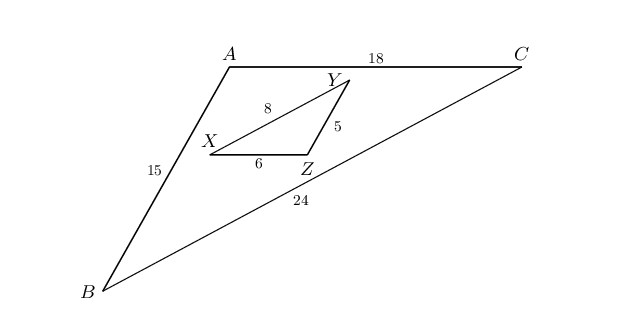
4. Consider the diagram given below. Determine whether or not \(\triangle PQR
                                                   \enspace ||| \enspace \triangle SPR\).
   Show calculations.
   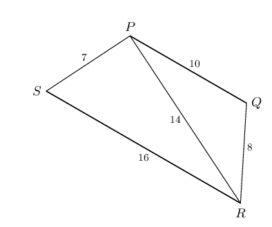

(Diagrams are not drawn to scale)

**Investigate proportionality of \(\triangle ABC\) and \(\triangle ZYX\):**
For similar triangles, the order in which the triangles are labelled indicates which
                                    pairs of sides correspond.

                              \begin{align*}
                              \text{In } \triangle ABC &\text{ and } \triangle ZYX: \\
                              \frac{AB}{ZY} &= \frac{15}{5} = \frac{3}{1} \\
                              \frac{AC}{ZX} &= \frac{18}{6} = \frac{3}{1} \\
                              \frac{BC}{YX} &= \frac{24}{8} = \frac{3}{1} \\
                              \therefore \triangle ABC \enspace & ||| \enspace \triangle ZYX \qquad \text{(SSS)}
                              \end{align*}

**Investigate proportionality of \(\triangle PQR\) and \(\triangle RPS\):**
\begin{align*}
                              \text{In } \triangle PQR &\text{ and } \triangle RPS: \\
                              \frac{PQ}{RP} &= \frac{10}{14} = \frac{5}{7} \\
                              \frac{PR}{RS} &= \frac{14}{16} = \frac{7}{8} \\
                              \frac{QR}{PS} &= \frac{8}{7} \\
                              \therefore \triangle PQR &\text{ is not similar to } \triangle RPS
                              \end{align*}
</Callout>

<Callout type="tip" title="Worked example 7: Similarity of triangles">
**Question:**
\(PQSR\) is a trapezium, with \(PQ \parallel RS\). Prove that \(PT \cdot RT = ST \cdot
                                    QT\).

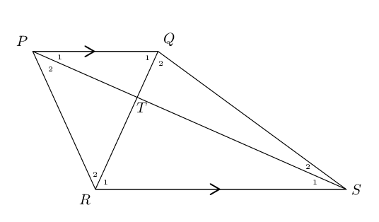

**Identify triangles:**
We are required to prove that \(PT \cdot RT = ST \cdot QT\), which we can also write as
                                    the ratio \(\frac{PT}{QT} = \frac{ST}{RT}\).

To determine which two triangles we must consider, examine the lengths given in the
                                    ratio.

**Prove triangles are equiangular:**
\[\begin{array}{rll}
                              \text{In } \triangle PTQ \text{ and } \triangle STR: \quad \hat{{P}_{1}} & =
                              \hat{{S}_{1}} & (\text{alt. }\angle \text{s}, PQ \parallel RS) \\
                              \hat{{Q}_{1}} & = \hat{{R}_{1}} & (\text{alt. } \angle \text{s}, PQ \parallel RS)
                              \\
                              \therefore \triangle PTQ & \enspace ||| \enspace \triangle STR & \text{(AAA)}
                              \end{array}\]

**Use proportionality:**
\[\begin{array}{rll}
                              \frac{PT}{TQ} & = \frac{ST}{TR} & \text{(}\triangle PTQ \enspace ||| \enspace
                              \triangle STR\text{)} \\
                              \therefore PT \cdot TR & = ST \cdot TQ &
                              \end{array}\]
</Callout>

## Similarity of triangles

### Textbook Exercise 8.8

**Problem:**
Consider the diagram given below. \(PR = 20\) units and \(XZ = 12\) units.
                                                Is \(\triangle XYZ \enspace ||| \enspace \triangle PQR\)? Give reasons.

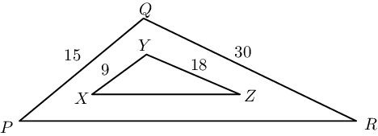

**Solution:**
\begin{align*}
                                          \frac{XY}{PQ} &= \frac{9}{15} = \frac{3}{5} \\
                                          \frac{YZ}{QR} &= \frac{18}{30} = \frac{3}{5} \\
                                          \frac{ZX}{RP} &= \frac{12}{20} = \frac{3}{5}
                                          \end{align*}

Yes, \(\triangle XYZ \enspace ||| \enspace \triangle PQR\).

**Problem:**
\(AB\) is a diameter of the circle \(ABCD\).
                                                \(OD\) is drawn parallel to \(BC\) and meets \(AC\) in \(E\).

If the radius is \(\text{10}\) \(\text{cm}\) and \(AC = \text{16}\text{
                                                cm}\), calculate the length of \(ED\).

[NCS, Paper 3, November 2011]

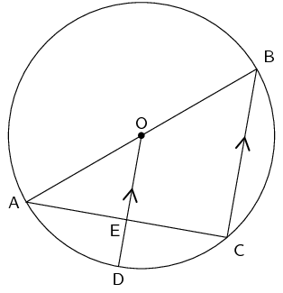

**Solution:**
\[\begin{array}{r@{\;}l@{\quad}l}
                                          \hat{C} & = \text{90}° & (\angle \text{s in semi-circle})\\
                                          O\hat{E}A & = \text{90}° & (\text{corresp. } \angle \text{s; } OD
                                          \parallel BC)\\
                                          AE & = \text{8}\text{ cm} & (\text{line from centre } \perp
                                          \text{chord})\\
                                          OE & = \text{6}\text{ cm} & (\text{Pythagoras})\\
                                          ED & = \text{10} - \text{6} = \text{4}\text{ cm} &
                                          \end{array}\]

OR

                                          \[\begin{array}{r@{\;}l@{\quad}l}
                                          \hat{C} & = \text{90}° & (\angle \text{s in semi-circle})\\
                                          O\hat{E}A& = \text{90}° & (\text{corresp. } \angle \text{s; } OD
                                          \parallel BC)\\
                                          OE & \parallel BC & (\text{given})\\
                                          OA & = OB & (\text{radii})\\
                                          AE & = EC = \text{8}\text{ cm} & (\text{midpoint th.})\\
                                          OE &= \text{6}\text{ cm} & (\text{Pythagoras})\\
                                          ED &= \text{10} - \text{6} = \text{4}\text{ cm} &
                                          \end{array}\]

OR

                                          \[\begin{array}{r@{\;}l@{\quad}l}
                                          \hat{C} &= \text{90}° & (\angle \text{s in semi-circle})\\
                                          BC^{2} &= (20)^{2} - (16)^{2} & \\
                                          BC^{2} &= 144 &\\
                                          BC &= 12 &\\
                                          OE &= \frac{1}{2}BC & (\text{midpoint th.})\\
                                          OE &= \text{6}\text{ cm} &\\
                                          OD & = \text{10}\text{ cm} &\\
                                          ED & = \text{10} - \text{6} = \text{4}\text{ cm} &
                                          \end{array}\]

\(P, Q, S \text{ and } T\) are on the circumference of the circle.

\(TS \text{ is produced to } V \text{ so that } SV = 2TS.\)

\(TRQ \text{ is produced to } U \text{ so that } VU \parallel SRP.\)

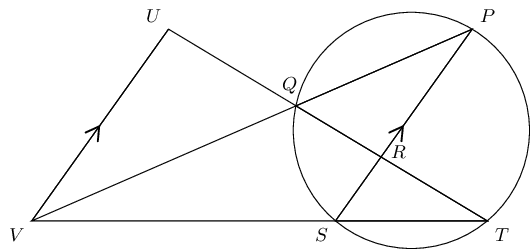

Prove, with reasons, that:

**Problem:**
\(\dfrac{TR}{RU} = \dfrac{1}{3}\)

**Solution:**
\[\begin{array}{rll}
                                                \dfrac{TR}{TU}&= \dfrac{TS}{TV} & (SR \parallel VU) \\
                                                &= \dfrac{1}{3} & (SV = 2TS)
                                                \end{array}\]

**Problem:**
\(\triangle TQV \enspace ||| \enspace \triangle PSV\)

**Solution:**
In \(\triangle TQV \text{ and } \triangle PSV\):

                                                \[\begin{array}{rll}
                                                \hat{P}&= \hat{T} & (\angle \text{s subtended chord } QS)\\
                                                P \hat{V} T&= P \hat{V}T & (\text{common }\angle) \\
                                                \therefore \triangle TQV & \enspace ||| \enspace \triangle PSV &
                                                (\text{AAA})
                                                \end{array}\]

**Problem:**
\(QV \cdot PV = 6TS^{2}\)

**Solution:**
\[\begin{array}{rll}
                                                \dfrac{QV}{TV}&= \dfrac{SV}{PV} & (\triangle TQV \enspace |||
                                                \enspace \triangle PSV) \\
                                                \therefore QV \cdot PV&= TV.SV & \\
                                                \text{But } SV &= 2TS & (\text{given})\\
                                                \therefore TV &= 3TS & \\
                                                \therefore QV.PV &= 3TS.2TS & \\
                                                QV.PV &= 6TS^{2} &
                                                \end{array}\]

**Problem:**
\(\triangle UQV \enspace ||| \enspace \triangle RQP \enspace |||
                                                      \enspace \triangle RST\)

**Solution:**
In \(\triangle UQV \text{ and } \triangle RQP \text{ and } \triangle
                                                      RST\):

                                                \[\begin{array}{rll}
                                                \hat{U}&= Q\hat{R}P & (\text{alt. } \angle \text{s, } VU
                                                \parallel RP) \\
                                                &= S\hat{R}T & (\text{vert. opp. } \angle \text{s}) \\
                                                U\hat{V}Q&= \hat{P} & (\text{alt. } \angle \text{s, } VU
                                                \parallel RP) \\
                                                &= \hat{T} & (\angle \text{s on chord } QS) \\
                                                \triangle UQV & \enspace ||| \enspace \triangle RQP \enspace |||
                                                \enspace \triangle RST & (\text{AAA})
                                                \end{array}\]

\(ABCD\) is a parallelogram with diagonals intersecting at \(F\).
                                                \(FE\) is drawn parallel to \(CD\).
                                                \(AC\) is produced to \(P\) such that \(PC = 2AC\) and \(AD\) is
                                                produced to \(Q\) such that \(DQ = 2AD\).

[NCS, Paper 3, November 2011]

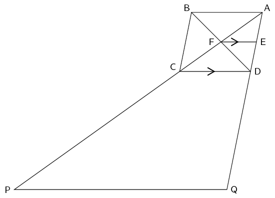

**Problem:**
Show that \(E\) is the midpoint of \(AD\).

**Solution:**
\[\begin{array}{r@{\;}l@{\quad}l}
                                                AF & = FC & (\text{diag. parm. bisect})\\
                                                FE & \parallel \; CD & \\
                                                AE & = ED & (\text{prop th. }FE \parallel CD)\\
                                                \end{array}\]

**Problem:**
Prove \(PQ \parallel FE\).

**Solution:**
\[\begin{array}{r@{\;}l@{\quad}l}
                                                \frac{AC}{CP} & = \frac{1}{2} & (\text{given})\\
                                                \frac{AD}{DQ} & = \frac{1}{2} & (\text{given})\\
                                                \frac{AC}{CP} & = \frac{AD}{DQ} &\\
                                                CD & \parallel PQ & (\text{converse prop. th.})\\
                                                CD & \parallel FE & (\text{given})\\
                                                \therefore PQ & \parallel FE &
                                                \end{array}\]

OR

                                                \[\begin{array}{r@{\;}l@{\quad}l}
                                                \frac{AC}{AP} & = \frac{1}{3} &\\
                                                \frac{AD}{AQ} & = \frac{1}{3} &\\
                                                \frac{AC}{AP} & = \frac{AD}{AQ} &\\
                                                CD & \parallel PQ & (\text{converse prop. th.})\\
                                                CD & \parallel FE & (\text{given})\\
                                                \therefore PQ & \parallel FE &
                                                \end{array}\]

OR

                                                \begin{align*}
                                                \frac{AF}{AP} & = \frac{1}{6}\\
                                                \frac{AE}{AQ} & = \frac{1}{6}\\
                                                \frac{AF}{AP} & = \frac{AE}{AQ}\\
                                                \therefore PQ & \parallel FE \quad(\text{converse prop. theorem})
                                                \end{align*}

**Problem:**
If \(PQ\) is \(\text{60}\) \(\text{cm}\), calculate the length of
                                                      \(FE\).

**Solution:**
In \(\triangle AEF\) and \(\triangle APQ\):

2. \(\hat{A} \quad (\text{ is common})\)
4. \(A\hat{E}F = A\hat{Q}P \quad (\text{corresp. } \angle
                                                               \text{s, } FE \parallel PQ)\)
6. \(A\hat{F}E = A\hat{P}Q \quad (\text{corresp. } \angle
                                                               \text{s, } FE \parallel PQ)\)

\(\therefore \triangle BHD \enspace ||| \enspace \triangle FED \quad
                                                      (\angle \angle \angle)\)

                                                \begin{align*}
                                                \frac{FE}{PQ} &= \frac{AF}{AP} \quad (||| \enspace
                                                \triangle\text{s}) \\
                                                \frac{FE}{60} &= \frac{1}{6} \\
                                                FE &= \text{10}\text{ cm}
                                                \end{align*}

OR

In \(\triangle ADC\) and \(\triangle APQ\):

2. \(\hat{A} \quad (\text{ is common})\)
4. \(A\hat{D}C = A\hat{Q}P \quad (\text{corresp. } \angle
                                                               \text{s, } CD \parallel PQ)\)
6. \(A\hat{C}D = A\hat{P}Q \quad (\text{corresp. } \angle
                                                               \text{s, } CD \parallel PQ)\)

\(\therefore \triangle ADC \enspace ||| \enspace \triangle APQ \quad
                                                      (\angle \angle \angle)\)

                                                \[\begin{array}{r@{\;}l@{\quad}l}
                                                \frac{AC}{AP} &= \frac{AD}{AQ} = \frac{1}{3} & (|||
                                                \triangle\text{s}) \\
                                                CD & = \frac{1}{3}PQ & \\
                                                CD & = \text{20}\text{ cm} & \\
                                                \text{But } AF & = FC &\\
                                                AE & = ED & (\text{mid-point th.}) \\
                                                FE & = \frac{1}{2}CD & \\
                                                FE & = \text{20}\text{ cm} &
                                                \end{array}\]
