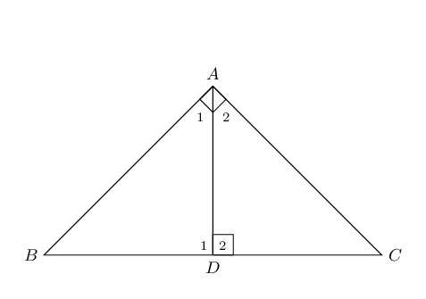
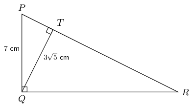
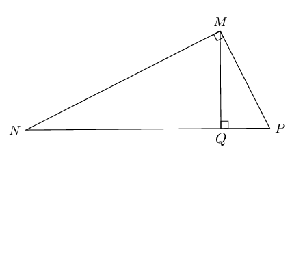
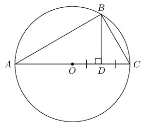
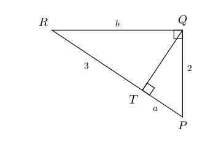
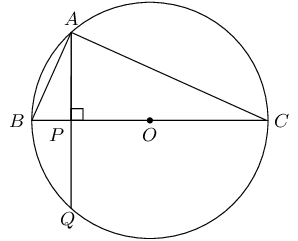
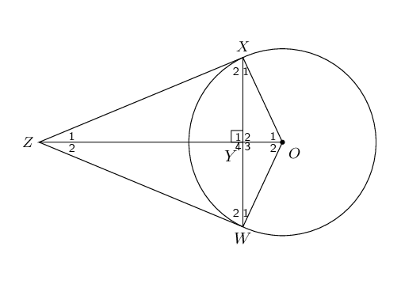

## 8.6 Pythagorean theorem (EMCJH)

<QuizCard id="m12-08-06a" title="Interactive Exercise 8.15" question="In \(\Delta DEF\) , \(D \hat{E} F = \text{90}\text{°}\) and \(EG \perp DF\) . If \(DE = \text{15}\ \text{km}\) and \(EG = \sqrt{122}~\text{km}\) , determine \(y\) , \(DF\) and \(EF\) . INSTRUCTION: Round your answers to two decimal places." options=[] answer="10.15, 22.17, 16.32" hint="You should enter a number here. If you want to, you can use a space to separate thousands.                Example: 12 800,25 For scientific notation you need to use the multiply symbol                ( ∗ ) and the exponent symbol ( ^ ). For example 6,673 × 10 −11 should be written as: 6,673 ∗ 10^−11" explanation="Use the theorem of Pythagoras The question asks us to find the lengths of \(y\) , \(DF\) and \(EF\) . Let's first look at the length of \(DG\) . This side is part of the smaller right angled triangle, \(\Delta DEG\) . We have the lengths of \(DE = \text{15}\ \text{km}\) and \(EG = \sqrt{122}~\text{km}\) so \(DG\) is the only missing side. Using the theorem of Pythagoras, we can solve for the length of \(DG\) . \[                     \begin{aligned}                     \text{In } \Delta DEG: \quad DG^{2} = & DE^{2} -         EG^{2} \\                     & = \left(15\right)^{2} - \left(\sqrt{122}\right)^{2} \\                     & = 225 - 122 \\                     \therefore y & = \sqrt{103} \\                     & = \text{10,14889...}                     \end{aligned}                 \] We take the positive answer of the square root when calculating a length. So \(y = \text{10,15}\ \text{km}\) . Prove that \(\Delta DEG \enspace ||| \enspace \Delta DFE \enspace ||| \enspace \Delta EFG\) To prove that triangles are similar, we need to show that all pairs of corresponding angles are equal or all pairs of corresponding sides are in the same proportion. Let's list all the information we have about the given diagram: \[                     \begin{aligned}                     D \hat{E} F  = \text{90}\text{°} \quad & \text{given} \\                     EG \perp DF  \quad  &\text{given}\\                     \angle D = \angle D  \quad & \text{common}\enspace \angle \enspace                     \Delta DEG \text{ and } \Delta DFE \\                     \therefore \Delta DEG\enspace &||| \enspace \Delta DFE \enspace  \text{ (AAA)}                     \end{aligned}                 \] Now let's prove: \( \quad \Delta DEG \enspace ||| \enspace \Delta EFG \quad\) \[                     \begin{aligned}                     E\hat{G}D  &= \text{90}\text{°} \quad (\text{given})\\                     E\hat{G}F  &= \text{90}\text{°} \quad (\text{supplementary } \angle)\\                     \text{Let} \quad E\hat{D}G  &= x\\                     \therefore D\hat{E}G &= \text{90}\text{°} - x \quad (\text{interior } \angle \text{s  of } \Delta)\\                     \text{and} \quad G\hat{E}F &=                     x \quad (\hat{E}= \text{90}\text{°})\\                     \therefore G\hat{F}E &= \text{90}\text{°} - x \quad (\text{interior } \angle \text{s  of } \Delta)                     \end{aligned}                 \] Therefore \(\Delta DEG \enspace ||| \enspace \Delta EFG \quad (\text{AAA})\) So we have proven that \(\Delta DEG \enspace ||| \enspace \Delta DFE \enspace ||| \enspace \Delta EFG\) because all of the corresponding angles are equal. Now we can use proportionality of similar shapes to determine \(DF\) and \(EF\) . Use proportionality to determine \(DF\) Let's look at \(\Delta EFG\) and \(\Delta DEG\) . They are similar, so we can set up an equation with the sides that are proportional to each other. \[                     \begin{aligned}                     \frac{EG}{GF} & = \frac{DG}{EG} \quad (\Delta EFG \enspace ||| \enspace  \Delta DEG) \\                     \therefore EG^{2} & = GF \cdot DG                     \end{aligned}                 \] Now that the equation is simplified we can determine the length of \(GF\) by substituting the values into the equation: \[                     \begin{aligned}                     \left(\sqrt{122}\right)^{2} & = GF\left(\text{10,14889...}\right) \\                     122 & = \left(\text{10,14889...}\right)GF                     \\ \frac{122}{\text{10,14889...}} & = GF \\                     \text{12,02101...} & = GF                     \end{aligned}                 \] And \[                     \begin{aligned}                     DF &= DG + GF \\                     & = \text{10,14889...} + \text{12,02101...} \\                     &= \text{22,16990...}\text{km}                     \end{aligned}                 \] So the length of side \(DF = \text{22,17}\ \text{km}\) Find the length of the remaining side The length of side \(EF\) is the only side left to calculate. Again we can use the Pythagorean theorem to calculate the missing side. \[                     \begin{aligned}                     \text{In } \Delta DEF:\quad EF^{2} & = DF^{2} - DE^{2}  \quad \text{ (Pythagoras)} \\                     & = \left(\text{22,16990...}\right)^{2} - \left(\text{15}\right)^{2} \\                     & = \text{266,50485...} \\                     \therefore EF & = \text{16,32497...}\text{km}                     \end{aligned}                 \] We take the positive answer when calculating a length. The final answers Therefore \(y = \text{10,15}\ \text{km}\) , \(DF = \text{22,17}\ \text{km}\) and \(EF = \text{16,32}\ \text{km}\) . Submit your answer as: and and" />

Many different methods of proving the theorem of Pythagoras have been formulated over the years.
                  Similarity of triangles is one method that provides a neat proof of this important theorem.

# Chapter 8: Theorem: Pythagorean theorem

The square on the hypotenuse of a right-angled triangle is equal to the sum of the squares on
                              the other two sides.

(Reason: Pythagoras or \(\text{right-angled } \triangle \text{s}\))

\(\triangle ABC\) with \(\hat{A}=\text{90}°\)

\(B{C}^{2}=A{B}^{2}+A{C}^{2}\)

**Construction:** draw \(AD \perp BC\).

                        \[\begin{array}{rll}
                        \hat{C} + \hat{A}_{2} & = \text{90}° & \text{(}\angle \text{s}\text{ of }\triangle
                        CAD \text{)} \\
                        \hat{A}_{1} + \hat{A}_{2} & = \text{90}° & \text{(given)} \\
                        \therefore \hat{A}_{1} & = \hat{C} & \\
                        & & \\
                        \hat{A}_{1} + \hat{B} & = \text{90}° & \text{(}\angle \text{s}\text{ of }\triangle
                        ABD \text{)} \\
                        \therefore \hat{B} & = \hat{A}_{2} & \\
                        & & \\
                        \hat{D}_{1} & = \hat{D}_{2}= \hat{A} = \text{90}° & \text{(construction)} \\
                        & & \\
                        \therefore \triangle ABD \enspace & ||| \enspace \triangle CBA \enspace ||| \enspace
                        \triangle CAD &\text{(AAA)} \\
                        & & \\
                        \therefore \frac{AB}{BC}&=\frac{BD}{AB} & (\triangle ABD \enspace ||| \enspace \triangle
                        CBA ) \\
                        & & \\
                        AB^{2} &= BD \times BC & \\
                        & & \\
                        \text{Similarly } \frac{AC}{CB}&=\frac{DC}{AC} & (\triangle ABD \enspace ||| \enspace
                        \triangle CBA ) \\
                        & & \\
                        AC^{2} &= CB \times DC &\\
                        & & \\
                        \therefore AC^{2} + AB^{2} &= (BD \times BC) + (CB \times DC ) &\\
                        &= BC(BD + DC ) & \\
                        &= BC(BC ) & \\
                        &= BC^{2}& \\
                        & & \\
                        \therefore BC^{2} &= AC^{2} + AB^{2} & \\
                        \end{array}\]

**Converse: theorem of Pythagoras**

If the square of one side of a triangle is equal to the sum of the squares of the other two sides of the
                  triangle, then the angle included by these two sides is a right angle.

<Callout type="tip" title="Worked example 8: Theorem of Pythagoras">
**Question:**
In \(\triangle PQR\), \(P\hat{Q}R = \text{90}°\) and \(QT \perp PR\). If \(PQ =
                              \text{7}\text{ cm}\) and \(QT = 3\sqrt{5} \enspace \text{cm}\), determine \(PR\) and
                              \(QR\) (correct to the nearest integer).

**Use the theorem of Pythagoras to determine \(PT\):**
\[\begin{array}{rll}
                        \text{In } \triangle PTQ, \quad PT^{2} &= PQ^{2} - QT^{2} & (\text{Pythagoras}) \\
                        &= 7^{2} - \left( 3\sqrt{5} \right)^{2} & \\
                        &= 49 - 45 & \\
                        \therefore PT &= \sqrt{4} & \\
                        &= \text{2}\text{ cm} &
                        \end{array}\]

**Use proportionality to determine \(PR\) and \(QR\):**
\[\begin{array}{rll}
                        P\hat{Q}R &=\text{90}° & \text{(given)} \\
                        QT &\perp PR & \text{(given)} \\
                        \therefore \enspace \triangle PQT \enspace & ||| \enspace \triangle QRT \enspace |||
                        \enspace \triangle PRQ & (\text{right-angled } \triangle \text{s}) \\
                        & & \\
                        \therefore \dfrac{QT}{TR} &= \dfrac{PT}{QT} & (\triangle QRT \enspace ||| \enspace
                        \triangle PQT ) \\
                        & & \\
                        \therefore QT^{2} &= TR \cdot PT & \\
                        & & \\
                        \left( 3\sqrt{5} \right)^{2} &= TR \cdot 2 & \\
                        & & \\
                        \frac{45}{2} &= TR & \\
                        & & \\
                        \text{And } PR &= PT + TR & \\
                        &= \dfrac{45}{2} + 2 & \\
                        &= \text{25}\text{ cm} & \text{(to nearest integer)}\\
                        & & \\
                        \text{In } \triangle PQR, \quad QR^{2} &= PR^{2} - PQ^{2} & (\text{Pythagoras}) \\
                        &= 25^{2} - 7^{2} & \\
                        \therefore QR &= \sqrt{576} & \\
                        &= \text{24}\text{ cm} &
                        \end{array}\]

**Write the final answer:**
\(PR = \text{25}\text{ cm}\) and \(QR = \text{24}\text{ cm}\)
</Callout>

For any right-angled \(\triangle MNP\), if \(MQ\) is drawn perpendicular to \(NP\), then:

## Theorem of Pythagoras

### Textbook Exercise 8.9

**Problem:**
\(B\) is a point on circle with centre \(O\). \(BD \perp AC\) and \(D\) is the
                                          midpoint of radius \(OC\).

If the diameter of the circle is \(\text{24}\text{ cm}\), find \(BD\).

Leave answer in simplified surd form.

**Solution:**
\[\begin{array}{rll}
                                    ABC&= \text{90}° & (\angle \text{ in semi-circle}) \\
                                    BD&\perp AC & \\
                                    \therefore BD^{2}&= AC.DC & \\
                                    AO &= OC & (\text{equal radii}) \\
                                    &= \frac{1}{2} AC & \\
                                    &= \text{12}\text{ cm} & \\
                                    \therefore DC &= \text{6}\text{ cm} & \\
                                    \therefore AD&= \text{18}\text{ cm} & \\
                                    BD^{2}&= AD \cdot DC & (\text{right-angled } \triangle \text{s}) \\
                                    BD^{2}&= 18 \times 6 & \\
                                    BD&= \sqrt{108} & \\
                                    &= \sqrt{36 \times 3} & \\
                                    &= 6 \sqrt{3} \text{ cm} &
                                    \end{array}\]

**Problem:**
In \(\triangle PQR\), \(RQ \perp QP\) and \(QT \perp RP\). \(PQ = 2\) units, \(QR
                                          = b\) units, \(RT = 3\) units and \(TP = a\) units. Determine \(a\) and \(b\),
                                          giving reasons.

**Solution:**
\[\begin{array}{rll}
                                    QP^2 &= PT \cdot PR & (\text{right-angled } \triangle \text{s}) \\
                                    2^{2} &= a(a + 3) & \\
                                    4 &= a^{2} + 3a & \\
                                    0 &= a^{2} + 3a -4 & \\
                                    0 &= (a - 1)(a + 4) & \\
                                    \therefore a &= 1 \text{ or } a = -4 & \\
                                    \text{Length must be positive } & \therefore a = 1 \text{ unit} &
                                    \end{array}\]

                                    \[\begin{array}{rll}
                                    QR^2 &= RT \cdot RP & (\text{right-angled } \triangle \text{s}) \\
                                    b^{2} &= 3(3 + 1) & \\
                                    &= 3(4) & \\
                                    &= 12 & \\
                                    \therefore b &= \pm \sqrt{12} & \\
                                    \text{Length must be positive } & \therefore b = 2\sqrt{3} \text{ units} &
                                    \end{array}\]

Chord \(AQ\) of circle with centre \(O\) cuts \(BC\) at right angles at point
                                          \(P\).

**Problem:**
Why is \(\triangle ABP \enspace ||| \enspace \triangle CBA\)?

**Solution:**
\[\begin{array}{rll}
                                          B\hat{A}C&= \text{90}° & (BC \text{ is diameter of circle }O) \\
                                          \end{array}\]

In \(\triangle ABP\) and \(\triangle CBA\):

                                          \[\begin{array}{rll}
                                          B\hat{P}A&= B\hat{A}C =\text{90}° & (\text{given}) \\
                                          \hat{B}&= \hat{B} & (\text{common } \angle) \\
                                          \therefore \triangle ABP& \enspace ||| \enspace \triangle CBA &
                                          (\text{AAA})
                                          \end{array}\]

**Problem:**
If \(AB = \sqrt{6}\) units and \(PO = 2\) units, calculate the radius of
                                                the circle.

**Solution:**
In \(\triangle ABP\):

                                          \[\begin{array}{rll}
                                          AP^{2} &= BA^{2} - BP^{2} & (\text{Pythagoras}) \\
                                          BP &= BO - PO & \\
                                          &= r - 2 & (BO = r, \text{ given } PO = 2) \\
                                          AP^{2} &= \left( \sqrt{6} \right)^{2} - (r-2)^{2} & \\
                                          &= 6 - (r-2)^{2} & \\
                                          & & \\
                                          AP^{2} &= BP.PC & (B\hat{A}C = \text{90}°, AP \perp BC) \\
                                          &= (r-2).PC & \\
                                          \text{And } PC &= PO + OC & \\
                                          &= 2 + r & \\
                                          \therefore AP^{2} &= (r-2)(2 + r) &
                                          \end{array}\]

                                          \[\begin{array}{rll}
                                          6 - (r-2)^{2} &= (r-2)(2 + r) & \\
                                          6 - r^{2} + 4r - 4 &= r^{2} - 4 & \\
                                          2r^{2} - 4r -6 &= 0 & \\
                                          r^{2} - 2r - 3 &= 0 & \\
                                          (r-3)(r+1) &= 0 & \\
                                          r = 3 \text{ or } r &= -1 & \\
                                          \therefore r &= \text{3}\text{ units} & \\
                                          \end{array}\]

In the diagram below, \(XZ\) and \(WZ\) are tangents to the circle with centre
                                          \(O\) and \(X\hat{Y}Z = \text{90}°\).

**Problem:**
Show that \(XY^{2} = OY \cdot YZ\).

**Solution:**
\[\begin{array}{rll}
                                          \text{In } \triangle OXZ: & & \\
                                          X\hat{Y}Z & = \text{90}° & (\text{given}) \\
                                          O\hat{X}Z & = \text{90}° & (\text{tangent } \perp \text{ radius})
                                          \\
                                          \therefore XY^{2} & = OY \cdot YZ & (\text{right-angled } \triangle
                                          \text{s})
                                          \end{array}\]

**Problem:**
Prove that \(\frac{OY}{YZ} = \frac{OW^{2}}{WZ^{2}}\).

**Solution:**
\[\begin{array}{rll}
                                          \text{In } \triangle OWZ: & & \\
                                          W\hat{Y}Z & = \text{90}° & (\text{given}) \\
                                          O\hat{W}Z & = \text{90}° & (\text{tangent } \perp \text{ radius})
                                          \\
                                          \therefore WZ^{2} & = ZY \cdot ZO & (\text{right-angled } \triangle
                                          \text{s}) \\
                                          \text{And } WO^{2} & = OY \cdot ZO & (\text{right-angled } \triangle
                                          \text{s}) \\
                                          \therefore \frac{WO^{2}}{WZ^{2}} & = \frac{OY \cdot ZO}{ZY \cdot ZO} &
                                          \\
                                          \frac{WO^{2}}{WZ^{2}} & = \frac{OY}{ZY} & \\
                                          \therefore \frac{OY}{YZ} &= \frac{OW^{2}}{WZ^{2}} &
                                          \end{array}\]
