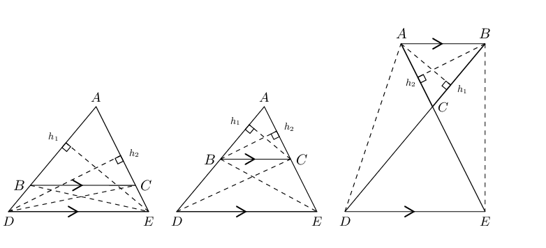
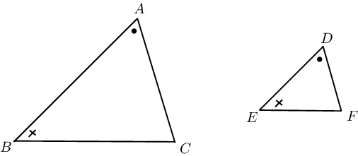
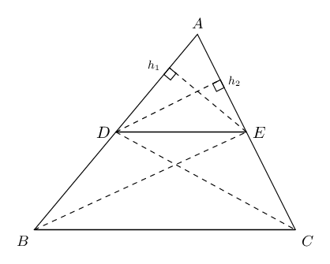
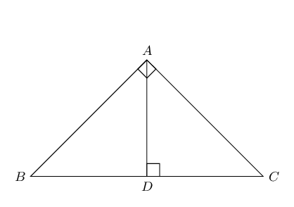

## 8.7 Summary (EMCJJ)

- A ratio describes the relationship between two quantities which have the same units.
          \[x:y \quad \text{ or } \quad \frac{x}{y} \quad \text{ or } \quad x \enspace \text{ to } \enspace y\]
- If two or more ratios are equal to each other \(\left( \frac{m}{n} = \frac{p}{q} \right)\), then \(m\) and
            \(n\) are in the same proportion as \(p\) and \(q\).
- A polygon is a plane, closed shape consisting of three or more line segments.
- Triangles with equal heights have areas which are proportional to their bases.
- Triangles with equal bases and between the same parallel lines are equal in area.
- Triangles on the same side of the same base and equal in area lie between parallel lines.
- A line drawn parallel to one side of a triangle divides the other two sides of the triangle in the same
            proportion.
  
- **Converse: proportion theorem**
  If a line divides two sides of a triangle in the same proportion, then the line is parallel to the third
            side.
- **Special case: the mid-point theorem **
  The line joining the mid-points of two sides of a triangle is parallel to the third side and equal to half
            the length of the third side.
  If \(AB = BD\) and \(AC = CE\), then \(BC \parallel DE\) and \(BC = \frac{1}{2}DE\).
  
- **Converse: the mid-point theorem**
  The line drawn from the mid-point of one side of a triangle parallel to another side, bisects the third side
            of the triangle.
  If \(AB = BD\) and \(BC \parallel DE\), then \(AC = CE\).
- Polygons are similar if they are the same shape but differ in size. One polygon is an enlargement of the
            other.
- Two polygons with the same number of sides are similar when:
  2. All pairs of corresponding angles are equal, **and**
  4. All pairs of corresponding sides are in the same proportion.
- If two triangles are equiangular, then the triangles similar.
  
- Triangles with sides in proportion are equiangular and therefore similar.
  
- The square on the hypotenuse of a right-angled triangle is equal to the sum of the squares on the other two
            sides.
  
- **Converse: theorem of Pythagoras**
  If the square of one side of a triangle is equal to the sum of the squares of the other two sides of the
            triangle, then the angle included by these two sides is a right angle.
