## End of chapter exercises

### Textbook Exercise 8.10

**Problem:**
Calculate \(SV\)

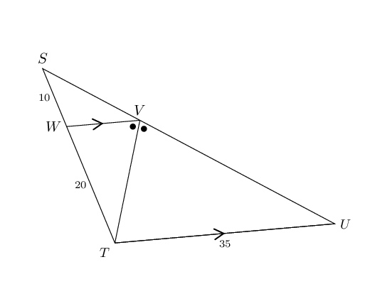

**Solution:**
\[\begin{array}{rll}
                        V\hat{T}U & = W\hat{V}T & \quad \text{(alt. } \angle \text{s}, WV \parallel TU) \\
                        \therefore TU & = VU = 35 & \quad \text{(isosceles } \triangle \text{)} \\
                        \frac{SW}{WT} & = \frac{SV}{VU} & \quad \text{(proportion Theorem)} \\
                        \therefore SV & = \frac{SW.VU}{WT} & \\
                        & = \frac{(10)(35)}{20} & \\
                        & = \text{17,5}\text{ units} & \\
                        \end{array}\]

**Problem:**
\(\frac{CB}{YB}=\frac{3}{2}\). Find \(\frac{DS}{SZ}\).

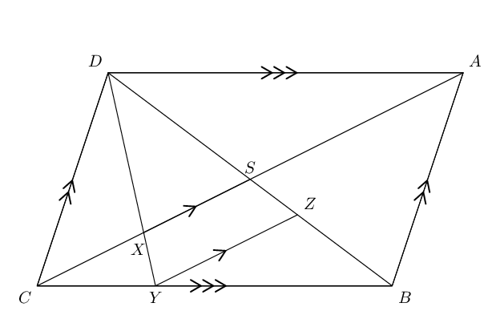

**Solution:**
\[\begin{array}{rll}
                        DABC & \text{ is a parallelogram } & (DA \parallel CB \text{ and } DC \parallel AB)\\
                        DS &= SB & (\text{diagonals bisect})\\
                        & & \\
                        \dfrac{SZ}{ZB} &= \dfrac{CY}{YB} = \frac{3}{2} & (CS \parallel YZ)\\
                        & & \\
                        \dfrac{SZ}{SB} &= \dfrac{CY}{CB} = \frac{3}{5} & (CS \parallel YZ)\\
                        & & \\
                        \therefore SZ &= \frac{3}{5} SB & \\
                        & & \\
                        \therefore \dfrac{DS}{SZ} &= \dfrac{DS}{\frac{3}{5} SB} & (DS = SB) \\
                        & & \\
                        &= \frac{5}{3} &
                        \end{array}\]

**Problem:**
Using the following figure and lengths, find \(IJ\) and \(KJ\) (correct to one decimal place).

\(HI= \text{20}\text{ m},KL= \text{14}\text{ m}, JL=\text{18}\text{ m}\) and \(HJ=\text{32}\text{
                        m}\).

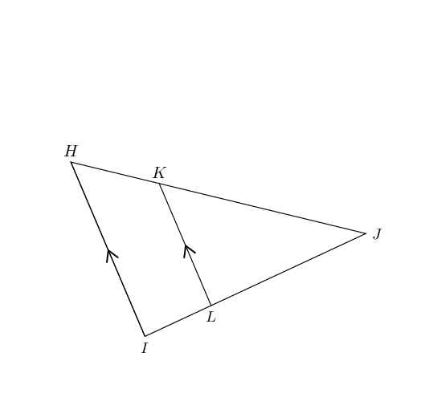

**Solution:**
\[\begin{array}{rll}
                        \dfrac{IJ}{LJ} & = \dfrac{HI}{KL} & \quad \text{(proportion Theorem)}\\
                        & & \\
                        IJ & = \dfrac{HI}{KL}(LJ) & \\
                        & & \\
                        & = \dfrac{20}{14}(18) & \\
                        & & \\
                        & = \dfrac{180}{7} & \\
                        & & \\
                        & = \text{25,7}\text{ m} &
                        \end{array}\]

\[\begin{array}{rll}
                        KJ & = \dfrac{LJ}{IJ}(HJ) & \\
                        & & \\
                        & = \dfrac{18}{\text{25,7}}(32) & \\
                        & & \\
                        & = \text{22,4}\text{ m} & \\
                        \end{array}\]

**Problem:**
Find \(FH\) in the following figure.

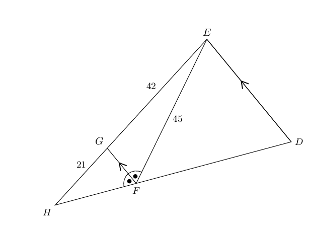

**Solution:**
\[\begin{array}{rll}
                    G\hat{F}H & = \hat{D} & \text{(corresp. } \angle \text{s}, GF \parallel ED) \\
                    G\hat{F}E & = F\hat{E}D & \text{(alt. } \angle \text{s}, GF \parallel ED) \\
                    \therefore F\hat{E}D & = \hat{D} & \\
                    \therefore EF &= FD = \text{45}\text{ cm} & \\
                    \frac{HF}{FD } &= \frac{21}{42} & \\
                    &= \frac{1}{2} & \\
                    \therefore HF & = \frac{1}{2}(45) & \\
                    & = \text{23,5}\text{ cm} &
                    \end{array}\]

**Problem:**
In \(\triangle GHI\), \(GH\parallel LJ\), \(GJ\parallel LK\) and \(\frac{JK}{KI}=\frac{5}{3}\).
                        Determine \(\frac{HJ}{KI}\).

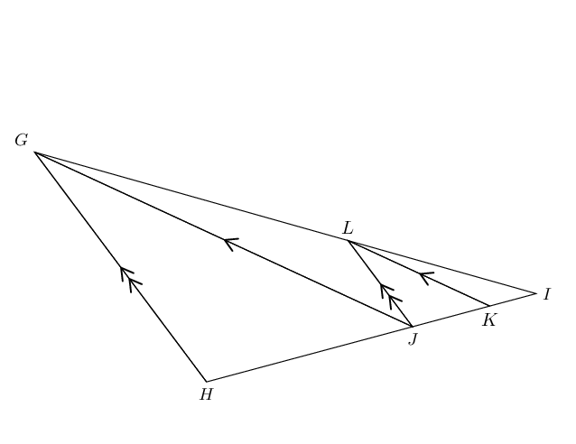

**Solution:**
\[\begin{array}{rll} L\hat{I}J & = G\hat{I}H &\\
                    J\hat{L}I & = H\hat{G}I & \text{(corresp. }\angle \text{s}, HG \parallel JL) \\
                    \therefore \triangle LIJ & \enspace ||| \enspace \triangle GIH & \text{(Equiangular
                    }\triangle \text{s)}
                    \end{array}\]

                    \[\begin{array}{rll}
                    \frac{HJ}{JI}& =\frac{GL}{LI} & \left(\triangle LIJ \enspace ||| \enspace \triangle
                    GIH\right)\\
                    \text{and }\frac{GL}{LI}& =\frac{JK}{KI} & \left(\triangle LIK \enspace ||| \enspace
                    \triangle GIJ\right)\\
                    & =\frac{5}{3} \\
                    \therefore \frac{HJ}{JI}& =\frac{5}{3} \end{array}\]

                    \begin{align*} \frac{HJ}{KI} & = \frac{HJ}{JI} \times \frac{JI}{KI} \end{align*}

                    \begin{align*} JI & = JK+KI \\ & = \frac{5}{3}KI+KI \\ & = \frac{8}{3}KI \\
                    \frac{JI}{KI} & = \frac{8}{3} \\ & \\ \frac{HJ}{KI} & = \frac{HJ}{JI} \times
                    \frac{JI}{KI} \\ & = \frac{5}{3}\times \frac{8}{3} \\ & = \frac{40}{9} \end{align*}

**Problem:**
\(BF=\text{25}\text{ m}\), \(AB=\text{13}\text{ m}\), \(AD=\text{9}\text{ m}\),
                        \(DF=\text{18}\text{ m}\).

Calculate the lengths of \(BC\), \(CF\), \(CD\), \(CE\) and \(EF\), and find the ratio
                        \(\frac{DE}{AC}\).

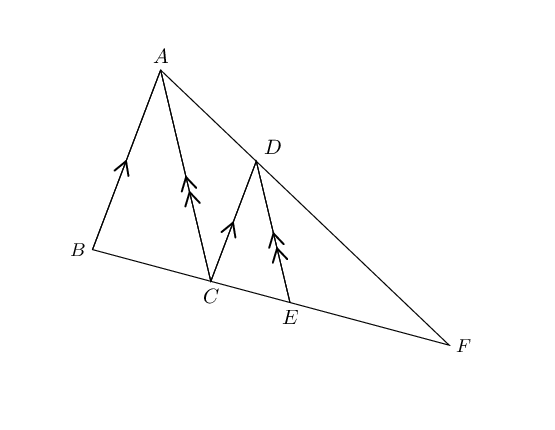

**Solution:**
\[\begin{array}{rll}
                    \frac{BC}{BF} & = \frac{AD}{AF} = \frac{9}{27} = \frac{1}{3} & (CD \parallel BA) \\
                    \therefore BC & = \frac{1}{3} \times 25 & \\
                    &= \text{8,3}\text{ m} & \\
                    & & \\
                    CF &= BF - BC & \\
                    &= 25 - \text{8,3} & \\
                    &= \text{16,7}\text{ m} & \\
                    & & \\
                    \frac{CD}{AB} &= \frac{DF}{AF} & (CD \parallel BA) \\
                    CD &= \frac{DF}{AF} \times AB & \\
                    &= \frac{18}{27} \times 13 & \\
                    &= \text{8,7}\text{ m} & \\
                    & & \\
                    \frac{CE}{CF} &= \frac{AD}{AF} & (DE \parallel AC) \\
                    CE &= \frac{AD}{AF} \times CF & \\
                    &= \frac{9}{27} \times \text{16,7} & \\
                    &= \text{5,6}\text{ m} & \\
                    & & \\
                    EF &= BF - (BC + CE) & \\
                    &= 25 - (\text{8,3} - \text{5,6}) & \\
                    &= \text{11,1}\text{ m} &
                    \end{array}\]

**Problem:**
In \(\triangle XYZ\), \(X\hat{Y}Z =\text{90}°\) and \(YT \perp XZ\). If \(XY =
                        \text{14}\text{ cm}\) and \(XT = \text{4}\text{ cm}\), determine \(XZ\) and \(YZ\) (correct to
                        two decimal places).

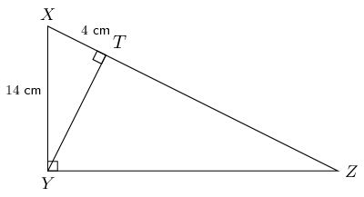

**Solution:**
Use the theorem of Pythagoras to determine \(YT\):

                    \[\begin{array}{rll}
                    \text{In } \triangle XTY, \quad YT^{2} &= XY^{2} - XT^{2} & (\text{Pythagoras}) \\
                    &= 14^{2} - 4^{2} & \\
                    &= 196 - 16 & \\
                    \therefore YT &= \sqrt{180} & \\
                    &= \sqrt{36 \times 5} & \\
                    &= 6 \sqrt{5} ~\text{cm} &
                    \end{array}\]

Use proportionality to determine \(XZ\) and \(YZ\):

                    \[\begin{array}{rll}
                    X\hat{Y}Z &= \text{90}° & \text{(given)} \\
                    YT &\perp XZ & \text{(given)} \\
                    \therefore \enspace \triangle XYT \enspace & ||| \enspace \triangle YZT \enspace ||| \enspace
                    \triangle XZY & (\text{right-angled } \triangle \text{s}) \\
                    & & \\
                    \therefore \dfrac{YT}{TZ} &= \dfrac{XT}{YT} & (\triangle YZT \enspace ||| \enspace \triangle
                    XYT ) \\
                    & & \\
                    \therefore YT^{2} &= TZ \cdot XT & \\
                    & & \\
                    \left( 6 \sqrt{5} \right)^{2} &= TZ \cdot 4 & \\
                    & & \\
                    \therefore TZ &= 45 & \\
                    & & \\
                    \text{And } XZ &= XT + TZ & \\
                    &= 4 + 45 & \\
                    &= \text{49}\text{ cm} & \\
                    & & \\
                    \text{In } \triangle XYZ, \quad YZ^{2} &= XZ^{2} - XY^{2} & (\text{Pythagoras}) \\
                    &= 49^{2} - 14^{2} & \\
                    \therefore YZ &= \sqrt{2205} & \\
                    &= \text{46,96}\text{ cm} &
                    \end{array}\]

**Problem:**
Given the following figure with the following lengths, find \(AE\), \(EC\) and \(BE\).

\(BC=15\) cm, \(AB=4\) cm, \(CD=18\) cm, and \(ED=9\) cm.

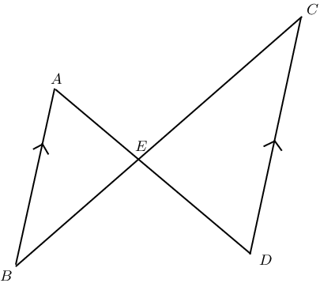

**Solution:**
\[\begin{array}{rll}
                        B\hat{A}E & = C\hat{D}E & \text{(alt. } \angle \text{s}, AB \parallel CD) \\
                        A\hat{B}E & = D\hat{C}E & \text{(alt. } \angle \text{s}, AB \parallel CD) \\
                        A\hat{E}B & = D\hat{E}C & \text{(vert. opp. } \angle \text{s)}\\
                        \therefore \triangle AEB & \enspace ||| \enspace \triangle DEC & \text{(AAA)}\\
                        \therefore \frac{AE}{DE} & = \frac{AB}{DC} = \frac{4}{18} = \frac{2}{9} & (\triangle AEB
                        \enspace ||| \enspace \triangle DEC) \\
                        & & \\
                        AE & = \dfrac{2}{9} DE & \\
                        & & \\
                        & = \dfrac{2}{9} (9) & \\
                        & & \\
                        & = \text{2}\text{ cm} & \\
                        \end{array}\]

\[\begin{array}{rll}
                        \frac{EC}{BC} & = \dfrac{ED}{AD} = \dfrac{9}{11} & (AB \parallel CD) \\
                        & & \\
                        EC & = \dfrac{ED}{AD}(BC) & \\
                        & & \\
                        & = \dfrac{9}{11}(15) & \\
                        & & \\
                        & = \text{12,3}\text{ cm} & \\
                        \end{array}\]

\[\begin{array}{rll}
                        \frac{BE}{BC} & = \dfrac{AE}{AD} = \dfrac{2}{11} & (AB \parallel CD) \\
                        & & \\
                        BE & = \dfrac{AE}{AD}(BC) & \\
                        & & \\
                        & = \dfrac{2}{11}(15) & \\
                        & & \\
                        & = \text{2,7}\text{ cm} & \\
                        \end{array}\]

\(NKLM\) is a parallelogram with \(T\) on \(KL\).

\(NT\) produced meets \(ML\) produced at \(V\). \(NT\) intercepts \(MK\) at \(X\).

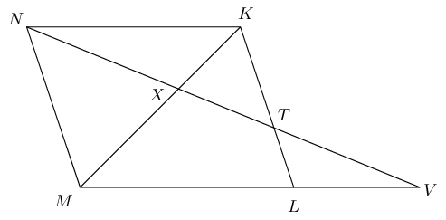

**Problem:**
Prove that \(\dfrac{XT}{NX} = \dfrac{XK}{MX}\).

**Solution:**
In \(\triangle TXK\) and \(\triangle NXM\):

                        \[\begin{array}{rll}
                        X\hat{T}K&= X\hat{N}M & (\text{alt. } \angle \text{s, } NK \parallel MV) \\
                        N\hat{X}M&= T\hat{X}K & (\text{vert. opp. } \angle \text{s}) \\
                        \therefore \triangle TXK & \enspace ||| \enspace \triangle NXM & (\text{AAA}) \\
                        \therefore \dfrac{TX}{NX} &= \dfrac{XK}{XM} &
                        \end{array}\]

**Problem:**
Prove \(\triangle VXM \enspace ||| \enspace \triangle NXK\).

**Solution:**
In \(\triangle VXM \text{ and } \triangle NXK\):

                        \[\begin{array}{rll}
                        \hat{V}&= X\hat{N}K & (\text{alt. } \angle \text{s, } NK \parallel MV) \\
                        M\hat{X}V&= K\hat{X}N & (\text{vert. opp. } \angle \text{s}) \\
                        \therefore \triangle VXM& \enspace ||| \enspace \triangle NXK & (\text{AAA})
                        \end{array}\]

**Problem:**
If \(XT = \text{3}\text{ cm}\) and \(TV = \text{4}\text{ cm}\), calculate \(NX\).

**Solution:**
\[\begin{array}{rll}
                        \dfrac{VX}{NX} &= \dfrac{XM}{XK} & (\triangle VXM \enspace ||| \enspace \triangle NXK
                        \text{, proved in (b)}) \\
                        \text{But } \dfrac{XM}{XK} &= \dfrac{NX}{TX} & (\text{proved in (a)}) \\
                        \therefore \dfrac{VX}{NX} &= \dfrac{NX}{TX} & \\
                        NX^{2} &= VX.TX & \\
                        NX^{2}&= 3 \times 4 & \\
                        NX &= \sqrt{12} & \\
                        &= 2 \sqrt{3} \text{ cm} &
                        \end{array}\]

\(MN\) is a diameter of circle \(O\). \(MN\) is produced to \(R\) so that \(MN =2NR\).

\(RS\) is a tangent to the circle and \(ER \perp MR\). \(MS\) produced meets \(RE\) at \(E\).

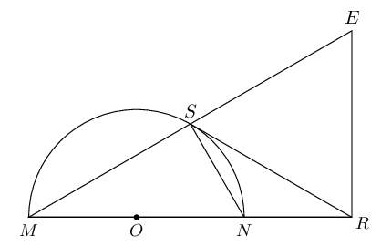

Prove that:

**Problem:**
\(SNRE\) is a cyclic quadrilateral

**Solution:**
\[\begin{array}{rll}
                        M\hat{S}N&= \text{90}° & (\angle \text{ in semi-circle}) \\
                        N\hat{R}E&=\text{90}° & (\text{given}) \\
                        \therefore SNRE&\text{ is a cyclic quad. } & (\text{ext. }\angle = \text{ opp. int. }
                        \angle)
                        \end{array}\]

**Problem:**
\(RS = RE\)

**Solution:**
\[\begin{array}{rll}
                        N\hat{S}R&=\hat{M} = x & (\text{tangent/chord}) \\
                        \therefore E\hat{S}R&= \text{90}° - x & \\
                        \hat{E}&= \text{90}° - x & (MRE = \text{90}°, \enspace \hat{M} = x) \\
                        \therefore E\hat{S}R&= \hat{E} & \\
                        \therefore RS&= RE & (\text{isos. } \triangle)
                        \end{array}\]

**Problem:**
\(\triangle MSN \enspace ||| \enspace \triangle MRE\)

**Solution:**
In \(\triangle MSN\) and \(\triangle MRE\):

                        \[\begin{array}{rll}
                        \hat{M} &=\hat{M} & \\
                        M\hat{S}N &= \text{90}° & (\angle \text{ in semi-circle}) \\
                        M\hat{R}E &= \text{90}° & (\text{given}) \\
                        \therefore M\hat{S}N &= M\hat{R}E & \\
                        \therefore \triangle MSN& \enspace ||| \enspace \triangle MRE & (\text{AAA})
                        \end{array}\]

**Problem:**
\(\triangle RSN \enspace ||| \enspace \triangle RMS\)

**Solution:**
In \(\triangle RSN\) and \(\triangle RMS\):

                        \[\begin{array}{rll}
                        \hat{R}&= \hat{R} & (\text{common } \angle) \\
                        R\hat{S}N&= \hat{M} & (\text{tangent/chord}) \\
                        \therefore \triangle RSN & \enspace ||| \enspace \triangle RMS & (\text{AAA})
                        \end{array}\]

**Problem:**
\(RE^{2} = RN.RM\)

**Solution:**
\[\begin{array}{rll}
                        \dfrac{RS}{RN} &= \dfrac{RM}{RS} & \\
                        RS^{2} &= RN.RM & \\
                        \text{But } RS &= RE & \\
                        RE^{2} &= RN.RM &
                        \end{array}\]

\(AC\) is a diameter of circle \(ADC\). \(DB \perp AC\).

\(AC = d, AD = c, DC = a \text{ and } DB = h\).

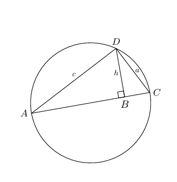

**Problem:**
Prove that \(h = \dfrac{ac}{d}\).

**Solution:**
\[\begin{array}{rll}
                        \triangle ADB& \enspace ||| \enspace \triangle DCB \enspace ||| \enspace \triangle ACD &
                        (A\hat{D}C = \text{90}°, DB \perp AC) \\
                        \therefore \dfrac{DB}{AD}&= \dfrac{CD}{AC} & \\
                        \therefore \dfrac{h}{c}&= \dfrac{a}{d} & \\
                        \therefore h&= \dfrac{ac}{d} &
                        \end{array}\]

**Problem:**
Hence, deduce that \(\enspace \dfrac{1}{h^{2}}=\dfrac{1}{a^{2}}+\dfrac{1}{c^{2}}\).

**Solution:**
\[\begin{array}{rll}
                        h^{2}&= \dfrac{a^{2}c^{2}}{d^{2}} & \\
                        \text{But } d^{2}&= a^{2} + c^{2} & (\text{In } \triangle ADC, \hat{D} =
                        \text{90}°, \text{ Pythagoras}) \\
                        \therefore h^{2}&= \dfrac{a^{2}c^{2}}{a^{2}+c^{2}} & \\
                        \therefore \dfrac{1}{h^{2}}&= \dfrac{a^{2}+c^{2}}{a^{2}c^{2}} & \\
                        \dfrac{1}{h^{2}}&= \dfrac{a^{2}}{a^{2}c^{2}} + \dfrac{c^{2}}{a^{2}c^{2}} & \\
                        \dfrac{1}{h^{2}}&= \dfrac{1}{c^{2}} + \dfrac{1}{a^{2}} &
                        \end{array}\]

\(RS\) is a diameter of the circle with centre \(O\). Chord \(ST\) is produced to \(W\).
                        Chord \(SP\) produced meets the tangent \(RW\) at \(V\).
                        \(\hat{\text{R}}_{1} = \text{50}°\).

[NCS, Paper 3, November 2011]

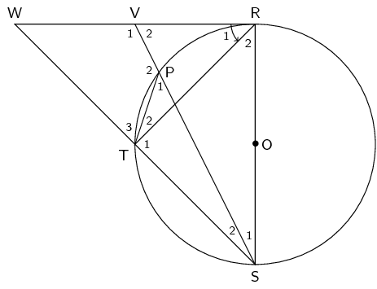

**Problem:**
Calculate the size of \(\text{W}\hat{\text{R}}\text{S}\).

**Solution:**
\(W\hat{R}S = \text{90}°\qquad (\text{tangent } \perp \text{ radius})\)

**Problem:**
Find \(\hat{\text{W}}\).

**Solution:**
\[\begin{array}{rll}
                        R\hat{S}T & = \text{50}° & \qquad(\text{tangent chord th.})\\
                        \hat{W} & = \text{40}° & \qquad(\angle \text{ sum } \triangle)
                        \end{array}\]

**OR**

                        \[\begin{array}{rll}
                        \hat{T}_{1} & = \text{90}° & \qquad(\angle \text{s in semi-circle})\\
                        \hat{W} + \hat{R}_{1} & = \hat{T}_{1} & \qquad(\text{ ext. } \angle \triangle)\\
                        \hat{W} & = \text{40}° &
                        \end{array}\]

**Problem:**
Determine the size of \(\hat{\text{P}}_1\).

**Solution:**
\[\begin{array}{rll}
                        \hat{R}_{2} & = \text{40}° & \qquad(\text{tangent } \perp \text{ radius})\\
                        \hat{P}_{1} & = \text{40}° & \qquad(\angle \text{s in same seg.})
                        \end{array}\]

**Problem:**
Prove that \(\hat{\text{V}}_1 = \text{P}\hat{\text{T}}\text{S}\).

**Solution:**
\[\begin{array}{rll}
                        \hat{P}_{1} & = \hat{W} & \qquad(= \text{40}°)\\
                        \text{WVPT is}& \text{ a} \text{ cyclic quadrilateral} &(\text{ext. } \angle = \text{
                        int. opp.})\\
                        \hat{V}_{1} & = P\hat{T}S & \qquad (\text{ext. } \angle \text{ cyclic quad.})
                        \end{array}\]

**OR**

                        \[\begin{array}{rll}
                        \hat{T}_{1} & =\text{90}° & \qquad(\angle \text{s in semi-circle})\\
                        P\hat{T}S & = \text{90}° + \hat{T}_{2} & \\
                        \hat{T}_{2} & = \hat{S}_{1} & \qquad(\angle \text{s in same seg.})\\
                        P\hat{T}S & = \text{90}° + \hat{S}_{1} & \qquad(\text{ext. } \angle \triangle) \\
                        \hat{V}_{1} & = P\hat{T}S & \\
                        \end{array}\]

**OR**

                        \[\begin{array}{rll}
                        \hat{P}_{2} & = \text{140}° & \qquad(\angle \text{s on str. line})\\
                        \hat{W} + \hat{P}_{2} & = \text{180}° & \\
                        \text{WVPT} &\text{is a cyclic quadrilateral} & \qquad(\text{opp. } \angle \text{s
                        suppl})\\
                        \hat{V}_{1} & = P\hat{T}S & \qquad(\text{ext } \angle \text{ cyclic quad})
                        \end{array}\]

**OR**

                        \[\begin{array}{rll}
                        \hat{V}_{1} & = \hat{R}_{1} + \hat{R}_{2} + \hat{S}_{1} & \qquad(\text{ext. } \angle
                        \triangle)\\
                        \hat{V}_{1} & = \text{90}° + \hat{S}_{1} & \\
                        P\hat{T}S & = \text{90}° + \hat{T}_{2} & \\
                        \text{but } \hat{T}_{2} & = \hat{S}_{1} & \qquad(\angle \text{s in same seg.})\\
                        \hat{V}_{1} & = P\hat{T}S &
                        \end{array}\]

**OR**

In \(\triangle PTS\) and \(\triangle WVS\)

                        \[\begin{array}{rll}
                        \hat{P}_{1} & = \hat{W} & \qquad(\text{40}°) \\
                        \hat{S}_{2} & \text{ is common} &\\
                        \hat{V}_{1} & = P\hat{T}S & \qquad (\angle \text{ sum } \triangle)
                        \end{array}\]

\(ABCD\) is a cyclic quadrilateral and \(BC = CD.\)

\(ECF\) is a tangent to the circle at \(C\). \(ABE\) and \(ADF\) are straight lines.

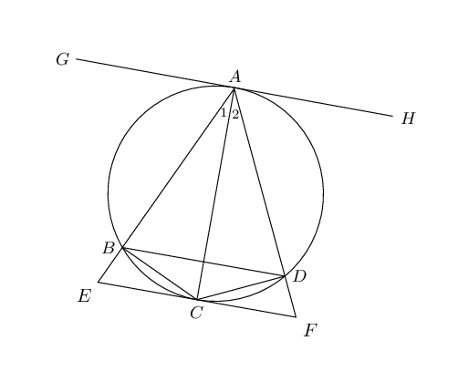

Prove:

**Problem:**
\(AC \text{ bisects } E\hat{A}F\)

**Solution:**
\[\begin{array}{rll}
                        BC &= CD & (\text{given}) \\
                        \therefore B\hat{A}C &= D\hat{A}C & (\angle \text{s on equal chords})
                        \end{array}\]

**Problem:**
\(BD \parallel EF\)

**Solution:**
\[\begin{array}{rll}
                        D\hat{C}F&= \hat{A_{2}} & (\text{tangent/chord}) \\
                        B\hat{D}C&= \hat{A_{1}} & (\angle \text{s on same chord}) \\
                        \hat{A_{1}} &= \hat{A_{2}} & (\text{proved in (a)}) \\
                        \therefore B\hat{D}C &= D\hat{C}F & \\
                        \therefore BD & \parallel EF & (\text{alt. } \angle \text{s are equal})
                        \end{array}\]

**Problem:**
\(\triangle ADC \enspace ||| \enspace \triangle CBE\)

**Solution:**
In \(\triangle ADC\) and \(\triangle CBE\):

                        \[\begin{array}{rll}
                        \hat{A_{2}} &= D\hat{B}C & (\angle \text{s on chord } CD) \\
                        &= B\hat{C}E & (\text{alt. } \angle \text{s, } BD \parallel EF) \\
                        A\hat{D}C &= E\hat{B}C & (\text{ext. } \angle \text{ of a cyclic quad}) \\
                        \therefore \triangle ADC & \enspace ||| \enspace \triangle CBE & (\text{AAA})
                        \end{array}\]

**Problem:**
\(DC^{2} = AD.BE\)

**Solution:**
\[\begin{array}{rll}
                        \dfrac{DC}{AD} &= \dfrac{BE}{BC} & (\triangle ADC \enspace ||| \enspace \triangle CBE)
                        \\
                        \text{But } DC &= BC & (\text{given}) \\
                        \therefore \dfrac{DC}{AD} &= \dfrac{BE}{DC} & \\
                        \therefore DC^{2} &= AD.BE &
                        \end{array}\]

\(CD\) is a tangent to circle \(ABDEF\) at \(D\). Chord \(AB\) is produced to \(C\). Chord \(BE\)
                        cuts chord \(AD\) in \(H\) and chord \(FD\) in \(G\). \(AC \parallel FD\) and \(EF = AB\). Let
                        \(D_{4} = x\) and \(D_{1} = y\).

[NCS, Paper 3, November 2011]

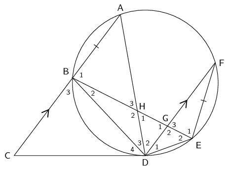

**Problem:**
Determine THREE other angles that are each equal to \(x\).

**Solution:**
\[\begin{array}{r@{\;}l@{\quad}l}
                        \hat{A} & = \hat{D}_{4} = x & (\text{tangent chord th.})\\
                        \hat{E}_{2} & = x & (\text{tangent chord th.})\\
                        \hat{D}_{2} & = \hat{A} = x & (\text{alt. } \angle \text{s, } CA \parallel DF)
                        \end{array}\]

**Problem:**
Prove that \(\triangle \text{BHD} \enspace ||| \enspace \triangle \text{FED}\).

**Solution:**
In \(\triangle BHD\) and \(\triangle FED\)

2. \(\hat{B}_{2} = \hat{F} \quad(\angle \text{s in same seg.})\)
4. \(\hat{D}_{3} = \hat{D}_{1} \quad(\text{chord subtends } = \angle \text{s})\)

\(\triangle BHD \enspace ||| \enspace \triangle FED \quad (\angle \angle \angle)\)

**Problem:**
Hence, or otherwise, prove that \(AB \cdot BD = FD \cdot BH\).

**Solution:**
\[\begin{array}{r@{\;}l@{\quad}l}
                        \frac{FE}{BH} & = \frac{FD}{BD} & (||| \enspace \triangle\text{s})\\
                        \text{But } FE & = AB & (\text{given})\\
                        \frac{AB}{BH} & = \frac{FD}{BD} &\\
                        AB \cdot BD & = FD \cdot BH &
                        \end{array}\]
