# Chapter 9: Statistics

- It is easy for learners to be intimidated by the formulae in this chapter. Slowly go through
                                  the meaning of each term in the formulae and ensure that learners are familiar with
                                  summation notation.
- Use by hand calculations to aid the understanding of key concepts.
- Calculator skills are very important in this chapter. Methods for SHARP and CASIO
                                  calculators are shown but practical demonstration may be required.
- The formula for population variance and population standard deviation are used and not
                                  sample variance and sample standard deviation.
- Calculation of the correlation coefficient requires the use of the sample standard
                                  deviation, but the concepts of sample and population are beyond the scope of CAPS. The
                                  formula used for the correlation coefficient in this chapter is
                                  \(r=b\frac{\sigma_x}{\sigma_y}\) so as not to confuse learners. The actual formula is
                                  \(r=b\frac{S_{x}}{S_{y}}\), however as this is a ratio, the difference in denominators
                                  between the population standard deviation and sample deviation will cancel. Note that
                                  there are other formulae for the correlation coefficient but these should be avoided as
                                  usage of the population standard deviation will result in erroneous results.
- Discuss the misuse of statistics in the real world and encourage awareness.

## 9.1 Revision (EMCJK)

### Terminology (EMCJM)

<QuizCard id="m12-09-01a" title="Interactive Exercise 9.1" question="The table below is a frequency table which summarises \(\text{20}\) values. The data are grouped into \(\text{4}\) intervals. Interval Frequency \(0 \leq x < 2\) \(\text{8}\) \(2 \leq x < 4\) \(\text{7}\) \(4 \leq x < 6\) \(\text{2}\) \(6 \leq x < 8\) \(\text{3}\) The estimated mean value of these data is calculated using the midpoints of the intervals and the frequency of each interval. This is shown below, but one value is missing and has been replaced by \(n\) . \[                 \begin{aligned}                     \text{Estimated} \atop \text{mean} & = \frac{\left( \begin{array}{c}(1 \cdot 8) \,+ (3 \cdot 7) \,+  \\ (5 \cdot n) + (7 \cdot 3) \end{array} \right)}{20}                 \end{aligned}             \] Answer the two questions below about the calculation of the estimated mean. What is the value of \(n\) in the calculation? Is the value represented by \(n\) a midpoint or a frequency ?" options=["8", "7", "2", "3", "midpoint", "frequency"] answer="2, 1" hint="" explanation="Determine the missing value in the calculation The question asks us to identify the missing value in the calculation of the mean of a table of grouped data. So a good place to start is the definition of the mean. The mean is defined as the sum of a set of values, divided by the number of values in the set. In the case of grouped data, like the ones shown in the frequency table, we do not know the exact value of each data point. Instead we have to assume that each point in a given interval has the value of the midpoint of the interval . We use the midpoint because it is assumed to be the average value within the interval. To find the estimated mean of a set of grouped data, we must multiply the midpoint of each interval by the frequency of that interval. The frequency is the number of times each midpoint value occurs in the data set.Then we add all those numbers up and divide that total by the total number of values in the set. We are told that there are a total of \(\text{20}\) values in the data set. Let's add the midpoint values to the frequency table: Interval Frequency \(0 \leq x < 2\) Midpoint: \(\text{1}\) \(\text{8}\) \(2 \leq x < 4\) Midpoint: \(\text{3}\) \(\text{7}\) \(4 \leq x < 6\) Midpoint: \(\text{5}\) \(\text{2}\) \(6 \leq x < 8\) Midpoint: \(\text{7}\) \(\text{3}\) If we calculate the estimated mean using the information from the frequency table, we end up with the following equation: \[                     \begin{aligned}                         \text{Estimated} \atop \text{mean} & = \frac{\left( \begin{array}{c}(1 \cdot 8) \,+ (3 \cdot 7) \,+  \\ (5 \cdot 2) + (7 \cdot 3) \end{array} \right)}{20}                     \end{aligned}                 \] Comparing this to the expression given in the question, we can see that the missing value is \(\text{2}\) . So the correct answer is \(n = \text{2}\) . Identify whether the value is a midpoint or a frequency Now we need to determine whether \(n\) is a midpoint or a frequency. Comparing the value of \(n\) to the new information in the table, we can see that \(n\) is a frequency. So the correct answer is that \(n\) is a frequency . Submit your answer as: 2 and frequency" />

<QuizCard id="m12-09-01a" title="Interactive Exercise 9.1" question="Estimate the mean value of the data from the table." options=["is", "is not", "A", "B", "C"] answer="15" hint="You should enter a number here. If you want to, you can use a space to separate thousands.                Example: 12 800,25 For scientific notation you need to use the multiply symbol                ( ∗ ) and the exponent symbol ( ^ ). For example 6,673 × 10 −11 should be written as: 6,673 ∗ 10^−11" explanation="Find the midpoints of the intervals In this question we are given a frequency table, and asked to estimate the mean value of the data. The mean of a set of values is the sum of the values, divided by the number of values in the data set. So the first step is to calculate the sum of all the values. The values in the frequency table have been grouped . This means that we do not know the exact values of the data points. We only know which interval the data fall into. So we have to assume that every point in each group has the average value for that group; this is the midpoint of the interval. Interval Frequency \(0 \leq x < 6\) Midpoint: \(\text{3}\) \(\text{5}\) \(6 \leq x < 12\) Midpoint: \(\text{9}\) \(\text{3}\) \(12 \leq x < 18\) Midpoint: \(\text{15}\) \(\text{4}\) \(18 \leq x < 24\) Midpoint: \(\text{21}\) \(\text{7}\) \(24 \leq x < 30\) Midpoint: \(\text{27}\) \(\text{3}\) Calculate the estimated mean To get the estimated mean of the values in each group, we multiply the frequency in each group by the interval midpoint. The sum of all the values is an estimate for the sum of the real data values. \[                         \begin{aligned}                             \text{Sum} = \left( \begin{array}{c}(\text{3} \cdot 5) \,+ (\text{9} \cdot 3) \,+  \\ (\text{15} \cdot 4) \,+ (\text{21} \cdot 7) \,+  \\ (\text{27} \cdot 3) \,\end{array} \right)                         \end{aligned}                     \] We then divide this value by the total number of values in the data set. We are told in the question that there are \(\text{22}\) values in the data set. \[                         \begin{array}{c}                             \text{Number} = 22                         \end{array}                     \] So now we have all the pieces we need to calculate the estimated mean. \[                         \begin{aligned}                             \text{Estimated} \atop \text{mean} & = \frac{\text{Sum}}{\text{Number}}\\[0.2cm]                             & = \frac{330}{22}\\                             & = 15                         \end{aligned}                     \] So the estimated mean value of the data is \(\text{15}\) . Submit your answer as:" />

<QuizCard id="m12-09-01a" title="Interactive Exercise 9.1" question="\(\text{34}\) data values are grouped into \(\text{5}\) intervals. Each interval has a width of \(\text{20}\) . The results are shown in the histogram below. Note that the first interval is labelled A, the second is labelled B, and so on. NOTE: The bins include the boundaries on the left, and exclude the boundaries on the right. For example: \(20 \leq x < 40\) . Identify the modal interval or intervals. Give any possible value for the median of the data if the data values are all integers. There may be more than one correct value, but you should give only one answer." options=["intervals A and E", "intervals B and E", "intervals A, B, and C", "intervals A, B, and E", "intervals A, C, and E", "intervals B, C, and E"] answer="2, ['60', '61', '62', '63', '64', '65', '66', '67', '68', '69', '70', '71', '72', '73', '74', '75', '76', '77', '78', '79']" hint="" explanation="Find the modal interval or intervals The modal interval is the interval with the most values in it. If there is more than one interval with a maximum number of values then there is more than one modal interval. We can identify the modal interval or intervals on a histogram by looking for the tallest bars. The height of the bars indicate how many values are in the interval. In this case, there are \(\text{3}\) modal intervals. You can see these highlighted below. Just like with the mode for ungrouped data, there can be more than one modal interval. In this case, intervals A, B, and C all have more values than any other interval. NOTE: The name modal interval comes from the word mode . Find the interval where the median is For the second question we need to give any possible value for the median of the data. So we need to find the interval where the median is. To find the interval which contains the median we start with the total number of values. In this case, that is \(\text{34}\) (as given in the question). And that means the data split into two equal batches of \(\text{17}\) values with no single data value in the middle . For a case like this, we need to look for the interval that contains both the \(17^{\text{th}}\) and the \(18^{\text{th}}\) value because the median is the mean of those two values. \[                     \begin{array}{ccc}                         \underbrace{24 \;; \; 39 \;; \; \ldots \ldots} &  & \underbrace{\ldots \ldots \;; \; 105 \;; \; 107} \\[-0.25cm]                          & \uparrow &  \\                         \begin{array}{c}17 \text{ smallest}\\[-0.1cm]\text{values}\end{array} & \begin{array}{c} \text{no number}\\[-0.1cm] \text{here}\end{array} & \begin{array}{c}17 \text{ largest}\\[-0.1cm]\text{values}\end{array}                     \end{array}                 \] So starting with the first interval, we need to add up how many data values there are until we find the interval which contains the \(17^{\text{th}}\) value. The first \(\text{2}\) intervals combined have fewer than \(\text{17}\) values. But if we add the third interval we get a total of \(\text{24}\) , which means that the median is in the third interval. Pick a number from the interval Now we know that the median is in the interval \(60 \leq x < 80\) . We also know from the question statement that all data values are integers. So the median might be as low as \(\text{60}\) or as high as \(\text{79}\) (it cannot be \(\text{80}\) because that value belongs in the next interval). So any of these values are possible for the median: \[                     \begin{array}{c}                         60\, ;61\, ;62\ldots77\, ;78\, ;79                     \end{array}                 \] The modal intervals are intervals A, B, and C . The median could be any of these values: \[                     \begin{aligned}                         60\, ;61\, ;62\ldots77\, ;78\, ;79                     \end{aligned}                 \] Submit your answer as: intervals A, B, and C and" />

<QuizCard id="m12-09-01a" title="Interactive Exercise 9.1" question="A group of \(\text{10}\) students count the number of coins they each have. This is the data they collect: \[                 \begin{array}{c}                     3 \; \; 5 \; \; 5 \; \; 7 \; \; 8 \; \;  \\ 1 \; \; 1 \; \; 9 \; \; 5 \; \; 8 \; \;                  \end{array}             \] Calculate the range of values in the data set." options=[] answer=" 8 " hint="You should enter a number here. If you want to, you can use a space to separate thousands.                Example: 12 800,25 For scientific notation you need to use the multiply symbol                ( ∗ ) and the exponent symbol ( ^ ). For example 6,673 × 10 −11 should be written as: 6,673 ∗ 10^−11" explanation="Find the maximum and minimum values and calculate the range The range of a set of data values is the difference between the largest and smallest values in the set. So we need to find the difference between the maximum and minimum data values. Firstly, we find the maximum value in the data set. \[\begin{array}{c}\text{Maximum value } = \text{9}\end{array}\] Then we find the minimum value in the data set. \[\begin{array}{c}\text{Minimum value } = \text{1}\end{array}\] Finally, we calculate the range of the data set. \[                     \begin{aligned}                         \text{Range} & = \text{Maximum} - \text{Minimum}\\                         & = (\text{9}) - (\text{1}) \\                         & = \text{8}                     \end{aligned}                 \] So the range of the data is \(\text{8}\) . Submit your answer as:" />

<QuizCard id="m12-09-01a" title="Interactive Exercise 9.1" question="Percentile is a value which tells us how far along through an ordered data set a certain value sits. Percentile is related to minimum and maximum values in a data set and to the quartiles. From the dropdown menu below, choose the value which corresponds to the \(95^{\text{th}}\) percentile." options=["minimum value", "first quartile", "median (second quartile)", "third quartile", "maximum value", "none of the above"] answer="none of the above" hint="" explanation="Use the definition of the quartiles Quartiles break a data set up into four groups. We get those four groups by 'breaking' the data set when the percentile is a multiple of 25. Percentile Position in the data Value in the data set \(0^{\text{th}}\) beginning minimum value \(25^{\text{th}}\) 1 quarter of the way first quartile \(50^{\text{th}}\) 2 quarters of the way median (second quartile) \(75^{\text{th}}\) 3 quarters of the way third quartile \(100^{\text{th}}\) upper limit of the data maximum value For this question we have the \(95^{\text{th}}\) percentile. This does not correspond to any of the quartile boundaries, which are all multiples of 25. The correct choice from the dropdown menu is: none of the above . Submit your answer as: none of the above" />

<QuizCard id="m12-09-01a" title="Interactive Exercise 9.1" question="Suppose a data set has a range of \(\text{0}\) . If the maximum value in the data set is \(\text{39}\) , what is the minimum value in the data set?" options=[] answer="39" hint="You should enter a number here. If you want to, you can use a space to separate thousands.                Example: 12 800,25 For scientific notation you need to use the multiply symbol                ( ∗ ) and the exponent symbol ( ^ ). For example 6,673 × 10 −11 should be written as: 6,673 ∗ 10^−11" explanation="Use the range to find the answer The range of a data set tells us how spread out the data are: it is the difference between the largest and smallest values. In this question, we do not know what the data values are, but we know that the range of the data is \(\text{0}\) . We also know that the maximum value is \(\text{39}\) . We can solve this question using the equation for the range: \[\begin{array}{c}\text{range = maximum - minimum}\end{array}\] However, for this solution let's think through the information that we have. In this case, the range is zero. That means there is no spread in the data: all the values must be equal. In fact, the data must be something like this: \[                     \begin{aligned}                         \{39\; \, ; \;39\; \, ; \;39\; \, ; \;39\; \, ; \;39\}                     \end{aligned}                 \] We do not know how many values there are in the set (there is no information about that). But if the range is zero then there is no separation between the largest and smallest values. All the values must be the same. The minimum value is \(\text{39}\) . Submit your answer as:" />

**Measures of central tendency:**

Provide information on the data values at the centre of the data set.

- The **mean** is the 'average' value of a data set. It is calculated as
                                          \[\bar{x} = \frac{\sum\limits_{i=1}^n x_i}{n}\]
                                          where the \(x_i\) are the data and \(n\) is the number of data entries.
                                          We read \(\bar{x}\) as “x bar”.
- The **median** is the middle value of an ordered data set.
                                                  To find the median, we first sort the data in ascending or descending
                                                  order and then pick out the value in the middle of the sorted list.
                                                  If the middle is in between two values, the median is the average of
                                                  those two values.

**Measures of dispersion:**

Tell us how spread out a data set is.
                                If a measure of dispersion is small, the data are clustered in a small region.
                                If a measure of dispersion is large, the data are spread out over a large region.

- The **range** is the difference between the maximum and minimum
                                                  values in the data set.
- The **inter-quartile range** is the difference between the first
                                                  and third quartiles of the data set.
                                                  The quartiles are computed in a similar way to the median.
                                                  The median is halfway into the ordered data set and is sometimes also
                                                  called the second quartile.
                                                  The first quartile is one quarter of the way into the ordered data set,
                                                  whereas the third quartile is three quarters of the way into the ordered
                                                  data set.
  If you begin numbering your ordered data set with the number 1, the formulae
                                                  for the location of each quartile are as follows:
                                                  \begin{align*}
                                                  \text{Location of } Q_{1} & = \frac{1}{4}(n-1)+1 \\
                                                  \text{Location of } Q_{2} & = \frac{1}{2}(n-1)+1 \\
                                                  \text{Location of } Q_{3} & = \frac{3}{4}(n-1)+1
                                                  \end{align*}
- The **variance** of the data is the average squared distance
                                                  between the mean and each data value.
  The variance of the data is
                                                  \[\sigma^2 = \frac{\sum\limits_{i=1}^n \left(x_i -
                                                  \bar{x}\right)^2}{n}\]
                                                  in a population of \(n\) elements, \(\{x_1; x_2; \ldots; x_n\}\), with a
                                                  mean of \(\bar{x}\).
- The **standard deviation** measures how spread out the values in
                                                  a data set are around the mean.
                                                  More precisely, it is a measure of the average distance between the
                                                  values of the data in the set and the mean.
  The standard deviation of the data is
                                                  \[\sigma = \sqrt{\frac{\sum\limits_{i=1}^n \left(x_i -
                                                  \bar{x}\right)^2}{n}}\]
                                                  in a population of \(n\) elements, \(\{x_1; x_2; \ldots; x_n\}\), with a
                                                  mean of \(\bar{x}\).

The **five number summary** combines a measure of central tendency, the median,
                                with measures of dispersion, namely the range and the inter-quartile range. More
                                precisely, the five number summary is written in the following order:

- minimum;
- first quartile;
- median;
- third quartile;
- maximum.

The five number summary is often presented visually using a **box and whisker
                                        diagram**, illustrated below.

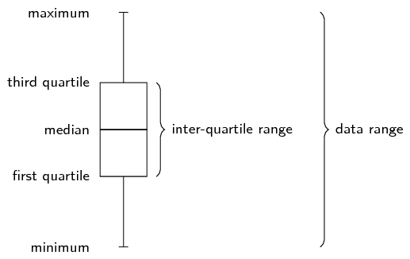

<Callout type="note" title="Note">
<VideoPlayer src="http://www.khanacademy.org/embed_video?v=09Cx7xuIXig" title="Video:
                                                29BS" />
</Callout>

<Callout type="tip" title="Worked example 1: Five number summary">
**Question:**
Draw a box and whisker diagram for the following data set:
                                                \[\text{1,25}\ ;\ \text{1,5}\ ;\ \text{2,5}\ ;\ \text{2,5}\ ;\
                                                \text{3,1}\ ;\ \text{3,2}\ ;\ \text{4,1}\ ;\ \text{4,25}\ ;\
                                                \text{4,75}\ ;\ \text{4,8}\ ;\ \text{4,95}\ ;\ \text{5,1}\]

**Determine the minimum and maximum:**
Since the data set is already ordered, we can read off the minimum as the
                                                first value (\(\text{1,25}\)) and the maximum as the last value
                                                (\(\text{5,1}\)).

**Determine the quartiles:**
There are \(\text{12}\) values in the data set. We can use the figure below
                                                or the formulae to determine where the quartiles are located.

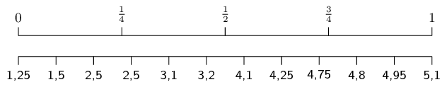

Using the figure above we can see that the median is between the sixth and
                                                seventh values. We can confirm this using the formula:

                                                \begin{align*}
                                                \text{Location of } Q_{2} & = \frac{1}{2}(n-1)+1 \\
                                                &= \frac{1}{2}(11)+1 \\
                                                &=\text{6,5}
                                                \end{align*}

                                                Therefore, the value of the median is
                                                \[\frac{\text{3,2}+\text{4,1}}{2} = \text{3,65}\]

The first quartile lies between the third and fourth values. We can confirm
                                                this using the formula:

                                                \begin{align*}
                                                \text{Location of } Q_{1} & = \frac{1}{4}(n-1)+1 \\
                                                &= \frac{1}{4}(11)+1 \\
                                                &=\text{3,75}
                                                \end{align*}

                                                Therefore, the value of the first quartile is
                                                \[Q_1 = \frac{\text{2,5}+\text{2,5}}{2} = \text{2,5}\]

The third quartile lies between the ninth and tenth values. We can confirm
                                                this using the formula:

                                                \begin{align*}
                                                \text{Location of } Q_{3} & = \frac{3}{4}(n-1)+1 \\
                                                &= \frac{3}{4}(11)+1 \\
                                                &=\text{9,25}
                                                \end{align*}

                                                Therefore, the value of the third quartile is
                                                \[Q_3 = \frac{\text{4,75}+\text{4,8}}{2} = \text{4,775}\]

**Draw the box and whisker diagram:**
We now have the five number summary as (\(\text{1,25}\); \(\text{2,5}\);
                                                \(\text{3,65}\); \(\text{4,775}\); \(\text{5,1}\)).
                                                The box and whisker diagram representing the five number summary is
                                                given below.

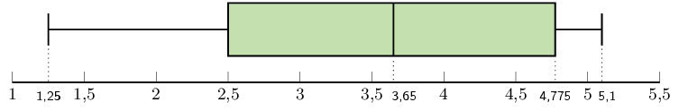
</Callout>

<Callout type="note" title="Note">
<VideoPlayer src="https://www.youtube.com/embed/HvDqbzu0i0E" title="Video:
                                                29BT" />
</Callout>

<Callout type="tip" title="Worked example 2: Variance and standard deviation">
**Question:**
You flip a coin \(\text{100}\) times and it lands on heads \(\text{44}\)
                                                times.
                                                You then use the same coin and do another \(\text{100}\) flips.
                                                This time in lands on heads \(\text{49}\) times.
                                                You repeat this experiment a total of \(\text{10}\) times and get the
                                                following results for the number of heads.
                                                \[\{44; 49; 52; 62; 53; 48; 54; 49; 46; 51\}\]

For the data set above:

- Calculate the mean.
- Calculate the variance and standard deviation using a table.
- Confirm your answer for the variance and standard deviation using a
                                                          calculator.

**Calculate the mean:**
The formula for the mean is
                                                \[\overline{x} = \frac{\sum_{i=1}^n x_i}{n}\]

In this case, we sum the data and divide by \(\text{10}\) to get
                                                \(\overline{x} = \text{50,8}\).

**Calculate the variance using a table:**
The formula for the variance is
                                                \[\sigma^2 = \frac{\sum_{i=1}^n \left(x_i - \overline{x}\right)^2}{n}\]

We first subtract the mean from each data point and then square the result.

| \(x_i\) | \(\text{44}\) | \(\text{49}\) | \(\text{52}\) | \(\text{62}\) | \(\text{53}\) | \(\text{48}\) | \(\text{54}\) | \(\text{49}\) | \(\text{46}\) | \(\text{51}\) |
| --- | --- | --- | --- | --- | --- | --- | --- | --- | --- | --- |
| \(x_i - \overline{x}\) | \(-\text{6,8}\) | \(-\text{1,8}\) | \(\text{1,2}\) | \(\text{11,2}\) | \(\text{2,2}\) | \(-\text{2,8}\) | \(\text{3,2}\) | \(-\text{1,8}\) | \(-\text{4,8}\) | \(\text{0,2}\) |
| \((x_i - \overline{x})^2\) | \(\text{46,24}\) | \(\text{3,24}\) | \(\text{1,44}\) | \(\text{125,44}\) | \(\text{4,84}\) | \(\text{7,84}\) | \(\text{10,24}\) | \(\text{3,24}\) | \(\text{23,04}\) | \(\text{0,04}\) |

The variance is the sum of the last row in this table divided by
                                                \(\text{10}\), so \(\sigma^2 = \text{22,56}\).

**Calculate the variance using a calculator:**
\(\\\)**Using the SHARP EL-531VH calculator:**

Using your calculator, change the mode from normal to “Stat \(x\)
                                                ”. Do this by pressing [2ndF] and then 1. This mode enables you to
                                                type in univariate data.

Key in the data, row by row:

| Enter: | Press: | See: |
| --- | --- | --- |
| 44 | DATA | n = \(\text{1}\) |
| 49 | DATA | n = \(\text{2}\) |
| 52 | DATA | n = \(\text{3}\) |
| 62 | DATA | n = \(\text{4}\) |
| 53 | DATA | n = \(\text{5}\) |
| 48 | DATA | n = \(\text{6}\) |
| 54 | DATA | n = \(\text{7}\) |
| 49 | DATA | n = \(\text{8}\) |
| 46 | DATA | n = \(\text{9}\) |
| 51 | DATA | n = \(\text{10}\) |

Note: The [**DATA**] button is the same as the [M+] button.

Get the value for \(\sigma_{x}\):

| Press: | Press: | See: |
| --- | --- | --- |
| RCL | \(\sigma x\) | \(\sigma x= \pm\text{4,75}\) |

\(\therefore \sigma_{x}= \pm\text{4,75} \text{ and }
                                        {\sigma_{x}}^{2}=(\text{4,75})^{2} = \text{22,56}\)

**Using the CASIO \(fx\)-82ZA PLUS calculator:**

Switch on the calculator. Press [MODE] and then select STAT by pressing [2].
                                                The following screen will appear:

| 1 | \(1-VAR\) | 2 | \(A+BX\) |
| --- | --- | --- | --- |
| 3 | \(_+C{X}^{2}\) | 4 | \(lnX\) |
| 5 | \(eX\) | 6 | \(A.B\)\(X\) |
| 7 | \(A.XB\) | 8 | \(1/X\) |

Now press [1] for variance and standard deviation. Your screen should look
                                                something like this:

|  | \(x\) |
| --- | --- |
| 1 |  |
| 2 |  |
| 3 |  |

Press [44] and then [\(=\)] to enter the first \(x\)-value under \(x\). Then
                                                enter the other values in the same way.

|  | \(x\) |
| --- | --- |
| 1 | 44 |
| 2 | 49 |
| 3 | 52 |

Then press [AC]. The screen clears but the data remains stored.

Now press [SHIFT][1] to get the stats computations screen shown below.

| 1: | Type | 2: | Data |
| --- | --- | --- | --- |
| 3: | Sum | 4: | Var |
| 5: | MinMax |  |  |

Choose variance by pressing [4].

| 1: | n | 2: | \(\bar{x}\) |
| --- | --- | --- | --- |
| 3: | \(\sigma x\) | 4: | s\(x\) |

Get the value for \(\sigma_{x}\):

Press [3] and [=] to get the value of \(\sigma x\)

                                        \(\therefore \sigma_{x}=\pm\text{4,75} \text{ and }
                                        {\sigma_{x}}^{2}=(\text{4,75})^{2} = \text{22,56}\)
</Callout>

### Symmetric and skewed data (EMCJN)

<QuizCard id="m12-09-01b" title="Interactive Exercise 9.2" question="Describe the skewness of the data." options=["not strongly skewed", "skewed right", "skewed left", "behaving badly"] answer="skewed right" hint="" explanation="Examine how balanced the histogram is Skewness tells us if a data set is out of balance. In this case the data are out of balance. The peak on the histogram is to the left, not in the centre. And there is a tail on the right side. So these data are skewed to the right. The data shown in the histogram are skewed right . Submit your answer as: skewed right" />

<QuizCard id="m12-09-01b" title="Interactive Exercise 9.2" question="Adapted from DBE Nov 2016 Grade 11, P2, Q1 Maths formulas Here is a list of data: \[                 \begin{array}{ccccccc}             		\color{black}{9} & 32 & 39 & 41 & 45 & 46 & \color{black}{57}                 \end{array}             \] The box and whisker diagram below represents this data." options=["skewed to the right", "skewed to the left", "typical (not skewed)"] answer="1, 0, 0" hint="" explanation="Look at the skewness of the data The box and whisker diagram gives us a picture of the spread of the data. We need to look at both the                 	box part of the diagram and the whisker parts of the diagram in order to determine the skewness. NOTE: If there is an outlier, how do the whiskers look? The data is skewed to the left. The data is skewed to the right. If there is no outlier, look at the box part of the diagram: The data is typical (not skewed). The data is skewed to the left. The data is skewed to the right. The left whisker is much longer than the right whisker.                     This means the data is skewed to the left . Look at the maximum and minimum values An outlier is a value in the data set that 'sticks out' because it is much smaller or much bigger than most of the other values in the data set. Our data values are already ordered: \[ 				    \begin{array}{ccccccc} 						\color{red}{9} & 32 & 39 & 41 & 45 & 46 & \color{blue}{57}					 				    \end{array} 				\] The minimum value is \(\color{red}{\text{9}}\) and the maximum value is \(\color{blue}{\text{57}}\) . Is the minimum much smaller than the other values? Is the maximum much larger than the other values? There is a rule about what qualifies as much smaller and much bigger . Identify an outlier An outlier is an outlier because it 'sticks out'. It is not close to the other values. The rule for checking if a value is an outlier is that it must be: more than \(\text{1,5} \times IQR\) to the left of \(Q_1\) ; or more than \(\text{1,5} \times IQR\) to the right of \(Q_3\) Look at the information shown on the box and whisker diagram. Determine the interquartile range: \[                     \begin{aligned}                         IQR &= Q_3 - Q_1 \\                             &= \text{46} - \text{32} \\                             &= \text{14}                     \end{aligned}                 \] An outlier on the left-hand side would need to be less than : \[ 				    \begin{aligned} 						 &Q_1 - \text{1,5} \times IQR \\ 						 &=32 - (\text{1,5} \times 14) \\ 						 &=\text{11} 				    \end{aligned} 				\] An outlier on the right-hand side would need to be more than : \[ 				    \begin{aligned} 						  & Q_3 + \text{1,5} \times IQR \\ 						  &= 46 + (\text{1,5} \times 14) \\ 						  &= \text{67} 				    \end{aligned} 				\] So to answer the questions we posed: Is the minimum much smaller than the other values? Yes . Is the maximum much larger than the other values? No . The minimum value \(\text{9}\) is less than \(\text{11}\) and so it is an outlier. Submit your answer as: skewed to the left and There is an outlier in the given data set, and it is \(x\) and \(\text{9}\)" />

Last year you learnt about three shapes of data distribution: symmetric, left skewed and
                                right skewed.

A *symmetric* distribution is one where the left and right hand sides of the
                                distribution are roughly equally balanced around the mean.
                                The histogram below shows a typical symmetric distribution.

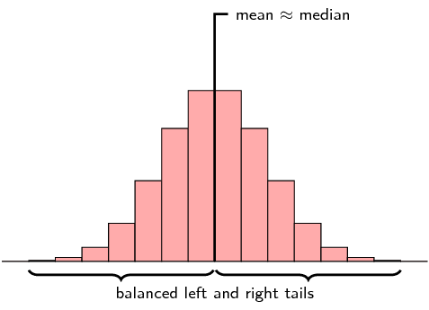

For symmetric distributions, the mean is approximately equal to the median and the left and
                                right tails are equally balanced, meaning that they have about the same length.

If large numbers of data are collected from a population, the graph will often have a bell
                                shape. If the data was, say, examination results, a few learners usually get very high
                                marks, a few very low marks and most get a mark in the middle range. This is a common
                                type of symmetric data known as a *normal* distribution. We say a distribution is
                                normal if

- the mean, median and mode are equal.
- it is symmetric around the mean.
- \(\text{68}\%\) of the sample lies within one standard deviation of the mean,
                                                  \(\text{95}\%\) within two standard deviations and \(\text{99}\%\)
                                                  within three standard deviations of the mean.

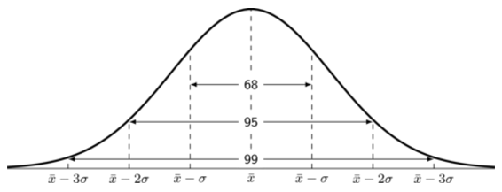

<Callout type="note" title="Note">
<VideoPlayer src="http://www.khanacademy.org/embed_video?v=hgtMWR3TFnY" title="Video:
                                                29BV" />
</Callout>

What happens if the test was very easy or very difficult? Then the distribution may not be
                                symmetrical. If extremely high or extremely low scores are added to a distribution, then
                                the mean and median tend to shift towards these scores and the curve becomes skewed.

If the test was very difficult, the mean and median scores are shifted to the left. In this
                                case, we say the distribution is *positively skewed*, or *skewed right*.

A distribution that is skewed right has the following characteristics:

- the mean is typically more than the median;
- the tail of the distribution is longer on the right hand side than on the left hand
                                          side; and
- the median is closer to the first quartile than to the third quartile.

If the test was very easy, then many learners would get high scores, and the mean and median
                                of the distribution would be shifted to the right. We say the distribution is
                                *negatively skewed*, or *skewed left*.

A distribution that is skewed right has the following characteristics:

- the mean is typically less than the median;
- the tail of the distribution is longer on the left hand side than on the right hand
                                          side; and
- the median is closer to the third quartile than to the first quartile.

The table below summarises the different categories visually.

| Skewed right (positive) | Symmetric | Skewed left (negative) |
| --- | --- | --- |
| mean \(>\) median | mean \(\approx\) median | mean \(<\) median |

<Callout type="tip" title="Worked example 3: Skewed and symmetric data">
**Question:**
Three Matric classes wrote a Mathematics test. The test is out of
                                                \(\text{40}\) marks and each class has \(\text{21}\) learners. The
                                                results of the test are shown in the table below:

| Gr. 12A | Gr. 12B | Gr. 12C |
| --- | --- | --- |
| \(\text{4}\) | \(\text{4}\) | \(\text{4}\) |
| \(\text{8}\) | \(\text{12}\) | \(\text{6}\) |
| \(\text{8}\) | \(\text{16}\) | \(\text{6}\) |
| \(\text{12}\) | \(\text{16}\) | \(\text{10}\) |
| \(\text{12}\) | \(\text{16}\) | \(\text{14}\) |
| \(\text{12}\) | \(\text{16}\) | \(\text{14}\) |
| \(\text{12}\) | \(\text{16}\) | \(\text{16}\) |
| \(\text{16}\) | \(\text{20}\) | \(\text{16}\) |
| \(\text{16}\) | \(\text{20}\) | \(\text{18}\) |
| \(\text{16}\) | \(\text{28}\) | \(\text{18}\) |
| \(\text{16}\) | \(\text{32}\) | \(\text{21}\) |
| \(\text{32}\) | \(\text{32}\) | \(\text{24}\) |
| \(\text{32}\) | \(\text{32}\) | \(\text{24}\) |
| \(\text{32}\) | \(\text{32}\) | \(\text{24}\) |
| \(\text{36}\) | \(\text{36}\) | \(\text{28}\) |
| \(\text{36}\) | \(\text{36}\) | \(\text{30}\) |
| \(\text{36}\) | \(\text{36}\) | \(\text{32}\) |
| \(\text{40}\) | \(\text{36}\) | \(\text{36}\) |
| \(\text{40}\) | \(\text{40}\) | \(\text{36}\) |
| \(\text{40}\) | \(\text{40}\) | \(\text{36}\) |
| \(\text{40}\) | \(\text{40}\) | \(\text{40}\) |

2. For each class, determine the five number summary and draw a box and
                                                           whisker diagram on the same set of axes using an appropriate
                                                           scale.
4. Determine the mean and standard deviation for each class.
6. Comparing the mean and median values for each class, comment on the
                                                           distribution of the test marks for each class.

2. First, we order the data from smallest to largest. This has already
                                                           been done for us. Then, we divide our data into quartiles:
   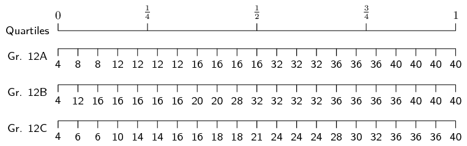
   The minimum of each data set is \(\text{4}\).
                                                           The maximum of each data set is \(\text{40}\).
   Since there are \(\text{21}\) values in the data set, the median lies
                                                           on the eleventh mark, making it equal to \(\text{16}\) for Gr.
                                                           12A, \(\text{32}\) for Gr. 12B and \(\text{21}\) for Gr. 12C.
   The first quartile lies between the fifth and sixth values, making it
                                                           equal to \(\text{12}\) for Gr. 12A, \(\text{16}\) for Gr. 12B
                                                           and \(\text{14}\) for Gr. 12C.
   The third quartile lies between the \(16^{\text{th}}\) and
                                                           \(17^{\text{th}}\) values, making it equal to \(\text{36}\) for
                                                           Gr. 12A and Gr. 12B, and \(\frac{\text{30}+\text{32}}{\text{2}}
                                                           = \text{31}\) for Gr. 12C.
                                                   Therefore, we are able to formulate the following five number summaries
                                                   and subsequent box and whisker plots:
   - Gr. 12A \(= [ \text{4} ; \text{12} ; \text{16} ; \text{36} ;
                                                                     \text{40} ]\)
   - Gr. 12B \(= [ \text{4} ; \text{16} ; \text{32} ; \text{36} ;
                                                                     \text{40} ]\)
   - Gr. 12C \(= [ \text{4} ; \text{14} ; \text{21} ; \text{31} ;
                                                                     \text{40} ]\)
   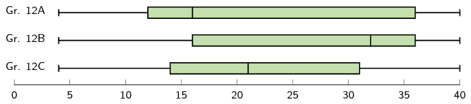
4. Gr. 12A: \[\text{mean } (\bar{x}) = \frac{496}{21} = \text{23,6}\]
                                                   \[\text{standard deviation } (\sigma) = \sqrt{\frac{\sum
                                                   {\left(x-\bar{x}\right)}^{2}}{n}} = \pm \text{12,70}\]
                                                   Gr. 12B: \[\text{mean } (\bar{x}) = \frac{556}{21} = \text{26,5}\]
                                                   \[\text{standard deviation } (\sigma) = \sqrt{\frac{\sum
                                                   {\left(x-\bar{x}\right)}^{2}}{n}} = \pm \text{10,65}\]
                                                   Gr. 12C: \[\text{mean } (\bar{x}) = \frac{453}{21} = \text{21,6}\]
                                                   \[\text{standard deviation } (\sigma) = \sqrt{\frac{\sum
                                                   {\left(x-\bar{x}\right)}^{2}}{n}} = \pm \text{10,54}\]
6. If the mean is greater than the median, the data is typically
                                                           positively skewed and if the mean is less than the median, the
                                                           data is typically negatively skewed.
   Gr. 12A: \(\text{mean} - \text{median} = \text{23,6} - \text{16} =
                                                           \text{7,6}\). The marks for 12A are therefore positively skewed,
                                                           meaning that there were many low marks in the class with the
                                                           high marks being more spread out.
   Gr. 12B: \(\text{mean} - \text{median} = \text{26,5} - \text{32} =
                                                           -\text{5,5}\). The marks for 12B are therefore negatively
                                                           skewed, meaning that there were many high marks in the class
                                                           with the low marks being more spread out.
   Gr. 12C: \(\text{mean} - \text{median} = \text{21,6} - \text{21} =
                                                           \text{0,6}\). The marks for 12C are therefore normally
                                                           distributed, meaning that there are as many low marks in the
                                                           class as there are high marks.
</Callout>

## Revision

### Textbook Exercise 9.1

State whether each of the following data sets are symmetric,
                                                                skewed right or skewed left.

**Problem:**
A data set with this distribution:

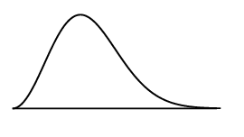

**Solution:**
skewed right

**Problem:**
A data set with this box and whisker plot:

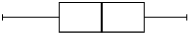

**Solution:**
symmetric

**Problem:**
A data set with this histogram:

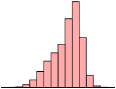

**Solution:**
skewed left

**Problem:**
A data set with this frequency polygon:

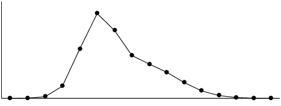

**Solution:**
skewed right

**Problem:**
A data set with this distribution:

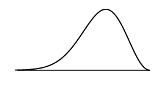

**Solution:**
skewed left

**Problem:**
The following data set:

\(\text{105}\) ; \(\text{44}\) ; \(\text{94}\) ;
                                                                        \(\text{149}\) ; \(\text{83}\) ; \(\text{178}\)
                                                                        ; \(-\text{4}\) ; \(\text{112}\) ; \(\text{50}\)
                                                                        ; \(\text{188}\)

**Solution:**
The statistics of the data set are

- mean: \(\text{99,9}\);
- first quartile: \(\text{66,5}\);
- median: \(\text{99,5}\);
- third quartile: \(\text{130,5}\).

                                                                Note that we get contradicting indications from the
                                                                different ways of determining whether the data is skewed
                                                                right or left.

- The mean is slightly greater than the
                                                                                  median. This would indicate that the
                                                                                  data set is skewed right.
- The median is slightly closer to the third
                                                                                  quartile than the first quartile. This
                                                                                  would indicate that the data set is
                                                                                  skewed left.

                                                                Since these differences are so small and since they
                                                                contradict each other, we conclude that the data set is
                                                                symmetric.

For the following data sets:

- Determine the mean and five number summary.
- Draw the box and whisker plot.
- Determine the skewness of the data.

**Problem:**
\(\text{40}\) ; \(\text{45}\) ; \(\text{12}\) ;
                                                                        \(\text{6}\) ; \(\text{9}\) ; \(\text{16}\) ;
                                                                        \(\text{11}\) ; \(\text{7}\) ; \(\text{35}\) ;
                                                                        \(\text{7}\) ; \(\text{31}\) ; \(\text{3}\)

**Solution:**
The mean is \(\bar{x} = \frac{222}{12}=\text{18,5}\).

To determine the five number summary, we order the
                                                                        data:

                                                                \[3\ ;\ 6\ ;\ 7\ ;\ 7\ ;\ 9\ ;\ 11\ ;\ 12\ ;\ 16\ ;\ 31\
                                                                ;\ 35\ ;\ 40\ ;\ 45\]

We use the diagram below (or the formulae) to find
                                                                        at, or between, which values the quartiles lie.

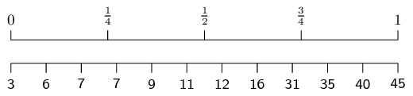

The minimum is 3 and the maximum is 45.

For the first quartile, the position is between the
                                                                        third and fourth values.
                                                                        Since both these values are equal to
                                                                        \(\text{7}\), the first quartile is
                                                                        \(\text{7}\).

For the median (second quartile), the position is
                                                                        halfway between the sixth and seventh values.
                                                                        The sixth value is \(\text{11}\) and the seventh
                                                                        value is \(\text{12}\), which means that the
                                                                        median is \(\frac{11+12}{2}=\text{11,5}\).

For the third quartile, the position is between the
                                                                        ninth and tenth values.
                                                                        Therefore the third quartile is
                                                                        \(\frac{31+35}{2}=33\).

Therefore, the five number summary is (3; 7;
                                                                        \(\text{11,5}\); 33; 45)

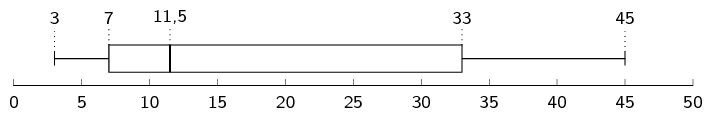

Mean \(>\) median, therefore the data is skewed
                                                                        right.

**Problem:**
\(\text{65}\) ; \(\text{100}\) ; \(\text{99}\) ;
                                                                        \(\text{21}\) ; \(\text{8}\) ; \(\text{27}\) ;
                                                                        \(\text{21}\) ; \(\text{31}\) ; \(\text{33}\) ;
                                                                        \(\text{31}\) ; \(\text{38}\) ; \(\text{16}\)

**Solution:**
The mean is \(\bar{x} =
                                                                        \frac{490}{12}=\text{40,83}\).

To determine the five number summary, we order the
                                                                        data:

                                                                \[8\ ;\ 16\ ;\ 21\ ;\ 21\ ;\ 27\ ;\ 31\ ;\ 31\ ;\ 33\ ;\
                                                                38\ ;\ 65\ ;\ 99\ ;\ 100\]

We use the formulae (or a diagram) to find at, or
                                                                        between, which values the quartiles lie.

                                                                \begin{align*}
                                                                \text{Location of } Q_{1} & = \frac{1}{4}(n-1)+1 =
                                                                \frac{1}{4}(12-1)+1 = \text{3,75}\\
                                                                \text{Location of } Q_{2} & = \frac{1}{2}(n-1)+1 =
                                                                \frac{1}{2}(12-1)+1 = \text{6,5}\\
                                                                \text{Location of } Q_{3} & = \frac{3}{4}(n-1)+1 =
                                                                \frac{3}{4}(12-1)+1 = \text{9,25}
                                                                \end{align*}

The minimum is 8 and the maximum is 100.

For the first quartile, the position is between the
                                                                        third and fourth values.
                                                                        Since both these values are equal to
                                                                        \(\text{21}\), the first quartile is
                                                                        \(\text{21}\).

For the median (second quartile), the position is
                                                                        halfway between the sixth and seventh values.
                                                                        The sixth value and seventh value are
                                                                        \(\text{31}\), which means that the median is
                                                                        \(\text{31}\).

For the third quartile, the position is between the
                                                                        ninth and tenth values.
                                                                        Therefore the third quartile is
                                                                        \(\frac{38+65}{2}=\text{51,5}\).

Therefore, the five number summary is (8; 21;
                                                                        \(\text{31}\); \(\text{51,5}\); 100)

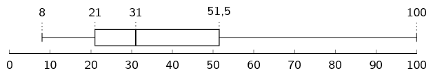

Mean \(>\) median, therefore the data is skewed
                                                                        right.

**Problem:**
\(\text{65}\) ; \(\text{57}\) ; \(\text{77}\) ;
                                                                        \(\text{92}\) ; \(\text{77}\) ; \(\text{58}\) ;
                                                                        \(\text{90}\) ; \(\text{46}\) ; \(\text{11}\) ;
                                                                        \(\text{81}\)

**Solution:**
The mean is \(\bar{x} = \frac{654}{10}=\text{65,4}\).

To determine the five number summary, we order the
                                                                        data:

                                                                \[11\ ;\ 46\ ;\ 57\ ;\ 58\ ;\ 65\ ;\ 77\ ;\ 77\ ;\ 81\
                                                                ;\ 90\ ;\ 92\]

We use the formulae (or a diagram) to find at, or
                                                                        between, which values the quartiles lie.

                                                                \begin{align*}
                                                                \text{Location of } Q_{1} & = \frac{1}{4}(n-1)+1 =
                                                                \frac{1}{4}(10-1)+1 = \text{3,25}\\
                                                                \text{Location of } Q_{2} & = \frac{1}{2}(n-1)+1 =
                                                                \frac{1}{2}(10-1)+1 = \text{5,5}\\
                                                                \text{Location of } Q_{3} & = \frac{3}{4}(n-1)+1 =
                                                                \frac{3}{4}(10-1)+1 = \text{7,75}
                                                                \end{align*}

The minimum is 11 and the maximum is 92.

For the first quartile, the position is between the
                                                                        third and fourth values.
                                                                        Since the third is 57 and the fourth is 58, the
                                                                        first quartile is
                                                                        \(\frac{57+58}{2}=\text{57,5}\).

For the median (second quartile), the position is
                                                                        halfway between the fifth and sixth values.
                                                                        The sixth value is 65 and the seventh value is
                                                                        \(\text{77}\),
                                                                        therefore the median is
                                                                        \(\frac{65+77}{2}=\text{71}\).

For the third quartile, the position is between the
                                                                        seventh and eighth values.
                                                                        Therefore the third quartile is
                                                                        \(\frac{77+81}{2}=\text{79}\).

Therefore, the five number summary is (11;
                                                                        \(\text{57,5}\); \(\text{77}\); \(\text{79}\);
                                                                        92)

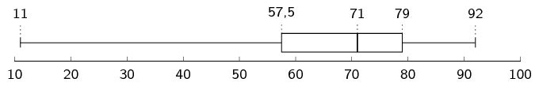

Mean \(<\) median, therefore the data is skewed
                                                                        left.

**Problem:**
\(\text{1}\) ; \(\text{99}\) ; \(\text{76}\) ;
                                                                        \(\text{76}\) ; \(\text{50}\) ; \(\text{74}\) ;
                                                                        \(\text{83}\) ; \(\text{91}\) ; \(\text{41}\) ;
                                                                        \(\text{17}\) ; \(\text{33}\)

**Solution:**
The mean is \(\bar{x} =
                                                                        \frac{641}{11}=\text{58,27}\).

To determine the five number summary, we order the
                                                                        data:

                                                                \[1\ ;\ 17\ ;\ 33\ ;\ 41\ ;\ 50\ ;\ 74\ ;\ 76\ ;\ 76\ ;\
                                                                83\ ;\ 91\ ;\ 99\]

We use the formulae (or a diagram) to find at, or
                                                                        between, which values the quartiles lie.

                                                                \begin{align*}
                                                                \text{Location of } Q_{1} & = \frac{1}{4}(n-1)+1 =
                                                                \frac{1}{4}(11-1)+1 = \text{3,5}\\
                                                                \text{Location of } Q_{2} & = \frac{1}{2}(n-1)+1 =
                                                                \frac{1}{2}(11-1)+1 = \text{6}\\
                                                                \text{Location of } Q_{3} & = \frac{3}{4}(n-1)+1 =
                                                                \frac{3}{4}(11-1)+1 = \text{8,5}
                                                                \end{align*}

The minimum is 1 and the maximum is 99.

For the first quartile, the position is between the
                                                                        third and fourth values.
                                                                        The third value is 33 and the fourth value is
                                                                        41, therefore the first quartile is
                                                                        \(\frac{33+41}{2}=\text{37}\).

The second quartile (median) is at the sixth
                                                                        position.
                                                                        The sixth value is \(\text{74}\).

For the third quartile, the position is between the
                                                                        eighth and ninth values.
                                                                        Therefore the third quartile is
                                                                        \(\frac{76+83}{2}=\text{79,5}\).

Therefore, the five number summary is (1; 37;
                                                                        \(\text{74}\); \(\text{79,5}\); 99)

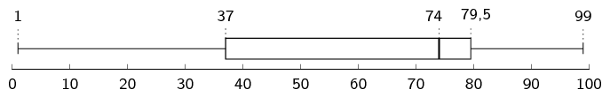

Mean \(<\) median, therefore the data is skewed
                                                                        left.

**Problem:**
\(\text{0,5}\); \(-\text{0,9}\) ; \(-\text{1,8}\) ;
                                                                        \(\text{3}\) ; \(-\text{0,2}\) ; \(-\text{5,2}\)
                                                                        ; \(-\text{1,8}\) ; \(\text{0,1}\) ;
                                                                        \(-\text{1,7}\) ; \(-\text{2}\) ; \(\text{2,2}\)
                                                                        ; \(\text{0,5}\); \(-\text{0,5}\)

**Solution:**
The mean is \(\bar{x} =
                                                                        \frac{-\text{7,8}}{13}=-\text{0,6}\).

To determine the five number summary, we order the
                                                                        data:

                                                                \[-\text{5,2};-\text{2};-\text{1,8};-\text{1,8};-\text{1,7};-\text{0,9};-\text{0,5};-\text{0,2}\
                                                                ;\ \text{0,1}\ ;\ \text{0,5}\ ;\ \text{0,5}\ ;\
                                                                \text{2,2}\ ;\ \text{3}\]

We use the formulae (or a diagram) to find at, or
                                                                        between, which values the quartiles lie.

                                                                \begin{align*}
                                                                \text{Location of } Q_{1} & = \frac{1}{4}(n-1)+1 =
                                                                \frac{1}{4}(13-1)+1 = \text{4}\\
                                                                \text{Location of } Q_{2} & = \frac{1}{2}(n-1)+1 =
                                                                \frac{1}{2}(13-1)+1 = \text{7}\\
                                                                \text{Location of } Q_{3} & = \frac{3}{4}(n-1)+1 =
                                                                \frac{3}{4}(13-1)+1 = \text{10}
                                                                \end{align*}

The minimum is \(-\text{5,2}\) and the maximum is 3.

The first quartile is at the fourth position.
                                                                        Therefore, the first quartile is
                                                                        \(-\text{1,8}\).

The median (second quartile) is at the seventh
                                                                        position.
                                                                        The seventh value is \(-\text{0,5}\).

The third quartile is at the tenth position.
                                                                        Therefore the third quartile is \(\text{0,5}\).

Therefore, the five number summary is
                                                                        (\(-\text{5,2}\); \(-\text{1,8}\);
                                                                        \(-\text{0,5}\); \(\text{0,5}\); 3)

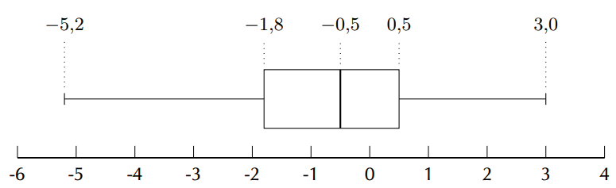

Mean \(\approx\) median, therefore the data is
                                                                        symmetric.

**Problem:**
\(\text{86}\) ; \(\text{64}\) ; \(\text{25}\) ;
                                                                        \(\text{71}\) ; \(\text{54}\) ; \(\text{44}\) ;
                                                                        \(\text{97}\) ; \(\text{31}\) ; \(\text{78}\) ;
                                                                        \(\text{46}\) ; \(\text{60}\) ; \(\text{86}\)

**Solution:**
The mean is \(\bar{x} =
                                                                        \frac{742}{12}=\text{61,83}\).

To determine the five number summary, we order the
                                                                        data:

                                                                \[25\ ;\ 31\ ;\ 44\ ;\ 46\ ;\ 54\ ;\ 60\ ;\ 64\ ;\ 71\
                                                                ;\ 78\ ;\ 86\ ;\ 86\ ;\ 97\]

We use the formulae (or a diagram) to find at, or
                                                                        between, which values the quartiles lie.

                                                                \begin{align*}
                                                                \text{Location of } Q_{1} & = \frac{1}{4}(n-1)+1 =
                                                                \frac{1}{4}(12-1)+1 = \text{3,75}\\
                                                                \text{Location of } Q_{2} & = \frac{1}{2}(n-1)+1 =
                                                                \frac{1}{2}(12-1)+1 = \text{6,5}\\
                                                                \text{Location of } Q_{3} & = \frac{3}{4}(n-1)+1 =
                                                                \frac{3}{4}(12-1)+1 = \text{9,25}
                                                                \end{align*}

The minimum is 25 and the maximum is 97.

For the first quartile, the position is between the
                                                                        third and fourth values.
                                                                        The third value is 44 and the fourth value is
                                                                        \(\text{46}\), which means that the first
                                                                        quartile is \(\frac{44+46}{2}=\text{45}\).

For the median (second quartile), the position is
                                                                        halfway between the sixth and seventh values.
                                                                        The sixth value is 60 and the seventh value is
                                                                        \(\text{64}\), which means that the median is
                                                                        \(\frac{60+64}{2}=\text{62}\).

For the third quartile, the position is between the
                                                                        ninth and tenth values.
                                                                        Therefore the third quartile is
                                                                        \(\frac{78+86}{2}=\text{82}\).

Therefore, the five number summary is (25; 45;
                                                                        \(\text{62}\); \(\text{82}\); 97)

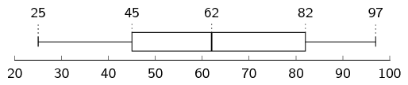

Mean \(\approx\) median, therefore the data is
                                                                        symmetric.

For the following data sets:

- Determine the mean.
- Use a table to determine the variance and the
                                                                          standard deviation.
- Determine the percentage of data points within one
                                                                          standard deviation of the mean. Round your
                                                                          answer to the nearest percentage point.

**Problem:**
\(\{\text{9,1}; \text{0,2}; \text{2,8}; \text{2,0};
                                                                        \text{10,0}; \text{5,8}; \text{9,3};
                                                                        \text{8,0}\}\)

**Solution:**
The formula for the mean is

                                                                \begin{align*}
                                                                \bar{x} &= \frac{\sum\limits_{i=1}^n x_i}{n} \\
                                                                \therefore \bar{x} &= \frac{\text{47,2}}{8} \\
                                                                &= \text{5,90}
                                                                \end{align*}

The formula for the variance is
                                                                        \[\sigma^2 = \frac{\sum_{i=1}^n \left(x_i -
                                                                        \overline{x}\right)^2}{n}\]

We first subtract the mean from each data point and
                                                                        then square the result.

| \(x_i\) | \(\text{9,1}\) | \(\text{0,2}\) | \(\text{2,8}\) | \(\text{2,0}\) | \(\text{10,0}\) | \(\text{5,8}\) | \(\text{9,3}\) | \(\text{8,0}\) |
| --- | --- | --- | --- | --- | --- | --- | --- | --- |
| \(x_i - \overline{x}\) | \(\text{3,2}\) | \(-\text{5,7}\) | \(-\text{3,1}\) | \(-\text{3,9}\) | \(\text{4,1}\) | \(-\text{0,1}\) | \(\text{3,4}\) | \(\text{2,1}\) |
| \((x_i - \overline{x})^2\) | \(\text{10,24}\) | \(\text{32,49}\) | \(\text{9,61}\) | \(\text{15,21}\) | \(\text{16,81}\) | \(\text{0,01}\) | \(\text{11,56}\) | \(\text{4,41}\) |

The variance is the sum of the last row in this table
                                                                        divided by \(\text{8}\), so \(\sigma^2 =
                                                                        \frac{\text{47,2}}{8}=\text{12,54}\).
                                                                        The standard deviation is the square root of the
                                                                        variance, therefore \(\sigma=\sqrt{12.54}=\pm
                                                                        \text{3,54}\).

The interval containing all values that are one
                                                                        standard deviation from the mean is
                                                                        \(\left[\text{5,90}-\text{3,54} ;
                                                                        \text{5,90}+\text{3,54}\right] =
                                                                        \left[\text{9,44} ; \text{2,36}\right]\).
                                                                        We are asked how many values are
                                                                        **within** than one standard
                                                                        deviation from the mean, meaning
                                                                        **inside** the interval.
                                                                        There are \(\text{5}\) values from the data set
                                                                        within the interval, which is \(\frac{5}{8}
                                                                        \times 100=\text{63}\%\) of the data points.

**Problem:**
\{9; 5; 1; 3; 3; 5; 7; 4; 10; 8\}

**Solution:**
The formula for the mean is

                                                                \begin{align*}
                                                                \bar{x} &= \frac{\sum\limits_{i=1}^n x_i}{n} \\
                                                                \therefore \bar{x} &= \frac{55}{10} \\
                                                                &= \text{5,5}
                                                                \end{align*}

The formula for the variance is
                                                                        \[\sigma^2 = \frac{\sum_{i=1}^n \left(x_i -
                                                                        \overline{x}\right)^2}{n}\]

We first subtract the mean from each data point and
                                                                        then square the result.

| \(x_i\) | \(\text{9}\) | \(\text{5}\) | \(\text{1}\) | \(\text{3}\) | \(\text{3}\) | \(\text{5}\) | \(\text{7}\) | \(\text{4}\) | \(\text{10}\) | \(\text{8}\) |
| --- | --- | --- | --- | --- | --- | --- | --- | --- | --- | --- |
| \(x_i - \overline{x}\) | \(\text{3,5}\) | \(-\text{0,5}\) | \(-\text{4,5}\) | \(-\text{2,5}\) | \(-\text{2,5}\) | \(-\text{0,5}\) | \(\text{1,5}\) | \(-\text{1,5}\) | \(\text{4,5}\) | \(\text{2,5}\) |
| \((x_i - \overline{x})^2\) | \(\text{12,25}\) | \(\text{0,25}\) | \(\text{20,25}\) | \(\text{6,25}\) | \(\text{6,25}\) | \(\text{0,25}\) | \(\text{2,25}\) | \(\text{2,25}\) | \(\text{20,25}\) | \(\text{6,25}\) |

The variance is the sum of the last row in this table
                                                                        divided by \(\text{10}\), so \(\sigma^2 =
                                                                        \frac{\text{76,5}}{\text{10}} = \text{7,65}\).
                                                                        The standard deviation is the square root of the
                                                                        variance, therefore
                                                                        \(\sigma=\sqrt{\text{7,65}}=\pm \text{2,77}\).

The interval containing all values that are one
                                                                        standard deviation from the mean is
                                                                        \(\left[\text{5,5}-\text{2,77} ;
                                                                        \text{5,5}+\text{2,77}\right] =
                                                                        \left[\text{2,73} ; \text{8,27}\right]\).
                                                                        We are asked how many values are
                                                                        **within** than one standard
                                                                        deviation from the mean, meaning
                                                                        **inside** the interval.
                                                                        There are \(\text{7}\) values from the data set
                                                                        within the interval, which is \(\frac{7}{10}
                                                                        \times 100=\text{70}\%\) of the data points.

**Problem:**
\{81; 22; 63; 12; 100; 28; 54; 26; 50; 44; 4; 32\}

**Solution:**
The formula for the mean is

                                                                \begin{align*}
                                                                \bar{x} &= \frac{\sum\limits_{i=1}^n x_i}{n} \\
                                                                \therefore \bar{x} &= \frac{516}{12} \\
                                                                &= \text{43}
                                                                \end{align*}

The formula for the variance is
                                                                        \[\sigma^2 = \frac{\sum_{i=1}^n \left(x_i -
                                                                        \overline{x}\right)^2}{n}\]

We first subtract the mean from each data point and
                                                                        then square the result.

| \(x_i\) | \(\text{81}\) | \(\text{22}\) | \(\text{63}\) | \(\text{12}\) | \(\text{100}\) | \(\text{28}\) | \(\text{54}\) | \(\text{26}\) | \(\text{50}\) | \(\text{44}\) | \(\text{4}\) | \(\text{32}\) |
| --- | --- | --- | --- | --- | --- | --- | --- | --- | --- | --- | --- | --- |
| \(x_i - \overline{x}\) | \(\text{38}\) | \(-\text{21}\) | \(\text{20}\) | \(-\text{31}\) | \(\text{57}\) | \(-\text{15}\) | \(\text{11}\) | \(-\text{17}\) | \(\text{7}\) | \(\text{1}\) | \(-\text{39}\) | \(-\text{11}\) |
| \((x_i - \overline{x})^2\) | \(\text{1 444}\) | \(\text{441}\) | \(\text{400}\) | \(\text{961}\) | \(\text{3 249}\) | \(\text{225}\) | \(\text{121}\) | \(\text{289}\) | \(\text{49}\) | \(\text{1}\) | \(\text{1 521}\) | \(\text{121}\) |

The variance is the sum of the last row in this table
                                                                        divided by \(\text{12}\), so \(\sigma^2 =
                                                                        \frac{\text{8 822}}{12}=\text{735,17}\).
                                                                        The standard deviation is the square root of the
                                                                        variance, therefore \(\sigma=\sqrt{735.17}=\pm
                                                                        \text{27,11}\).

The interval containing all values that are one
                                                                        standard deviation from the mean is
                                                                        \(\left[\text{43}-\text{27,11} ;
                                                                        \text{43}+\text{27,11}\right] =
                                                                        \left[\text{15,89} ; \text{70,11}\right]\).
                                                                        We are asked how many values are
                                                                        **within** than one standard
                                                                        deviation from the mean, meaning
                                                                        **inside** the interval.
                                                                        There are \(\text{8}\) values from the data set
                                                                        within the interval, which is \(\frac{8}{12}
                                                                        \times 100=\text{67}\%\) of the data points.

Use a calculator to determine the

- mean,
- variance,
- and standard deviation

                                                        of the following data sets:

**Problem:**
\(\text{8}\) ; \(\text{3}\) ; \(\text{10}\) ;
                                                                        \(\text{7}\) ; \(\text{7}\) ; \(\text{1}\) ;
                                                                        \(\text{3}\) ; \(\text{1}\) ; \(\text{3}\) ;
                                                                        \(\text{7}\)

**Solution:**
- Mean = \(\text{5}\)
- \(\sigma^{2} = \text{9}\)
- \(\sigma = \pm \text{3}\)

**Problem:**
\(\text{4}\) ; \(\text{4}\) ; \(\text{13}\) ;
                                                                        \(\text{9}\) ; \(\text{7}\) ; \(\text{7}\) ;
                                                                        \(\text{2}\) ; \(\text{5}\) ; \(\text{15}\) ;
                                                                        \(\text{4}\) ; \(\text{22}\) ; \(\text{11}\)

**Solution:**
- Mean = \(\text{8,58}\)
- \(\sigma^{2} = \text{30,91}\)
- \(\sigma = \pm \text{5,56}\)

**Problem:**
\(\text{4,38}\) ; \(\text{3,83}\) ; \(\text{4,99}\) ;
                                                                        \(\text{4,05}\) ; \(\text{2,88}\) ;
                                                                        \(\text{4,83}\) ; \(\text{0,88}\) ;
                                                                        \(\text{5,33}\) ; \(\text{3,49}\) ;
                                                                        \(\text{4,10}\)

**Solution:**
- Mean = \(\text{3,88}\)
- \(\sigma^{2} = \text{1,47}\)
- \(\sigma = \pm \text{1,21}\)

**Problem:**
\(\text{4,76}\) ; \(-\text{4,96}\) ; \(-\text{6,35}\)
                                                                        ; \(-\text{3,57}\) ; \(\text{0,59}\) ;
                                                                        \(-\text{2,18}\) ; \(-\text{4,96}\) ;
                                                                        \(-\text{3,57}\) ; \(-\text{2,18}\) ;
                                                                        \(\text{1,98}\)

**Solution:**
- Mean = \(-\text{1,66}\)
- \(\sigma^{2} = \text{11,47}\)
- \(\sigma = \pm \text{3,39}\)

**Problem:**
\(\text{7}\) ; \(\text{53}\) ; \(\text{29}\) ;
                                                                        \(\text{42}\) ; \(\text{12}\) ; \(\text{111}\) ;
                                                                        \(\text{122}\) ; \(\text{79}\) ; \(\text{83}\) ;
                                                                        \(\text{5}\) ; \(\text{69}\) ; \(\text{45}\) ;
                                                                        \(\text{23}\) ; \(\text{77}\)

**Solution:**
- Mean = \(\text{54,07}\)
- \(\sigma^{2} = \text{1 406,07}\)
- \(\sigma = \pm \text{37,50}\)

Xolani surveyed the price of a loaf of white bread at two
                                                                different supermarkets.
                                                                The data, in rands, are given below.

| Supermarket A | \(\text{3,96}\) | \(\text{3,76}\) | \(\text{4,00}\) | \(\text{3,91}\) | \(\text{3,69}\) | \(\text{3,72}\) |
| --- | --- | --- | --- | --- | --- | --- |
| Supermarket B | \(\text{3,97}\) | \(\text{3,81}\) | \(\text{3,52}\) | \(\text{4,08}\) | \(\text{3,88}\) | \(\text{3,68}\) |

**Problem:**
Find the mean price at each supermarket and
                                                                then state which supermarket has the lower mean.

**Solution:**
Supermarket A: \(\text{3,84}\). Supermarket B:
                                                                        \(\text{3,82}\). Supermarket B has the lower
                                                                        mean.

**Problem:**
Find the standard deviation of each
                                                                supermarket's prices.

**Solution:**
Standard deviation:
                                                                        \[\sigma = \sqrt{\frac{\sum\limits_{i=1}^n
                                                                        \left(x_i - \bar{x}\right)^2}{n}}\]

For Supermarket A:
                                                                        \begin{align*}
                                                                        \sigma
                                                                        &= \sqrt{\frac{\sum\limits_{i=1}^n \left(x_i
                                                                        - \text{3,84}\right)^2}{\text{6}}} \\
                                                                        &= \sqrt{\frac{\text{0,0882}}{\text{6}}} \\
                                                                        &= \sqrt{\text{0,0147}} \\
                                                                        &\approx \pm \text{0,121}
                                                                        \end{align*}

For Supermarket B:
                                                                        \begin{align*}
                                                                        \sigma
                                                                        &= \sqrt{\frac{\sum\limits_{i=1}^n \left(x_i
                                                                        - \text{3,82}\right)^2}{6}} \\
                                                                        &=
                                                                        \sqrt{\frac{\text{0,20}\dot{3}}{\text{6}}} \\
                                                                        &= \sqrt{\text{0,033}\dot{8}} \\
                                                                        &\approx \pm\text{0,184}
                                                                        \end{align*}

**Problem:**
Which supermarket has the more consistently
                                                                priced white bread? Give reasons for your answer.

**Solution:**
The standard deviation of Supermarket A's prices is
                                                                        lower than that of Supermarket B's.
                                                                        That means that Supermarket A has more
                                                                        consistent (less variable) prices than
                                                                        Supermarket B.

The times for the \(\text{8}\) athletes who swam the
                                                                \(\text{100}\) \(\text{m}\) freestyle final at the 2012
                                                                London Olympic Games are shown below.
                                                                All times are in seconds.

\(\text{47,52}\) ; \(\text{47,53}\) ; \(\text{47,80}\) ;
                                                                \(\text{47,84}\) ; \(\text{47,88}\) ; \(\text{47,92}\) ;
                                                                \(\text{48,04}\) ; \(\text{48,44}\)

**Problem:**
Calculate the mean time.

**Solution:**
\(\overline{x} = \text{47,87}\)

**Problem:**
Calculate the standard deviation for the
                                                                data.

**Solution:**
\(\sigma = \pm\text{0,27}\)

**Problem:**
How many of the athletes' times are more
                                                                than one standard deviation away from the mean?

**Solution:**
The mean is \(\text{47,87}\) and the standard
                                                                        deviation is \(\text{0,56}\).
                                                                        Therefore the interval containing all values
                                                                        that are one standard deviation from the mean is
                                                                        \(\left[\text{47,87}-\text{0,27} ;
                                                                        \text{47,87}+\text{0,27}\right] =
                                                                        \left[\text{47,60} ; \text{48,15}\right]\).
                                                                        We are asked how many values are
                                                                        **further** than one standard
                                                                        deviation from the mean, meaning
                                                                        **outside** the interval.
                                                                        There are \(\text{3}\) values from the data set
                                                                        outside the interval.

**Problem:**
The following data set has a mean of \(\text{14,7}\) and a
                                                                variance of \(\text{10,01}\).

                                                        \[\text{18}\ ;\ \text{11}\ ;\ \text{12}\ ;\ a\ ;\ \text{16}\ ;\
                                                        \text{11}\ ;\ \text{19}\ ;\ \text{14}\ ;\ b\ ;\ \text{13}\]

Calculate the values of \(a\) and \(b\).

**Solution:**
From the formula of the mean we have
                                                                \begin{align*}
                                                                \text{14,7} &= \frac{\text{114} + a + b}{10} \\
                                                                \therefore a + b &= \text{147} - \text{114} \\
                                                                \therefore a &= 33-b
                                                                \end{align*}

From the formula of the variance we have
                                                                \begin{align*}
                                                                \sigma^2 &= \frac{\sum_{i=1}^n
                                                                (x_i-\overline{x})^2}{n} \\
                                                                \therefore \text{10,01} &= \frac{\text{69,12} +
                                                                (a-\text{14,7})^2 + (b-\text{14,7})^2}{10}
                                                                \end{align*}

Substitute \(a = 33-b\) into this equation to get
                                                                \begin{align*}
                                                                \text{10,01} &= \frac{\text{69,12} +
                                                                (\text{18,3}-b)^2 + (b-\text{14,7})^2}{10} \\
                                                                \therefore \text{100,1} &= 2b^2 - \text{66}b +
                                                                \text{620,1} \\
                                                                \therefore 0 &= b^2 - \text{33}b + \text{260} \\
                                                                &= (b-13)(b-20)
                                                                \end{align*}
                                                                Therefore \(b = 13\) or \(b = 20\).

Since \(a = 33-b\) we have \(a = 20\) or \(a = 13\).
                                                                So, the two unknown values in the data set are
                                                                \(\text{13}\) and \(\text{20}\).

We do not know which of these is \(a\) and which is \(b\)
                                                                since the mean and variance tell us nothing about the
                                                                order of the data.

**Problem:**
The height of each learner in a class was measured and it was
                                                                found that the mean height of the class was
                                                                \(\text{1,6}\) \(\text{m}\). At the time, three learners
                                                                were absent. However, when the heights of the learners
                                                                who were absent were included in the data for the class,
                                                                the mean height did not change.

If the heights of two of the learners who were absent are
                                                                \(\text{1,45}\) \(\text{m}\) and \(\text{1,63}\)
                                                                \(\text{m}\), calculate the height of the third learner
                                                                who was absent. [NSC Paper 3 Feb-March 2013]

**Solution:**
Let the number of learners who were first measured be \(x\).

The total measure of all heights is \(\text{1,6}x\).

Let the height of the last learner be \(y\).

                                                        \begin{align*}
                                                        \frac{\text{1,6}x+\text{1,45}+\text{1,63}+y}{x+3}&=\text{1,6}
                                                        \\
                                                        \text{1,6}x + \text{3,08} + y&= \text{1,6}x + \text{4,8} \\
                                                        y&=\text{1,72}
                                                        \end{align*}

There are 184 students taking Mathematics in a first-year
                                                                university class. The marks, out of 100, in the
                                                                half-yearly examination are normally distributed with a
                                                                mean of 72 and a standard deviation of 9. [NSC Paper 3
                                                                Feb-March 2013]

**Problem:**
What percentage of students scored between
                                                                72 and 90 marks?

**Solution:**
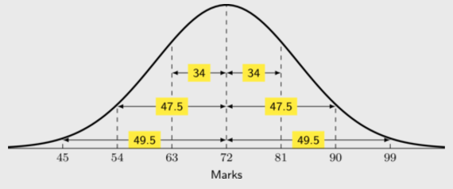

\(90=72 +2(9)\)

Therefore 90 lies at 2 standard deviations to the
                                                                        right of the mean.

Hence, \(\text{47,5}\%\) of students scored between
                                                                        72 and 90 marks.

**Problem:**
Approximately how many students scored
                                                                between 45 and 63 marks?

**Solution:**
\begin{align*}
                                                                &45=72-3(9) \\
                                                                &\therefore 45 \text{ lies at 3 standard deviations
                                                                to the left of the mean.} \\
                                                                &63= 72 - 9 \\
                                                                & \therefore 63 \text{ lies at 1 standard deviation
                                                                to the left of the mean.} \\
                                                                & \text{The area between 1 standard deviation and 3
                                                                standard deviations is: } \\
                                                                &\text{49,5} - 34 = \text{15,5}\% \\
                                                                &\therefore \text{15,5}\% \text{ of } 184 \approx 29
                                                                \text{ students scored between 45 and 63 marks.}
                                                                \end{align*}
