## 9.2 Curve fitting (EMCJP)

### Intuitive curve fitting (EMCJQ)

In Grade 11, we used various means, such as histograms, frequency polygons and ogives, to visualise our data.
        These are very useful tools to depict **univariate** data, i.e. data with only one variable such as
        the height of learners in a class.

Last year we also learnt about a visual tool called scatter plots. **Scatter plots** are a common
        way to visualise **bivariate** data, i.e. data with two variables. This allows us to identify the
        *direction* and *strength* of a relationship between two variables.

We identify the nature of a relationship between two variables by examining if the points on the scatter plot
        conform to a linear, exponential, quadratic or some other function. The process of fitting functions to data is
        known as **curve fitting**.

The strength of a relationship can be described as *strong* if the data points conform closely to a
        function or *weak* if they are further away.

In the case of linear functions, the direction of a relationship is *positive* if high values of one
        variable occur with high values of the other or *negative* if high values of one variable occur with low
        values of the other.

The table below summarises the different relationships:

| Strong, positive linear relationship | Strong, negative linear relationship |
| Weak, positive linear relationship | Exponential relationship |
| Quadratic relationship | No relationship |

<Callout type="tip" title="Worked example 4: Intuitive curve fitting">
**Question:**
Examine the scatter plot below of data collected from a new shop:

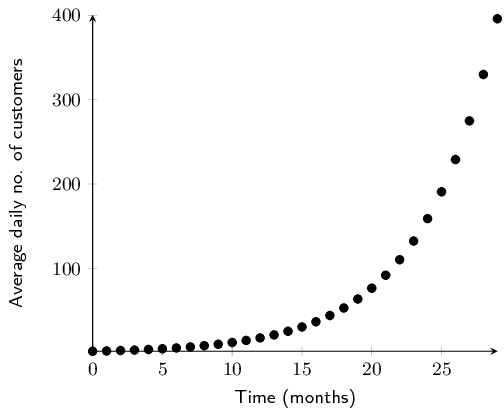

- What are the two variables being compared?
- What type of function best fits the data?
- Is the relationship between the two variables strong or weak?
- Is the relationship between the two variables positive or negative?
- Using your answers above, describe the relationship between the two variables in one sentence.

- The variables being compared are average daily number of customers and time in months.
- The data fit an exponential function.
- The data points appear to fit the curve close to perfectly, so the relationship can be described as very
              strong.
- As time increases, the number of customers increases, so the relationship can be described as positive.
- There is a very strong, positive, exponential relationship between average daily customers and time in the
              new shop.
</Callout>

<QuizCard id="m12-09-02a" title="Interactive Exercise 9.4" question="Use your calculator to determine the value of the correlation coefficient, \(r\) , for the following data set and describe the strength and direction of the correlation. INSTRUCTION: Round your answer to two decimal places. \(x\) \(y\) \(\text{58}\) \(-\text{100}\) \(-\text{81}\) \(\text{195}\) \(-\text{94}\) \(\text{210}\) \(\text{67}\) \(-\text{126}\) \(-\text{13}\) \(\text{9}\) \(\text{52}\) \(-\text{102}\) \(-\text{100}\) \(\text{228}\) \(-\text{11}\) \(\text{40}\) \(\text{44}\) \(-\text{96}\) \(-\text{54}\) \(\text{131}\)" options=["positive", "negative", "none", "perfect", "strong", "moderate", "weak", "no correlation"] answer="-1.0, 1, 0" hint="You should enter a number here. If you want to, you can use a space to separate thousands.                Example: 12 800,25 For scientific notation you need to use the multiply symbol                ( ∗ ) and the exponent symbol ( ^ ). For example 6,673 × 10 −11 should be written as: 6,673 ∗ 10^−11" explanation="Determine the value of \(r\) This question requires us to determine the correlation coefficient of a data set. We are asked specifically to use our calculator. If you are unsure of how to do so, see Worked Example 7 and 8 and the step 5 of Worked Example 9 in the Statistics chapter of Everything Maths. It is very important that you know how to calculate the correlation coefficient ( \(r\) ) using your calculator because it will be assumed in your tests and exams that you are using your calculator unless the instructions say otherwise. Practise this problem multiple times until you are completely familiar with the process. You want to save all the time you can in your exams! Therefore, using our calculators and rounding to two decimal places, the value of \(r\) is \(-\text{1}\) . Determine the direction of \(r\) The sign in front of the correlation coefficient indicates its direction. As the value of \(r\) is negative, the direction is negative . Determine the strength of \(r\) The correlation coefficient ( \(r\) ) is a value between \(\text{1}\) and \(-\text{1}\) , where \(r=-\text{1}\) is a perfect negative correlation, where \(r=\text{0}\) there is no correlation and where \(r=\text{1}\) there is a perfect positive correlation. Use the following table as a general guide: Positive Strength Negative \(r=0\) no correlation \(r=0\) \(\text{0}<r<\text{0,25}\) very weak \(-\text{0,25}<r<\text{0}\) \(\text{0,25}<r<\text{0,5}\) weak \(-\text{0,5}<r<-\text{0,25}\) \(\text{0,5}<r<\text{0,75}\) moderate \(-\text{0,75}<r<-\text{0,5}\) \(\text{0,75}<r<\text{0,9}\) strong \(-\text{0,9}<r<-\text{0,75}\) \(\text{0,9}<r<\text{1}\) very strong \(-\text{1}<r<-\text{0,9}\) \(r=\text{1}\) perfect correlation \(r=-\text{1}\) Given the options for strength, the value of \(r\) indicates that the correlation is perfect . Therefore, we can conclude that \(r = -\text{1}\) , the direction of \(r\) is negative and the strength is perfect. Submit your answer as: and negative and perfect" />

In the worked example above, by plotting the average daily customers and time data of a new shop on a scatter
        plot, we were able to identify the relationship between the two variables. Once we know the relationship between
        two variables, we are able to do another very useful thing - we are able to predict values where no data exist.

Interpolation and extrapolation

When we predict values that fall within the range of our data, this is known as
            **interpolation**. When we predict the values of a variable beyond the range of our data, this
            is known as **extrapolation**.

Extrapolation must be done with caution unless it is known that the observed relationship continues beyond the
        range of our data. For example, an exponential function may look linear if we only have the first few data
        points available but if we extrapolate far enough beyond the initial data points, our predictions will be
        inaccurate.

In order to interpolate or extrapolate values, we need to find the equation of the function which best fits the
        data. For linear data, we draw a straight line through the data which best approximates the available data
        points. This line is known as the **line of best fit** or trend line. Let us try our hand at this
        in the following example.

<Callout type="tip" title="Worked example 5: Fitting by hand">
**Question:**
- Use the data below to draw a scatter plot and line of best fit.
- Write down the equation of the line that best seems to fit the data.
- Use your equation to calculate the estimated value for \(y\) if \(x = 4\).
- Use your equation to calculate the estimated value for \(x\) if \(y = 6\).

| \(x\) | \(\text{1,0}\) | \(\text{2,4}\) | \(\text{3,1}\) | \(\text{4,9}\) | \(\text{5,6}\) | \(\text{6,2}\) |
| --- | --- | --- | --- | --- | --- | --- |
| \(y\) | \(\text{2,5}\) | \(\text{2,8}\) | \(\text{3,0}\) | \(\text{4,8}\) | \(\text{5,1}\) | \(\text{5,3}\) |

**Draw the graph:**
2. Choose a suitable scale for the axes.
4. Draw the axes.
6. Plot the points.

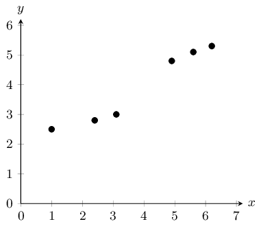

**Drawing the line of best fit:**
The next step is to draw a straight line which goes as close to as many points as possible. It is generally
            best to have as many points above the line as below the line.

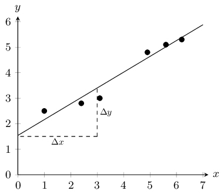

**Calculating the equation of the line:**
The equation of the line is

          \(y=mx+c\)

From the graph we have drawn, we estimate the y-intercept to be \(\text{1,5}\). We estimate that
            \(y=\text{3,5}\) when \(x=3\). So we have that points \(\left(3;\text{3,5}\right)\) and
            \(\left(0;\text{1,5}\right)\) lie on the line. The gradient of the line, m, is given by

          \begin{align*} m & = \frac{\Delta y}{\Delta x} = \frac{{y}_{2}-{y}_{1}}{{x}_{2}-{x}_{1}} \\ & =
          \frac{\text{3,5}-\text{1,5}}{3-0} \\ & = \frac{2}{3} \end{align*}

So we finally have that the equation of the line of best fit is

          \(y=\frac{2}{3}x+\text{1,5}\)

**Calculate the unknown values:**
The equation of the line is \(y=\frac{2}{3}x+\text{1,5}\) so in order to find the unknown values, we insert
            the known values into our equation.

For \(x = 4\):

          \begin{align*}
          y &=\frac{2}{3} \cdot 4 +\text{1,5}\\
          &= \text{4,17}
          \end{align*}

Since this \(x\)-value is within the data range, this is **interpolation**.

For \(y = 6\):

          \begin{align*}
          6 & =\frac{2}{3} \cdot x +\text{1,5} \\
          \therefore x &= (6 - \text{1,5}) \times \frac{3}{2} \\
          &= \text{6,75}
          \end{align*}

Since this \(y\)-value is outside the data range, this is **extrapolation**.
</Callout>

## Intuitive curve fitting

### Textbook Exercise 9.2

Identify the function (linear, exponential or quadratic) which would best fit the data in each of the
                scatter plots below:

**Problem:**
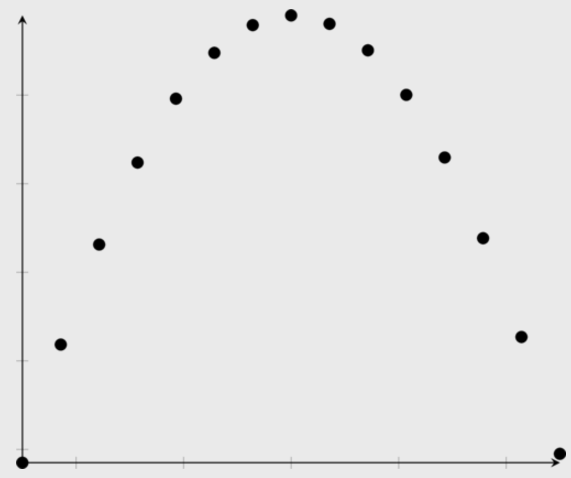

**Solution:**
quadratic

**Problem:**
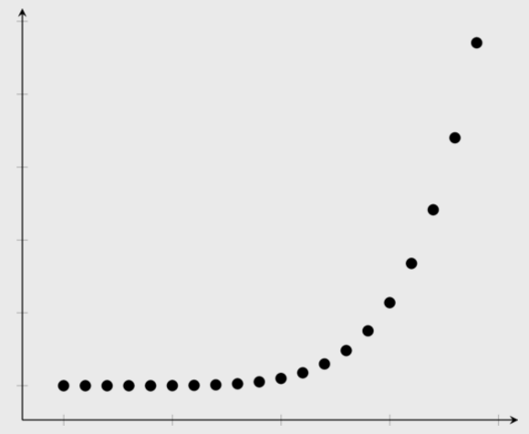

**Solution:**
exponential

**Problem:**
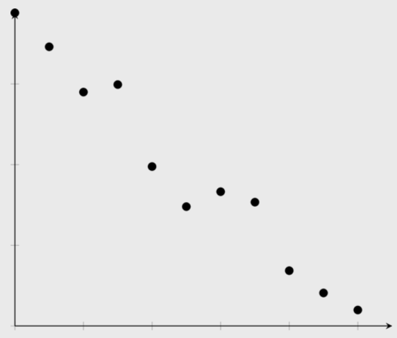

**Solution:**
linear

**Problem:**
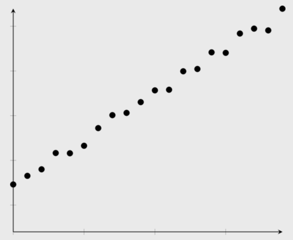

**Solution:**
linear

**Problem:**
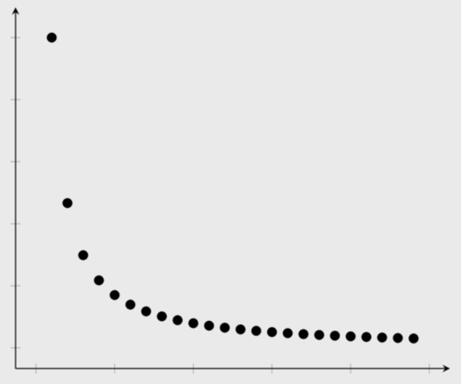

**Solution:**
exponential

**Problem:**
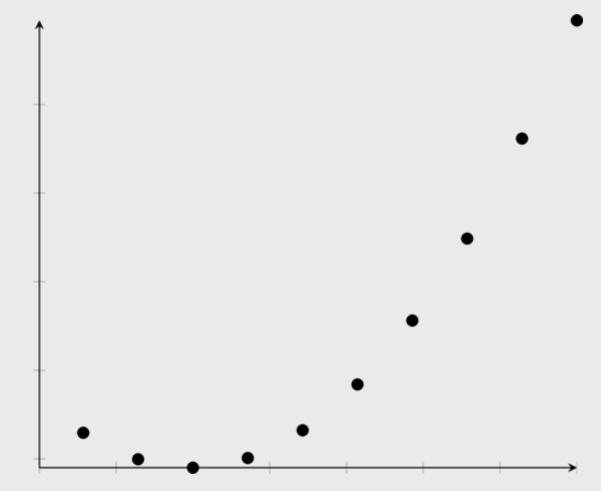

**Solution:**
quadratic

Given the scatter plot below, answer the questions that follow.

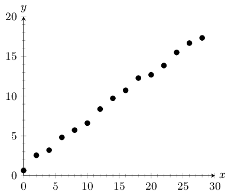

**Problem:**
What type of function fits the data best? Comment on the fit of the function in terms
                of strength and direction.

**Solution:**
The data fit a strong, positive linear function.

**Problem:**
Draw a line of best fit through the data and determine the equation for your line.

**Solution:**
NB: The answer to this question is learner dependent. The method is more important than the final
                  answer. Pay special attention to the \(y\)-intercept of the line of best fit. Learners often draw
                  their line through the origin, even when this is not appropriate. Below is an illustration of how the
                  learner should go about finding the solution to this problem. The learner's answer does not have to
                  look exactly like the model answer, but should at least be a good approximation.

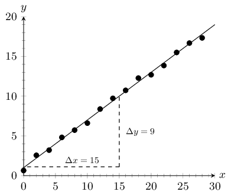

The \(y\)-intercept is approximately 1. The \(y\)-value at \(x = 15\) is approximately 10. Therefore,
                  \(m = \frac{\Delta y}{\Delta x} = \frac{10-1}{15-0} = \text{0,6}\)

The equation for the line of best fit: \(y = \text{0,6}x + 1\)

**Problem:**
Using your equation, determine the estimated \(y\)-value where \(x = 25\).

**Solution:**
Answer will depend on the learner's previous answer.

                \begin{align*}
                y &=\text{0,6}(25)+1 \\
                \therefore y &= \text{16}
                \end{align*}

**Problem:**
Using your equation, determine the estimated \(x\)-value where \(y = 25\).

**Solution:**
Answer will depend on the learner's previous answer.

                \begin{align*}
                25&=\text{0,6}x+1 \\
                \therefore \text{0,6}x &= 24 \\
                \therefore x = \frac{24}{\text{0,6}} &= \text{40}
                \end{align*}

Tuberculosis (TB) is a disease of the lungs caused by bacteria which are spread through the air when an
                infected person coughs or sneezes. Drug-resistant TB arises when patients do not take their medication
                properly. Andile is a scientist studying a new treatment for drug-resistant TB. For his research, he
                needs to grow the TB bacterium. He takes two bacteria and puts them on a plate with nutrients for their
                growth. He monitors how the number of bacteria increases over time. Look at his data in the scatter plot
                below and answer the questions that follow.

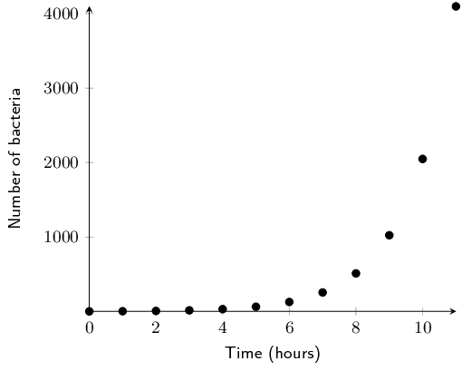

**Problem:**
What type of function do you think fits the data best?

**Solution:**
Exponential

**Problem:**
The equation for bacterial growth is \(x_{n} = x_{0}(1+r)^{t}\) where \(x_{0}\) is
                the initial number of bacteria, \(r\) is the growth rate per unit time as a proportion of 1, \(t\) is
                time in hours, and \(x_{n}\) is the number of bacteria at time, \(t\). Determine the number of bacteria
                grown by Andile after 24 hours if the number of bacteria doubles every hour (i.e. the growth rate is
                \(\text{100}\%\) per hour).

**Solution:**
We are told that \(x_{0} = 2, t = 24 \text{ and } r = \text{1}\):
                \begin{align*}
                x_{24}&= 2 \times 2^{24} \\
                &= \text{33 554 432}
                \end{align*}

Marelize is a researcher at the Department of Agriculture. She has noticed that farmers across the
                country have very different crop yields depending on the region. She thinks that this has to do with the
                different climate in each region. In order to test her idea, she collected data on crop yield and
                average summer temperatures from a number of farmers. Examine her data below and answer the questions
                that follow.

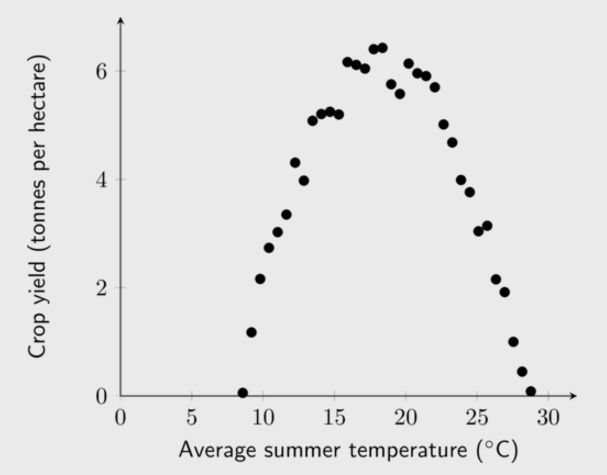

**Problem:**
Identify what type of function would fit the data best.

**Solution:**
Quadratic

**Problem:**
Marelize determines that the equation for the function which fits the data best is
                \(y=-\text{0,06}x^{2} + \text{2,2}x - 14\). Determine the optimal temperature to grow wheat and the
                respective crop yield. Round your answer to two decimal places.

**Solution:**
This question requires us to find the turning point of the function. There are a number of ways to do
                  this; two are shown below:

The first method is using the formula \(x = \frac{-b}{2a}\):

- The first step is to write the equation in the form: \(y=ax^{2} + bx + c\). Our equation is
                      already in this form, so we can immediately substitute the values into the formula for \(x\). \[x =
                      \frac{-b}{2a} = \frac{-\text{2,2}}{(2 \times -\text{0,06})} = \text{18,33}\]
- To find \(y\), we substitute our \(x\)-value into the quadratic equation:
                      \[y=-\text{0,06}(\text{18,33}^{2}) + \text{2,2}(\text{18,33}) - 14 = \text{6,17}\]

Another method is using differentiation:

- The first step is to write the equation in the form: \(y=ax^{2} + bx + c\). Our equation is
                      already in this form, so we can immediately differentiate the equation.
                      \[y' = -\text{0,06}(2)x + \text{2,2} = -\text{0,12}x + \text{2,2}\]
- At the turning point, \(y' = 0\), therefore we can now solve for \(x\): \begin{align*}
                      0&= -\text{0,12}x + \text{2,2} \\
                      \therefore x &= \frac{-\text{2,2}}{-\text{0,12}} = \text{18,33}
                      \end{align*}
- The \(x\)-value can now be substituted into the quadratic equation to find \(y\):
                      \[y = -\text{0,06}(\text{18,33})^{2} + \text{2,2}(\text{18,33}) - 14 = \text{6,17}\]

Therefore the optimal temperature to grow wheat is \(\text{18,33}\)\(\text{°C}\) and the
                  respective crop yield is \(\text{6,17}\) \(\text{tonnes per hectare}\).

Dr Dandara is a scientist trying to find a cure for a disease which has an \(\text{80}\%\) mortality
                rate, i.e. \(\text{80}\%\) of people who get the disease will die. He knows of a plant which is used in
                traditional medicine to treat the disease. He extracts the active ingredient from the plant and tests
                different dosages (measured in milligrams) on different groups of patients. Examine his data below and
                complete the questions that follow.

| Dosage (mg) | \(\text{0}\) | \(\text{25}\) | \(\text{50}\) | \(\text{75}\) | \(\text{100}\) | \(\text{125}\) | \(\text{150}\) | \(\text{175}\) | \(\text{200}\) |
| --- | --- | --- | --- | --- | --- | --- | --- | --- | --- |
| Mortality rate \((\%)\) | \(\text{80}\) | \(\text{73}\) | \(\text{63}\) | \(\text{49}\) | \(\text{42}\) | \(\text{32}\) | \(\text{25}\) | \(\text{11}\) | \(\text{5}\) |

**Problem:**
Draw a scatter plot of the data

**Solution:**
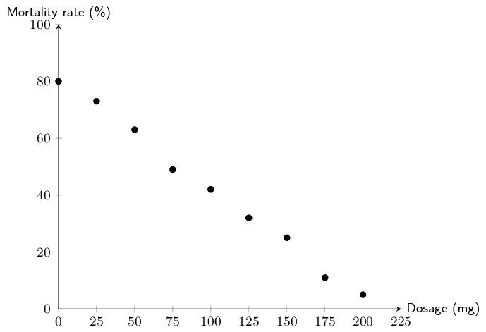

**Problem:**
Which function would best fit the data? Describe the fit in terms of strength and
                direction.

**Solution:**
The data show a strong, negative linear relationship.

**Problem:**
Draw a line of best fit through the data and determine the equation of your line.

**Solution:**
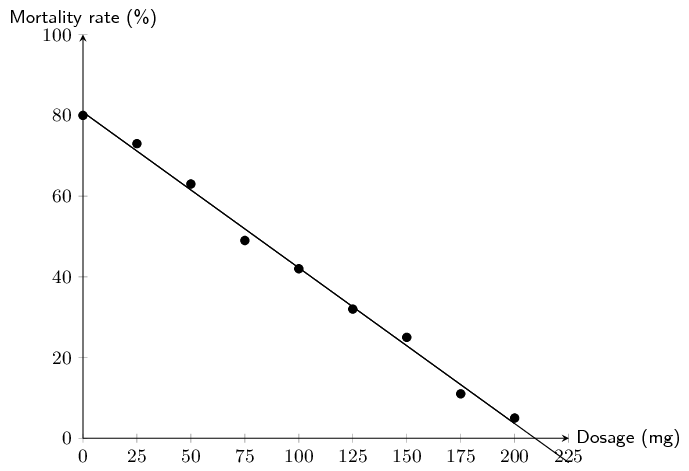

The \(y\)-intercept is approximately 80. The \(x\)-intercept is approximately 210. Therefore, \(m =
                  \frac{\Delta y}{\Delta x} = \frac{80-0}{0-210} = -\text{0,38}\)

The equation for the line of best fit: \(y = -\text{0,38}x + 80\)

**Problem:**
Use your equation to estimate the dosage required for a \(\text{0}\%\) mortality
                rate.

**Solution:**
\begin{align*}
                0&=-\text{0,38}x + 80 \\
                \therefore x&= \frac{-80}{-\text{0,38}} = \text{210,53}\text{ mg}
                \end{align*}

**Problem:**
Dr Dandara decided to administer the estimated dosage required for a \(\text{0}\%\)
                mortality rate to a group of infected patients. However, he still found a mortality rate of
                \(\text{5}\%\). Name the statistical technique Dr Dandara used to estimate a mortality rate of
                \(\text{0}\%\) and explain why his equation did not accurately predict his experimental results.

**Solution:**
Dr Dandara used **extrapolation** to calculate the dosage where the mortality rate \(=
                  \text{0}\%\). Extrapolation can result in incorrect estimates if the trend observed within the
                  available data range does not continue outside of the range. In this case, it appears that at dosages
                  greater than \(\text{200}\) \(\text{mg}\), the equation of the line of best fit no longer fits the
                  data, therefore extrapolation produced a false estimate.

In the previous worked example and exercises, you drew the line of best fit by hand. This can give us a
        reasonable approximation of which function best fits the data when the data points are close together. However,
        you and your classmates may have found that you obtained slightly different answers from one another. In the
        next section, we will learn about a more precise way of fitting a linear function to data.

### Linear regression (EMCJR)

Linear regression analysis is a statistical technique for finding out exactly which linear function best fits a
        given set of data. We can find out the equation of the regression line by using an algebraic method called the
        **least squares method**, available on most scientific calculators. The linear regression equation
        is written \(\hat{y}=a+bx\) (we say y-hat) or \(y=A+Bx\). Of course these are both variations of the more
        familiar equation \(y=mx+c\).

The least squares method is very simple. Suppose we guess a line of best fit, then at every data point, we find
        the distance between the data point and the line. If the line fitted the data perfectly, this distance would be
        zero for all the data points. The worse the fit, the larger the differences. We then square each of these
        distances, and add them all together.

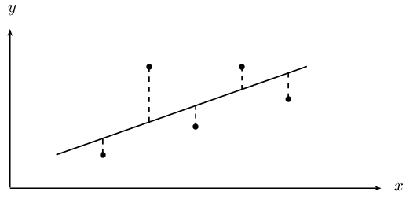

The best-fit line is then the line that minimises the sum of the squared distances.

<Callout type="note" title="Note">
<VideoPlayer src="http://www.khanacademy.org/embed_video?v=6OvhLPS7rj4" title="Video: 29D5" />
</Callout>

Suppose we have a data set of \(n\) points
        \(\left\{\left({x}_{1};{y}_{1}\right),\left({x}_{2};{y}_{2}\right),...,\left({x}_{n};{y}_{n}\right)\right\}\).
        We also have a line \(f\left(x\right)=mx+c\) that we are trying to fit to the data. The distance between the
        first data point and the line, for example, is

      \(\text{distance}={y}_{1}-f\left({x}_{1}\right)={y}_{1}-\left(m{x}_{1}+c\right)\)

We now square each of these distances and add them together. Lets call this sum \(S\left(m,c\right)\). Then we
        have that

      \begin{align*} S\left(m,c\right) & =
      {\left({y}_{1}-f\left({x}_{1}\right)\right)}^{2}+{\left({y}_{2}-f\left({x}_{2}\right)\right)}^{2}+\ldots
      +{\left({y}_{n}-f\left({x}_{n}\right)\right)}^{2} \\ & =
      \sum_{i=1}^{n}{\left({y}_{i}-f\left({x}_{i}\right)\right)}^{2} \end{align*}

Thus our problem is to find the value of m and c such that \(S\left(m,c\right)\) is minimised. Let us call
        these minimising values \(b\) and \(a\) respectively. Then the line of best-fit is \(f\left(x\right)=a+bx\). We
        can find \(a\) and \(b\) using calculus, but it is tricky, and we will just give you the result, which is that

      \begin{align*}
      b & = \frac{n{\sum }_{i=1}^{n}{x}_{i}{y}_{i}-{\sum }_{i=1}^{n}{x}_{i}{\sum }_{i=1}^{n}{y}_{i}}{n{\sum
      }_{i=1}^{n}{\left({x}_{i}\right)}^{2}-{\left({\sum }_{i=1}^{n}{x}_{i}\right)}^{2}} \\
      a & = \frac{1}{n}\sum _{i=1}^{n}{y}_{i}-\frac{b}{n}\sum _{i=1}^{n}{x}_{i}=\bar{y}-b\bar{x}
      \end{align*}

<Callout type="tip" title="Worked example 6: Method of least squares by hand">
**Question:**
In the table below, we have the records of the maintenance costs in rands compared with the age of the
            appliance in months. We have data for five appliances. Determine the equation for the least squares
            regression line by hand.

| Appliance | 1 | 2 | 3 | 4 | 5 |
| --- | --- | --- | --- | --- | --- |
| Age (\(x\)) | \(\text{5}\) | \(\text{10}\) | \(\text{15}\) | \(\text{20}\) | \(\text{30}\) |
| Cost (\(y\)) | \(\text{90}\) | \(\text{140}\) | \(\text{250}\) | \(\text{300}\) | \(\text{380}\) |

| Appliance | \(x\) | \(y\) | \(xy\) | \({x}^{2}\) |
| --- | --- | --- | --- | --- |
| 1 | \(\text{5}\) | \(\text{90}\) | \(\text{450}\) | \(\text{25}\) |
| 2 | \(\text{10}\) | \(\text{140}\) | \(\text{1 400}\) | \(\text{100}\) |
| 3 | \(\text{15}\) | \(\text{250}\) | \(\text{3 750}\) | \(\text{225}\) |
| 4 | \(\text{20}\) | \(\text{300}\) | \(\text{6 000}\) | \(\text{400}\) |
| 5 | \(\text{30}\) | \(\text{380}\) | \(\text{11 400}\) | \(\text{900}\) |
| Total | 80 | \(\text{1 160}\) | \(\text{23 000}\) | \(\text{1 650}\) |

\begin{align*}
        b & = \frac{n\sum xy-\sum x\sum y}{n\sum {x}^{2}-{\left(\sum x\right)}^{2}}=\frac{5\times 23000-80\times
        1160}{5\times 1650-{80}^{2}}=12 \\
        a & = \bar{y}-b\bar{x}=\frac{1160}{5}-\frac{12\times 80}{5}=40 \\
        \therefore \hat{y}&= 40+12x
        \end{align*}
</Callout>

<Callout type="tip" title="Worked example 7: Using the SHARP EL-531VH calculator">
**Question:**
Using a calculator, find the equation of the least squares regression line for the following data:

| Days (\(x\)) | 1 | 2 | 3 | 4 | 5 |
| --- | --- | --- | --- | --- | --- |
| Growth in m (\(y\)) | \(\text{1,00}\) | \(\text{2,50}\) | \(\text{2,75}\) | \(\text{3,00}\) | \(\text{3,50}\) |

NB. If you have a CASIO calculator, do the next worked example first. Come back to this worked example once
            you are done and see if you get the same answer on your calculator.

**Getting your calculator ready:**
Using your calculator, change the mode from normal to “Stat \(xy\) ”. Do this by pressing
            [2ndF] and then 2. This mode enables you to type in bivariate data.

**Entering the data:**
Key in the data row by row:

| Enter: | Press: | Enter: | Press: | See: |
| --- | --- | --- | --- | --- |
| 1 | \((x,y)\) | 1 | DATA | n = \(\text{1}\) |
| 2 | \((x,y)\) | \(\text{2,5}\) | DATA | n = \(\text{2}\) |
| 3 | \((x,y)\) | \(\text{2,75}\) | DATA | n = \(\text{3}\) |
| 4 | \((x,y)\) | \(\text{3,0}\) | DATA | n = \(\text{4}\) |
| 5 | \((x,y)\) | \(\text{3,5}\) | DATA | n = \(\text{5}\) |

Note: The [(\(x,y\))] button is the same as the [STO] button and the [**DATA**] button is the
            same as the [M+] button.

**Getting regression results from the calculator:**
Ask for the values of the regression coefficients \(a\) and \(b\).

| Press: | Press: | See: |
| --- | --- | --- |
| RCL | \(a\) | \(a=\text{0,9}\) |
| RCL | \(b\) | \(b=\text{0,55}\) |

\(\therefore \hat{y}=\text{0,9}+\text{0,55}x\)
</Callout>

<Callout type="tip" title="Worked example 8: Using the CASIO \(fx\)-82ZA PLUS calculator">
**Question:**
Using a calculator determine the least squares line of best fit for the following data set.

| Learner | 1 | 2 | 3 | 4 | 5 |
| --- | --- | --- | --- | --- | --- |
| Chemistry \((\%)\) | \(\text{52}\) | \(\text{55}\) | \(\text{86}\) | \(\text{71}\) | \(\text{45}\) |
| Accounting \((\%)\) | \(\text{48}\) | \(\text{64}\) | \(\text{95}\) | \(\text{79}\) | \(\text{50}\) |

For a Chemistry mark of \(\text{65}\%\), what mark does the least squares line predict for Accounting?

NB. If you have a SHARP calculator, ensure that you have done the previous worked example first. Once you
            have completed the previous worked example, attempt this example using your calculator and see if you get
            the same answer.

**Getting your calculator ready:**
Switch on the calculator. Press [MODE] and then select STAT by pressing [2]. The following screen will
            appear:

| 1 | \(1-VAR\) | 2 | \(A+BX\) |
| --- | --- | --- | --- |
| 3 | \(_+C{X}^{2}\) | 4 | \(lnX\) |
| 5 | \(eX\) | 6 | \(A.B\)\(X\) |
| 7 | \(A.XB\) | 8 | \(1/X\) |

Now press [2] for linear regression. Your screen should look something like this:

|  | \(x\) | \(y\) |
| --- | --- | --- |
| 1 |  |  |
| 2 |  |  |
| 3 |  |  |

**Entering the data:**
Press [52] and then [\(=\)] to enter the first mark under \(x\). Then enter the other values, in the same
            way, for the \(x\)-variable (the Chemistry marks) in the order in which they are given in the data set. Then
            move the cursor across and up and enter 48 under y opposite 52 in the \(x\)-column. Continue to enter the
            other \(y\)-values (the Accounting marks) in order so that they pair off correctly with the corresponding
            \(x\)-values.

|  | \(x\) | \(y\) |
| --- | --- | --- |
| 1 | 52 |  |
| 2 | 55 |  |
| 3 |  |  |

Then press [AC]. The screen clears but the data remains stored.

Now press [SHIFT][1] to get the stats computations screen shown below.

| 1: | Type | 2: | Data |
| --- | --- | --- | --- |
| 3: | Edit | 4: | Sum |
| 5: | Var | 6: | MinMax |
| 7: | Reg |  |  |

Choose Regression by pressing [7].

| 1: | A | 2: | B |
| --- | --- | --- | --- |
| 3: | r | 4: | \(\hat{x}\) |
| 5: | \(\hat{y}\) |  |  |

**Getting regression results from the calculator:**
2. Press [1] and [=] to get the value of the \(y\)-intercept, \(a=-\text{5,065} \ldots = -\text{5,07}\)
                   (to two decimal places)
   Finally, to get the slope, use the following key sequence: [SHIFT][1][7][2][\(=\)]. The calculator
                   gives \(b=\text{1,169} \ldots = \text{1,17}\) (to two decimal places)
   The equation of the line of regression is thus:
   \(\hat{y}=-\text{5,07}+\text{1,17}x\)
4. Press [AC][65][SHIFT][1][7][5][\(=\)]
   This gives a (predicted) Accounting mark of \(=\text{70,94}=\text{71}\%\)
</Callout>

## Least squares regression analysis

### Textbook Exercise 9.3

Determine the equation of the least-squares regression line using a table for the data sets below.
                Round \(a\) and \(b\) to two decimal places.

**Problem:**
| \(x\) | \(\text{10}\) | \(\text{4}\) | \(\text{9}\) | \(\text{11}\) | \(\text{11}\) | \(\text{6}\) | \(\text{8}\) | \(\text{18}\) | \(\text{9}\) | \(\text{13}\) |
| --- | --- | --- | --- | --- | --- | --- | --- | --- | --- | --- |
| \(y\) | \(\text{1}\) | \(\text{0}\) | \(\text{6}\) | \(\text{3}\) | \(\text{9}\) | \(\text{5}\) | \(\text{9}\) | \(\text{8}\) | \(\text{7}\) | \(\text{15}\) |

**Solution:**
| \(x\) | \(y\) | \(xy\) | \({x}^{2}\) |
| --- | --- | --- | --- |
| \(\text{10}\) | \(\text{1}\) | \(\text{10}\) | \(\text{100}\) |
| \(\text{4}\) | \(\text{0}\) | \(\text{0}\) | \(\text{16}\) |
| \(\text{9}\) | \(\text{6}\) | \(\text{54}\) | \(\text{81}\) |
| \(\text{11}\) | \(\text{3}\) | \(\text{33}\) | \(\text{121}\) |
| \(\text{11}\) | \(\text{9}\) | \(\text{99}\) | \(\text{121}\) |
| \(\text{6}\) | \(\text{5}\) | \(\text{30}\) | \(\text{36}\) |
| \(\text{8}\) | \(\text{9}\) | \(\text{72}\) | \(\text{64}\) |
| \(\text{18}\) | \(\text{8}\) | \(\text{144}\) | \(\text{324}\) |
| \(\text{9}\) | \(\text{7}\) | \(\text{63}\) | \(\text{81}\) |
| \(\text{13}\) | \(\text{15}\) | \(\text{195}\) | \(\text{169}\) |
| \(\sum=\text{99}\) | \(\sum=\text{63}\) | \(\sum=\text{700}\) | \(\sum=\text{1 113}\) |

                \begin{align*}
                b & = \frac{n\sum xy-\sum x\sum y}{n\sum {x}^{2}-{\left(\sum x\right)}^{2}}=\frac{10\times
                700-99\times 63}{10\times \text{1 113}-{99}^{2}}=\text{0,574} \\
                a & = \bar{y}-b\bar{x}=\frac{63}{10}-\frac{\text{0,574}\times 99}{10}=\text{0,616} \\
                \therefore \hat{y}&= \text{0,62}+\text{0,57}x
                \end{align*}

**Problem:**
| \(x\) | \(\text{8}\) | \(\text{12}\) | \(\text{12}\) | \(\text{7}\) | \(\text{6}\) | \(\text{14}\) | \(\text{8}\) | \(\text{14}\) | \(\text{14}\) | \(\text{17}\) |
| --- | --- | --- | --- | --- | --- | --- | --- | --- | --- | --- |
| \(y\) | \(-\text{5}\) | \(\text{4}\) | \(\text{3}\) | \(-\text{3}\) | \(-\text{5}\) | \(-\text{6}\) | \(-\text{2}\) | \(\text{0}\) | \(-\text{4}\) | \(\text{3}\) |

**Solution:**
| \(x\) | \(y\) | \(xy\) | \({x}^{2}\) |
| --- | --- | --- | --- |
| \(\text{8}\) | \(-\text{5}\) | \(-\text{40}\) | \(\text{64}\) |
| \(\text{12}\) | \(\text{4}\) | \(\text{48}\) | \(\text{144}\) |
| \(\text{12}\) | \(\text{3}\) | \(\text{36}\) | \(\text{144}\) |
| \(\text{7}\) | \(-\text{3}\) | \(-\text{21}\) | \(\text{49}\) |
| \(\text{6}\) | \(-\text{5}\) | \(-\text{30}\) | \(\text{36}\) |
| \(\text{14}\) | \(-\text{6}\) | \(-\text{84}\) | \(\text{196}\) |
| \(\text{8}\) | \(-\text{2}\) | \(-\text{16}\) | \(\text{64}\) |
| \(\text{14}\) | \(\text{0}\) | \(\text{0}\) | \(\text{196}\) |
| \(\text{14}\) | \(-\text{4}\) | \(-\text{56}\) | \(\text{196}\) |
| \(\text{17}\) | \(\text{3}\) | \(\text{51}\) | \(\text{289}\) |
| \(\sum=\text{112}\) | \(\sum=-\text{15}\) | \(\sum=-\text{112}\) | \(\sum=\text{1 378}\) |

                \begin{align*}
                b & = \frac{n\sum xy-\sum x\sum y}{n\sum {x}^{2}-{\left(\sum x\right)}^{2}}=\frac{10\times
                -\text{112}-112\times -\text{15}}{10\times -\text{1 378}-{112}^{2}}=\text{0,453} \\
                a & = \bar{y}-b\bar{x}=\frac{-15}{10}-\frac{\text{0,453} \times 112}{10}= -\text{6,574}\\
                \therefore \hat{y}&= -\text{6,57}+\text{0,45}x
                \end{align*}

**Problem:**
| \(x\) | \(-\text{9}\) | \(\text{3}\) | \(\text{4}\) | \(\text{7}\) | \(\text{13}\) | \(\text{6}\) | \(\text{0}\) | \(\text{8}\) | \(\text{1}\) | \(\text{14}\) |
| --- | --- | --- | --- | --- | --- | --- | --- | --- | --- | --- |
| \(y\) | \(\text{0}\) | \(-\text{12}\) | \(-\text{10}\) | \(-\text{14}\) | \(-\text{31}\) | \(-\text{32}\) | \(-\text{41}\) | \(-\text{52}\) | \(-\text{51}\) | \(-\text{63}\) |

**Solution:**
| \(x\) | \(y\) | \(xy\) | \({x}^{2}\) |
| --- | --- | --- | --- |
| \(-\text{9}\) | \(\text{0}\) | \(\text{0}\) | \(\text{81}\) |
| \(\text{3}\) | \(-\text{12}\) | \(-\text{36}\) | \(\text{9}\) |
| \(\text{4}\) | \(-\text{10}\) | \(-\text{40}\) | \(\text{16}\) |
| \(\text{7}\) | \(-\text{14}\) | \(-\text{98}\) | \(\text{49}\) |
| \(\text{13}\) | \(-\text{31}\) | \(-\text{403}\) | \(\text{169}\) |
| \(\text{6}\) | \(-\text{32}\) | \(-\text{192}\) | \(\text{36}\) |
| \(\text{0}\) | \(-\text{41}\) | \(\text{0}\) | \(\text{0}\) |
| \(\text{8}\) | \(-\text{52}\) | \(-\text{416}\) | \(\text{64}\) |
| \(\text{1}\) | \(-\text{51}\) | \(-\text{51}\) | \(\text{1}\) |
| \(\text{14}\) | \(-\text{63}\) | \(-\text{882}\) | \(\text{196}\) |
| \(\sum=\text{47}\) | \(\sum=-\text{306}\) | \(\sum=-\text{2 118}\) | \(\sum=\text{621}\) |

                \begin{align*}
                b & = \frac{n\sum xy-\sum x\sum y}{n\sum {x}^{2}-{\left(\sum x\right)}^{2}}=\frac{10\times
                -\text{2 118}-47\times -\text{306}}{10\times 621-{47}^{2}}=-\text{1,699} \\
                a & = \bar{y}-b\bar{x}=\frac{-\text{306}}{10}+\frac{\text{1,699}\times 47}{10}= -\text{22,6147}\\
                \therefore \hat{y}&= -\text{22,61}-\text{1,70}x
                \end{align*}

Use your calculator to determine the equation of the least squares regression line for the following
                sets of data:

**Problem:**
| \(x\) | \(\text{0,16}\) | \(\text{0,32}\) | 3 | \(\text{2,6}\) | \(\text{6,12}\) | \(\text{7,68}\) | \(\text{6,16}\) | \(\text{8,56}\) | \(\text{11,24}\) | \(\text{11,96}\) |
| --- | --- | --- | --- | --- | --- | --- | --- | --- | --- | --- |
| \(y\) | \(\text{5,48}\) | \(\text{10,56}\) | \(\text{13,4}\) | \(\text{15,96}\) | \(\text{15,44}\) | \(\text{16,6}\) | \(\text{17,2}\) | \(\text{22,28}\) | \(\text{22,04}\) | \(\text{24,32}\) |

**Solution:**
\(\hat{y}= \text{9,07} + \text{1,26}x\)

**Problem:**
| \(x\) | \(-\text{3,5}\) | \(\text{5,5}\) | \(\text{4}\) | \(\text{1}\) | \(\text{5,5}\) | \(\text{5}\) | \(\text{3,5}\) | \(\text{5,5}\) | \(\text{7,5}\) | \(\text{8,5}\) |
| --- | --- | --- | --- | --- | --- | --- | --- | --- | --- | --- |
| \(y\) | \(-\text{10}\) | \(-\text{20,5}\) | \(-\text{30,5}\) | \(-\text{46}\) | \(-\text{46,5}\) | \(-\text{64,5}\) | \(-\text{67}\) | \(-\text{76,5}\) | \(-\text{83,5}\) | \(-\text{94}\) |

**Solution:**
\(\hat{y}= -\text{29,09} -\text{5,84}x\)

**Problem:**
| \(x\) | \(\text{2,5}\) | \(\text{4,5}\) | \(-\text{2}\) | \(\text{9}\) | \(\text{8,5}\) | \(\text{10}\) | \(\text{7,5}\) | \(\text{3}\) | \(\text{8}\) | \(\text{15}\) |
| --- | --- | --- | --- | --- | --- | --- | --- | --- | --- | --- |
| \(y\) | \(-\text{2}\) | \(\text{6}\) | \(\text{11}\) | \(\text{11,5}\) | \(\text{17}\) | \(\text{21}\) | \(\text{21}\) | \(\text{30,5}\) | \(\text{32,5}\) | \(\text{33,5}\) |

**Solution:**
\(\hat{y}= \text{9,45} + \text{1,33}x\)

**Problem:**
| \(x\) | \(\text{7,24}\) | \(\text{8,24}\) | \(\text{5,34}\) | \(\text{1,66}\) | \(\text{0,32}\) | \(\text{11,46}\) | \(\text{9,34}\) | \(\text{14,24}\) | \(\text{12,9}\) | \(\text{12,34}\) |
| --- | --- | --- | --- | --- | --- | --- | --- | --- | --- | --- |
| \(y\) | \(-\text{3,2}\) | \(-\text{18,78}\) | \(-\text{21,1}\) | \(-\text{32}\) | \(-\text{31,2}\) | \(-\text{53,02}\) | \(-\text{53}\) | \(-\text{65,46}\) | \(-\text{74,8}\) | \(-\text{80,24}\) |

**Solution:**
\(\hat{y}= -\text{12,44} -\text{3,71}x\)

**Problem:**
| \(x\) | \(-\text{0,28}\) | \(\text{2,32}\) | \(\text{0,12}\) | \(\text{4,64}\) | \(\text{3,08}\) | \(\text{7,92}\) | \(\text{5,08}\) | \(\text{8,96}\) | \(\text{10,28}\) | \(\text{7,12}\) |
| --- | --- | --- | --- | --- | --- | --- | --- | --- | --- | --- |
| \(y\) | \(-\text{6,88}\) | \(-\text{0,32}\) | \(\text{3,68}\) | \(\text{4,8}\) | \(\text{11,68}\) | \(\text{19,2}\) | \(\text{20,96}\) | \(\text{24,96}\) | \(\text{29,28}\) | \(\text{33,28}\) |

**Solution:**
\(\hat{y}= -\text{1,94} + \text{3,25}x\)

**Problem:**
| \(x\) | \(\text{1}\) | \(\text{1,1}\) | \(\text{4,8}\) | \(\text{3,55}\) | \(\text{2,75}\) | \(\text{1,95}\) | \(\text{6,1}\) | \(\text{8,9}\) | \(\text{10,35}\) | \(\text{9,55}\) |
| --- | --- | --- | --- | --- | --- | --- | --- | --- | --- | --- |
| \(y\) | \(-\text{8,45}\) | \(-\text{5,95}\) | \(-\text{4,35}\) | \(\text{0,85}\) | \(-\text{2,95}\) | \(-\text{1,8}\) | \(\text{0,25}\) | \(\text{0,05}\) | \(\text{4,8}\) | \(-\text{3,05}\) |

**Solution:**
\(\hat{y}= -\text{5,64} + \text{0,72}x\)

**Problem:**
| \(x\) | \(\text{1,9}\) | \(\text{1,1}\) | \(-\text{1,5}\) | \(\text{1,3}\) | \(\text{0,95}\) | \(\text{8,25}\) | \(\text{10,6}\) | \(\text{6,2}\) | \(\text{8,1}\) | \(\text{8,65}\) |
| --- | --- | --- | --- | --- | --- | --- | --- | --- | --- | --- |
| \(y\) | \(\text{7}\) | \(\text{8,45}\) | \(\text{0,9}\) | \(\text{0,1}\) | \(\text{2,45}\) | \(\text{4,35}\) | \(\text{2,2}\) | \(\text{1,4}\) | \(\text{0,15}\) | \(\text{2,05}\) |

**Solution:**
\(\hat{y}= \text{3,52} -\text{0,13}x\)

**Problem:**
| \(x\) | \(-\text{81,8}\) | \(\text{73,1}\) | \(\text{84}\) | \(\text{92,2}\) | \(-\text{69,7}\) | \(-\text{56,1}\) | \(\text{8,8}\) | \(\text{80,9}\) | \(\text{68,4}\) | \(-\text{40,4}\) |
| --- | --- | --- | --- | --- | --- | --- | --- | --- | --- | --- |
| \(y\) | \(\text{10,6}\) | \(\text{16,1}\) | \(\text{3,6}\) | \(\text{4,6}\) | \(\text{11,9}\) | \(\text{18,3}\) | \(\text{16,6}\) | \(\text{17,6}\) | \(\text{17,7}\) | \(\text{24,1}\) |

**Solution:**
\(\hat{y}= \text{14,55} -\text{0,03}x\)

**Problem:**
| \(x\) | \(\text{2,8}\) | \(\text{7,4}\) | \(-\text{2,4}\) | \(\text{4}\) | \(\text{11,3}\) | \(\text{6,9}\) | \(\text{2,5}\) | \(\text{1,7}\) | \(\text{5,4}\) | \(\text{8,2}\) |
| --- | --- | --- | --- | --- | --- | --- | --- | --- | --- | --- |
| \(y\) | \(\text{12,4}\) | \(\text{13,4}\) | \(\text{15,3}\) | \(\text{15,4}\) | \(\text{16,4}\) | \(\text{19,2}\) | \(\text{21,1}\) | \(\text{19,4}\) | \(\text{21,3}\) | \(\text{25}\) |

**Solution:**
\(\hat{y}= \text{16,94} + \text{0,20}x\)

**Problem:**
| \(x\) | \(\text{5}\) | \(\text{1,2}\) | \(\text{8}\) | \(\text{6}\) | \(\text{7,4}\) | \(\text{7,4}\) | \(\text{6,7}\) | \(\text{8,7}\) | \(\text{12,2}\) | \(\text{14,3}\) |
| --- | --- | --- | --- | --- | --- | --- | --- | --- | --- | --- |
| \(y\) | \(-\text{4,2}\) | \(-\text{13,7}\) | \(-\text{23,7}\) | \(-\text{33,5}\) | \(-\text{43,8}\) | \(-\text{54,2}\) | \(-\text{63,9}\) | \(-\text{73,9}\) | \(-\text{84,5}\) | \(-\text{93,5}\) |

**Solution:**
\(\hat{y}= \text{5,14} -\text{7,03}x\)

Determine the equation of the least squares regression line given each set of data values below. Round
                \(a\) and \(b\) to two decimal places in your final answer.

**Problem:**
\(n = 10; \enspace \sum x = \text{74}; \enspace \sum y = \text{424}; \enspace \sum xy =
                  \text{4 114,51};\enspace \sum (x^{2}) = \text{718,86}\)

**Solution:**
\begin{align*}
                b & =
                \frac{n{\sum\limits_{i=1}^{n}}{x}_{i}{y}_{i}-{\sum\limits_{i=1}^{n}}{x}_{i}{\sum\limits_{i=1}^{n}}{y}_{i}}{n{\sum\limits_{i=1}^{n}}{\left({x}_{i}\right)}^{2}-{\left({\sum\limits_{i=1}^{n}}{x}_{i}\right)}^{2}}
                \\
                & = \frac{10 \times \text{4 114,51} - 74 \times \text{424}}{10 \times \text{718,86} - 74^{2}} =
                \text{5,704250847} \\ \\
                a&= \bar{y}-b\bar{x} = \frac{\text{424}}{\text{10}} - \text{5,704250847} \times \frac{74}{10} =
                \text{0,188543732} \\ \\
                \therefore \hat{y}&= \text{0,19} + \text{5,70}x
                \end{align*}

**Problem:**
\(n = 13; \enspace \bar{x} = \text{8,45}; \enspace \bar{y} = \text{17,83}; \enspace \sum xy =
                  \text{1 879,25}; \enspace \sum (x^{2}) = \text{855,45}\)

**Solution:**
\begin{align*}
                \bar{x} & =\frac{\sum\limits_{i=1}^{n}(x_i)}{n} \\
                \therefore \bar{x}n &= \sum\limits_{i=1}^{n}(x_i) \\
                \therefore b & =
                \frac{n{\sum\limits_{i=1}^{n}}{x}_{i}{y}_{i}-(\bar{x}n)(\bar{y}n)}{\sum\limits_{i=1}^{n}{y}_{i}{n{\sum\limits_{i=1}^{n}}{\left({x}_{i}\right)}^{2}-(\bar{x}n)^{2}}}
                \\
                & = \frac{13 \times \text{1 879,25} - (13\times\text{8,45}) \times (13\times\text{17,83})}{13
                \times \text{855,45} - (13 \times \text{8,45})^{2}} = \text{1,090584962} \\ \\
                a&= \bar{y}-b\bar{x} = \text{17,83} - \text{1,090584962} \times \text{8,45} = \text{8,614557071} \\
                \\
                \therefore \hat{y}&= \text{8,61} + \text{1,09}x
                \end{align*}

**Problem:**
\(n = 10; \enspace \bar{x} = \text{5,77}; \enspace \bar{y} = \text{17,03}; \enspace \overline{xy} =
                  \text{133,817}; \enspace \sigma_x = \pm \text{3,91} \\\)
                  (Hint: multiply the numerator and denominator of the formula for \(b\) by \(\frac{1}{n^{2}}\))

**Solution:**
\begin{align*}
                Var[x] &= \sigma_{x}^{2} = \frac{\sum\limits_{i=1}^{n}x_{i}^{2}}{n} - \bar{x}^{2} \text{ (proof
                below the solution)}\\
                \bar{x} & =\frac{\sum\limits_{i=1}^{n}(x_i)}{n} \\
                \therefore b \times \frac{\frac{1}{n^{2}}}{\frac{1}{n^{2}}} & =
                \frac{\frac{\sum\limits_{i=1}^{n}{x}_{i}{y}_{i}}{n}-\frac{{\sum\limits_{i=1}^{n}}{x}_{i}{\sum\limits_{i=1}^{n}}{y}_{i}}{n^{2}}}{\frac{\sum\limits_{i=1}^{n}{{x}_{i}}^{2}}{n}-\frac{{\left({\sum\limits_{i=1}^{n}}{x}_{i}\right)}^{2}}{n^{2}}}
                = \frac{\overline{xy} -\bar{x}\bar{y}}{\frac{\sum\limits_{i=1}^{n}{{x}_{i}}^{2}}{n}-\bar{x}^{2}} =
                \frac{\overline{xy} -\bar{x}\bar{y}}{Var[x]} \\
                & = \frac{\text{133,817} - (\text{5,77} \times \text{17,03})}{\text{3,91}^{2}} =
                \text{2,325593108}\\ \\
                a&= \bar{y}-b\bar{x} = {\text{17,03}} - \text{2,325593108} \times \text{5,77} = \text{3,611327767}
                \\ \\
                \therefore \hat{y}&= \text{3,61} + \text{2,33}x
                \end{align*}

                \begin{align*}
                \text{RTP: } Var[x] &= \frac{\sum\limits_{i=1}^{n}x_{i}^{2}}{n} - \bar{x}^{2} \\
                Var[x] & = \frac{\sum\limits_{i=1}^{n}(x_i - \bar{x})^{2}}{n} \text{ (from the formula)}\\
                &= \frac{\sum\limits_{i=1}^{n}(x_i^{2} - 2x_{i}\bar{x} - \bar{x}^{2})}{n} \\
                &= \frac{\sum\limits_{i=1}^{n}x_{i}^{2}}{n} - 2\bar{x}\frac{\sum\limits_{i=1}^{n}x_{i}}{n} +
                \frac{\sum\limits_{i=1}^{n}\bar{x}^{2}}{n} \\
                &= \frac{\sum\limits_{i=1}^{n}x_{i}^{2}}{n} - 2\bar{x}^{2} +
                \frac{{n}\bar{x}^{2}}{{n}} \\
                & =\frac{\sum\limits_{i=1}^{n}x_{i}^{2}}{n} - \bar{x}^{2}
                \end{align*}

The table below shows the average maintenance cost in rands of a certain model of car compared to the
                age of the car in years.

| Age (\(x\)) | \(\text{1}\) | \(\text{3}\) | \(\text{5}\) | \(\text{6}\) | \(\text{8}\) | \(\text{9}\) | \(\text{10}\) |
| --- | --- | --- | --- | --- | --- | --- | --- |
| Cost (\(y\)) | \(\text{1 000}\) | \(\text{1 500}\) | \(\text{1 600}\) | \(\text{1 800}\) | \(\text{2 000}\) | \(\text{2 400}\) | \(\text{2 600}\) |

**Problem:**
Draw a scatter plot of the data.

**Solution:**
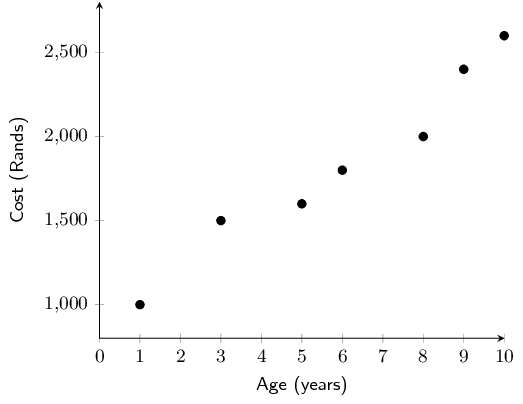

**Problem:**
Complete the table below, filling in the totals of each column in the final row:

| Age (\(x\)) | Cost (\(y\)) | \(xy\) | \(x^{2}\) |
| --- | --- | --- | --- |
| 1 | \(\text{1 000}\) |  |  |
| 3 | \(\text{1 500}\) |  |  |
| 5 | \(\text{1 600}\) |  |  |
| 6 | \(\text{1 800}\) |  |  |
| 8 | \(\text{2 000}\) |  |  |
| 9 | \(\text{2 400}\) |  |  |
| 10 | \(\text{2 600}\) |  |  |
| \(\sum = \ldots\) | \(\sum = \ldots\) | \(\sum = \ldots\) | \(\sum = \ldots\) |

**Solution:**
| Age (\(x\)) | Cost (\(y\)) | \(xy\) | \(x^{2}\) |
| --- | --- | --- | --- |
| 1 | \(\text{1 000}\) | \(\text{1 000}\) | 1 |
| 3 | \(\text{1 500}\) | \(\text{4 500}\) | 9 |
| 5 | \(\text{1 600}\) | \(\text{8 000}\) | 25 |
| 6 | \(\text{1 800}\) | \(\text{10 800}\) | 36 |
| 8 | \(\text{2 000}\) | \(\text{16 000}\) | 64 |
| 9 | \(\text{2 400}\) | \(\text{21 600}\) | 81 |
| 10 | \(\text{2 600}\) | \(\text{26 000}\) | 100 |
| \(\sum=42\) | \(\sum=\text{12 900}\) | \(\sum=\text{87 900}\) | \(\sum=316\) |

**Problem:**
Use your table to determine the equation of the least squares regression line. Round
                \(a\) and \(b\) to two decimal places.

**Solution:**
\begin{align*}
                b & = \frac{n{\sum }_{i=1}^{n}{x}_{i}{y}_{i}-{\sum }_{i=1}^{n}{x}_{i}{\sum
                }_{i=1}^{n}{y}_{i}}{n{\sum }_{i=1}^{n}{\left({x}_{i}\right)}^{2}-{\left({\sum
                }_{i=1}^{n}{x}_{i}\right)}^{2}} \\
                & = \frac{7 \times \text{87 900} - 42 \times \text{12 900}}{7 \times 326 - 42^{2}} =
                \text{164,0625} \\ \\
                a&= \bar{y}-b\bar{x} = \frac{\text{12 900}}{\text{7}} - \text{164,0625} \times \frac{42}{7} =
                \text{858,48} \\ \\
                \therefore \hat{y}&= \text{858,48} + \text{164,06}x
                \end{align*}

**Problem:**
Use your equation to estimate what it would cost to maintain this model of car in its
                \(15^{\text{th}}\) year.

**Solution:**
\[y= \text{858,48} + \text{164,06}(15) = \text{R}\,\text{3 319,42}\]

**Problem:**
Use your equation to estimate the age of the car in the year where the maintenance
                cost totals over \(\text{R}\,\text{3 000}\) for the first time.

**Solution:**
\begin{align*}
                \text{3 000}&= \text{858,48} + \text{164,06}x \\
                \text{2 141,52} &= \text{164,06}x \\
                x &= \frac{\text{2 141,52}}{\text{164,06}} = \text{13,05}
                \end{align*}
                Therefore the maintenance cost will exceed \(\text{R}\,\text{3 000}\) for the first time when the car is
                aged 13.

Miss Colly has always maintained that there is a relationship between a learner's ability to understand
                the language of instruction and their marks in Mathematics. Since she teaches Mathematics through the
                medium of English, she decides to compare the Mathematics and English marks of her learners in order to
                investigate the relationship between the two marks. A sample of her data is shown in the table below:

| English \% (\(x\)) | 28 | 33 | 30 | 45 | 45 | 55 | 55 | 65 | 70 | 76 | 65 | 85 | 90 |
| --- | --- | --- | --- | --- | --- | --- | --- | --- | --- | --- | --- | --- | --- |
| Mathematics \% (\(y\)) | 35 | 36 | 34 | 45 | 50 | 40 | 60 | 50 | 65 | 85 | 70 | 80 | 90 |

**Problem:**
Complete the table below, filling in the totals of each column in the final row:

| English \% (\(x\)) | Mathematics \% (\(y\)) | \(xy\) | \(x^{2}\) |
| --- | --- | --- | --- |
| \(\text{28}\) | \(\text{35}\) |  |  |
| \(\text{33}\) | \(\text{36}\) |  |  |
| \(\text{30}\) | \(\text{34}\) |  |  |
| \(\text{45}\) | \(\text{45}\) |  |  |
| \(\text{45}\) | \(\text{50}\) |  |  |
| \(\text{55}\) | \(\text{40}\) |  |  |
| \(\text{65}\) | \(\text{50}\) |  |  |
| \(\text{70}\) | \(\text{65}\) |  |  |
| \(\text{76}\) | \(\text{85}\) |  |  |
| \(\text{65}\) | \(\text{70}\) |  |  |
| \(\text{85}\) | \(\text{80}\) |  |  |
| \(\text{90}\) | \(\text{90}\) |  |  |
| \(\sum = \ldots\) | \(\sum = \ldots\) | \(\sum = \ldots\) | \(\sum = \ldots\) |

**Solution:**
| English \% (\(x\)) | Mathematics \% (\(y\)) | \(xy\) | \(x^{2}\) |
| --- | --- | --- | --- |
| \(\text{28}\) | \(\text{35}\) | \(\text{980}\) | \(\text{784}\) |
| \(\text{33}\) | \(\text{36}\) | \(\text{1 188}\) | \(\text{1 089}\) |
| \(\text{30}\) | \(\text{34}\) | \(\text{1 020}\) | \(\text{900}\) |
| 45 | 45 | \(\text{2 025}\) | \(\text{2 025}\) |
| 45 | 50 | \(\text{2 250}\) | \(\text{2 025}\) |
| 55 | 40 | \(\text{2 200}\) | \(\text{3 025}\) |
| 65 | 50 | \(\text{3 250}\) | \(\text{4 225}\) |
| 70 | 65 | \(\text{4 550}\) | \(\text{4 900}\) |
| 76 | 85 | \(\text{6 460}\) | \(\text{5 776}\) |
| 65 | 70 | \(\text{4 550}\) | \(\text{4 225}\) |
| 85 | 80 | \(\text{6 800}\) | \(\text{7 225}\) |
| 90 | 90 | \(\text{8 100}\) | \(\text{8 100}\) |
| \(\sum=742\) | \(\sum=740\) | \(\sum=\text{46 673}\) | \(\sum=\text{47 324}\) |

**Problem:**
Use your table to determine the equation of the least squares regression line. Round
                \(a\) and \(b\) to two decimal places.

**Solution:**
\begin{align*}
                b & = \frac{n{\sum }_{i=1}^{n}{x}_{i}{y}_{i}-{\sum }_{i=1}^{n}{x}_{i}{\sum
                }_{i=1}^{n}{y}_{i}}{n{\sum }_{i=1}^{n}{\left({x}_{i}\right)}^{2}-{\left({\sum
                }_{i=1}^{n}{x}_{i}\right)}^{2}} \\
                & = \frac{13 \times \text{46 673} - 742 \times \text{740}}{13 \times \text{47 324} -
                742^{2}} = \text{0,8920461577} \\ \\
                a&= \bar{y}-b\bar{x} = \frac{\text{740}}{\text{13}} - \text{0,8920461577} \times \frac{742}{13} =
                \text{6,007827002} \\ \\
                \therefore \hat{y}&= \text{6,01} + \text{0,89}x
                \end{align*}

**Problem:**
Use your equation to estimate the Mathematics mark of a learner who obtained
                \(\text{50}\%\) for English, correct to two decimal places.

**Solution:**
\[y= \text{6,01} + \text{0,89}(50) = \text{50,51}\%\]

**Problem:**
Use your equation to estimate the English mark of a learner who obtained
                \(\text{75}\%\) for Mathematics, correct to two decimal places.

**Solution:**
\begin{align*}
                \text{75}&= \text{6,01} + \text{0,89}x \\
                \text{68,99} &= \text{0,89}x \\
                x &= \frac{\text{68,99}}{\text{0,89}} = \text{77,52}\%
                \end{align*}

Foot lengths and heights of ten students are given in the table below.

| Height (cm) | \(\text{170}\) | \(\text{163}\) | \(\text{131}\) | \(\text{181}\) | \(\text{146}\) | \(\text{134}\) | \(\text{166}\) | \(\text{172}\) | \(\text{185}\) | \(\text{153}\) |
| --- | --- | --- | --- | --- | --- | --- | --- | --- | --- | --- |
| Foot length (cm) | \(\text{27}\) | \(\text{23}\) | \(\text{20}\) | \(\text{28}\) | \(\text{22}\) | \(\text{20}\) | \(\text{24}\) | \(\text{26}\) | \(\text{29}\) | \(\text{22}\) |

**Problem:**
Using foot length as your \(x\)-variable, draw a scatter plot of the data.

**Solution:**
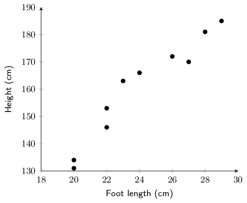

**Problem:**
Identify and describe any trends shown in the scatter plot.

**Solution:**
Strong (or fairly strong), positive, linear trend

**Problem:**
Find the equation of the least squares line using the formulae and draw the line on your graph. Round
                  \(a\) and \(b\) to two decimal places in your final answer.

**Solution:**
| Foot length (\(x\)) | Height (\(y\)) | \(xy\) | \(x^{2}\) |
| --- | --- | --- | --- |
| 27 | \(\text{170}\) | \(\text{4 590}\) | 729 |
| 23 | \(\text{163}\) | \(\text{3 749}\) | 529 |
| 20 | \(\text{131}\) | \(\text{2 620}\) | 400 |
| 28 | \(\text{181}\) | \(\text{5 068}\) | 784 |
| 22 | \(\text{146}\) | \(\text{3 212}\) | 484 |
| 20 | \(\text{134}\) | \(\text{2 680}\) | 400 |
| 24 | \(\text{166}\) | \(\text{3 984}\) | 576 |
| 26 | \(\text{172}\) | \(\text{4 472}\) | 676 |
| 29 | \(\text{185}\) | \(\text{5 365}\) | 841 |
| 22 | \(\text{153}\) | \(\text{3 366}\) | 484 |
| \(\sum=241\) | \(\sum=\text{1 601}\) | \(\sum=\text{39 106}\) | \(\sum=\text{5 903}\) |

                \begin{align*}
                b & =
                \frac{n{\sum\limits_{i=1}^{n}}{x}_{i}{y}_{i}-{\sum\limits_{i=1}^{n}}{x}_{i}{\sum\limits_{i=1}^{n}}{y}_{i}}{n{\sum\limits_{i=1}^{n}}{\left({x}_{i}\right)}^{2}-{\left({\sum\limits_{i=1}^{n}}{x}_{i}\right)}^{2}}
                \\
                & = \frac{10 \times \text{39 106} - 241 \times \text{1 601}}{10 \times \text{5 903} -
                241^{2}} = \text{5,49947313} \\ \\
                a&= \bar{y}-b\bar{x} = \frac{\text{1 601}}{\text{10}} - \text{5,49947313} \times \frac{241}{10}
                = \text{27,56269575} \\ \\
                \therefore \hat{y}&= \text{27,56} + \text{5,50}x
                \end{align*}

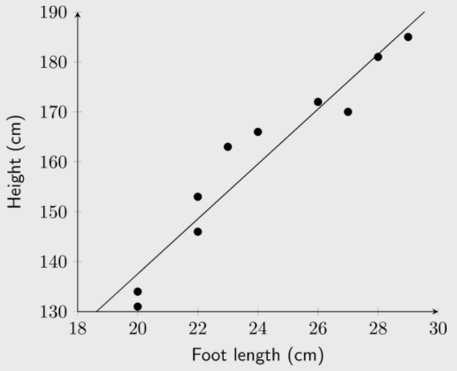

**Problem:**
Confirm your calculations above by finding the least squares regression line using a calculator.

**Solution:**
Answer should be the same as c).

**Problem:**
Use your equation to predict the height of a student with a foot length of \(\text{21,6}\)
                  \(\text{cm}\).

**Solution:**
\[y = \text{27,56} + \text{5,5}(\text{21,6}) = \text{146,36}\text{ cm}\]

**Problem:**
Use your equation to predict the foot length of a student \(\text{190}\) \(\text{cm}\) tall, correct
                  to two decimal places.

**Solution:**
\begin{align*}
                190&=\text{5,5}x + \text{27,56} \\
                \therefore x&= \frac{\text{162,44}}{\text{5,5}} = \text{29,53}\text{ cm}
                \end{align*}

Now that we have a precise technique for finding the line of best fit, we still do not know how well our line
        of best fit really fits our data. We can fit a least squares regression line to any bivariate data, even if the
        two variables do not show a linear relationship. If the fit is not “good”, our assumption of the
        \(a\) and \(b\) values in \(\hat{y}=a+bx\) might be incorrect. Next, we will learn of a quantitative measure to
        determine how well our line really fits our data.
