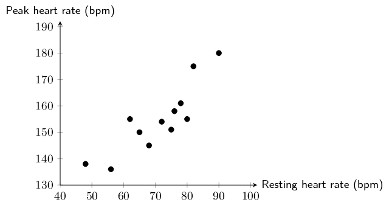
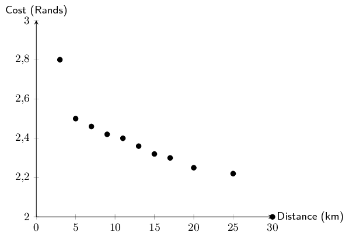
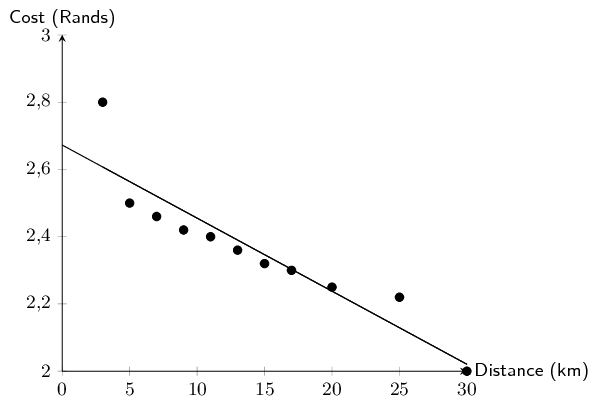
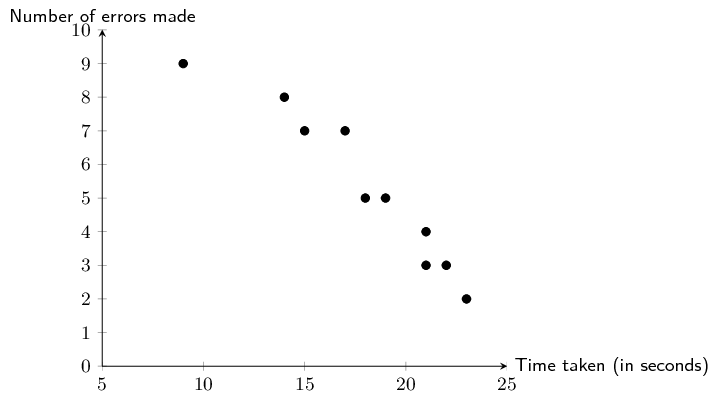
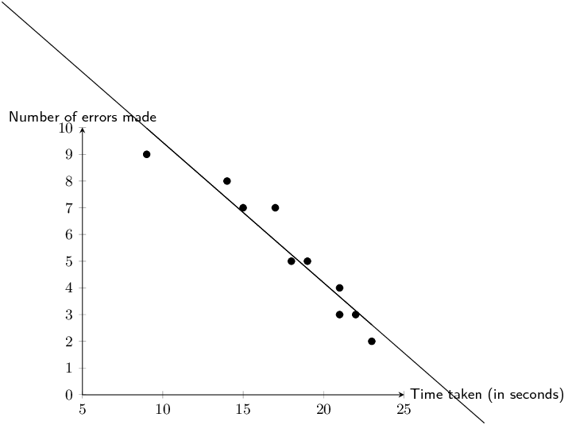
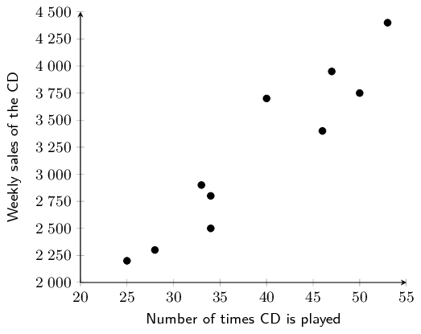

## 9.3 Correlation (EMCJS)

The linear correlation coefficient, \(r\), is a measure which tells us the strength and direction of a
      relationship between two variables. The correlation coefficient \(r\in \left[-1;1\right]\). When \(r=-1\), there
      is perfect negative correlation, when \(r=0\), there is no correlation and when \(r=1\) there is perfect positive
      correlation.

| Positive, strong | Positive, fairly strong | Positive, weak |
| \(r\approx \text{0,9}\) | \(r\approx \text{0,7}\) | \(r\approx \text{0,4}\) |

| Negative, fairly strong | Negative, weak | No correlation |
| \(r\approx -\text{0,7}\) | \(r\approx -\text{0,4}\) | \(r=0\) |

NB. See the fifth bullet at the beginning of the chapter regarding the formula for the correlation coefficient.

The linear correlation coefficient \(r\) can be calculated using the formula

    \(r=b\dfrac{\sigma_{x}}{\sigma_{y}}\)

- where \(b\) is the gradient of the least squares regression line,
- \(\sigma_{x}\) is the standard deviation of the \(x\)-values and
- \(\sigma_{y}\) is the standard deviation of the \(y\)-values.

This is known as the Pearson's product moment correlation coefficient. It is much easier to do on a calculator
      where you simply follow the procedure for the regression equation, and go on to find \(r\).

In general:

| Positive | Strength | Negative |
| --- | --- | --- |
| \(r=0\) | no correlation | \(r=0\) |
| \(0<r<\text{0,25}\) | very weak | \(-\text{0,25}<r<0\) |
| \(\text{0,25}<r<\text{0,5}\) | weak | \(-\text{0,5}<r<-\text{0,25}\) |
| \(\text{0,5}<r<\text{0,75}\) | moderate | \(-\text{0,75}<r<-\text{0,5}\) |
| \(\text{0,75}<r<\text{0,9}\) | strong | \(-\text{0,9}<r<-\text{0,75}\) |
| \(\text{0,9}<r<1\) | very strong | \(-\text{1}<r<-0.9\) |
| \(r=1\) | perfect correlation | \(r=-1\) |

<Callout type="note" title="Note">
Correlation does not imply causation! Just because two variables are correlated does not mean that they are
        causally linked, i.e. if A and B are correlated, that does not mean A causes B, or vice versa. This is a common
        mistake made by many people, especially journalists looking for their next juicy story.

For example, ice cream sales and shark attacks are correlated. This does not mean that the sale of ice cream is
        somehow causing more shark attacks. Instead, a simpler explanation is that the warmer it is, the more likely
        people are to buy ice cream and the more likely people are to go to the beach as well, thus increasing the
        likelihood of a shark attack.

<VideoPlayer src="http://www.khanacademy.org/video/correlation-and-causality?utm_campaign=embed" title="Video: 29DV" />
</Callout>

<QuizCard id="m12-09-03a" title="Interactive Exercise 9.6" question="" options=[] answer="-38.7, -19.26, 1, 9, -83.28, 28" hint="You should enter a number here. If you want to, you can use a space to separate thousands.                Example: 12 800,25 For scientific notation you need to use the multiply symbol                ( ∗ ) and the exponent symbol ( ^ ). For example 6,673 × 10 −11 should be written as: 6,673 ∗ 10^−11" explanation="The completed table looks like this: Points \(x\) \(y\) \(xy\) \(x^2\) Point A \(-\text{3}\) \(\text{12,9}\) \(-\text{38,7}\) \(\text{9}\) Point B \(-\text{2}\) \(\text{9,63}\) \(-\text{19,26}\) \(\text{4}\) Point C \(-\text{1}\) \(\text{5,19}\) \(-\text{5,19}\) \(\text{1}\) Point D \(\text{0}\) \(\text{2,55}\) \(\text{0}\) \(\text{0}\) Point E \(\text{1}\) \(\text{0,81}\) \(\text{0,81}\) \(\text{1}\) Point F \(\text{2}\) \(-\text{2,55}\) \(-\text{5,1}\) \(\text{4}\) Point G \(\text{3}\) \(-\text{5,28}\) \(-\text{15,84}\) \(\text{9}\) Totals \(\text{0}\) \(\text{23,25}\) \(-\text{83,28}\) \(\text{28}\) Submit your answer as: and and and and and" />

<Callout type="tip" title="Worked example 9: The correlation coefficient">
**Question:**
A cardiologist wanted to test the relationship between resting heart rate and the peak heart rate during
          exercise. Heart rate is measured in beats per minute (bpm). The following set of data was generated from 12
          study participants after they had run on a treadmill at \(\text{10}\) \(\text{km/h}\) for 10 minutes.

| Resting heart rate | 48 | 56 | 90 | 65 | 75 | 78 | 80 | 72 | 82 | 76 | 68 | 62 |
| --- | --- | --- | --- | --- | --- | --- | --- | --- | --- | --- | --- | --- |
| Peak heart rate | 138 | 136 | 180 | 150 | 151 | 161 | 155 | 154 | 175 | 158 | 145 | 155 |

- Draw a scatter plot of the data. Use resting heart rate as your \(x\)-variable.
- Use your calculator to determine the equation of the line of best fit.
- Estimate what the heart rate of a person with a resting heart rate of \(\text{70}\) \(\text{bpm}\) will be
              after exercise.
- Without using your calculator, find the correlation coefficient, \(r\). Confirm your answer using your
              calculator.
- What can you conclude regarding the relationship between resting heart rate and the heart rate after
              exercise?

**Draw the scatter plot:**
2. Choose a suitable scale for the axes.
4. Draw the axes.
6. Plot the points.

**Calculate the equation of the line of best fit:**
As you learnt previously, use your calculator to determine the values for \(a\) and \(b\).

\(a = \text{86,75}\)

\(b = \text{0,96}\)

Therefore, the equation for the line of best fit is \(y = \text{86,75} + \text{0,96}x\)

**Calculate the estimated value for \(y\):**
If \(x = 70\), using our equation, the estimated value for \(y\) is:
          \[y= \text{86,75} + \text{0,96} \times 70 = \text{153,95}\]

**Calculate the correlation co-efficient:**
The formula for \(r\) is:

        \[r=b\dfrac{\sigma_{x}}{\sigma_{y}}\]

We already know the value of \(b\) and you know how to calculate \(b\) by hand from worked example 5, so we
          are just left to determine the value for \(\sigma_{x}\) and \(\sigma_{y}\). The formula for standard deviation
          is:

        \[\sigma_{x}= \frac{\sqrt{\sum\limits_{i=1}^{n}(x_i - \bar{x})^{2}}}{n}\]

First, you need to determine \(\bar{x}\) and \(\bar{y}\) and then complete a table like the one below.

        \begin{align*}
        \bar{x} &= \frac{\sum\limits_{i=1}^{n}x_i}{n} = 71 \\
        \bar{y} &= \frac{\sum\limits_{i=1}^{n}y_i}{n} = \text{154,83} \text{ (rounded to two decimal places)}
        \end{align*}

| Resting heart rate (\(x\)) | Peak heart rate (\(y\)) | \((x-\bar{x})^{2}\) | \((y-\bar{y})^{2}\) |
| --- | --- | --- | --- |
| 48 | 138 | 529 | \(\text{283,25}\) |
| 56 | 136 | 225 | \(\text{354,57}\) |
| 90 | 180 | 361 | \(\text{633,53}\) |
| 65 | 150 | 36 | \(\text{23,33}\) |
| 75 | 151 | 16 | \(\text{14,67}\) |
| 78 | 161 | 49 | \(\text{38,07}\) |
| 80 | 155 | 81 | \(\text{0,03}\) |
| 72 | 154 | 1 | \(\text{0,69}\) |
| 82 | 175 | 121 | \(\text{406,83}\) |
| 76 | 158 | 25 | \(\text{10,05}\) |
| 68 | 145 | 9 | \(\text{96,63}\) |
| 62 | 155 | 81 | \(\text{0,03}\) |
| \(\sum=852\) | \(\sum=\text{1 858}\) | \(\sum=\text{1 534}\) | \(\sum=\text{1 861,68}\) |

\begin{align*}
        \sigma_{x}&= \frac{\sqrt{\sum\limits_{i=1}^{n}(x_i - \bar{x})^{2}}}{n} = \frac{\sqrt{\text{1 534}}}{12}
        = \pm \text{3,26} \\
        \sigma_{y}&= \frac{\sqrt{\sum\limits_{i=1}^{n}(y_i - \bar{y})^{2}}}{n} =
        \frac{\sqrt{\text{1 861,68}}}{12} = \pm \text{3,60} \\
        b&=\text{0,96} \\
        \therefore r&= \text{0,96} \times \frac{\text{3,26}}{\text{3,60}} \\
        &= \text{0,87}
        \end{align*}

**Confirm your answer using your calculator:**
Once you know the method for finding the equation of the best line of fit on your calculator, finding the
          value for \(r\) is trivial. After you have entered all your \(x\) and \(y\) values into your calculator, in
          STAT mode:

- on a SHARP calculator: press [RCL] then [r] (the same key as [\(\div\)])
- on a CASIO calculator: press [SHIFT] then [STAT], [5], [3] then [\(=\)]

**Comment on the correlation coefficient:**
\[r = \text{0,87}\]

Therefore, there is a strong, positive, linear relationship between resting heart rate and peak heart rate
          during exercise. This means that the higher your resting heart rate, the higher your peak heart rate during
          exercise is likely to be.
</Callout>

## Correlation coefficient

### Textbook Exercise 9.4

Determine the correlation coefficient by hand for the following data sets and comment on the strength and
              direction of the correlation. Round your answers to two decimal places.

**Problem:**
| \(x\) | \(\text{5}\) | \(\text{8}\) | \(\text{13}\) | \(\text{10}\) | \(\text{14}\) | \(\text{15}\) | \(\text{17}\) | \(\text{12}\) | \(\text{18}\) | \(\text{13}\) |
| --- | --- | --- | --- | --- | --- | --- | --- | --- | --- | --- |
| \(y\) | \(\text{5}\) | \(\text{8}\) | \(\text{3}\) | \(\text{8}\) | \(\text{7}\) | \(\text{5}\) | \(\text{3}\) | \(-\text{1}\) | \(\text{4}\) | \(-\text{1}\) |

**Solution:**
| \(x\) | \(y\) | \(xy\) | \({x}^{2}\) | \({x-\bar{x}}^{2}\) | \({y-\bar{y}}^{2}\) |
| --- | --- | --- | --- | --- | --- |
| \(\text{5}\) | \(\text{5}\) | \(\text{25}\) | \(\text{25}\) | \(\text{56,25}\) | \(\text{0,81}\) |
| \(\text{8}\) | \(\text{8}\) | \(\text{64}\) | \(\text{64}\) | \(\text{20,25}\) | \(\text{15,21}\) |
| \(\text{13}\) | \(\text{3}\) | \(\text{39}\) | \(\text{169}\) | \(\text{0,25}\) | \(\text{1,21}\) |
| \(\text{10}\) | \(\text{8}\) | \(\text{80}\) | \(\text{100}\) | \(\text{6,25}\) | \(\text{15,21}\) |
| \(\text{14}\) | \(\text{7}\) | \(\text{98}\) | \(\text{196}\) | \(\text{2,25}\) | \(\text{8,41}\) |
| \(\text{15}\) | \(\text{5}\) | \(\text{75}\) | \(\text{225}\) | \(\text{6,25}\) | \(\text{0,81}\) |
| \(\text{17}\) | \(\text{3}\) | \(\text{51}\) | \(\text{289}\) | \(\text{20,25}\) | \(\text{1,21}\) |
| \(\text{12}\) | \(-\text{1}\) | \(-\text{12}\) | \(\text{144}\) | \(\text{0,25}\) | \(\text{26,01}\) |
| \(\text{18}\) | \(\text{4}\) | \(\text{72}\) | \(\text{324}\) | \(\text{30,25}\) | \(\text{0,01}\) |
| \(\text{13}\) | \(-\text{1}\) | \(-\text{13}\) | \(\text{169}\) | \(\text{0,25}\) | \(\text{26,01}\) |
| \(\sum=\text{125}\) | \(\sum=\text{41}\) | \(\sum=\text{479}\) | \(\sum=\text{1 705}\) | \(\sum=\text{142,5}\) | \(\sum=\text{94,9}\) |

              \begin{align*}
              r&= b\frac{\sigma_x}{\sigma_{y}} \\
              b & = \frac{n\sum xy-\sum x\sum y}{n\sum {x}^{2}-{\left(\sum x\right)}^{2}}=\frac{10\times
              479-125\times 41}{10\times \text{1 705}-{125}^{2}}=-\text{0,235} \\
              \sigma_{x}&=\sqrt{\frac{\sum\left(x-\bar{x}\right)^{2}}{n}} =
              \sqrt{\frac{\text{142,5}}{10}}=\sqrt{\text{14,25}}=\pm \text{3,775}\\
              \sigma_{y}&=\sqrt{\frac{\sum\left(y-\bar{y}\right)^{2}}{n}} =
              \sqrt{\frac{\text{94,9}}{10}}=\sqrt{\text{9,49}}= \pm \text{3,081}\\
              \therefore r&= -\text{0,235} \times \frac{\text{3,775}}{\text{3,081}}\\
              &= -\text{0,29}
              \end{align*}

Therefore, the correlation between \(x\) and \(y\) is negative but weak.

**Problem:**
| \(x\) | \(\text{7}\) | \(\text{3}\) | \(\text{11}\) | \(\text{7}\) | \(\text{7}\) | \(\text{6}\) | \(\text{9}\) | \(\text{12}\) | \(\text{10}\) | \(\text{15}\) |
| --- | --- | --- | --- | --- | --- | --- | --- | --- | --- | --- |
| \(y\) | \(\text{13}\) | \(\text{23}\) | \(\text{32}\) | \(\text{45}\) | \(\text{50}\) | \(\text{55}\) | \(\text{67}\) | \(\text{69}\) | \(\text{85}\) | \(\text{90}\) |

**Solution:**
| \(x\) | \(y\) | \(xy\) | \({x}^{2}\) | \({x-\bar{x}}^{2}\) | \({y-\bar{y}}^{2}\) |
| --- | --- | --- | --- | --- | --- |
| \(\text{7}\) | \(\text{13}\) | \(\text{91}\) | \(\text{49}\) | \(\text{2,89}\) | \(\text{1 592,01}\) |
| \(\text{3}\) | \(\text{23}\) | \(\text{69}\) | \(\text{9}\) | \(\text{32,49}\) | \(\text{894,01}\) |
| \(\text{11}\) | \(\text{32}\) | \(\text{352}\) | \(\text{121}\) | \(\text{5,29}\) | \(\text{436,81}\) |
| \(\text{7}\) | \(\text{45}\) | \(\text{315}\) | \(\text{49}\) | \(\text{2,89}\) | \(\text{62,41}\) |
| \(\text{7}\) | \(\text{50}\) | \(\text{350}\) | \(\text{49}\) | \(\text{2,89}\) | \(\text{8,41}\) |
| \(\text{6}\) | \(\text{55}\) | \(\text{330}\) | \(\text{36}\) | \(\text{7,29}\) | \(\text{4,41}\) |
| \(\text{9}\) | \(\text{67}\) | \(\text{603}\) | \(\text{81}\) | \(\text{0,09}\) | \(\text{198,81}\) |
| \(\text{12}\) | \(\text{69}\) | \(\text{828}\) | \(\text{144}\) | \(\text{10,89}\) | \(\text{259,21}\) |
| \(\text{10}\) | \(\text{85}\) | \(\text{850}\) | \(\text{100}\) | \(\text{1,69}\) | \(\text{1 030,41}\) |
| \(\text{15}\) | \(\text{90}\) | \(\text{1 350}\) | \(\text{225}\) | \(\text{39,69}\) | \(\text{1 376,41}\) |
| \(\sum=\text{87}\) | \(\sum=\text{529}\) | \(\sum=\text{5 138}\) | \(\sum=\text{863}\) | \(\sum=\text{106,1}\) | \(\sum=\text{5 862,9}\) |

              \begin{align*}
              r&= b\frac{\sigma_x}{\sigma_{y}} \\
              b & = \frac{n\sum xy-\sum x\sum y}{n\sum {x}^{2}-{\left(\sum x\right)}^{2}}=\frac{10\times
              \text{5 138}-87\times 529}{10\times \text{863}-{87}^{2}}=\text{5,049} \\
              \sigma_{x}&=\sqrt{\frac{\sum\left(x-\bar{x}\right)^{2}}{n}} =
              \sqrt{\frac{\text{106,1}}{10}}=\sqrt{\text{10,61}}=\pm \text{3,26}\\
              \sigma_{y}&=\sqrt{\frac{\sum\left(y-\bar{y}\right)^{2}}{n}} =
              \sqrt{\frac{\text{5 862,9}}{10}}=\sqrt{\text{586,29}}=\pm \text{24,21}\\
              \therefore r&= \text{5,049} \times \frac{\text{3,26}}{\text{24,21}}\\
              &= \text{0,68}
              \end{align*}

Therefore, the correlation between \(x\) and \(y\) is positive and moderate.

**Problem:**
| \(x\) | \(\text{3}\) | \(\text{10}\) | \(\text{7}\) | \(\text{6}\) | \(\text{11}\) | \(\text{16}\) | \(\text{17}\) | \(\text{15}\) | \(\text{17}\) | \(\text{20}\) |
| --- | --- | --- | --- | --- | --- | --- | --- | --- | --- | --- |
| \(y\) | \(\text{6}\) | \(\text{24}\) | \(\text{30}\) | \(\text{38}\) | \(\text{53}\) | \(\text{56}\) | \(\text{65}\) | \(\text{75}\) | \(\text{91}\) | \(\text{103}\) |

**Solution:**
| \(x\) | \(y\) | \(xy\) | \({x}^{2}\) | \({x-\bar{x}}^{2}\) | \({y-\bar{y}}^{2}\) |
| --- | --- | --- | --- | --- | --- |
| \(\text{3}\) | \(\text{6}\) | \(\text{18}\) | \(\text{9}\) | \(\text{84,64}\) | \(\text{2 313,61}\) |
| \(\text{10}\) | \(\text{24}\) | \(\text{240}\) | \(\text{100}\) | \(\text{4,84}\) | \(\text{906,01}\) |
| \(\text{7}\) | \(\text{30}\) | \(\text{210}\) | \(\text{49}\) | \(\text{27,04}\) | \(\text{580,81}\) |
| \(\text{6}\) | \(\text{38}\) | \(\text{228}\) | \(\text{36}\) | \(\text{38,44}\) | \(\text{259,21}\) |
| \(\text{11}\) | \(\text{53}\) | \(\text{583}\) | \(\text{121}\) | \(\text{1,44}\) | \(\text{1,21}\) |
| \(\text{16}\) | \(\text{56}\) | \(\text{896}\) | \(\text{256}\) | \(\text{14,44}\) | \(\text{3,61}\) |
| \(\text{17}\) | \(\text{65}\) | \(\text{1 105}\) | \(\text{289}\) | \(\text{23,04}\) | \(\text{118,81}\) |
| \(\text{15}\) | \(\text{75}\) | \(\text{1 125}\) | \(\text{225}\) | \(\text{7,84}\) | \(\text{436,81}\) |
| \(\text{17}\) | \(\text{91}\) | \(\text{1 547}\) | \(\text{289}\) | \(\text{23,04}\) | \(\text{1 361,61}\) |
| \(\text{20}\) | \(\text{103}\) | \(\text{2 060}\) | \(\text{400}\) | \(\text{60,84}\) | \(\text{2 391,21}\) |
| \(\sum=\text{122}\) | \(\sum=\text{541}\) | \(\sum=\text{8 012}\) | \(\sum=\text{1 774}\) | \(\sum=\text{285,6}\) | \(\sum=\text{8 372,9}\) |

              \begin{align*}
              r&= b\frac{\sigma_x}{\sigma_{y}} \\
              b & = \frac{n\sum xy-\sum x\sum y}{n\sum {x}^{2}-{\left(\sum x\right)}^{2}}=\frac{10\times
              \text{8 012}-122\times 541}{10\times \text{1 774}-{122}^{2}}=\text{4,943} \\
              \sigma_{x}&=\sqrt{\frac{\sum\left(x-\bar{x}\right)^{2}}{n}} =
              \sqrt{\frac{\text{285,6}}{10}}=\sqrt{\text{28,56}}=\pm \text{5,344}\\
              \sigma_{y}&=\sqrt{\frac{\sum\left(y-\bar{y}\right)^{2}}{n}} =
              \sqrt{\frac{\text{8 372,9}}{10}}=\sqrt{\text{837,29}}= \pm \text{28,936}\\
              \therefore r&= \text{4,943} \times \frac{\text{5,344}}{\text{28,936}}\\
              &= \text{0,91}
              \end{align*}

Therefore, the correlation between \(x\) and \(y\) is positive and very strong.

Using your calculator, determine the value of the correlation coefficient to two decimal places for the
              following data sets and describe the strength and direction of the correlation.

**Problem:**
| \(x\) | \(\text{0,1}\) | \(\text{0,8}\) | \(\text{1,2}\) | \(\text{3,4}\) | \(\text{6,5}\) | \(\text{3,9}\) | \(\text{6,4}\) | \(\text{7,4}\) | \(\text{9,9}\) | \(\text{8,5}\) |
| --- | --- | --- | --- | --- | --- | --- | --- | --- | --- | --- |
| \(y\) | \(-\text{5,1}\) | \(-\text{10}\) | \(-\text{17,3}\) | \(-\text{24,9}\) | \(-\text{31,9}\) | \(-\text{38,6}\) | \(-\text{42}\) | \(-\text{55}\) | \(-\text{62}\) | \(-\text{64,8}\) |

**Solution:**
\(r=-\text{0,95}\), negative, very strong.

**Problem:**
| \(x\) | \(-\text{26}\) | \(-\text{34}\) | \(-\text{51}\) | \(-\text{14}\) | \(\text{50}\) | \(-\text{57}\) | \(-\text{11}\) | \(-\text{10}\) | \(\text{36}\) | \(-\text{35}\) |
| --- | --- | --- | --- | --- | --- | --- | --- | --- | --- | --- |
| \(y\) | \(-\text{66}\) | \(-\text{10}\) | \(-\text{26}\) | \(-\text{51}\) | \(-\text{58}\) | \(-\text{56}\) | \(\text{45}\) | \(-\text{142}\) | \(-\text{149}\) | \(-\text{30}\) |

**Solution:**
\(r=-\text{0,40}\), negative, weak.

**Problem:**
| \(x\) | \(\text{101}\) | \(-\text{398}\) | \(\text{103}\) | \(\text{204}\) | \(\text{105}\) | \(\text{606}\) | \(\text{807}\) | \(-\text{992}\) | \(\text{609}\) | \(-\text{790}\) |
| --- | --- | --- | --- | --- | --- | --- | --- | --- | --- | --- |
| \(y\) | \(-\text{300}\) | \(\text{98}\) | \(-\text{704}\) | \(-\text{906}\) | \(-\text{8}\) | \(\text{690}\) | \(-\text{12}\) | \(\text{686}\) | \(\text{984}\) | \(-\text{18}\) |

**Solution:**
\(r=\text{0,00}\), no correlation

**Problem:**
| \(x\) | \(\text{101}\) | \(\text{82}\) | \(-\text{7}\) | \(-\text{6}\) | \(\text{45}\) | \(-\text{94}\) | \(-\text{23}\) | \(\text{78}\) | \(-\text{11}\) | \(\text{0}\) |
| --- | --- | --- | --- | --- | --- | --- | --- | --- | --- | --- |
| \(y\) | \(\text{111}\) | \(-\text{74}\) | \(\text{21}\) | \(\text{106}\) | \(\text{51}\) | \(\text{26}\) | \(\text{21}\) | \(\text{86}\) | \(-\text{29}\) | \(\text{66}\) |

**Solution:**
\(r=\text{0,14}\), positive, very weak.

**Problem:**
| \(x\) | \(-\text{3}\) | \(\text{5}\) | \(-\text{4}\) | \(\text{0}\) | \(-\text{2}\) | \(\text{9}\) | \(\text{10}\) | \(\text{11}\) | \(\text{17}\) | \(\text{9}\) |
| --- | --- | --- | --- | --- | --- | --- | --- | --- | --- | --- |
| \(y\) | \(\text{24}\) | \(\text{18}\) | \(\text{21}\) | \(\text{30}\) | \(\text{31}\) | \(\text{39}\) | \(\text{48}\) | \(\text{59}\) | \(\text{56}\) | \(\text{54}\) |

**Solution:**
\(r=\text{0,83}\), positive, strong.

Calculate and describe the direction and strength of \(r\) for each of the sets of data values below.
              Round all \(r\)-values to two decimal places.

**Problem:**
\(b = -\text{1,88}; \enspace \sigma^{2}_x = \text{48,62}; \enspace \sigma^{2}_y = \text{736,54}.\)

**Solution:**
\[r=-\text{1,88} \times \sqrt{\frac{\text{48,62}}{\text{736,54}}} = -\text{0,48}\]

**Problem:**
\(a = \text{32,19}; \enspace x = \text{4,3}; \enspace \bar{y} = \text{36,6}; \enspace
              \sum\limits_{i=1}^{n}(x_i-\bar{x})^{2} = \text{620,1};\enspace \sum\limits_{i=1}^{n}(y_i-\bar{y})^{2}=
              \text{2 636,4}.\)

**Solution:**
\begin{align*}
              a&= \bar{y} - b\bar{x} \\
              \therefore b&=\frac{\hat{y}-a}{x} = \frac{\text{36,6} - \text{32,19}}{\text{4,3}} = \text{1,03}\\
              \therefore r&= \text{1,03} \times \sqrt{\frac{\text{620,1}}{\text{2 636,4}}} = \text{0,50}
              \end{align*}

The geography teacher, Mr Chadwick, gave the data set below to his class to illustrate the concept that
              average temperature depends on how far a place is from the equator (known as the latitude). There are 90
              degrees between the equator and the North Pole. The equator is defined as 0 degrees. Examine the data set
              below and answer the questions that follow.

| City | Degrees N (\(x\)) | Average temp. (\(y\)) | \(xy\) | \(x^{2}\) | \((x-\bar{x})^{2}\) | \((y-\bar{y})^{2}\) |
| --- | --- | --- | --- | --- | --- | --- |
| Cairo | 43 | 22 |  |  |  |  |
| Berlin | 53 | 19 |  |  |  |  |
| London | 40 | 18 |  |  |  |  |
| Lagos | 6 | 32 |  |  |  |  |
| Jerusalem | 31 | 23 |  |  |  |  |
| Madrid | 40 | 28 |  |  |  |  |
| Brussels | 51 | 18 |  |  |  |  |
| Istanbul | 39 | 23 |  |  |  |  |
| Boston | 43 | 23 |  |  |  |  |
| Montreal | 45 | 22 |  |  |  |  |
| Total: |  |  |  |  |  |

**Problem:**
Copy and complete the table.

**Solution:**
| City | Degrees N (\(x\)) | Average temp. (\(y\)) | \(xy\) | \(x^{2}\) | \((x-\bar{x})^{2}\) | \((y-\bar{y})^{2}\) |
| --- | --- | --- | --- | --- | --- | --- |
| Cairo | 43 | 22 | 946 | \(\text{1 849}\) | \(\text{15,21}\) | \(\text{0,64}\) |
| Berlin | 53 | 19 | \(\text{1 007}\) | \(\text{2 809}\) | \(\text{193,21}\) | \(\text{14,44}\) |
| London | 40 | 18 | \(\text{720}\) | \(\text{1 600}\) | \(\text{0,81}\) | \(\text{23,04}\) |
| Lagos | 6 | 32 | 192 | 36 | \(\text{1 095,61}\) | \(\text{84,64}\) |
| Jerusalem | 31 | 23 | 713 | 961 | \(\text{65,61}\) | \(\text{0,04}\) |
| Madrid | 40 | 28 | \(\text{1 120}\) | \(\text{1 600}\) | \(\text{0,81}\) | \(\text{27,04}\) |
| Brussels | 51 | 18 | 918 | \(\text{2 601}\) | \(\text{141,61}\) | \(\text{23,04}\) |
| Istanbul | 39 | 23 | 897 | \(\text{1 521}\) | \(\text{0,01}\) | \(\text{0,04}\) |
| Boston | 43 | 23 | 989 | \(\text{1 849}\) | \(\text{15,21}\) | \(\text{0,04}\) |
| Montreal | 45 | 22 | 990 | \(\text{2 025}\) | \(\text{34,81}\) | \(\text{0,64}\) |
| Total: | 391 | 228 | \(\text{8 492}\) | \(\text{16 851}\) | \(\text{1 562,9}\) | \(\text{173,6}\) |

**Problem:**
Using your table, determine the equation of the least squares regression line. Round
              \(a\) and \(b\) to two decimal places in your final answer.

**Solution:**
\begin{align*}
              b & = \frac{n{\sum }_{i=1}^{n}{x}_{i}{y}_{i}-{\sum }_{i=1}^{n}{x}_{i}{\sum }_{i=1}^{n}{y}_{i}}{n{\sum
              }_{i=1}^{n}{\left({x}_{i}\right)}^{2}-{\left({\sum }_{i=1}^{n}{x}_{i}\right)}^{2}} \\
              & = \frac{10 \times \text{8 492} - 391 \times \text{228}}{10 \times \text{16 851} - 391^{2}}
              = -\text{0,2705227462} \\ \\
              a&= \bar{y}-b\bar{x} = \frac{\text{228}}{\text{10}} - -\text{0,2705227462} \times \frac{391}{10} =
              \text{33,37743938} \\ \\
              \therefore \hat{y}&= \text{33,38} -\text{0,27}x
              \end{align*}

**Problem:**
Use your calculator to confirm your equation for the least squares regression line.

**Solution:**
Answer should be as above.

**Problem:**
Using your table, determine the value of the correlation coefficient to two decimal
              places.

**Solution:**
\begin{align*}
              r&=b\left(\frac{\sigma_{x}}{\sigma_{y}}\right) \\
              &=-\text{0,27}\left(\frac{\sqrt{\frac{\text{1 562,9}}{10}}}{\sqrt{\frac{\text{173,6}}{10}}}\right)\\
              &=-\text{0,81}
              \end{align*}

**Problem:**
What can you deduce about the relationship between how far north a city is and its
              average temperature?

**Solution:**
There is a strong, negative, linear correlation between how far north a city is (latitude) and average
                temperature.

**Problem:**
Estimate the latitude of Paris if it has an average temperature of
              \(\text{25}\)\(\text{°C}\)

**Solution:**
\begin{align*}
              25&= \text{33,38} + -\text{0,27}(x) \\
              \therefore x&=\frac{25-\text{33,38}}{-\text{0,27}} \\
              &=\text{31,04} \text{ degrees North}
              \end{align*}

A taxi driver recorded the number of kilometres his taxi travelled per trip and his fuel cost per
              kilometre in Rands. Examine the table of his data below and answer the questions that follow.

| Distance (\(x\)) | 3 | 5 | 7 | 9 | 11 | 13 | 15 | 17 | 20 | 25 | 30 |
| --- | --- | --- | --- | --- | --- | --- | --- | --- | --- | --- | --- |
| Cost (\(y\)) | \(\text{2,8}\) | \(\text{2,5}\) | \(\text{2,46}\) | \(\text{2,42}\) | \(\text{2,4}\) | \(\text{2,36}\) | \(\text{2,32}\) | \(\text{2,3}\) | \(\text{2,25}\) | \(\text{2,22}\) | 2 |

**Problem:**
Draw a scatter plot of the data.

**Solution:**

**Problem:**
Use your calculator to determine the equation of the least squares regression line and
              draw this line on your scatter plot. Round \(a\) and \(b\) to two decimal places in your final answer.

**Solution:**
\[\hat{y}=\text{2,67} + -\text{0,02}x\]

**Problem:**
Using your calculator, determine the correlation coefficient to two decimal places.

**Solution:**
\(r = -\text{0,92}\)

**Problem:**
Describe the relationship between the distance travelled per trip and the fuel cost per
              kilometre.

**Solution:**
There is a very strong, negative, linear relationship between distance travelled per trip and the fuel
                cost per kilometre.

**Problem:**
Predict the distance travelled if the cost per kilometre is \(\text{R}\,\text{1,75}\).

**Solution:**
\begin{align*}
              \text{1,75}&=\text{2,67} -\text{0,02}x \\
              \therefore x &= \frac{\text{1,75}-\text{2,67}}{-\text{0,02}} = 46 \text{ kilometres}
              \end{align*}

The time taken, in seconds, to complete a task and the number of errors made on the task were recorded
              for a sample of 10 primary school learners. The data is shown in the table below. [Adapted from NSC Paper
              3 Feb-March 2013]

| Time taken to complete task (in seconds) | 23 | 21 | 19 | 9 | 15 | 22 | 17 | 14 | 21 | 18 |
| --- | --- | --- | --- | --- | --- | --- | --- | --- | --- | --- |
| Number of errors made | \(\text{2}\) | \(\text{4}\) | \(\text{5}\) | \(\text{9}\) | \(\text{7}\) | \(\text{3}\) | \(\text{7}\) | \(\text{8}\) | \(\text{3}\) | \(\text{5}\) |

**Problem:**
Draw a scatter plot of the data.

**Solution:**

**Problem:**
What is the influence of more time taken to complete the task on the number of errors
              made?

**Solution:**
When more time is taken to complete the task, the learners make fewer errors.

**OR**

When less time is taken to complete the task, the learners make more errors.

**Problem:**
Determine the equation of the least squares regression line and draw this line on your
              scatter plot. Round \(a\) and \(b\) to two decimal places in your final answer.

**Solution:**
\begin{align*}
              a&= \text{14,71} \\
              b&= -\text{0,53} \\
              \hat{y}&=\text{14,71} - \text{0,53}x
              \end{align*}

**Problem:**
Determine the correlation coefficient to two decimal places.

**Solution:**
\(r = -\text{0,96}\)

**Problem:**
Predict the number of errors that will be made by a learner who takes 13 seconds to
              complete this task.

**Solution:**
\begin{align*}
              \hat{y}&=\text{14,71} -\text{0,53}(13) \\
              &\approx \text{7,82} \\
              &\approx 8
              \end{align*}

**Problem:**
Comment on the strength of the relationship between the variables.

**Solution:**
There is a strong negative relationship between the variables.

A recording company investigates the relationship between the number of times a CD is played by a
              national radio station and the national sales of the same CD in the following week. The data below was
              collected for a random sample of 10 CDs. The sales figures are rounded to the nearest 50. [NSC Paper 3
              November 2012]

| Number of times CD is played | 47 | 34 | 40 | 34 | 33 | 50 | 28 | 53 | 25 | 46 |
| --- | --- | --- | --- | --- | --- | --- | --- | --- | --- | --- |
| Weekly sales of the CD | \(\text{3 950}\) | \(\text{2 500}\) | \(\text{3 700}\) | \(\text{2 800}\) | \(\text{2 900}\) | \(\text{3 750}\) | \(\text{2 300}\) | \(\text{4 400}\) | \(\text{2 200}\) | \(\text{3 400}\) |

**Problem:**
Draw a scatter plot of the data.

**Solution:**

**Problem:**
Determine the equation of the least squares regression line.

**Solution:**
\begin{align*}
              a&=\text{293,06} \\
              b&=\text{74,28} \\
              \hat{y} &=\text{293,06} + \text{74,28}x
              \end{align*}

**Problem:**
Calculate the correlation coefficient.

**Solution:**
\(r=\text{0,95}\)

**Problem:**
Predict, correct to the nearest 50, the weekly sales for a CD that was played 45 times
              by the radio station in the previous week.

**Solution:**
\begin{align*}
              \hat{y}&= \text{293,06} + \text{74,28}(45) \\
              &= \text{3 635,66} \\
              &\approx \text{3 650} \text{ (to the nearest 50)}
              \end{align*}

**Problem:**
Comment on the strength of the relationship between the variables.

**Solution:**
There is a very strong positive relationship between the number of times that a CD was played and the
                sales of that CD in the following week.
