## End of chapter exercises

### Textbook Exercise 9.5

The number of SMS messages sent by a group of teenagers was recorded over a
                                                period of a week. The data was found to be normally distributed with a
                                                mean of 140 messages and a standard deviation of 12 messages. [NSC Paper
                                                3 Feb-March 2012]

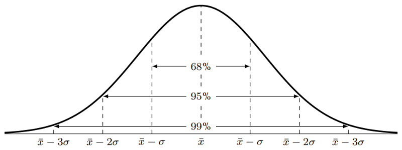

Answer the following questions with reference to the information provided in
                                                the graph:

**Problem:**
What percentage of teenagers sent less than 128 messages?

**Solution:**
\(140-12=128\)

128 is 1 standard deviation to the left of the mean, therefore the
                                                        percentage of teenagers who sent less than 128 messages is:

\(\text{50}\% - \text{34}\% = \text{16}\%\)

**Problem:**
What percentage of teenagers sent between 116 and 152
                                                messages?

**Solution:**
116 minutes is 2 standard deviations from the mean, therefore
                                                        \(\text{47,5}\%\)

152 minutes is 1 standard deviation from the mean, therefore
                                                        \(\text{34}\%\)

Percentage of the teenagers who sent between 116 and 152 messages \(=
                                                        \text{47,5}\% + \text{34}\% = \text{81,5}\%\)

**Problem:**
A company produces sweets using a machine which runs for a few hours per day.
                                                The number of hours running the machine and the number of sweets
                                                produced are recorded.

| Machine hours | Sweets produced |
| --- | --- |
| \(\text{3,80}\) | \(\text{275}\) |
| \(\text{4,23}\) | \(\text{287}\) |
| \(\text{4,37}\) | \(\text{291}\) |
| \(\text{4,10}\) | \(\text{281}\) |
| \(\text{4,17}\) | \(\text{286}\) |

Find the linear regression equation for the data, and estimate the machine
                                                hours needed to make \(\text{300}\) sweets.

**Solution:**
Using a calculator, the equation is:

                                        \[\hat{y} = \text{165,70} + \text{28,62}x\]

Therefore, the estimated number of machine hours needed to make 300 sweets
                                                is:

                                        \begin{align*}
                                        300 &= \text{165,70} + \text{28,62}x \\
                                        \therefore x &= \frac{300-\text{165,7}}{\text{28,62}} = \text{4,69} \text{
                                        machine hours}
                                        \end{align*}

The profits of a new shop are recorded over the first 6 months. The owner
                                                wants to predict his future sales. The profits by month so far have been
                                                \(\text{R}\,\text{90 000}\); \(\text{R}\,\text{93 000}\);
                                                \(\text{R}\,\text{99 500}\); \(\text{R}\,\text{102 000}\);
                                                \(\text{R}\,\text{101 300}\); \(\text{R}\,\text{109 000}\).

**Problem:**
Calculate the linear regression function for the data, using profit
                                                        as your \(y\)-variable. Round \(a\) and \(b\) to two decimal
                                                        places.

**Solution:**
\[\hat{y} = \text{86 893,33} + \text{3 497,14}x\]

**Problem:**
Give an estimate of the profits for the next two months.

**Solution:**
\begin{align*}
                                                \text{Profit seventh month } &= \text{86 893,33} +
                                                \text{3 497,14}(7) = \text{R}\,\text{111 373,31} \\
                                                \text{Profit eighth month } &= \text{86 893,33} +
                                                \text{3 497,14}(8) = \text{R}\,\text{114 870,45}
                                                \end{align*}

**Problem:**
The owner wants a profit of \(\text{R}\,\text{130 000}\). Estimate
                                                        how many months this will take.

**Solution:**
\begin{align*}
                                                \text{130 000} &= \text{86 893,33} + \text{3 497,14}x
                                                \\
                                                \therefore x &=
                                                \frac{\text{130 000}-\text{86 893,33}}{\text{3 497,14}} =
                                                \text{12,33}
                                                \end{align*}

It will take 13 months to reach a profit of \(\text{R}\,\text{130
                                                        000}\).

A fast food company produces hamburgers. The number of hamburgers made and
                                                the costs are recorded over a week.

| Hamburgers made | Costs |
| --- | --- |
| \(\text{495}\) | \(\text{R}\,\text{2 382}\) |
| \(\text{550}\) | \(\text{R}\,\text{2 442}\) |
| \(\text{515}\) | \(\text{R}\,\text{2 484}\) |
| \(\text{500}\) | \(\text{R}\,\text{2 400}\) |
| \(\text{480}\) | \(\text{R}\,\text{2 370}\) |
| \(\text{530}\) | \(\text{R}\,\text{2 448}\) |
| \(\text{585}\) | \(\text{R}\,\text{2 805}\) |

**Problem:**
Find the linear regression function that best fits the data. Use
                                                        hamburgers made as your \(x\)-variable and round \(a\) and \(b\)
                                                        to two decimal places.

**Solution:**
\(\hat{y}= \text{601,28} + \text{3,59}x\)

**Problem:**
Calculate the value of the correlation coefficient, correct to two
                                                        decimal places, and comment on the strength and direction of the
                                                        correlation.

**Solution:**
\(r = \text{0,86}\)

There is a strong, positive, linear correlation.

**Problem:**
If the total cost in a day is \(\text{R}\,\text{2 500}\), estimate
                                                        the number of hamburgers produced. Round your answer down to the
                                                        nearest whole number.

**Solution:**
\begin{align*}
                                                \text{2 500} &= \text{601,28} + \text{3,59}x \\
                                                \therefore x&= \frac{\text{2 500} - \text{601,28}}{\text{3,59}}
                                                =
                                                \text{528,89}
                                                \end{align*}

Therefore 528 burgers are produced.

**Problem:**
What is the cost of \(\text{490}\) hamburgers?

**Solution:**
\[y= \text{601,28} + \text{3,59}(490) = \text{R}\,\text{2 360,38}\]

A collection of data related to an investigation into biceps length and
                                                height of students was recorded in the table below. Answer the questions
                                                to follow.

| Length of right biceps (cm) | Height (cm) |
| --- | --- |
| \(\text{25,5}\) | \(\text{163,3}\) |
| \(\text{26,1}\) | \(\text{164,9}\) |
| \(\text{23,7}\) | \(\text{165,5}\) |
| \(\text{26,4}\) | \(\text{173,7}\) |
| \(\text{27,5}\) | \(\text{174,4}\) |
| \(\text{24}\) | \(\text{156}\) |
| \(\text{22,6}\) | \(\text{155,3}\) |
| \(\text{27,1}\) | \(\text{169,3}\) |

**Problem:**
Draw a scatter plot of the data set.

**Solution:**
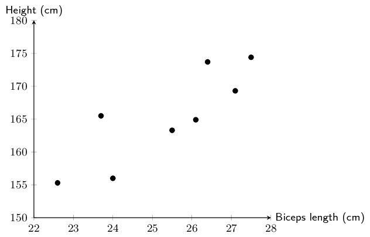

**Problem:**
Calculate equation of the line of regression.

**Solution:**
\(\hat{y}=\text{77,32} + \text{3,47}x\)

**Problem:**
Draw the regression line onto the graph.

**Solution:**
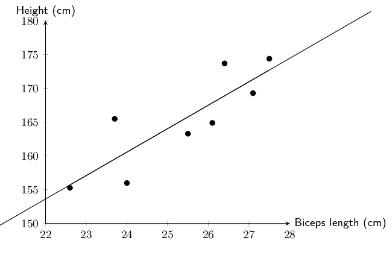

**Problem:**
Calculate the correlation coefficient \(r\)

**Solution:**
\(r=\text{0,85}\)

**Problem:**
What conclusion can you reach, regarding the relationship between the
                                                        length of the right biceps and height of the students in the
                                                        data set?

**Solution:**
The length of the right biceps and the height of the students have a
                                                        strong, positive linear relationship.

A class wrote two tests, and the marks for each were recorded in the table
                                                below. Full marks in the first test was \(\text{50}\), and the second
                                                test was out of \(\text{30}\).

| Learner | Test 1 | Test 2 |
| --- | --- | --- |
|  | (Full marks: \(\text{50}\)) | (Full marks: \(\text{30}\)) |
| \(\text{1}\) | \(\text{42}\) | \(\text{25}\) |
| \(\text{2}\) | \(\text{32}\) | \(\text{19}\) |
| \(\text{3}\) | \(\text{31}\) | \(\text{20}\) |
| \(\text{4}\) | \(\text{42}\) | \(\text{26}\) |
| \(\text{5}\) | \(\text{35}\) | \(\text{23}\) |
| \(\text{6}\) | \(\text{23}\) | \(\text{14}\) |
| \(\text{7}\) | \(\text{43}\) | \(\text{24}\) |
| \(\text{8}\) | \(\text{23}\) | \(\text{12}\) |
| \(\text{9}\) | \(\text{24}\) | \(\text{14}\) |
| \(\text{10}\) | \(\text{15}\) | \(\text{10}\) |
| \(\text{11}\) | \(\text{19}\) | \(\text{11}\) |
| \(\text{12}\) | \(\text{13}\) | \(\text{10}\) |
| \(\text{13}\) | \(\text{36}\) | \(\text{22}\) |
| \(\text{14}\) | \(\text{29}\) | \(\text{17}\) |
| \(\text{15}\) | \(\text{29}\) | \(\text{17}\) |
| \(\text{16}\) | \(\text{25}\) | \(\text{16}\) |
| \(\text{17}\) | \(\text{29}\) | \(\text{18}\) |
| \(\text{18}\) | \(\text{17}\) |  |
| \(\text{19}\) | \(\text{30}\) | \(\text{19}\) |
| \(\text{20}\) | \(\text{28}\) | \(\text{17}\) |

**Problem:**
Is there a strong correlation between the marks for the first and
                                                        second test? Show why or why not.

**Solution:**
Using a calculator, \(r=\text{0,98}\) which is a very strong,
                                                        positive, linear correlation between the marks of the first and
                                                        the second test.

**Problem:**
One of the learners (in Row 18) did not write the second test. Given
                                                        her mark for the first test, calculate an expected mark for the
                                                        second test. Round the mark up to the nearest whole number.

**Solution:**
Using a calculator, the least squares regression line equation is:

                                                \[\hat{y} = \text{1,08} + \text{0,57}x\]

Therefore, the expected mark for the second test for the learner in
                                                        Row 18 is:

                                                \[y = \text{1,08} + \text{0,57}(17) = \text{10,77}\]

Therefore the expected mark for the learner in row 18 for the second
                                                        test is 11 out of 30.

Lindiwe works for Eskom, the South African power distributor. She knows that
                                                on hot days more electricity than average is used to cool houses. In
                                                order to accurately predict how much more electricity needs to be
                                                produced, she wants to determine the precise nature of the relationship
                                                between temperature and electricity usage.

The data below shows the peak temperature in degrees Celsius on ten
                                                consecutive days during summer and the average number of units of
                                                electricity used by a number of households. Examine her data and answer
                                                the questions that follow.

| Peak temp. (\(y\)) | 32 | 40 | 30 | 28 | 25 | 38 | 36 | 20 | 24 | 26 |
| --- | --- | --- | --- | --- | --- | --- | --- | --- | --- | --- |
| Average no. of units (\(x\)) | 37 | 45 | 35 | 30 | 20 | 40 | 38 | 15 | 20 | 22 |

**Problem:**
Draw a scatter plot of the data.

**Solution:**
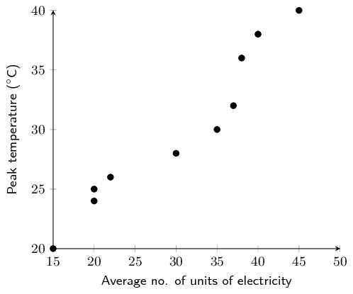

**Problem:**
Using the formulae for \(a\) and \(b\), determine the
                                                equation of the least squares line.

**Solution:**
| Average no. of units (\(x\)) | Peak temp. (\(y\)) | \(xy\) | \(x^{2}\) |
| --- | --- | --- | --- |
| 37 | 32 | \(\text{1 184}\) | \(\text{1 369}\) |
| 45 | 40 | \(\text{1 800}\) | \(\text{2 025}\) |
| 35 | 30 | \(\text{1 050}\) | 1225 |
| 30 | 28 | 840 | 900 |
| 20 | 25 | 500 | 400 |
| 40 | 38 | \(\text{1 520}\) | \(\text{1 600}\) |
| 38 | 36 | \(\text{1 368}\) | \(\text{1 444}\) |
| 15 | 20 | \(\text{300}\) | \(\text{225}\) |
| 20 | 24 | \(\text{480}\) | \(\text{400}\) |
| 22 | 26 | \(\text{572}\) | \(\text{484}\) |
| \(\sum = 302\) | \(\sum = 299\) | \(\sum = \text{9 614}\) | \(\sum = \text{10 072}\) |

                                                \begin{align*}
                                                b & = \frac{n{\sum }_{i=1}^{n}{x}_{i}{y}_{i}-{\sum
                                                }_{i=1}^{n}{x}_{i}{\sum }_{i=1}^{n}{y}_{i}}{n{\sum
                                                }_{i=1}^{n}{\left({x}_{i}\right)}^{2}-{\left({\sum
                                                }_{i=1}^{n}{x}_{i}\right)}^{2}} \\
                                                & = \frac{10 \times \text{9 614} - 302 \times \text{299}}{10
                                                \times \text{10 072} - 302^{2}} = \text{0,613913409} \\ \\
                                                a&= \bar{y}-b\bar{x} = \frac{\text{299}}{\text{10}} -
                                                \text{0,613913409} \times \frac{302}{10} = \text{11,359815048} \\ \\
                                                \therefore \hat{y}&= \text{11,36} + \text{0,61}x
                                                \end{align*}

**Problem:**
Determine the value of the correlation coefficient, \(r\),
                                                by hand.

**Solution:**
We have already calculated the value of \(b\) by hand in the question
                                                        above, so we are left to determine \(\sigma_{x}\) and
                                                        \(\sigma_{y}\).

| Average no. of units (\(x\)) | Peak temp. (\(y\)) | \((x-\bar{x})^{2}\) | \((y-\bar{y})^{2}\) |
| --- | --- | --- | --- |
| 32 | 37 | \(\text{46,24}\) | \(\text{4,41}\) |
| 40 | 45 | \(\text{219,04}\) | \(\text{102,01}\) |
| 30 | 35 | \(\text{0,01}\) | \(\text{23,04}\) |
| 28 | 30 | \(\text{0,04}\) | \(\text{3,61}\) |
| 25 | 20 | \(\text{104,04}\) | \(\text{24,01}\) |
| 38 | 40 | \(\text{96,04}\) | \(\text{65,61}\) |
| 36 | 38 | \(\text{60,84}\) | \(\text{37,21}\) |
| 20 | 15 | \(\text{231,04}\) | \(\text{98,01}\) |
| 24 | 20 | \(\text{104,04}\) | \(\text{34,81}\) |
| 26 | 22 | \(\text{67,24}\) | \(\text{15,21}\) |
| \(\sum=299\) | \(\sum=\text{302}\) | \(\sum=\text{951,6}\) | \(\sum=\text{384,9}\) |

                                                \begin{align*}
                                                \sigma_{x}&= \frac{\sqrt{\sum\limits_{i=1}^{n}(y_i -
                                                \bar{y})^{2}}}{n} = \frac{\sqrt{\text{951,6}}}{10} = \pm \text{3,08} \\
                                                b&=\text{1,52} \\
                                                \sigma_{y}&= \frac{\sqrt{\sum\limits_{i=1}^{n}(x_i -
                                                \bar{x})^{2}}}{n} = \frac{\sqrt{\text{384,9}}}{10} = \pm \text{1,96} \\
                                                \therefore r&= \text{0,61} \times \frac{\text{3,08}}{\text{1,96}} \\
                                                &= \text{0,96}
                                                \end{align*}

**Problem:**
What can Lindiwe conclude about the relationship between
                                                peak temperature and the number of electricity units used?

**Solution:**
There is a very strong, positive, linear correlation between peak
                                                        temperature and the average number of electricity units a
                                                        household uses.

**Problem:**
Predict the average number of units of electricity used by
                                                a household on a day with a peak temperature of
                                                \(\text{45}\)\(\text{°C}\). Give your answer correct to the nearest
                                                unit and identify what this type of prediction is called.

**Solution:**
\begin{align*}
                                                45&= \text{11,36} + \text{0,61}x \\
                                                \therefore x &=\frac{45-\text{11,36}}{\text{0,61}} \\
                                                &= \text{55,15} \approx \text{55}\text{ units}
                                                \end{align*}

The value we were asked to predict is outside the range of the
                                                        available data. This is known as extrapolation.

**Problem:**
Lindiwe suspected that the relationship between temperature and
                                                        electricity consumption was not linear for all temperatures. She
                                                        then decided to collect data for peak temperatures down to
                                                        \(\text{0}\)\(\text{°C}\). Examine the graph of her data
                                                        below and identify which type of function would best fit the
                                                        data and describe the nature of the relationship between
                                                        temperature and electricity for the newly available data.

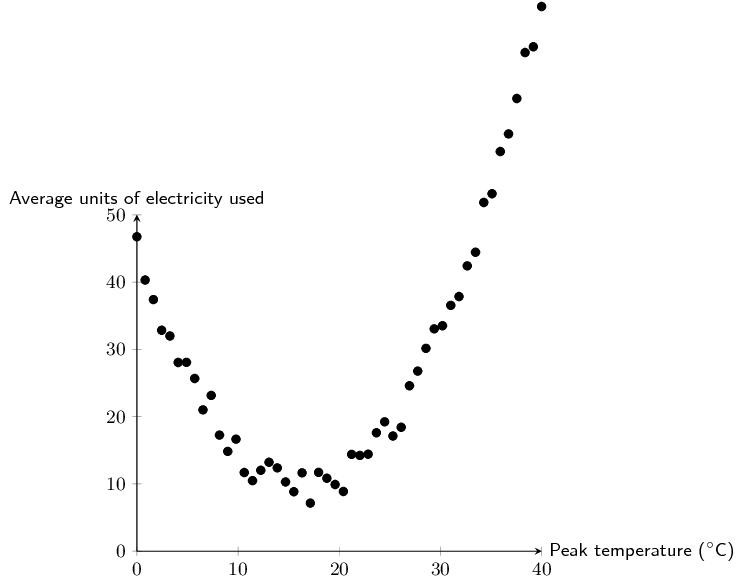

**Solution:**
A quadratic function would best fit the data. At about
                                                        \(\text{18}\)\(\text{°C}\) average household electricity
                                                        usage is at its minimum. As the peak temperature gets colder or
                                                        warmer than this point, electrcity usage increases.

**Problem:**
Lindiwe is asked by her superiors to determine which day is best to
                                                        perform maintenance on one of their power plants. She determined
                                                        that the equation \(y=\text{0,13}x^2 - \text{4,3}x + 45\) best
                                                        fit her data. Use her equation to estimate the peak temperature
                                                        and average no. of units used on the day when the least amount
                                                        of electricity generation is required.

**Solution:**
This question requires us to find the minimum value of the quadratic
                                                        equation. There are a number of ways to do this, two are shown
                                                        below:

The first method is using the formula \(x = \frac{-b}{2a}\):

- The first step is to write the equation in the form:
                                                                  \(y=ax^{2} + bx + c\). Our equation is already in this
                                                                  form, so we can immediately substitute the values into
                                                                  the formula for \(x\). \[x = \frac{-b}{2a} =
                                                                  \frac{\text{4,3}}{(2 \times \text{0,13})} =
                                                                  \text{16,54}\]
- To find \(y\), we substitute our \(x\)-value into the
                                                                  quadratic equation: \(\text{0,13}(\text{16,54})^2 -
                                                                  \text{4,3}(\text{16,54}) + 45 = \text{9,44}\)

Another method is using differentiation:

- The first step is to write the equation in the form:
                                                                  \(y=ax^{2} + bx + c\). Our equation is already in this
                                                                  form, so we can immediately differentiate the equation.
                                                                  \[y' = \text{0,13}(2)x - \text{4,3} = \text{0,26}x +
                                                                  \text{4,3}\]
- At the turning point, \(y' = 0\), therefore we can now solve
                                                                  for \(x\): \begin{align*}
                                                                  0&= \text{0,26}x - \text{4,3} \\
                                                                  \therefore x &= \frac{\text{4,3}}{\text{0,26}} =
                                                                  \text{16,54}
                                                                  \end{align*}
- The \(x\)-value can now be substituted into the quadratic
                                                                  equation to find \(y\):
                                                                  \[y = \text{0,13}(\text{16,54})^{2} -
                                                                  \text{4,3}(\text{16,54}) + 45 = \text{9,44}\]

Therefore the peak temperature when electricity demand is at its
                                                        lowest is \(\text{16,54}\)\(\text{°C}\) and the respective
                                                        average household electricity usage is \(\text{9,44}\)
                                                        \(\text{units}\).

Below is a list of data concerning 12 countries and their respective carbon
                                                dioxide \((\text{CO}_{2})\) emission levels per person per annum
                                                (measured in tonnes) and the gross domestic product (GDP is a measure of
                                                products produced and services delivered within a country in a year) per
                                                person (in US dollars). Data sourced from the World Bank and the US
                                                Department of Energy's Carbon Dioxide Information Analysis Center.

|  | \(\text{CO}_{2}\) emmissions per capita (x) | GDP per capita (y) |
| --- | --- | --- |
| South Africa | \(\text{8,8}\) | \(\text{11 440}\) |
| Thailand | \(\text{4,1}\) | \(\text{9 815}\) |
| Italy | \(\text{7,5}\) | \(\text{32 512}\) |
| Australia | \(\text{18,3}\) | \(\text{44 462}\) |
| China | \(\text{5,3}\) | \(\text{9 233}\) |
| India | \(\text{1,4}\) | \(\text{3 876}\) |
| Canada | \(\text{15,3}\) | \(\text{42 693}\) |
| United Kingdom | \(\text{8,5}\) | \(\text{35 819}\) |
| United States | \(\text{17,2}\) | \(\text{49 965}\) |
| Saudi Arabia | \(\text{16,1}\) | \(\text{24 571}\) |
| Iran | \(\text{7,3}\) | \(\text{11 395}\) |
| Indonesia | \(\text{1,8}\) | \(\text{4 956}\) |

**Problem:**
Draw a scatter plot of the data set.

**Solution:**
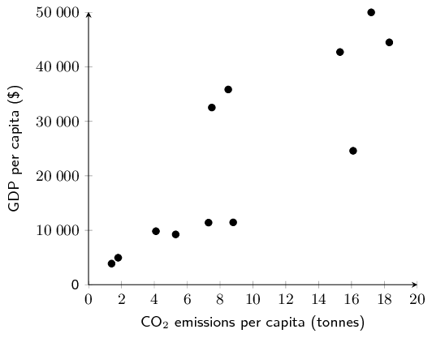

**Problem:**
Draw your estimate of the line of best fit on your scatter plot and
                                                        determine the equation of your line of best fit.

**Solution:**
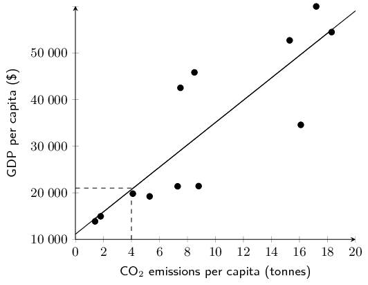

The \(y\)-intercept is approximately 1000. At \(x=4\), \(y\) is
                                                        approximately \(\text{11 000}\). Therefore, \(m =
                                                        \frac{\Delta y}{\Delta x} = \frac{11000-1000}{4-0} =
                                                        \text{2 500}\)

The equation for the line of best fit: \(y = \text{2 500}x +
                                                        \text{1 000}\)

**Problem:**
Use your calculator to determine the equation for the least squares
                                                        regression line. Round \(a\) and \(b\) to two decimal places in
                                                        your final answer.

**Solution:**
\(a = \text{1 133,996106}\) and \(b =
                                                        \text{2 393,736978}\), therefore \(\hat{y} =
                                                        \text{1 134,00} + \text{2 393,74}x\)

**Problem:**
Use your calculator to determine the correlation coefficient, \(r\).
                                                        Round your answer to two decimal places.

**Solution:**
\(r = \text{0,85}\)

**Problem:**
What conclusion can you reach regarding the relationship between
                                                        \(\text{CO}_{2}\) emissions per annum and GDP per capita for the
                                                        countries in the data set?

**Solution:**
There is a strong, positive, linear correlation between
                                                        \(\text{CO}_{2}\) emissions per annum and GDP per capita for the
                                                        countries in the data set.

**Problem:**
Kenya has a GDP per capita of \(\text{\$}\,\text{1 712}\). Use your
                                                        equation of the least squares regression line to estimate the
                                                        annual \(\text{CO}_{2}\) emissions of Kenya correct to two
                                                        decimal places.

**Solution:**
\begin{align*}
                                                \text{1 712} &= \text{1 134,00} + \text{2 393,74}x \\
                                                \therefore x &=
                                                \frac{\text{1 712}-\text{1 134,00}}{\text{2 393,74}} =
                                                \text{0,24} \text{ tonnes}
                                                \end{align*}

A group of students attended a course in Statistics on Saturdays over a
                                                period of 10 months. The number of Saturdays on which a student was
                                                absent was recorded against the final mark the student obtained. The
                                                information is shown in the table below. [Adapted from NSC Paper 3
                                                Feb-March 2012]

| Number of Saturdays absent | 0 | 1 | 2 | 2 | 3 | 3 | 5 | 6 | 7 |
| --- | --- | --- | --- | --- | --- | --- | --- | --- | --- |
| Final mark (as \(\%\)) | \(\text{96}\) | \(\text{91}\) | \(\text{78}\) | \(\text{83}\) | \(\text{75}\) | \(\text{62}\) | \(\text{70}\) | \(\text{68}\) | \(\text{56}\) |

**Problem:**
Draw a scatter plot of the data.

**Solution:**
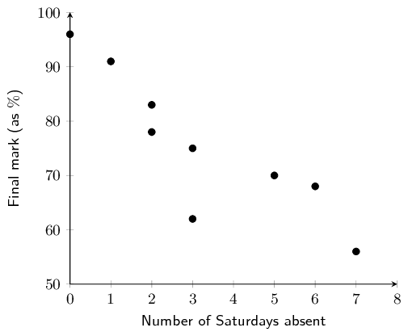

**Problem:**
Determine the equation of the least squares line and draw
                                                it on your scatter plot.

**Solution:**
\begin{align*}
                                                a&= \text{91,27} \\
                                                b &= -\text{4,91} \\
                                                \hat{y} &= \text{91,27} - \text{4,91}x
                                                \end{align*}

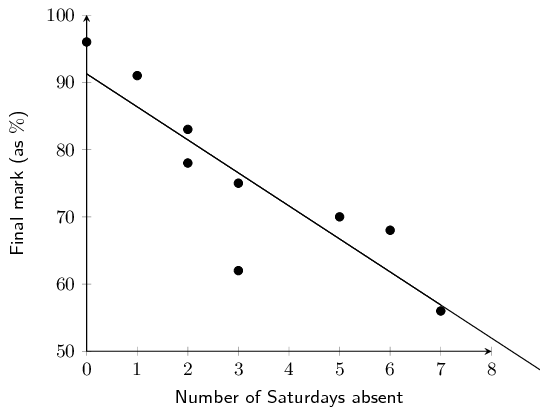

**Problem:**
Calculate the correlation coefficient.

**Solution:**
\(r=-\text{0,87}\)

**Problem:**
Comment on the trend of the data.

**Solution:**
The greater the number of Saturdays absent, the lower the mark.

**Problem:**
Predict the final mark of a student who was absent for four
                                                Saturdays.

**Solution:**
\begin{align*}
                                                \hat{y} &= \text{91,27} - \text{4,91}(4) \\
                                                &= \text{71,63}\% \\
                                                &\approx \text{72}\%
                                                \end{align*}

Grant and Christie are training for a half-marathon together in 8 weeks time.
                                                Christie is much fitter than Grant but she has challenged him to beat
                                                her time at the race. Grant has begun a rigid training programme to try
                                                and improve his time.

Time taken to complete a half marathon was recorded each Sunday. The first
                                                recorded Sunday is denoted as week 1. The half-marathon takes place on
                                                the eighth Sunday, i.e. week 8. Examine the data set in the table below
                                                and answer the questions the follow.

| Week | 1 | 2 | 3 | 4 | 5 | 6 |
| --- | --- | --- | --- | --- | --- | --- |
| Grant's time (HH:MM) | 02:01 | 01:59 | 01:55 | 01:53 | 01:47 | 01:42 |
| Christie's time (HH:MM) | 01:40 | 01:42 | 01:38 | 01:39 | 01:37 | 01:35 |

**Problem:**
Draw a scatter plot of the data sets. Include Grant and
                                                Christie's data on the same set of axes. Use a \(\bullet\) to denote
                                                Grant's data points and \(\times\) to denote Christie's data points.
                                                Convert all times to minutes.

**Solution:**
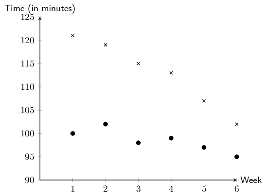

**Problem:**
Comment on and compare any trends that you observe in the
                                                data.

**Solution:**
Both data sets show negative, linear trends. The trend in Grant's
                                                        data appears to be more rapidly decreasing than the trend in
                                                        Christie's data.

**Problem:**
Determine the equations of the least squares regression
                                                lines for Grant's data and Christie's data. Draw these lines on your
                                                scatter plot. Use a different colour for each.

**Solution:**
\begin{align*}
                                                \hat{y}_{\text{Grant}}&= \text{126,13} -\text{3,8}x \\
                                                \hat{y}_{\text{Christie}}&= \text{102,4} - \text{1,11}x
                                                \end{align*}

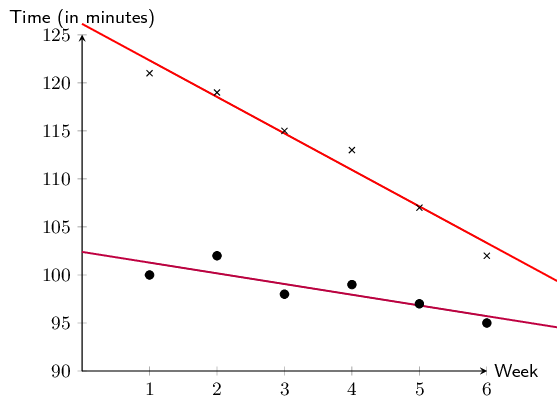

**Problem:**
Calculate the correlation coefficient and comment on the
                                                fit for each data set.

**Solution:**
\begin{align*}
                                                \text{Grant: } r&= -\text{0,98} \quad \text{(negative, very strong)}
                                                \\
                                                \text{Christie: } r&= -\text{0,86} \quad \text{(negative, strong)}
                                                \end{align*}

**Problem:**
Assuming the observed trends continue, will Grant beat
                                                Christie in the race?

**Solution:**
Grant will beat Christie when \(\hat{y}_{\text{Grant}} <
                                                        \hat{y}_{\text{Christie}}\). To find where the trends intersect,
                                                        we equate each \(\hat{y}\).

                                                \begin{align*}
                                                \text{126,13} -\text{3,8}x &= \text{102,4} - \text{1,11}x \\
                                                -\text{3,8}x + \text{1,11}x&= \text{102,4} - \text{126,13} \\
                                                -\text{2,69}x &= -\text{23,73} \\
                                                x &= \text{8,82}
                                                \end{align*}

The race takes place in week 8. \(\text{8,82} > 8\), therefore,
                                                        Grant will be unable to beat Christie's time when the race takes
                                                        place.

**Problem:**
Assuming the observed trends continue, extrapolate the week
                                                in which Grant will be able to run a half-marathon in less time than
                                                Christie.

**Solution:**
See answer to e). Grant will be able to beat Christie's time in the
                                                        ninth week.
