## 10.3 Tools and Techniques (EMCJY)

<QuizCard id="m12-10-03a" title="Interactive Exercise 10.7" question="The food \"apples\" is an element in whose shopping list?" options=["Only Alison", "Only Nthabiseng", "Both Alison and Nthabiseng", "Neither Alison nor Nthabiseng"] answer=" 0 " hint="" explanation="Find out which set or sets \"apples\" belongs to The key things about a Venn diagram are: if something is inside a circle in a Venn diagram,                         then it belongs in that group if something is outside a circle in a Venn diagram,                         then it does not belong in that group For example, \"tea\" is an element of (belongs in) set \(\text{Alison}\) because it is inside of the                         yellow circle. Notice that the orange set is inside of the yellow set! This means that every element in the orange set is also an element of the yellow set because those elements are in both circles. From the Venn diagram, we can write each set as a list: \[                         \begin{aligned}                         \text{Alison} & = \{ \text{apples} \; \, ; \text{bread} \; \, ; \text{coffee} \; \, ; \text{pilchards} \; \, ; \text{sugar} \; \, ; \text{tea} \;  \} \\                         \text{Nthabiseng} & = \{ \text{bread} \; \, ; \text{coffee} \; \, ; \text{pilchards} \; \, ; \text{sugar} \ \}                         \end{aligned}                     \] The element \"apples\" is in \(\text{Alison}\) but not in \(\text{Nthabiseng}\) , so the correct answer is: Only Alison . Submit your answer as: Only Alison" />

**Venn diagrams** are used to show how events are related to one another.
      A Venn diagram can be very helpful when doing calculations with probabilities.
      In a Venn diagram each event is represented by a shape, often a circle or a rectangle.
      The region inside the shape represents the outcomes included in the event and the region outside the shape
      represents the outcomes that are not in the event.

**Tree diagrams** are useful for organising and visualising the different possible outcomes of a
      sequence of events.
      Each branch in the tree shows an outcome of an event, along with the probability of that outcome. For each
      possible outcome of the first event, we draw a line where we write down the probability of that outcome and the
      state of the world if that outcome happened.
      Then, for each possible outcome of the second event we do the same thing.
      The probability of a sequence of outcomes is calculated as the product of the probabilities along the branches of
      the sequence.

**Two-way contingency tables** are a tool for keeping a record of the counts or percentages in a
      probability problem.
      Two-way contingency tables are especially helpful for figuring out whether events are dependent or independent.

<QuizCard id="m12-10-03b" title="Interactive Exercise 10.8" question="The Venn diagram below is meant to represent the results of the survey for chess club ( \(C\) ) and maths club ( \(M\) ). All the                 numbers \(n_1\) , \(n_2\) , \(n_3\) , and \(n_4\) are missing. Determine the values of \(n_1\) and \(n_2\) ." options=[] answer="24, 3" hint="You should enter a number here. If you want to, you can use a space to separate thousands.                Example: 12 800,25 For scientific notation you need to use the multiply symbol                ( ∗ ) and the exponent symbol ( ^ ). For example 6,673 × 10 −11 should be written as: 6,673 ∗ 10^−11" explanation="Use the list of information to start finding any possible number We need to find two of the numbers on the Venn diagram. In general it is best to                     find all the numbers on a Venn diagram even if you only need two of them. This                     is because they usually depend on each other. So we will find all four numbers,                     and then read the two answers from the diagram. TIP: When you are putting numbers in a Venn diagram, start with the information that gives you the numbers for individual regions. If this doesn't give you all the numbers you need you can try working with overlapping (intersecting) sections of the Venn diagram where you know the total, and all but one of numbers that make up that total. In this case, we can use the first two pieces of information immediately.                     They both include the word only . This is an important                     word in probability, because 'only' gives us precise information. It describes                     a region that does not overlap with any other sets. This means the first two facts in the list tell us immediately the values of two                     of the numbers. \(n_2\) represents the people who only                     want to join a chess club. \(n_4\) represents the                     people who only want to join a maths club. \(\text{3}\) people want to join a chess club only: \[                     \begin{aligned}                         \therefore n_2 = 3                     \end{aligned}                 \] \(\text{37}\) people want to join a maths club only: \[                     \begin{aligned}                         \therefore n_4 = 37                     \end{aligned}                 \] At this point the diagram looks like this: Find \(n_3\) What else can we find? Let's use the third item in the list, which states that \(\text{16}\) people                     want to join both a chess club and a maths club. Which region or regions does this refer to? It is the                     region where the circles overlap. It represents the people who                     want to be in both clubs. \(\text{16}\) people want to join both a chess club and a maths club: \[\begin{array}{c}\therefore n_3 = 16\end{array}\] Now the diagram is: Find \(n_1\) The last number, \(n_1\) , is outside of both circles. That region                     includes all the people who are not interested in either club. We can calculate \(n_1\) by subtracting the three numbers                     we already know from the total number of people: \[                    \begin{aligned}                         n_1 &= 80 - 16 - 3 - 37 \\                             &= 24                    \end{aligned}                \] The completed diagram is: TIP: Check the completed Venn diagram to make sure everything adds up. For example, the                     question told you there are \(\text{80}\) people in total.                     Does the completed Venn diagram                     agree? Yes, because \(24 + 3 + 16 +                     37 = 80\) . Checking the numbers like                     this is a good way to catch mistakes. Identify the correct answers Now we can read off the two numbers we need for this question. The correct answers are: \(n_1 = \) \(\text{24}\) \(n_2 = \) \(\text{3}\) Submit your answer as: and" />

<Callout type="tip" title="Worked example 7: Venn diagrams">
**Question:**
There are 200 boys in Grade 12 at Marist Brothers High School. Their participation in sport can be broken
          down as follows:

- 107 play rugby
- 90 play soccer
- 63 play cricket
- 35 play rugby and soccer
- 23 play rugby and cricket
- 15 play rugby, soccer and cricket
- 190 boys play rugby, soccer or cricket

2. How many boys do not play any of these sports?
4. Draw a Venn diagram to illustrate the given information and use it to answer the following questions:
   2. How many boys play soccer and cricket, but not rugby?
   4. What is the probability that a randomly chosen Grade 12 boy at Marist Brothers High School will take
                      part in at least two of the sports: rugby, soccer or cricket? Give your answer correct to 3 decimal
                      places.

**Calculate the number of boys playing none of the given sports:**
In order to calculate the number of boys playing none of the sports, we subtract the number of boys playing
          any of the three sports from the total number of boys in the sample space.

        \[\text{Not rugby, cricket or soccer } = 200 - 190 = 10\]

Therefore \(\text{10}\) boys do not play rugby, cricket or soccer.

**Draw the outline of the Venn diagram:**
Let \(X =\) the sample space; \(R =\) rugby; \(S =\) soccer and \(C =\) cricket. Put this information on a
          Venn diagram:

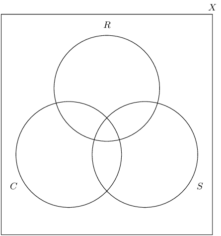

**Calculate the counts for the different groupings:**
The following groupings exist:

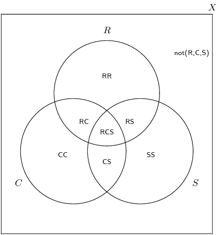

Rugby, cricket and soccer: \(RCS\)

        \[RCS = 15\]

Rugby and soccer but not cricket: \(RS\)

        \begin{align*}
        RS &= (R \text{ and } S) - RCS\\
        &= 35 - 15 = 20
        \end{align*}

Rugby and cricket but not soccer: \(RC\)

        \begin{align*}
        RC &= (R \text{ and } C) - RCS \\
        &= 23 - 15 = 8
        \end{align*}

Cricket and soccer but not rugby: \(CS\)

        \begin{align*}
        CS &= (S \text{ and } C) - RCS \\
        \text{Let } (S \text{ and } C)& = x \\
        \text{Therefore } CS &= x - 15
        \end{align*}

Only rugby: \(RR\)

        \begin{align*}
        RR &= R - RS - RC - RCS \\
        &= 107 - 20 - 8 - 15 = 64
        \end{align*}

Only soccer: \(SS\)

        \begin{align*}
        SS &= S - RS - CS - RCS \\
        &= 90 - 20 - (x - 15) - 15 = 70 - x
        \end{align*}

Only cricket: \(CC\)

        \begin{align*}
        CC &= C - RC - CS - RCS \\
        &= 63 - 8 - (x - 15) - 15 = 55 - x
        \end{align*}

Not rugby, cricket or soccer: \(\text{not}(R,C,S)\)

        \[\text{not}(R,C,S) = 10\]

**Fill in the counts on the Venn diagram:**
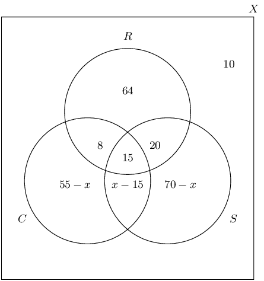

**Calculate the unknown values:**
Since 190 of the boys play at least one of the sports, using the values on our Venn diagram, we can set up
          the following equation to solve for \(x\).

        \begin{align*}
        64 + 8 + 15 + 20 + (x - 15) + (70 - x) + (55 - x) &= 190 \\
        217 - x &= 190 \\
        \text{Therefore } x &= 27
        \end{align*}

We know that:

        \begin{align*}
        \text{Cricket and soccer but not rugby } (CS) & = x - 15 \\
        \text{Therefore } CS &= 27 - 15 \\
        &= 12
        \end{align*}

Therefore there are 12 boys who play cricket and soccer but not rugby.

**Calculate the probability that a randomly chosen Grade 12 boy plays at least two of the given
          sports:**
We know the number of boys who play two or more of rugby, cricket or soccer and we know the total number of
          boys. Therefore, we can calculate the probability using the following equation:

        \begin{align*}
        P(\text{at least two sports}) &= \dfrac{n(RC)+n(RS)+n(CS)+n(RCS)}{n(X)} \\
        &= \dfrac{8+15+20+12}{200} \\
        &= \frac{55}{200} = \text{0,275}
        \end{align*}

Therefore the probability that a randomly chosen Grade 12 boy plays at least 2 of either rugby, cricket or
          soccer \(= \text{0,275}\) or \(\text{27,5}\%\)
</Callout>

<QuizCard id="m12-10-03c" title="Interactive Exercise 10.9" question="There are \(\text{161}\) Grade 12 learners at a school.                 All of these take some combination of Sepedi, Technical Sciences,                 and Visual Art. The number who take Technical Sciences is \(\text{93}\) . The number who take Visual Art                 is \(\text{99}\) . And \(\text{60}\) take Sepedi. The number who take Sepedi and                 Visual Art is \(\text{41}\) . The number who                 take Technical Sciences and Visual Art is \(\text{39}\) ,                 and there are \(\text{8}\) who take Sepedi                 only and \(\text{39}\) who take Visual Art only. If a student is selected at random, what is the probability that the student takes                 Technical Sciences only (and neither Sepedi nor Visual Art)? INSTRUCTION: Give your answer as a fraction (do not round off)." options=[] answer="43 / 161" hint="You should enter a number here. If you want to, you can use a space to separate thousands.                Example: 12 800,25 For scientific notation you need to use the multiply symbol                ( ∗ ) and the exponent symbol ( ^ ). For example 6,673 × 10 −11 should be written as: 6,673 ∗ 10^−11" explanation="Set up a Venn diagram This question is quite complex: there are three different subjects, and many students                     taking one, two, or all three subjects. Let's start by drawing a basic Venn diagram.                     Set up the diagram with three empty circles to represent the three subjects. Label                     each circle to identify which subject it represents (for example, we are using \(S\) for Sepedi). Fill in the diagram with all possible numbers Now we need to unpack the information in the question and put the numbers into the diagram.                     To do that we need to use the facts given in the question. Only two of the facts given describe                     specific regions in the diagram. There are also three facts about the number of students who                     take each of the three subjects. This information is labelled below, along with the letters \(a\) to \(e\) which are numbers we do not know yet. In addition, the                     shaded region shows the area of the diagram we need to answer this question. Fill in the diagram with all possible numbers Now we need to figure out numbers in the overlapping spaces. We can do this using                     simultaneous equations. The question states that there are \(\text{41}\) students taking Sepedi and Visual Art, and also                     there are \(\text{39}\) students taking Technical Sciences                     and Visual Art. Based on these facts we can write two equations: \[                     \begin{aligned}                     b + c = 41 \quad \text{and} \quad b + d = 39                     \end{aligned}                 \] We can combine these equations by adding them together to get a single equation: \[                     \begin{aligned}                     b + c & = 41 \\                     b + d & = 39 \\                     \hline                     2b + c + d & = 80                     \end{aligned}                 \] The equation above cannot be solved for any one of the variable values. We need                     another equation. And specifically we need one which includes the variables \(b\) , \(c\) , and \(d\) . We can get this using                     that fact that \(n\left(V\right) = 99 \) : \[                     \begin{aligned}                     b + c + d + 39 & = 99 \\                     b + c + d & = 60                     \end{aligned}                 \] We can now combine the two equations to solve for \(b\) : if we subtract                     the second equation from the first one, \(c\) and \(d\) both                     cancel. \[                     \begin{array}{rrr}                     2b + c + d \;\, & = & 80 \\                     - \; \left(b + c + d \right) & =  & -60 \\                     \hline                     b \qquad \qquad & =  & 20                     \end{array}                 \] Now we know that \( b = 20\) . Using the value of \( b = 20\) and the equations above,                     you can also find the values of \(c\) and \(d\) . Following that,                     you can find the value of \(e\) based on the fact that \(n\left( T \right) = 93\) . The complete results are shown below. Calculate the required probability Now we can get to the specific question. We need to find the probability that a                     student (picked at random) will take Technical Sciences only (and neither Sepedi nor Visual Art). We can                     write this as \(P(\text{Technical Sciences only})\) or \(P(T \text{ only})\) . \[                     \begin{aligned}                     P( T \text{ only} )=\frac{ n( T \text{ only} ) }{ n(S) }                     \end{aligned}                 \] The number of students who are taking Technical Sciences only is 43. \[                     \begin{aligned}                     P\left( T \text{ only} \right) & = \frac{43}{161}                      \end{aligned}                 \] The probability that the student we pick will take Technical Sciences only (and neither Sepedi nor Visual Art)                     is \( \dfrac{43}{161} \) . Submit your answer as:" />

<Callout type="note" title="Note">
<VideoPlayer src="http://www.khanacademy.org/embed_video?v=obZzOq_wSCg" title="Video: 29GD" />
</Callout>

<Callout type="tip" title="Worked example 8: Tree diagrams">
**Question:**
The probability that the floor of a supermarket will be wet when it opens in the morning is \(\text{30}\%\)
          and there is a \(\text{10}\%\) probability of the floor being very wet. The probability that a person will
          slip and fall if the floor is dry is \(\text{12}\%\) and a person is three times as likely to fall if the
          floor is wet. If the floor is very wet, the probability that a person will fall is \(\text{0,6}\). Draw a tree
          diagram to represent the given information, showing the probabilities of each outcome, and use it to answer
          the following questions:

2. What is the probability that a person will fall on any given day?
4. What is the probability that a person will not fall on any given day?
6. Are the events of the floor being dry and a person falling independent? Justify your answer with a
               calculation.

**Identify the events:**
There are three outcomes for the floor, namely, dry, wet and very wet, and two outcomes for a person, namely
          fall or not fall.

**Draw the first level of the tree diagram:**
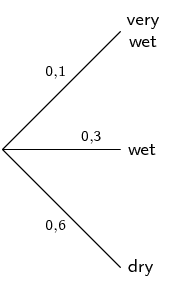

This tree diagram shows the possible outcomes and probabilities of the status of the floor.

**Draw the second level of the tree diagram:**
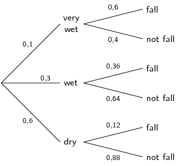

This tree diagram shows the possible outcomes and probabilities based on whether the floor is very wet, wet
          or dry. Remember that the sum of the probabilities for any set of branches is 1. Use this as a logical check
          whenever you are constructing a tree diagram.

**Compute the probabilities of the various outcomes:**
We can calculate the probability of each outcome by multiplying the probabilities along the path from the
          start of the tree to the end of the branch containing the desired outcome.

- \(P(\text{very wet and fall}) = \text{0,1} \times \text{0,6} = \text{0,06}\)
- \(P(\text{very wet and not fall}) = \text{0,1} \times \text{0,4} = \text{0,04}\)
- \(P(\text{wet and fall}) = \text{0,3} \times \text{0,36} = \text{0,108}\)
- \(P(\text{wet and not fall}) = \text{0,3} \times \text{0,64} = \text{0,192}\)
- \(P(\text{dry and fall}) = \text{0,6} \times \text{0,12} = \text{0,072}\)
- \(P(\text{dry and not fall}) = \text{0,6} \times \text{0,88} = \text{0,528}\)

**Compute the probability of falling or not falling:**
We can calculate the probability of falling or not falling by adding the probabilities of all the desired
          outcomes.

- \(P(\text{fall}) = \text{0,06} + \text{0,108} + \text{0,072} = \text{0,24}\)
- \(P(\text{not fall}) = \text{0,04} + \text{0,192} + \text{0,528} = \text{0,76}\)

Therefore the probability of falling on a given day is \(\text{24}\%\) and the probability of not falling is
          \(\text{76}\%\).

**Determine whether the floor being dry and a person falling are independent events:**
Logically, it appears that these events are dependent but the question asked us to prove this using a
          calculation. We can do this using the rule for independent events:

        \[P(A \text{ and } B) = P(A) \times P(B)\]
        \begin{align*}
        P(\text{dry and fall}) &= \text{0,072} \\
        P(\text{dry}) \times P(\text{fall}) &= \text{0,6} \times \text{0,24} \\
        &= \text{0,144} \\
        \text{Therefore } P(\text{dry and fall})& \ne P(\text{dry}) \times P(\text{fall})
        \end{align*}

Therefore we can conclude that the floor being dry and a person falling are dependent events.
</Callout>

## Venn and tree diagrams

### Textbook Exercise 10.2

A survey was done on a group of learners to determine which type of TV shows they enjoy: action, comedy
              or drama. Let \(A =\) action, \(C =\) comedy and \(D =\) drama. The results of the survey are shown in the
              Venn diagram below.

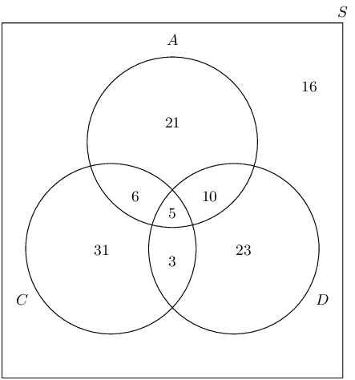

Study the Venn diagram and determine the following:

**Problem:**
the total number of learners surveyed

**Solution:**
\(\text{115}\)

**Problem:**
the number of learners who do not enjoy any of the mentioned types of TV shows

**Solution:**
\(\text{16}\)

**Problem:**
\(P(\text{not } A)\)

**Solution:**
\(\frac{73}{115}\)

**Problem:**
\(P(A \text{ or } D)\)

**Solution:**
\(\frac{68}{115}\)

**Problem:**
\(P(A \text{ and } C \text{ and } D)\)

**Solution:**
\(\frac{5}{115} = \frac{1}{23}\)

**Problem:**
\(P(\text{not } (A \text{ and } D))\)

**Solution:**
\(\frac{100}{115} = \frac{20}{23}\)

**Problem:**
\(P(A \text{ or not } C)\)

**Solution:**
\(\frac{81}{115}\)

**Problem:**
\(P(\text{not } (A \text{ or } C))\)

**Solution:**
\(\frac{39}{115}\)

**Problem:**
the probability of a learner enjoying at least two types of TV shows

**Solution:**
\(\frac{24}{115}\)

**Problem:**
Describe, in words, the meaning of each of the questions c) to h) in the context of
              this problem.

**Solution:**
\(P(\text{not }A)\): the probability that learners do not enjoy action TV shows

\(P(A \text{ or } D)\): the probability that learners enjoy action or drama TV shows

\(P(A \text{ and } D \text{ and } C)\): the probability that learners enjoy action, drama and comedy TV
                shows

\(P(\text{not } (A \text{ and } D))\): the probability that learners do not enjoy action and drama TV
                shows

\(P(A \text{ or not }C)\): the probability that learners enjoy action TV shows or do not enjoy comedy
                TV shows

\(P(\text{not }(A \text{or }C))\): the probability that learners do not enjoy action or comedy TV shows

At Thandokulu Secondary School, there are are \(\text{320}\) learners in Grade 12, 270 of whom take one
              or more of Mathematics, History and Economics. The subject choice is such that everybody who takes
              Physical Sciences must also take Mathematics and nobody who takes Physical Sciences can take History or
              Economics. The following is known about the number of learners who take these subjects:

- 70 take History
- 50 take Economics
- 120 take Physical Sciences
- 200 take Mathematics
- 20 take Mathematics and History
- 10 take History and Economics
- 25 take Mathematics and Economics
- \(x\) learners take Mathematics and History and Economics

**Problem:**
Represent the information above in a Venn diagram. Let Mathematics be \(M\), History be
              \(H\), Physical Sciences be \(P\) and Economics be \(E\).

**Solution:**
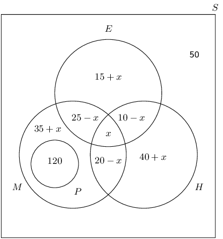

**Problem:**
Determine the number of learners, \(x\), who take Mathematics, History and Economics.

**Solution:**
\begin{align*}
              120 + (35 + x) + (25 - x) + (20 - x) + x + (40 + x) + (10 - x) + (15 + x) &= 270 \\
              265 + x&= 270 \\
              x & = 5
              \end{align*}

Therefore \(\text{5}\) learners take Mathematics, History and Economics.

**Problem:**
Determine \(P(\text{not } (M \text{ or } H \text{ or } E))\) and state in words what
              your answer means.

**Solution:**
\[P(\text{not } (M \text{ or } H \text{ or } E)) = \frac{50}{320} = \frac{5}{32}\]

This is the probability that a learner does not take Mathematics, History or Economics.

**Problem:**
Determine the probability that a learner takes at least two of these subjects.

**Solution:**
This question requires us to find the sum of the probabilities of all the learners who take at least
                two subjects. This includes the intersection of each of the subjects.

              \begin{align*}
              P(\text{at least two subjects}) &= \dfrac{120 + 20 + 5 + 5 + 15}{320} \\
              & = \frac{33}{64}
              \end{align*}

A group of \(\text{200}\) people were asked about the kind of sports they watch on television. The
              information collected is given below:

- \(\text{180}\) watch rugby, cricket or soccer
- \(\text{5}\) watch rugby, cricket and soccer
- \(\text{25}\) watch rugby and cricket
- \(\text{30}\) watch rugby and soccer
- \(\text{100}\) watch rugby
- \(\text{65}\) watch cricket
- \(\text{80}\) watch soccer
- \(x\) watch cricket and soccer but not rugby

**Problem:**
Represent all the above information in a Venn diagram. Let rugby watchers \(= R\),
              cricket watchers \(= C\) and soccer watchers \(= F\).

**Solution:**
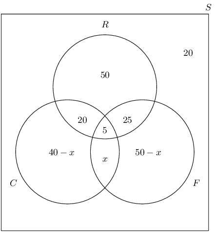

**Problem:**
Find the value of \(x\).

**Solution:**
\begin{align*}
              50 + 25 + 5 + 20 + (40 - x) + (50 - x) + x &= 180 \\
              190 - x&= 180 \\
              \text{Therefore } x&= 10
              \end{align*}

**Problem:**
Determine \(P(\text{not } (R \text{ or } F \text{ or } C))\)

**Solution:**
\[P(\text{not } (R \text{ or } F \text{ or } C))= \frac{20}{200} = \frac{1}{10}\]

**Problem:**
Determine \(P(R \text{ or } F \text{ or not } C)\)

**Solution:**
\[P(R \text{ or } F \text{ or not } C) = \frac{170}{200} = \frac{17}{20}\]

**Problem:**
Are watching cricket and watching rugby independent events? Confirm your answer using a
              calculation.

**Solution:**
\begin{align*}
              P(R) &= \frac{100}{200} = \frac{1}{2} \\
              P(C) &= \frac{65}{200} = \frac{13}{40} \\
              P(R \text{ and } C) &= \frac{25}{200} = \frac{1}{8} \\
              P(R) \times P(C)&= \frac{1}{2} \times \frac{13}{40} = \frac{13}{80} \ne \frac{1}{8} = P(R \text{ and }
              C)
              \end{align*}

Therefore watching rugby and watching cricket are dependent events.

There are \(\text{25}\) boys and \(\text{15}\) girls in the English class. Each lesson, two learners are
              randomly chosen to do an oral.

**Problem:**
Represent the composition of the English class in a tree diagram. Include all possible
              outcomes and probabilities.

**Solution:**
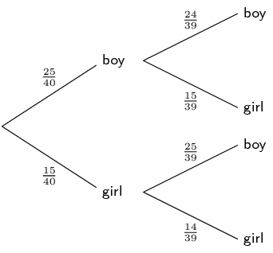

**Problem:**
Calculate the probability that a boy and a girl are chosen to do an oral in any
              particular lesson.

**Solution:**
\begin{align*}
              \left(\frac{25}{40} \times \frac{15}{39}\right) + \left(\frac{15}{40} \times \frac{25}{39}\right) &=
              \frac{25}{104} + \frac{25}{104} \\
              & = \frac{25}{52}
              \end{align*}

**Problem:**
Calculate the probability that at least one of the learners chosen to do an oral in any
              particular lesson is male.

**Solution:**
Note: This question can be answered by subtracting the outcome not containing a boy (girl; girl) from 1
                (shown below) or by adding the three outcomes which include a boy. Either method is correct.

              \begin{align*}
              1 - \left(\frac{15}{40} \times \frac{14}{39}\right)&=1 - \frac{7}{52} \\
              &= \frac{45}{52}
              \end{align*}

**Problem:**
Are the events picking a boy first and picking a girl second independent or dependent?
              Justify your answer with a calculation.

**Solution:**
\begin{align*}
              P(\text{boy first}) &= \frac{25}{40} = \frac{5}{8} \\
              P(\text{girl second}) &= \left(\frac{15}{40} \times \frac{14}{39}\right) + \left(\frac{25}{40} \times
              \frac{15}{39}\right) \\
              &= \frac{7}{52} + \frac{25}{104} \\
              &= \frac{3}{8} \\
              P(\text{boy first}) \times P(\text{girl second}) &= \frac{5}{8} \times \frac{3}{8} = \frac{15}{64} \\
              P(\text{boy first and girl second}) &= \frac{25}{40} \times \frac{15}{39} \\
              &= \frac{25}{104} \ne \frac{15}{64} = P(\text{boy first}) \times P(\text{girl second})
              \end{align*}

Therefore picking a boy first and picking a girl second are dependent events.

During July in Cape Town, the probability that it will rain on a randomly chosen day is \(\frac{4}{5}\).
              Gladys either walks to school or gets a ride with her parents in their car. If it rains, the probability
              that Gladys’ parents will take her to school by car is \(\frac{5}{6}\). If it does not rain, the
              probability that Gladys' parents will take her to school by car is \(\frac{1}{12}.\)

**Problem:**
Represent the above information in a tree diagram. On your diagram show all the
              possible outcomes and respective probabilities.

**Solution:**
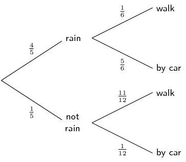

**Problem:**
What is the probability that it is a rainy day and Gladys walks to school?

**Solution:**
\begin{align*}
              P(\text{rain and walk})&= \frac{4}{5} \times \frac{1}{6} \\
              &= \frac{2}{15}
              \end{align*}

**Problem:**
What is the probability that Gladys' parents take her to school by car?

**Solution:**
\begin{align*}
              P(\text{by car})&= P(\text{rain and car}) + P(\text{no rain and car}) \\
              &= \left(\frac{4}{5} \times \frac{5}{6}\right) + \left(\frac{1}{5} \times \frac{1}{12}\right) \\
              &= \frac{2}{3} + \frac{1}{60} \\
              &= \frac{41}{60}
              \end{align*}

There are two types of property burglaries: burglary of private residences and burglary of business
              premises. In Metropolis, burglary of a private residence is four times as likely as that of a business
              premises. The following statistics for each type of burglary were obtained from the Metropolis Police
              Department:

**Burglary of private residences**

Following a burglary:

- \(\text{25}\%\) of criminals are arrested within \(\text{48}\) \(\text{hours}\).
- \(\text{15}\%\) of criminals are arrested after \(\text{48}\) \(\text{hours}\).
- \(\text{60}\%\) of criminals are never arrested for that particular burglary.

**Burglary of business premises**

Following a burglary:

- \(\text{36}\%\) of criminals are arrested within \(\text{48}\) \(\text{hours}\).
- \(\text{54}\%\) of criminals are arrested after \(\text{48}\) \(\text{hours}\).
- \(\text{10}\%\) of criminals are never arrested for that particular burglary.

**Problem:**
Represent the information above in a tree diagram, showing all outcomes and respective
              probabilities.

**Solution:**
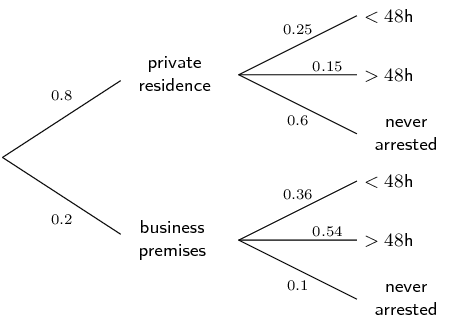

**Problem:**
Calculate the probability that a private home is burgled and nobody is arrested.

**Solution:**
\begin{align*}
              P(\text{private home and never arrested})&= \text{0,8} \times \text{0,6} \\
              &= \text{0,48}
              \end{align*}

**Problem:**
Calculate the probability that burglars of private homes and business premises are
              arrested.

**Solution:**
\begin{align*}
              P(\text{arrested})&= (\text{0,8} \times \text{0,25}) + (\text{0,8} \times \text{0,15}) + (\text{0,2}
              \times \text{0,36}) + (\text{0,2} \times \text{0,54}) \\
              &= \text{0,5}
              \end{align*}

**Problem:**
Use your answer in the previous question to construct a tree diagram to calculate the
              probability that a burglar is arrested after at most three burglaries.

**Solution:**
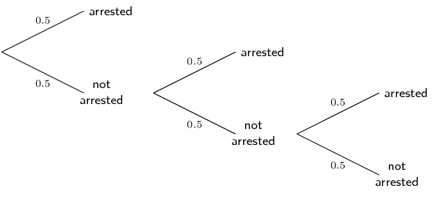

This answer could also be reached by subtracting the probability of not being arrested after three
                burglaries from 1:

              \[1 - (\text{0,5} \times \text{0,5} \times \text{0,5}) = 1 - \text{0,5}^{3} = 1 - \text{0,125} =
              \text{0,875}\]

We will use this principle to answer the next question.

**Problem:**
Determine after how many burglaries a burglar has at least a

2. \(\text{90}\%\) chance of being arrested.
4. \(\text{99}\%\) chance of being arrested.

**Solution:**
Let the number of burglaries \(= n\)

2. \begin{align*}
                     \text{0,90}&= 1 - P(\text{not arrested})^{n} \\
                     &= 1 - \text{0,5}^{n}\\
                     \text{Therefore } \text{0,1} &= \text{0,5}^{n} \\
                     \text{Therefore } n &= \log_{\text{0,5}}{\text{0,1}} \\
                     &= \text{3,32}
                     \end{align*}
   After \(\text{4}\) burglaries, there will be at least a \(\text{90}\%\) chance of being arrested.
4. \begin{align*}
                     \text{0,99}&= 1 - P(\text{not arrested})^{n} \\
                     &= 1 - \text{0,5}^{n}\\
                     \text{Therefore } \text{0,01} &= \text{0,5}^{n} \\
                     \text{Therefore } n &= \log_{\text{0,5}}{\text{0,01}} \\
                     &= \text{6,64}
                     \end{align*}
   After \(\text{7}\) burglaries, there will be at least a \(\text{99}\%\) chance of being arrested.

<QuizCard id="m12-10-03d" title="Interactive Exercise 10.10" question="Adapted from DBE Nov 2015 Grade 11, P1, Q9 Maths formulas The table below shows data on the monthly income of employed people in two residential areas. Representative samples were used in the collection of the data. MONTHLY INCOME (IN RANDS) Area 1 Area 2 TOTAL \(x < \text{3 200}\) \(\text{370}\) \(\text{648}\) \(\text{1 018}\) \(\text{3 200} \leq x < \text{25 600}\) \(\text{494}\) \(\text{742}\) \(\text{1 236}\) \(x \geq \text{25 600}\) \(\text{370}\) \(\text{463}\) \(\text{833}\) Total \(\text{1 234}\) \(\text{1 853}\) \(\text{3 087}\) Use the table to answer the following questions. INSTRUCTION: Give your answers as simplified fractions, or rounded to two decimal places." options=[] answer="['1018/3087', '0.33', '3.3e-1'], ['106/441', '0.24', '2.4e-1'], ['96/343', '0.28', '2.8e-1']" hint="You should enter a number here. If you want to, you can use a space to separate thousands.                Example: 12 800,25 For scientific notation you need to use the multiply symbol                ( ∗ ) and the exponent symbol ( ^ ). For example 6,673 × 10 −11 should be written as: 6,673 ∗ 10^−11" explanation="1. What is the probability that a randomly chosen person will earn less than \(\text{R}\,\text{3 200}\) ? The probability of an event is given by \[                 		\begin{array}{c}                 			P(E) = \dfrac{^{\quad \; \;\text{number of}}_{\text{favourable outcomes}}}{^{\quad \quad \text{total}}_{\text{possible outcomes}}}                 		\end{array}                 	\] The number of favourable outcomes is the total number of people earning less than \(\color{ForestGreen}{\text{R}\,\text{3 200}}\) , and the number of possible outcomes is the grand total . MONTHLY INCOME (IN RANDS) Area 1 Area 2 TOTAL \(\color{ForestGreen}{x < \text{3 200}}\) \(\text{370}\) \(\text{648}\) \(\text{1 018}\) \(\color{black}{\text{3 200} \leq x < \text{25 600}}\) \(\text{494}\) \(\text{742}\) \(\text{1 236}\) \(\color{black}{x \geq \text{25 600}}\) \(\text{370}\) \(\text{463}\) \(\text{833}\) Total \(\text{1 234}\) \(\text{1 853}\) \(\text{3 087}\) The probability that a randomly chosen person earns less than \(\text{R}\,\text{3 200}\) : \[                 	\begin{aligned}                 		& \;\; \dfrac{{\color{ForestGreen}{\text{1 018}}}}{{\color{blue}{\text{3 087}}}}  \\                 		 & = \text{0,32977...} \\ & \approx \text{0,33}                 	\end{aligned}                 \] 2. What is the probability that a randomly chosen person will be a person from Area 2 who earns at least \(\text{R}\,\text{3 200}\) but less than \(\text{R}\,\text{25 600}\) per month? MONTHLY INCOME (IN RANDS) Area 1 Area 2 TOTAL \(\color{black}{x < \text{3 200}}\) \(\text{370}\) \(\text{648}\) \(\text{1 018}\) \(\color{ForestGreen}{\text{3 200} \leq x < \text{25 600}}\) \(\text{494}\) \(\text{742}\) \(\text{1 236}\) \(\color{black}{x \geq \text{25 600}}\) \(\text{370}\) \(\text{463}\) \(\text{833}\) Total \(\text{1 234}\) \(\text{1 853}\) \(\text{3 087}\) The favourable outcome is the number of people who live in Area 2 and earn at least \(\color{ForestGreen}{\text{R}\,\text{3 200}}\) but less than \(\color{ForestGreen}{\text{R}\,\text{25 600}}\) per month , and the number of possible outcomes is the grand total . he probability that a randomly chosen person is a person from Area 2 who earns at least \(\text{R}\,\text{3 200}\) but less than \(\text{R}\,\text{25 600}\) per month: \[                 	\begin{aligned}                 		& \;\; \dfrac{{\color{ForestGreen}{\text{742}}}}{{\color{blue}{\text{3 087}}}} \\                 		& = \dfrac{\text{106}}{\text{441}} \\ & = \text{0,24036...} \\ & \approx \text{0,24}                  	\end{aligned}                 \] 3. What is the probability that a randomly chosen person is a person from Area 1 who earns at least \(\text{R}\,\text{3 200}\) per month? MONTHLY INCOME (IN RANDS) Area 1 Area 2 TOTAL \(\color{black}{x < \text{3 200}}\) \(\text{370}\) \(\text{648}\) \(\text{1 018}\) \(\color{ForestGreen}{\text{3 200} \leq x < \text{25 600}}\) \(\text{494}\) \(\text{742}\) \(\text{1 236}\) \(\color{ForestGreen}{x \geq \text{25 600}}\) \(\text{370}\) \(\text{463}\) \(\text{833}\) Total \(\text{1 234}\) \(\text{1 853}\) \(\text{3 087}\) The favourable outcome is the number of people who live in Area 1 and earn at least \(\color{ForestGreen}{\text{R}\,\text{3 200}}\) , and the number of possible outcomes is the grand total . The probability that a randomly chosen person is a person from Area 1 who earns at least \(\text{R}\,\text{3 200}\) per month: \[                 	\begin{aligned}                 		& \;\; \dfrac{{\color{ForestGreen}{\text{494} + \text{370}}}}{{\color{blue}{\text{3 087}}}}  \\                 		& = \dfrac{\text{96}}{\text{343}} \\ & = \text{0,27988...} \\ & \approx \text{0,28}                 	\end{aligned}                 \] Submit your answer as: and and" />

<Callout type="tip" title="Worked example 9: Two-way contingency tables">
**Question:**
The table below shows the results of testing two different treatments on 240 fruit trees which have a disease
          causing the trees to die. Treatment \(A\) involves the careful removal of infected branches and treatment
          \(B\) involves removing infected branches as well as spraying the tree with antibiotic.

|  | Tree dies within 4 years | Tree lives \(>\) 4 years | Total |
| --- | --- | --- | --- |
| Treatment A | \(\text{70}\) | \(\text{50}\) |  |
| Treatment B |  |  |  |
| Total | \(\text{90}\) | \(\text{150}\) |  |

2. Fill in the missing values on the table.
4. What is the probability the a tree received treatment B?
6. What is the probability that a tree will live beyond 4 years?
8. What is the probability that a tree is given treatment B and lives beyond 4 years?
10. Of the trees who were given treatment B, what is the probability that a tree lives beyond 4 years?
12. Are a tree given treatment B and living beyond 4 years independent events? Justify your answer with a
               calculation.

**Complete the contingency table:**
Since each column has to sum to its total, we can work out the number of trees which fall into each category
          for treatments A and B.
          Then, we can add each row to get the totals on the right hand side of the table.

|  | Tree dies within 4 years | Tree lives \(>\) 4 years | Total |
| --- | --- | --- | --- |
| Treatment A | \(\text{70}\) | \(\text{50}\) | \(\text{120}\) |
| Treatment B | \(\text{20}\) | \(\text{100}\) | \(\text{120}\) |
| Total | \(\text{90}\) | \(\text{150}\) | \(\text{240}\) |

**Compute the required probabilities:**
For the second question, we need to determine the probability that a tree receives treatment B.
          This means that we do not include treatment A in this calculation.
          So, the probability that treatment B is given to a tree is the ratio between the number of trees that received
          treatment B and the total number of trees.

        \begin{align*}
        P(\text{treatment B})
        &= \dfrac{n(\text{treatment B})}{n(\text{total trees})} \\
        &= \frac{\text{120}}{\text{240}} \\
        &= \frac{1}{2}
        \end{align*}

Similarly for the third question, the probability that a tree will live beyond \(\text{4}\) years:

        \begin{align*}
        P(\text{lives beyond }4 \text{ years})
        &= \dfrac{n(\text{lives } > \text{4} \text{ years})}{n(\text{total trees})} \\
        &= \frac{\text{150}}{\text{240}} \\
        &= \frac{5}{8}
        \end{align*}

In the fourth question, we need to determine the probability that a tree receives treatment B and lives
          beyond \(\text{4}\) years.

        \begin{align*}
        P(\text{treatment B and lives } > \text{4} \text{ years})
        &= \dfrac{n(\text{treatment B and lives } > \text{4} \text{ years})}{n(\text{total trees})} \\
        &= \frac{\text{100}}{\text{240}} \\
        &= \frac{5}{12}
        \end{align*}

In the fifth question, there is a subtle change from the fourth question. Here, we need to determine the
          probability that of the trees which received treatment B, a tree lives beyond \(\text{4}\) years. This means
          we are only concerned with those trees which received treatment B. We no longer need to care about the trees
          given treatment A, so our denominator needs to be adjusted accordingly.

        \begin{align*}
        P(\text{lives } > \text{4} \text{ years having received treatment B})
        &= \dfrac{n(\text{treatment B and lives } > \text{4} \text{ years})}{n(\text{total treatment B})} \\
        &= \frac{\text{100}}{\text{120}} \\
        &= \frac{5}{6}
        \end{align*}

**Independence:**
We need to determine whether a tree given treatment B and living beyond \(\text{4}\) years are dependent or
          independent events.
          According to the definition, two events are independent if and only if
          \[P(A\text{ and }B) = P(A) \times P(B)\]

        \begin{align*}
        P(\text{treatment B}) \times P(\text{lives } > \text{4} \text{ years})
        &= \frac{1}{2} \times \frac{5}{8} \\
        &= \frac{5}{16}
        \end{align*}\[P(\text{treatment B and lives } > \text{4} \text{ years})= \frac{5}{12}\]

From these probabilities we can see that
          \[P(\text{treatment B and lives } >\text{4} \text{ years}) \ne
          P(\text{treatment B}) \times P(\text{lives } > \text{4} \text{ years})\]

          and therefore the treatment of a tree with treatment B and living beyond \(\text{4}\) years are dependent
          events.
</Callout>

## Contingency tables

### Textbook Exercise 10.3

A number of drivers were asked about the number of motor vehicle accidents they were involved in over the
              last 10 years. Part of the data collected is shown in the table below.

|  | \(\leq\) 2 accidents | \(>\) 2 accidents | Total |
| --- | --- | --- | --- |
| Female | \(\text{210}\) | \(\text{90}\) |  |
| Male |  |  |  |
| Total | \(\text{350}\) | \(\text{150}\) | \(\text{500}\) |

**Problem:**
What are the variables investigated here and what is the purpose of the research?

**Solution:**
The variables are gender and number of accidents over a period of 10 years. The purpose of the research
                is to determine if gender is related to the number of accidents a driver is involved in.

**Problem:**
Complete the table.

**Solution:**
|  | \(\leq\) 2 accidents | \(>\) 2 accidents | Total |
| --- | --- | --- | --- |
| Female | \(\text{210}\) | \(\text{90}\) | \(\text{300}\) |
| Male | \(\text{140}\) | \(\text{60}\) | \(\text{200}\) |
| Total | \(\text{350}\) | \(\text{150}\) | \(\text{500}\) |

**Problem:**
Determine whether gender and number of accidents are independent suing a calculation.

**Solution:**
\begin{align*}
              P(\text{female})&= \frac{300}{500} = \text{0,6} \\
              P(\text{male})&= \frac{200}{500} = \text{0,4} \\
              P(\leq 2 \text{ accidents})&= \frac{350}{500} = \text{0,7} \\
              P(>2 \text{ accidents})&= \frac{150}{500} = \text{0,3} \\
              P(\text{female and }\leq 2 \text{ accidents})&= \frac{210}{500} = \text{0,42} \\
              P(\text{female and }>2 \text{ accidents})&= \frac{90}{500} = \text{0,18} \\
              P(\text{male and }\leq 2 \text{ accidents})&= \frac{140}{500} = \text{0,28} \\
              P(\text{male and }>2 \text{ accidents})&= \frac{60}{500} = \text{0,12} \\
              P(\text{female}) \times P(\leq 2 \text{ accidents}) &= \text{0,42} = P(\text{female and }\leq 2 \text{
              accidents}) \\
              P(\text{female}) \times P(>2 \text{ accidents}) &= \text{0,18} = P(\text{female and }>2 \text{
              accidents}) \\
              P(\text{male}) \times P(\leq 2 \text{ accidents}) &= \text{0,28} = P(\text{male and }\leq 2 \text{
              accidents}) \\
              P(\text{male}) \times P(>2 \text{ accidents}) &= \text{0,12} = P(\text{male and }>2 \text{
              accidents})
              \end{align*}

It can be seen that in all cases \(P(A) \times P(B) = P(A \text{ and } B)\), therefore number of motor
                vehicle accidents is independent of the gender of the driver.

Researchers conducted a study to test how effective a certain inoculation is at preventing malaria. Part
              of their data is shown below:

|  | Malaria | No malaria | Total |
| --- | --- | --- | --- |
| Male | \(a\) | \(b\) | \(\text{216}\) |
| Female | \(c\) | \(d\) | \(\text{648}\) |
| Total | \(\text{108}\) | \(\text{756}\) | \(\text{864}\) |

**Problem:**
Calculate the probability that a randomly selected study participant will be female.

**Solution:**
\(P(\text{female}) = \frac{648}{864} = \frac{3}{4}\)

**Problem:**
Calculate the probability that a randomly selected study participant will have malaria.

**Solution:**
\(P(\text{malaria}) = \frac{108}{864} = \frac{1}{8}\)

**Problem:**
If being female and having malaria are independent events, calculate the value \(c\).

**Solution:**
\begin{align*}
              P(\text{female and malaria}) &= \frac{3}{4} \times \frac{1}{8}= \frac{3}{32}\\
              \therefore c &= \frac{3}{32} \times 864 = 81
              \end{align*}

**Problem:**
Using the value of \(c\), fill in the missing values on the table.

**Solution:**
|  | Malaria | No malaria | Total |
| --- | --- | --- | --- |
| Male | 27 | 189 | \(\text{216}\) |
| Female | 81 | 567 | \(\text{648}\) |
| Total | \(\text{108}\) | \(\text{756}\) | \(\text{864}\) |

The reaction time of \(\text{400}\) drivers during an emergency stop was tested. Within the study cohort
              (the group of people being studied), the probability that a driver chosen at random was \(\text{40}\)
              years old or younger is \(\text{0,3}\) and the probability of a reaction time less than \(\text{1,5}\)
              \(\text{seconds}\) is \(\text{0,7}\).

**Problem:**
Calculate the number of drivers who are \(\text{40}\) years old or younger.

**Solution:**
\(n(\text{forty years and younger}) = \text{0,3} \times 400 = 120\)

**Problem:**
Calculate the number of drivers who have a reaction time of less than \(\text{1,5}\)
                \(\text{seconds}\).

**Solution:**
\(n(\text{reaction time } < \text{1,5}\text{ s}) = \text{0,7} \times 400 = 280\)

**Problem:**
If age and reaction time are independent events, calculate the number of drivers \(\text{40}\) years
                old and younger with a reaction time of less than \(\text{1,5}\) \(\text{seconds}\).

**Solution:**
\begin{align*}
              P(40\text{ or younger and reaction time } < \text{1,5}\text{ secs}) &= \text{0,3} \times
              \text{0,7}= \text{0,21}\\
              \therefore n(40\text{ or younger and reaction time } < \text{1,5}\text{ secs}) &= \text{0,21}
              \times 400 = 84
              \end{align*}

**Problem:**
Complete the table below.

|  | Reaction time \(< \text{1,5}\text{ s}\) | Reaction time \(> \text{1,5}\text{ s}\) | Total |
| --- | --- | --- | --- |
| \(\leq\)\(\text{40}\) years |  |  |  |
| \(>\) \(\text{40}\) years |  |  |  |
| Total |  |  | 400 |

**Solution:**
|  | Reaction time \( | Reaction time \(>\) \(\text{1,5}\) \(\text{s}\) | Total |
| --- | --- | --- | --- |
| \(\leq\) \(\text{40}\) years | 84 | 36 | 120 |
| \(>\) \(\text{40}\) years | 196 | 84 | 280 |
| Total | 280 | 120 | 400 |

A new treatment for influenza (the flu) was tested on a number of patients to determine if it was better
              than a placebo (a pill with no therapeutic value). The table below shows the results three days after
              treatment:

|  | Flu | No flu | Total |
| --- | --- | --- | --- |
| Placebo | \(\text{228}\) | \(\text{60}\) |  |
| Treatment |  |  |  |
| Total | \(\text{240}\) | \(\text{312}\) |  |

**Problem:**
Complete the table.

**Solution:**
|  | Flu | No flu | Total |
| --- | --- | --- | --- |
| Placebo | \(\text{228}\) | \(\text{60}\) | \(\text{288}\) |
| Treatment | \(\text{12}\) | \(\text{252}\) | \(\text{264}\) |
| Total | \(\text{240}\) | \(\text{312}\) | \(\text{552}\) |

**Problem:**
Calculate the probability of a patient receiving the treatment.

**Solution:**
\begin{align*}
              P(\text{treatment})&= \dfrac{n(\text{treatment})}{n(\text{total patients})} \\
              &= \frac{312}{552} = \frac{13}{23}
              \end{align*}

**Problem:**
Calculate the probability of a patient having no flu after three days.

**Solution:**
\begin{align*}
              P(\text{no flu})&= \dfrac{n(\text{no flu})}{n(\text{total patients})} \\
              &= \frac{264}{552} = \frac{11}{23}
              \end{align*}

**Problem:**
Calculate the probability of a patient receiving the treatment and having no flu after
              three days.

**Solution:**
\begin{align*}
              P(\text{no flu and treatment})&= \dfrac{n(\text{no flu and treatment})}{n(\text{total patients})} \\
              &= \frac{252}{552} = \frac{21}{46}
              \end{align*}

**Problem:**
Using a calculation, determine whether a patient receiving the treatment and having no
              flu after three days are dependent or independent events.

**Solution:**
\begin{align*}
              P(\text{treatment}) \times P(\text{no flu})&= \frac{11}{23} \times \frac{13}{23} = \frac{143}{529} =
              \text{0,270} \\
              P(\text{treatment and no flu} &= \frac{21}{46} = \text{0,457}
              \end{align*}

Therefore receiving treatment and having no flu after three days are dependent events.

**Problem:**
Calculate the probability that a patient receiving treatment will have no flu after
              three days.

**Solution:**
\begin{align*}
              P(\text{no flu if treated})&= \dfrac{n(\text{no flu and treatment})}{n(\text{total treated})} \\
              &= \frac{252}{264} = \frac{21}{22}
              \end{align*}

**Problem:**
Calculate the probability that a patient receiving a placebo will have no flu after
              three days.

**Solution:**
\begin{align*}
              P(\text{no flu if given placebo})&= \dfrac{n(\text{no flu and placebo})}{n(\text{total placebo})} \\
              &= \frac{60}{288} = \frac{5}{24}
              \end{align*}

**Problem:**
Comparing you answers in f) and g), would you recommend the use of the new treatment
              for patients suffering from influenza?

**Solution:**
The probability of having no influenza after three days is much higher when on the new treatment so its
                use is recommended.

**Problem:**
A hospital is trying to decide whether to purchase the new treatment. The new treatment is much more
                expensive than the old treatment. According to the hospital records, of the \(\text{72 024}\) flu
                patients that have been treated with the old treatment, only \(\text{3 200}\) still had the flu
                three days after treatment.

- Construct a two-way contingency table comparing the old treatment data with the new treatment data.
- Using the data from your table, advise the hospital whether to purchase the new treatment or not.

**Solution:**
|  | Flu | No flu | Total |
| --- | --- | --- | --- |
| Old treatment | \(\text{3 200}\) | \(\text{68 824}\) | \(\text{72 024}\) |
| New treatment | \(\text{12}\) | \(\text{252}\) | \(\text{264}\) |
| Total | \(\text{3 212}\) | \(\text{69 076}\) | \(\text{72 288}\) |

              \begin{align*}
              P(\text{no flu if old treatment}) &= \frac{\text{68 824}}{\text{72 024}} \\
              &= \frac{\text{8 603}}{\text{9 003}} = \text{0,956} \\
              P(\text{no flu if new treatment}) & = \frac{\text{252}}{\text{264}} = \text{0,955}
              \end{align*}

The probability of not having flu after three days if given the new treatment is approximately the same
                if given the old treatment, therefore the hospital should not purchase the new, more expensive
                treatment.

Human immunodeficiency virus (HIV) affects \(\text{10}\%\) of the South African population.

**Problem:**
If a test for HIV has a \(\text{99,9}\%\) accuracy rate (i.e. \(\text{99,9}\%\) of the
              time the test is correct, \(\text{0,1}\%\) of the time, the test returns a false result), draw a two-way
              contingency table showing the expected results if \(\text{10 000}\) of the general population are
              tested.

**Solution:**
If \(\text{10 000}\) people are tested and the prevalence rate is \(\text{10}\%\):

              \begin{align*}
              \text{10 000} \times \text{0,1} &= \text{1 000} \text{ people are expected to be sick} \\
              \text{Therefore } \text{10 000} - \text{1 000} &= \text{9 000} \text{ people are
              expected to be healthy}
              \end{align*}

|  | Sick | Healthy | Total |
| --- | --- | --- | --- |
| Positive |  |  |  |
| Negative |  |  |  |
| Total | \(\text{1 000}\) | \(\text{9 000}\) | \(\text{10 000}\) |

If the test is \(\text{99,9}\%\) accurate:

              \begin{align*}
              \text{1 000} \times \text{0,999} &= \text{999} \text{ sick people are expected to test positive}
              \\
              \text{Therefore } \text{1 000} - \text{999} &= \text{1} \text{ sick person is expected to test
              negative} \\
              \text{And }\text{9 000} \times \text{0,999} &= \text{8 991} \text{ healthy people are
              expected to test negative} \\
              \text{Therefore } \text{9 000} - \text{8 991} &= \text{9} \text{ healthy people are expected
              to test positive}
              \end{align*}

|  | Sick | Healthy | Total |
| --- | --- | --- | --- |
| Positive | \(\text{999}\) | \(\text{9}\) | \(\text{1 008}\) |
| Negative | \(\text{1}\) | \(\text{8 991}\) | \(\text{8 992}\) |
| Total | \(\text{1 000}\) | \(\text{9 000}\) | \(\text{10 000}\) |

**Problem:**
Calculate the probability that a person who tests positive for HIV does not have the
              disease, correct to two decimal places.

**Solution:**
\begin{align*}
              P(\text{healthy if tested positive}) &= \dfrac{n(\text{healthy and tested positive})}{n(\text{tested
              positive})} \\
              &= \frac{9}{1008} \\
              &= \text{0,01}
              \end{align*}

It is worth noting that this probability is bigger than the one suggested by the '\(\text{99,9}\%\)
                accuracy' of the test.

**Problem:**
In practice, a person who tests positive for HIV is always tested a second time.
              Calculate the probability that an HIV-negative person will test positive after two tests, correct to four
              decimal places.

**Solution:**
\begin{align*}
              P(\text{healthy if tested positive twice}) &= \frac{9}{1008} \times \frac{9}{1008} \\
              &= \frac{\text{81}}{\text{1 016 064}} \\
              &= \text{0,0001}
              \end{align*}
