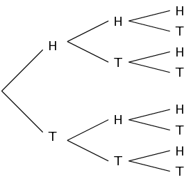

## 10.4 The fundamental counting principle (EMCJZ)

Mathematics began with counting. Initially, fingers, beans and buttons were used to help with counting, but these
      are only practical for small numbers. What happens when a large number of items must be counted?

This section focuses on how to use mathematical techniques to count different assortments of items.

### Introduction (EMCK2)

An important aspect of probability theory is the ability to determine the total number of possible outcomes
        when multiple events are considered.

For example, what is the total number of possible outcomes when a die is rolled and then a coin is tossed? The
        roll of a die has six possible outcomes (\(1;2;3;4;5\) or \(\text{6}\)) and the toss of a coin, \(\text{2}\)
        outcomes (heads or tails). The sample space (total possible outcomes) can be represented as follows:

      \[S = \left\{\begin{array}{cccccc}
      (1;H); & (2;H); & (3;H); & (4;H); & (5;H); & (6;H); \\
      (1;T); & (2;T); & (3;T); & (4;T); & (5;T); & (6;T)
      \end{array}\right\}\]

Therefore there are \(\text{12}\) possible outcomes.

The use of lists, tables and tree diagrams is only feasible for events with a few outcomes. When the number of
        outcomes grows, it is not practical to list the different possibilities and the fundamental counting principle
        is used instead.

The fundamental counting principle

The fundamental counting principle states that if there are \(n(A)\) outcomes in event \(A\) and \(n(B)\)
            outcomes in event \(B\), then there are \(n(A) \times n(B)\) outcomes in event \(A\) and event \(B\)
            combined.

If we apply this principle to our previous example, we can easily calculate the number of possible outcomes by
        multiplying the number of possible die rolls with the number of outcomes of tossing a coin: \(6 \times 2 = 12\)
        outcomes. This allows us to formulate the following:

If there \(n_{1}\) possible outcomes for event \(A\) and \(n_{2}\) outcomes for event \(B\), then the total
          possible number of outcomes for both events is \(n_1 \times n_2\)

This can be generalised to \(k\) events, where \(k\) is the number of events. The total number of outcomes for
        \(k\) events is:

\[{n}_{1}\times {n}_{2}\times {n}_{3}\times \cdots \times {n}_{k}\]

<Callout type="note" title="Note">
The order in which the experiments are done does not affect the total number of possible outcomes.
</Callout>

<Callout type="tip" title="Worked example 10: Choices without repetition">
**Question:**
A take-away has a 4-piece lunch special which consists of a sandwich, soup, dessert and drink for R
            \(\text{25,00}\). They offer the following choices for:

Sandwich: chicken mayonnaise, cheese and tomato, tuna mayonnaise, ham and lettuce

Soup: tomato, chicken noodle, vegetable

Dessert: ice-cream, piece of cake

Drink: tea, coffee, Coke, Fanta, Sprite

How many possible meals are there?

**Determine how many parts to the meal there are:**
There are 4 parts: sandwich, soup, dessert and drink.

**Identify how many choices there are for each part:**
| Meal component | Sandwich | Soup | Dessert | Drink |
| --- | --- | --- | --- | --- |
| Number of choices | \(\text{4}\) | \(\text{3}\) | \(\text{2}\) | \(\text{5}\) |

**Use the fundamental counting principle to determine how many different meals are possible:**
\(4\times 3\times 2\times 5=120\)

So there are \(\text{120}\) possible meals.
</Callout>

<QuizCard id="m12-10-04a" title="Interactive Exercise 10.12" question="\(\text{7}\) swimmers compete in a \(\text{100}\ \text{m}\) backstroke race. In how many different ways can all \(\text{7}\) positions in the event be arranged, assuming that it's impossible to have a tie?" options=[] answer="5040" hint="You should enter a number here. If you want to, you can use a space to separate thousands.                Example: 12 800,25 For scientific notation you need to use the multiply symbol                ( ∗ ) and the exponent symbol ( ^ ). For example 6,673 × 10 −11 should be written as: 6,673 ∗ 10^−11" explanation="Any of the \(\text{7}\) swimmers can come first in the event. Now there are only \(\text{6}\) swimmers left to be second because a swimmer cannot be both second and first in an event. After second place, there are only \(\text{5}\) swimmers left for the third place, and then \(\text{4}\) swimmers for the fourth place and so on. Therefore, using the fundamental counting principle, the number of ways the positions in the event can be arranged is: \[\begin{array}{c}7\times6\times5\times4\times3\times2\times1 = \text{7}! = \text{5 040}\end{array}\] Therefore, the total number of possible ways the positions in the event can be arranged is \(\text{5 040}\) . Submit your answer as:" />

In the previous example, there were a different number of options for each choice. But what happens when the
        number of choices is unchanged each time you choose?

For example, if a coin is flipped three times, what is the total number of different results? Each time a coin
        is flipped, there are two possible outcomes, namely heads or tails. The coin is flipped \(\text{3}\) times. We
        can use a tree diagram to determine the total number of possible outcomes:

From the tree diagram, we can see that there is a total of 8 different possible outcomes.

Drawing a tree diagram is possible to draw for three different coin flips, but as soon as the number of events
        increases, the total number of possible outcomes increases to the point where drawing a tree diagram is
        impractical.

For example, think about what a tree diagram would look like if we were to flip a coin six times. In this case,
        using the fundamental counting principle is a far easier option. We know that each time a coin is flipped that
        there are two possible outcomes. So if we flip a coin six times, the total number of possible outcomes is
        equivalent to multiplying 2 by itself six times:

      \[2 \times 2 \times 2 \times 2 \times 2 \times 2 = 2^{6} = 64\]

Another example is if you have the letters A, B, C, and D and you wish to discover the number of ways of
        arranging them in three-letter patterns if repetition is allowed, such as ABA, DCA, BBB etc. You will find that
        there are \(\text{64}\) ways. This is because for the first letter of the pattern, you can choose any of the
        four available letters, for the second letter of the pattern, you can choose any of the four letters, and for
        the final letter of the pattern you can choose any of the four letters. Multiplying the number of available
        choices for each letter in the pattern gives the total available arrangements of letters:

      \[4 \times 4 \times 4 = 4^{3} = 64\]

This allows us to formulate the following:

When you have \(n\) objects to choose from and you choose from them \(r\) times, then the total number of
          possibilities is \[n \times n \times n \ldots \times n \enspace (r \text{ times}) = n^{r}\]

<Callout type="tip" title="Worked example 11: Choices with repetition">
**Question:**
A school plays a series of \(\text{6}\) soccer matches. For each match there are \(\text{3}\)
            possibilities: a win, a draw or a loss. How many possible results are there for the series?

**Determine how many outcomes you have to choose from for each event:**
There are \(\text{3}\) outcomes for each match: win, draw or lose.

**Determine the number of events:**
There are \(\text{6}\) matches, therefore the number of events is \(\text{6}\).

**Determine the total number of possible outcomes:**
There are \(\text{3}\) possible outcomes for each of the \(\text{6}\) events. Therefore, the total number
            of possible outcomes for the series of matches is

          \[3 \times 3 \times 3 \times 3 \times 3 \times 3 = 3^6 = 729\]
</Callout>

<QuizCard id="m12-10-04b" title="Interactive Exercise 10.13" question="A group of friends plays \(\text{10}\) football games. For each game there are \(\text{3}\) possibilities: a win, a draw or a loss. What is the total number of possible results for the \(\text{10}\) games?" options=[] answer="59049" hint="You should enter a number here. If you want to, you can use a space to separate thousands.                Example: 12 800,25 For scientific notation you need to use the multiply symbol                ( ∗ ) and the exponent symbol ( ^ ). For example 6,673 × 10 −11 should be written as: 6,673 ∗ 10^−11" explanation="Determine how many outcomes you have to choose from for each event The first thing we need to do to determine the total number of possible results is to determine how many possibilities there are for each event. There are \(\text{3}\) possibilities for each game: win, draw or lose. Determine the number of events Our next step is to determine the number of events. As there are \(\text{10}\) games played, there are \(\text{10}\) events. Determine the total number of possible outcomes Now that we have determined that there are \(\text{3}\) possible results for each of the \(\text{10}\) events, we can use the fundamental counting principle to determine the total possible number of results for the series. Total number of possible results \(= (n)^r\) where \(n\) is the number of outcomes for each event and \(r\) is the total number of events. \[                     \begin{aligned}                         &\text{Total number of possible results } \\                         &= (n)^r \\                         &= (3)^{10} \\                         &= \text{59 049}                     \end{aligned}                 \] Therefore, the total number of possible results for the \(\text{10}\) games is \(\text{59 049}\) . Submit your answer as:" />

## Number of possible outcomes if repetition is allowed

### Textbook Exercise 10.4

**Problem:**
Tarryn has five different skirts, four different tops and three pairs of shoes. Assuming that all the
                colours complement each other, how many different outfits can she put together?

**Solution:**
\[5 \times 4 \times 3 = \text{60} \text{ different outfits}\]

**Problem:**
In a multiple-choice question paper of \(\text{20}\) questions the answers can be A, B,
              C or D. How many different ways are there of answering the question paper?

**Solution:**
\[4^{20} = \text{1,0995} \times \text{10}^{\text{12}} \text{ different ways of answering the exam paper}\]

**Problem:**
A debit card requires a five digit personal identification number (PIN) consisting of
              digits from 0 to 9. The digits may be repeated. How many possible PINs are there?

**Solution:**
\[10^{5} = \text{100 000} \text{ possible PINs}\]

**Problem:**
The province of Gauteng ran out of unique number plates in 2010. Prior to 2010, the
              number plates were formulated using the style LLLDDDGP, where L is any letter of the alphabet excluding
              vowels and Q, and D is a digit between 0 and 9. The new style the Gauteng government introduced is
              LLDDLLGP. How many more possible number plates are there using the new style when compared to the old
              style?

**Solution:**
\begin{align*}
              \text{Old style: } 20^{3} \times 10^{3} &= \text{8 000 000} \text{ possible arrangements} \\
              \text{New style: } 20^{4} \times 10^{2} &= \text{16 000 000} \text{ possible arrangements}
              \\
              \text{16 000 000} - \text{8 000 000} &= \text{8 000 000}
              \end{align*}

Therefore there are \(\text{8 000 000}\) more possible number plates using the new style.

**Problem:**
A gift basket is made up from one CD, one book, one box of sweets, one packet of nuts
              and one bottle of fruit juice. The person who makes up the gift basket can choose from five different CDs,
              eight different books, three different boxes of sweets, four kinds of nuts and six flavours of fruit
              juice. How many different gift baskets can be produced?

**Solution:**
\[5 \times 8 \times 3 \times 4 \times 6 = \text{2 880} \text{ possible gift baskets}\]

The code for a safe is of the form XXXXYYY where X is any number from 0 to 9 and Y represents the
                letters of the alphabet. How many codes are possible for each of the following cases:

**Problem:**
the digits and letters of the alphabet can be repeated.

**Solution:**
\[10^{4} \times 26^{3} = \text{175 760 000} \text{ possible codes}\]

**Problem:**
the digits and letters of the alphabet can be repeated, but the code may not contain
                a zero or any of the vowels in the alphabet.

**Solution:**
We exclude the digit \(\text{0}\) and the vowels (A; E; I; O; U), leaving \(\text{9}\) other digits
                  and \(\text{21}\) letters to choose from.

                \[9^{4} \times 21^{3} = \text{60 761 421} \text{ possible codes}\]

**Problem:**
the digits and letters of the alphabet can be repeated, but the digits may only be
                prime numbers and the letters X, Y and Z are excluded from the code.

**Solution:**
The prime digits are \(\text{2}\), \(\text{3}\), \(\text{5}\) and \(\text{7}\). This gives us 4
                  possible digits. If we exclude the letters X, Y and Z, we are left with \(\text{23}\) letters to
                  choose from.

                \[4^{4} \times 23^{3} = \text{3 114 752} \text{ possible codes}\]

**Problem:**
A restaurant offers four choices of starter, eight choices for the main meal and six
              choices for dessert. A customer can choose to eat just one course, two different courses or all three
              courses. Assuming that all courses are available, how many different meal options does the restaurant
              offer?

**Solution:**
- A person who eats only a starter has 4 choices
- A person who eats only a main meal has 8 choices
- A person who eats only a dessert has 6 choices
- A person who eats a starter and a main course has \(4 \times 8 = 32\) choices
- A person who eats a starter and a dessert has \(4 \times 6 = 24\) choices
- A person who eats a main meal and a dessert has \(8 \times 6 = 48\) choices
- A person who eats all three courses has \(4 \times 8 \times 6 = 192\) choices.

              \[\text{Therefore, there are } 4 + 8 + 6 + 32 +24 + 48 + 192 = \text{314} \text{ different meal options}\]
