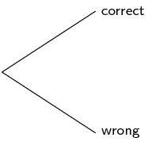
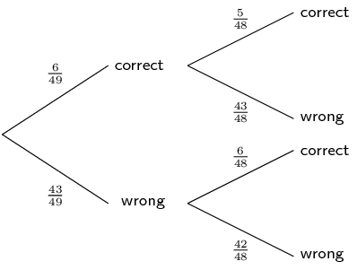
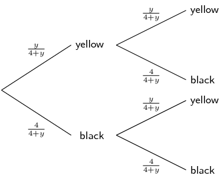

## End of chapter exercises

### Textbook Exercise 10.9

An ATM card has a four-digit PIN. The four digits can be repeated and each of them can be chosen from the
            digits 0 to 9.

**Problem:**
What is the total number of possible PINs?

**Solution:**
\[10^{4} = \text{10 000}\]

**Problem:**
What is the probability of guessing the first digit correctly?

**Solution:**
\(\dfrac{1}{10}\)

**Problem:**
What is the probability of guessing the second digit correctly?

**Solution:**
\(\dfrac{1}{10}\)

**Problem:**
If your ATM card is stolen, what is the probability, correct to four decimal places, of a
            thief guessing all four digits correctly on his first guess?

**Solution:**
\(\left(\dfrac{1}{10}\right)^{4} = \text{0,0001}\)

**Problem:**
After three incorrect PIN attempts, an ATM card is blocked from being used. If your ATM
            card is stolen, what is the probability, correct to four decimal places, of a thief blocking the card?
            Assume the thief enters a different PIN each time.

**Solution:**
\begin{align*}
            P(\text{incorrect PIN}) &= 1 - P(\text{correct PIN})\\
            & = 1 - \frac{1}{10^{4}} = \text{0,9999} \\
            \text{Therefore } P(3\text{ incorrect PIN attempts})& = (\text{0,9999})^{3} \\
            & = \text{0,9997}
            \end{align*}

The LOTTO rules state the following:

- Six numbers are drawn from the numbers 1 to 49 - this is called a 'draw'.
- Numbers are not replaced once drawn, so you cannot have the same number more than once.
- The order of the drawn numbers does not matter.

You decide to buy one LOTTO ticket consisting of \(\text{6}\) numbers.

**Problem:**
How many different possible LOTTO draws are there? Write your answer in scientific
            notation, rounding to two digits after the decimal point.

**Solution:**
\[49 \times 48 \times 47 \times 46 \times 45 \times 44 = \text{1,01} \times \text{10}^{\text{10}}\]

**Problem:**
Complete the tree diagram below after the first two LOTTO numbers have been drawn showing
            the possible outcomes and probabilities of the numbers on your ticket.

**Solution:**

**Problem:**
What is the probability of getting the first number drawn correctly?

**Solution:**
\[P(\text{first number correct}) = \dfrac{6}{49}\]

**Problem:**
What is the probability of getting the second number drawn correctly if you get the first
            number correct?

**Solution:**
\[P(\text{second number correct if first correct}) = \dfrac{5}{48}\]

**Problem:**
What is the probability of getting the second number drawn correct if you do not get the
            first number correctly?

**Solution:**
\[P(\text{second number correct if first incorrect}) = \dfrac{6}{48}\]

**Problem:**
What is the probability of getting the second number drawn correct?

**Solution:**
This is the sum of the probabilities of the outcomes where the second number drawn is correct:

            \begin{align*}
            P(\text{second number correct}) & = \dfrac{6}{49} \times \dfrac{5}{48} + \dfrac{43}{49} \times
            \dfrac{6}{48}\\
            &= \dfrac{5}{392} + \dfrac{43}{392} \\
            & = \dfrac{6}{49}
            \end{align*}

Notice that the answer is the same as the probability of getting the first number correct. If you are
              unaware of the outcome of prior events, the probability of the outcome of a certain event, is equal to the
              probability of that outcome of the first event. Learners are not required to learn this concept but it is
              interesting to note.

**Problem:**
What is the probability of getting all \(\text{6}\) LOTTO numbers correct? Write your
            answer in scientific notation, rounding to two digits after the decimal point.

**Solution:**
\[P(\text{all \text{6} correct}) = \dfrac{6}{49} \times \dfrac{5}{48} \times \dfrac{4}{47} \times
            \dfrac{3}{46} \times \dfrac{2}{45} \times \dfrac{1}{44} = \text{7,15} \times \text{10}^{-\text{8}}\]

**Problem:**
The population statistics of South Africa show that \(\text{55}\%\) of all babies born are female.
            Calculate the probability that a couple planning to have children will have a boy followed by a girl and
            then a boy. Assume that each birth is an independent event. Write your answer as a percentage, correct to
            two decimal places.

**Solution:**
\[\text{0,45} \times \text{0,55} \times \text{0,45} = \text{11,14}\%\]

**Problem:**
Fezile and Vuzi write a Mathematics test. The probability that Fezile will pass the test is \(\text{0,8}\).
            The probability that Vuzi will pass the test is \(\text{0,75}\). What is the probability that only one of
            them will pass the test?

**Solution:**
\begin{align*}
          P(\text{only one passes}) &= P(\text{F pass}) \times P(\text{V fail}) + P(\text{F fail}) \times P(\text{V
          pass}) \\
          &= \text{0,8} \times \text{0,25} + \text{0,2} \times \text{0,75} \\
          &= \text{0,35}
          \end{align*}

Landline telephone numbers are 10 digits long. Numbers begin with a zero followed by \(\text{9}\) digits
            chosen from the digits 0 to 9. Repetitions are allowed.

**Problem:**
How many different phone numbers are possible?

**Solution:**
\[10^{9} = \text{1 000 000 000}\]

**Problem:**
The first three digits of a number form an area code. The area code for Cape Town is
            \(\text{021}\). How many different phone numbers are available in the Cape Town area?

**Solution:**
\[10^{7} = \text{10 000 000}\]

**Problem:**
What is the probability of the second digit being an even number?

**Solution:**
There are \(\text{5}\) even numbers between 0 and 9, therefore:
            \[P(\text{second digit even}) = \dfrac{5}{10} = \dfrac{1}{2}\]

**Problem:**
Ignoring the first digit, what is the probability of a phone number consisting of only
            odd digits? Write your answer correct to three decimal places.

**Solution:**
\[\left(\dfrac{5}{10}\right)^{9} = \text{0,002}\]

Take the word 'POSSIBILITY'.

**Problem:**
In how many way can the letters be arranged if repeated letters are considered identical?

**Solution:**
There are two S's and three I's, therefore there are:

            \[\dfrac{11!}{2! \times 3!} = \text{3 326 400} \text{ different arrangements}\]

**Problem:**
What is the probability that a randomly generated arrangement of the letters will begin
            with three I's? Write your answer as a fraction.

**Solution:**
If the arrangement begins with three I's, that leaves POSSBLTY to be arranged.

            \begin{align*}
            n(\text{arrangements beginning with III})&= \dfrac{8!}{2!} = \text{20 160} \\
            \text{Therefore } P(\text{arrangements beginning with III})&=
            \dfrac{\text{20 160}}{\text{3 326 400}} \\
            & = \dfrac{1}{165}
            \end{align*}

**Problem:**
The code to a safe consists of \(\text{10}\) digits chosen from the digits \(\text{0}\) to
          \(\text{9}\). None of the digits are repeated. Determine the probability of a code where the first digit is
          odd and none of the first three digits may be a zero. Write your answer as a percentage, correct to two
          decimal places.

**Solution:**
- There are \(\text{5}\) odd numbers from \(\text{0}\) to \(\text{9}\), so there are five arrangements for
                the first digit.
- For the second digit there are \(\text{8}\) digits left to arrange, as the first digit and zero are
                removed.
- For the third digit there are \(\text{7}\) digits left to arrange as zero and the first two digits are
                removed.
- For the fourth digit, there are \(\text{7}\) digits (\(\text{0}\) is now included) left which can be
                combined in \(\text{7}\)! ways for the remaining digits.

          \begin{align*}
          \text{Total possible number of codes}&= 10! = \text{3 628 800} \\
          \text{Total no. of codes with first digit odd, first three non-zero}&= 5 \times 8 \times 7 \times 7! \\
          & = \text{1 411 200} \\
          \text{Therefore } P(\text{first digit odd, first three non-zero})& =
          \dfrac{\text{1 411 200}}{\text{3 628 800}} \\
          &= \text{38,89}\%
          \end{align*}

**Problem:**
Four different red books and three different blue books are to be arranged on a shelf. What
          is the probability that all the red books and all the blue books stand together on the shelf?

**Solution:**
Total number of arrangements \(= 7!\)

If the red and blue books stand together, there are two groups of books which can be arranged \(2!\) ways.

Then there are four red books which can be arranged in \(4!\) ways and the three blue books can be arranged
            in \(3!\) ways.

          \[P(\text{blue and red together}) = \dfrac{2! \times 3! \times 4!}{7!} = \dfrac{2}{35}\]

The probability that Thandiswa will go dancing on a Saturday night (event \(D\)) is \(\text{0,6}\) and the
            probability that she will go watch a movie is \(\text{0,3}\) (event \(M\)).
            Determine the probability that she will:

**Problem:**
go dancing and watch a movie if \(D\) and \(M\) are independent.

**Solution:**
\begin{align*}
            P(D \text{ and } M)&= P(D) \times P(M) \\
            &= \text{0,6} \times \text{0,3} = \text{0,18}
            \end{align*}

**Problem:**
go dancing or watch a movie if \(D\) and \(M\) are mutually exclusive.

**Solution:**
\begin{align*}
            P(D \text{ or } M)&= P(D) + P(M) \\
            &= \text{0,6} + \text{0,3} = \text{0,9}
            \end{align*}

**Problem:**
go dancing and watch a movie if \(P(D \text{ or } M) = \text{0,7}\).

**Solution:**
\begin{align*}
            P(D \text{ and } M)&= P(D) + P(M) - P(D \text{ or } M) \\
            &= \text{0,6} + \text{0,3} - \text{0,7}= \text{0,2}
            \end{align*}

**Problem:**
not go dancing or go to a movie if \(P(D \text{ and } M) = \text{0,8}\).

**Solution:**
\begin{align*}
            P(\text{not } (D \text{ and } M))&= \text{1} - P(D \text{ and } M) \\
            &= \text{1} - \text{0,8} = \text{0,2}
            \end{align*}

Three boys and four girls sit in a row.

**Problem:**
In how many ways can they sit in the row?

**Solution:**
\[7! = \text{5 040}\]

**Problem:**
What is the probability that they sit in alternating gender positions?

**Solution:**
There is only one way they can sit alternately: GBGBGBG

            The number of ways they can sit alternately \(= 1! \times 3! \times 4!\)
            \[P(\text{sit in alternating positions}) = \dfrac{1! \times 3! \times 4!}{7!} = \dfrac{1}{35}\]

**Problem:**
The number plate on a car consists of any 3 letters of the alphabet (excluding the vowels,
          J and Q), followed by any 3 digits from 0 to 9. For a car chosen at random, what is the probability that the
          number plate starts with a Y and ends with an odd digit? Write your answer as a fraction.

**Solution:**
- The number plate starts with a Y, so there is only 1 choice for the first letter.
- The number plate ends with an odd digit, so there are 5 choices (1, 3, 5, 7, 9)
- There are 19 letters available because the 5 vowels (A, E, I, O, U), J and Q are excluded.

          \begin{align*}
          n(\text{plates starting with Y, ending with odd digit}) &= 1 \times 19^{2} \times 10^{2} \times 5 \\
          &= \text{180 500} \\
          n(\text{total possible number plates } &= 19^{3} \times 10^{3}\\
          &= \text{6 859 000} \\
          \therefore P(\text{plate starting with Y, ending with odd digit}) & =
          \dfrac{\text{180 500}}{\text{6 859 000}} \\
          & = \dfrac{1}{38}
          \end{align*}

**Problem:**
There are four black balls and \(y\) yellow balls in a bag. Thandi takes out a ball, notes
          its colour and then puts it back in the bag. She then takes out another ball and also notes its colour. If the
          probability that both balls have the same colour is \(\dfrac{5}{8}\), determine the value of \(y\).

**Solution:**
Using a tree diagram, the different outcomes and probabilities can be illustrated as follows:

Solving for \(y\):

          \begin{align*}
          \dfrac{5}{8} &= \dfrac{y}{4 + y} \times \dfrac{y}{4 + y} + \dfrac{4}{4 + y} \times \dfrac{4}{4 + y} \\
          \dfrac{5}{8} &= \left(\dfrac{y}{4 + y}\right)^{2} + \left(\dfrac{4}{4 + y}\right)^{2} \\
          \dfrac{5}{8} &= \dfrac{y^{2} + 4^{2}}{(4 + y)^{2}} \\
          5(4 + y)^{2} &= 8(y^{2} + 16)) \\
          5(16 + 8y + y^{2}) &= 8y^{2} + 128 \\
          80 + 40y + 5y^{2} &= 8y^{2} + 128 \\
          \text{Therefore } 3y^{2} - 40y + 48 &= 0 \\
          (3y-4)(y-12) &= 0 \\
          \text{Therefore } y &= 12 (y \ne \dfrac{4}{3} \text{ as balls cannot be fractions})
          \end{align*}

A rare kidney disease affects only \(\text{1}\) in \(\text{1 000}\) people and the test for this
            disease has a \(\text{99}\%\) accuracy rate.

**Problem:**
Draw a two-way contingency table showing the results if \(\text{100 000}\) of the
            general population are tested.

**Solution:**
If \(\text{100 000}\) people are tested and the prevalence rate is \(\text{0,1}\%\):

            \begin{align*}
            \text{100 000} \times \text{0,001} &= \text{100} \text{ people are expected to be sick} \\
            \text{Therefore } \text{100 000} - \text{100} &= \text{99 900} \text{ people are expected to
            be healthy}
            \end{align*}

|  | Sick | Healthy | Total |
| --- | --- | --- | --- |
| Positive |  |  |  |
| Negative |  |  |  |
| Total | \(\text{100}\) | \(\text{99 900}\) | \(\text{100 000}\) |

If the test is \(\text{99}\%\) accurate:

            \begin{align*}
            \text{100} \times \text{0,99} &= \text{99} \text{ sick people are expected to test positive} \\
            \therefore \text{100} - \text{99} &= \text{1} \text{ sick person is expected to test negative} \\
            \text{And }\text{99 900} \times \text{0,99} &= \text{98 901} \text{ healthy people are
            expected to test negative} \\
            \therefore \text{99 900} - \text{98 901} &= \text{999} \text{ healthy people are expected to
            test positive}
            \end{align*}

|  | Sick | Healthy | Total |
| --- | --- | --- | --- |
| Positive | \(\text{99}\) | \(\text{999}\) | \(\text{1 098}\) |
| Negative | \(\text{1}\) | \(\text{98 901}\) | \(\text{98 902}\) |
| Total | \(\text{100}\) | \(\text{99 900}\) | \(\text{100 000}\) |

**Problem:**
Calculate the probability that a person who tests positive for this rare kidney disease
            is sick with the disease, correct to two decimal places.

**Solution:**
\begin{align*}
            P(\text{sick if tested positive}) &= \dfrac{n(\text{sick and tested positive})}{n(\text{tested
            positive})} \\
            &= \frac{99}{1098} \\
            &= \text{0,09}
            \end{align*}

Notice that this means that a positive result is wrong \(\text{91}\%\) of the time! This is an important
              concept in medical science. For very rare diseases, tests have to be highly accurate otherwise the result
              is meaningless.
